# 【全集】加州理工学院 C语言系统编程 中英字幕 p10 Lecture 10 - 整数运算符 -BV1bUzWBLEiC_p10-

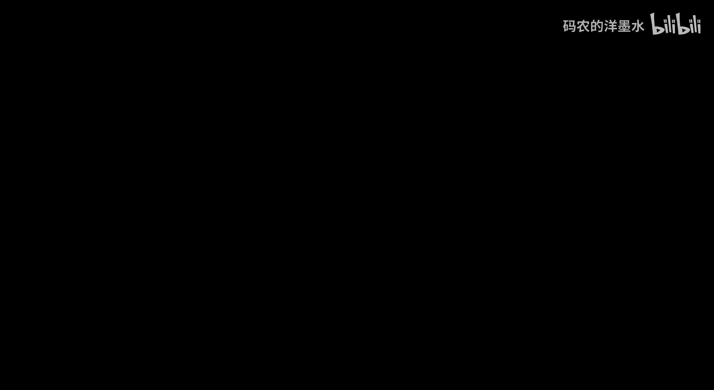

Excellent okay as I was saying before， I think we're gonna have a lot more time to check out with students starting next week。

 my goal is to go ahead and I have a big deadline at the end of this month which is upon us so I want to be able to dedicate a lot more time and to like checking in with all of you and making sure that everyone has completed the the to- do list and to get you your document for what's going be the midterm I kind of give you a prelude to understand what's going to be but actually have to draft that document and I've been shared it and so I'll pack it into the repo once I've altereded it and then I'll make an announcement on discord as well so you can go ahead and look out for that and so if you want to stay in the same group that you might have already been in based off of doing your to do list you can go ahead and do that if you want to like find a different group or if you weren in a group before and now you want to find one use the discord to try to find group members right so。

Just make an announcement on the inside the general chat area and the channel and you should be able to do that。

Okay with that said， I kind of want to finish off at least the concept of numerical representations of integral values over the course of this class and I think the last thing we have besides so we already talked a lot about encoding integral values with a number of considerations not just the number of bits that you're going to use to encode your value which is going to impact your range。

 but also what set of integers that you're going to use。

 whether you're going to use just the non-neg ones or if you're going to use negative and positive ones。

 which is also going to impact the range from zero to some positive value to having it shift towards a set of negative values and a set of positive values and of course that requires two different encoding schemes so depending on whether it's unsigned you're signed is going to matter what the interpretation of that is and we saw that you don't necessarily want to just cast from one type to the other because if it's a negative numbers it's going to turn its just really big。

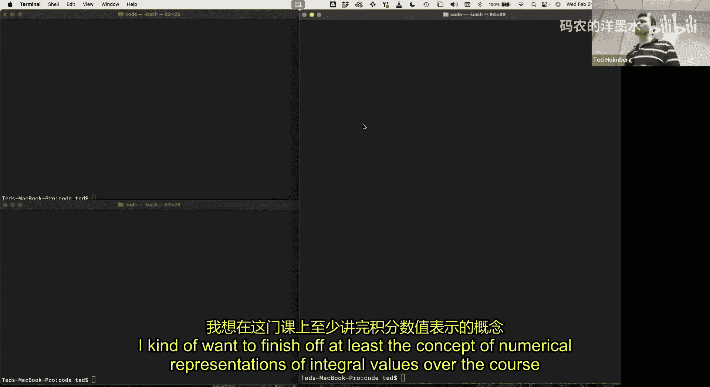

今なか。Betweensi or if it's a really big number， it could turn it into a negative number。😡，So again。

 just a small pitfall you should be aware of when working with C because really what it cares about is what the binary sequences are and the contacts for any given type so once you stick to it once you declare a type typically you want to try to stick to it。

It's the safest approach。Okay， so we've talked about how we represent numbers and at the end of the day。

 we find a creative way to take whatever it is we want to represent and express that in the form of numerical data right whether it's image data。

 whether it's text data or it's musical or audio data。

So the next thing we need to do now that we have our numbers represented。

 how can we go ahead I guess let me switch over to there and actually start to in our arithmetic processes so like when you start running Java you learn the Python or C right we have all the simple arithmetic operators mapped to a set of symbols like the plus symbol the minus symbol the division symbol the asterisk symbol。

 the multiicative of symbol right so。How。Can we manipulate the bits in our binary sequences that's consistent with the arithmetic that we perform and so think about the arithmetic operations we care about。

 we care about addition， we care about subtraction。

 we care about multiplication and we care about division。😡。

And what are some of the implications about some of these operators and that's what we're going to kind of take a look at today I don't think this will take the entire time and then next part after we talk about integer arithmetic we'll start talking about fractional numbers and fractional representation。

😡，So that's where we have approximate values that can have decimal points or very large numbers as well。

And my goal is to talk about that next week。So。Let's see here。

Let's go into our so let's start with unsigned edition so with unsigned addition。

 one thing we need to be weary about is。How it can affect the。

The the max limit size of our binary sequence So when we're mapping a set of values that's kind of arbitrary we're like oh yeah we'll use8 bits and this is the number of different values I can map to 8 bits once we start talking about doing operations that when we're doing an unsigned operations right we can ever have a negative value we can only ever go down to zero but it's possible that we can take a legal let's say8 bit value added it to another8 bit value and actually result in a value that has to be larger than 8 bits right does that make sense。

Intuitively right， okay， here's the challenge for the class。What。😮。

If if I express my binary sequences in the form of two to the power of w where w is the width of my binary string right and so if I have a two to the W string and a two to the W string and I add those together what is the。

😡，Biggest。New voluntary strain that can be produced from that。😡。

Let's talk about so we're talking about bounds， what's the maximum bound that if I wanted to encode that overflow。

 if I wanted to capture the actual addition of two， let's say eight bit values。

 how many bits would it take to guarantee I get that result？😡。

I'll give you a moment to think about that。是。一だ。对。Yeah。And you add this together。

Does everyone kind of see the concept so so as a proof of concept try to do this by hand let's do four bits instead of eight bits to keep the math smaller。

 what's the biggest value you can have for using four bits。😡。

Let's just talk about the binary representation， what's a binary representation that represents the maximal value that can have？

😡，One， one， one， one， right？All the ones are togg goes on they all contribute towards the sum okay so that's a legal value for a four bit number right so what if we add that with another max value what's the other max value you can have。

😡，Well， it doesn't have to be unique， right， so82 can be11，11。

So why don't you do that if you have pen and paper or if you comminly do this math？😡。

take the binary sum has everyone done binary edition before， okay， do the binary sum of1，1。

11 four ones plus 11，11 and tell me。😡，Tell me what size binary string that is。喂。32 and how many bits？

可以。Eight bits， wait 32， so it was 1111， right， and then 1111。Okay谢。111000， okay， so let's see here。

And let me see here。Let me see if I can't do this here as well。对。New window。Or。The class。

 let me see if I can do。完完完完了。Ws。So。Itch is going to be。And I'm trying to remember， how do I？

Can I do this， I'm trying to remember does anyone remember the python？Remember how to？

Translate that easily， but let's see here。So let me think this is 16， this is my 16th place。

 this is going to be my each place。Well。So。Let's see give me the sequence really quick。Okay。

 so here we have let's see， our ones place， our twos place， our fourth place， our eight。

Is right here and our 6 team is right there。So。ItIt ends up being 30 right so we have 15 plus 15 right and so the next bit over then so if we have the ability to code up and code up to 16 so let's let's do this so we got one1 one one right。

And so if that's the equivalent of saying 15 plus 15。Then that means here is our 16th spot。Right。

 that means。That means that this here is our 32 spot right now we're not at 32 right so we're at the 16 spot。

 right？And。Let's save 14 after that， so8。没有。And then here， let's su it。前面都系个笑。我出来。

So we increased our bits then by one then right we start with four bits and now we have five bits。

Okay， just as a proof of concept， try with two five bit values at max and see what you get as a result from that。

And see if you can't find a pattern here。So this is a sequence here， so we stated that actually。

 let me see if I could do this。So 1111 plus 1111 is equal to。Yeah， perfect， Okay， good。

 so this is an expression where we can actually see it。 So if you see this。

 if our max size of bits is four。And so when we talk about addition。

 we're going to talk about addition requires that our bit strings are aligned right。

 so there's the possibility that they're misaligned， what do you do？😡，Is it possible first of all。

 if you have misaligned length of your binary strings。

 let's say a three bit string and a six bit string。

You couldn't actually add those together right because they're different lengths right you need the same number of elements to do a vector operation like that right so but but there's a way to do that how would you normally do that Yeah right yeah you zero yeah you can zero fill or if it's su complement you can one fill depending on like your encoding but you can expand your binary sequence by just taking whatever the smaller amount is and giving it more bits because the bigger binary sequence can encode the same value as the smaller one。

😡，But notice what you're doing， whether you realize it or not。

 you are effectively casting by sides mentally。😡，For you to be able to do that operation right now so what we're going to harden a constraint or making sure everyone understands this constraint one of the constraints about any arithmetic operation is that since we're working in vector spaces。

 it has the same number of elements as the left opera to the right opera。😡，Okay。

 once we agree upon that， now we can start creating hardened rules。

 we can understand what the maximal growth rate with addition might be。😡，And so this instance。

 no matter how many bits you add into your edition。

 it's only ever maximally going to produce a string that is。😡，One bit more。

And it doesn't matter so like we were playing around with four bit strings。

 but that's true for 32 bit strings or 128 bit strings or 1000 bit string right if you take the maximum amount of both those at them together。

 it can ever only ever produce a binary string that has one additional bit to carry the carrier。😡。

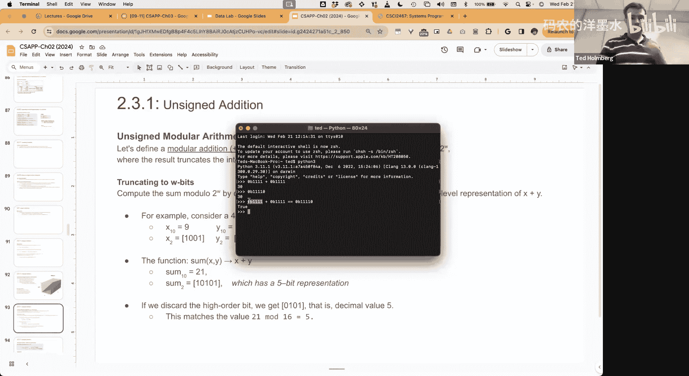

I think I even have a code example of this， let's take a look at it。Let's say here。

 let's take a's clear this。It's what do I have here？You know， Ella， okay， let's take a look at this。

Overflow oh。

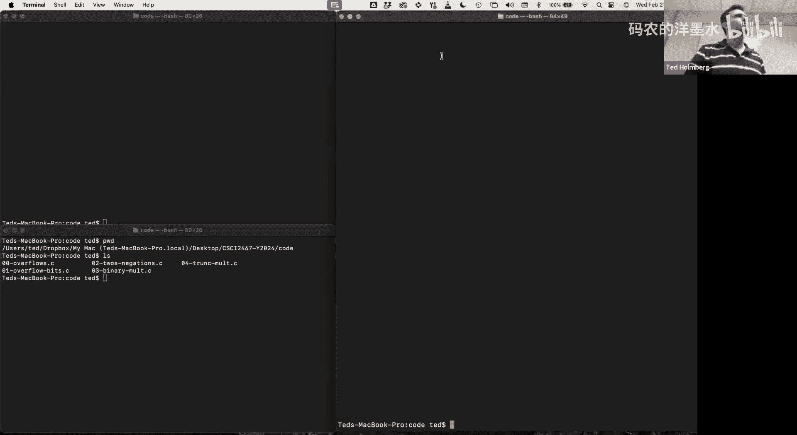

We talk about it folks。

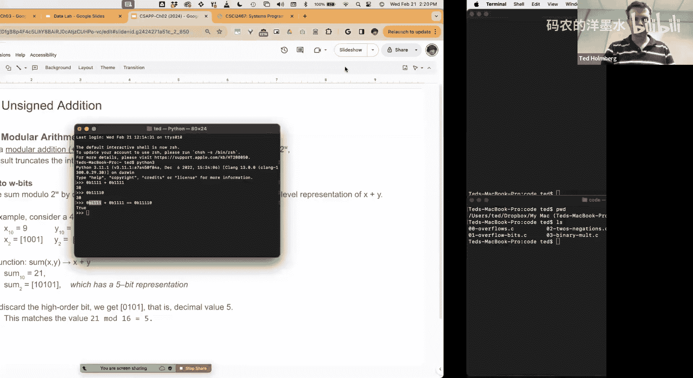

I guess we are talking about overflows， yes。Yeah， this is exactly what we're talking about。嗯，看。Okay。

 it's Gcc01 overflow the bits。Or a120，0。And let's call this overflow。

For our application and actually let's take a look at the code as well。哎呀。Okay。

 so quick idea of what we're going to look at really quick'm not going to spend too much time i'm going to include my limits header i'm going to include my standard input output header we're just going to have a main function inside this function what we're going to do is i'm going to use limits to access the max value。

😡，So that I don't have to memorize what it is。So here we're going to get our unsigned integer max value。

 and then we're going to see， okay， what happens when we add one to it？

And this should cause a wraparound right so with computers so we see when we're allowed to increase by additional bits right we would get the actual value but in a programming language like C we're not allowed to arbitrarily expand the bit sequence so we're constrained by it so for instance if we are in a character encoding it's limited to eight bits if for some reason I do addition that produces a nine bit sequence what's going to happen is it's going to discard the most significant bit。

😡，Probably trigger a carry flag in the systems the system knows that a carry occurred。

 but the actual sequence then that gets updated is going to be whatever is inside the eight bits that it does have。

 starting from the least significant bit going all the way up until it runs out of bits to encode。😡。

Okay， so what we're going to do is we're going to look at the maximal value and in this instance we're just going to add one。

Just one right over the max and for unsigned values and then we want to look at overflows for s values as well now overflows for sign values can go in two directions right I could either add on a value that's too high or I can subtract from a value that's too low。

😡，So I can have a negative wraparound or a positive wraparound and so this is a very simple code where all I'm doing is assigning to either really big or really really positive or really negative values and then I'm just going to give it a little push。

In one way or the other。Let's take a look at that。So here I'm actually going to print out the actual value of my maximum unsigned in and it should be of no surprise to you since I don't have negative values and unsigned values that it's going to be twice the size as the maximum size did。

😡，Right？Okay， so we're going to take a look at that then we're going to add one to that and so we just roll over back to zero。

😡，Because what would have happened is if we had an additional bit of information。

 that's the thing that then gets pushed over into that overflow space， but doesn't this。😡。

So essentiallyally， we're kind of doing the equivalent of a modulus operation inside our inside of our binary space。

 right we fill it up and then we carry everything except for the most significant。Okay。

 let's take a look at this as well。 So you can see in our signed。

Overflow is doing the same thing right only now instead of rolling over to zero。

 we're going to roll over in such a way that our very high positive number by adding one becomes a very big negative number。

Which the interesting thing about this now is if I did a relational operator between those two。

 right， like this value plus one is greater than just that value if it tell me false。😡。

That's not greater than right because it's going to translate as a negative value so notice how this can have like pitfall like hard to detect errors if you don't realize you've actually added two numbers that produces an overflow effect。

😡，Because you can look at it immensely you're like， yeah。

 that number based off of the value of A and B， when I add them together。

 it should be bigger than this number。But to the system。

 if you overflow the address of the encodecodable space for that value， the range。

 it just wraps around。So it's something to be aware of it's not going to happen often。

 but this isn' a pitfall that would be。😡，Difficult。To try to identify in a code base。

Same thing with this minimum value right I have this really small minimal value if I add one now all of a sudden it becomes my biggest。

 it becomes my max value。😡，I'm sure y'all pray you much looked at this already though in assembly。

 right？😡。

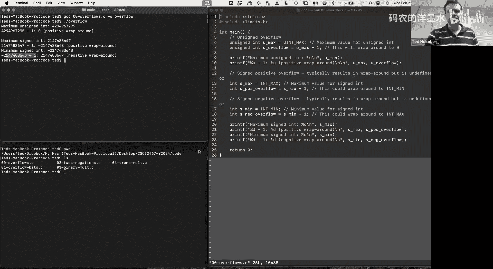

Yeah。Okay靠。Okay， so now the book。TheOne thing that I do appreciate about the book is that the book does have some really nice visualizations on it and so。

I don't know why the TVs are coming on so let's take and look at the visualization that it has for this idea of overflow just so you can see how our binary sequences are mapping inside of our domain。

So with the book， it's using four bit spaces。 So with four bits with four bit values right here。

 which is what this what this。Sub。😡，Indiceacy is this this sub value of four is representing a vector of four bits Okay。

 so with four bit representations， if I was to plot this across a。Three dimensional plots。

With the idea being this， my three dimensional plot on one dimension can be what is my current value of you。

 which is one of my four bit numbers on the other so this let's say this is my X access。😡。

And then let's say on this other access， let's say this is my Y access。😡。

My other four bit number can have another value。😡，Now I can sum those together。

And when I sum those together， it can produce a new value that has to exist in that same spatial domain。

Now， this particular instance， you see how this uses the word with inflation。

 this means that it's allowing me to increase my spatial domain to accommodate a summation that doesn't exist between you and V。

😡，So this is。The easiest of the kind of three dimensionional visualizations that give you in the book so that you can understand what you're looking at。

 so this is our sum function that takes your u at any potential value takes your V and so the three dimensional the height is based off of what the combination of those two aggregate to what they sum together with。

😡，And it doesn't limit the value， so it's okay， whatever binary sequences you need。

 it can then resolve to be up to 32。😡，Which makes sense， right？Well， almost 32， 32 is here is 30。

 right because it's 15 to 15。So it's going to be noticed we have these are in two unit increments。

 so 32s at the very highest and if we go to the very highest， which is 15 here and 15 here。

 this is our highest peak。😡，That's at 30， that line right there。Okay。

 so everyone understands what this visualization represents in right this is this is the behavior of some two four bit numbers。

 probably the most complicated visualization for one of the most easiest concepts to grasp。😡，Okay。

 let's show you though， how this has to be modified if we constrain some to have to encode into the same spatial space that U andV exist in。

 and so it's going to create a different propagation of our wave you can actually see the point at where overflow will then occur at。

😡，And so here we have the same image， but notice we have our 14 our 14 or 15 our 15 and now we' are going to limit the sum to be no greater than 15 as well。

 so when we get to where we get any combination of values for U and V that would sum up to 15 effectively the behavior becomes a moduluous operation just rolls over。

😡，So this is just a graphical illustration of where our normal behavior then lies for some when bounded based off of space on encoding。

 and then where our outlier where our overflow behavior would occur。

 where we start having to truncate those most significant bits。

 which means that when we reinterpret those as a four bit sequence。

 it's going to start all over again。😡，Because we've run out of unique values。

 so we start reusing the values we've already used and since they've already been defined。😡，We个版。

And of course， the obvious thing here for detecting an overflow。😡。

If you needed to do this was you can do checks right one check for detecting a one of these positive overflows。

 for instance， with unsigned addition is if your summation between x and y produces something that isn't greater than X itself。

Because with unsigned values you can't have a negative right that means those are two positive values。

 even if one of them is zero， you should at least have the same value x was if that any time you were left or something smaller then you know an overflow has occurred。

😡，So if you have to check for overflows the understanding how these rules work let you know how to detect foreign overflow inside of your code or how code does that like like how the system is able to evaluate for that I don't want to pretend like this is something you're ever going to actually have to do but what you should know is this is what the system needs to do to know what's happening with our numerical values when we start using them for processing so again。

😡，There's one thing to use computer systems to store information right that's great but we want to do more than storing information we want to produce operations on it。

 we want to be able to process it that means transforming our data from its initial state to some new desired state。

 but we have to ensure that as we transform it it's in a state that is legal and it's what we expect it to be。

😡，And so these are the rules that we abide by inside the system that ensures that something as well。

 I say is basic， I mean， arithmetic， you learn it from an early age。

 but it's a very sophisticated set of concepts that have developed over a period of several thousands of years right and has been the reason why society and civilization has been able to hit where we're at today。

😡，And of course， we already showed that with S arithmetic。

 we have to check for overflows for both ends， and that means that you can do a check at either end。

And so here we can just see when we can detect for positive overflow。

 we would do that the same way that we would do for unsigned values where we can check if the summation between two values becomes less than。

And then we can also do the inbu of that for a negative overflow when this attraction of two values produces something that's。

A greater magnitude than what we would expect。And so we can define those almost into cases。

RightWhere you have a negative overflow case， your normal negative outcome。

 your normal positive and your positive overflow。Okay， let's say here。

 let's take a look at another example， let's quit out of this。

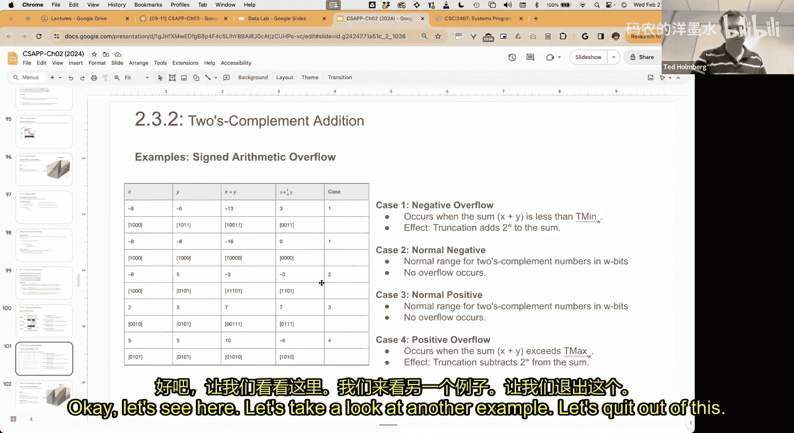

Let's see let's I think I have another one where we're actually going to look at the bits in overflow。

是啊。Here we have a function that we'll just call add binary。

 it's going to take a binary string in the form of a character pointer。

 it's going to take another binary string in the form of a character pointer。

 it's going to take another binary string， which is going to be our result and a size of our binary string。

So actually let's say before we read the logic inside of this function。

 let's jump into the main function just to see how it's used that way it motivates what the implementation is so jump in down to the main function we have two binary strings。

One， one， one one， one， one， one， one， so this is effectively the example I gave to you earlier I'm going to give you this size four bits。

I'm going to go ahead and produce a result， which now we know。Based off of bounds。

Because of the rules of addition will never be more than what the initial set of binary strings are plus one bit。

Now notice I'm doing plus two， the plus two is because I also need nu character because it's a strength。

Okay， then I'm going into to do an add binary here。

 so now that we know this is just adding two binary streams together。

 we're going to do a four loop that does this for us inside of our four loop we're going to iterate over starting at the most significant bit。

And until we finally hit the index of zero， we'll decrement。Because we're going to parse。

From left to right， because that's how we process strings。Okay， so then once we do that。

 we will go ahead and。Indexed in to go ahead and convert our characters to integer values we'll actually just go ahead and sum those together with whatever carry flag we had。

 we'll produce a sum， we'll go ahead do the modulus on and on binary to determine whether it's going to be a what the value is there we're going to go ahead impute that into our result。

And then determine if we have a carrier or not so essentially this is a modulus advisor it's it's like the same as integer division where we're deciding how we're going to decide when to add a unit。

And then carry unit because we have two ones。Okay。Not super interested in the logic of that though because we're trying to motivate a different concept So let's just run this。

 What is this this is 01。And this is output and let's call their bits。

And let's just take a look at what the outcome is here。 and so here you can see。

This is probably what we already stated before if I have 1111 plus 1111 I get my new five bit result from so what we've already done by。

😡，But now you can see a piece of software that does the same thing。What is the next out of here。

 then the next one is going to be my two's negation perfect。

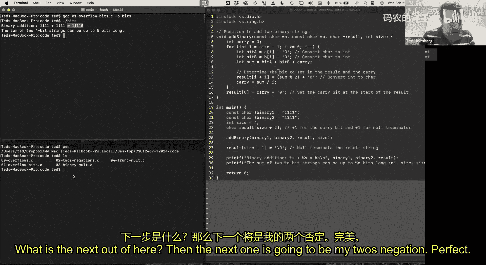

Okay， and so I just want to kind of contrast our three dimensional。Plos。

Of some for sign numbers versus unsigned numbers so with signed with sign numbers now remember you have a negative overflow you have a positive overflow again what you're probably thinking of is these numbers kind of linked almost like a doubly linked list together right where you can go in either direction that' a good conceptual model to have in terms of creating the 3D dimensional model you can see this right here the middle would represent my normal space of s between two additions and my overflows are represented here。

And here， so again， you can see this this visual mapping where you're like well。

 most of the time with a function， you wanted to map to a unique value。

 but since here we're rolling we've eclipsed the space， you can see a set of。😡。

U and V values produce the same outcome sometimes three times。😡，It's less than ideal。Yes。Okay。

 let's talk about two complement negation， so twos complement negation is。

When we want to be able to flip the sign bit of our binary string right so if we want to turn a minus3 into a positive three there's what there's two binary operations you can do Do you remember what those are so this is what the system will do the system does this for two complements so again it's important numerical representation if we're going to build from these very low level theoretical concepts how do you turn a negative three into a positive three like is it simply you flip the bits that's one of the first things you do right you take your bit sequence you of flip it。

😡，And so one of the beautiful things about having your leading one value as the sign bit means that if that gets flipped now it's a positive sign。

 now it's a negative sign， but that's not enough，'s the other thing you have to do for your whose complement negation。

Because there's not a one to one correspondence， right？There's like， for instance。

 on the instance of one bite， a sign bite， what's my。Most negative value。Minus 128， right？

What is my most positive value？😡，It's positive 127 there's an off by one there。

 off by one because we group zero as part of the non negative terms。

 because zero is part of the unsigned set of values。

 we always start counting at zero in computer science。😡。

To the point of when we do our split for encoding the zeros group for the positive side。

 which means it'll always be one value less than the number of negative value so if we want to have a clean discernible way to take a binary string and very quickly and easily flip it。

😡，Then we not only have to。Flip the bits， but then we have to add one to it as well。

And did you cover that in assembly as well the idea about how you can translate your values between positive and negative expressions perfect and I think I just have a very basic application we can look at just to motivate that that's my zero two my two's negation。

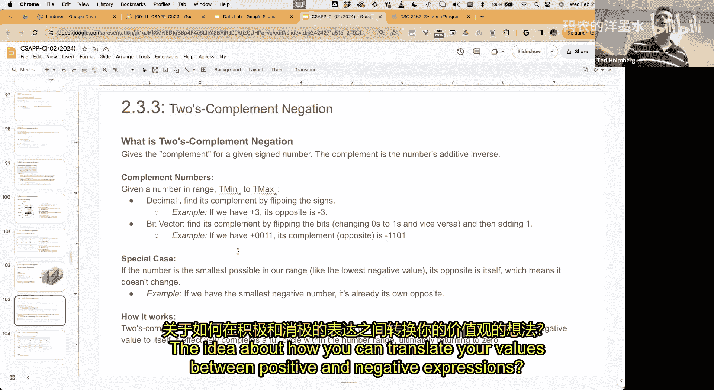

Here which I don't I don't want to spend too much time at this point I think the logic to get it to work in a piece of software is going to take too much time to walk through in its world so let me just run it i'll show you be free to read the logic you should now know the syntax well enough to be able to parse this。

But what I care more about is to actually just illustrate how this code will translate into us being able to flip a binary set of values so that we can parse it it either positive or negative so you understand what the system's doing when it's not displayed inside of a piece of software。

Let's call these。Choose。Toosene。There we go。Okay。And so here to give you an instance of this。

 we can have the original binary string and so in this the one reason why this this code is a little lengthy is I want to show you as much as possible。

 so I not only want to show you the binary sequence。

 but I want to show you also how we parse that binary sequence to translate into an integer assigned integer value。

So in this instance， this is our original binary string， which represents minus5。

 so if we do choose complement which where you're going to flip the bits and add one。

 we will then parse that as positive。So quick and easy way to be able to transform between R。

 which is the entire point of two is complicated。

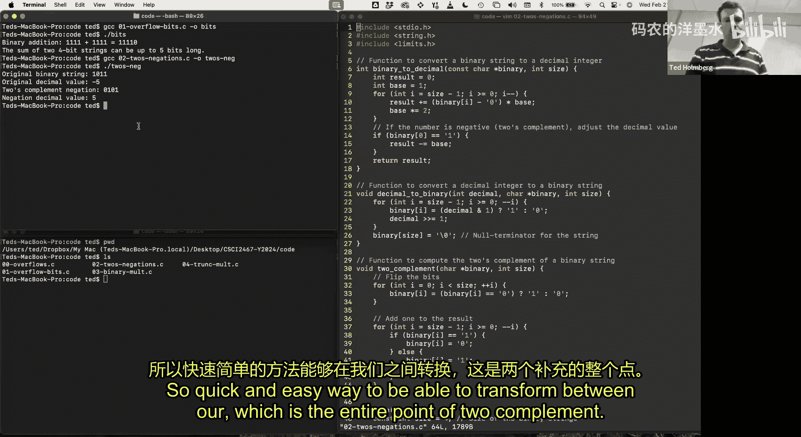

And this table right here just highlights some unfortunate results that could potentially happen we ahead and when we go ahead and perform operations that。

Enforce us to be within a certain encoding space。So here with four bits the least value the most negative value is going to be minus8 right and it'd be positive seven so you can just see some operations of what we would get as we start as we start performing the two complement and then the increment on it right so it's two operations the first is to flip the bits and the second is to increment by a single bit and it shows you how we go from5 to minus5 from seven to minus7 from minus4 to4 to zero to zero and from minus8 to minus8。

是。Perfect。Okay， done， we're done with the dish， oh subtraction is effectively dish right。

 can we all agree with that。😡，So let's move on to multiplication。Okay。

 I'm going to ask you this question and I'll。If there's a max bound。On。

Addition where we only have to add a single bit。Given two。Bit vectors of a constrained size。

Is there a well defined max bound given to bit vectors when we do multiplication。

 is it as cut and dry with the most applicative property as it is with the additive property？😡。

What do you think？No。Multipplication， so much more complex， right？😊，So。

The concept of multiplication is a complex one right because you're taking something I know if you think about multiplication as being able to do successive repeated amounts of summing based off of the the right operant so suppose one way of thinking about multiplication is giving a right operant。

We will sum it against itself a number of times to the right opera right very primitive and crude way where you can see how that produces something that's very。

 very， very large potentially， right？😡，And it gets larger and larger。

 the more that your left offering can be。I mean does that explanation make sense so if the idea behind summing was we were simply I guess the intuition I'm trying to impress upon you there about one of the concepts that drives the most app property is that with summation we only ever add two bit sequences of like the same size together once。

But if you think of multiplication as being able to self sum something X number of times。

 that's like adding that bit sequence to that bit sequence to that bit sequence to that bit sequence。

 to that bit sequence， some arbitrary number of times。😡。

It can grow tremendously so multiplication is a lot more difficult to try to capture that behavior right so I don't think they even try to do 3D like representations of that but let's kind of dig into how multiplication is done that's the more important thing here is how do we do multiplication did y'all already do multiplication division with the integers and assembly oh I want to spend too much time on this then so you already know how long multiplication works and the concept of how you would do this by hand right which is not too different than how you do this with decimal numbers you just do it with binary numbers and so you keep offsetting the number of spaces so say for instance I had decimal 11 and decimal 6 I represent decimal 11 as this top operant。

And then with long multiplication， i'll then represent my desimal six as this bottom opera well one way to actually process this is I can go ahead and。

I would do the same way I would perform the multiplication by offsetting base off where the digits are at so this is 110 right so in the if so at the least significant bit well that's all going to zero out like zero times these four bits so each in these instances and the long multiplication it's going to be four bits for each row I create so i'm going to do the multiplication based off with just the zeros place i'm going to do the multiplication based off this one's place。

😡，Or these two plates， let me use that term to place。

 and then I'm going to use do this multiplication based off of these force plates。😡。

So since this is zero， I'm just going to zero out of those four bits and then I all set into to be now in this two position where my least significant bit is and I'm going to then do my four bit computation there so this is a one so I just repeat it。

😡，And now the last digit is going， the one the first place is a one so I'm going to repeat that。

 then I'm going to go ahead and I'm going to add those together and that's going to give me the size of my string。

Or it's going to give me the new strength， but notice I have to pivot by a bit for each unit that's inside of my rightmost opera or my bottommost opera right in order to do the summatation。

😡，Okay， so this is pretty much how you probably learned how to do this by hand right Okay。

 so I want to map that。😡，Into how we can resolve that to be nothing more than shifts and additions did you learn how to do that effectively in assembly to how to represent that。

😡，And did you do this just by hand math or did you also program these concepts so if you programmatically wanted to do multiplication。

😡，Which conceptually is a very costly thing imagine if you tried to do this by doing a for loop and well。

 I mean kind of that's what we're doing here in a way。😡，So I have a better slide for this。

 but one way we can do this， let me go to the other slide and actually have code here we can show off too。

 let me see where that other slide go。Well， when I get to the slide we'll talk about it。

 but you can see effectively what's happening here is one way of representing this value is we're going to take。

Our binary string， which is our topmost opera end or right the leftmost opera end， which is my 11。

 my 1011， and we're going to shift it。We're going to shift。Byu two spaces， which is happening here。

 right？And then we're going to add that by shifting by just one。😡。

You see how this maps into what's happening here and then I'm not going to do this one because that's all zero I could。

 but it doesn't contribute to anything。😡，So does everyone see how this。

 this process is effectively using a set of operators that are available to us that's doing the same thing we would do by hand here？

You see how we're shifting this， we're shifting this。

Topmost opera in this 11 by two spaces and the reason why we're doing that is because we have this this unit here that we have to multiply it by and we're shifting this one here by just one space right to the to the left so if I shift my original value by two that represents this unit here and add it because that's what we're doing here right we're doing this addition here。

😡，Add that to a shift by one。And then we don't have to add anything here because that's where we were zeroed out the sum of that is going to produce。

😡，Well these two binary strings， which when combined because it's just shifting that by two and it's shifting that by one。

 I add those together， I'm going to get the same binary string I get here。

 which is going to give me a 66 and energy values thats that's how that's how multiplication is done。

😡，Our multiplication。In a bitwise operation it's just shifts and pluss。

So that's what makes it so efficient， that's what makes it so fast。😡，And of course。

 because your number can grow so large， we trunccate right the thing that always gets truncated is the most significant bits so the thing you're always lefted over with is whatever the least significant bits that bit into that encodecodable spaces。

😡，Let's take a look at some of these， this code。

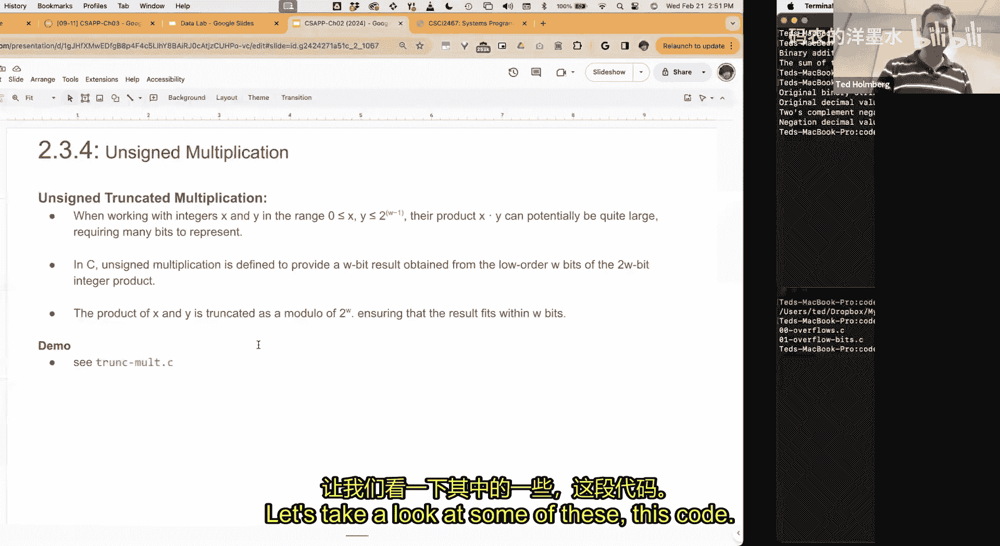

Brop that。Gm zero three， okay， binary multiplication， don't care。

I mean I'm going to give all this source code to you it's well commented I want to just run it so you can see the results I not going spend too much time explaining it。

 but if you want to know how this code works in C to produce these results。

 you'll have it in the repo。😡，Okay， let's see GCC， what is this 03 now？And let's call this。别人呢。Not。

Perfect。And there we go， so suppose we want to multiply these numbers。

 notice these are different numbers now。I didn't use sex I use five at this time。

Then you can see based off of the shifts that get performed， this is the shift based off of。

Shifting from the zero position。Plus shifting from the force position and notice the two's position where there's just one0 that's been pushed to the left isn't there because this was zero it out right so then that's going to give me the binary sequence that just goes ahead and sums these together and then this gives me is that the energyteger value that's I can't really see that part of my screen does it give me the actual energyteger value as well perfect so actually the reason why I like to have the source code though is I unlike a slide I can change these values though let me see where I put these values。

😡，Here here they are。 So first， I have to enter into my insert mode。 And so here。

 so let's say instead of。0， I mean，1，0，1。 I wanted to make this 11，0 like the saw。Okay。

 and so here let me escape out。This as well。ok了 me。Escape out。系い。Give me my escape， okay。Okay。

me this thing。是。嗯。Okay， wait， okay， now let's go ahead and。

We're on that and so now notice I have my numbers updated so that we could see。We no longer have11。

 I mean， 1011， it's now going to be 10110 because the place at the zeros is a zero。

 so it's not going to contribute towards the sum then in our two's place。😡。

We're going to shift that by one and then add that to a shift in the force place。

Anyway you can play around with that makes as many binary digits as you want and see how it results I think the concept is pretty evident though。

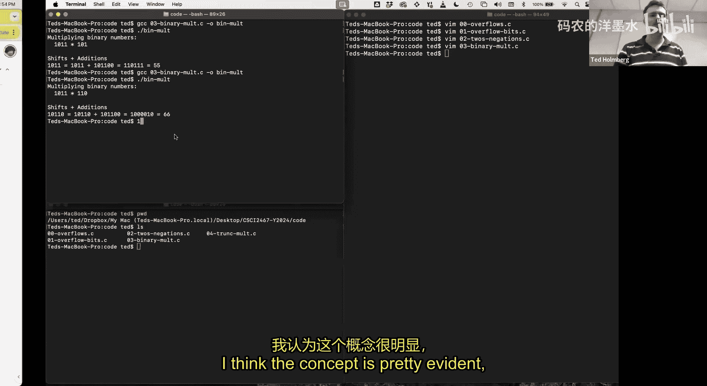

Of how that works。Okay， so now let me show you truncation because that's the more interesting thing。

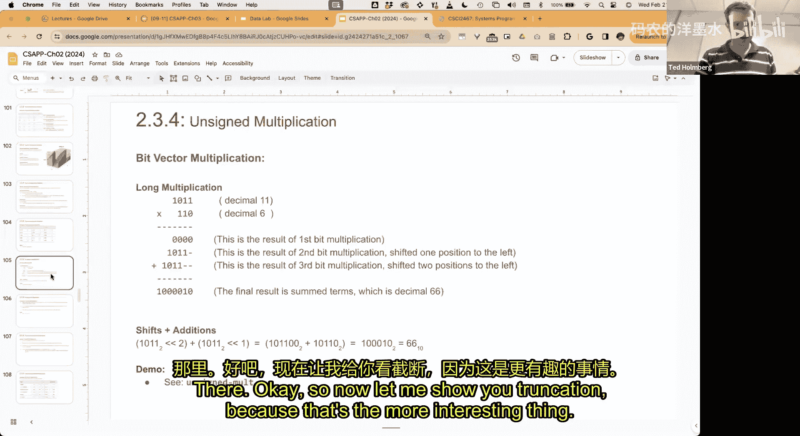

Let's clear this。And again， for the purposes so that you can actually see the source code。

 I'll give it to you here while I start to compile it， look at it your're own accord really。

 all I'm doing here though is I'm creating two numbers。And I'm going to multiply that。

 I'm going to show you what happens when we try to trunate what what the actual value should be versus the value it's going to report as。

😡，And it's called a trunk。Okay， and let's run our trunk。So here you could see the truncated value。

 so you can see the full value between these very large numbers。😡。

Is going to eclipse what can fit inside of an integer value， an unsign integer value of 32 bits。😡。

So if I do the full results。In 64 bits， you could see this is what I should expect。

 but look at what I end up getting here and clearly that's not the right answer， right like clearly。

Would you have？A value that's。All zeros in both of them， how am I getting the term 80？😡，Right？

So you can look at it， not even know what the actual number is and like that's not right。

 but it kind of is right in the fact that if I had those missing bits，😡。

It would parse to be the appropriate thing。It'But it rolled over。

But this is just an example of also what to expect now obviously truncation and overflow。

 this is another form of overflow right， these overflows are much more likely to happen with multipllicicant properties than with additive properties。

And again， it's something that's good to be aware of because I want to highlight that I did this simply by multiplying two numbers together right so you can easily do this in your own code if you're finding an erroneous behavior if you want to know why C has a bad reputation it's for reasons like this right like there's lots of ways that you can fall into pitholes that then you spend hours and hours trying to figure out why and it's not something obvious it's not like it's a limitation in the way that like your sequence of bits are being encoded and you've overflown those。

Okay， oh， I have some。Topics here。They go here， okay， let me see what the current questions are。

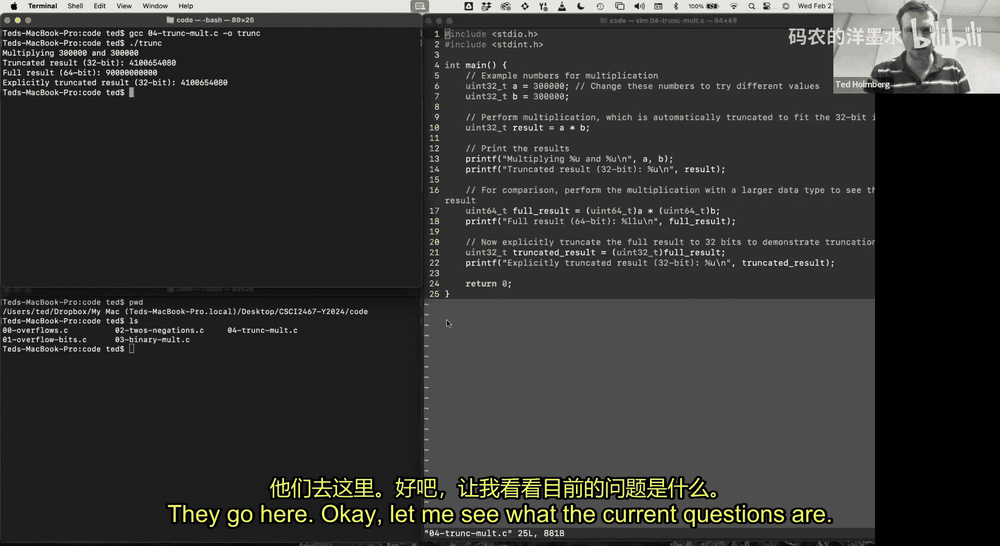

St。叫。Oh， we've had lots of communication how many bits to represent the value of the sum。Oh yeah。

 that was the question， sorry。I think you can， oh， thank you。

 someone showed me what I can do inside Python to get the binary sequence。

And then shift in the bits left and yep， very good extra zero。

 a lot of good comments is what I see on here。We didn't hand do these in assembly。

 but I did years ago and it's not fun。Yes， yeah， binary math by hand is not fun at all。

And sometimes they'll do that just to train you I think so you have expectations。

 but fortunately most of the stuff you don't have to do by hand or even touch depending on what domain you go into it's just good for you to know these things because this is how everything operates at a very lowle system and so it's like it's true the jobs you're probably going to get are going to be using frameworks and using highlevel languages and usually like what your job is kind of going to be like for many people not everyone there's lots of roles out there for software engineers but I would say probably a decent number of jobs is equivalent of plumbing code right you take like one pipeline of code you take another pipeline of another framework and you create a widget that merges them together so you're playing around with a lot of not even on top of highlevel languages but frameworks built on top of high-level languages that already designed to do tasks then you have to learn how to use the framework。

To do a specific task。Even if that's what you end up going into having this。😡。

Low level appreciation of what the system is doing will aid you to catch small bugs or know how nefarious agents might try to compromise your system。

 especially when we get into things like the bomb lab or the attack lab where you can kind of see where you can try to give the system something that you know won't process to try to run unsigned code。

😡，But again， once you have any understanding that everything inside your system is just sequence of bytes with contacts and you can somehow put the sequence of bytes you want and give it that context to the system。

 suddenly you can run an application， you're not supposed to run。Okay。

 and so here we have our twos complement of our multiplication。

 so here we're just showing you the value of x， we're showing you the value of y。

 we're showing you what the actual multipllicant of properties should be。

 but also what the truncated value is。RightAnd of course。

 what the trunkd value is is if I take the least significant bits for whatever my sequences。

 notice I'm using three bit sequences for my x and my Y。

 so if we're actually using a constrained spatial domain of three bits。

 everything that produces from that operation should only be three bits。

 anything that overflows outside the three bits gets lost。So yeah。

 we get some of these wonderful results like three times three produces one。They're okay。

 yeah and here this gives the this is the example I was showing before where kind of have if we wanted to have like a pseudocode example of how we can do that。

We can take our sum as0 and then for each index in our bid vector， we'd see， okay。

 if that bid vector， that index is one， then we would sum based off of。

Taking that whatever our x value is and shifting it by that number of index values。Okay。

And of course， we can't end our discussion of how we can go ahead and process on our integral number set without also speaking of division。

 so we talked about how essentially subtraction is the same thing as addition and so multiplication。

Has he related？Property to multiplication， but it's not exact right because when you start having things。

 what's one of the issues with having things？😡，It has to。

It might not be evenly divisible right and so that's an important concept so with multipl properties you can always double something right that never causes any issues。

 but we can never always have something。😡，And so here， let's go through。

The process so these are just some examples of how we can perform some logical shifts so the concept is effectively the same though right when we divide we're going to shift by powers of two towards the right so with multiplicant of properties we were shifting to the left so the concepts going to be the same but the big thing we need to do is know what are going to be the rules on how we handle things that are not even lead it visible like do we round down and so this is an instance of a table where that's what we that's what we decide to do。

There's other instances where okay we could do our twos complement division so here incorrect rounding arises when our simple performing white shifts on negative numbers with twos complement occurs so if we want to try to on the instances of on negative numbers we don't want to round them we want to round up right。

It's a supplement for that。And so this is just a table to illustrate based off of the state of the number。

 whether you're going to do a roundup or round down to be able to get a better approximation of what your division should be。

Division naturally is a very lossy operation though it's much different than the multiplative properties or the subtraction addition right inherently so like there's there's so many more like。

How can I express this division is the reason why we realize we need decimal places。Right。

It's why we have a modulus operator， it's the reason why we have an entirely different number set。😡。

Right？Division was the operation that broke things down like you had。Ancient mathematicians is like。

 yeah， we have every expressible number that's countable， one， two， three， four。

 and we can express any ratio by just taking an integer and div it by， I'm sorry。

 taking inger and divided it by another integer。Right but no。

 you can't right like some things only exist as that operation like one over two resolve to be one over two。

So that's but we have a number set now well we have a not a number set but we have a mechanism to express that using radx points right so fractional numbers 1。

5 but those are naturally loss right they can produce things that aren't really the divisional quality of your two integers that you're dividing against。

It's just division is a very interesting thing， another interesting thing along the same line。

Small sidebar is exponential power right you can always exponentially grow something。

 but the inverse to root something is where we actually start getting our complex numbers from it's reason why complex numbers are the square root of minus one that always defines as such because once you introduce exponential numbers like a there's all these other numbers we can't even represent we don't even try to represent it except using a multipl of property where we multiply pi I which represents the square root of minus one。

Because that's the representation of that number that just does not exist it's a hole in our。😡。

Number theory。So we represent that number as an opera that can't resolve to anything besides that。

 it doesn't reduce any smaller than。😡，So it's become a constant end of itself。So yeah。

 the evolution of numbers can be quite a kind of in， but going back towards our dividing。

You could say the expression that we use for correct rounding would be effectively this and it all depends on whether our most significant bit is one or zero if it's a signed value is going to determine how we're going to shift。

We're going to shift by we're going to do our right shift so what we're going to is we're going to do our right shifts。

So we can get the most significant value and based off that， then we do left stress back。

I'll show you a code， I don't have a code example for this。

 but we'll take a code example of this X class。But that will。

Finish us up on our integer arithmetic which I'm thinking was just something that you've already covered right so it's all probably repeat material so well how far did y' all go into rate expense values because that's the last thing you need on chapter two and I don't think rate Exp values are you used in the data lab at all。

So Reddix points values are super valuable to know because there's again。

 two number sets that you really use inside of your numerical representation。

 either the integer data set which we've just spent like the two lectures the last few lectures discussing that's are countable numbers that are discrete numbers but you also have fractional numbers right and so that might be necessary for representing when the concept of continuity is important where you have an impotismimal difference between one unit and another。

And it can be， however。Big or small you needed to be right you can customize the amount of space between units that's the fantastic thing about fractional numbers right so whereas inable numbers the unit of space between my one and two and three and four and five and six a set it's constant is not true with fractional numbers and that's why it's so useful it allows me to create a weighting on the distance between two values at any given time sometimes when you're modeling the concept that's very important。

😡，To be able to have a smaller distance between two units than another unit。

And because it's the rate experience value is designed where we can keep adding any set of values。

To the white of the point， we can keep making that space smaller， smaller and smaller， and smaller。

 insimally small。😡，Okay， so hot wait let me ask the question again。

 How many did you all cover that the concept of how you model the。

Floating point values in binary sequences。Or did you only stop at integer values？

Okay so we'll actually do a full lecture of that next week so its something for you to actually put your appetite on and say okay I know how to do integer numbers two times over now we're gonna say how to do floating point numbers which have some really interesting consequences and you're going to really see why you don't everyone trust floating point numbers and I say I still have about six minutes left do I want to use my six minutes to kind of just cover the data lab I don't think that's enough time to cover data lab so probably what I'll do is I'll go ahead and just conclude today's lecture right now but what I will say is data lab is online and available probably what we'll do next class is actually just have a quick introduction into data lab and I might even just have you all break into groups and spend the class hour working on your data lab together where you can potentially ask questions and whatnot so I think that's what we'll probably do for Monday and then on Wednesday。

I'll pick up and do a lecture on floating point numbers and then we'll be done down with chapter two I also try to get you the actual rubric and the actual assignment sheet for the presentations we'll be doing。

对不对。

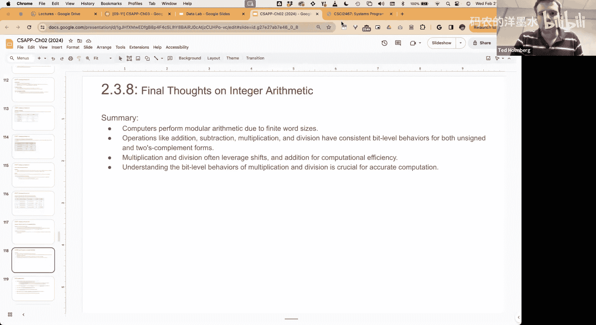

好。嗯。は。