# C语言系统编程：10：整数运算符 🧮

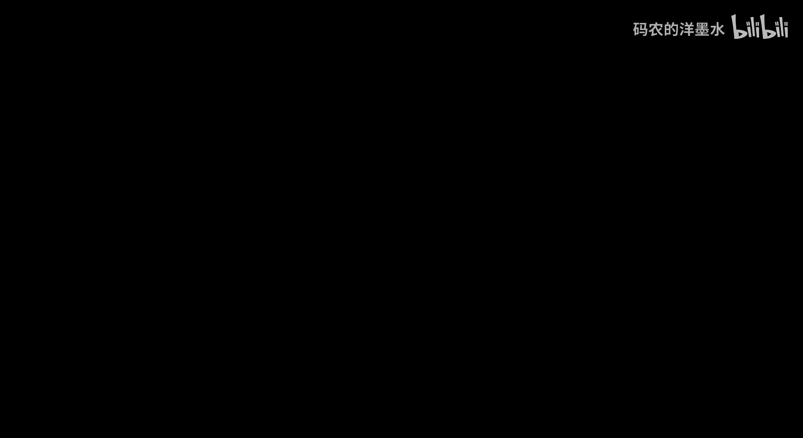

在本节课中，我们将学习整数在计算机中的算术运算，包括加法、减法、乘法和除法。我们将探讨这些运算在固定位宽下的行为，特别是溢出问题，并了解其背后的二进制操作原理。

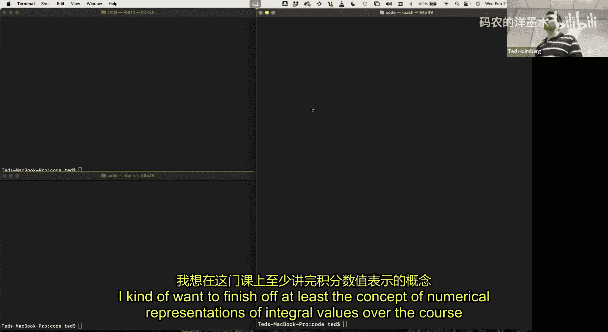

---

## 概述：整数运算的挑战

上一节我们介绍了整数的二进制表示（无符号数和补码）。本节中，我们来看看如何对这些表示进行算术运算。由于计算机使用固定位宽（如32位）存储整数，运算结果可能超出可表示的范围，导致溢出。理解这些行为对于编写健壮的程序至关重要。

---

## 无符号加法与溢出

无符号加法是最基础的运算。但当我们对两个w位的无符号数相加时，结果可能需要w+1位来表示。

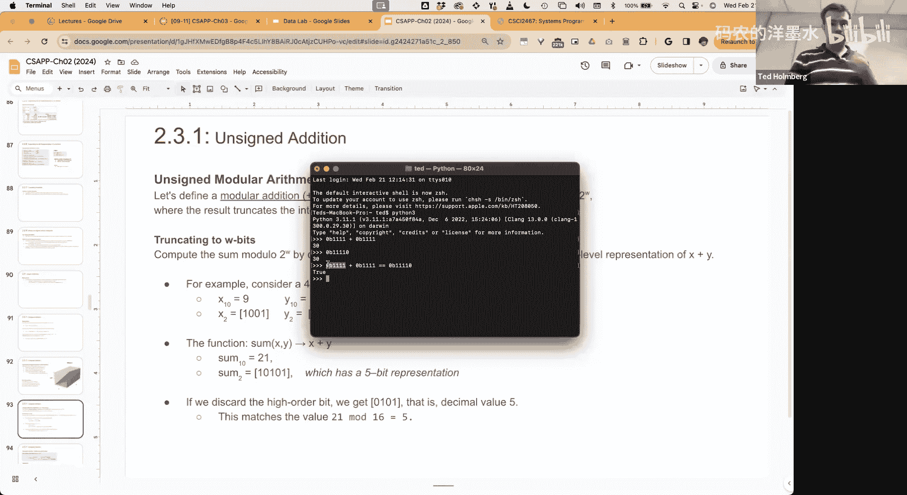

以下是理解溢出的关键步骤：
1.  考虑两个4位无符号数的最大值：`1111` (15)。
2.  计算 `1111 + 1111`，手工二进制加法结果为 `11110` (30)。
3.  这需要5位来存储。但在固定4位系统中，最高位的`1`会被丢弃，结果回绕为`1110` (14)。

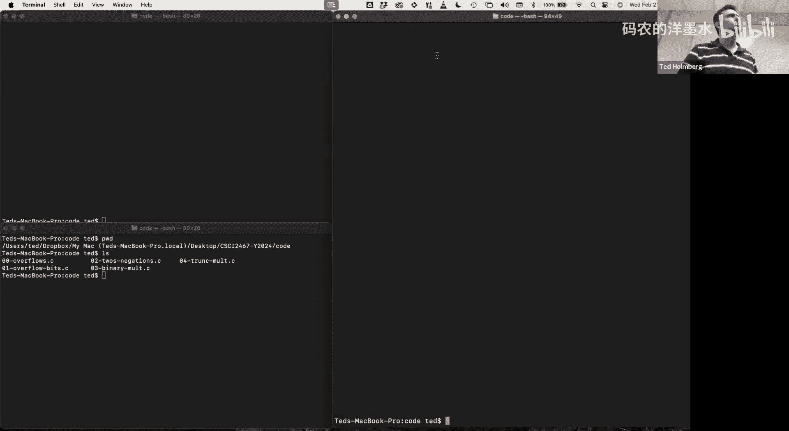

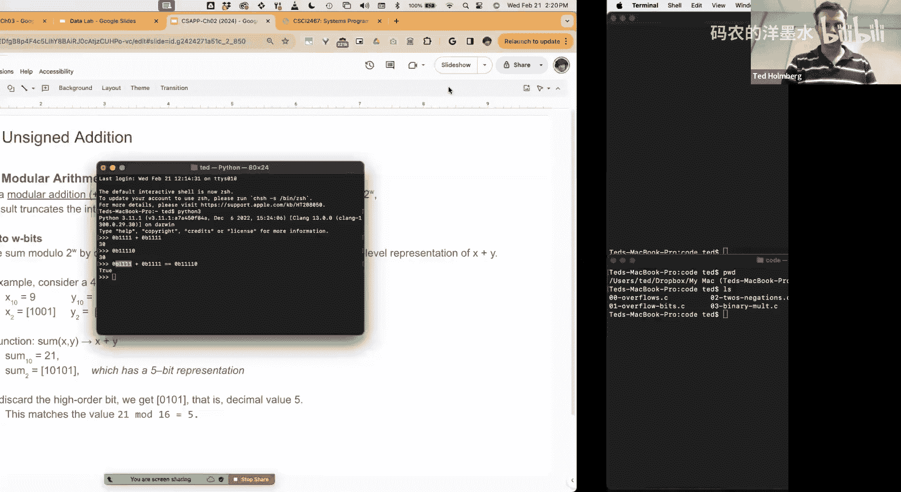

在C语言中，溢出不会报错，而是发生回绕。我们可以通过以下代码观察：

```c
#include <stdio.h>
#include <limits.h>

int main() {
    unsigned int max_unsigned = UINT_MAX;
    printf("Max unsigned int: %u\n", max_unsigned);
    printf("Max unsigned int + 1 (overflow): %u\n", max_unsigned + 1);
    return 0;
}
```

运行后，`UINT_MAX + 1` 的结果将是 `0`。

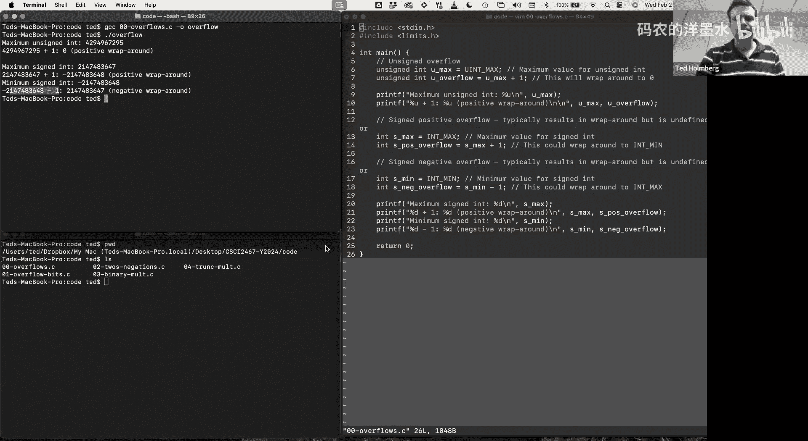

**溢出检测**：对于无符号加法，如果 `x + y < x`，则发生了溢出。

---

## 有符号加法与溢出

对于补码表示的有符号数，溢出可能发生在两个方向：正溢出（结果太大）和负溢出（结果太小）。

以下是两种溢出情况的示例：
1.  **正溢出**：最大的正数加1会变成最大的负数。
2.  **负溢出**：最小的负数减1会变成最大的正数。

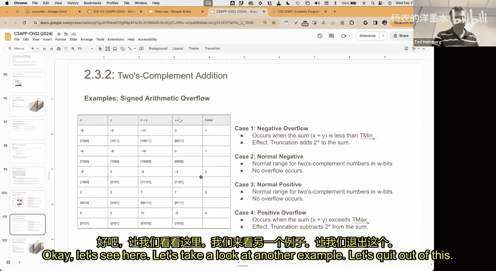

```c
#include <stdio.h>
#include <limits.h>

int main() {
    int max_int = INT_MAX;
    int min_int = INT_MIN;

    printf("Max int: %d\n", max_int);
    printf("Max int + 1 (positive overflow): %d\n", max_int + 1);

    printf("Min int: %d\n", min_int);
    printf("Min int - 1 (negative overflow): %d\n", min_int - 1);

    return 0;
}
```

**溢出检测**：
*   **正溢出检测**：如果两个正数相加得到负数 (`x > 0 && y > 0 && x + y < 0`)。
*   **负溢出检测**：如果两个负数相加得到正数 (`x < 0 && y < 0 && x + y >= 0`)。

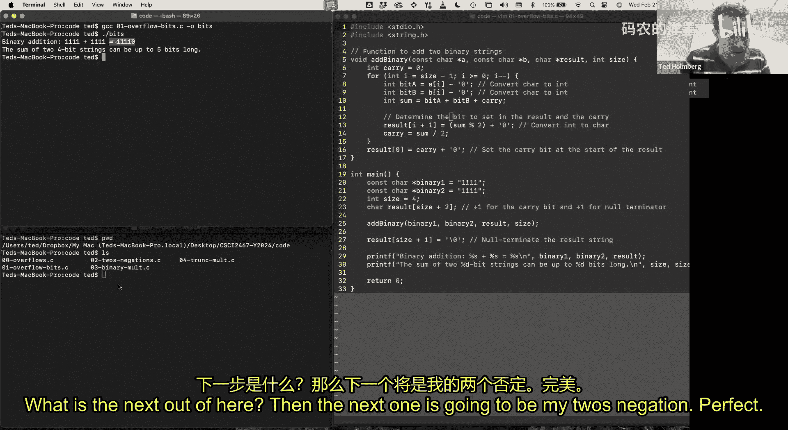

---

## 补码取反

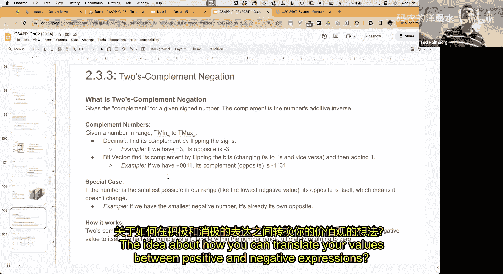

将一个补码数转换为它的相反数（如+5变-5），需要两个步骤：
1.  **按位取反**：将所有比特位翻转（0变1，1变0）。
2.  **加1**：对取反后的结果加1。

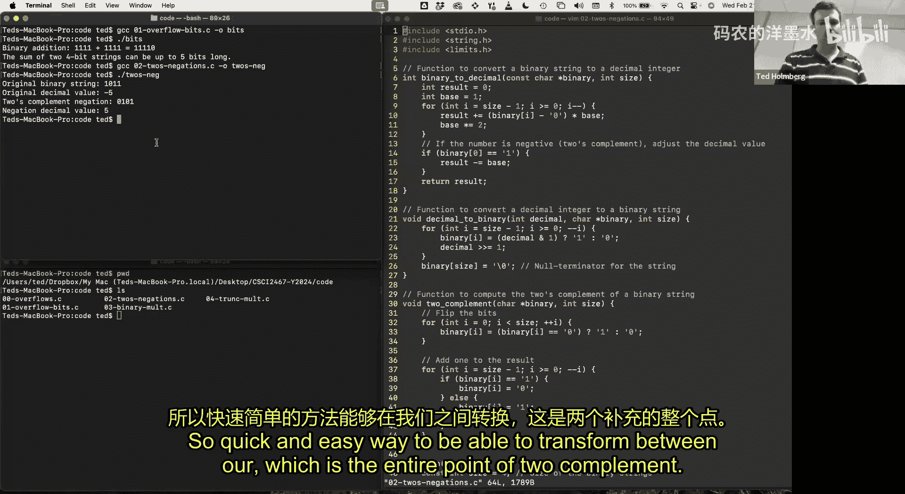

公式表示为： **-x = ~x + 1**

例如，用4位表示 `3` (`0011`)：
1.  按位取反：`1100`
2.  加1：`1101` (即 `-3` 的补码表示)

特殊案例：对 `INT_MIN` 取反，由于其不对称性（例如8位时-128没有对应的+128），结果仍是它自身。

---

## 乘法运算

乘法可以分解为**移位和加法**的组合，这比重复相加高效得多。这与我们手工进行十进制乘法的原理类似。

考虑计算 `11 (1011) * 6 (0110)`：
1.  检查乘数 `0110` 的每个位。
2.  如果某位是1，则将被乘数 `1011` 左移相应的位数，并累加到结果中。
    *   第0位是0：忽略。
    *   第1位是1：`1011 << 1 = 10110`，累加。
    *   第2位是1：`1011 << 2 = 101100`，累加。
    *   第3位是0：忽略。
3.  将所有移位后的结果相加：`10110 + 101100 = 1000010` (即66)。

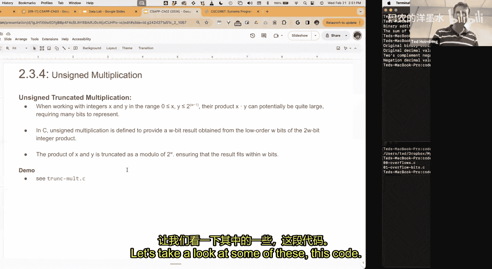

在代码中，乘法可以通过循环和条件移位实现：

```c
int multiply(int x, int y) {
    int result = 0;
    for (int i = 0; i < sizeof(int) * 8; i++) {
        if ((y >> i) & 1) { // 检查y的第i位是否为1
            result += x << i; // 将x左移i位并累加
        }
    }
    return result;
}
```

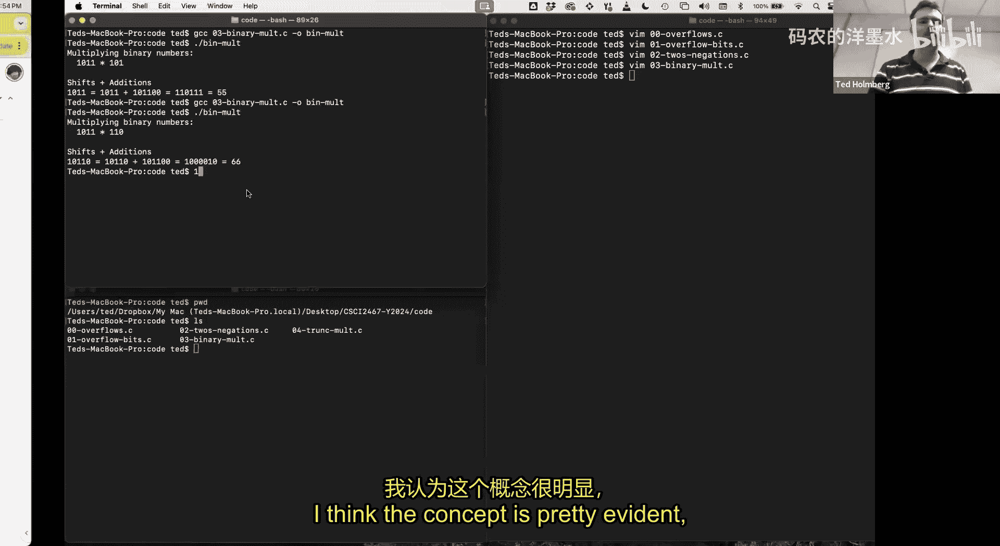

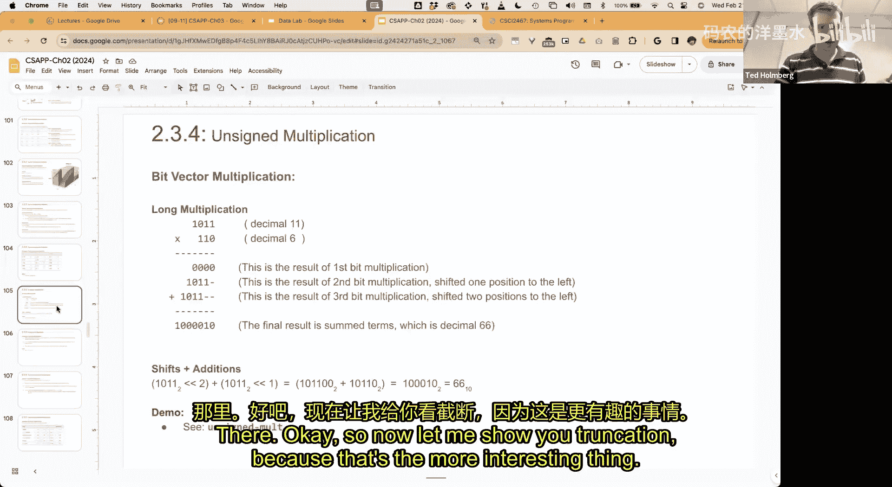

乘法也容易导致溢出，且由于结果增长更快，溢出的可能性比加法更大。

---

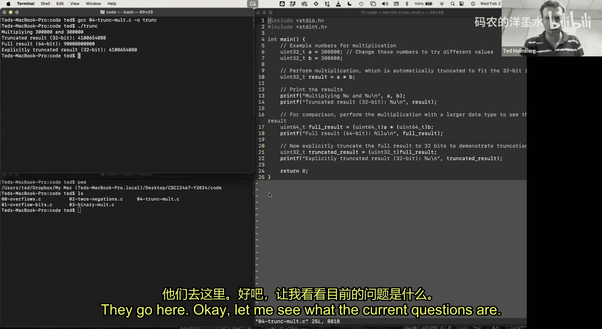

## 除法运算

除法与乘法相反，通常通过**右移**来实现。对于无符号数，直接使用逻辑右移（`>>`）即可。

然而，对于有符号数（补码），需要特别注意：
*   对于**正数**，算术右移（高位补0）等同于向下取整的除法。
*   对于**负数**，算术右移（高位补1）也是向下取整，但这可能不是我们想要的结果（例如 `-5 / 2` 希望得到 `-2`，但 `-5 >> 1` 可能得到 `-3`）。

因此，为了实现“向零取整”的标准整数除法，需要对负数进行校正：

```c
int divide_round_to_zero(int x, int k) {
    int is_negative = x < 0;
    int shifted = x >> k; // 算术右移k位
    // 如果是负数且不能被2^k整除，则需要向上调整（加1）
    if (is_negative && (x & ((1 << k) - 1)) != 0) {
        shifted += 1;
    }
    return shifted;
}
```

本质上，`x / (2^k)` 可以近似为 `(x < 0 ? x + (1<<k) - 1 : x) >> k`。

---

## 总结

本节课中我们一起学习了整数运算的核心机制：
1.  **加法和减法**：可能发生溢出，无符号数回绕到0，有符号数则在正负极值间回绕。
2.  **补码取反**：遵循 **`-x = ~x + 1`** 的规则。
3.  **乘法**：在硬件层面被优化为移位和加法的组合，效率很高。
4.  **除法**：通过右移实现，但对负数需要特别处理以实现向零取整。

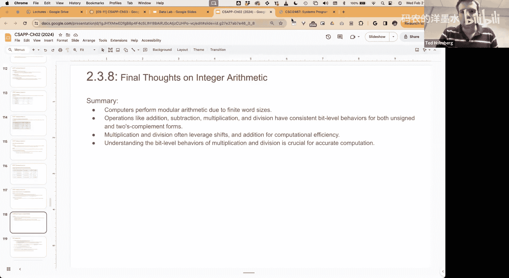

理解这些底层原理有助于我们预测代码行为，避免因溢出和取整问题导致的隐蔽错误。下一节，我们将探讨如何表示和运算非整数——浮点数。