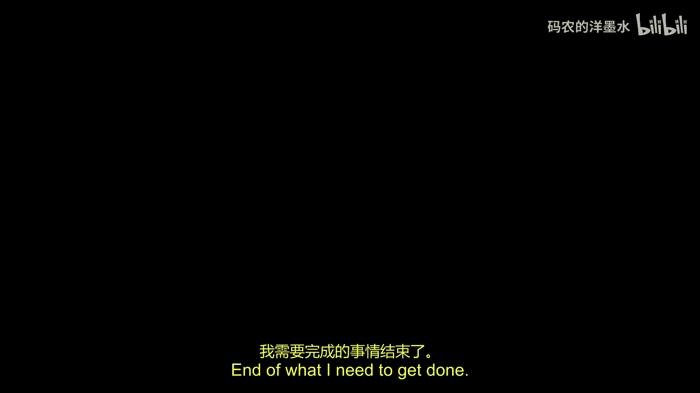
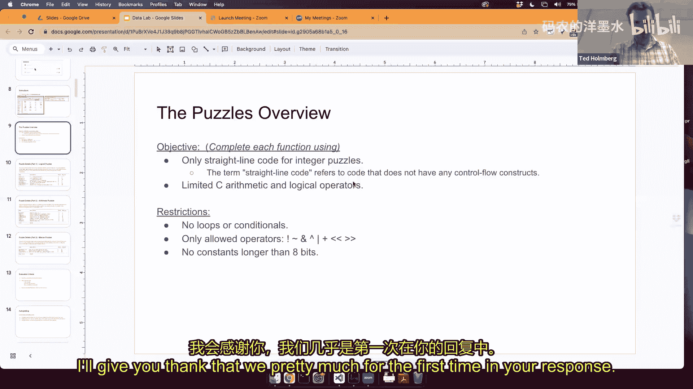

# 【全集】加州理工学院 C语言系统编程 中英字幕 p11 Lecture 11 - 数据实验 -BV1bUzWBLEiC_p11-

of what I need to get done so then I can book this and open up with what I need to do for this class but for this lecture as I already alluded to last lecture was I want to open this up to effectively be the formal lecture where we introduced the data lab that you should have already started working on so if you hadn't started working on it or if you're kind of confused about some of the some of the tooling or some of the concepts that are given to you in that I want to kind of cover that very briefly and then give you the opportunity in class to group up and work on the problems that you still have left did anyone finish the data lab by chance perfect this will be a perfect lecture then for you to actually make some good progress on it。

So the big thing about Datala is it's going to really hone in and challenge you we've been lecturing about for the last couple of weeks。

 which is going to be this concept of bit level representations， in particular。

 bit level representations for integral data， but sometimes just for for a sequence of bits so bit vectors as well and performing booleing algebra on it。

So of course the purpose of this assignment isn't that you can familiarize yourself the bullying algebra in a very practical way right it's one way for us to lecture about the concepts。

 but typically by doing it is where you actually learn the intricacies and the real logic behind something so when you're forced to be a stakeholder and execute on it and so I think that's why labs are so good I think that's why it's good to have labs in Java one that's why I think it's good to have labs in Java2 I think that's why it's good to have labs in 2467 system programming concepts in fact I think every class would benefit if it had very strong practical coding components in addition to the theoretical components。

And on top of that， we want to ensure that everyone understands the bit level representation of integers。

 recall there's two different level， the two different types of integer representations we have right。

 one for unsigned and one for signeded integers。One of the fun things about this lab is it's supposed to be a series of riddle like challenges。

 so here you get a chance to try to solve some programming puzzles to understand the machine level representations and supposed to be kind of enough fun way if you like puzzles so if you think puzzles are fun you'll really enjoy if you think puzzles are frustrating then you'll be very frustrated with this lab。

😡，And then also， this is going to ensure that everyone really learns how to use their Bi wise operations and say。

And again， if you want to consult the textbook for the chapters， it's going to be chapter two。

 really， and really the chapters we discussed early on section 2。1 and 2。

2 inside of our systems book。So just some quick instructions。

 you're going to want to use your web terminal to access the systems lab for all of the labs or a lot of the labs。

 you might not realize that there might be some background services that are running on the systems lab that facilitate。

😡，You to be able to accomplish the lab so we don't really have it set up so you can run things locally so I do recommend that everyone use the web terminal so you can log into the web terminal using your unI credentials you should have done this before and so one of the beautiful things about the web terminal is it's actually a full guI OS experience in Ubutu environment so that means that anything you have to import into your system you could either use the shell to do that or you can just open up a browser and for some instances it makes sense to open up the browser like to submit to auto lab so if you do need to access web applications if you need to access web resources from your web terminal from your systems lab home environment you can do that the same way you would in a window like Mac OS or Windows you can just go from applications to internet and either use the chrommeium web。

Browser or the Firefox web browser and then log into either auto lab or Github because I put all of our course resources。

 all the data lab stuff should be inside of the repo so you can download it on steam machine that way。

Of course， we've seen Autolab before。Here， here， this is just showing you how you can navigate through AutoLB。

And so here I did not attach these through autoLb like I did last semester。

 I have them attached in our GitHub report， so all the course materials should be in one spot where you can easily keep pulling it as it gets updated。

😡，But the important thing is when you finally get this datalab。handout。

ar the important thing is that's going to be your collection of starter files。

 so once you get that on your systems lab， you can go ahead and extract those files when you extract those files you should have these collection of sub fileses here or you know for on the shell we could view it this way as well。

So let's kind of walk through what some of these files are。So again。

 the objective for these puzzles is you are to only use straight line code for the integer puzzles。

 what is straight line code that refers to code that doesn't have any control flow constructs。

 you're not allowed if， you're not allowed if L statements， you're not allowed switch statements。

 you're not allowed any repetition statements like four loops or while loops or do while loops。😡，So。

You're only allowed the primitive set of operators so you're limited to in fact the C arithmetic and logical operators so like I said no loops or conditionals you're allowed to use the the bang operator the。

😡，Your bit wise and your bitwise exO， your Biwise or， your addition operation， your shift left。

 your shift right。And your your。Nigation operation。

And so you also one other role you should be aware of because it's going to be one of the challenge。

 I think one the more challenging problems is relying on this constraint。

You can have any constants and when we're talking about constants we're going to be working with bit vectors。

 you can't have any bit vector that's longer than eight bits so you're only going to be working with bytes so you're going to see one of the problems you're going to have to construct a certain bit sequence that's going to extend multiple bytes and you're going to have to learn how to you're going to have to problem solve how to craft that using。

Eight block bits， so starting with eight bits manifest it and you'll see when we get to that problem。

 you'll see what that looks like。😡，So that's there's one problem where that will be kind of an issue for you part of the problem domain so let's actually look at what these problems are asking you to do we can kind of break the set of puzzles if you want to call it that I think that's a good word choice for that we can break it into three types of puzzles the first type of puzzle will be logical puzzles these are going to be the problems that primarily involve operations that deal with boolean logic they're operations that often or or bitwise operations they're often used to evaluate or produce boolean values like true false1 zero in the context of bitwise operations they can also involve operations that manipulate our bits without changing the numeric interpretation so you're going to see this is pulled directly off the lab document you have the name of the function that you're going to implement so what we're going to see is you're going to have a bits C source code file that's going to have sububbed out code so it's going to have a lot of empty source code。

F a lot empty functions that you're going to have to actually implement and there's kind of some directive some comments on how to implement those so there's going to be a description on what the intent for each of these are so in this instance we have what1。

2，345678 so there's8 challenges for you in the logical set of puzzles so for instance on the first one it's going to be a bit wise or operation where you have to do effectively this computation taking an X and a y which are a bit vectors you have to produce the result that would do an or with the trick is you don't get the you have to you're limited to only being able to use the bitwise and and the bit wise not。

Does that make sense so that how can you use those operations to mimic what you would get on the bit wise or operation？

And so just to give you a hint， there's a concept you probably learned about in discrete mathematic called to Morgan's Law that would probably be useful for a problem like this。

Okay， so in this instance， you have your point value。

For each of your problems and then here it's not just also the challenge isn't just like many puzzles it's not just about getting the correct answer。

 but doing so using a number of operations that doesn't hit your max so here you're allowed eight operations for you to be able to get credit for this so you have to not only figure out a way to do this conversion and you have to do the conversion a way that is under this max operations account。

😡，And so here after that when we have the bit wise and， which is going to kind of be the inverse。

 the other one， you have to do the equivalent of bit X and y using only the or。

 the bitwise or and the negation the。Excuse me， and the effect of leave bit wise not。

We have the exor。😡，And again， each one of these is going to show you what you are limited to being able to use。

Then you're going to have is not equal， so here you're going to return zero if x is equal to y one otherwise。

 right we're checking for not equality。😡，We're going to have copy the least significant bit。

 so here we're going to set all the bits of a result。

 the least significant bit of X so notice this is only taking in one parameter as opposed to two。😡。

We have special bits which has no parameters this is going to be the one was I was mentioning you before where you're going to have to return a very specific bit pattern of this now notice that pattern you can't hard code because it's larger than eight bits so here you'll have to use operations to create this sequence pattern and then return that。

😡，Here you're going to have an opportunity to try to implement your version of the conditional operator。

 so recall that the conditional operator X is a truthy value。

 it's either zero or one it's going to be something that's either truth or false and if it's true。

 then you would return y and if it's false， you would return Z。😡，And then finally bit parity。

 this is going to return one if x contains an odd number of zeros。Yeah。

Then the second part of data lab is going to be more arithmetic puzzles these are going to be problems that deal with the arithmetic properties of numbers they can evoke operations like addition subtraction。

 finding the maximum of value negation checking the sign of numbers these operations changed the numeric interpretation of bits and so again pulled directly from the data lab PDF you could see we have the set of functions that are stbed out initially that you'll go ahead and implement and then a quick description for what those functions are we could see the total number of points oh I didn't put the total number of points。

For the the first part well the total number of points I think after everything' said and done is effectively I want to say 40 points is what the lab's worth and then there's a bonus component。

 which is the third if not mistaken I think these are yeah， these are bonus points。

So it's worth 40 points between parts one and part two and then we'll take a look at part three which is optional and then can append an additional10 points to your lab grade so on this instance you have minus one notice no parameters all the ses return a value of minus one。

We have TM Tos complement Max， which is going to return the maximum tos complement in that you can create。

We are're going to have， again， this doesn't have any parameter。

 so it's something that you can just compute and return the value of， you have negate X。

Where you were going to turn minus x without using a negation operator。

You're going to use is negative x and is positive X and these are kind of related it's going to return the first one will return one if x is less than zero otherwise it return zero and is positive will return one if x is greater than zero otherwise it return zero you have your bang X which is going to compute the bang operator on n without using the B operator。

You're going to have add OK， which is going to determine if x plus y can compute without an overflow。

😡，Okay。And then finally， an absolute value of x， which is going to be well。

 the absolute value of x and again， the maximum number of operations and the number of points that each of these are going to be worth。

And then finally， we have some bitwise puzzles that are primarily deal with manipulating the individual bits or groups of bits within a number。

 they can evolve operations like counting the number of set bits。

 swapping certain bits or sifting bits。So here there's three problems they're worth a total of 10 points these are the bonus ones in bit swap you have an x and n and an M。

 this is going to swap the n byte and the m byte with the mte with the x vector so x is the vector your bit vector and so n and M are going to be the positions in the vector that you want to the bit vector that you want to swapwamp。

For a bit count， you're going to pass in a bit vector so we're going to return the count of the number of ones in that word and then finally your logical shift is going to take an x and an n and it's going to shift x to the right by end using a logical shift。

Okay， so after you have implemented all this， let's talk about how you can actually evaluate and see if you have the right answers and talk about submission guidelines。

So you should comment all of your solutions detailing why your code works like what the logic behind it is。

 so technically to get full credit for everything you should pass the test there's going to be automated test in both auto lab but're we're going to include the same test that we use an auto lab as part of the package you're going to download as part of the tarR file so make sure you pass all the test use only the legal operators which we have a script that will go ahead and evaluate your code to make sure that it is meets the expectations and to also have explanatory comments。

Okay， we already know a little bit about the auto。Grading tools。

 but let's talk a little bit about the code that we can use to actually check the correctness actually check to see if our solutions are right or not。

 So we have this be so if we go ahead and from our directory， there's a make file， we can。

Use the shell to invoke the make file which will then build out the applications that we have defined inside the make file this will create an executable one of these is going be B test we can run B test and that will it'll evaluate all of the functions inside a bits c we can also try to test for a particular function so if I pass this flag f and then give it a function name I can just test that one function to see if it's correct or not without having to test everything I can also test certain parameters so I can do B test then dash f and add a function name and then do dash1 and dash2 and then give the appropriate arguments that I'd want to pass for that particular function and a lot of this you might want to be able to get to this level of testing because you should get some responsiveness when you test against the test so if you're playing around with your code and you want to see。

It works， you can test it against particular values。Now。

 remember you want readedville BT each time after modifying your bits。c。

An example of what this would look like initially with your stubdown code would look like this。

 so if I just want Bt after I do the make it's everything should fail right because nothing's been implemented yet and then at the very end of here you could see the total points of 50 that's including the bonus points right so you can get 50 total points I have zero。

😡，Now。If I were to run this again and actually go ahead and build up my solutions and implement them。

 this is what my output should then look like。Where it'll it'll give me all the various points that something's worth the amount of points。

That I have accumulated my total number of points， so in this instance I've collected all 50 of the 50 possible points and it'll show me what my point allotment is for each of the individual functions I of've implemented。

Now we also have DLC that's going to be for the coding rules checker。

 so this will verify the compliance with the coding rules for each puzzle because it's not just about getting the right solution。

 but also ensuring that you adhere to the up to the max number of operations so this checker will check to make sure that none of your functions exceed the number of operations are allowed to。

Utilize。And so the behavior of this is going to be slightly different。

 it's going to run silently unless it detects an issue such as an illegal operator or too many operators or a non straight line code using some kind of conditional logic。

So in this instance this is a version of a successful run if I run DlC and then bit。

c I pass it my code， it should just silently prompt me for another instruction now if I violate any of those rules。

 you'll see I'll get these kind of outputs in this instance I get warning six operators exceeded when there was an max of three that was allowed and you can see here chose me in particular which of these functions is causing that special bits in this case。

Or bid count， 42 operators exceeded the max of 40。And of course。

 if you want to run these side by side， both your BT and your DLC to compute the correctness and performance points for your solution。

 you can just run this pearlscriptDver。pl。😡，And so let's see if I have。

 and here you get to say when I execute this pearl script。

 it's going to go ahead and run through the build sequence。

And then it's going to show you your final output performance here and again。

 that's what AutoLb is effectively going to use to aot you your points。

And this is a version where we get zero points。Sub doubt and then this is the same thing with a fully implemented version of what it would look like。

 where it shows the number of points， the ratingdium for the amount of points you can get。

 the number of errors， the performance points， and the number of operations。

And then when it comes time to submit this into autoLb。😡。

All you have to submit is the bitc source code file you don't have to package this into a car anything you should just be able to submit it just by itself and again just log into autolab using your UNO credentials。

 navigate to CSciI 2467 go to the data lab， go to submit and pass it your bitsc file that you've implemented out。

Now this I think project does have a scoreboard so you can actually compare your performance to that of all of your peers。

 so you should be able to click on the scoreboard link to see the how everyone else is also doing。

Excellent so just on general advice for testing purposes， you might be printing out values。

 but when it comes time to actually evaluate the correctness using the scripts remove any print statements that means that you won't need to include a standard input out header file for this right because our application is going to use your application as effectively an API is' going to。

Compile it and it's going to try to invoke calls to it and see if it gets the expected values back from it that means if you do put print statements in there it could mess up the grading scripts and actually mark things wrong when it's actually correct because then you're littering up the standard output buffer right with data that we don't want in there。

😡，So keep in mind， it's okay to use print statements when developing。

 but when evaluating either remove them or comment them out。Yeah。And so at all times。

 it's good just to kind of test and evaluate using these BT and driver applications。

And let's see oh and then that's it Okay， so at this time i'm going to ask everyone to now assemble into groups and start working on the data lab and I will say。

When we get to the 1， maybe  the 10 to 15 minute mark。

 I will allow you all collectively to try to identify one problem that you want to walk through in class。

So I'll give you a chance to kind of look over everything initially。

 we'll spend the very tail end of class actually showing one solution。

 I'll leave it to the entire class to decide what that is before we end。OkayOkay。好，没。

Let me see so I have a question， are these slides posted anywhere I'm assuming these slides are posted at the link that I have on the I might have these slides posted。

 I don't know if I posted these slides or not。Because the tail in these slides have solutions on them。

 so I think I might have been hesitant on sharing them。

But I can post the front half of these without the solutions。Any sorry。大概能没。That on the street now。I。

Yeah， that's a。大大家。And I'llpo a video at this point。其实。Okay。

 it looks like we're out of time for lecture today， but like I said earlier。

 collectively come to a consensus through discord on a question you want me to go over as if getting that next class and I'll actually go ahead and we'll walk through a particular question with the solution but the thing is I'll show you the solution just not at see I'll show it to you in Python and then you can map that logic to see but it's got to be a consensus so the class collectively has to decide which question you want me to cover next class。

