# 【全集】加州理工学院 C语言系统编程 中英字幕 p13 Lecture 13 - 浮点数 part2 -BV1bUzWBLEiC_p13-

Okay， so for today's lecture I want to pick up exactly where we last left off so as you might recall we were talking about the iEE floating point representation and the power of expressive expressiveness it allows for us to try to capture very large numerical encodings encoding binary encodings for very large numbers of very small numbers by using。

A portion of the the bit sequence to represent an exponential value because that allows us then to take a base value to multiply to some exponential value on a on a power of two basis to represent numbers that can grow very large or。

Either on the right side of our binary point right or on the left side of our binary point。😡，Okay。

 so to really highlight。Why this is both good becomes with its own pitfalls we're going to look at some examples。

 some toy examples of tiny floating point numbers now the floating point numbers that you use inside your system are typically either going to be a single precision or double precision that single precision is a 32 bit encoding that double precision is a 64 bit encoding over the course of this class I want to see what happens if we try to use the same schema but on like a eight bit encoding on a six bit encoding on a five bit encoding even on a four bit encoding to see what numerical values we have and to really get an idea of what it means for floating point numbers to be approximations we really motivate that when you start singing it in tiny scope and actually I have developed a little bit of a small C code which is now already available on our GiHub repo so that you can examine the code and actually get the same output for yourself so before。

I do that， I just want to ensure that everyone is comfortable and familiar with the floating point values。

 typically we treat them in one of three cases， we have deormalized values。

 which are those cases that are typically smaller than one and trend towards zero。

So the closer you are towards zero， the more of the denormalized zone you're in。

 and then those that fall outside and go toward further away from our zero scope are our normal values。

 our normalized values and the ones that fall into the range of infinity or undefined or not a number are going to be our special cases。

And so we're going to again look at each of our encodings in our tiny cases to see when we have to define an infinity when we have to define a zero a0 in itself as a special case。

 although that's when our entire binary sequence is all zeros or if our bit sequence is one it's possible to have a negative zero inside of floating point representation as I said before。

 we'll see that today and then we'll take a look at when we get a normalizedized and denormalized value。

 so up to this point is this this chart at least。Seem understandable and parsable in terms of what we're talking about in terms of defining just what a deormalized versus a normalized value is and then our special cases。

 excellent。😡，I we'm seeing a lot of the head shaking， Okay， so then。

Let's go back to our representation so we we said that when we have a binary sequence of n number of bits。

 we partition into three。😡，Segments to represent a iEE floating point number， one bit。

 regardless of how many total bits are allocated towards our encoding scheme is always going to be used for our sign bit so that we can have both positive and negative numbers and that's always going to be our most significant bit。

😡，Now， in our tiny floating point example， we're going to actually create a one bitete float。

So in order to do this， in order to maximize。What we can do here we're going to go ahead and prioritize the four bit encoding scheme onto this exponential value and then the three bit sequence on my fractional value so remember this is kind of the base that gets's multiplied by the two to the power of whatever value which will be represented by my three bit value here so let's take a look。

😡，If we take and actually。

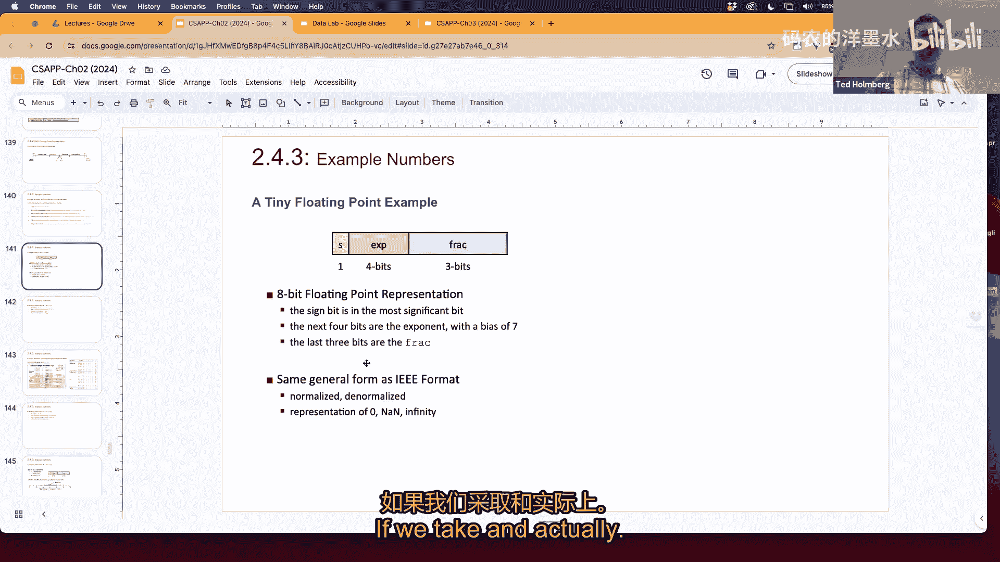

Try to run a representation of that inside of C。 So the first thing I'm going to do is I don't think I had set this up this is we're gonna to have ugly code today because I'm on my secondary machine I haven't configured my my syntax highlighting on my vim inside this machine so I'll have to set a profile up for this。

 but this is great you'll get to see what code inside of vim looks like if I if I use the default settings。

And this is a good day for it because I'm not so concerned about the implementation details。

 I'm more concerned for you to see the actual set of values that are possible using an eight bit encoding。

Okay， so let us take a look at this， yes， very ugly Co because now it's all。

Just white text on a black background。Okay can and here。

Let me start to go ahead and run this and then I'll just show you some of the highlights of the code that's worth mentioning。

 but what I really want to see is then we'll call this8 B。

What I really want to see here is going to be the results of this so while that's compiling one thing you can see here that i'm using is i'm going create a strong that is going to represent the three partition sizes for my tiny float so in this particular example that we're going to look at my sign bit is one right because we're going to have eight bits that represents our tiny floating point numbers four bits are going to be reserved to our exponential value or eP and three bits are going to be reserved for our frac so that's going to be our。

Okay， so with that said， I'm going to create a helper function that's going to go ahead and print。

The state of my tiny float in terms of its binary vector， which。Is each of its partitions。

 what is the value of each of its partitions， and then I'm also going to define whether that sequence represents a special case。

 whether that sequence represents a denormalized case or whether that sequence represents a normalized case。

😡，And then I'm actually going to show you what the value。

 the translated value based off of the IE standard would be to parse that based off of a eight bit。😡。

A bit sequence that's subdivided the way we see here。😡，Okay， let's actually run this。

And then here I want to say inside my main， you can see I'm just going through and I'm going to iterate and loop over every possible value that I can encode in a tiny floating point number。

 so this will show you effectively the exhaustive complete set of values we have if we limit ourselves to one byte floating point numbers。

😡，And then I want to look at smaller ones too， so we can actually get something a little bit more survey。

But even this， you'll see how tiny this ends up being and what the values are so here we can see let's let's。

So an example here。We get a decent number of values right like we know how much encoding we can do using using a full byte that's going to be 256 different representations。

 so here we can see that I have my zero value I have my denormalized values which are going to be close to zero and you could see how small of zero even with just a single byte we can get。

Now， keep in mind， this is the exhaust of the list。

 so we don't have any values inside of our tiny flow data type that's in between these。😡。

So when we do any kind of math just like you would in an integral math。

 you're actually hopping from one unit that's available to you to the next unit。

 that's what we mean by approximations， we're going to really see the consequence of this when we start talking about adding floating point numbers together and multiplying floating point numbers together。

😡，So what you see here is every possible representation。

 so you could see we have these very small values and then once we get a little。

Outside of that bandwidth of what we consider close to zero。

 you can see we start hitting our normalized values and this is all based off of what's inside of our EXP register remember in our EP register。

 I mean partition not register， this isn't machine code， but inside of our partition here。

 if it's all zeros， that's the case where we say it's a deormalized value and that is always going to resolve to something that's very small。

The moment we start encoding a one bit anywhere inside of our EP space。

 then that's when we start our normalized value。 that's the more definite conceptual term where when you look at your bits your bit sequence。

 you know just just by examining。😡，The zeros and the ones。

 whether it's a normalized or denormalized value。Here you can see we're incrementing up with our normalized values and we go all the way up to 240。

And we can go all the way to minus240 with an eight byte sequence， but notice。And this is。

Where I was trying to stress last time， but I think when we can see the exhaustive set of values that's given to us。

 you could see。What it really means to be an approximation inside of a floating point。😡，Encoding。

 if you see here， I jump from minus 224 to minus 240。I don't have a representation between that。😡。

So if I'm doing addition and I'm limited to a single byte floating point representation and I'm adding two values together。

 I have to do a lot of rounding。To decide which is the next unit Ive jumped to if I don't have it available to me as one of my representations。

😡，This is why it's super dangerous to use floating point numbers for anything that really requires precision I know they talk about that in 1583 they probably talk about that in 2120 they probably mentioned in an assembly and even in assembly you probably were starting to cover these concepts it sounds like you're starting to talk about this inside of computer org right so I don't know maybe in computer org they'll show the same thing where I think this is valuable though to see exactly what it means to be in approximation a consequence of trying to get those very large representation with a finite number of bit sequences means that you have holes in your number sequence between values。

😡，And so that can cause erroneous behavior， which is why it's always， always。

 always better to use doubles over floats， gives you double the precision。😡。

And when you're always dealing with an approximation， especially once you start operating on it。

 once you start adding to it， once you start subtracting from it。

 once you start multiplying or dividing with it， you are going to get something that's close but not maybe exactly to what was there。

 which is why you start using the rules similar to in calculus where whenever you do have to compare anything that is a floating point approximation。

 you use some error thresholdholding to say if it's at least within this distance of this other。😡。

Floating point representation， then it's effectively the same。😡，Now， fortunate。

 64 bit encodings give us a very deep pool to go ahead and utilize。😡。

This is and actually let's keep getting smaller that was the entire point so here we're looking at the aid bit let me。

Let's。Let me screw this up here as it that way。Okay， so now let's do。

Because I kind of I want to keep going down this rabbit hole， we see the range of an eight book。

Looking at six feet that。Supposing I want my sign bit to be one bit of encoding space。

 I want my exponential to be three bits and I want my fractional to be two bits。So let's clear this。

That's now。And what is this， let's call this six bit。Okay， so this is。

 as you can see based off the source code， the same encoding scheme we're just reducing and we're going to see what consequence that has。

By just removing two bits from my encoding scheme。 Now you can see the exhaustive list we have is much smaller than what we had before。

 You can see that our deormalized numbers。Are further away from zero than we had before。

 we don't have as many spaces， as many binary sequences on just two bits。😡。

To get a lot of denormalized values because remember。

 that fractional space represents how many dennormalized values I can have。

 the exponential space represents the number of normalized values I can have。

And then this would be my normalized values here and then in this representation I have a min to max of from 14 to minus 14 and then you could say when I have all ones inside my exponential field that's when I'm going to have like my infinity of my Nands。

😡，You'd see if it's anything in between all zeros and all ones。

 that's my normalized space when my XP field is all zeros。

 that's my deormalized space and when its all zeros for the bit sequence， it's a zero value。

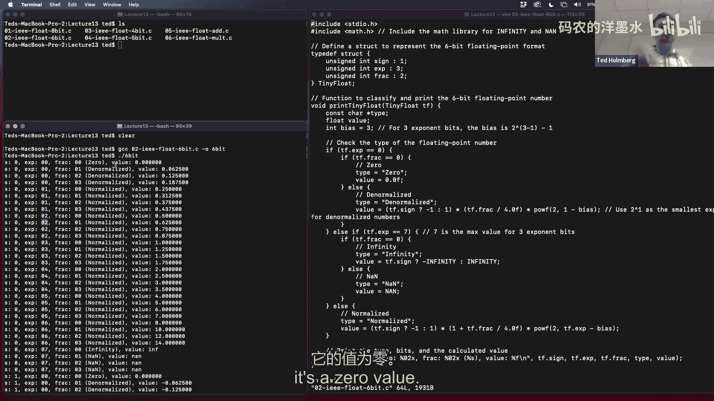

Actually， I think I can tie this in to。Yeah， so I think the。

The book gives for the eight bit sequence like a chart that you can look at I think it's much easier just to see the source the the output from our console log but going to the six bit format which is also an example given in the book but the book gives is this so what I wanted to do was map the exhaustive list so we can actually inspect it towards this。

😡，Set of values that are plotted across an access， a numerical access。 So notice we get the way that。

The IE floating point standard works now now that this is。

Surveyable because usually when you're talking about 32 bit encoding 64 bit encoding。

 you can't really survey the number of values you can encode when it's six bits you can and in fact will go smaller and smaller all the way down to four bits're not going to go any lower than four bits on this。

😡，But you can say that an affordance that's given to us in this encoding scheme is it propagates a lot of our encoding priorities towards the zero space and immediately around there look at how dense and clustered our set of normalized values are our denormalized values as we already saw when we only have three bits to encode is going to be eight deormalized values that makes sense right that's the number of combinations you can have。

😡，For three bes， when your three exponential bes or exponent bets are zeros。

So I'll have eight values there。And then the rest of the values are going to be normalized。

 but notice as we get to the extremes， our holes get larger and larger。In between values。

And then finally， the very ends represent our infinity。

 so this is all this is doing this mapping visually this right here。😡。

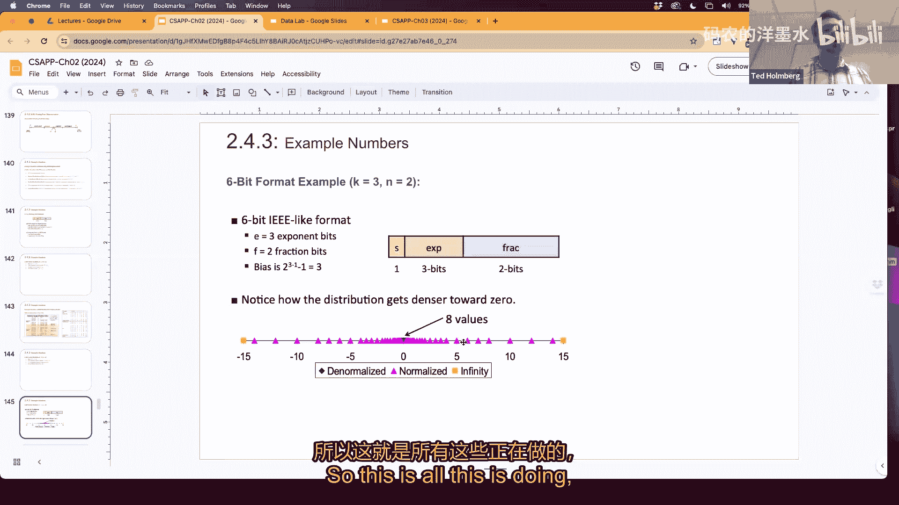

Does that make sense？Has this given you a more realistic understanding of what the floating point representation is actually doing in binary？

😡，喂。At the end of the day， all we're really talking about is how we're saving our data。

 how we're storing our data， our representations， whether in this instance it fractional numbers before then was integral values in binary sequences。

 but it's important to understand the limitations of our encoding schemes。

 and I think you can kind of see now based off of the formula we presented the three independent variables that were states that a floating point representation requires that given a particular sequence what our max number of representations on。

Make sure there's no comments here， perfect， okay。

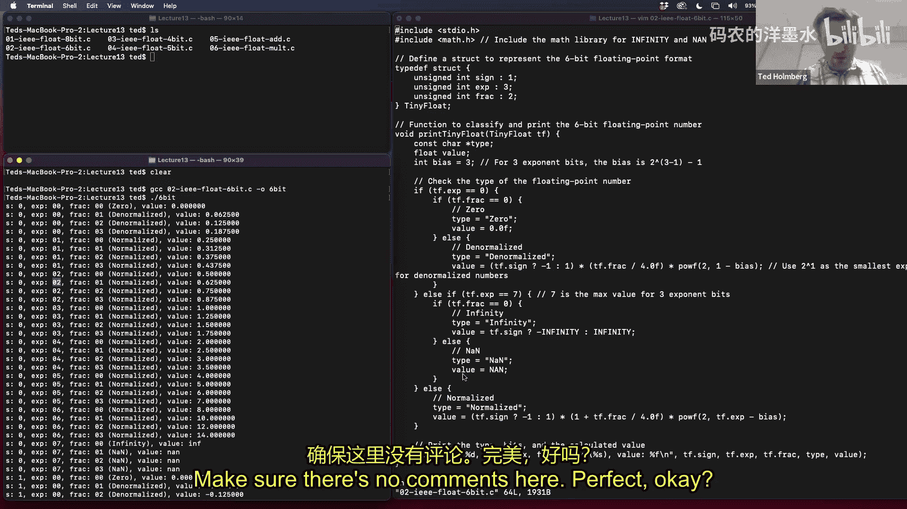

Let me see heres are going down this list， Okay so。Maybe we were to zoom in。

On that visualization now because again， you could see we have a dense clustering of our normalized terms and then we just the eight deormalized terms。

 you could see right here those will be those eight deormalized some will be on the negative side。

 some will be on the positive side and then zero counts as one of those encodings。

And to notice how the spacing is kind of。Evenly distribute it all the way from minus 0。5 to 0。

5 and then it starts to elongate and it'll continue to elongate as you keep stepping further and further from your zero encoding。

😡，Okay， so here。Is an example of a five big case again pulled from the book now we can either view this。

On the chart just like this where it shows our bit sequences where the first it's subdivided into。😡。

3 partitions， this first partition is our sign bit this second partition is our our exponent bit and this third partition is our fraction bit so we can see translating this into the given formula。

 we can read。Evaluated it as the value or its decimal representation。😡，So zero， one quarter。

 one half， three quarters， one。Five quarters， six quarters， in fact。

If we want to see the exhaustive list， I just so happened just to go ahead and make a C code to show you that this chart lines up exactly if we were to implement this in C and display all those values and stick so let's take a look at that me cancel to this。

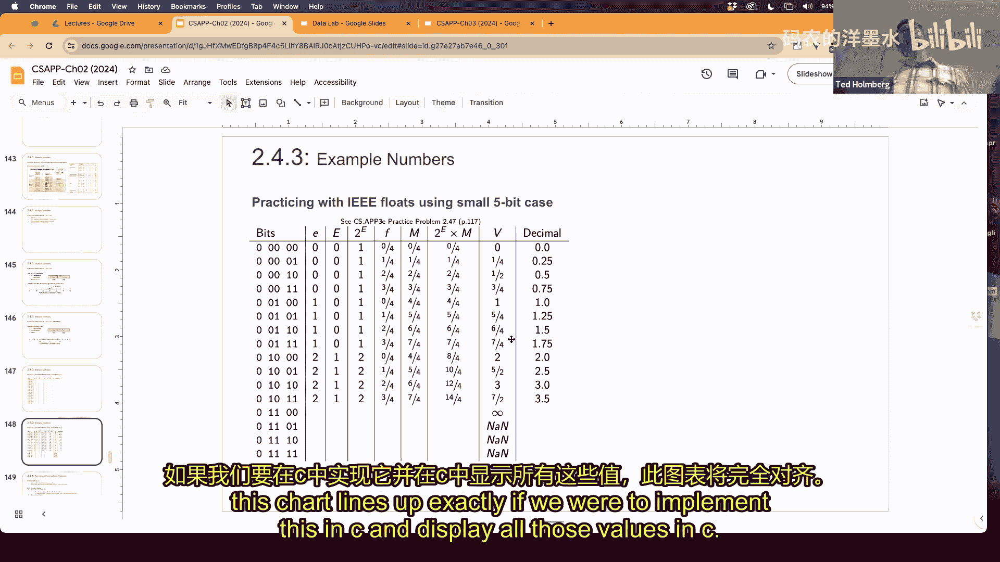

Let's do this0 three。no。I want。I want， I guess04 for some reason I jumped to four bit。

Is that a five bit？Okay so here you can see just like in that representation here and let me clear this before I start talking。

Zero， four。Yeah， that's perfect， let's call this five bit。So just like you saw on that example table。

 the first bit in the partition bit sequence would be the sign bit。

 the next two bits would be your exponent bits， and then the next two bits are going to be your fraction bits。

😡，Okay。Let's see what and then we will compare to the table so you can see if we look at or normalized our deormalized what our infinity values and N values are all mapped to like I was saying earlier we actually have two mappings for zero This is when the sign bit is one so that's actually a negative zero this is when our sign bit is zero so that's a positive zero right just a consequence of this mapping scheme。

And then we approach unilaterally both ways。And of course。

 obviously the reason why we need to have a negative zero is so that we have an even distribution of spaces between our zeros。

So we want to be approaching from both ways， so it's even the divisible for our representation purposes that's super important with our floating point numbers since we want to support signed and and well。

 negative and positive numbers in the same way and not have it all amongst them。Okay。

 so actually if you look at these values right， 0。25。5 0。751，1。25， 1。5， 1。752 2。53，3。5。

 that's the max number we can get to with five bits， right？

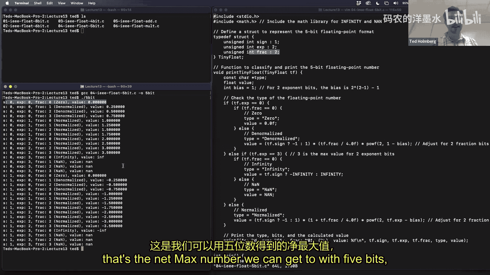

And so here you see that maps quite cleanly to what the book gives you。

So just some source code that I think helps supplement what the book gives so you don't have to just trust it you can actually see it and you can actually see the code that represents these very tiny floating point representations and so here we can see both the fractional depiction and then the decal depiction。

For only when the signine bit is zero and then the N and the infinity encodings。

 what you're going to state that's also included here is when the sine bit is one。

 and so then we're just taking those same set of values and we're applying a negative sign in front。

😡。

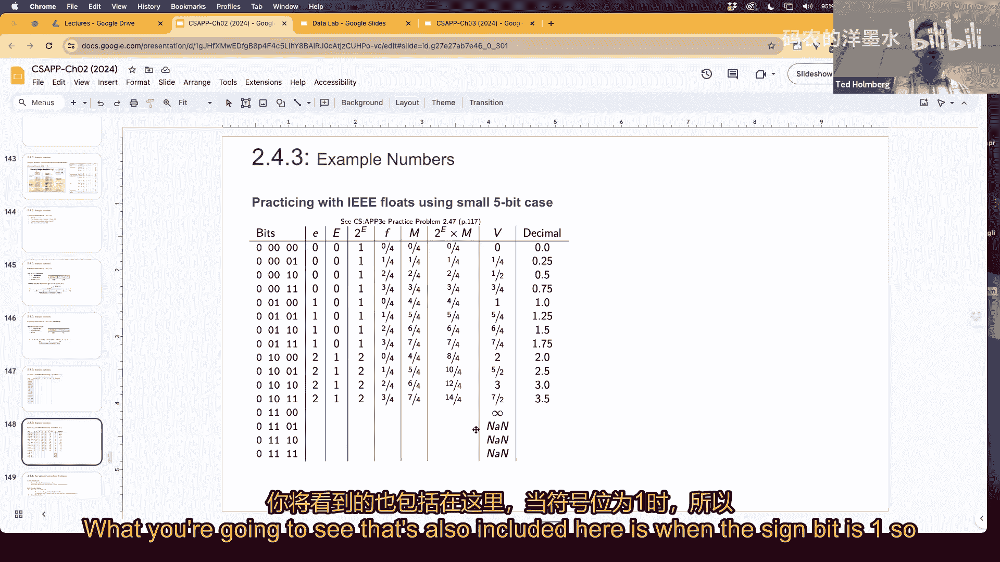

But the actual like magnitude of the values the same。Okay， and just for fun。

Let's look at the four bit representation， then we'll just move on。

And we would have looked at tons of tiny eventss。Or tons of tiny floats。

So here to try to represent a four bit representation for our sign bit。

 we'll just have one bit for our exponent bit， we'll have two and then for a fractional bit。

 we'll do one。And I think this one。Now， it was three。Okay。

And the reason why I want to do this is because this is incredibly surveyable okay。

 so with four bits， we don't get a lot of encoding space so we could see our exhaustive list is just these sets of values。

😡，So notice I have my zero term， my deormalized term of 0。5 and minus 0。5。

 so I only have three deormalized terms with this four bit representation。

 the rest are my normalized terms which would be 1，1。523， and minus1， minus 1。5 minus2 and minus3。

 and then anything outside of that is an infinity value， then we just go to infinity or not a number。

So if I were to try to use this to do math， those are going to be the only values that I can map to whenever do my operations like an addition operation or a multiplication operation。

 that would be the exhaustive list。😡，Now we don't encode any numbers in like four bits。

 but the entire point of this is just to show you that it we are we are afforded a max number of values and so this has。

Huge consequences for addition to multiplication division and subtraction and all your other me operations and that's what we're going to look at next so we have to know what are we going to do if we try to add two floating point numbers and that value is just in one of those holes that makes up our sequence well then we have to use rounding。

By default， that is the solution。

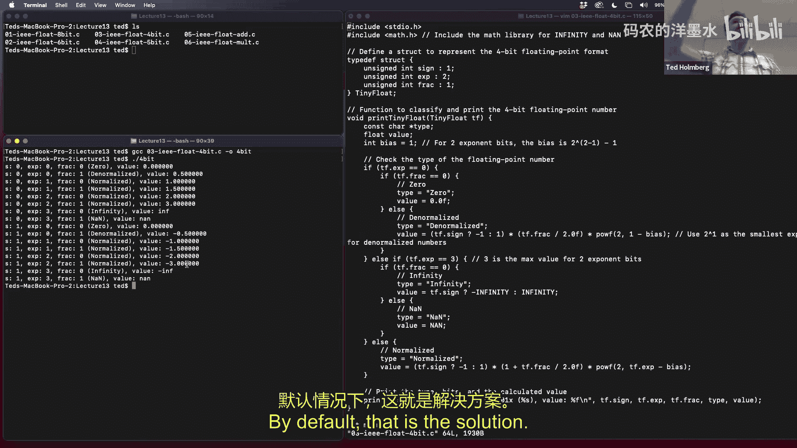

Let's look at the different rounding schemes we have as well。So in rounding。

You could either round to even。You can round towards zero。

 you could round down or you can round on there's lots of ways so。

And so every time we produce some kind of arithmetic operation。

 we would do the operation like normal and then we would round down to the next like value that's actually encoded for us。

It。So here， the entire point of rounding is to str to find the closest representative value。

 given the values that we do have。So let's kind of explain the behavioral differences between these rounding。

 the one that's used by the IAE is this round to even the idea behind it is it rounds to the closest value so for instance if it's 1。

4， it would round down to one。😡，If I'm rounding to the in this instance。

 if I'm rounding based off of the nearest integral unit to keep it simple。

 but in IAA it would round to the next unit that it can map to so suppose I'm mapping to the integral units。

 then 1。4 the next closest one would be one right 1。6， the next closest one would be two。😡。

Now you always have in this concept of rounding this odd choice where what happens if you're evenly？

Distance between two values， so in the instance of an integral and in the instance of base 10 math。

 what happens if it's 1。5？😡，Do you go to one or do you go to two？And so for round to even。

 you round to the nearest even。Yes。Does that make sense， so if it's 1。5？

The nearest even would be two。If it's 2。5， the nearest even would be two。

Does that make sense so round to even is really communicating that on the edge case that it's a 0。

5 value that you have equal distance， well， the equal distance you're going to be between is an odd number and an even number so you always choose the even number。

😡，And that is the basis that it uses for its rounding logic。Okay， let's talk about round toward zero。

 round toward zero means that you round positive numbers down and negative numbers up。So minus 1。

4 would get rounded so round to zero， you're rounding towards the direction of zero in both directions。

Round down means that both positive and negative numbers are go downward and roundup means both positive and negative numbers round upward okay these are text descriptions I have another slide that actually gives examples let's actually look at the examples and just make sure everyone kind of understands the behaviors because as we stated rounding is a critical part。

😡，It's a fundamental part， it's an inherent part of floating point representation for doing operations on。

😡，Which is crazy right we already said that just taking a floating point representation was already lossy and now what I'm saying on top of that is operating onto two floating point representations is even more loss。

😡，Okay， so Ro to even， let's look at this 1。4， well， that's going to go to one， right？

Ca that's not a that's not an edge case 1。6 that's going to go to two 1。5 is our edge case。

 so we round the nearest even number， that's going to be two 2。

5 we're going to round to the nearest even number， so that's going to be two minus 1。5。

 we're going to round to the nearest even number， which is going to be minus2。

Let's talk about round toward zero。😡，Here at 1。5， we're going to round fors， we're zero。

 we're trying to go in the direction of zero， so we'll round that down to one， 1。6。

 we're going to round that down to one。😡，1。5 we're going to round that down to one， 2。5。

 we're going to round that to two， and then minus 1。5。

 we're going to round that two minus one because we're going in the opposite direction。

When were talking about rounding down， that means we use the similar behavior regardless of if it is a positive or negative value。

 so on the instance of 1。4， we round that down to  one， 1。6， we round that down to  one， 1。5。

 we round that down to 1， 2。5 is to finally minus 1。5 gets rounded down to minus2。😡，Right。

 so we're always shifting towards the left。😡，Which in this instance made the number more negative。

A bigger magnitude versus a smaller magnitude versus the positive version。😡，And then on rounding up。

 it's going to be the opposite effect between positive and negative numbers， so off my 1。

4 becomes a two， my 1。6 becomes a two， my 1。5 becomes a two my 2。5 becomes a three， my minus 1。

5 becomes a minus one because we're shifting towards the next right hand side value。😡，So again。

 look at the difference between my 1。5 and my minus 1。5， this comes to  two versus the minus1。

So that obviously we don't want to round down and round up because we get different behaviors depending on whether it's a positive or negative value。

 one reason why we avoid those rounding schemes。😡，W the actual avoids those roundsing schemes and then round to zero。

啊。Gives a more kind of consistent behavior， but the reason why you don't necessarily want to always round down to zero is because you're always kind of truncating the number in a way and so sometimes if you're trying to round in a way that you're not always losing value but sometimes gaining value that's what's afforded to you by round to even sometimes you're bumping it up sometimes you're bringing it down so statistically it provides a more reliable。

😡，Behavior in terms of mapping to something that we would expect。😡。

So that's why you're probably using a rounding scheme you've never seen before。

 I'm sure you've seen all the other ones， right？Okay。Yeah， so why rounds it even。

 as we stated earlier， it avoids those statistical biases and calculations。

 so half the time we're rounding up， the other time we're rounding down。And now in terms of examples。

The examples where we'd actually see this is not usually on integers right it's going to be when we start talking about these。

😡，Numbers where we're going down to the lower precision points。

Where we're having to examine the granularity and take the next set of points that are going to be on the far end of our radx point。

So these are just some examples to show。That's。How we how both these， both these values is 1。

235 and is 1。245 but round down to 1。24 if we looking for two precision points。

Versus what is at three precision points？And of course that's why rounding maps right。

 because you're always looking at how do you fit whatever you have based off the precision points that are afforded to you。

Okay， I think everyone pretty much kind of gets an understanding。

 is everyone pretty comfortable with this concept？Okay， so again。

 the real motivating behind this rounding is because it has major consequences on all of our arithmetic operations。

For when we decide to add when we decide to multiply or subtract or we divide so the basic idea here is we would first compute our exact result。

And then。Now we can have that exact result mathematically， but based off of your bit sequence。

 you might not have a representation of it inside of the system。😡，If you're using a floats。

 it's possible， even if you're using a double， it's possible that the resulting value is nonexent in the decocoding。

😡，So you first would compute that， then make it fit into your desired precision。

 then possibly overflow the exponent if it's too large and then you round to fit into your fraction partition that's the general concept of how we manage the operations so that it goes from a mathematical theoretical component into a practical applicable systems implementation。

😡，Okay， and again， if we're going to do any kind of floating point values。

Just like we said with integer Ed。You needed to make sure your binary sequence is。

We're the same size and so you would sometimes pad zeros so that you always use the same number of bits in each operation the concepts the same with our fractional values as well our floating point values we have to ensure that all of our binary points line up and if necessary you zerofi the least significant bits before you do the addition that seems pretty obvious though right but it's going to be stated just so that everyone's on the same space with that so that everyone's on the same concept with that。

And then here I think we have multiplication okay so let's take a quick example of what floating point edition looks like now you already know what it looks like clearly because you've coded using doubles and floats as early as Java one so let's look at what floating point addition looks like and why it can be and what it means for that rounding concept to actually occur by doing it by defining it on our five bit tiny float。

So here， let's take a look at this。No， not multiplication we want。Okay。

So we have some source code here again I'm not super interested in the source code because I'm not really entailing you to implement your own fractional numbers I'm just showing you that this is available and that you can see at least what the makeup is of our fractions of our floating point value we'll have one bit for the significant the design bit two bits for the exponent bit and two bits for the fraction bit we've already seen this implementation before just a moment ago but now what we've done was we've added a ability add tiny float that takes in to float values and we'll add them together and apply the rules that are stated for the I triple bulling and we're going to see what the result of that is so let me。

😡，So i'm more concerned about what the resulting behavior is going to be because I think that's what's more critical for you to understand so was this five。

Yes， okay， and let's call this add。So here， let's run my。Oops。

So let's run add so the first thing I'm going to do in add is just to remind you what is the complete set of numerical encodings that I have for my five bit floating scheme so I show that all the values and then to prove it to you I show you the binary sequences as it's subdivided into the different partitions。

😡，Between the sign bit， the exponent bit and the fraction bit。

So here are so when we do our addition operation and so for our addition operation say for instance。

 we're going to take this representation， which is 1。

25 which is on there right that's why I want to show everything there and then 2。5 I want to add。😡，1。

25 to 2。5。 And so notice the actual value isn't actually there， right。

 we can't actually encode the resulting。Operation that's going to add those two together because what I should expect is 3。

75， right？But when I look at my exhaustive list， I don't have a 3。75。

So what I get as a result is going to be a 3。5， which makes sense because that's when I factor in my ability to round after I do my addition is going to be the next assignable value inside of my encoded scheme。

😡，Okay， is this really making it more clear what's happening with floating point numbers。

 it's not how it is lossy on both addition and it's also lossy on representing actual sets of values or creates holes in a number line。

 which has super consequences when you start trying to add numbers together or multiply numbers。😡，嗯他。

Let's also。我没有。

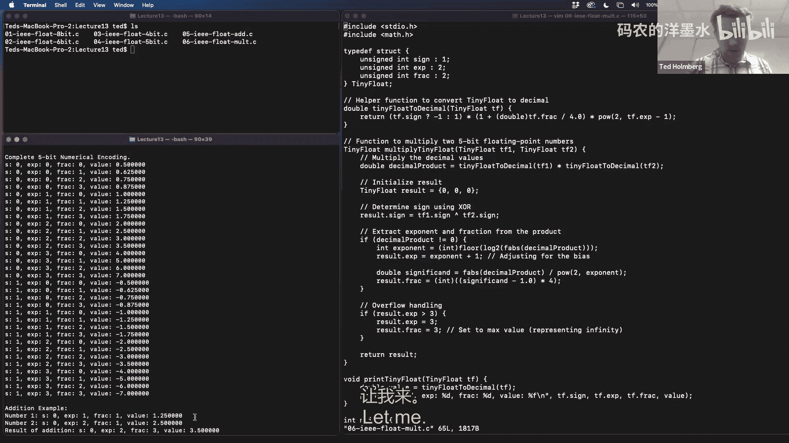

Clai out a this。Okay。So then the next thing I want to talk about then is we already know。

That we have to go ahead and。And round with the addition。

 we'll have to do the same thing with multiplication。

 but multiplication is kind of an interesting thing because now we can start multiplying by values that are under one。

And so here we're not going to spend too much time defining。The floating point multiplication。

 but what we will do is we'll take and look at an example with our five bit tiny float。

 just like what we did with addition。They have all these various。

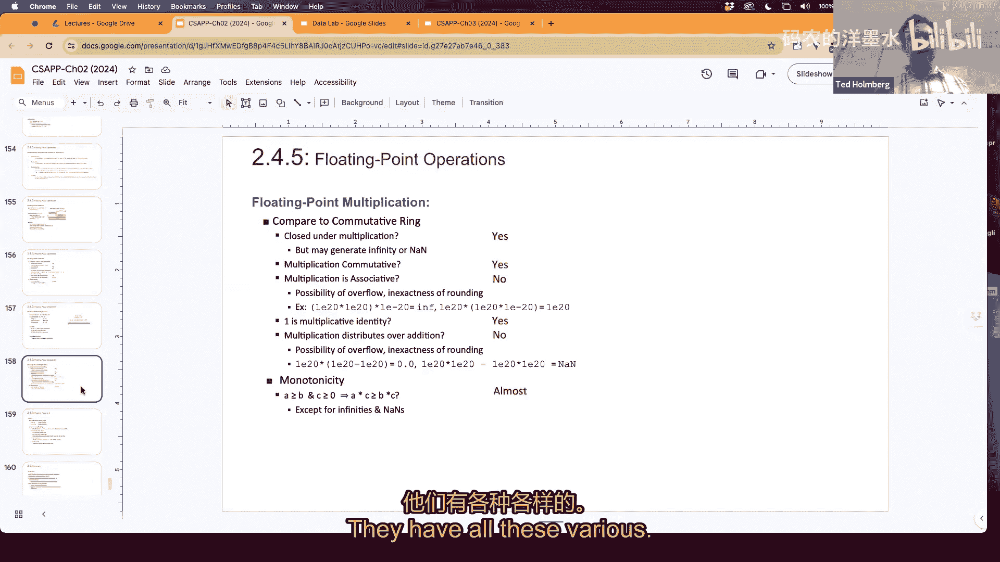

Here， let's。Still， what is this？Yeah， perfect， and let's call this moldl。And so here。

 when we run our multiplication。You can say， oh。Here you can see that I have decided to take a value that's under one。

To illustrate one of the interesting novel things of multiplication for floating point values that's not true necessarily for integral values since you don't have 0。

5 since you don't have values smaller than one and then we're going to multiply that by 2。

5 and so since this is the same encoding sequence we can see yeah look we had a 1。

25 we know that because I used it in the addition so we can actually this is an instance where I did have the number I could represent and in fact my number is half the size of my left operant。

So just some examples of how we can operate our floating point numbers。

 but why rounding is a factor and why like why it's critically so and why you should be aware Okay。

 so with that said I。

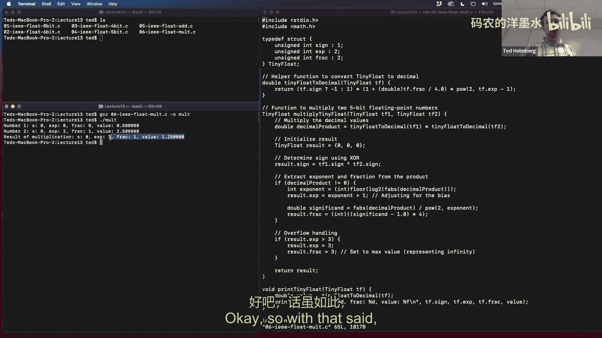

I think for the most part， that's the theory that's given to us inside the chapter of the book so we've really talked about。

Everything that's critical in chapter two in terms of how we represent our data in form of binary sequences and how all data inside of our systems at some point has to be quantified。

 which means represented in the form of a number， and that's true whether it is textbased or whether it is numerical- based initially or whether it is an image or whether it's a sound or any other format。

 we as software designers as software engineers have to find a way to represented。😡。

As a number and then once we have our number of representation， we have our integer types。

 which we've looked at。And we just looked at our floating point， our fractional types。

And so to build off of that the way that C handles the floating point numbers。

 so we saw how we're giving a standard generic term of having a bit an exponent bit or exponent field and a fraction field。

😡，For say， those are defaulted to our float and our doubles。😡。

And then of course we can try to cast but we know the casting operations that can happen with those and so the one thing I want to leave off after talking about our floating point numbers is you can now see if you're building a serious application and if you have。

An ability to model it using an integer versus a versus a floating point number you should always opt to do in integer value'll give you an example if you're going to up to this point have you had to implement we might have already talked about this。

 but this seems like an app time to talk about it again just highlight this if you have to create an app。

That does anything related with managing money， what is the best way to represent money？一。😀Yeah。😊。

So like， so it would be ideal， you could see， first of all， you could see the possibilities。

 the pitfalls， the dangerous idea of representing it using dollar units right because dollar is not the smallest element that defines money。

And because of that， dollars naturally inherently have fractional representations。

 like you can have something that is $1 and 06 at 60 cents。Since it's probably right？

If I'm remembering correctly， based off of percent of percent of adult。O。What now。

 but what I've already stated is that money does have a elemental unit right。

 what is the elemental unit of money？Yeah， a cent。So。Now。

We're going to assume it's aent for most applications because you could probably create an argument for some applications where things can then be。

Broken down into partial sense， but we'll make an assumption when we start building the specifications that acent represents the smallest units of currency and so if you wanted to make a really solid application now knowing how fractional numbers work and that you can potentially have lossy representations when you start adding them or subtracting them or dividing them and then all of a sudden some money either mysteriously disappeared or appeared because of the rounding behaviors。

😡，Which could cause all sorts of complexities if that then has to get translated into real money。

It illustrates why knowing how that representation is done， you just don't mindlessly say， oh。

 let me represent this as a float value， let me represent my dollars in terms of a cent value and each dollar then will be 100 cents。

😡，It might seem like a more clumsy way initially， but one of the values of this class is peering under the hood of our data types gives us a better understanding of when we should use a particular type over another。

😡。

