# C语言系统编程：第13讲：浮点数（第二部分） 🧮


在本节课中，我们将继续深入探讨IEEE浮点数表示法。我们将通过分析微小的浮点数示例，来理解这种表示法如何允许我们编码极大或极小的数字，同时也会揭示其固有的近似性本质及其带来的潜在问题。

上一节我们介绍了浮点数的基本构成，本节中我们来看看具体的编码示例及其含义。

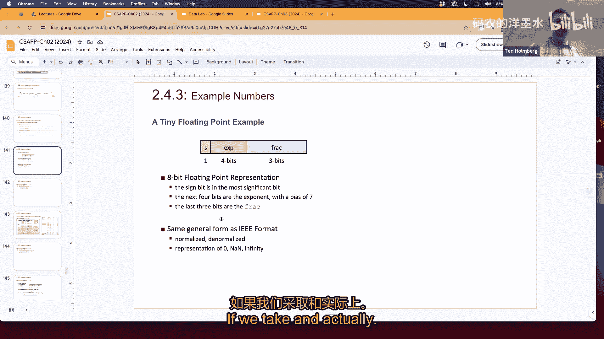

## 浮点数的三种情况

浮点数通常分为三种情况处理：
*   **非规格化值**：用于表示非常接近零的数值。
*   **规格化值**：用于表示距离零较远的常规数值。
*   **特殊值**：用于表示无穷大、未定义或非数字（NaN）等情况。

## 微小的浮点数示例

为了清晰地展示浮点数的表示范围和近似性，我们将使用比特数远少于标准单精度（32位）或双精度（64位）的编码方案，例如8位、6位甚至4位编码。

### 8位浮点数示例

我们首先定义一个8位的“微型浮点数”格式：1位符号位（s），4位指数域（exp），3位小数域（frac）。

以下C代码片段定义了这种格式并遍历所有可能的值：

```c
// 示例：定义并遍历8位微型浮点数的所有可能值
void print_tiny_float_8bit() {
    // 格式: s (1位) | exp (4位) | frac (3位)
    for (unsigned int i = 0; i < 256; i++) {
        // 解析符号位、指数域、小数域
        int s = (i >> 7) & 1;
        int exp = (i >> 3) & 0xF; // 4位指数
        int frac = i & 0x7;       // 3位小数
        // ... 计算并打印对应的数值表示
    }
}
```

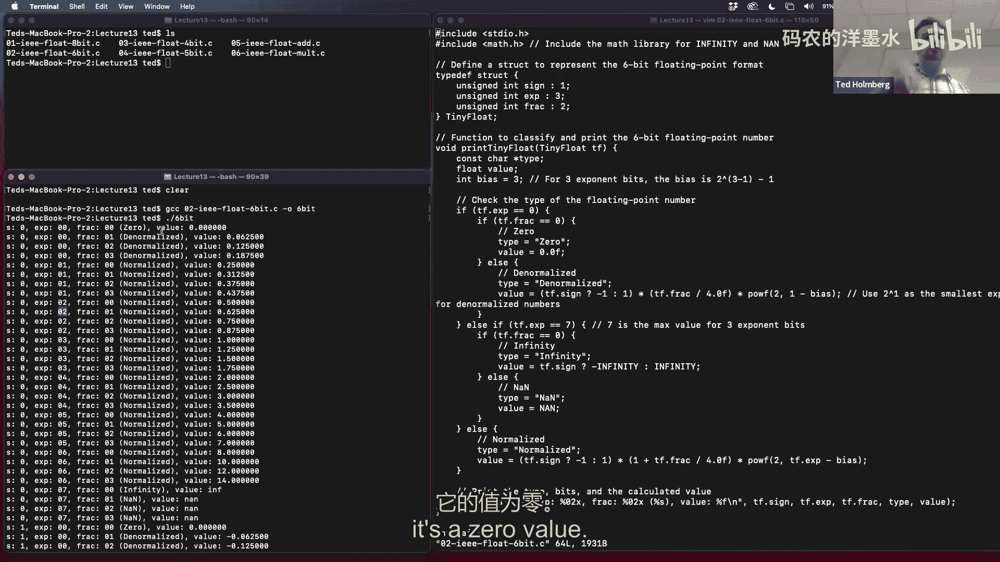

运行此代码会生成一个所有可能值的穷举列表。观察列表可以发现：
*   数值在数轴上的分布是不均匀的。
*   在零附近（非规格化区域），数值分布非常密集。
*   随着数值增大（规格化区域），数值之间的“间隔”或“空洞”变得越来越大。
*   例如，在某个区间，可能直接从-224跳转到-240，中间没有其他可表示的值。

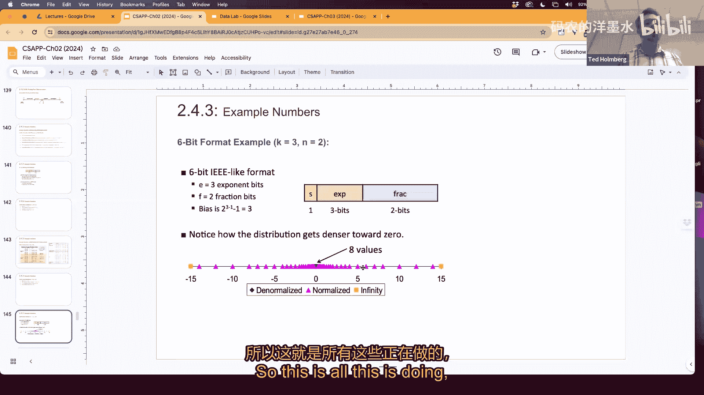

这直观地展示了**浮点数是近似表示**。当进行加法等运算时，如果精确结果落在两个可表示值之间，就必须通过**舍入**来匹配最接近的可表示值。

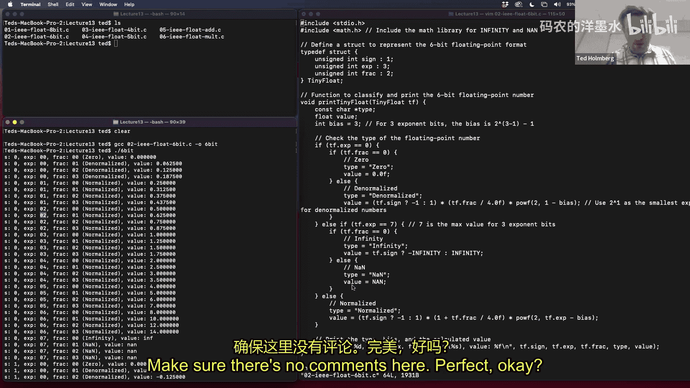

### 更小的编码：6位、5位和4位示例

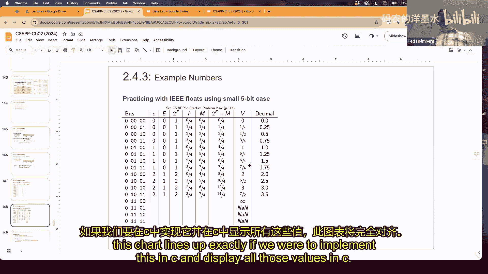

通过进一步减少比特数，我们可以更清晰地观察这种模式。

以下是不同微型浮点数格式的总结：

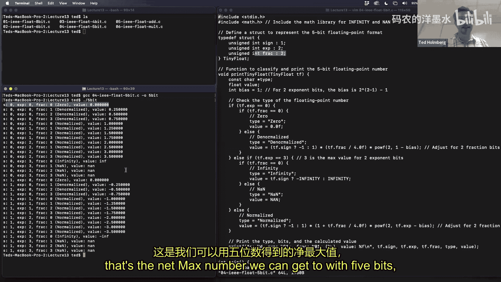

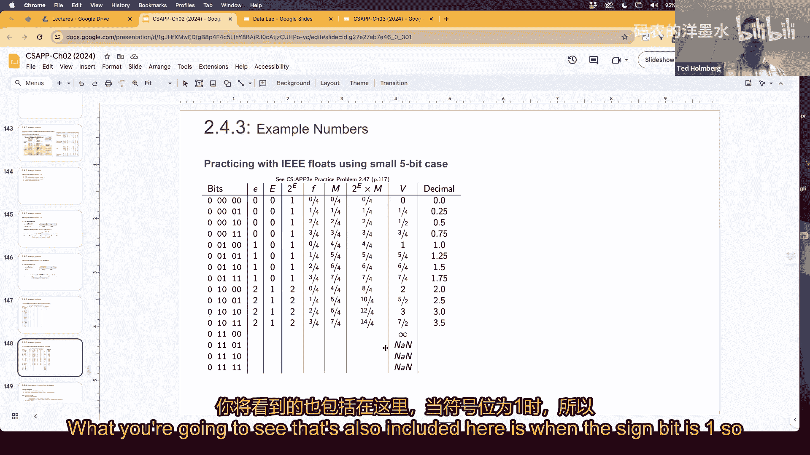

*   **6位格式** (s:1, exp:3, frac:2)：可表示的值更少，非规格化值距离零更远，规格化值的最大范围显著缩小（例如-14到14）。
*   **5位格式** (s:1, exp:2, frac:2)：这是教材中的一个例子。其所有可表示值（如0, 0.25, 0.5, 0.75, 1, 1.25, ... 最大到3.5）可以清晰地绘制在数轴上，显示出在零附近的密集聚类和向两端扩散时增大的间隔。
*   **4位格式** (s:1, exp:2, frac:1)：这是可调查的极限。穷举列表显示只有少数几个值：0, ±0.5, ±1, ±1.5, ±2, ±3，以及无穷大。任何数学运算的结果都必须映射到这个有限的集合中。

这些微型示例的核心启示是：**使用有限比特表示无限实数集必然导致近似和间隔**。这解释了为什么在需要高精度的场合（如金融计算），应优先考虑使用整数类型（例如以“分”而不是“元”为单位存储金额），并说明了为何在比较浮点数时应使用误差容限而非直接相等。

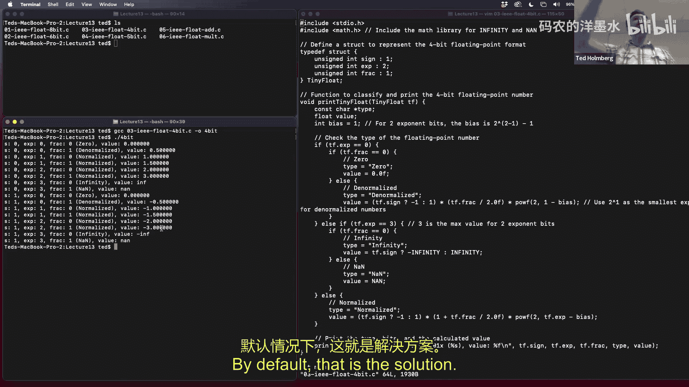

## 浮点运算与舍入

由于浮点数表示存在“空洞”，算术运算（加、减、乘、除）的结果可能无法精确表示，因此舍入是浮点运算不可或缺的一部分。

基本运算步骤为：
1.  计算数学上的精确结果。
2.  调整以适应目标精度（可能涉及指数溢出检查）。
3.  将结果舍入到最近的可表示值。

### 舍入模式

以下是几种常见的舍入模式及其在处理1.5和2.5等中间值时的行为：

| 舍入模式 | 1.4 | 1.6 | 1.5 | 2.5 | -1.5 |
| :--- | :--- | :--- | :--- | :--- | :--- |
| **向偶数舍入** | 1 | 2 | 2 | 2 | -2 |
| **向零舍入** | 1 | 1 | 1 | 2 | -1 |
| **向下舍入** | 1 | 1 | 1 | 2 | -2 |
| **向上舍入** | 2 | 2 | 2 | 3 | -1 |

**IEEE标准默认采用“向偶数舍入”**。这种模式在统计上更优，因为它避免了持续向上或向下舍入带来的系统性偏差。当值恰好位于两个可表示值的正中间时，它选择舍入到最近的偶数。

### 加法与乘法示例

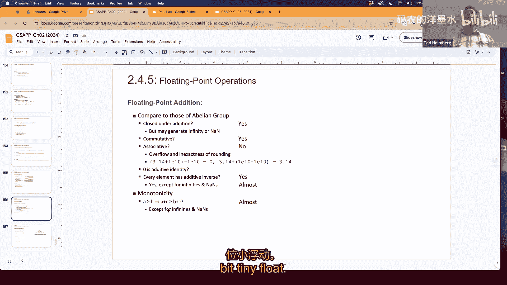

让我们在5位微型浮点数格式上观察运算过程。

**加法示例**：计算 1.25 + 2.5
*   数学精确结果：3.75
*   查看5位格式的可表示值列表：... 3.5, 4.0 ...
*   3.75并不在列表中。应用舍入后，结果被映射到最接近的可表示值 **3.5**。

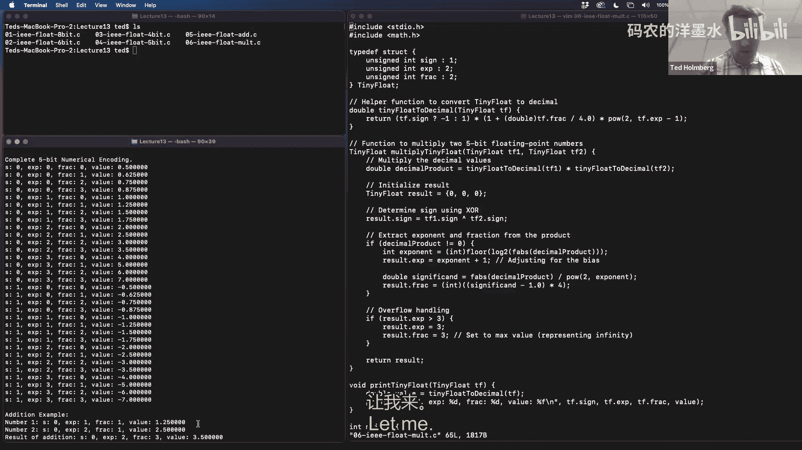

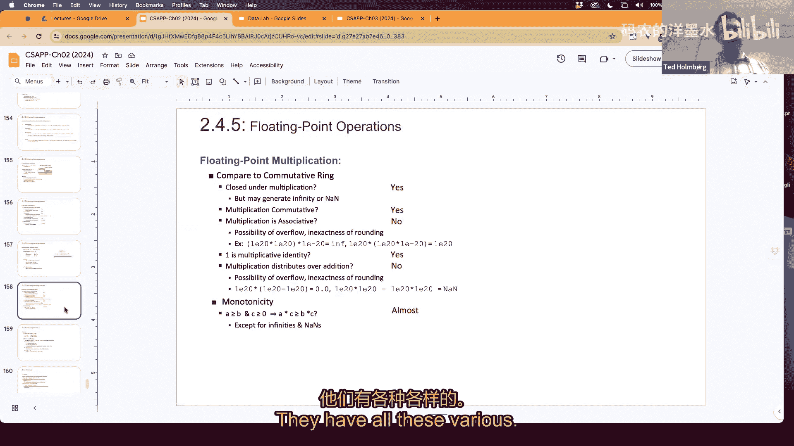

**乘法示例**：计算 0.5 * 2.5
*   数学精确结果：1.25
*   1.25恰好是5位格式中的一个可表示值，因此结果就是 **1.25**。

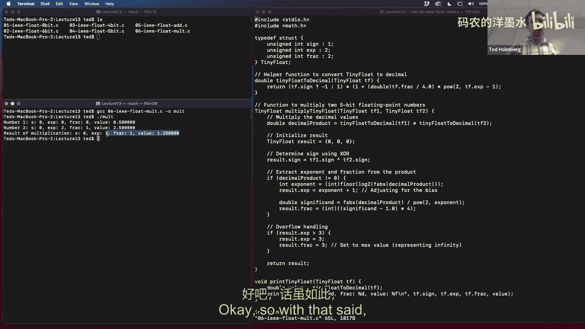

这些例子表明，即使初始操作数是可精确表示的，运算结果也可能不可表示，必须经过舍入。

## 总结

本节课中我们一起学习了：
1.  **浮点数的表示局限**：通过分析8位、6位、5位和4位等微型浮点数格式，我们直观地看到了浮点数在数轴上的分布是不均匀的，存在“间隔”，这导致了其**近似表示**的本质。
2.  **舍入的必要性与模式**：由于上述间隔，浮点算术运算的结果常常需要舍入。我们介绍了向偶数舍入、向零舍入等不同模式，并理解了IEEE标准采用**向偶数舍入**的原因是为了减少统计偏差。
3.  **实践启示**：理解浮点数的这些特性对于编写可靠的程序至关重要。它解释了为什么在需要精确计算的领域（如金融）应避免使用浮点数，而应使用整数类型；也说明了为什么在比较浮点数时应该检查两者之差是否在某个很小的误差范围内，而不是直接使用`==`操作符。

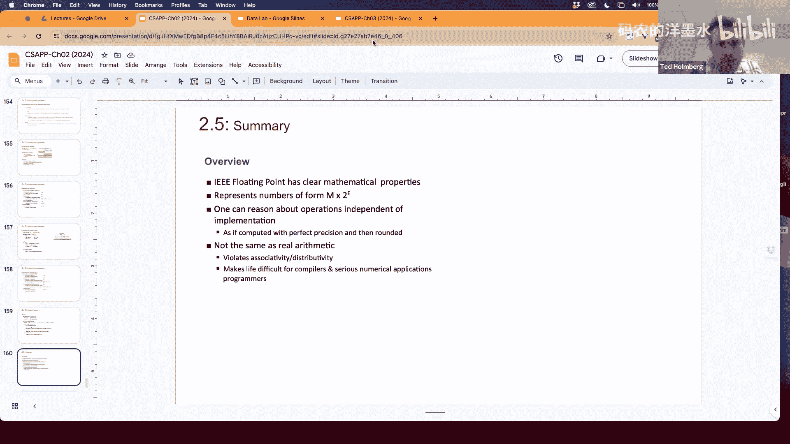

对数据底层表示的理解，能帮助我们做出更明智的编程决策，选择最适合的数据类型来解决问题。