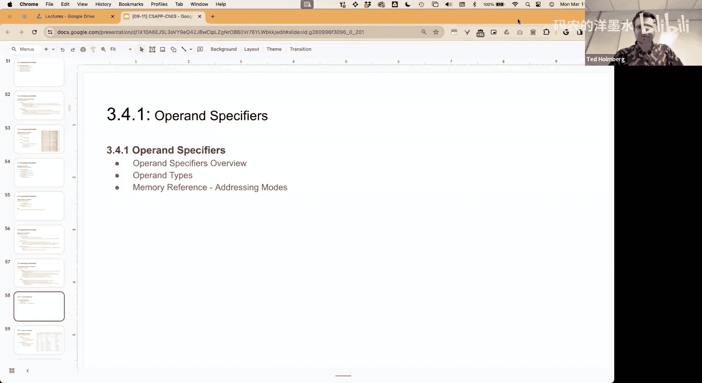

# 【全集】加州理工学院 C语言系统编程 中英字幕 p15 Lecture 15 - 汇编：编码与格式化 -BV1bUzWBLEiC_p15-

Okay， so like I stated it last class if you can remember because that seems so far away now。

 it's crazy how quickly last Wednesday feels when you're on Monday。

 but we had finished chapter two and we did a little preface into chapter three and what I had stated was I want to kind of run through the concepts。

That govern chapter 3 so that we can start using our lecture session more like an in-class lab and then I'm going to flip the classroom where if we focus on doing the lab content during the lecture hour where I kind of walk through and I can explain the concepts as it appears in practice then I'm gonna to become more relying on you to actually read the book to see how to generalize the concepts。

 we're going to actually be putting in practice in the class right there's always one of the difficulties when we have lecture do I want to show you how to do something and then you have to take the time to broaden the scope of it later or do I want to show you an abstract thing and then you have to actually learn how to use it on your own So we're gonna to pivot and see what way works best right。

 we spent a lot of the class doing。A combination of abstract and then these tiny little practice examples。

 but I think that the data lab with the Bo lab will' be much more hands on with that。

 but then I'm going to be relying on you to read the book to see the things that exist outside of what we actually do。

So with that said this lecture is still going to be a little bit of theoretical just make sure that we're we understand how we tie into chapter two and how that ties into chapter one of course chapter one is a nonsequior because that was a broad tour of a computer system at large that was a very big picture you and then we get very we got very granular in chapter two because we really talked very very deeply about how all the information that we can store that we process on inside of a system a computer system。

Can be encoded as binary strings and what the implications of that are and how important is to provide a context and a set of operations on whatever format we chose and we looked very deeply then on the very critical representations。

That drive the ability to thereby encode everything else。

 which was our integer data types and our floating point data types。

 So now that we've hardened our knowledge on data representation in。

The form of binary representations， I want to now go up an additional level。

 maybe move from the mathematical perspective and start looking more at the。

Engineering or the machine perspective。So now that we have all of these binary representations。

 how do we actually use them inside of the system and not at an abstract level。

 like the idea behind this class is to build from this very lowleve binary representation and motivate up towards this abstract representation that we use in languages like C or C+ plus or Java or Python right but before we can do that we have to go to the assembly level because all of our highlevel code kind of funnels down into a assembly representation which in itself is still an abstracted view that's human readable and easy to easy for us to author that effectively gets assembled into machine code and the machine code is what actually communicates with the ISA the instructions at architecture and everything else that binds to the hardware to actually start moving and operating and。

ulating our binary representations and so that's where chapter three is we're going to go from those binary representations and say okay。

 a system now has to do things to move the binary data to so that it can be process has to process it it has to move it it has a lot of different operations to do interesting things with it because so far all we've done was create a schema by which we can utilize where we can start representing things but now we have to build the hardware。

 the machinery， the mechanisms that can interface and and。

And what's the word I'm looking for kind of instantiated？

Okay and that's what this chapter is about so we already kind of gave the preface if you might recall last class so a lot of this I think is going to tie in to your assembly class right because a lot of your assembly class was interfacing with the lower level portions of what drives our underlyinglin system so i'm going to probably try to run through a lot of the concepts inside of this slide deck so that we can get to the more interesting lab component sooner rather than later。

That's my goal of this， we'll see if I can stick too。Okay。

Make sure there's no questions online perfect， okay。So let's see here。

 so let's ask some quick motivating questions， we're talking about machine code now because and by machine code。

 I want to distinguish between assembly and machine code right our machine code is encoded by our encoded byte sequences that represent the low level CPU operations。

And so these bicycle sequences can be loaded in memory so that they're addressable。

Our key functions of machine code， the things that they have to be able to do if we're going to be able to realize these byte representations and do meaningful things with them is data manipulation。

😡，Memory management。Input and output operations and network communications right so at the core this is what our system needs to be able to handle for us to build on top of that and start doing meaningful things So of course the role of our compiler then and so just remember a compiler is just an application it's a piece of software in itself that runs on our system but a highly specialized piece of software that translates our highlevel code and into machine code right something that you should already know。

It operates in stages。And it considers a couple of things one stage is it considers the programming language rules at one end of the pipeline。

 and on the other end of the pipeline it has to consider the machine instruction set。

And so it has to translate from our programming language rules into something that can then be abed by that can actually operate on our actual machine instruction set and of course every operating system is going to have its own set of conventions and so this can affect portability of code in very meaningful ways one of the big advantages again about Java and so this isnt this is something this is just one of the things that has been around for decades so we take it for granted but understand one of the reasons why Java became such dominant language as it were was because the JVM the JVM allowed you as a software developer as a software engineer to target your platform for compilation to be the JVM you'd have to worry if it was like a UniI system or a Windows system or an OS or whatever the hardware was right at that time some microsystems now it's oracle is the one responsible for ensuring that the JVM runs in all the hardware。

And then you as a developer can abstract away the complexities of having to ensure your code is compliant with a particular instruction set and you just have to make sure it runs on the JBM that concept is portability that's not always the case for other languages right like C is a systems level language and there are implementations of C as we've already stated that might be able to execute that might be able to run on one system and not another or it might run differently on different systems based off of how they define the different primitive types。

And we'll kind of touch briefly on why that might be the case when we look at a historical perspective of our hardware architectures。

 our instructions which are like legacy bound and still influence the way we like several decades later。

 like a generation later， maybe even two now still kind of code and so some of the design philosophies that go into software that what's that that phrase like standards never die right and so there's tons of examples where things that we build today or builds off a standards that were created like decades ago centuries ago。

Okay， let's see here。So of course。Since we're using UniX inside of our class。

 the compiler we use is GCC everyone should already be familiar with it at this point GCC is a great compiler it can we can go ahead and use it to assemble our code so that we convert it from a human readable version into our machine code it uses an asr to convert assembly code to machine code and a linker to then take what's generated into an executable right we all know this we went through lab zero where you actually go through the various stages of GCC one of the important concepts and I think this is highlighted the other slide as well is that there's effectively two forms of our executable like files we have our object code which which is kind of disconnected and they're all linked together into one executable file and that's what we can actually then tell the system to go ahead and invoke。

And so that's going to be the job of our linker。And just to highlight。

We have our high level code that's an abstraction from machine level details in languages like C and Java assembly level code。

 we can write low level instructions， but it's also a form of abstraction itself。

 but this is actually how coding was done in early computing they like for instance。

If you ever played the original Nintendo， all of the codes。

 all of the games that were developed for the NES was done in assembly。

 it wasn't done in a higher level language like C， I think that's true with the game Boy as well。

So we have it much， much nicer today than what developers had back then， in fact。

 they had to be incredibly resourceful。Back in the 80s and early 90s I got to said all of the 90s too。

 but the 90s were a weird time where like every six months you were seeing your processor speeds literally double up like you kept wanting to hold off on buying a computer because you would get something twice as good six months down the road。

And again， the advantages of our highlevel language is it's more efficient for us to be able to actually generate code right it's easier for us to do more with less and error detection too it's easier to try to identify bugs portability if you write in a high levelve language。

 even even those that are system level language is like sayy。

 it's going to be way more portable than if you write in assembly assembly is designed it's the very definition of hardware specific。

And so and also modern compiler optimization is another good use of highlevel code units because our compilers are probably going to be much better at optimizing our code than we could do if we did it by hand and we can actually toggle the optimization level from our compiler itself so there are flags we can pass for our compiler to say don't opt this at all for the purposes of debugging like things that optr code to run faster on your system is the same things we do with optimizing our code for the web has anyone done any web development before。

 is anyone familiar with the concept of minification of files So let's just put it this way I abstract the concept of what good compiler optimizer can do in the way that a web server and a web client can communicate because the concept the basis is relatively the same So understand。

The way that your browser communicates with the internet is you have a web client and a web server and so that concept of that server client relationship as you probably recall from object oriented programming where one object can act as the client and the other is a server and the client makes a request to the server and the server responds back to the client it' a request response model that's the very definition by the way that。

Web applications work that web clients to web servers work so web server just sits around and waits for a web client to make a request and when it makes a request a response to that request and that's it' it's like a handshake it's like the web client says the the web client always initializes right it always initiates so the web clients like hey I need this thing the web servers there it is and then that's it then if the web client needs something else it makes another initiates another request and then the response。

Disengages it breaks that relationship。Okay， so with that said。

 let's say the web client wants a web page。That web page could be an HTML page with CSS and images and probably some jascript attached to it as well right so if you're unfamiliar。

 the kind of launch point for everything that's a web application is an HTML file the HTML file contains instructions on everything it needs to properly load things that can load are the styling instructions that's held in your cs could be your the programmatic components of the web application that's inside of the client you actually have a runtime environment that's it's a jascript runtime environment that runs in all browsers regardless of what the browser you have is and so your HTML page can also include jascript files Now when you go and load a。

Web page from a web or when you transmit。Biles data from a web server to a web client。

All of the text。Inside of that file。😡，Is takes up。Spix。It makes the file larger。

 the larger the file is the more data has to be transmitted from your web server to your web client。

 the more data that has to be transmitted from your web server to your web client。

 the longer time it takes， which can create a load that the end user can sit。😡。

So developers want to optimize that transfer so it's invisible to you the end user。😡。

So what are mechanisms by which you can reduce the latency of data transfer from the web server to the web client there's lots of things they do right Caching is one web caching you've been to a site already it can save a lot of the stuff guess what we do caching in the hardware system as well same concept okay let's see other things we can pull from our web application kind of knowledge is okay so if we know that。

😡，You have to transmit if every character takes up space。

Inside of a ja file and you can have a huge ja file So like when you start talking about web applications like Google Drive。

 for instance， or like any real modern web like web web page is really a web applications So if you go onto like Facebook or TikTo or YouTube or Google Drive or office or whatever right all of these are applications that run inside of your browser。

😡，And so that's going to load a lot of JavaScript files into your client side so what's it mean to minimize my as well as a developer i'm probably going to give really good readable names to all my variables and functions right but guess what for every character that I add to my variable name for every character I add to my function name that's。

😡，X amount more space I have to transmit from a web server to a web client that doesn't affect the actual execution of my software in any way right those names are for me as a developer they're for you as developers to read what I've done or to debug what I've done。

😡，But when it comes time to actually execute the system doesn't care if it's a one letter function name or a 64 letter function name。

 but I'll tell you what it takes a lot less time to transmit a one letter function name。

 then a 64 letter function name so a minimizer will go ahead and recompile a retranslate the JavaScript files and minimizeify them。

 it takes the human readable variables， a human readable functions and it makes them one letter。

 two letter right it makes them as small as possible， it removes all the spaces。

 it removes all of this tabs， it moves all the all that's just stuck for us。😡。

Not needed to actually execute and guess what now you take a big file and you've optimized it to compress it to be very small so you can easily transmit it from a web server to a applying okay so that's very important when you have issues regarding latency trying to get things as quickly as possible well guess what our GCC compiler can do the same thing we can either we can tell it we don't want any optimization why might we not want any optimization because maybe we want to debug it the same reason why we might not want to minimize buy all of our files right we might want to have a nonmified version so that we can read it。

😡，But if we know that we're just going to run it and it's just going to execute and we want it to be as quick and as fast as possible。

 then we can tell our compiler compressive。😡，Optimize it。Okay。

 let's talk about some motivations to learn machine code， obviously。

The significance is it's a pretty essential thing if you want to consider yourself a serious developer right so like if you want to exist just at a certain particular level where you are like creating web forms and you're working in frameworks and you're working on top technologies other people have built for you and you don't have to have a deep knowledge of how computer works then that's fine right but that's going to be a very surface level knowledge you're going have if you want to take the craft of computer science of software engineering software development as a as a。

Deep skill， then you should understand how your high level code translates into low level code。

 translates into machine code all the way down to the logic gates。😡。

Because that has real implications for security and optimization and for error detection as well。

 because it's incredible how someone who has a deep knowledge of the entire vertical of our architecture is able to identify weird bugs。

And I think this is just what these are saying， your benefits， understanding compiler optimization。

 your runtime behaviors， like howcur works or how data sharing works or how vulnerabilities can manifest inside your code。

And again， in this chapter， really the emphasis here。

 I think I stated it this last time is we want to shift away from writing and reading assembly to being able to understand。

Compilr generated assembly。Because most as instructions that are generated aren't done by humans。

 it's generated by software。And so you should be apt at reading assembly that because in actuality。

 that's that's。That's your biggest use case for using assembly Like it's very rare is the time that you're gonna to be an embedded systems developer where you have to program directly on the hardware there's like there's still jobs like that available if you're like developing for NASA or if you're working for on airplanes。

 for instance， you don't want that overhead necessarily of having to compile down So there are still embedded developers that work at the assembly level。

 That's not most jobs Most of the time but you as a developer need in terms of assembly literacy is in debugging and what's generating the assembly from the debugger it's the compiler it's your debuggs。

Again， this is just emphasizing that concept， the distinction between handwritten assembly and compiler generated assembly。

 the idea behind the compiler generated assembly is that it's going to be more abstract。

 it's going to be generated based off of programming rules， which makes sense。

Whereas our handwritten assembly is direct， often optimized for specific tasks。

 it can have comments in it， it can have well defined names。

So when you transition to machine code and this is probably something that you're already aware of。

 you can understand how common C constructs like loops and conditions can transform its machine code I'm assuming that's what you actually did in assembly was take common constructs on oh。

 this is the high level language of an if statement。

 this is how we can create labels inside and then then jumps to go and effectively perform selection statements or loop structures or things like that。

Procedural calls。Okay let's talk a little bit about the current dominance of machine languages and this is something that the book states and it's rapidly changing in today's environment right so this is still relevant now I don't know how much longer it'll be relevant X 8664 machines are like they power still most laptops unless you have a MacBook in which case they don't。

Lots of service and data centers though are so empowered by X86。

 so that's really important for security implications。

But we are seeing a huge surge right now in arm based。

Systems and so it should be interesting in the coming years to see how if that if if the larger data centers also start adopting some of these arm processors instruction sets versus the x8664。

 but as of now this is still really relevant and I don't think it's I think Intel has too much invest in the game to not try to maintain some dominance in a market that's super valuable to them。

Really the ones to watch right now is going to be， I think the GPU sector like and video right now incredibly exploding because of their KUuda architecture。

 which is all of the really big notut just graphics。

 but AI stuff is built and optimized on top of GPU architecture。Okay。

 let's talk though about our evolutionary journey about how we got here。So。

In terms of the assembly that you learned how to code and that were used for our Uni systems as well。

 it began in 1978 using 16 bit instruction sets。So and of course we've expanded that to 64 bit today right we're still a 64 bit currently it seems to be very large large enough for us to do whatever we need it's not as limiting as it was in the 70s and 80s and even 90s as we moved from 16 to 32 to  finally 64。

So again， the modern interpretation of why this is important is well。

We still live with the growing pains of what was decided in 1978 with 16 bit architecture and the instruction set that governed all that。

 and so the way that we interface with that today is going to be with GCC and Mc。

Which is going to sidestep for us a lot of these legacy complex cities。不。Okay， so let's see here。

 we already know the relationship between C and assembly。

I'mpacking data represent okay so in terms of X86 and 64。

 we are going to talk a little bit about the data representation we'll talk about that later in the slides and also how we can implement things like our control control control constructs。

 our procedures and our data structures will be very brief at this because I think that's what you should already be familiar with with the assembly that should be the machine code concepts the assembly code concepts that you're carrying into the class。

And then some runtime considerations， obviously are're going to be memory referencing challenges。

 addressing buffer overflow vulnerabilities and just tips for effective debugging with our debugger。

 our new debugger。Again， these are， I think always the complexities people have when you drop down into the assembly language。

And again， we talked about floating point in terms of its binary representation。

 but understand what drives floating point computations and representation is actually something that's at the hardware level too it's not just this abstract concept that is a binary encoded concept。

 so we'll look at that briefly as we go through this historical perspective。So a quick overview here。

 we go from an 18 bit microprocessor， right？And so that effectively evolve us to our advanced operating system support that we now have today。

And so this evolution is obviously driven by our technology improvement， our processors got better。

 RAM got better， cheaper， much cheaper right so we can build better things smaller and faster the ability to produce these transistors at smaller and smaller engineering levels allowed us to cram more and more things onto chips that are smaller and smaller。

 so it's incredible what engineering have been able to do in the last several decades。

As before we had the microprocess， we were forced to do everything with vacuum tubes。

It's hard to build small things with vacuum tubes that take a lot of space。Okay。

 let's talk about the key。Milestones inside of the evolution of the Intel processor。

 so we already stated that in 1978 you had your initial 16 bit microprocessor was the 8086。

86 is going to be the like legacy term that moves forward and forward and keeps rolling generation after generation of these processors。

 so this was the basis for the original IBMPs and MS dos。😡，And then you had your 8286。

 you had your 8086， then the next advancement was and so。

Notally you could typically drop the 80 off so you could call that the 286 the 386， the 486 anyway。

 so with the 8286， this added some more addressing modes。😡。

So it was a incremental change from the 8086， but the 386。

 which came out in 1985 was a significant change that's where they doubled。

Addresable space we went from a 16 bit microprocessor to a 32 bit microprocessor。

 this means that you can now double the size of the byte sequences that can be encoded this was very significant。

And then in 1989。You had improved performance and then you start at the same time that's where you start to integrate the floating point unit。

 so up until that point you did not have floating point units built into the machine。😡。

And then starting in 1993， you had the Pium series， which brought in an entirely new instruction set。

😡，And expanded that from the 486 and then finally in 2006 you had your core series which brought in concepts like multicore processors and hyperthreading and all the other new technologies that allows us to get more and more out of these out of our chips that we have in our instruction sets at the instruction set level。

Which of course， has huge implications on being able to program concurrent。Or concurrency program。

Now， the big thing about this。Is。It's all backwards compatible right so the standards that were put place kept carrying on we're going to see that in a moment in how we're able to access or even name our register spaces。

😡，And so that does produce some artifacts with got to get some strange remnants of the instruction set due to this evolution evolutionary heritage let's not leave AMD out the equation though we focused a lot of Intel and what they brought to the scene。

 but AMD is the major competitor to Intel in terms of being inside that inside that microprocessor space now for the longest time they were lagging behind like if you had an AMD in the late 90s early 2000s that was the cheap computer right like that was the knockoff alternative that you would buy if you couldn't afford an Intel machine but they really started to invest heavily in their R&D and they really went an arms war with Intel at the beginning of the the 21st century。

Wed to say。And so actually they brought a lot of innovations that Intel did not to the market。

 they were the first to surpass  one gigahertz speed， which was a big thing。

 and they were also the one who more importantly though they were the ones to introduce the X8664 instruction set。

 which Intel themselves adopt。So keep in mind， up until this point。

 one reason why Intel was so dominant was they're the ones who defined the instruction set。

Clearly their competitors can use it right it was fundamental like an open source infrastructure set a kind of。

 but。But it explains why they had such a dominant position。

 so let's talk a little bit about terminology IA32 refers to Intel's 32 B architecture。😡。

Intel 64 was Intel's branding of their 64 bit extension off of IA32， however。

 you probably commonly see X8664 also referred to as AMD64。

 this was the AMDs 64 bit extension to the X86 architecture， which Intel itself adopted。😡。

And of course， whenever you see the X86， think back to the 8086， that's the lineage。

You drop the 80 and usually everything's referred to that 86 and then just whatever the placeholder is there。

是。Okay， enough of historical the entire point of that is that this is where our instruction sex come from and so we have a lot of artifacts that have built up over the last。

😡，40 years right going on 50 years right of this microprocessor design that's been very influential and dominant inside of the market so if we want to be real about systems and system design system development our systems run。

 we should really take a look at the instruction sets that were put forth and develop and cultivated under this under under this evolutionary sequence that' we probably grew up alongside right。

Okay， so in terms of programming codings， we already know about compilation。

 we'll look more at the compiler options that kind of talk about optimization level that we we're discussing in terms of web servers。

 the compilation process and machine code forms， we're going to run through this because I think we've talked about this。

Agnosed。Okay so we already know the purpose of compilation write transforms our human readable code into something that's executable in our system one of the advantages of writing a see program is that it allows us to subdivide our software across multiple files and the compiler can stitch our files together into one executable that is awesome that allows us to break our code into manageable parts the compilation process。

Uses GCC， we feed it our C code， it spits out our object code， our circuitable code。

And so the important part here is if we want to control our optimization level。

 this is the flag we would use， this dash O for optimization， the various types we might want to use。

We already know what GCC is we've already stated that we can compile our CNC+ plus code there's other other languages too that you can use for it if I hadn't stated it before it stands for new compiler election so it's a collection of compilers。

And these are optimization levels so Og is what we would use if we wanted to do debugging because that doesn't optimize the executable at all。

 so it will maintain things like your human readable functions。

 which is going to be important for things like maybe bomb lab if we want to be able to go ahead and read things that。

Are human readable now if you do dash01 that's going to give a moderate level of optimization and then dash02 would do very aggressive optimization so really the takeaway here is you want to choose your optimization level based off of your project needs your debugging needs and what your maximum performance needs are。

Quick overview on our compilation step， we go from our seed preproor to our compiler to our asssembbler to our linker。

our C processoror just prepares our source code for compilation and effectively expands all of our preprocessor directives like hashtag include or hashtag define replaces those macros with their actual values or expressions and so what we get the result of that is a preprocessed source code file still human readable just replaces all the hashtags out。

 then we go into the compilation process， this translates our source code to assembly code。

So here the syntax and semantics or checked our code optimization is based off of the flags that we go ahead and select and then what we're going to get from this is our assembly files。

Our dot S files so here what what we're what we're doing here though。

 is we're illustrating that we're flowing everything from our high level。

Human crafted source code files into what's going to be our machine code。

 then when we get to our machine code we're going to actually look at what moves that around with our binary representation。

😡，So let's step down another step， we have our asmbr stage where we convert our assembly code into the binary code。

 this translates our assembly instructions， which are still human readable into the machine instructions。

 which as we've already shown our hexademal representations that exist in memory that the system parses and say。

 a， I do this operation responsive。Everything's based off of context。

And it resolves symbolic names to memory addresses。

And so that's going to be our object code files that we get and then finally we have to link our various multiple object files and libraries。

 this results external references between object files and it combines the necessary libraries so that we can actually bring everything together to execute。

😡，And of course then what that means is there's two types of machine code that exist inside of our system。

 you can have object code that's your dot o files that aren't linked。

 once they're all linked together， it creates what's called an executable file or an executable code。

And so this object code is our intermediate step in the compilation process while executable code is the end product ready to launch on our system。

And so we've already seen this before， these are dot o files。

And so this is going to be our binary code ready for execution。

 we can just run that straight from our shell or from our system launch it and it can do things so all of our symbols and addresses so what's what does that mean that means that all the symbols and addresses are resolved。

When we executed knows what to do inside of our system to do that thing。

 it's combined all the necessary libraries， it's directly interpreted by the processor itself。😡。

It can be fed to the processor， so again， the process of this is generated by the linker merging our multiple object files and libraries。

So a little bit about machine level code there is abstraction machine level programming right we've talked about this before that's what the distinction between assembly versus machine code is assembly allows us to represent。

😡，And actually， to a degree， machine code as well allows us to be able to represent things like the processor state。

And memory model， right， those are the when we start talking about。😡。

How can we actually how can we actualize binary representations what are the two things the actual hardware has to do to be able to make that occur well we need to have the processor state which is responsible for operating on everything we need a way of understanding what stated it is and get it to get into a state that we needed to to operate on something。

😡，And then where do we store all the binary representation that has to be in our memory model？😡。

So we need a ability to hold things and we need an actor to act on it。

And so here this is going to be allow us to have our execution characteristics and we're enabled by our virtual address space。

So what represents our processor what is that abstraction well our instruction set architecture or ISA defines our processor state。

 so this is what is created by Intel or AMD right this is when you learn assembly。

 this is the instructions that you're learning that tells the processor what to do at each statement。

😡，And there's very primitive instruction sets that you can tell the processor to shifts from state to state to process your binary representations。

So this defines our processor state， it gives us our instruction formats。

 this is why we have different。😡，Instruct。Instruction set architecture is in the name right but this is why different processors have different instruction sets。

 is why your Masm code can't necessarily run in MIPS or your MIPS code might not be able to run on an Ar architecture right because whoever's designing the ISA gets to decide what the keywords are。

😡，And then also it's going to affect has effects on the state of the processor itself。

 right you're giving it statements to execute。😡，And then again， you have your sequential operation。

 so ISA like X 84 64 defines instructions as executed in sequence to this idea where you have a sequence starting with the topmost statement and you kind of trickle down is how we also go ahead and execute our state by state。

Instructions to our processor and so then the actual hardware might execute concurrently。

 but ensures ISA's sequential behavior， right？So these processes are so quick。

 it can actually run things multiple times， but then it'll ensure that things are actually executed in the order that you intend。

And so that brings serious implications of how does the system do that。

 that's going to probably be something that you're going to learn more about an O。是。

We talking about how to sequence things。Especially in modes of concurrerency okay we already talked about virtual addresses why this is so prolific for us we don't want to have to manually be able to manage every RA module or that we have access to we want to put it all in one giant pool and be able to simplify our memory addressing the management that way so again another abstraction。

Assembly code is just a text representation， it's easy to read， we already know this。

 our machine code exposes parts of the processor state that's hidden in sync。

Such as our program counter right we don't get access so just like C exposes things that is hidden Java the idea of references by pointers its kind of disguised to us in Java right the way that garbage collection is done is hidden。

From us because of the Java Java takes care of dangling references。

 if we don't have to delocate memory in Java right if we stop using an object。

 the JVM clears that up for us something' just create a memory leak inside of our system like it would in where if you forget to release your memory it's going to potentially cause an issue if the application runs tool。

😡，Segment segmentation faults。Big thing you'll see and see， has anyone come across those yet？

Well probably see some during tiny shower lab。I would think。Okay， so of course。

 like this is our going to be our instruction pointer。Okay。

 let's talk a little bit more about our processor state and our memory model。

 so when I say processor state is everyone kind of familiar with the concept of like a finite state machine。

 have y'all talked about that at all？😡，So many things can be modeled as finite state machines。是。

But oh perfect， yeah， yeah， so so if you think about state as like a finite state machine。

 which you probably went over in theory of computation。嗯。Yeah。

 so the idea is that like your processor can have multiple states and we can cause the processor to shift from one state to the other with an action right we give an instruction that makes it do a particular action。

So what are the different states that our processor can have well we have the program counter this is going to indicate the next instruction to address use the program counter i'm assuming an assembly right so you're probably already familiar with that just so this is just a refresher on that you have your register your integer register files so inside of X8664 we have 16 name locations that store 64 bit values right so these are important。

😡，Spaces that we can hold data that gets fed directly into the processor。

When you have your condition code registers， this holds status information from register operations like did't overflow occur？

These are like your flag values and then you have your vector registers this is going to store multiple integers or floating point values so you have some registers specifically designed for floating points。

 some specifically designed for integers some for the conditions on giving the context of a binary string what are the flags for it after an operation and then where is the program counter in terms of where we're at and executing things right everyone's familiar with these four concepts and again if we can model this state then we can do a lot in terms of controlling the hardware to do things at a software level with the representation of our binary forms。

Now let's talk a little bit about memory in our in our machine code so it's seen as a large byte of addressable array。

 which makes it easy for us The actual representation is an aggregate data type like arrays and structures which are continuous bytes of collection so we'll see more about this。

ButWe'll clear that up a little bit in a slide or too。

So our program memory components our contains machine code， our OS information， our runtime S。

 our user allocated memory blocks， this is all the stuff that's going to be in our program。

At any given time， the virtual addresses that are used for addressing and only a certain set of ranges are validin and this is controlled by the OS so the OS is the gatekeeper for anything that's memory address。

That's on purpose。That's one of the roles of the OS for a number of reasons。Okay。

 some elementary operations we have our machine instructions they perform the very simple tasks like addition data transfer or conditional branching right those are the primary concepts that's going to drive us to do anything interesting so if we want to think about computer systems as like a biological evolution right now we're starting to talk about like starting to build our little unicellular multicellular creatures that allows us to evolve it into these much more complex organism。

No hang on， let me see I have some questions in the chat。嗯。Yes。

AndM indeed deserves to be roasted every now。嗯而咁时。Jump over here。Ok。

So let's talk a little bit more about some code examples。

And we'll do this in the boring way but the quick way because I don't want to spend too much time actually fiddle on around with altering any code because I want to get more into effectively the bomb lab sooner so suppose that we have this C code right and suppose that this is inside of a file called Mstore。

C this is pulled directly from the book by the way so I think this is pretty close to the book demonstration the idea here is that you can go from C code to assembly code to machine code then we can go from machine code back to assembly code then we can kind of predict what the C code look like from me。

That process is what's called reverse engineering， which if you're interested in。

 they do have classes for that。Which is useful for a number of reasons。

 not just debugging what's happening with code， but if huge implications for cyber are security。Okay。

 so let's suppose we want to generate。Our assembly code。

Then what we can do here is when we run our GCC compiler。

 we can include this flag OG to avoid any optimization so that we maintain the kind of human readability component of this。

And so this dash S allows us to do this on a。We'll do this with our Mstore。c file。

And that's going to generate our Mstore。s file。And with that then we could effectively inspect and since we didn't compile it。

 we would still get our whatever function names we have in there and then we could actually see what the assembly instructions are and we'd see how these assembly instructions actually perform this operation here like there's a one to one analog with that。

Did you all do any of that in assembly like translate between C code and assembly code？

I think we already did that in class in this class a couple times， right？And then of course。

 once you have this representation， then that itself here gets encoded into our hexademal encoding。

 which is actually used by the system itself under the context of。

A program representation to actually feed these instructions to the instruction set architecture to change the state of the processor to actually manage these calls。

And of course， then this we just look in memory somewhat。Okay， so suppose。

I want to do the reverso instead of having my C code and generate。😡，The ability to read the assembly。

 the dot S file， our assembly code from the compiler， suppose I had my object code。

 so now it's in a machine code state and I want to bring it back up to an assembly code state。

Then I could use a different application for that， which you're already familiar with。

 I think you use this inside of La zero object dump， right？😡。

So object dump allows us to convert machine code or machine code file back into an assembly format。

 Now， the interesting thing about this is that now you get to see the additional fluff that the machine generated。

Asmbly creates so like I like we stated earlier， once you once you hit that object code。

 once you hit that executable file。😡，That now includes everything like the memory addresses that have to be resolved for your system to actually execute so when you look at an object dump。

😡，Log it's going to show you things like memory addresses and where in memory are these instructions at so when you' help to launch。

 it's going to jump into the system to launch that。😡，But in addition to the memory addresses。

 which would be on the far left column， it would also have the hexademal representation at those memory addresses。

 which are the instructions that are encoded for managing your processor states to tell the processor how to shift from one state to the next that represents your executable file。

😡，Then it translates that into your actual assembly instructions。

 which is now human readable enough for you to understand it。😡，Does that make sense。

 so you see the granular levels of what's happening here where in memory are these instructions fed at what is the machine code representation that is meaningful directly to how we abstract the processor state and manage the processor state。

😡，And memory state here， memory state， processor state， and then finally。For us。

The human readable version of that， which is our symbol。

 which then we could translate if we're sufficiently capable enough back into C code。

Now some little artifacts that you might get from this Gcc generated code is suppose， for instance。😡。

Your just a simpler might output something like push and then onto this register， right percent RBX。

😡，So whereas your GCC might generate this as a push queuee quadword， right？

Because that's a 64 that's a quadword register space right。

64 bit register space so sometimes the Gcc will be more specific about the。Bit vector size。

Whereas the disassembler is not。These are small nuances you're going to see when you read different。

Program or computer generated assembly because both of these are software that generates assembly。

 but they use different rule sets。😡，One is really dedicated towards optimization。

 right that's our GCC。Whereas our disassembler is really designed more for us to try to parse and read it well it's going to strive to create something readable for us and there are some really。

 really impressive debuggs out there and some disassembly tools out there that can make good predictions about what the actual C code or high levelve representations are。

And again。What we have here generates an we already know how to generate an executable of a program。

And then just like we can object dump an object code file。

 we said there's two different machine code files， the reason why we stated that is to illustrate we can use object dump on them。

Our executable files and our object files and again。

 if we look at now the sanction is look at the difference between the sample output。😡。

That's that's the big takeaway here is here we have less information because this hasn't been linked and fully resolved so when you look at your memory address space it's very abstracted to zero and one it's more like offsets of where the instructions fall right whereas once it's linked it' actually going to get resolved to actual memory ref on the left side right so at the machine level you can really see what's happening that's different between object code file and the actual executable file。

😡，The actual memory addresses aren't just an offset that's ready to get linked into some other executable binary file。

 it's actually been resolved to be a hardened。😡，Address that exists inside of our system member。😡。

And again this is going to be the same this is still going to be hexismal representation this is going to be the same as well。

 but it's this left column here the far left column that's going to be a difference between our ob files and ourecutable files and again that's due to our linker our linker is the thing that fills the function to all the call addresses。

And potentially other memory optimizations stuff。Okay， so what are challenges of？

Asmbly code that's generated by these pieces of software human readabilityism right not guaranteed to be readable to be very difficult it can hold extraneuous information so you have to understand when weassesemble something into machine code when you're linking it the reason why I want to show you the binary file versus object code file is there's a lot of stuff that has to happen to make it actually wrong in your system like resolving memory addresses and a lot of times it pushes things like whenever you have a function called it's going to push things onto the stack to make sure that the thing that called it doesn't lose its values and it's going to recall that stuff from the stack and there's all these patterns that happen that。

You don't necessarily encode in the instruction sequence。

 but the system does and you have to if you want to read the assembly code you're like。

 why is this push happening you have to understand what those patterns are？😡。

On how the system is priming and prepping for a procedure call to happen。

And we're going to look at that and examine that when we do， I think， the bomb lab。And then finally。

 there's a lack of descriptions， it's not going to have any comments。

So we lose that connection to what that original source code file was even if you authored it。

 you might not be able to read the assembly code version of that。Okay。

 so just a just to highlight what this might look like， we look at what Mstore。

c might look like if we had gone ahead and compiled it， but in kind of a shortened way。

 but these are examples of all like the extraenneuous stuff it might add into there all these like dots are assembly or linker directives inside of here the file and the tag and。

😡，A mold store and all this stuff we don't care about right that's not actually affecting the instructions in the software itself it's all metadata related towards the system being able to manage the application for to run。

😡，Okay， let's take a look at this annottonated assemblyly just for a little bit of clarity。

 suppose we have this function in C this function has a void so it's not returning anything directly。

 it's going to call store I think this is short for multiplication and store it in some variable that we're going to give you access to that's the point of the name it's going to have a long X it's going to have a long y so presumably we're going to take an x we're going to take a y we're going to multiply them together and guess what we're going to store the resulting in multiplication at this destination which we're given the memory address to right we're given a point or to a long that represents the destination of this multiplication。

Okay， with that said。How does our parameter space in C。Connect to our register spaces in a symbol。

And so when we have these like procedural calls， when we have these function calls。

 X would map to the RDI， our destination register。Why with've mapped to our RSI， that's our source。😡。

Register。And then。The third parameter here would be our RDX。

And that'll represent our register so you start to see that's my point is you start to see these patterns when I have these three parameters in myC code I can know what registers are going to be consumed by that so important thing is you can't have something important in that register if it's going to get overridden when you make this function call if there's something in RDX is better get pushed onto your stack so you can recall it after you're done process this function right you're probably really familiar with that with assembly that's one of the big keys about assembly is constantly having to manage what's in your registers before you do any key operation make sure you save anything that's important so you can recall it for。

It's a lot of management， but some people really thrive and love that part of it。

 some people hate it。Anyway， so if we were to annotate this。

 what we could say is these would be the instructions where we're pushing RBX。

We're going to move a quad word。Our RDX， our destination unto RBX recall that when we do our multiplication。

 we're going to go ahead and get a result into our。Alway RBx， we're going to call the malt two。

 which is calling this external function。😡，And then we're going to return out because since we've set this destination to where the result of this multiplication is going to go to it's going to get the result and then we can just leave so you can see this is effectively our comments for these instruction sets here and this should be very similar to something we've already looked at at a summary。

But being able to read this， seeing this and read this is going to be a very。

 very valuable skill set when we hit bomb one。So again。

 why we're kind of taking this little tourre of our machine code。O。

Now let's talk about our data formats that are available to us at the machine level。

 which you should already be familiar with we've already talked at length about what our。😡。

Data formats are at the higher level language of C。

 let's see how that tethers to our machine code representation。😡。

So this all has to do with the evolution of our 8086， our 16 bit microprocessor。

 so a originally right if 16 bit was the size of a byte vector a bit vector that can represent an encoding well。

 if you think of that and encoding as being representation of something that was the original word。

 that was our that was our binary words， so hence words are 16 bits。That meant when we doubled the。

Size of our memory space when we went from a 16 bit microprocessor to a 32 bit processor。

 we suddenly went from words to double words。So we so if a word is 16 bits， a double word is 32 bits。

 then when we evolve to a 64 bit。Memory addressable space where we can represent 64 bid vectors that now became a quadrant。

Hence you see the artifice， which is our linguistics。

We built atomically off of word and just kept doubling that up as we doubled up the register space and so that is going to have consequences on the way we name our registers and the way we name our instructions that move things in and out of our registers。

😡，Okay， so now let's map。These data types that exist at the machine level to the data types that are a high level representation。

 so if a car so car is a by well。😡，That doesn't even meet the standards of award。

That sells just the bite。Our sort is a word representation， right？😡，W whichhich。

Back when the microprocessor when 8086 came out， that was as big as you could have integer value right was your shorts。

That's why they still't exist。Backwards compatibility。Then you have your int。

 that was a big thing to be able to increase the size of your energy space， that's your double word。

😡，Which is also represented with an L right so B is for byte W is for word number of bytes is on this column L's represent your double words。

And then finally， your quad words are represented with a cube。Now。

We have our integer types which have their own register space and then you have your own precision register spaces。

 we said that that was introduced in was that that was a 486 or that introduced the or it 386 I forget now。

I think it was the 486， I think 386 brought the 32 bit architecture and the 486 brought the floating point representation in unit on our processor。

 which results in actually having a data type dedicated to our floating point we had our single precision and our double precision and notice our double precision is represented with an L versus a investor。

And again， all the corresponding bite sizes are mis charts。

Okay so now that we know what are the fundamental data types and so now we're in such an abstract level at the machine code level。

 we just talked in things in terms of size of bit sequences right we don't even provide a context the idea of having context is a higher level there that's like a C code thing。

😡，At the assembly level， we just treat things as sequences of bits。And so that's so our data format。

 our data types represent that the amount of context that we understand our representation to have is inclusive to the data format at any given level。

 so the higher we go up， the more definitive we can be about the context that those bits represent the more lower we go down to the hardware level。

 the more it just becomes an abstract set of。😡，Binary values。So with that said。

 we have instructions that allows us to start moving our bits around our system。😡，And again。

 if we want to move a byte versus a word versus a double word an L or a quad word， a Q。

 we actually can append the data type to the move command。And this lets the system know how much。

What size bit vector you intend to actually move in？😡，To memory or into the register space。So again。

 this is a key concept ability to access information right that's one of the fundamental concepts our system has to provide for us if we wanted to do interesting things if we want to support high level language。

 we want to support software development。😡，Sty how big is this I we probably run through this and then will be done for today？

Okay， so just a quick gander at introducing how we access information again。

 all of this is predicated off of that X8664 architecture。

 so it was derived from Intel's CPU design from 16 bit to 32 B to 164 bit on how we moved things around our system。

😡，Because that represents the hardware state and that's what we're tethered to on our system。😡。

So that。Because of the ISA design， it provides to us 16 general purpose registers。

 which I'm sure you've had chances to go over already and asseem。That would be like your RAX RVX RCX。

 and so your registers can be used say for instance for integer data。

 it can hold hold numbers for arithmetic or other operations。

 you can use it for pointers to reference memory locations because guess what that's saved as hexademal is that's also saved as integer data as well right？

😡，It's a hexlaadaismmo representation， all memory addresses start as actually as unsigned values。

So very powerful that allows us to either store primitive data in terms of numbers or those numbers can represent memory addresses where something else more abstract and reside in。

😡，Now let's talk a quick brief mention of the history of the evolution of our registers we start with 8 16 bit registers。

😡，Remember， AX， Bx， Cx were all the original names for a 160 bit register space。😡。

And then that could be subdivided right to be two different fight representations you had your AL and your AA H right AL is the lower end of your 16 bit register and AH is the higher end of your 16 B register did you remember that Okay great so then we extend that to 32 bit which is going to be our EA Act extended A Act。

😡，EBP extended BPP， so we're going to take 16 bits and put another 16 bits in front and we've extended it。

😡，Then finally， we introduce 64 bit where we are going to prefix it with an R instead。😡。

And so that's going to extend it again from 32 bit to 64 bit。😡。

Now in addition to extending it to 64 bit we also got eight new registers as well。

 so this graphic illustrates this evolution from size from AL to AX to EAX to RAX or all the other registers that we have available to us。

So again， since we started at 16 bit， we moved to 32 bit we moved to 64 bit and even at 16 B you could have data like cars which existed in8 bit segments you have the ability to access at the AL on AH level the H andL level then that means we have byte level operations at a machine code bases 16 bit operations 32 bit operations to 64 bit operations again what I'm trying to impress upon you is these are data formatted concepts just like we said that you have the idea of like casting with higher level things where things had to be the same data type for you to operate on them it's the same thing at the machine code level it's just our data formats have less context so we're operating on things at how big is the bit vector but when we operate on things we want to do it at a byte level size 16 bit size 32 bit size or 64 bit size you're conformed to the data format very abstract notion which。

T kind of rules you would expect at a higher level system。And so there's implications there。

 if you're doing something that out a 32 bit operation。

 it's just talking about the least four significant bits。

 the least two significant bytes or the least significant byte versus accessing your entire register space。

😡，And so the general role up to 32 bits was that the remaining bytes on one or two byte quantities remained unchanged。

 we saw that when we were looking at the integer value stuff as the binary representation。

 but something really wacky happened when we went from 32 bits to 64 bits。😡。

Here the upper four bytes are set to zero when you do a four byte quantity and operational and 64 B system。

 you should understand that that has a consequence。😡。

And that was the convention that X86 that was adopted。Okay。

 let's see how much more Okay so let me get through these last couple and then i'll be done the important registers that you should be aware of the first and foremost is going to be your stack pointer the purpose of that is going to indicate the end position of your one time stack that's what controls。

What's happening in terms of your memory space？So when calling a function。

 RSP is adjusted to make room for your local variables and save registers。

 your other 15 registers are generally used for storing things like temporary data。

 function arguments and more we'll talk more about that next class。

And just understand that all instructions can use any register interchangeably。

Some instructions purposely use a register as like an accumulator or as a counter right so when you call a specific operation inside of your instruction set it can have consequences。

😡，On producing a result that's going to overwrite whatevers in that space so you should be well aware if you're going to do any kind of assembly programming of what each instruction does destructively。

😡，How it's going to change your state in a way that can compromise data you want it to save for future use。

 which is why it's so important to know how to use your stack point so that you can archive that stuff。

😡，And so the last thing I just want to mention is that in terms of the programming conventions for the registers。

 we will use functions we'll use your registers to manage the stack to pass arguments to another function or to get a returning value from a function that it was calling to do work that's how registers are actually used for kind of interfacing between function calls in our client server model。

And then on top of that， the registers are used for storage。

 it's used to store local data that your function might use。

 it can be used just to store temporary data like inside of a loop， for instance。

 for your loop control variable。And so we'll pick up from here with our opera and specifiers next class。

I will so I will I will talk about the midterm on Wednesday Kenneth so there was a question about the midterm I will actually produce the document so that you can all start working on that and I'll issue it out to you all Wednesday thank you for reminding me or you didn't remind me but thank you for reminding me to tell the rest of the class that。

😡。

