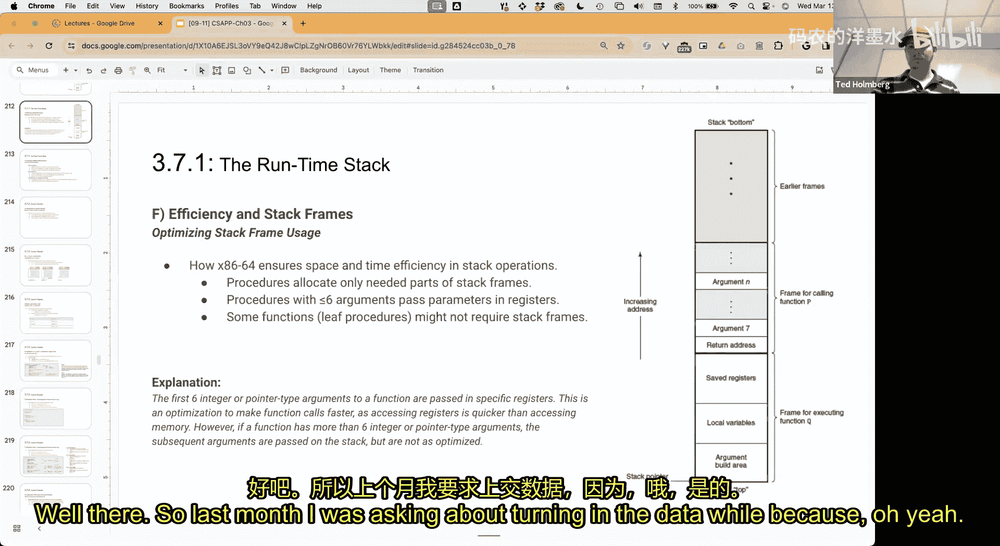

# 【全集】加州理工学院 C语言系统编程 中英字幕 p16 Lecture 16 - 汇编：数据运算符与控制逻辑 -BV1bUzWBLEiC_p16-

Excellent， so I have a draft of the group project I want everyone to work on in regards to the shell application。

 so I'm going to finalize that later tonight and finally give the specifications for that to you all formally so you can actually start working on that project。

And then I'll figure out what due date I want to put on that as well the parameters are going to be similar to what I had stated earlier effectively I'm going to give you a list of various shell applications command line tools to select from。

 but you will not be limited to those tools， these are just the ones that are very common and popular and sophisticated and complex enough that I think it would warrant having a small student group be able to play around and give a demo will about a 10 minute demo or so of that particular tool to the rest of that class。

And then we could all come away having experienced a vast assortment of shell line tools。

From a consequence of that now if there is a tool that you've used in the password that you're interested in using this on the list you can go ahead and just seek permission to use something that's not on the list now each group will have to present on a unique tool though so once you've so so when you choose one that you're interested in you want to go ahead and make it your own as quickly as possible right so another group can't claim access and it seems like the the fair rules for that is once you've you can start to consider who your teammates are when I give you the document i'm just going to use。

Post request inside of the discord for priority in terms of who gets what tools so when you go to make a claim go ahead and make your claim make sure no one above you had already made the claim if you did。

Then make a better claim now this this does beg the question though。

DoesDoes Discord allow you to edit your post Okay， so you have to make the claim and that post can't be edited？

嗯嗯。Nope， so that's how we'll solve that problem。Excellent。

 I think this will be the last day that we do kind of like the more formal kind of lecture presentation with slides I want to finish up this slide deck that I have here and then we're going to migrate i'm going to launch the bomb labb and then we'll start playing with the Bo labb in class itself。

And so I finally got done my submission process， so for the rest of the week。

 after I get a little bit of ability to recollect to myself。

 I'll be able to go ahead and address all of the questions that have piled up I'm sure inside of my Discord message box。

Okay， with that said， does anyone else have any other questions before we start on the PowerPoint presentation on chapter three where we continually examine the role of。

Machine code in driving our underlying systems。Check online perfect okay， yeah so。I guess to。

Bring us back to the thread of where we last left off。On Monday。

We're trying to really motivate what is the value of machine code and by consequence assembly code after learning how to take that class in assembly like what is the overall picture that plays into。

Computer systems。 and so we started with a very。Topmost approach where if you think of the top as being very abstract and we're slowly kind of building our way down to explain the actual interopal components of our computer systems。

 once we understand that theoretically we can represent anything in our system as binary vectors。😡。

Then one of the major roles that the system then has to do the the。

The actual hardware has to go ahead and support is not only storing the representations in something that's fit a physical representation。

 physical realization， but then being able to bus those representations around where they need to go so that we can do meaningful operations。

 and we've defined all the meaningful operations in terms of these operators that can actually be modeled using logic gates。

 which can be modeled with real world processes so we can actually create real- worldor physical constructs that then implement the logic gates which allows us to transform one representation into another。

So we've covered that， and so now what we're looking at is we had looked at the instruction set。

That's defined by the processor， which is really。Designed to go ahead and facilitate the operations。

And the access of our binary representation， so now what we're going to start looking at is how the software is controlling the hardware to do the fundamental things that the next layer application is going to require on top of our system。

So really as we stated earlier， the very big drivers of what we need to occur at the very low levels is being able to move data around and then be able to create control structures for our instruction pointer since everything is just the sequence sets of processing how we can go ahead and model the idea of control logic there and again。

 we'll go through this relatively briefly because I'm pretty confident you covered a lot of these concepts and assembly already。

 this lecture is really just to emphasize how this then maps how all of that assembly learned then maps into the larger ecosystem that designs and develops and implements and realizes our computer system holistically。

So I think we left off on this slide right， the opera specifiers。So when we talk about our operators。

 operators typically require operas。😡，You can think of those as your parameters when we when we redefine an operator mathematically into something like a function in computer science functions can take in parameters operators use opera so the opera and specifier is going to be what type of data can our operator take when we're talking about the machine code aspect of data type when we're talking about the assembly code when we looked at the data types and assembly code let's think about it more in terms of the machine code concept here what we really care about in terms of types in the way that data really manifest itself at such a kind of abstract level where it's just binary representation is going to be where does this representation reside at。

So really， there's only three types of specifiers when we're looking at these operators that we care about。

 it's going to be the immediate， you can see on this list immediate。The register。

And the memory are going to be the types that we concern about so what are the opera in particular for the operators we're going to look at that deals with our machine code our assembly code representations well it's going to specify typically a source value for the operation and a destination。

😡，So again， these are places to look for information and places to write your information into so read and write operations everything's fundamentally going to them resolved to be one of these three concepts。

 so the immediate type of opera is really a constant value。

So typically we would put a dollar sign in front to specify hey。

 this is a constant constant values are highly optimized by the system because they can just look them up it's not something that is in memory and it's not something that is in the register space it is。

The idea of a primitive value in Java drill that all the way down and understand that immediate values are just something we can do look ups on。

Something that's provided to us by the system， it's important enough that there's a immediate representation of that。

😡，Okay so that is one type of opera which is effectively a type of data at this level。

 the next is going to be register registers represent the locations of inside of the CPU register space so that's going to be where those contents are at。

😡，And so our registers can actually have various sizes we can have， say for instance。

 a one byte register， a two byte register， a four or an8 byte register。

 we talked about that last class and we talked about the evolution of these register spaces。😡。

With the X86 architecture。And the last type is going to be a memory reference。

This is going to be based off of the effective address that that memory has that you can then read and write from from our virtual memory addressing that we go ahead and have access to。

嗯。So notice the big takeaway with these types are all really focused on。

Where does the data live at inside of the system before we do an operation so it's dealing fundamentally with the type of addressing where our data。

Is located in our system whether it's immediate register or memory and so there's going to be implications for these operas on whether it can whether one of these types can be legally a source or legally a destination like clearly an immediate type can always be a source。

 but it can never be a destination you can't overwrite the value in an immediate address because it's designed to be immutable and constant。

Whereas with registers and memory references， that's not true。

 those are locations you're supposed to not only be able to read from。

 but also be able to write into。And so since。Weve mentioned these types as effectively as ways of reading into locations inside of our system to go ahead and access data。

 or to then write data into， let's talk about some of the addressing modes that the system recognizes so that when you see this in code。

 or if you write code， you'll understand how this actually interacts with the underlying system。😡。

So the general form， by the way that we can go ahead and do our our addressing mode is here。

 let's use we'll have our immediate offset， so this would normally be some kind of integer value。

I would replace with IMM and then inside parentheses you effectively have a tuple that has three values。

 the first is going to be your base register， the memory address you're starting at。

 the second is going to be the index register， the offset by how much spaces from the base you need to jump to and the fine amount is going to be our scale factor。

 which you need to be the size of 1，2，48， which is how big is the data type that's typically held in this memory location that we have to jump past to get to the next element in memory。

😡，It looks a lot like。Conceptually how we do indexing for arrays。

 but this is just how we do indexing for for data and our addressable space generally right so if you are thinking about our addressable space is effectively just one giant。

Table that we can insert binary representations， then the system is going to be able to allocate at any time。

 whether it should be in like a one by chunk or two bike chunks or four by chunks and then where does a star and how many elements if it is a more complex type that can have associated values and so this formatting scheme that's the general formatting scheme supports any kind of way we need to go ahead and access。

😡，Locationations inside of our system to be able to extract those binary representations very if you think about it it a very complex kind of phylon problem。

And again， the way that we can see this。Mathematically， I guess， would be this representation here。

Where it's our immediate plus the value in our base register， plus the value in our index register。

 and then that index register has a multiplicative property that scales how many units you have to jump by。

Okay， let's talk now now that we've talked a little bit about addressing modes。

 we talked a little bit about the different types of data in terms of addressable space now let's start talking about some of the fundamental calls we use inside of assembly。

To facilitate being able to get our code to run we have our。Movement instructions。

So let's just jump to that。Those are the very common ones。

 these are ones you probably opened up day one or day two in assembly here you have a move instruction and this allows you to and does it give you mine this doesn't give you。

The ups Okay， so anyway， we have we can usually append the end of moV move the amount of data we want to move so move B does one byte move the move W is two bytes for word move L will do 32 bits so that's four bytes and finally move quadword will be our eight bytes。

And so we had mentioned based off of types that you always have a source opera and a destination opera for these operators。

 so the source can be an immediate。So it can be a constant value， it could be a register。

 so some value in a register space or a inside of memory。

Now the destination for moves can only be register memory， right we can only move data。

 those are the two wriable spaces for us。So you can think of sources as being read spaces。

 our destination as having writing privileges on them。Now we do have the stipulation。

 you might recall this， that you cannot move data directly between two memory locations。

You can read data or access one memory location， but you usually have to pair that with also operating on one of the register spaces because our CPUO has much more direct control and access to that that can be kind of like the buffer zone in a way a buffer memory to be able to store our data before we process and then send it somewhere else so and that's obviously something that you've already covered so I will keep moving on so let's look at just some quick examples of our moves to ensure that we all kind of understand what it looks like。

In practice here I'm going to move L so it's going to be able to move four bytes and here that the source is going to be a constant value。

 we know it's a constant value because we prefix it with a dollar sign as。

And then the second is going to go ahead and be at our register。

 we know it's a registered ace because we prefix it with the percent sign symbol。

EAX so this would be a immediate to register operation we're removing some sets of bits from our immediate space into our register space。

And so here we're doing a similar thing， this represents a register to register。

Source to destination move。Here we're going to do another register well here we're going to do actually memory so one way we can go ahead and define memory is remember the address mode we had just spoke about we use in the address mode the sets of parentheses that serve as a tuL this is the set of symbols we use to provide the context that this is the memory local。

So here RDI would effectively be， so the address in RDI would represent the base index and the address at RCX then our counter register would represent the index value。

And since there is no scale factor， the default scale factor， then would be one byte。

And so here then we would then move that into the register AL， the lower。8 bits of the。

Or AX register， so that would be a memory to register by one byte move。

Here's another representation of a constant value， so here this is just representing this is a hexadeimal value remember if we prefix it with0 x we know that that's he versus just a decimal representation this just illustrating you can use either type for immediate。

And then here we're going to move this into memory again。

 whenever we use the parentheses around what looks kind of like a register space。

 that means we want to use that as a memory address and not as a value from the register space。

So here this would be immediate to memory for one byte and then finally， this is a register。

Look up with just the percent not the parentheses and then we this is our if remember our address mode inside the parentheses is going to be our base index and then here we're going to apply an immediate offset where effectively by doing minus- 12 it's going to subtract 12 from that memory address。

So this is a way to actually jump。😡，From using your memory address as a basis。

 being able to jump around。And so this would represent a register to memory。

 and so this would actually jump and then be able to overwrite past that jump when it's because that's a destination value that's doing there。

Excellent， is there any questions or is this pretty familiar with that regarding？

You kind of covered the differences between immediates and registers and your memory lookups and you are familiar with the notational like Masm is pretty consistent with what you did with Masm 32。

Excellent。Okay， so just a quick additional note on move that you can also do move。啊。

Absolute quad ABSQ， and this is just designed with dealing with 64 bit immediate data。Oops。

So if you see that， just an example of the usage， suppose that you have this 64 bits。

Representation hexadeal representation， this would be your destination constant value and then this is going to be I mean this is going to be your source。

 the constant value this is going to be your destination， this register。

 so this instruction would just simply move that 64 bit immediate value into the RAX register。Now。

 there are instances when you move data that。You might want to go ahead and affect how that move fills or modifies the destination。

So for instance， you have move Z and move s， Z will zero extend the source value to fill your destination if there is any unwritten bits over the course of that move。

 whereas move S will sign extend the source value to the destination value。And so clearly。

 the decision on move Z or move S is predicated on whether you're using signed data or unsigned data。

 whether you want to zero fill or not。So an example of this is suppose and usually this is important when you need that offset when you're moving a smaller sized。

Bit vector into a space that is a larger size bit vector right so in this instance in this example we're going to move the least significant eight bits from RX right which we can access just using percent A out that's the lower half of the EX or RX register and then we're going to。

Move that into as our destination， BX， which is going to be the full 16 bit lower half of that register。

So clearly since this is a smaller bid vector as a source than what it's moving into。

 it needs an instructional what to do with the data it's not grabbing from A out this is the instance when you want to consider whether you're going to use move Z to zero fill those or whether you want to use move S to bill it based off of the sign that they get moved in。

 whether you want to go ahead and sign extend with a1 for a negative value or zero to represent a positive value。

😡，And these are just more slides。I kind of represent this。Now。

One thing you should know is when we go ahead and do the signed excer extend。There's a。

Instruction we can use。CLTQ， which is a compact way to sign extend from 32 bit to 64 good values。

So just in instance， if you wanted to go ahead and move those， I have an example here。Well。

 here so here。Me say， for instance。If we wanted to do this instruction here。

 a more compact and efficient way instead of doing move， sign。嗯。With your quadword。

From EAX into our AX so 32 bits， 64 bit， we can simply just do CLTQ。Just in case you see it。

 you know that's a moving structure。Okay。Okay， let's see here。

 but really the big takeaways for this section is how do we move the data right that's a big nontrivial task that our underlying system has to do。

 you should understand there's a lot of thought there's a lot of consideration there's entire operators where that is what their task is and there's operators like any other operator has a set of operas and you should know what the valid forms of those are。

Especially since this is how we access all the data and write into all the data inside of our system。

Okay let's take a look at an actual example where we move data around and let's look at an example again where we're not altering the code because that's what you've learned to do in assembly but how does this code gets authored for us by the tools that we use by things like GCC to go ahead and convert into something that executes onto our system so suppose that we have this code representation here which does in exchange and what we do in this exchange so it looks like this is returning so just looking at the function signature here we are returning a long data type we have a name and identifier a label for our function called exchange and then we have two parameters the first is going to be a pointer to a long data type。

Which we will call Xp， and then the second is going to be the value of a long value。

So inside of here， the first thing we're going to do is we're going to dereference that memory address to get the actual value that resides there into long X。

Then we're going to grab Y， which is the memory address。

And so what we're going to do is we're going to assign that to the memory address。

Or the the value of what's at Xp and then we're going to go ahead and return next so effectively what we're doing is we're taking the two values putting one in value and we're swapping them between locations let's see what that actually looks like when our system translates that into a series of moves。

In our assembly， so when we look at these parameters。

 the things you should know is what are the default registers that were responsible for handling parameters in higher level languages。

So on exchange， we have two parameters， right our long pointer and our long value， so our XP。

Identifier will go into our RDI register space。And our Y parameter will go into our RSI。

 so RDI represents our effectively our destination index and RSI represents our source index。

Typically it is I think the the notional nam for that so if we were to look at a the label that we give to our function exchange the set of operations that we should now be able to read based off of the way that these symbols are parse is this is a memory lookup right we inside of our address mode we have a set of parentheses we will go ahead and then register access RDI。

And so。We will fetch the value at RDI and then store that in RAX。

 right because this is our source and this is our destination。😡。

Then what we're going to do is we're going to go and take what's RSI and so here I'm actually going to have the value I'm not doing it's not a memory lookup I have to do for this。

 it's going to be the actual value inside of RSI and then I'm going to move that into memory。

That RDI is pointing to。😡，And then we're going to return。So now we can see how high level code。

To do these kind of operations that read and write into all of our variables is actually working with these move operations at the very low level of a symbol。

 and then this maps into our machine kit。Now RAX is typically used for storing your return values。

 so when you return something back from one function to another。

 understand that's usually various deposit。Okay， so why is this worth talking about， well。

 pointers in C are effectively just addresses in assembled symbol。Right。

 probably by now you've already made that connection。😡。

Local variables like X are often stored in Regs Pro access and our parameters are passed through registers between function calls。

So this kind of starts to tether how these。How a vertical stack of technologies are implementing to allow you to do what you do in like the worlds of Java。

 or in our case， in this class， the world of C。Okay， let's see here。

The next thing we should talk about then is pushing and popping onto our stack data so besides the set of registers and besides being able to to access remove data between our our memory and our register spaces and access or read at least the immediate values。

 we also have a lot of S management。😡，At the assembly level to be able to store and recall data as our programs as our applications process。

So let's take a look at how the system is able to manage data that's not currently processed in this particular timeframe。

😡，So we're going to look at push Q， we'll look at P Q instructions to manipulate our program stack。

And again。In case for any reason you forgot what a stack is。

 it's a data structure that exhibits the last sin first out discipline so。So here we go， yep。

 it's so as we add or remove， it's less in first out like sacka pancakes。Our operations。

 your push add data， your P removes data， the top of the stack is going to be the end of the array where the data is added or removed from。

Okay， so now that we got the very primitive concepts of a stack down。

 let's actually look at how our program stack operates。Inside of XA664。

So here we're going to have our memory region， this is going to be the program stack。

Which is stored in specific memory region allocated to our application by the OS。

So here we can see initially what's held in the respective registers that are designed to manage our stack。

So you'll see。We have say for instance， RAX， which we stated earlier typically where our return values can be held at。

 we just have this value， hexademal value 1，2， three。We have our RD Act。

 which is typically thought of as potentially our。Yes。

As one of our general purpose stacks that we have， but that can also be like a kind of a destination stack of sorts and then we have RP which is going to be our S pointer and that's going to let us know where the top of our stack is so if we go ahead yeah what is the address of the top of the stack and our growth direction is going to be downward which means the top element has the lowest address so let's see what that actually looks like in practice so here this concept is we are increasing address as we go up。

So that means this is going to be the bottom of the stack。

And this is going to be the top of the stack here， so at 108， so when we go one frame over。

 suppose we push RAX。So we have RAX， suppose we do our push command。

 REX onto the stack in the way that we update the stack based off of the contents of our register spaces。

That does all this administrative stuff is well our RAX has the value 1，2，3 RDX。

 so has the value of0， but now notice that our Sac pointer has advanced to hexademal 100 so now we can see here that this was the former top of the stack an operation ago in the prior operation 108。

 but now it's going to be 100 because of the size of the data we used the push Q which is a quadwork。

So it's going to so each one of these units， these hexasone units that is our addressable space。

 represents one byte of addressable memory， that means we've advanced our sack pointer by eight bytes。

Or eight units。Okay， so then suppose that we're going to go and top that value from the sack。

 we saw how push serves as the location of well we pushed RAX onto the sack， so now when we pop。

A the Xs。We're going to overwrite whatever was in RDX so RDX was empty now we're going to effectively put the value123 in there well we never overwrote RAX so that's still also the value of  one。

23 right textademal。😡，And now that we've popped that value from the stack。

 the pop operation is going to update the stack pointer to now have the top of the stack return to 108。

So this， I mean， has I'm assuming everyone maybe it's not like you could potentially be in this class without data structures right。

 the requirements was 2120 and assembly。But this like stack management is definitely something you do in data structures and something you do in 2120s well like talk about SACs so everyone wants to be and you did a lot of this did you do a lot of this inside of assembly as well like learn how to manage the stack and how the SAC properties are all effectively just managed by register values that the CPU looks at when processing a set of directives。

O。Perfect。So we've already talked about this。😡，This example and again。

 these these examples are just pulled right off the book So the syntax。

 as you could probably have guessed from the prior example。

 and I guess your experience working with assembly is push is a operator It uses one opera。

In this instance， it's going to be a register value。And so， for instance， here。

This operation that we can do the so the equivalent code of what push effectively allows us to do。

Because there's multiple ways we can move data around in our system。

 but this is an aliaest way of doing these two operations。

Where you can go ahead and subtract this immediate value of eight right for the position of the address from your stack pointer。

 so we're subtracting our address by eight。And then we're going to move the value of RBP。

The base pointer by this to this value here， which is going to be the memory address here so start RBP onto our stack。

 which is the value that we want to store when we go to do this right here， this RBP。

So just showing how there's a way of calling our atomic level move operations to perform these tasks like pushing and popping things off the sack。

 these are all just register spaces and we can we can see how we're implementing operators from these simpler operators。

 probably like what you realized you were doing how in object orientness。

 you build complex sets of processing methods on top of your simpler primitive data types。

And of course， P is very similar the syntax is just P Q or whatever the amount of bytes that you want to go ahead or your bit representation and then some kind of register。

And then that could as equivalently be this form of the move operation paired with an ad or an ad operation as well。

Now one of the interesting things is since we know that the stack can grow or it can shrink， right。

 it is like a continuousuous block of memory that we kind of track based off of where the top of it is。

It's possible to access an arbitrary s position。😡，The way that we can do that would be using the address mode。

That we had discussed earlier inside of this lecture。

So recall that the syntax for this operation is this offset here。

 and then inside this parentheses we can put our whatever the register is。

 so if we were to use this code here。I'll register being our stack pointer。

 we could then go ahead and put eight in front of that and that's going to act as an an offset of eight bytes so that effectively then will get us eight bytes above our current stack pointer。

😡，So just understanding how easy and how effective all of the management of the data is within the system。

 but how exploitable this potentially can be as well， right？Okay， let's move on。Okay。

 let's talk a little bit about arithmetic and logical operations。This yeah。

 so most of these just looking at this list， let me let me gauge the interest of the class based off of what you already have an expertise in。

😡，I'm assuming most of these you've already covered， you have load effective address。

Unary and binary operations shift operations and your special arithmetic operations and again these are pulled directly from the book so I guess we'll go through and if you haven't seen one before stop。

So I think a lot of these， this is probably what you spent a lot of time if I had to wager my guess with inside an assembly。

So first and foremost is the LEA。Operator its short for load effective address is a very powerful instruction that provides a way to perform our arithmetic and addressing calculations。

 you could think of it as a variant of move Q。But the key difference is where Mo Q moves the content at a source address to a destination。

 load effective address just moves the address itself。So it allows you to load the effect of address。

Hence the name。So it's primarily used for computing the address without actually having to dereference it。

And it's use cases in arithmetic calculations， bio arithmetic and address calculations。

 pretty much things where you're using addresses for， right？Okay。

 so just a quick Gander at load effective address， this is our set of operas for it。

Here we have load effective address of RDX as a source or as our base， RDX as our index mode。

 as our index value and then four would be our scale factor。

 so notice this is just using this address mode。So here shows you the details of how this might manifest where load effective address。

 we give it a base， which is a register， we give it a index， which is a register。

 and then a scale factor， and this is all one parameter。Which represents some location and memory。

 and then we give it some destination。So in this instance。

 the destination we're going to give it is going to be RAX。

We know because it's just the percent sign so what does this effectively do well the effective address is it's going to take that base it's going to add it to the index and it's going to multiply it by and that index is going to be multiplied by the scale so this obviously we do Pda this does first。

And then we do the addition that's going to give us an effective a memory address of this。

 right in terms of this example， and so what we can think of that is being effectively the result of five times the value at RDX and that's stored in Rient。

So we can use our LEA operator for a pointer generation。For doing all sorts of memory tasks。

 so when we start thinking how is things like maybe our pointers generated for us。

 this is effectively the underlying mechanism by which that can happen。So this example here。

 suppose you have an array starting at a memory location pointed at RDI and we want to access the element four places。

Then we could do the following instruction here oops I don't want to move that where we can load effective memory dress without dereencing we pass the memory address at RDI and we offset it。

By the number of places that we want we want to do that and that's going to be a total of 16 due to the size of the value itself and bys。

So like four bytes。Four units at four bytes a unit is going to be 16 bytes that we want to offset。

So to kind of piece this together， suppose I want to use LEA for arithmetic operations。

Then let's take a look at this arithmetic example， suppose RDx holds the numerical value of x。

 whatever x might be。Then the instruction using our load effective address， using our address mode。

 so we would give it RDX as our base RDX as the index， the same address。

 and then we'll give a scale factor of four， we can kind of take advantage of how this function。

 how this operator works， to perform an arithmetic operation。And then our immediate all set is seven。

 well， the computation that gets performed from that is whatever value was held at x will get multiplied by5。

 the scale factor， and then we would add the immediate value our from our address mode seven。

 and then we could store that into Rient。😡，A clever little optimization trick where you're using effectively loading memory addresses to do。

Mathematical， multiplicative and addition operations。And again。

 one of the big things about this is we're not directly from seeing memory。So you look ups on this？

And so why do I bring this up this is just what compilers these are clever uses that compilers might do to do computations why do I care about that well again the emphasis on this particular chapter isn't just to build a comprehension and an understanding of machine code and an assembly code but the machine code and assembly code that gets generated by software like a compiler so when you go dis disassemble this if you go and look at this in a debugger and you're wondering why is there an LAQ when I'm doing a mathematical operation this gives you to insight as to what the compiler might have done if it was toggled to a high optimization bubble。

And that makes sense。Okay， let's see， did y'all cover that that by the way。

 did y'all cover was that something you covered inside of assembly as well using load effective address？

Oh excellent okay let me go a little quicker then Okay so there's two different kinds of operations right and this was true in Java as well whenever we talk about operators that are pretty common you have your unary operations which are one opera and you have your binary operations which are two opera let's take a look at the unary operations this is going to be like if we wanted to go ahead and call increment or decrement the words do exactly what you'd expect them to do and also just like you'd expect since our data types are based off of how long the V vectors are we can always make it a ink or deck of a byte or or a。

Or a word or a quad word or an L， which is going to be our double words。So in this instance。

 we can go ahead and also notice inside of our address mode， we have put this in parentheses。

 that means that in this particular example we're giving it a memory address。

That is held at our sack pointer so it's say hey， get the memory addresses the sack pointer and incremented by one。

And this were decremented by one。Okay， let's take a look at our two opera。

 typically the two opera for our operations will have a source and a destination as we stated earlier。

 so suppose you have subtract and you have add both of which we can specify how many bytes we want to add or subtract and then we could give it in this instance in these examples。

 the sources are going to be register spaces， we know this because it's prefixed with a percent sign and the destination it's going to be the second parameter is also going to be a register space so our two register spaces。

Now， in these instances。It should be noted that this is the same as in the compound assignment。

 so when we see subtract RAX and RDX。😡，These two operas i'm sorry it's not just a source and destination。

 but these are going to overwrite these are going to take the two opera as input and it's going to overwrite a value from this operation and typically we know that the operation that gets overridden on arithmetic。

😡，Operators is going to be our RAX register， our accumulator register。So we will take the value。

 so this will represent my x value， this will represent my y value。

 and then I overwrite what was the value of RAX with the result of this subtraction or the result of this edition。

So it's going to be like this compound assignment。Here and here， okay， let's keep moving on。

So you got to understand that the source destination ordering。

We can read that as subtract REX from RDX。So here。For the binary。

 then what we want to think of is really this value here that we're giving is the one that's getting overri。

 that's the destination。Okay， some basic restrictions， I think we already talked about this。That。

For being able to move， we can take a register and we can move that into memory。

 we can take a memory and we can move that into a register but one thing we can never do is move directly from one memory location to another memory location。

Yeah。Okay， let's keep moving on， let's talk about our shift operations。

And then we have our arithmetic shifts and logical shifts we've already seen this conceptually as it existed in C。

 this is just our mechanism to do these similar type of operations inside of assembly and of course it makes sense that these are assembly instructions in machine code instructions because one of the prime drivers that we try to facilitate with these languages is being able to move and operate in the form of binary sequences so clearly so much of what we need to do is shifting the values of bits。

On where they line up inside of our bitPS string。Our binary strength。So in this instance。

 this is also going to be a binary opera。We have our shift left here we can have say for instance。

 an immediate value or we could also pass if we want to a register value or value for memory。

 but this is effectively the number of bits we want to shift by and the second opera is going to be the bit vector in memory in this instance we're using an address of how we're actually going to shift that。

So again， these are just mapping all the things we've already learned and how we're actually articulating that at the very low level system mechanisms for that based off of the set of commands that they give to us。

Okay。And so this is just showing you the same thing we're doing a shift。Okay。

It we're shifting that left。And then we have our shift right as well now when we shift right recall that there's two different ways we can shift right。

 we can either shift right with an arithmetic shift which is going to copy the sign bit or you can shift using zero fill。

 which is theological shift so that's going to be in the value of SAR SR or SR。Okay。

 and similar principles， the first the first parameter is going to be the number of bits you want to shift。

 the second is going to be the register or the binary sequence that you want to shift on。

and then we also have the ability to have our。LetSo we have our。Arithmetic shift here。

And so here we have our shift left and we have an arithmetic shift left as well。

But these perform exactly the same。Right。These all just。Fill on the right with zero。Okay。

Let's go through what else we have。So we already talked about how we can shift right in detail。

 let's move on。Okay， so this is where it's going to be relevant for bomb lab。

Here we're going to have a set of C code。And so this represents how our C code is then translated into this corresponding assembly code so we can map how these operations manifest using these compiler optimization tricks we had discussed。

 so let's see what's happening here inside of this arithmetic function， we have an x a Y and a Z。

And here what we'll do is we're going to do the。We're going to take the long value and it looks like we're going to do a exO operation。

We're going to do a multiplicative operation， we're going to do a bit wise operation and then we're going to do a subtraction operation and then finally we're going to return what the value at T4 is。

And here， what you can see that we're doing here is in order to do this XOR。

 we can do an XOR right here。So the high level XO is using the XO。Wadword。

As the offering to implement that part and then this part here。

 this multiplicative property of take whatever our z value is and multiply that by 48。

 well it's going to optimize that to be this load effective address operation。

 it's going to take RDX。And remember， our X， Y， and Z parameters are saved inside of RI。

 RSI and RDX in terms of what registers are assigned to。

So we're going to go ahead and grab the Z from RDX。

And then we're going to use that as both the base and the index。😡。

And we're going to multiply that by two， which is going to be the equivalent of three times z。

And then we're going to save that to RAX。Then。Here。

on our sorry I was I'm just looking at the two different values then on our next line here where we have our T3 we would take T1 and and it so we can just call an and between those let's see oh we got to finish that up sorry so I get my Z here and then we have one other address that's actually one other operation that then's going to go ahead and do that shift so that we can shift the values we need so that instead of three times Z we're going to get 48 times Z so you can see it's able to optimize that operation to do this arithmetic multic of this multi like a property is done in just two machine coding instructions or assembly instructions。

Okay。Then here we're going to do the and on our T3 value just using an and opera end and then finally we're going to get our T2 minus t3 that's what's actually going to get returned。

 so we're going to subtract our RDI value that's our x from our RA X value that's our accumulator that we had Godden from our last operation and so that's going to put that into the register that we then have to return back from。

Which is going to be our RDI。Excellent， just this makes sense effectively you see how you could take the high level language and these instructions we talked about how it optimizes and then translates it that but the trick is。

Building up the ability to read these assembly instructions and knowing it maps to this representation high level code。

Right so it's one thing to say， oh yeah， I can take this high level code and I can see how it gets translated how it gets converted。

 but then when you're debugging you want to be able to do the reverse what are these set of operations likely doing if I were to remap it in a higher level language？

That's why reverse engineering can be very challenging right you have to start I did you only learn that very well by doing it。

And identifying the patterns that these compilers go ahead and use to perform these operations。Okay。

 and this chart right here just shows you all the different operations that we have available to us。

 all of which you've probably already seen。So we have load effective address， we have increment。

 decrement， negate， knot， add， subtract， multiply， integer multiply XO， or and our shift。

 our arithmetic shift left， our logical shift left， our arithmetic shift right。

 and our logical shift right。There。Don't care， okay， so don't really care about 28 that units。

And here， this is quickly。Talk about some of the special arithmetic operations。

 this represents our multi multiplier operations。Its just a quick example of how this might work。

 suppose that we have RSI and RAX， this would be the equivalent of copying X to our RAX register。

 so RSI is typically where our parameters go， as you may recall。

 and then if we call multiply RDX that's going to multiply our multiply by y and then deposit。

That into the register space。And then in terms of division。We can see that。

We can either call sign division or unsigned division。

So this would look like effectively this we would move RDI so let's just quickly take a look at our C code where given a division function call and it looks like this hang on let me。

There we go， oh no， whoops。My parentheses has gone， there we go。

Oh will well you can see that's the parentheses anyway I have my x my y and I have two pointers。

 so what I'm going to do is i'm going to compute my quotient， which is going to be x divided by y。

I'm going to calculate my remainder that's going to be my X modulus y notice these are integral values that means it's not floating point values。

 then I'm going to take my quotient and I'm going to use the memory address that's provided to me here and store that value at that memory address and then I'll take my remainder and store my remainder at my remainder pointer address here so what this would actually look like inside of our code here is we would move our RDI value。

So that's going to move our x to the lower eight bytes of the dividend。

Using and this is going to sign to extend and it's hard to see I think I lost an operation here to the upper eight bytes of the dividend and then we can call our division operation RSI and I think I had actually lost some operations in this example so I will fix this slide so you can see the rest of the operations that actually occur。

That was looking for。Okay so those were our operations。

 let's quickly now move on to how we go ahead and define our control a lot of the control inside of these lower level applications are done with labels and jumps。

So the key terms that you're really going to want to look at are going to be these here that's going to allow us to understand our condition code registers。

And we'll take a look at these for conditional branching right now。

 so our CFf represents our carry flag our Zf represents our zero flag。

 our SF represents our sign flag and our OF represents our overflow flag so these are all just single bit registers that store attributes of our arithmetic and logical operations from the system that the system would have to be aware of when it goes to the next set of operations or how to go ahead and parse the results of a computation that just got executed。

And so these are just instances where we can go ahead and understand whether there was a overflow or whether the zero flag was set。

 whether a negative flag was set or whether our signed overflow。

 these are mathematical conditions that we can take and look at given some T。

 which is the result of say， for instance， a earthmetic operation of a plus B。

So one big thing that you should know is that load effective address。

 increment and decrement do not touch any of your condition flags。

So other operations like add and subtract do， but you'll never affect those with these particular operations so understand that that's a thing you can't overflow or zero flag you can't cause this to trigger with these operations。

😡，And load effect of a memory dress doesn't cause any conditions to trigger。

Our compare instruction sets the condition codes based on the difference between two operas。

 so now let's start looking at how we can use operations designed for control。

This is obviously quality operations when we're comparing one opera to another。

And so the only difference between compare and test is that if test is negative， zero or positive。

 we can go ahead and use that， and I'm pretty sure test doesn't trigger your carry flags either。

And let's move on。We have the set instruction， which alters a single byte to 01 based off for the condition codes。

So this just let's us set based off of certain parameters like we can go ahead and have set Z that's gone to set to zero。

Set not zero or that's like are not equal versus our equal。

This is going to NLE is going to be greater than。N L is going to be greater or equal than。

Not greater than or equal that's going to be less not greater is going to be less than or equal to so clearly you can just see how our instructions are defined right here for all of our relational operations which is super important when we want to start creating these labels this represents a label。

And then we can do a compare of A and B。And then based off of this comparison。

 we're going to be able to go ahead and implement some kind of logic on top of that。

 So it's going to set our values in our register。And then move from one address to another or clear our the rest of the EAX。

Okay。Signed versus unsigned jumped okay this is where it gets interesting this is where we can start jumping to memory addresses and we can give these labels to be able to jump typically we prefix our labels with a period。

Yeah and so these are just various examples that we can then go ahead and use jumps so this is what you'll probably see the most is we have the standard jump where you give it a label or you can go ahead and do an indirect jump。

Given some opera end like a memory address， so you can either give it an immediate memory address or you can give it a label that's defined somewhere in your code base that it jumps to。

And then the rest of these just use labels so only jump can you use the operant from where you can use indirect jumping but the rest of these are going to be jump if equal jump if not equal jump if negative signed。

 jump if not signs that's not negative， jump if greater jump if greater and equal jump if less than jump if less than an equal。

 jump if above some value， jump if above or equal to some value。

 jump if below or jump if below or equal。So obviously one represents like logical data。

 the other is like the athmetic data sign versus un。Everyone's using， right？Pfect。Okay。Okay。Okay。H。

This is just representations of indirect jumps， this illustrates JMP is the only one that allows us to use non labels。

 so this is an instance of where we can go ahead and give a jump target based off of some memory address。

Or some register address。 So notice if we jump to an address。That's used inside of a register space。

 we can actually prefix it with a star， the same we would do almost in C with de referenceencecing。

But normally just use labels unless， but now when you look at machine created assembly。

 if you see jump commands are not like Jans and whatnot you now know how to track where jumping into。

Yeah， okay， example of。Relative addressing so one of the powerful things so this is program counter relative addressing do I have time to talk about this we'll probably talk more about this example do I want to talk about this is it meaningful。

Oh how much more time yeah okay so we have a little bit more slides we might finish up with some of the looping or I might just jump next class to the bottom lab I think a lot of this stuff you'all are familiar with right yeah well i'll post the slides up really what looks like the rest of these slides are dealing with is how we can go ahead and manifest our。

Looping logic and our selection logic using the sets of jumps and comparisons to be able to use our consecutive execution of assembly code to be able to now implement the forms of if。

 if else or loops， know， to jump back and then evaluate until we exit out of our。

And I'm assuming you had lots of practice with that last lecture， I mean， last last semester。

But I don't want to bore you with content that you already know。

So if you want you can review the rest of these slides。

 I don't see anything that's super interesting that you probably haven't seen already so I don't see the need yeah switch statements loop statements。

Procedures， passing data。Is everyone familiar with the runtime stack。

 did you cover this in any great detail inside of assembling and how your runtime stack holds your various sets of arguments and your register you can have your saved registers。

 your local variables and then you can go ahead and populate your stack with multiple sets of values and then you can extract them at any time。

Okay， perfect， so y'all have covered this concept as well。Okay， perfect。F transfer。

And then of course you use your runtime stack because you're pushing your sets of function calls onto the stack。

 you execute the sets of instructions， you have your memory inside of the stack as well that then gets cleared off as the function and all of its associated local variables gets processed and then you jump back to the next function that's on the stack so the control transfer between functions。

 the way that data is passed from one stack frame to the next and then returned from one stack to the the next is all something that everyone feels comfortable。

Yes， no。Oh I guess the question is， do y'all want me to lecture about that or do we just want to go into the Bo lab next class？

How are we all feeling about how assembly interface it I guess like do you feel like you are comfortable with that the concepts with that？

You want to mull over it for a little bit and we can make this decision on Monday。Okay。

 I'll do that look over the slides I haven't covered yet。

And then we'll decide whether it's worth having deeper。

Examinations into it because it's important that you understand what's happened what。

The reason why it's important and the reason that I want you to reflect on this then is I want to ensure I want to have the assurance that you understand how we took all this theoretical concepts mathematically of。

Representing our data， regardless of what that data is as binary representations and then mapping the transformation of those binary representations using all these operations how we can then implement that how we can actualize that at the assembly level because once that theory has been actualized in practice at the very low level system level。

 all of our high levelvel code gets mapped to those low-lel representations which then function at that pure mathematical kind of conceptualization that we've defined early and that way we are mapping to the physical these concepts that exist in a theoretical space but in a very practical and applicable way so like there's a lot of advanced concepts like how are we calling multiple functions。

 how are functions being nested together so they can rely on each other and share data between each other and then process to some desired solution because we're building very。

Clect softwareware systems off very simple atomic elements。

 so it's very important for you if you're really if you're really tasked with being an expert in the domain of computer science how these very atomic。

Concepts are build these very complex。😡，Binary like computer systems。

 how we create these very complex architectures from something that。

Pips down into something that's very simple。😡，So look over this I pretty much assume that you might have seen this but I want to make sure my assumption is right and the best person or the best people to ascertain that would be all of you because you literally just took this last semester so if you don't feel comfortable with one of these concepts with the because I do think that this is a pretty important concept how the runtime S works for because a lot of what the system has to manage is this and this is a nontrivial concept so look over the slides and if you have any questions we'll address those on Monday and if not we'll start with our bombba。

Okay。So last Council was asking about turning in the data lab because yeah。

