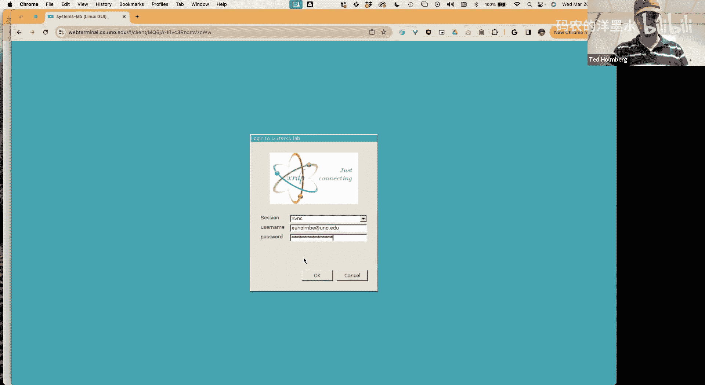
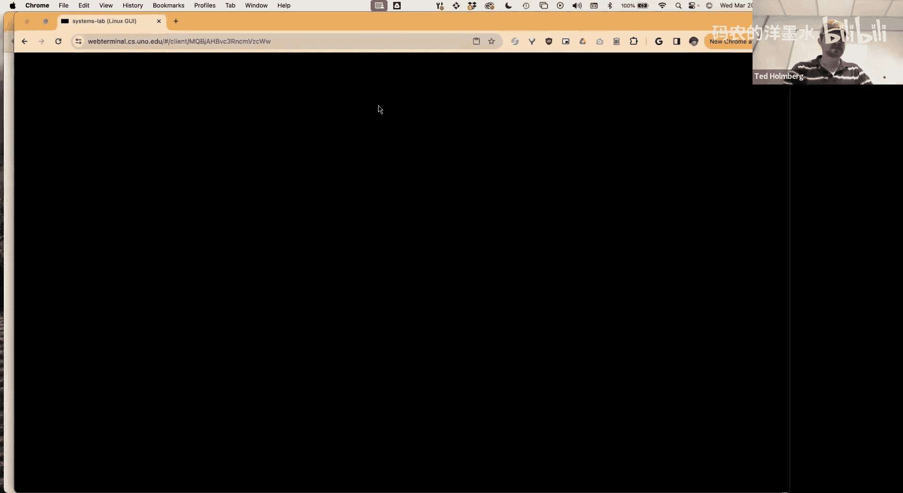
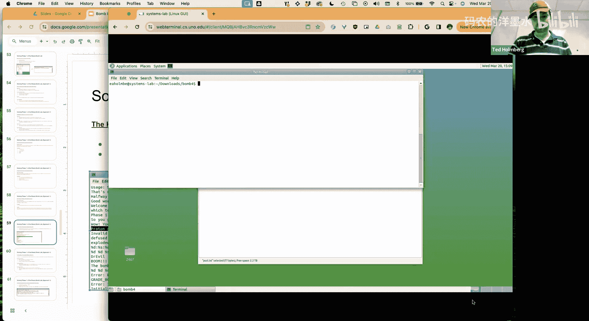

# 【全集】加州理工学院 C语言系统编程 中英字幕 p17 Lecture 17 - Bomb Lab part1 -BV1bUzWBLEiC_p17-

Okay， so we're going to start going through the bombM labb I worked with data to make sure our BoM labb server was up and running。

 so for just like the prior labs we depend on some services that are running inside of systems lab so you should use guacamole。

 you should use web terminal to be able to access your environment so that you can go ahead and either follow along or do these labs。

Now with that said， I think probably the rest of the semester should be more。

Code base so now i'm going to rely on you to read the book to broaden what we do inside of the of the code we show off。

 but before we start doing any coding I'll have like these little introductory。

Slides just to keep me on track so that you can see what the motivation is before we drop into the code and actually do any examples。

So before I start anything with Bomb Lab。It had me thinking since we do have at least two more labs that we're going to do throughout the semester and it's late March at this point we have bomb lab to get done and we have our tiny shell lab I'll probably likely extend when we do the presentations for the the second group project that I had given yesterday or last lecture to be towards the end of the semester so it'll give you a lot of time to kind of build a nice set of slides and really delve and explore that they each of those technologies these one of those shell tools or shell applications so we're not going to try to rush to a conclusion on that in the the two or three weeks you'll have at least probably about a month to be able to really explore the technology and and be able to build out your presentation but keep in mind there's going to be one last group project that。

Technically the final， so do do your due diligence and make sure to be progressing on group project two so that you don't have to do two group projects in the very last weeks of the semester because that would be awful you don't want to put yourself in that position。

Your future self will hate your current self if you do that。Okay。

 is there any questions before we move on？O。So I'm going to do a quick kind of explanation of what bomb lab is bomb labb where we diffuse a binary bomb。

是好了。What is a binary bomb why is it called bomb lab well binary bomb is a unique program challenge it's included as one of the challenges one of the labs in the book it consists of multiple phases there's six phases each phase requires the user to effectively type in some specific string so it's an application that textbased application that we launch effectively a C code application that we have to it the secret password or the bomb explodes。

And so correct input diffuses the phase while incorrect input causes the bomb to explode displaying boom。

So Dr Es plot the originator， the author of this source code file iss an nearious Dr E has planted these bombs on the class server it's a challenge as well as a test of skill for the students and so your mission。

😡，Is that each student is going to be assigned a unique bomb so it'll have an identifier number attached to it the goal is to successfully difffuse all the phases of your bomb in order to get the points for this lab。

The ultimate task is， can you become a member of the cyber bomb squad？

So how can you get your very own body？Well， in order to acquire your bomb。

 you have to go to the bomb distribution platform。Which will access through web terminal and so what you want to do and in fact。

 let me see if I can。I'll do it this way， let me open out。Here。Web terminal。2。Let's go on here。😔。

When we log in， so of course， you log into Web terminal with your UNO credentials。

Okay， just。Okay， perfect， so but any time I want to oscillate。Okay。

 so here recall that once we're logged into here， we can go to applications， we can go to internet。

 and then we can go to Firefox， choose one of our browsers that's effectively a full windowed OS that we have。

Birofox is already running， Okay， well that's。Okay。So let's get this。Or like that Okay， perfect。Okay。

 let's see here graphicphs internet， Firefox。对这个。Well， then we'll do Chrome。

Let's internet and we will try from。And。Okay。So once you select one of your OS operations。

I mean sorry your browser operations， you can go ahead and navigate towards this was the original URL。

 but I think we just updated it to be bumlab。cs。uno。edu let me actually test this here。Balmlab。tcs。

umo。edu。Yeah， this should bring up a landing page to our binary bomb request。😡，Born。

So that we can go ahead and get a ball。So again， just follow these instructions and then also you would use your UNO login name not including the@ UNO EDU for the user name and then the email address should be your UNO email address here and that will end then the bomb delivery platform will custom make your bomb and deliver it right to your desktop。

But let's see if I can't do that here。Let's see Farmlab。cs。un。edduu。Perfect， I'm going to do EA。

There we go。 I'll do E home。And then I'll do my email address。Just like so。And then we will submit。

And send anyway。And of course， the bomb platform。So apt that the bombM delivery platform is not HtTPS an insecure application。

嗯。It seems to be like a meness involved in that。I'llCheck your internet connection。

And then what should happen there？We will close this is inside of your。Downloads folder。

 you should get a bomb， so I have bomb4 for being the unique identifier。 tar。Yeah okay。

 so upon accessing the portal you'll enter a form， you enter your username and your email address。

 then you click submit button to request your bomb so the servers might take a few seconds to prepare your unique bomb avoid multiple submissions by clicking submit repeatedly because then it'll just min a lot of bombs for you。

But if that happens， select one and discard the us， you only need to do one bomb。

So once you receive your bomb， you can extract it in one of two ways。

 you can either use the GUI to double click on it and just export it， that's the easy way。

 or you can use the tarR She tool to go ahead and effectively to untar it。And once you extract。

You should have three files that are going to be inside of that directory。

 you'll have an executable file that was precompiled for us。😡，We'll have the Bo。

c file which is the file that contains the main function we're going to look at and inspected that file a little more so inside of this lecture。

 and then we have a readme file， which will take a look at the readme file as well。

In case you do get multiple bombs if for any reason that does happen。

 that's fine just as I said earlier choose one， focus on that one you can delete the others。Okay。

 let's step through the actual Bo dot C file that's given to us。😡。

So the first thing that we're going to see is that there's an actual kind of the introduction to our lab in the form of a license。

 so it's a playful kind of mocking way to license from Dr。

 Evil describing the terms of use there's actually some hints in here in the tools we can use so let's kind of just step through and understand the complete narrative as it's put forth Dr。

 Evil's insidious bomb version 1。1 copyright 2011 by Dr。 Evil Incorporated All rights reserved。😡。

And the license is Dr Eve Incorrated the perpetrator hereby grants you。

 the victim explicit permission to use this bomb in parentheses the bomb， this is a。

Time limited license， which expires on the death of the victim。

 the perpetrator takes no responsibility for damage frustration in San bugeyes。

 carpal tunnel syndrome， loss asleep or other harm to the victim unless the perpetrator wants to take credit that is The victim may not distribute this bomb source code to any enemies of the perpetrator No victim may debug reverse engineer。

 run strings on decompile， decrypt or use any other technique to gain knowledge of and defuse the bomb bomb proof clothing may not be worn when handling this program The perpetrator will not apologize for the perpetrator's poor sense of humor This license is no avoid when the bomb is prohibited by law。

So there we go， they have some ideas on strings as one Commandmantle will use a debugger is another。

So they're giving you kind of in a tongue in cheek way。

 some hints on what it is we're trying to accomplish。Okay， so the next thing。

And just so you can see what i'm reading here， so it's not dopes that's not what I want let me go here if I were to。

Unarchd if I was to expand out this so I can actually see the content I have the executable the bomb dot see and the read me and just just to show you what i'm reading through right now in the slides it's actually just。

It's actually just the source code file that i've destized so instead of just showing you one big file all at once i've been able to partition it a snippet so this first part the header comments and what we just looked at which is our end user license agreement and then we're going to say this isn't a very big。

File， right for what we have to do and we'll see why that is and what the implications of that all。

Okay， with that said， I'm going to jump back over here。

 So the next thing after our header comments that has our inlet license agreement。

 we see that there's a standard input output。Header file that we include and there's the standard library header those are our standard C libraries we've seen that numerous times already and other sample code projects we also have our support dot header and phases do header files and these are custom headers that contain functions or variables for the bomb logic and of course these are files that are not given to us we're not given those C files those have been prelinked precompiled inside of the executable。

So when we read through our bomb。c file， which is what we're actually doing right now just to make sure everyone understands this little data source code you do have。

 we can see the parts that are going to be very valuable to us in order to be able to diffuse the bomb we're going to have to extract using a various set of debugging tools。

 so we'll have to actually kind of operate our bomb from the executable file。

 but without triggering it to explode。And that's the goal at least。Okay。

 then we have another comment， a reminder from Dr。 Evil。

 a note suggesting that the source code should be deleted to prevent victims from understanding its behavior。

 and that's a note to himself。Note to self。Remember to erase this file。

 so my victims will have no idea what is going on and so that they will blow up in a spectacularly venendious explosion signed Dr。

 E。Okay， let's take a and then after that is our main function inside of a main function that's going to take command line arguments。

 we will use command line arguments potentially。So if there are no arguments。

 the bomb just reads input from your standard end so you can just type from the keyboard。

If you have a standard， if you do provide a argument， one argument， it could be the file name。嗯。

And then it will attempt to read all the input from that file until it reads the end of file。

 the EOF symbol， and then it'll switch back to standard Ben。So if more than one argument。

 it'll give you an error message。And we can test that out in just a moment once we're done reading through the source code。

 what we'll do is we'll start poking a stick at our bomb just to see what happens。Okay。

 so then once we。Once we get into our main function， let's actually look at the source code for it。

 can everyone see this following？W is。啊十七八十。I don't know why these oh just that one doesn't work Okay。

 so notice we're going to have one variable。One global variable that is effectively going to be a pointer to a file so if we if we decide to go ahead and use a file that's where we're going to be able to set it so that we can access and read from it so inside of our main function。

You can see we're going to go ahead and have a character pointer that goes ahead and grabs input or stores input。

From the end user。We have this comment here， note to self。

 remember to port this bomb to windows and put a fantastic gooey on it。

We have another comment when you run with no arguments the bomb reads its input line from standard input that's what we stated so we're just doing that check here if the argument count and so the argument counts here is going to be the first parameter that's given to our main function then and of course。

One argument would just be the name of the application that's running。😡，So on。

Then we will use standard input as our input file。If our argument count is two。

 that means it was the name of the application that we're running and some other value that we put after it when we went to launch our application。

😡，Then we're going to use that second argument， which we're going to access from the argument vector。

 the argument list。😡，At index one， and we're going to call F open file open in a recapac。😡。

And then we're going to bind that。Into our in file here so we're going to store that inside this variable so that we can then use that for the rest of this main function。

 and so that's where we can then derive the streams And again the value of this is when you。

Deacing the I mean， I'm sorry， diffusing the bomb as you're going to see is going to be kind of a time consuming。

😡，Task。So I'm going to show you strategies for one bomb that's going to be assigned to me your solutions are going to be different。

 you can't necessarily do the exact same thing for your bomb that we're going to do with the in class bomb。

😡，But you'll be able to know how to use the tools and you'll know the expectations of how to approach。

😡，To be able to debug your bomb but。Every time you move to the next phase while you're going through this process you don't want to have to launch your bomb and keep manually entering all the input from the prior phases so this ability to provide a file name means you can store this all of your prior answers or solutions inside a file and then feed it to your bomb so you can quickly jump to the phase you're currently trying to debg that's the motivation there。

😡，Okay， for any reason you can't read that file， it's going to also then go ahead and give you this error message。

 couldn't open whatever the file name was that you tried to pass in。And then it's go， oh。

 don't want to do that。And then we're going to exit out。

And then if you have more than one command line argument。

 then it's just going to show you the expectations of how do you run this application and then exit out as well。

😡，Okay， so。The next thing we're going to do and just to show you where we're at in the actual source code because again I destize this so we have our Ula we have our includes our imports。

 we have this comment to oneself we have the global variable in our main function our main function is the big one that is really the only function that we're given the complete source code for pretty well commented for a。

For doctor evil， so the next thing we're going to do here then is。

After we get to this part here right which is doing all of the maintenance of trying to figure out if it's going to use standard in or if it's going to use a file。

 then we actually get to the crux of the logic of this function so now the next slide I'm going to show you is going to be this part of our source code going down。

Okay， so。We have a。Call to a function initialized bomb。

So this probably is going to be the thing that sets up the bomb and contain all the hidden tricks and calling the function variables that we don't have in our source code。

Not in our main source code。So the bomb has six phases each representing a challenge for each phase the programs going to do the followings pretty consistent。

 it's going to read an input line using Read line， it's going to recall the respective phase function such as phase one with that input phase two with that input phase three all the way to phase six and if the phase is diffused it's going to call the phase diffused and print a congratulatory message each phase likely expects a specific input to prevent the bomb from exploding。

So just to give you the actual source code to map that explanation。

 this would be our representation of our phase one notice we're calling Read line and then we store them to input and we pass input into phase one then if we make it after we run that we'll check phase diffused to see if we successfully provided the special phrase that allows us to move on and if so we print this congratyory message if it's different than phase diffus we'll go ahead and explain this。

And so again， this is phase two， we can see the logic is effectively the same as well as with phase three。

And phase four and phase five， it just has different messages。Finally， phase six。Okay。

 so the art of diffusion。Your core mission here is that each student is going to be assigned your own unique binary bombal。

 your primary objectives to navigate through its phases in putting the correct strings to successfully disfuse each phase and remember every phase you diffuse brings you closer to completing this lab。

We already mentioned you have to do this inside of the UNA web terminal。

And just a quick word of caution， you want to try not to explode the bomb。So rumor has it that Dr。

 Evi is not just a fictional character the bomb is said to have a Tmper proof mechanism running the bomb outside of the designated server might lead to premature detonations。

 this means don't export your bomb outside of this and try to run it because it will alert the server that you did that and you'll lose points。

耶稣。So in terms of your toolkit and guidance， as you embark on this mission。

 you will have a variety of tools that we'll cover inside these lectures。

That'll give you an idea of how we can go ahead and get through this。

So each time your bomb explodes it's not just a setback in your diffusing journey。

 the explosion communicates with our bomb lab server and that deducts 0。5 points。

And you can get a maximum of 20 points lost this way， and just like all lives。

 we want to say that this is a 40。5。So now if you do explode your bomb。😡，It's okay。

 if you lose too many points， just go to the bomb delivery platform and order another one and diffuse that。

We should not be able to run out of golf that has not been an issue yet。嗯。Extra points。

 if you figure out a way how to actually fiddle around with the bomb delivery platform， though。

 see if you can't send the bomb server。Ironous information。

That would be a real systems programming bonus。Okay。

 let's talk about phase Y scoring so the journey to diffusing your bombs divided into phases each carrying a different weight for the point the first Hu phases are a little easier and then it gets much more challenging。

 so phase one and phase two are respectfully five points ofpiece。And then phase three。

 four and five or 10 months， so it's going to be worth a total of 40 points。

To navigate through five phases now if you recall。There's six phases so again there should be a10 point bonus score that you could potentially get so for seeking a challenge beyond the norm there's phase six refusing diffusing this phase not only showcases your advanced skills but gives you those 10 extra bonus points so you can' potentially get 50 out of 40 points。

Okay， this is just kind of the rubric breakdown of how the scoring works。Okay。

 so let's talk about how we might go ahead and operate our binary bomb so in order to interact with our bomb application you can start by executing this just like you would any other application from the shell right dot slash bomb why you're in the same directory as the bomb application at any point during're the execution you can stop the bomb by pressing control S let's take a look at that。

So let's close out of this。Let me， before I do that， I do kind of want to。Let's go here。😔。

So I'm just going to click on here， I'm going to open a terminal。Okay， print working directory。

 so yeah LS。Perfect， so I can see the three files so we。

So this is the application file right I can't immediately just read this like if I try to。

It's just going to be a bunch of nonsense。We already read through bomb C。Let me see here。

 let me open up the readMe inside of the read me， it's going to just consist of this is Bo for。

 whatever the unique identifier attached is， and it belongs to and then it should be your username and your box。

Okay， now let's clear this。So when we go and launch our bomb as such。

We can see it's going to go ahead and run that main function that we just examined welcome to my fiendish little bomb you have six phases with which to control your to blow yourself up have a nice stag I can all at any time hit control C and it's going to say so you think you can stop the bomb with control C do very nefarious right I'm just going to hit return and then yes well okay。

And then so we can safely at any time just walk away from the bomb。Okay， so when we go to interact。

 we talked about we we examined how we can go ahead and pass a file。

 so a shortcut for providing input is we can go ahead and when we invoke our bomb with actually。

 let's do that really quick。Let's do that let's let's do that one more time where I launched the bomb here and I it looks like i'm hanging right I controlled C but I didn't show you what I could do with it at this phase so let's let's。

Try to debalm it by just pushing the button up right。Poking it with a stick。

Let's see what happens if we do that so let's just so it's expecting some kind of string input right so any suggestions on what we should provide we can do it。

Ted okay perfect we're going give it Ted ands it's apparently Ted is not the pass phrase so this what happens when we unsuccessfully or fail to deffacese the bomb is going to go boom the bomb was blown up and your instructor has been notified definitely yep I just lost yep because so when I execute that there is a bomb server that's running and communicating with our systems lab and。

The moment that that fails， it contacts that bomb server。

 which is effectively the back agent greater， and it says subtract 0。

5 points from bombO number four who is EA home with this email address。

So instead of auto grader submissions， just by accomplishing this lab。

 you're being grade at while working。😡，在会有你边啊。You should well， you should be， it should select。

The one that is the highest score because you'll have multiple bombs associated with your name then。

 but I'll take whichever one has the highest about。So it should report to me all of your bombs。

But I'm not going to limit you on how many bombs you have。So if you mess it up。

 you don't have to panic， just get another bomb， now the downfall is you have to start all over again the all of the phrases all of the secret keywords that you found for your first bomb won't work for your second bomb。

Will be exactly， yep。Now， just to show you the alternate approach。😡，That I might have to do this is。

I might touch， which is a application from the shell that allows me to create a new file and then I give it a file name I'm sure we've seen this before。

 so I'll stick with like my example slides， phasesutions， Pol。txt。And so here I can open this up。

And let's put that same bad phrase in there， Ted。Hit enter so technically it's two lines because it needs a new line to know it's end of to act as end of file end of line for the input when it's reading that line hence read line right you need a full line for to read。

Let's save this。And let's blow the bomb up one more time with my name。So here。

 if I go to run my bomb。And if instead of no command line argument。

 I give it the command line argument of Pol do Txt is now going to open up this。File that I created。

 it'll read that line Ted， which we know is not the right one and its going to blow the bottom up immediately。

And yeah， that's exactly what happened， so now almost another 0。5 points。Yes， the string part is。

I believe it is。Completely case sensitive and we'll test that out in fact while we're in lab so remind me to test that out。

 but I want to say that yes， it is in fact case sensitive so whenever you put in any text make sure it's exactly the phrase is' looking for。

😡，It's going to feel a lot like the Java one lapse where it's like did I get that extra space。

 did I get that period？Okay。Only these are little short phrases。

 not long volumes of output it's comparing to。O。Okay， so in terms of handling our input lines。

 the binary bomb is designed to be user friendly， oh friendly in one aspect。

 it does disregard blank input lines。So this means you won't trigger the bomb or a phrase。😡。

Accidentally by hitting enter， let me show you what I just mean by that。If I go ahead and。

Activate my bomb， I can hit enter as much as I want and it does not accent so if I if I'm too quick with the gun。

 double tap。😡，I'm not going to blow it out。But now。If I put it and。Stop。Don't。Below。U。Please。

But then when I do my attempt。Then and only then we'll go ahead and break。

 grab that input and attempt it。可以了。Okay， so let's talk about。

Besides the funness of the narrative that's here the real like learning objectives。

 the rationale behind what this lab is really trying to provide to you it's a debugger proficiency which is a crucial skill not just for challenges like this but for being able to reverse engineer code but even more so than that to debug your own code so if you run into issues and you're like why is my code producing erroneous results this tool a debugger is a tool that allows you to kind of step through and see how the state of your application is changing a step at a time。

😡，And so if you know at certain points that your application is breaking down when a certain function is called。

 you can set break points inside of your debugger and get just jumps right to when you expect the strange behavior to happen so there's very。

 very strong。Reasons to know how to effectively use a debugger is just another tool in your arsenal to make creating software easier for you so you don't have to just depend on compiler output or you don't have to depend on unit testing this allows you to actually step through your application as it executes on the system and see what it's doing line by line。

😡，Okay， let's see single step through assembly code。

 we can set breakpoints to pause execution and we can inspect the register and members states。

 so also gives us a better understanding of what's happening at the system level too when our applications are running。

Okay， again， these， unlike the other labs， clearly everyone has to have their own bomb。

 there's no group bombs。And that's because that's how this is just going to be scored。

So every student's mom is unique， however， collaboration and sharing is encouraged not necessarily with solutions but with approaches。

Like the solution should be different for each of the bombs。

 but I do kind of advocate peer to peer instruction。Okay， so as I stated earlier。

 there's no manual submission that's required for this lab and that's because our Bo labb server tracks your score throughout the entire process。

Now I will say not trying to lose points doesn't mean you start with full points。You do lose points。

 but you also get points when you solve phases， so your starting point is actually zero。😡。

You can actually get negative zero， I guess， technically。

By losing points but not accomplishing the phase， but you only get your points right because you know how the points are aggregated and summed up it's the first phase is worth five points。

 the second phase is five points， phase is three，4 and five or 10 points and then phase six is some points。

 but it's scored out of 40 points so you can get 10 extra points。So yeah， I mean。

 I guess technically you can get a negative score on this slide。

 but I'll just say I I'll trunccate it to just be a zero。So you can't get lower than a zero score。

 you can't do so poor in this lab， it takes points away from your last slide。And。

They're supposed to be a very fun feature where everyone can kind of compare their own lab scores to see where what process law how how far along everyone is that I have to talk to find out if I have this I can get the score bullet up and line I think right now if we try to navigate there this is is not currently up operational I think the server just got rebuilt so if it goes down。

Let me know。Because it was down a little bit earlier when we spent some time getting it back up。Okay。

 so let's talk a little bit about some of the tools we'll use for bomb diffusal。Obviously。

 we talked about debuggers。Which are going to be used to kind of go through our disassembled binary real。

Examine the bomb as we run it so this so one of the things we'll do is analyze the structure and logic that provides to us our insight。

Obviously。There's no brute force approach to this right you can't just keep typing in phrases to find like first of all。

 I that would be ridiculous。But also the 0。5 point auction is going to make that。

Impossible even then I'd like to see if it's even possible to debug the bomb you'd have to go through so many potential phrases it be。

😡，I don't。I don't want to say it's impossible， but very likely it's not probable to bru force it。😡。

Okay so what are the tools we use we're going to use the new debugger so it's a command line debugger available in every platform we have it built in to our systems lab so we'll make use of that some of the features you should be aware of is it allows us to trace our program step by step examine the memory registers view both source code and assembly code set the breakpoints and memory match points and write script for automation so again the reason why we had all these lectures on how we can go ahead and represent our machine code inside of our system is so that we can adequately read assembly and our instructions for this lab。

So's just some quick tips we do want to learn how to utilize our breakpoints to prevent the bomb from exploding on wrong input there's online documentation available you can always just type help after or you can do man GDP so I don't know if I really showed you the man pages man is an application here。

GDB。That will bring up all of the information you might be interested in for this command this application。

 so here we can see the name of it， we can see the various flags， we can get a description of it。

What it does， in example， uses of it where it shows how we can potentially launch it in a variety of modes。

And then all the different commands we can go ahead and provide to it to be able to accomplish what we want and the options so any and all information you need to be able to work at the debugger should be provided through the man pages。

Okay debugger is not going to be the only thing that we use throughout this process though another tool that we'll look at and we've kind of used this tool once at least once before in I want to say lab zero and also in some of the some of the lecture source code is object dump and so object dump is a tool for displaying details about binary files just some quick notes though we can apply some flags on there such as object dump dash t and then。

Our application， so in this instance， our application will bomb we provide the bombs symbol table showing function names。

 global variables and error addresses just to show you what that looks like。始 on病屋。Stretch this out。

So here we can see。啊。There we go， we see our symbol table here。

So this is some potentially useful data that we have。

And then let me jump back over here and then we also have object dump dashD。

 and then we can give it our application， this will disassemble the entire code for a specific function view。

 use this with GB to decipher cryptic system calls。And just show what that looks like。

You me see here。We can now see things like。These procedure calls or these labels and next of these labels is the again we've already talked about this before。

 this is our memory addresses this is the hexasmal representation of the assembly code instructions that the processor that represents our processor state changes and this is the more readable assembly equivalent of that so here we can start reading through and seeing exactly what each of these procedures are doing in assembly of course what you would need to do is read the assembly and course in a thought process that's more higher level like how that work can see。

2。And then finally， we have strings， strings is a utility that can extract the readable strings from a binary file。

 So recall binary files。Most of the time。A。Convert it into a hexasmal representation so it can run as an executable。

 but it doesn't mean that a binary file can't have readable strings embedded within it。

And so strings allows us to find readable strings and then examine those and this might happen when you go and invoke your compiler to actually compile your code remember there's debug options or performance options if you toggle heavily to the performance options if's going to remove as much of those readable strings as possible to make the file smaller and to make it more performance if you。

If if you compile with your debug options on， it'll preserve more of the labels and more of the human readable strings inside of your binary code。

 in which case we can use this application to extract them。And so。

Just to show you what that looks like。We at this。We can see we have all of the human readable code。

That is available here， and you can see that fortunately for us， Dr。

 E decided to compile his code with debug optionskin on。Okay。Yeah， and you know。

 some of these things are going to be like clearly for formatting like some of them are system level strings。

 some of them are strings that might appear like here you go。

 congratulations if you difffuse the bomb。Well we'll look through this， in fact。

 I'm hoping we have enough time to actually get to the first phase today in which case we'll actually use strings to try to do the first phase。

Okay， so some further resources。You can always go to the textbooks webpage。

 they have tons of good summaries on using debuggs there， you can use the manned pages。

 the manual pages， that I just showed you for any of these command line tools to learn much more about them and again we also have the course website which has a resource section。

 so if we go to 2467。unO I mean 2467。cs。uno。edu what that should do is we should generalize I was just talking earlier we're going generalize this page to remove dates and instructor names。

 but have it act as like the center a central repo for this site。

I might even link my GiHub reppo then to here as well。

 but if you go to resources you can see we have all of the resources here and in fact if you go here let's go back to assignments if you want I'll upload the instruction manual the lateX instruction of the PDF instruction manual like I have for the other labs but until I do that you can just grab this one here effectively the same thing the only thing that's changed on it is the dates and the instructors。

And that's true for all of the lab materials， so this is just a good resource to have。

 but if you're looking for additional resources in terms of the tools。This is the place to go here。は。

Okay， so let's see here。Let's狗。O。😊，Let's talk about。Before we we end today's lecture。

 I want to try to at least see what it's like to get through phase one yeah we still have a decent amount of time too like about 15 minutes。

So that should be enough time to be able to get a surface bought。

So we've already located the bomb file right and so if you haven't done so you can just watch what I'm doing。

 do this afterwards or you can follow along if you want。So I have this bomb。

 in fact I just got this bomb earlier today， so I haven't even tried to debug it so we can collectively debug this one。

I don't know what the solution is yet。Okay， so like I said earlier， we're going to solve phase one。

 we actually solve phase one in a number of different ways。

 we could use the debugger or we can use strings I want to kind of explore the variety of tools that are available to us so I'm going to show you the solution where we can debug it using the strings application so again our objective is we want to understand the significance of the string in an executable we can extract the readable sequences from B which we just saw how to do and we can do that by just using the strings。

Application with a file name。Or our application name。So we're just going to do strings ball。

And so what we want to do when we do this in terms of。The concept behind phase one。

 why it's one of the easier ones is it's designed where there's a readable string in the binary that's actually our pass phrase for getting past the first phase so the idea is I want to read all of the strings inside of my bomb application。

 my executable and I want to see which one looks peculiar and then see if that's not the catch phrase or not the catchph but the SQL phrase。

😡，So the objective here is we want if we can differentiate between the unexpected and the unusual strings in our bomb executable。

And so the learning objective then is that we're going to understand how unexpected strings might hint at the executable's hidden functionalities。

So just to start talking about what is expected and what's not unexpected。

 where you have system level strings， these are strings related to the common system libraries functions or routines。

 these are often inserted during the compilation process and relate to the underlying system operations。

 so these are ones that you've probably seen that are part of C code like MalC or set the B。😡，Or say。

 for instance， these with underscores the IO standard N used or light Libib C start main or Gmon start。

These are all system related。Then we have our application strings。

 these are going to be strings that are directly derived from the application source code file。

 these give insight into the program's primary functionality such as giving the user feedback。

So the messages that we saw from our see code like so you think you can stop the bombhuh or the that's number percent deep or boom the bomb has blown up clearly these are all things that。

Are part of the application that's supposed to be。😡，Client facing that's user facing。

And then you have your unexpected ss， these are the ones that aren't typically found in the application source code or the system libraries。

 they can hint at the hidden functionalities， Easter ages or specific conditions。

And so in the example for the one that I did last semester， it was proton guns are all well and good。

 but sometimes you need the Swiss arm what the first。

 which is why I said probably impossible to brufor this。

Just getting past pace one would be difficult。So some insight here。

 while the system and application strings provide context。

 it's often the unexpected strings that carry hidden meeting or challenges。

 recognizing these unusual strings is crucial to be able to get through this first phase。

So just to give you an idea if I were to go ahead and exam and。Everything I had。

 this was the one that looked unusual。Okay so let's see if we can't use the same tool and I haven't done this so I'm going I have tons of eyes who are looking at my string。

 let's see if we can identify the string using strings that is neither the a systems level string or is all is supposed to be inside of our application as a string。

 something that is hidden as an Easter egg so to speak。😡，Okay。

 so let's see where we are and so one thing I might do， let me quit out of this。Okay， let me clear。

Just make this easy， I'm going to call strings again。

 but what I want to do is I want to redirect my output instead of going to my console to a file that way I can do whatever I want with the file。

 I can do like controltr F or I can just like go up and down I can save it。

 I don't have to deal with the hassle of having to scroll up and down inside of my terminal。😡。

And so here we'll just call this。Strings dot Txt。It's called this more specific bomb strings dot T of T and。

 Okay， so now since I've redirectred that output， I don't get anything into the terminal。

 but now I should be able to see right here I have a T X C file。 Okay， so let's see here。

 let's solve this together。Let's scroll down and let me know if you see something that looks interesting。

 we see a lot of stuff that is well it's it's normal C code keywords right so that stuff doesn't look to be very interesting to me。

It's going to be a phrase of sorts。Im to keep scrolling down， we have some error messages。Okay。

 so let's see here got through some of the system stuff now we're starting to get。

Initization error so you think you can stop the bomb。Your instructor has been notified。

Curses you found。Then we have。The bomb has blown up， we have some specifiers for print F。

If you see it， recall what line number it is so you can let me know what line number it is right but I have my line numbers all right here。

I think I did pass it， but I'm going to go all the way down。

But I'm pretty confident I did pass it just to see what the entirety of everything here is now it looks like we're doing more system like system level stuff here we have like function names like phase one。

 phase two， phase three， phase four， phase5， phase six， bomb。C， phase。c。

So the actual names of our applications。And。Yeah， the rest of this is going to be system level stuff it looks like then we have all these these。

These。Operations okay， so let's go back up so clearly it's going to probably be close to where we have the regular sets of strings。

 but which one is one that looks like it doesn't belong as a message intended for the endus as an Easter egg that's in there。

149，hu。And if I knew then what I know now I wouldn't have had my little accident okay。

 yeah that that looks like a good one oops did not want to do that。Okay， I'm on a math。But。Okay。

 control seat， not command。Got remember， I switched O lessons。Okay， yeah。

 that's way too long for me to try to type out， but let's actually see if that's actually what it is。

 let's go down here， let's open up our PO。Let's erase this。No。There we go， enter， Okay。

 now let's save that。And if I knew then what I know now I wouldn't have had my little accent Okay。

 let's jump over here， no not there， this is my slides。Let's close this。😔。

There we go clear and if anytime I want to inspect my solution file， I can always just use CA。

And then the name， so if I wanted to verify what's inside there， I can do that。Okay。

 so now what we can do is we can run the bomb。And then we can go ahead and run。With our application。

look at that Wele to my fiendish little bomb you have six phases with which to blow yourself off have a nice day phase one diffused how about it the next one So that was it and again。

 if I wanted to do that with the but control C。Clear that and again， if I wanted to do that。

Without adding that to my file， I can just go ahead and do the same thing I can no no。嗯。我。

Let's see here。Brab this。嗯。Okay， let's see here。这什么。Okay。

 and then if I were to paste that directly in standard in you can see exactly what's happening when we're reading from standard in so what's happened we we we pass in we hit enter and then it shows the message so this gives you the more fluid。

Interaction between the user the reading lines and the ability to sequence through our different phases Okay so now we've kind of gone through this the first phase and you kind of see what the process of this is and how we're going to slowly kind of use these tools I think for all the other phases we're effectively going to use the debugger moving forward and just to show you what that's going to look like。

We had covered it okay， let's clear this。When you control C， there's like a small pause that's。

Making you anticipatory that gets annoying real fast。Okay， GDP。

So we can always run GDP and when we run that you can kind of see do that launches our debugger so this is what we'll be using for the phases two through six and in fact i'll probably take a moment out for next class to show you how to use the debugger to solve phase one as well so that you can kind of get an alternate approach on that let's quit out of that。

Oh。没啊。Okay， so one thing that you can do though， is when you enter the debugger。

 you should be able to give it the ability， give it the command help and help will list all the commands that you can use inside of the debugger。

And so if we wanted to use our debugger to go ahead and actually。Exit here。Oh great。Okay。

 if I wanted to use the debugger to actually debug an application。

 I can use GDPB and then I can add you can do and give my application name。

And now you'll see it's actually reading from the application， So now if I do run for instance。

It's going to start the program and now you can see welcome to my huge little bomb you have six phases and then I'm just you know。

I don't have the。Pat to。Provide the correct answer。Whatever。This vote。

Because I cant so what this shows is I can blow up the bomb。And so I could debugger， so be careful。

Make sure you set break points as you can lose points even if you are inside the debugger now when you're inside the debugger and again I'll cover this more next class I'm just kind of giving you a quick rundown on how we can use the debugger so you see it。

I'm going to call the debugger and I'm going to use bomb and then instead of just doing run。

 I could do run and then as a second argument and give my command line argument so I'm running the executable and this time one of the command line arguments is the name of a file so I'll give it my P sold that TXT my phase solutions file and here it's going to start and notice now in the debugger I instantly jump to phase two。

So this is what the easy route that's going to allow us to really very quickly skip to where we're currently trying to to interface with our。

帮 that。And then yeah， the next thing we're going to do is learn how to really use the debugger in very interesting ways。

 Okay let's put out of this。Okay， with that said， does anyone have any questions let me check haven't checked online in a while。

 no questions online any questions in class， so how does everyone feel so far about starting this project？

Pretty good everyone knows how to get their bomb now kind of knows the strategy to do the first phase excellent I end it with about eight minutes to spare does anyone have any questions。

Okay， we're going to pick up where we leave off。Next class， so what is that， is that dog？

Yeah Monday it'll be Monday and we don't we're not on break until not next week but the week after right am I correct or not do we even have a break？

As it。Okay so we're going to lose a Wednesday so we'll just have one Monday fly okay so we'll start on phase two and i'm going to show you how to do phase one of the debugger and then we'll do phase two and then we'll keep doing phases until we're out of time。

So。If you dentonate the bomb， you permanently lose 0。5 points for that detonation for that bomb。

 in which case that bomb starts with no deduction on points， so it's a per bomb scoring。

So you can get as many bombs as you want if you get a perfect score。

 you can challenge with another bomb if you want。It doesn't matter though。

 we already got a perfect score， but each bomb has its own score and I'll just pick whatever the highest score is for your grade。

😡，I have it currently set the due date inside of auto lab。

 but it won't be due until we do the walkthrough I want so I think I've it set for three weeks into the future。

 but if it takes longer than that then i'll push it back but。

I want to we'll set the due date as we cover the material。

 but Dr I think we should be able to get through it in a couple of lectures。

 I would say about four lectures， maybe five。😡，At the longest。嗯。今天的房的标准。

你唔话你说话。