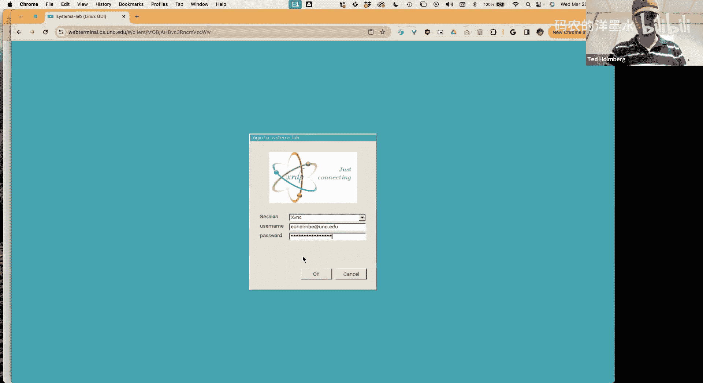
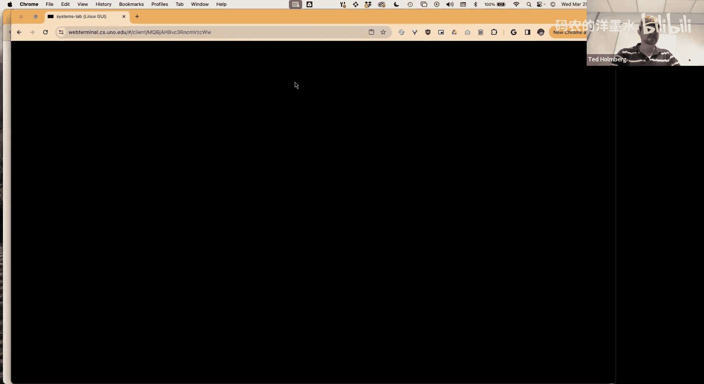
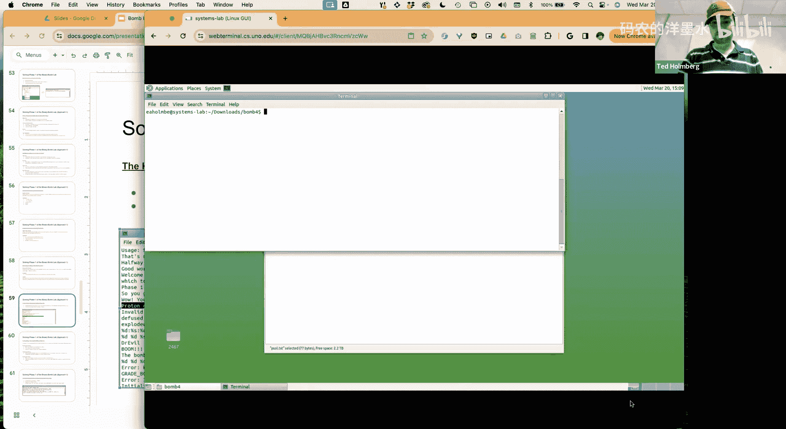

# C语言系统编程：17：Bomb Lab 第一部分


在本节课中，我们将开始学习“Bomb Lab”。这是一个通过逆向工程和调试技术来拆除“二进制炸弹”的挑战性实验。我们将了解实验的基本结构、目标以及用于拆弹的初步工具。

## 概述与实验目标





Bomb Lab 是一个独特的程序挑战，包含六个阶段。每个阶段都需要用户输入一个特定的字符串。输入正确则拆除该阶段，输入错误则“炸弹”会“爆炸”。你的任务是通过分析、调试和逆向工程，找出每个阶段的正确密码，成功拆除所有六个阶段。

你的炸弹是独一无二的，需要通过课程服务器获取。实验的目标是培养你使用调试器、阅读汇编代码和理解程序在系统层面运行的能力。

## 获取你的炸弹

为了开始实验，你首先需要获取属于你自己的炸弹。

以下是获取炸弹的步骤：

1.  登录到课程提供的 Web 终端环境。
2.  打开浏览器（如 Firefox 或 Chrome）。
3.  访问炸弹分发平台：`bomblab.cs.uno.edu`。
4.  在表单中输入你的用户名（不含 `@uno.edu`）和你的 UNO 邮箱地址。
5.  点击提交按钮。服务器会为你生成一个唯一的炸弹文件（例如 `bomb4.tar`）。
6.  下载完成后，解压该文件。你可以通过图形界面双击解压，或在终端使用命令：`tar -xvf bomb4.tar`。

解压后，你会得到三个文件：
*   `bomb`：可执行的二进制炸弹程序。
*   `bomb.c`：包含 `main` 函数的 C 语言源文件。
*   `README`：包含炸弹标识和所属信息的文件。

**注意**：请避免多次提交请求，否则你会收到多个炸弹。如果发生这种情况，只需选择其中一个进行破解即可。

## 分析源代码：`bomb.c`

虽然我们无法获得炸弹的全部源代码，但提供的 `bomb.c` 文件是理解程序入口点的关键。让我们来仔细查看它。

文件开头是一份“邪恶博士”的幽默版最终用户许可协议。其中隐含地提示了我们可以使用的工具，例如 `strings` 和调试器。

接下来是头文件包含和全局变量声明。关键的全局变量是 `FILE *infile`，它用于决定程序是从标准输入还是从文件中读取数据。

`main` 函数的核心逻辑如下：
1.  检查命令行参数数量 (`argc`)。
2.  如果 `argc` 为 1，则从标准输入读取。
3.  如果 `argc` 为 2，则将第二个参数作为文件名打开，并从中读取输入。**这非常有用**，因为它允许你将已知的答案保存在文件中，快速跳转到正在调试的阶段，而无需重复输入。
4.  如果 `argc` 大于 2，则打印用法说明并退出。
5.  调用 `initialize_bomb` 函数（具体实现在我们看不到的预编译代码中）。
6.  依次调用六个阶段函数 (`phase_1` 到 `phase_6`)。每个阶段都会先调用 `read_line` 读取一行输入，然后进行验证。

```c
// 示例：阶段一的调用逻辑
input = read_line(); // 读取输入
phase_1(input);      // 验证输入
phase_defused();     // 如果通过，标记该阶段已拆除
printf("Phase 1 defused. How about the next one?\n");
```

如果 `phase_1` 函数判定输入错误，程序会调用 `explode_bomb` 函数，导致炸弹“爆炸”。

## 运行炸弹与基本操作

现在，让我们看看如何与炸弹程序交互。

你可以在终端中直接运行炸弹：
```bash
./bomb
```
程序启动后会打印欢迎信息，并等待你为第一阶段输入字符串。

**重要提示**：
*   你可以随时按 `Ctrl+C` 来安全地中断程序。
*   直接按回车（输入空行）不会触发爆炸。
*   输入错误答案会导致炸弹爆炸，并向服务器报告，**每次爆炸扣除 0.5 分**。每个炸弹有 40 分的基础分，最多可扣 20 分。
*   如果分数扣得太多，你可以从分发平台重新获取一个新炸弹，但需要从头开始破解。

为了便于测试，你可以将答案保存在文件中：
```bash
echo “可能的答案” > solution.txt
./bomb solution.txt
```
这样，炸弹会从 `solution.txt` 中读取第一行的答案。

## 拆弹工具箱

要拆除炸弹，我们需要借助一系列工具来窥探这个二进制程序的内部。

### 1. `strings` 工具
`strings` 命令可以提取二进制文件中所有可打印的字符串序列。这对于寻找隐藏的密码或提示非常有效。
```bash
strings bomb
```
输出可能包含系统库字符串、程序中的提示信息，以及**可能作为密码的“异常”字符串**。

### 2. `objdump` 工具
`objdump` 用于反汇编二进制文件或显示其符号表。
*   查看符号表（函数、全局变量名）：
    ```bash
    objdump -t bomb
    ```
*   反汇编特定函数或所有代码：
    ```bash
    objdump -d bomb
    ```

### 3. `gdb` 调试器
`gdb` (GNU Debugger) 是本实验的核心工具。它允许你：
*   逐条指令地执行程序。
*   设置断点，在特定地址或函数处暂停执行。
*   检查内存和寄存器的值。
*   动态改变程序执行流程。
启动 `gdb`：
```bash
gdb bomb
```
在 `gdb` 提示符下，你可以使用 `run` 命令启动程序，使用 `help` 命令查看所有可用命令。

## 实战：拆除第一阶段

上一节我们介绍了拆弹的基本工具，本节中我们来看看如何利用 `strings` 工具快速破解第一阶段。

第一阶段的典型特点是，密码作为一个明文字符串直接隐藏在二进制程序中。我们的目标就是找到它。

以下是使用 `strings` 寻找密码的策略：

1.  **运行 `strings` 并保存输出**：为了方便分析，我们将输出重定向到文件。
    ```bash
    strings bomb > bomb_strings.txt
    ```
2.  **分析字符串类型**：打开 `bomb_strings.txt` 文件，字符串大致分为三类：
    *   **系统级字符串**：如 `malloc`、`__libc_start_main`，来自链接的库。
    *   **应用级字符串**：如 `“Welcome to my fiendish little bomb”`、`“BOOM!!!”`，来自 `bomb.c` 中的提示信息。
    *   **异常字符串**：那些看起来既不像系统调用，也不像正常用户提示的字符串。它们很可能就是隐藏的密码。
3.  **识别并测试**：浏览文件，寻找看起来像是一句完整、独立且有些突兀的话。例如，在示例中，字符串 `“If I knew then what I know now I wouldn’t have had my little accident.”` 看起来就很可疑。将它作为第一阶段的输入进行测试。

**操作示例**：
```bash
# 将可疑字符串存入答案文件
echo “If I knew then what I know now I wouldn’t have had my little accident.” > solution.txt
# 用答案文件运行炸弹
./bomb solution.txt
```
如果成功，你将看到 `“Phase 1 defused. How about the next one?”` 的消息。

## 调试器初探

虽然第一阶段可以用 `strings` 解决，但后续阶段将更多地依赖 `gdb` 调试器。

以下是 `gdb` 的基本使用流程：
1.  启动调试器并加载炸弹程序：`gdb bomb`
2.  在 `main` 函数或 `phase_1` 函数处设置断点：
    ```
    (gdb) break main
    (gdb) break phase_1
    ```
3.  运行程序，可以附带参数（如答案文件）：
    ```
    (gdb) run solution.txt
    ```
4.  程序会在断点处暂停。你可以使用 `stepi` (单步执行一条汇编指令) 或 `nexti` (执行完整个函数调用) 来逐步执行。
5.  使用 `info registers` 查看寄存器状态，使用 `x` 命令检查内存内容。
6.  通过分析汇编代码和程序状态，推断出正确的输入。

我们将在下一节课中详细演示如何使用 `gdb` 来系统性地分析和破解第二阶段。

## 总结与下节预告

本节课中我们一起学习了 Bomb Lab 的基本框架。我们了解了如何获取个人专属的炸弹，分析了提供的 `bomb.c` 源文件以理解程序结构，学习了运行炸弹的注意事项，并认识了三个关键工具：`strings`、`objdump` 和 `gdb`。最后，我们利用 `strings` 工具成功拆除了第一阶段。



下节课，我们将深入使用 `gdb` 调试器。我会演示如何用调试的方法再次破解第一阶段，然后我们将共同挑战更具难度的第二阶段。请确保你已经成功获取了自己的炸弹，并尝试用 `strings` 方法破解了第一阶段。