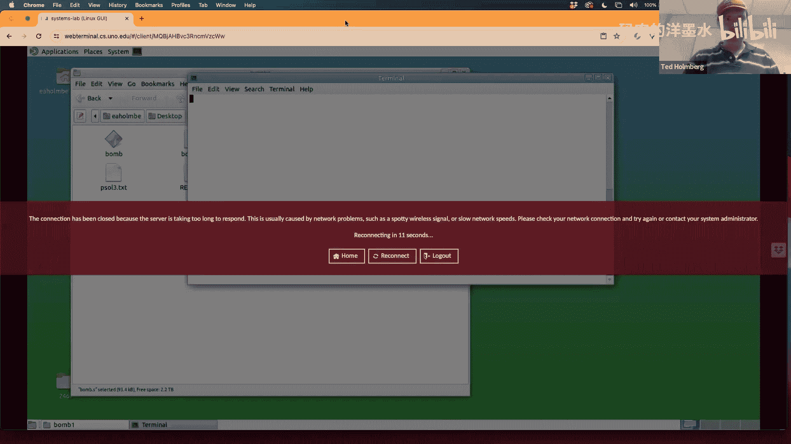
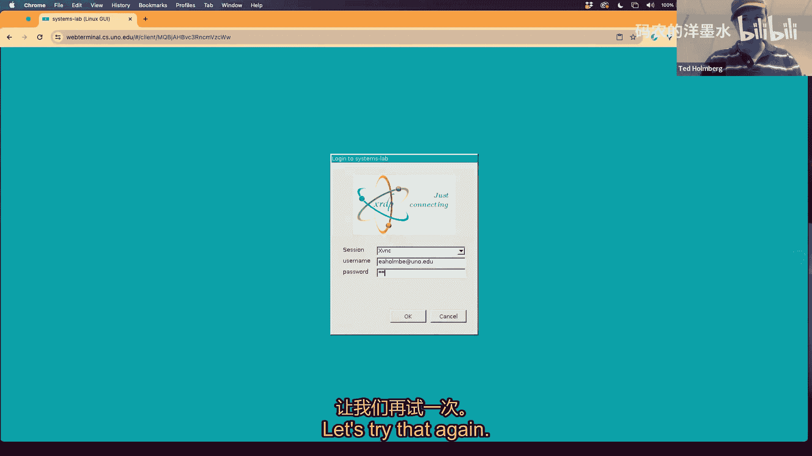
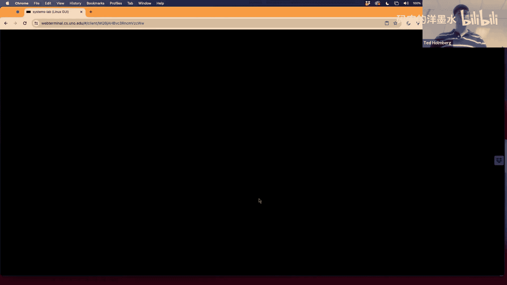
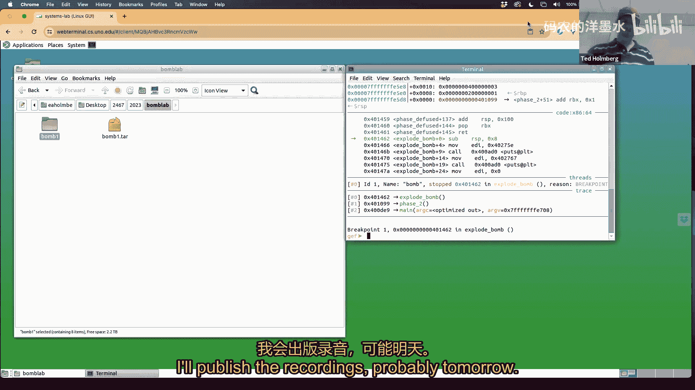

# 【全集】加州理工学院 C语言系统编程 中英字幕 p18 Lecture 18 - Bomb Lab part2 -BV1bUzWBLEiC_p18-

Okay， let's see here， we're gonna pick up where we last left off last lecture。

 So let's see we started the Bo lab right， Was everyone able to successfully make their own bomb now there's been some technical difficulty with the bomb platform delivery service as you might be aware it's not extraordinarily secure service it's prone to failures that every so often so if for any reason it goes down let me know like earlier I'm going to go set up board and it was down and so I had David relaunch it so it just recently rebuilt that VM so we have any issues let me know so we can go ahead and get that relaunch。

 but it should be functional now I think we last left off。

In the prior class motivating the concept about bomb labb， what it was。

 how to get a bomb and how to use strings to go ahead and find what the key word was for the first bomb。

Now I'm going to show you a second approach for that same phase。

 the first phase use the strings app the second phase will use the actual debugger and we'll kind of learn to use the debugger more in line so that we'll be very reliant on it in the latter phases。

 we're going to probably see two different ways to do phase two and then once we get to phase three we're going to definitely need to debugger to move beyond that。

So to kind of ease us into。Base。One with the bmy open up。My terminal， me go here， I'm going to。

Dasse symbolable， I'm going to start evaluating the bomb that I used actually last semester so that my slides are congruent。

 I don't have to remake all my slides。So let me go ahead and open my terminal here。

LetMe go and just make sure I'm inside my terminal is changing into my bomb。Perfect， okay。

 so now I can see I'm inside my terminal that has all of my。Boom paraphernal you get in there。Okay。

 so the first thing we want to do is we want to launch our debug， we saw how we can do that。

 we're going to use the new debugger G Dbing and then we're going to pass the application we want to debug as we stated earlier。

 Dr。 Evil was very kind to compile his application with with the to be very verbose and not to destroy to destructively destroy all of the function names it makes reverse engineering his code much much easier。

So let's go ahead and put our bomb in there。Okay， so at this point we've launched our debugger now we are inside the applications with the various options that we have let make sure there's comments there Okay。

 so at this point we saw how we can run so i'm going to start off from where we last left off I can run and this is runs the application at this point I can kind of E in words here i'm just going to do control queue though because I don't want to pass in any words at this point because we want to actually set up some safety nets so we are not going to to。

There would go， and now let's quit out of their queue to quit。And then I'll clear my terminal。 Okay。

 let's do this again。But instead of just running the application that said break pointss。

 breakpoints allows us to stop our code at certain specific labels or memory addresses。

So we're going to launch that at this point before I run my application。

 this is the point where I can do all of my preliminary setup for how I want to investigate my running application。

 so I'm going to set a break point for explode bomb。😡。

And notice that we now have our first breakpoint set at a particular memory address。

 that memory address is where the label of our function explode bomb is at in fact。

 to illustrate what if I try to set a break point with a label that does not exist。

 suppose I put elo bomb。Small typo， well that's perfect it's going to say not defined。Yes。Yeah。Okay。

 so at this point， if I go to run my code。😡，So I've launched into my application and if I go and type just any random string in there。

Normally if I was running this outside the debugger this would lead to an explosion now what it does is it still leads to the explode bomb function call we can see this right here because that's what gets invoked but that's also when my break point triggers so so long as I set my break point to catch that label i'll never unless i'm。

Unless I'm not paying attention， I shouldn't explode my bomb I could still explode the bomb if I put in like say person to continue I ignore that just continue Well now what I've done is the bomb is blown up。

So keep that in mind， even with the breakpoint set。

 it'll stop you but you can override the stop and just continue and this is easy when you're like investigating the registers and you get into the flow of doing things and you're like you don't pay attention for one small brief moment then suddenly you've exploded the ball。

Okay， let's quit。Out of this。Okay， so now that we've seen how to set a break point。

Let's see how we can not only prevent it from exploding our bomb prematurely so that if that were to happen。

 we can back out， but also how we can start investigating the code that's running in our system so that we can use that to effectively reverse engineer the strings we need to be able to disarm this ball。

Okay， so again， let me do my DbG。Let me go into my bomb。Perfect， okay。Oh， sorry， GDP。Okay。

 and now it's set a break。For my explode bomb。Perfect but set a break now if you remember。

We did a large。Evaluation of the code that was given to us inside of the Boattzi file。😡。

Some of the function calls that are very interesting was phase one， phase2， phase 3， phase 4。

 phase5 and phase 6。 So presumably let's pretend we don't already know what the phase one。

No funny phase one passcode is。Then I can set a break point for that function two， phase one。

There we go， we now have two breakpoints set up。And so if I go and now run my code or run the application。

 not my code， Dr。 E's code。And then what I can do here is let's say I type in hellello world and give it some prompt。

I'm going to hit enter。And now the first thing that's going to triggers my face too。

 because that's the thing that's going to evaluate to see if my user input matches what's expected before it makes the decision whether it's going to explode the bomb or not。

😡，Okay， so now there's there's some interesting things we can look at if I look at。

the very bottom here， it shows me where I'm at I'm at breakpoint two。

 it gives me the memory address at which this function is at。

 and it gives me the label if there's a label attached to this memory address。😡，Then we can see my。

Program stack， my application stack here。 right， my call stack。 So I started at the main function。

 and the main function invoked phase1， and phase one is the function I'm currently in。

 So this gives me a trace of where I'm at in the application， a historical trace。

Now the next thing I'm going to look at here is。We have all of our right here this green with the arrow is the location of the instruction that I'm at when I first launch into my phase one function my C function now recall that when my C function。

😡，Initially calls it does all sorts of preamly things so there's like a prologue where it goes ahead and pushes things onto the stack it makes it pushes the any kind of colly functions in if necessary and then it has an epilogue phase will look more of that at phase two but at this instance the things i'm interested in is well let's see what's happening here so I am。

Yeah this is some preliminary stuff that's like general pattern stuff that a machine generated assembly is going to embed the thing that's interesting to me is this line here right so here we're moving from our extended source index now we're called this usually a parameter that comes from a function some register space so we're moving something into ESi and now we're calling this other。

Function， this external function by this memory address that's called strings not equal。

So I'm assuming that the evaluation of phase one is probably happening at this line here and let's see what happens then it's going to test whatever is an EA Act。

😡，And then it's going to jump if it's equal to this memory address and this memory address notice。

 so these jumps。😡，Is that would be after this memory addressed here so and then this is a call to the ball so what we can see is we're going to check to see if it's not equal we'll evaluate that and then we're going to jump。

And if it's not equal， we're going to explode the bar。

If it is equal then we will be able to move on to the next phase so can every everyone kind of see what's happening in this assembling enough to be able to understand so let's let's what would the nice is if we could see what's happening in the register space at this particular call here。

😡，And we can do that actually we can go to each next instruction。

 so we're currently at this instruction， not an interesting one。

 so next I brings me to the next instruction。😡，And if you see now。

 my green arrow with the line that I'm currently at has now advanced to the next instruction where I'm moving e value to ESI。

😡，And so let's call that one more time。Because I'm going to get to。

This instruction where I'm calling strings not equal。Now at this point。

Let me see if so at this point， we moved something into。Okay。

 so there I'm inside of string's not equal， I've moved something into RSI previously。

 so let's actually use the ability to look the hexademal values of what's inside of RSI。

So I'm going to use x to get a hexademal value， and then I want to be able to get。

I want to read the value from a register space， so I'm going to do x slash s。😡。

And then to read a register， I'm going to use the dollar sign and then it's RSI that a value has been moved into。

 so I'm going to see what that value is。😡，Now for this particular bomb。

 the thing I'm comparing against is the statements that we need to actually supply。

 so it's going to be proton guns are well and good， but sometimes you need the Swiss arm。

So what I can do here is I could copy that。And now I would hit continue。

And now since I typed in how a world and not that phrase is going to bring me to the explode bomb at this point。

 I'd want to quit out。Now， if I want to test that。😡。

I could just launch the application and play really dangerously not going to do that。I'm gonna。

I'm going to go ahead and use our debugger again， going to set that up to launch。

Our bomb application， I'm going to always make sure that I set my breakpoint for my and I'm going to do this manually each time you get used to seeing this。

Going to set my explode bomb just in case， but at this point， I'm not going to debug anymore。

 I'm just going to go ahead and run。And I'm going to test that out， so I'm going to paste in here。

Oh no。Probably don't want these strings so。That's，'s actually well。Pace。Okay。

See go into Exp bone because we have quotations， so clearly we don't necessarily want the quotations into what we have。

 so let's do this。Well let's quit。Let's echo。Paste。Grab what we just want here， copy that。Okay。

 now let's go back into our bomb。W's。Seent our breakpoint。And let's run。And let's try that again。

Is that。And phase one diffuse so now you've seen two possible ways for us to go ahead and difuse the first phase。

 the first we use the strings application and the second approach we use the debugger application does anyone have any questions about how we were able to accomplish that。

我都系佢。What was your question？Oh， Echo is a shell command。That will print out whatever I send to it。

So just to give you an idea let me quit out of this。

 yeah there's all these fun little shell applications that are good to kind of learn so here we have echo。

And then I'll type in。Hello world， and then it just prints out hellello world。Now， you might wonder。

 why would I ever use ECcho？Um， so some common rationales on why I use echocho every so often just to give you some。

 I guess。A daily hack trick is whenever I launch a new GitHub repo。

 one of the first things that I always need to do is create a get ignore file and put dot Ds stores in there if you have a Mac。

诶。How many people have max the of curiosity yeah so one person at least shares this pain one of the unfortunate things about max is they put a hidden file into every directory in order to track what files are in each folder。

And that's your do Ds store file， which means they automatically get added into your Git repo。

 which is just garbage files like those are not things that you should be sharing that's for your and this is true for things that aren't just related to Mac there are sometimes private files that are in the repo for your own testability that you don't want to be part of the public repo that might be other things like API keys or anything that's not public knowledge for the application or things that are just local to your machine or anything that are like。

😡，But dependencies because a lot of times each machine should build its own dependencies for an application。

 so has everyone built a dot get ignore file before for your repo。

 is that at least something you've seen before， so instead of launching a text editor。

Where I create gett ignore file and then just putting dot Ds store。

 one thing you can do is just do echo。😡，And then you can put dot Ds store。That's supposed to be a do。

And then you can do a redirect， so instead of standard output that you're printing this text to。

 you can send it to a file， say for instance， a dot ignore file。😡，And then all of a sudden。

I should now be able to look at my get ignore file and you could see already have a dot Ds store。

 oh I think there's an underscore in there as well。

 it doesn't matter the proof of concept is still the same。

That allows me to very quickly print things from incentive to my output stream to a file stream without having to launch。

Big applications right this very lightweight application which is a very simple task that doesn't interrupt my workflow。

And that's what these small little shell applications are really good at， like for instance。

 if I want to remove quotation marks。Good question and this is what's really going to make me look forward to all the group presentations that y'all are going to show all。

😡，To be able to highlight all the very valuable and popular and useful shell applications that are available that will make you much more proficient。

 not just understanding how the shell works， but actually being able to use it as part of your workflow for developing software。

Okay。a question about of the steps you did you did the X slash S and then the dollar RsI and thats something that we should know and like somewhere we could like look and figure out how to look that's a great question so。

We're going to look at that more and on phase two as well so X allows me to be able to print hexademal value hence the term X then the slash and the value after that is going to effectively be the amount of memory I want to access to be able to build that hexademal value if you want to read more about the actual parameters because remember we've transition now where I'm just kind of showing you these very narrow way you'd want to either look at the man pages on the new debugger or you can go ahead and use the help command on new debugger so as I start to step through all these concepts and you're seeing some of these new commands you haven't seen before I'm now allloading the work of broadening your understanding to you to go read the APIs。

But two places to go look， there are man pages that are available that's like your API documentation that you can launch right from your shell using the command MAN sort for manual and also the debugger itself is an application that has a help option and the help option will allow you to go ahead and ask about any particular thing。

Good question though， and we'll look more at that particular command as we go further along this inside of this lab。

Okay guys， is there any other questions in terms of at least phase one？Okay。

 let's go into phase two now we're going to look at phase two in one of two ways there's actually two ways to solve phase two just like there's two ways to solve phase one in fact I'd argue there's probably more than two ways there's only two ways that i'm going to cover。

So I want to take an analytical approach at solving phase two and then I want to take an exploratory approach at solving phase two so one that's going to be heavily reliant on using the debugger that's going to allow us to explore our memory space our register space how what's happening that each line as we go ahead and executed and kind of feel out what's happening in the application step by step and then another approach I want to use object dump and application we've seen before just to be able to get access to the disassembled assembly code and try to reconstruct what's happening inside the phase two which is going to be the analytical approach that's what I mean to distinguish between the exploratory and analytical approach Okay so i'm going to start with the object dump approach。

So let's start with these。So let's do， okay， make sure I'm wheremont yet perfect。

 make sure there's no comments here， perfect。So I'm going to do object dump。

 this is an application we've used before。And we've lectured about multiple times。

 let me also stretch my window out here。Okay。And then the next thing I'm going to do is I'm going to put my flag。

Com'e on， don't lag on me computer。I've gotten an unstable connection。

The only problem with doing these labs， depending on the VM is sometimes it connects and can go unstable and then you got to take a pause。

 Okay， so we've got an object dump。And I'm going to use that dashd。

And then we're going to do the bomb application， and instead of printing this out to the console。

 I'm going to redirect this to a file that I'll call bomb。s。😡，Perfect。

So that allows me to open it up and explore I can do cat cat allows me to inspect the contents of a file right from my terminal so let's do that initially so bomb。

 s we can then see that oh I have all sorts of columns Okay this is a really hefty file it's going to be kind of burdensome for me to investigate it inside my terminal I can I could use a text editor inside my terminal to do that I'm just going to use whatever is built into our window display here so let me just grab this I'm going double click it。

Okay， so here one of the great things that is to our advantage is we can actually see now what our disassembled code looks like it gives us the opportunity to peer into what's this how this application is constructed now what you should notice is that we have the labels for each of our functions so this first column as we've stated in lecture is our set of memory addresses。

So if you see this is our memory address and starting from here。😡。

You can see it increments for each set of hexademal values that encode the set of instructions that this procedure executes。

So this is the set of memory addresses inside this memory addresses is the hexademal representation of our application logic。

And then this third and final column is going to be the retransd。😡，Assembly instructions。Okay。

And of course。It jumped us right to where we want to be phase two。

 thats the that's the interesting function for us at this moment。But if I were to scroll up or down。

 you can see that it would have more of these functions that we care about。

 but let me go back to where。Yeah， like for instance， we have the logic for phase five here。

 but let's go back to phase two， that's that's the one that we're trying to solve at this moment。

Okay， so the first thing we see is we're doing some pushing here again。

 that's going to be preliminary prologue stuff before our core body logic can execute。😡。

The machine generated assembly code is going to have。

Patterns that are for system level management between transitioning from one function call to another function call。

 so if we can see we're pushing some register spaces onto the stack and notice when we're done we're popping those back off we're turning notes。

😡，So when you start to learn how to read the machine generated assembly。

 you start to see what these kind of prologue and epilogue calls are that help set up the stage for a function to start executing and then break it back down so that we can return to the call function。

😡，You can see here， okay， so。We have here， we can see we're moving our sack pointer， right。

 so we're making rum on our sack pointer。Then we're taking our RSI and we're moving。😡。

That in and then we're calling this function here oh that's an interesting function read six numbers that's a bit of a clue on probably what the input is that we want。

 right？Let's see what else we have here then we're going to。Do a comparison。

To they've got to now remember when we're putting things in a parentheses。

 we're effectively doing like a dereence。Of a value at the stack pointer and we're comparing it here。

And then right here， we're going to up and right here we have a call to explode bomb。

So this looks like a pretty vital comparison and then then we're going to do a jump based off of that comparison and depending on what happens with that jump is going to depend on whether we're going to explode the bomb or。

Okay， let's actually jump in this instance I have。😡，Kind of。Paired。

The assembly with some comments so that you can actually read my comments so you don't have to follow my voice and kind of memorize what each of these statements do so let's actually jump to that。

Okay， so we already said that the structure of our。Object dump is going to give us the addresses。

 the machine code and the assembly code。And again， everything is going to be in little enddN format。

Which we've established earlier。So the first thing we do is we recognize as common function prologues。

 that was this push RBP RBX， it was this subtraction from our stack pointer by this amount so effectively what we're doing is we're saving our old base pointer we are going to save our old BX register and these are both col saved registers。

😡，Then we're going to allocate some stack space for the local variables and save registers that's coming in from our function call。

😡，And then what we're going to do is we're going to typically use to prepare for our next operation。

 we're going to move our source index into our S pointer。

And then we have our function body that's going to be the actual logic we care about so this is going to be pretty common in most functions and then at the end in the epilogue where we do our breakdowns。

 the kind of common pattern you're going to see is we're going to delocate that stack space that we allocatecate it before we started doing anything we're going to pop those registers back off and then we're going to return back to our called function so this stuff we can kind of ignore。

😡，When we do we do our initial inspection。Okay， so then with that said。

 let's take a look at what our。Reading six numbers looks like。

At least from the debuggerss perspective so here all I did was I grabbed that sequence from our object dump and pasted in here。

 and then I went ahead and I provided our comments to each side here so in our first line you could see when we call。

😡，This read six numbers， we're going to allocate 24 bytes of stack space because this is a hexasmal value here。

Then we're going to load the effective address of our second number into RCX， that's our counter。

Register， then we're going to load the effective address of our six number into RAX。

 so notice we're indexing into our source index。And then we're going to be offsetting by four byte increments。

Then here we're going to store the address of the sixth number onto the stack。

 we're going to load the effective address of the fifth number into RAX。😡。

And then we're going to load the effective address of the fourth number into R nine。

 load the effective address of the third number into RD act。

 so effectively you can see removing the values that are passed to us into our register space。

Then finally we're going to initialize EX to zero， this is the scanner's return value。

 which would be stored here， and then we're going to call scan F to read six numbers。

And then we're going to return the value of scan F。😡，With five。And if it's more than five numbers。

 we jump to address number 61 here。Which would be。Where we return from this function call。

If it's five or fewer， then we explode the bomb。So effectively， what we can see that。

Our read six numbers is doing is it's a helper function inside of our BaM application that checks to make sure we have six values。

And if we don't。It explodes the bar。So no， you can explode the bomb in helper functions。But we can。

If you're doing where。Let me restate we're doing an analytical approach so we can see that by looking at each of the functions that's called the first one we looked at was phase two。

 and then we started to look at what was happening in each line of assembly and see what comparisons lead to a jump that effectively lead to a explode bomb operation。

😡，And when we first saw that there was a。Heler function read six numbers。

 we found that inside of our object dump and we broke that down and the big interesting thing here is it's ensuring that our input then has to be six numbers long。

😡，And if it's not， we'll explode。And actually， let's see here， let's see if well， no。

We're going to play around and they explore， don't want to mix and match。

Thinking about running into the debugger we will wait for that Okay。

 so let's jump back into our phase two code down that and kind of have a slight understanding about what read six numbers does all even though I think the name of it was pretty is pretty spot on。

So here， what's in the red was all my pre emly stuff， right？Here。And here。Is all the stuff that。

Is not really part of the core logic of the function。Now， where it gets interesting。

Is where we go ahead and call this。So here。Is when we're calling that helper function。

To read those six numbers at this point， our registers should then be loaded with the six numbers that we had passed in to the application。

😡，So then the next。The next line， after we do that is going to be a comparison。

We're going to compare the value at the stack pointer addressed to zero， right？So again。

 our stack pointer， we're dereferencing when we put the parentheses around it and we're comparing it to the value zero。

 and we're going to jump if not negative。So if it's positive and we're going to jump to this address and notice I've highlighted the addresses for ease of readability to be this blue color。

😡，So this address is what 4010 SF that's going to be this address here right， am I yep。

 that looks correct， so we would jump here。Which is if you look。Advances us past the explode bar。

So what that tells us is if our number is negative。We explore。So non negative numbers。

 we got a hint already。😡，Okay， the next thing we're going to do。

Is we're going to move the stack pointer valued to the base pointer。

Now we can kind of think of our numbers as being stored in a contiguous block of memory so we can be able to index to access them。

😡，So the next thing I'm going to do is I'm going to load the effective address of my whatever reference I have in my base。

😡，and that's my my B I'm sorry inside of my RBx register space， so i'm going to load the value there。

 but when I load the effect of memory remember that if I have this。😡，Value。On the outside there。

 that constant value， I'm doing an increment on it。 This is a very。

CosCost effective performance wise way of doing an increment so i'm incrementing the value of RBX by one。

 you can see that in my comment here， and then i'm going to load that into my EAX register。

 so I'm taking RBX increment it and putting it into EAX。😡，Then inside this line here。😡。

I'm going to add the value。At the address， it's calculated。By my base pointer。Offset by RBX。

 So RBX is my offset into my array。And then since these are integer values。😡，They are four bys large。

 so I need to have a four by offside。And then I'm going to add that with what's an EAX。😡。

So this gives me a really good clue as to what I'm looking for to inspect for my input。😡。

Then and the reason why I'm going to do a comparison with that。

 I'm going to then compare EAX with the value that's inside of that base pointer。😡。

Offset by that index， which is my RBX in four block elements and notice this is doing you have this value here。

 that's the equivalent of effectively advancing by four。

Memory addresses so if you think about this as an integer array。

 it's like peering into the next element of the array as opposed to what I'm currently at。😡。

Does everyone kind of see that？Right here， this， so if this is grabbing the current element in the array。

😡，This is like grabbing the next element in the array。Because that four。

 that hexasmal4 value that's on the outside of the imprihees is advancing our memory of location by four bytes。

So it allows me to offset my memory location。Now this is my comparison。

 the comparisons are always was key with being able to solve what's happened with my bomb logic because that primes all my registers to then do a jump。

😡，Here I'm going to jump if equal， so if my EAX value is equal to whatever the value in the next element of the array is。

😡，So if it is， I'm going to jump to this memory address 401099， which is going to be here。

And look at what I jump past then there's only one statement between those two。

 it's an explode bomb function call， so this allows me to avoid exploding the bomb。😡。

Then after I do that， I'm going to compare my Vx register to 5。And if it's not equal。

 I'm going to jump to memory address 401087， which is up here。

 I'm jumping backwards because this is a loop structure。😡。

Whi you should already be familiar with with assembly。

 that's why we kind of skipped it inside of our earlier lectures is that all the logic stuff you should be familiar with with labels。

😡，Or I guess we're not using labels， but you know， memory addresses numerical。

 these are just numerical labels， right？😡，So clearly， this right here。

Is going to be my loop logic and my loop condition such that once I get to effectively index five。

 once I've done this for all six of my digits， I'm done。😡。

Which means I would then break out the loop。And when I break out my loop。

 well that's all this stuff that is my epilogue that's the deconstruction of this function and then I return back and we know after inspecting our main function。

😡，Last class set if we can get past phase two， we'll go to the diffus bomb function call and then we made it through this particular this particular concept okay or this particular phase not concept with face okay。

 so does this。Kind of walk through of the assembly kind of makes sense for my bomb remember you have to understand what's happening here because your bombs going to be different。

You can't simply use the same inputs。But notice how I was able to go ahead and。

Identify each of these lines in an analytical approach。😡。

Evaluate what's happening kind of create a predictor of what the behavior is so is this emergent has anyone been able to kind of guess what this logic is？

😡，Well you don't have to guess let me just move to the next slide what i've done now and let it would be a good practice for you to do is once you have kind of identified on a pur line basis。

😡，Analytically， what's happening in the assembly sees you can't reencode it into C code so that you can better isolate and understand what's happening in the logic。

😡，Between our input and what's being evaluated。😡，So now let's reexamine what I just very arduously stepped through and reframe it and perhaps even composite it together to actually translate it into C instructions。

And so what I'm going to do to make this readable so that you don't have to remember all the assembly instructions and I'm going to comment the assembly instructions out and pair them with my C code。

So here we can see these were the first several sets of calls that we have very little control over right this is all the preamble stuff and the call to get those six numbers loaded into our kind of memory。

😡，So there's nothing that we can really do to kind of like define that part right that's none of our own work。

😡，Then the next thing we notice is， hey， there's actually a for loop that's going that starts at index zero。

And increments until we hit。5ve。😡，Z， one， two， three， four， five。So。

And we notice that our R Bx value。是。Starts at zero and we increment it each time until we hit that terminating condition。

At the very end。And so these are the logics here that reveal to me that that is a for loop in assembly。

😡，Okay， so once I have my for loop established， we had this line here where we were loading the effect of the memory address。

😡，We were advancing it by one address space， so this was and then we were saving this。

 we were then loading the value into EAX， well that's the equivalent of moving into EAX。

 whatever the value in RBX is plus one。😡，And RVx is the thing that we're incrementing across， right。

 zero， one， two， three， four。😡，Then the next thing we're going to do here。Is。In this instruction。

We're going to。Use our base pointer， our offset， which is RBX and。😡，Not I'm sorry， our indexer。

 which is RBX and then our offset， which is four because that's our data size。😡，Well。

 that's the equivalent if I were to map that into。Aray indexing terms。

 we would have this array where I'm using RBx as my index value and this value here。😡，I'm sorry。

 this value here。Represent zero， so i'm not offsetting it at all。

 so i'm just indexing directly into that array space and I'm adding that with the value that's an EAX。

😡，So that's like saying take EAX and add to it the value that's at this erase space and then we're going to override EAX with that new value it's a destructive right because that's what the add。

😡，Operation does right， it deposits in the accumulator register。😡。

Then we're going to do this comparison and what our comparison for ease of purpose instead of checking。

We're going to check to see if it's not equal and make the bomb explode as opposed to checking if it does explode and like jumping past the bomb right in our logic we're just going to invert that concept。

 so we're going to see if EAX is not equal to whatever the next index value is in our array。😡。

And so what that comparison looks like is we're taking EAX。

 and then we're going to index into that same array。

 but instead of looking at the current position where the leading value is that hexademal zero。

 we're going to look at that leading value where it's effectively offset in our memory address by four memory addresses。

 so that's like adding that's like adding one to the data type。

 we're advancing four memory locations， which is one an integer value。

 which is going to be the start of our next integer value in our array。😡。

And so if those are not equal， then we blow the bomb off。

So there you go that's so does everyone kind of see how we can map our assembly logic into a higher level language then very important skill if you want to do an analytical diagnosis of what's happening in this disassembled code okay let's actually declutter this a little bit。

😡，Let's remove the assembly and just see what it looks like with the C code because this I think will reveal the logic more so once we're happy with our translation。

😡，Let's see if we can't flow with the logic so here I have for RBx no don't want to do that for RBx starting at zero and so long as RBx is less than five will increment RBx as our indexing value as our loop control variable。

😡，We will。Increment RBX and set that to EAX， then we'll take EAX and add it to whatever value it is we passed in。

 this array represents the the six values we've passed。😡，And we'll override EAX with that。

 and then if EAX is not the same as the next value of our input we explode the bond。😡。

Now what we have is something that we can solve algebraically。😡，So suppose RBX is zero， right。

 we started at zero。That means that。If array zero plus one， then has to equal array of index one。

 right so that means we're incrementing。😡，The next value in the sequence by one。So then for RBx1。

We're going tocrement we're going to index into array one。

 and then we're going to add two to it because remember this value that we're looking at is incrementing across this for loop。

 so we're getting this one， two， three， four， five value here。😡，For all six of our elements。

So does everyone understand how？This is generating our sequence。

 this is the algebra of terms that are generating our sequence。😡。

So if we assume that our rate index is one。Starting with the simplest positive number。

Then we can then say that one plus one with then2 for the second term， because remember。

 we don't have negative terms。😡，And  two plus two would equal4。

4 plus three would equal 7 going by this7 plus 4 would equal 11 and 11 plus 5 would equal 16。

 So that means if we're right in our conversion and we did this algebraically。

Then our terms would be 1，2，4， 7， 11， and 16。So does that actually make sense to everybody？Okay。

 so the analytical approach， let's see if this works。Okay， let's close this。That's GDP。Our bomb。

Let's set our break point。Or explode bomb。Let's run with our。

Solution so that we can skip past the first phase and immediately try this one。

 so what do we say it was one，24，7，1116。That's it。Okay。

 so that was just one way I can solve that now I want to show you a different way to solve the same problem I want to show you the exploratory way that we might solve this problem as opposed to the analytical way the analytical way is like let's just let's dump all of the assembly code let's evaluate it line by line。

 let's understand what's happening with it， let's follow the logic。

 let's retranslate it into a higher level language。

 let's algebraically solve it so that we can get a numerical sequence and then let's use the dobuger to see if that sequences valid。

😡，Completely acceptable ways not to work though right a lot of time invested。

This is also a way that is a lot of time invested， but it's a different way。

 so I'll leave it up to you which way you want to do it。

 we're going to do an exploratory way instead， okay， let me quit out of this。😡，Okay。

 so another way I can do this is。Let's launch our RD bugger。嗯。

GDP perfect and the next thing I'm going to do I'm going to break。On my explode bomb。

Because I never went back to trigger， I always want to stop if that ever triggers。

 now I'm going to set a break point for phase two。Bamn， okay， so now I'm my phase two。

 so now with my phase two。We kind of cheated a little bit by being analytical do we want to do this in a dummy way well because of because of time constraints。

 I'm going to have stated it。😡，Do知 that。更是。Yeah， due to time constraints because I have 15 minutes for this phase。

 I'm going to assume I already know that it is。5 of that at six digits that it has to be right Okay。

 now I could find out it's not by exploring as well， but in this instance。😡，Well。Actually。

 let's not let's let's let's do this let's do this with hellello world， Okay。

 so I'm going to do hello world。Oh wait， what am I doing？Oh， I'm still sending in my bright points。

 Okay， so now I need a run， so let's run。Okay， okay， so now let me give it hello world as the prompt。

So at this point， I'm just finding out what kind of input do you want？😡。

I'm gonna launch into here now I'm in bright I'm in break point2。

 And so just like when I use the deggger on the。First phase it's going to show me what is inside of this function。

 so here i'm at pushing RBP so we know this is all like the preliminary stuff。

 so I might go to next instruction。😡，And then next instruction。And then let's do next instruction。

Okay， and then what I can do here is。At any time。I can use DISAS disasse symbol to show me a more complete view of exactly what it is I can get my symboler dump。

😡，But step into。Okay， we're already in， let me go to next instruction again。あ。

I've got an unstable connection。I've lost my。Okay， let's see。

Has been closed because the server taking too long， okay， well let's try to reconnect。二照。

Some technical difficulty is because I'm reliant on a remote connection。Let's try that again。

Well。😮，Let us go back here。Let's go back here。Let's go back to our bomb labb， let's open terminal。

Alas。二靠。So let's go here to launch。Our G on our poem。Perfect， let us break on explode bomb。喂。

Break on。Bhase two。Perfect， okay， now let us run with our face solution file。

That completes through that first phase excellent Okay。

 so we were saying what if we just did hello world let's say we go in blindly and we're just。

Poking and prodding in the debugger to explore what's happening as our code runs。😡。

So we'll go ahead and run that we're inside phase two， let's go to the next instruction。

 let's go into the next instruction。The first instruction I see that's kind of interesting。

 what is this call， let's go into that instruction。And now can I step in this instruction。

 let's see here。Okay， so now I'm in read six numbers。

 see how it now shows me where I'm at here and if I look。

At my so step I allows me to step into instruction。

 which then allows me to pass into another function。😡，As opposed to next instruction。

 if I do next instruction just keeps executing from the instruction that I meant。

So this lets me step in， now I can use effectively disassemble disAS。

To also see well what are the sets of instructions that are executed inside this helper function so instead of having to use object dump I can explore all this code and kind of watch as it's executing so instead of passively reading it I kind of have this ability to poke and prod at it I can inspect my register spaces。

 I can have it walk line by line。😡，And then here。I'll tell it to go to continue。

I can see this is where it's doing this comparison here and it's going to jump if it's greater。😡。

To this。Which is going to bring me to the return and it's not it's going to it's going to jump it's going to do so I got to be greater than five。

So let me hit continue and you see that brings me to explode the bomb so now all of a sudden I know I call this read six digits and now I know how many digits it is by just looking at that code so now I can quit out of this because I don't want to explode my bomb。

I can jump back in。I can。Set my。Freg points。Break， explode bomb and break on phase two。Okay。

 so now I can start having some fun， so now I know okay， it's got to be a set of digits。Let's do。

Wrong。Okay， so suppose that I start with a minus one。0ero， one， two， three， four。

 right that looks like six stitchs， right？What I can do at this point， okay， so let's go to next I。

And let's go to next eye。Let's go to next I。Go to next I。Oh unsavable connection。Okay。

 so now we're going to call read six numbers， this is where we were dying last time because we didn't have any numbers to read。

 let's see if we can make it through this。啊。So now。Now we're going to compare and look。

 it tells me this jump is not taken， well that's a bad news for us， right？

The reason why that's not taken is our number has to be great， it can't be negative。

This is where we find out that condition we've explored a little bit， we're like， oh。

 we need this jump otherwise we're going to call this bomb， you see how bomb is the next thing。

So if I go to the next slide， what's going to happen？Yeah， it's going to。

It'sNow notice I'm on the explode ball。If I do next all， it's going to bring me into explode bomb。

 but at this point I want to quit out I don't want that okay。

 so now I know he be cant be a negative number。😡，So let's do it again。Okay， so let us。Break on。

Explode bomb。Let's。Break on phase two。Now， keep in mind。

 we assume no knowledge so far up to this point， everything we've learned。

 we've learned by exploring what leads us to explode a bomb。😡。

And then reading what jumps need to be taken at any given time to avoid that。

And we're slowly kind of filtering out what's not the answer until we finally drive what will be the answer。

 so a lot of work just in a different way。Okay， let us run with our phase solution 1。cxt。Okay。

 so now let's suppose okay， let's advance that so that it's zero， one，2， three， four， five， okay。

 we have six digits right， let's see where we go with this。Okay， so we're there。

 let's go to next slide。Let's go to next on。Now， really next I。啊哈。Now， actually。

 now that I look at this。This comparison is a pretty important one for us。

This comparison with the D word。Because that's going to determine if we explode the bomb or not。😡。

Actually， so let's actually set up a break point。So that we can actually。

Prevent ourselves or see or stop when we get to that long so we don't just see labels for break pointss because use memory as rest as well Okay。

 so actually let's quit out of this and do that。So let's set our breakpoint for explode。

Let set up our breakpoint for phase two， let us run Pol 1。txt。Okay， let us do zero， one， two， three。

 four， five。Okay， let me do next eye。Let me do a disassemble actually so i'm going to disassemble the reason why i'm going to disassemble is I need the memory addresses the only way I can get the memory address to get a break point for a particular long is to do this so the thing that I think is interesting that we want to stop at is going to be when we do this comparison here。

So let me grab this memory address。Copy that。And here I'm going to break and to do a memory rest。

 I have to lead with an asterisk。And then I'm going to paste。And now I have another break point。Okay。

 so now let's do next instruction。Next instruction， next instruction。

Next instruction a we just at that break point now the lovely thing about this break point is now we can inspect what's inside of our memory address。

So what we can do is we can do info registers， this would actually give us all of our register space that's a lot of noise。

 we don't care about all the registers we're going to look at what we're comparing against。😡。

Which is。Let me see someYeah， I did the wrong。Compare， actually。

So let us get out of this and actually just relaunch， I want to do this at least once so you can see。

So let's break。Unex this break on phase two。Let us go ahead and run our pieceO on du。

Our phaseolution。txt is201，2，3，45。But us actually get the other the the actual one we want to check which is going to be the compare that is。

Mostly right here yeah this comparison to EAs right this is the one we want because when we it's because that's what's going to allow us if that。

Is equal it allows us to jump to 51， which is going to avoid this explode bomb this one。

 if you remember， is just checking to make sure we're not negative。😡，We already solved that。

So what we care about is this memory address here， so let me copy that one。😡，Let me break on this。

 so now I'm going to start with an asterisk and I'm going to paste。Okay， so now that I have that set。

 I can now go to my next instruction and now let's just。

Let it execute next instruction if I wanted to I could just type continue and it will go to the next breakpoint as well。

 but I like being able to step through so you can see line by line while this is happening you。

Next I。Okay。Next I。Now。Next on。I'll just okay， continue。Okay， we're at breakpoint three。So continue。

 we'll just keep going until I get to another break point。So the application is done。

 so now I'm going to do info registers。Now this would actually display all the register information or I can give it a particular address that I'm interested in so here。

😡，I want to see what's an EAX that I'm comparing to remember I'm looking for equality。

 that's value is one。😡，What did I put in Well， if I want to see what I put in。

 I can use X and then one double word。😡，Because remember an integer is a double word size4 bytes。

 and then I can actually then look up in the register space so that would be RBP。

 I'll use my base pointer and since these are registers I've got a prefix with a dollar sign and then dollar sign RBX。

 that's my index value and then I got to multiply it by my size of my data by the scale of the data and oh wait what did I do here。

Wrong wrong direction there we go Oh yeah that's right I put in a one a zero so I'm comparing zero to one well now I know the first digit。

If they're equal， I jump， if they're not， then I die。So I need， okay， so to test this。

 let's quit out of this。😡，This launchs back into our debugger。Let's set our breakpoints。Explode。B。哦。

Bse。2。Perfect， let's run。Yes， he sold that up。Paceel1。ht。Perfect， let's do one， two， three， four。

 five， six， we'll just keep with the increment。And just to see if this works。

 let's see if we can't get past that first number and get to where it says it's the second and then you could see I would just keep doing this six times see it all six numbers without either having to know what the logic is just knowing what the comparisons are at any given time hence the exploratory approach as opposed to the analytical approach Okay so at this point let me do my disassemble。

😡，So that I can get the so that I can call my break when I do my compare and that was here right so let me get this memory address。

Let me copy that。Okay， let me set that break using an asterisk and let me paste that。And hit enter。

 okay， at this point， I'm going to tell it to continue until it hits that break point。

And so at this point， I'm going to say， okay， info registers。EA X。啊。

So I go past the first one because it's not one， so that means I'm now at the second digit where I'm comparing for two。

Right。And if I hit continue again。有。Next slide。Next ae。Oh， let's still continue。A am mind。

I'm finally an explode bomb because I got the wrong value。

So I'm out of time to show you how to do this all the way through。

 but you can see I just take the same set of steps and each time I find out what the next value is and I iteratively do that until I find all six values that's the exploratory approach of solving phase two Okay with that。

 you should be able to solve the first two phases。😡，Have a great spring break。

 we will reconvene next Monday。对证。I'll publish the recordings probably tomorrow。😡。

