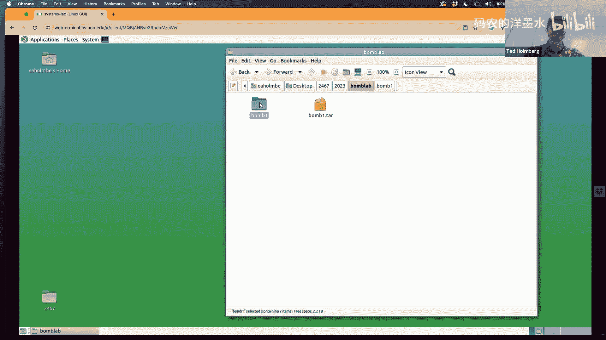
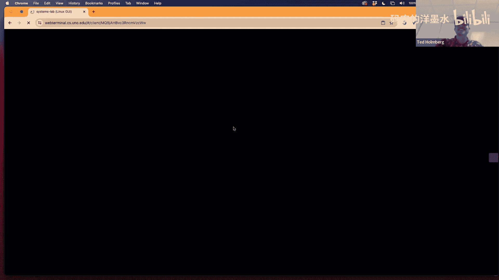
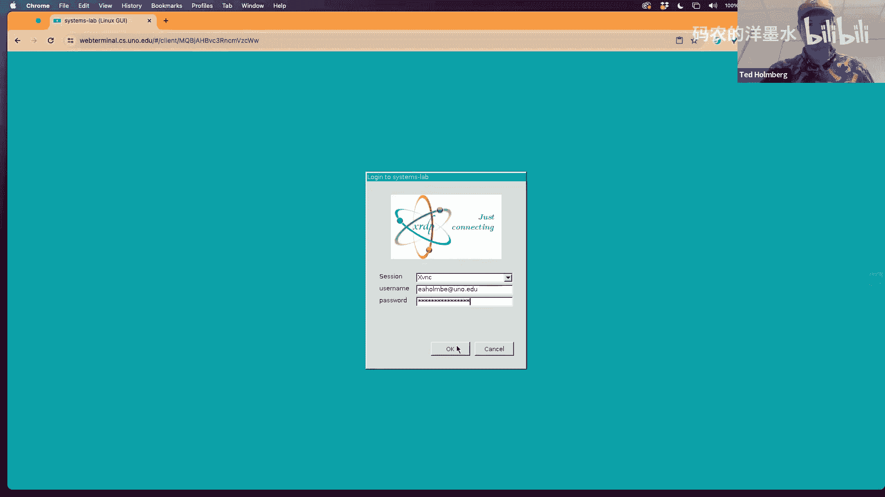
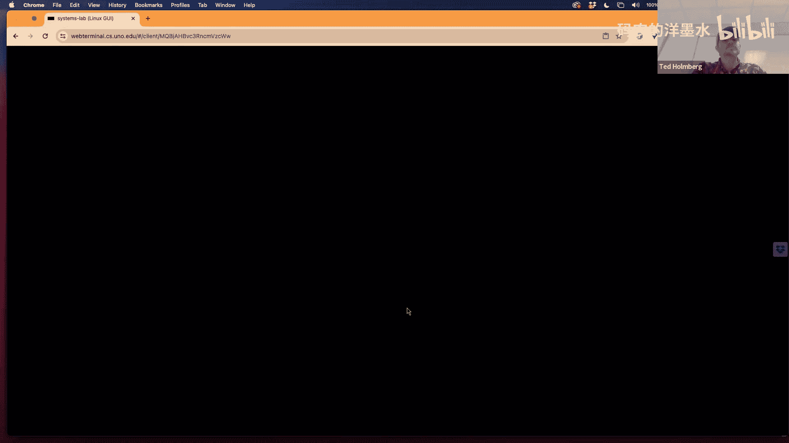
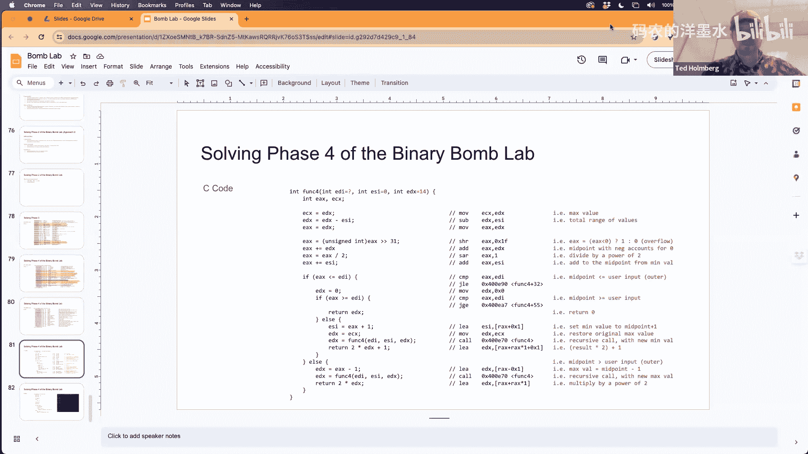

# 【全集】加州理工学院 C语言系统编程 中英字幕 p19 Lecture 19 - Bomb Lab part3 -BV1bUzWBLEiC_p19-

So in today's lecture we're going to pick up from phase two of Bomb labb and look at phase three and hopefully phase four as well we'll get through the first four phases of Bomb Lab and then what I'll probably do is I will hopefully have given you enough tools so that you could do the last phase on your own phase five so that I can migrate to Shell labb starting our next lecture so starting next Monday because it's super important that we work our way all the way through Shell labb before the semester ends we're going pretty close the end of the semester。

We're already in April， I think we have this month。

And that's it is I think pretty much in the beginning May it's over so once we roll around that time。

 then we'll start talking about your presentations。Yeah。Okay， so let's see where did we leave？go。

 is it here。下方。😔，B。Yes。Do I have what' in。So I update this document。So I think we got to。

Let's see this。😔，Let's go back。And open up it from the。Yeah。Okay， let's see here。 what's take and。啊。

你傻啊。😔，Don't。So I know that we got。😔，It is all that TxT that we looked at。No， yeah。She。没。

Let's not quite right。Okay。Let's take a look at。几傻啊。Or let's sake。Yeah， that's where。

So it looks like these were the first two so nope， we haven't found that either。

 so this is the one we got let me please copy this。I don't even think that that is the。

We have a lot of wrong solutions， example solutions on here。啊。Cunancel。Okay， so let's go in here。

Where my arm will go getting some massive lag。Okay， that's a bit our trauma on。屌嘟屌。

Did not quite want to maximize that。Just want to drag okay， so let's do this。

 let's touch PO called 2 dot xt。就瞓得 up。So based off of here。Oh you。Okay， so we know we want that。

 so that's where we last left off。Let's minimize this。Perfect， and then let's take a look at。

Let's grab this。Okay。我沙得啊。Yeah嗯。Let us。That。Now let's see if we。

Get to phase three so we can start talking about a solution for that。S。平啊。

Open or has anyone started to do any of the bomb laps？Moving forward on it。Okay， let's see here。ます。

Okay， so let's do we'll do this very dangerously， we'll just go ahead and。Run our bomb。With。

Paceol Txt2， actually。Perfect， okay。First two phases done， does control CF。Okay。

 so what we saw last time was we saw how to do phase one with strings and we saw how to do phase one with the debugger and then we saw how to use phase two with object dump and we saw how to use phase two with the debugger。

 is that correct？So moving forward， we're just going to rely strictly on the debugger to kind of explore what's happening inside of the bomb code。

 what's happening inside of the registers so that we can evolve what our passcode is to eliminate each phase。

So these next two phases are going to be a little bit more difficult in the prior。

 but we're going to use the same techniques that we used earlier。

It's just going to we'll have to be a little bit more careful as we start parsing through all the code。

And so you'll see what I mean just a moment， so let's start by opening up our debugger GB and let's load our bomb application。

Okay， perfect。So the first thing I want to do is。That's disassemled。Pas3。

And so the disassembled command allows us to go ahead and just do a breakdown so we can look ahead of time before setting break pointss before I try to run anything。

 what is exactly defined inside that function。You see this is a relatively large function。

So we see we have our phase three here。And let's see there's some interesting。

 so the interesting things that we have we have our preamble stuff。

We're moving zero into EAX we're going to make a call to our scanner to scan our user input and now we're going to compare our EAX to this value of one and if it's greater than one。

Here， I'm looking at this right here， if it's greater then。Then one。

 then we're going to jump to this memory address here， which is going to be。This one right here。

 which is going to avoid this explosion， this bomb explosion。So right from the Gi go。

 I can start to see where there's going to be a call to bomb explode。

In phase three so moving forward what we're going to want to do is as we start using the debugger。

 we want to start looking at all of the comparisons。

 all of the jumps and whether it's going to allow us to avoid a invocation to explode bomb or if it's going to lead to an invocation to explode bombs so let's actually kind of run this and kind of get an idea of what could be happening here。

Yeah。So， let me。So let's see here， let's go back here， let us。Let's run our。Oh。

 so let's see that's P。Sold to that's what I just made Txt this run this Okay。

 so now let's give some sample input let's start with just tello world。

Because we don't have any real clue as to what it is yet。Oh， you know what？

It should have said to break instance。😀哈哈哈。😊，Bard's us at your break points。Okay。So let's break on。

Explode bomb。We don't want that and in fact， let's also break on phase three。

Because that's really what we're interested in。Okay， now let's run。Okay， so now let's try this again。

Now let's add in a prompt teleworld。Okay， so now we've broken on our function phase three inside of there。

 you can see we are starting to do all the preamly stuff so we're making room onto our stack。Okay。

 let's do next all because that's not so interesting to me。Yep。

 we're loading the effective memory address into RCX。Let's next load effects memory address into RdX。

We are。Moving this value into RSI this is kind of an interesting thing let's see what this is so what this looks like is it's starting to load values as parameters before calling the scanner function。

Let's see what this particular value is here。Okay， so what I want to do is let's what's the memory address let's let's read so if I want to read a value from memory I can use the X command so X slash and then the format that I want to read it in I want to。

Assume that it's going to be a string， So I'm going to do x slash s and then I can beat at this memory address that I want to read from memory。

 So0 x 4，02，7。8 a。Ah， okay。So what that looks like is it's providing。A parameter to。

My scanner function call to parse the user input based off of these criteria。😡。

So it gives us a clue as to what the proper input should be。In terms， at least data types。😡。

So it's expecting a percent D and a percent D， so two integer values。

 so clearly we already know this is likely not going to work。Okay， so let me do next time。And again。

 if I wanted to go ahead and look at those two values inside of my register space just so you can see how to do that。

 I can read from memory， that same string， and then I can give it ESI because that's where we moved it and it' should gave me the same fit。

After moving that in there， the only thing is if I go and read from memory from memory address。

 I use a dollar sign for that register space。Okay， so now let's see what happens here next time。

 so at this point。Actually it kind of allows us to appear in what's happening here so inside a scanner these are the registers that got filled right RDI that's clearly the user input that we supplied。

That from our input stream， our RSI， which was got loaded into RSI。

 is going to be the formatting instructions。And then the rest of this looks like it's probably filepath directories and let's see here it's going to stop and then let's see let's do next eye here。

Okay， so after that call， now we're going to compare EAX。😡，To one， and at this point。

 we know that this comparison is important because we need it to be greater than one。

In order to avoid this call to explode bomb， everyone sees how there's an explode bomb here。

So clearly this。Here， this jump will allow us to jump to 39， which would be here。

 which would avoid this call because。Typically we go sequentially from statement to statement。Okay。

 so at this point， we can go ahead and see what the value of our EAX is so we can do that in a number of ways we can go and just do print。

嗯。Let's see and we can determine the data types if we print D。

 we could get the decsal value and then I can do what is it it's EAX we want to look at so dollar sign EAX。

And so we have the value zero。I could also do x here or hexademal。Yeah。Okay， so the question is。

 how can we get that？Now let'， we wanted to we're comparing to one what we need to be greater than one。

 so the question is what is happening to EAX and we call the scanner function that sets it because it's not being set directly in the code。

 but that's the thing we're comparing to after that function called。

So there's a couple of ways we can determine this one of these is we could just look at the man pages。

 we can read right the scanner function to see what is the return value for it。

 that's the way you probably should do this。But。Let's， let's test a theory out here。

 So we kind of peered into the belly of the beast to see that it's expecting a percent。

Space percent D， it's given us a set of constraints。

That it's trying to parse against so i'm going to make an assumption that the number of valid occurrences that get parsed is what gets returned。

 So when we supply the scanner function in C a。Set of wildcard that is trying to parse against is going to let us know how many were valid。

So it's a way of evaluating to see if the data types we've passed in is correct。

But I'm going to test this assumption， let's go ahead and try， let's try this。O。

Let's try running our PO。Dot2 TxT again。And so now let's try。A number。Yes。Let's say zero。And hello。啊。

看。And now let's see， let's go to next do。Let's go to next I。Let's go to next eye。嗯。Okay。

 so we're moving to ESI， so right now we're loading up all of the。Removing EAX， removing zero to EAX。

Re'recaling that。Scanner function。And now we're comparing to EAX now。

 so now let's do the same thing we did moments ago。

 let's take a look at the value of EAX if we did zero and hello and we'd see a。

It's not zero this time it's one we're so going to lose though because we got to we jump if we're greater than one right now we're equal that means that。

Well， we already kind of knew the the instructions。

 but that means that we should pass to energy value， so let's do that let's see wrong piece so one。

Dottxt。Yops， no。哦。Let's do two。Okay， so now let's try what numbers do we want to try for this？

What numbers are we want to try？We know it's going to be two numbers。

But we don't know what numbers they are yet， that's all we know。

Everyone understands how we got to the point knowing that we need two numbers， though。

 and how it checks against that for us。So now at this point。

 it could be any numbers and recall that as you do this。

 you're going to have different criteria if your bombs than what I have for mine。So。Let's sing。

So you just want to do， well， let's not do zero zero， you should do when you debug。

 you should always use two different numbers so you know whether you're reading into the first parameter the first argument of the second argument。

But we need two integers， let me see it today then when almost eye， we have some volunteers。Do 12。

 so we're going to do 12 as one number， what's the other。SecondN five， I like it， 12。Oh no。

 don't lag on me now， computer。12 and negative thought perfect okay。

 so please remember what order my numbers are that's going to be the responsibility of the class what is my first argument what is my second argument。

😡，go ahead。Go into that and let's take a look here， let us go to next I， work next instruction。

 next instruction， all the pre emly things， loading things up so that we can make our call to our scanner。

Function to grab all of our user input。Okay， so now we can see what's getting passed kind of the nice thing about the debugger is it could let you if you want to step into these auxiliary helper functions and you can kind of trace the logic there it even kind of gives you a quick view of what's being loaded in there as we already saw but I'm just going to continue on next I okay so now we're comparing EAX to one let's take a look。

At the value， it's two， so now we are greater than one， so we should jump and avoid the bomb。Next oh。

So here we can see it even tells me， let me stretch this out that the jump was taken and the reason why。

Then the next thing I'm going to do。And now we're doing this other thing here where we're going to compare。

😡，A value that's currently on our on our stack。 Remember that RP is our stack pointer。

 we're going to。Take a look so it's it's one of the values that were supplied by us so recall that the stack pointer。

😡，Create some space when we call a function and then it can populate things into the stack we can actually inspect that。

That's in memory， so let's take a look X。And then let's try D and then see if we can't do。RSP。

 so use register and every time we use register we preface it with a dollar sign and then we will do that offset and let's verify this。

We can't。Be converted into an integer， Okay， let's take a look at this。啊，这个哦。You need to do pause。

There we go。So12 the value is 12， which is makes sense right isn't that what we put so that's our first parameter So now what we're doing is we're comparing the value 12。

To the hexismm of value of seven， right？So where 12 is what we gave it argument one。

And then we're going to do a jump above。To this memory address 151 at 151。So well。

 we're going to see if that's just， I could disassemble and see what that is。

 I guess I could do that。We could。We can see where we're going to jump to or we can just do it。

See if it was like a jump or not？Disassemble what is this is phase3？And so one， five， one。

See what that is，1，5，1， oh， wait。That is probably not where we want to jump to。

I think we're we are going jump to that right it was it a jump above and we did at 12 and we're comparing to seven oh well。

 it's a good thing we said at right point。Okay， yeah， reason taken because 12 is above seven well。

I' really don't you to do the next one。Yeah， okay， now we're definitely going to call to explode that boat。

 Okay， so now we've learned something。We've learned that the first argument。😡，Has to be。

Below seven because it was jump a， right， not jump above or equal to。So it's got to be。Below seven。

 okay， so let's let's let's do this again， let's go back run。Oh two， about Tx。Okay。

 so what's a new number， we can't use 12 I mean we could use 12 but we'll get stuck at the same spot。

5， so let's do five。And what did we use last time was it minus minus five， okay， I like it。

 five minus five。Okay， now let's do that same thing let's。

I could set break points and just go and continue， but I think there's a gap value you to be had kind of stepping through all of the logic。

Yeah， let's load our reflect memory addresses into。These so that we can make our call to our scanner。

Yep， okay， now let's get to the next instruction here we do our comparison。

We should assume this is going to work because we've already seen that happen， yes。

 we take that jump， which means we avoid exploding the bomb。Now we're going to compare again。

In this instance， we already know that five should be below seven。

Which means we won't take their jump， which is good because this jump kills us。So。Let's do next I。

Not taking good sign。So now let's see where we go from here。

So now we're going to move into EAX this value and。What we can do is。

And then we're going to do a jump。After that， let's take a look at。This value。

s let's actually take next eye and just see what was put into EAX。Okay， so after doing that。

 we now know EAX has that value that was from our SAC pointer and I believe that's our first argument just looking at that like we've inspected that already haven't we Sac pointer offset by hexademal 14。

 I mean， not hexasmal yeah hexademal14。So we can just take a look， let's。

 we can print that out again。Okay， we can see that that is our value fault that's inside of E AX Okay。

 so what happens when we take this jump， let's go next I。And。

What is this this is going on RAX multiplying， but it's taken a de referenceence at this location let's just。

Jump into it and see what's happening。It's moving into EAX0。Okay。

And then we're doing this jump again and in fact we can。Just verify， yeah， our value of EX is zero。

 okay？sWalk， okay， so now we're subtracting from the EAX this value。Okay。So we haven't done that yet。

 let's go next all right， and now let's take a look， so now it's minus 349。Okay。And now where。Add。

To EAX， I think that same values， we're just bringing it back to zero。

And then it looks like we're subtracting from EAX again， so it looks like it's minus 349。

So it's like we're just awesome， it was just like overriding EAX multiple times。

And then we're going to go and jump right to 161， which is going to be right here。

 so we're going to jump and avoid this call to the bomb。That's good。So let's go to next eye。Okay。

 so now we're doing this comparison。Where we're comparing。That value。And actually。

 let's take a look at that， isn't that， I think that's our first argument。Let's take a look。Yeah。

 that's our first already made a five because we did five minus five， right？Okay。

 so here we're going to compare five to five。Looking good maybe， and we're going to jump if greater。

 oh， so we're only going to jump if we're greater than five， we're actually five。Okay。

 and let's see wheres where we jump into in this instance， 174， oh， well。

 we don't want to jump there。So that's good， good news。Okay。

 so let us do next I and it should tell us John' not taken， we already know why。

Let's do this again next eye。Here we're going to compare now EAX to。I have。

I have a guess that since we're looking at the stack pointer at a different offset。

 that's going to be our second argument。But you know what， we can use the debugger to verify that。

So let's take a look。Let's instead of doing RSP plus0 x14， let's look at0 x10。So hex to demal 10。

 and we can see， oh， yes， that's our minus5。So now we're going to compare whatever is in an EAX， oh。

 we did some really weird things with EX， didn't we。

 we're like subtracting it and adding it and subtracting and adding look what did it ends up being probably not minus five though。

Nothing is ever minus five。Okay， let's take a look at our value of let's use print。D on our EAX。Oh。

 dollar sign。Oh yeah， minus 340 notch。Okay， so that's okay。

 let's let's see we're going to jump if equal， they're not equal right one's a minus5。

 the other's a minus 349。 so in this instance。So if they were equal， we would jump to 179。

 which would be right here， oh， and the next line is to explode the bomb so in this instance we want them to be equal。

Okay。SoLet's try this again。We don't have to step through that next instruction we already know we're done for。

 so we'll do run PO2。 Txt perfect。And5。And minus 349 was the second one。And here in this instance。

Let's see something here。😔，Let's disassemble。Phase three。

I want to get where we compare that so here I'm going to grab this this address。

So that I can just jump right there， so let's create a break point。Bak。

Put an asterisk if we're doing a direct memory address not a label。And I'm going to paste that here。

And I'm going to hit enter， now I'm just going to hit continue。

And so now it should continue all the way until I get to that。

Memory address that way I don't have to keep hitting next eye next eye next eye next eye we've seen that enough times so now we're at this comparison。

Let's look at what our value is。😡，So， that is。Minus 293， minus 93。That's okay。

So let me take a look at what's in EAX。Oh。哦。Co。Let'sTake a look at what's inside of EX print。EAX。

Minus 349。Ooh， that's going to be makes going me kind of interesting。Well。Let us。See， then。Next aye。

And yeah， that's not going to reason taken。Next by。So we avoided the bomb。

 so I was probably looking at the number in a。Not as a sign number。

So he's just given it to me in an unsigned format。And so here， that means， well。

 that if I didn't explode， that means I should just be able to continue out。And get halfway there。

Excellent。Okay， so one of those things we working with sign numbers， we now know。

 keep that in mind when you're inspecting your memory address。Okay， so。What we have。

 let's quit out of this。Let's quit out of this。So。That means we're past phase three。Now。

 did everyone see we didn't even really understand what the logic was on what was happening in the function。

 we can derive the answer just by inspecting the registers。

And inspecting the compares and seeing what is constantly comparing to that leads to the explosion of the bomb that is a valid way of doing this lab in fact。

 that's what this lab is really trying to train you to do how to constantly step through code and kind of break it down and see what is the state of your registers at any given time that leads towards a function call in this instance a function call you don't want to occur now in the next phase it's going to get a little bit more complicated where you're going to need a little bit of an intuition to understand what leads the bomb to explode or not so this one's a fun one a little bit more complicated than phase two but ultimately should be something that's pretty much doable right you just you keep checking to see what's causing the comparisons to occur。

Okay， let me update so we used wow， it was five and minus 349。

So let's see here do I have one of those PO 3 OTx team？No， that's clearly wrong。

But I will update this one。Let's update this one， so Pol three。Let's close that。

So let's just open this。PO 3。 TXT。And what did we say it was it was five。And minus 349。哎靠。

And then we have perfect。So let's write that okay。Now let's cat dieol breed Txt。Perfect， okay， now。

 let's be very。I'm allowed to be very risky。Because I'm not going to award myself any points for this。

So let's just give it PSSoL 3。txt。And perfect phase one， phase two， phase 3 is now complete。

 So now let's go ahead and take a look at how we can go ahead and。

Try to find a solution for phase four be now remember there's technically six phases to Bo lab。

 you only have to do five for full credit。The sixth phase is a bonus phase。

 it gives you more points than you need and I guess splashes over for your other grades then。Okay。

 let's go ahead and control。Okay， let's clear out of this。Okay， so before we move on to phase four。

 does anyone have any questions about phase three about what I did？Okay， so just。

So it gets recorded looking at some of the feedback from online， can't we use seven。

 seven is not above seven， I would do that value before trying anything else。you diffuse phase three。

 okay， yes， yes， well you have a question in particular as to why phase three got diffused？

And is everyone in class pretty much？I know。I'm looking at the text on the debugger and I know where I'm looking so sometimes I forget that you might not be looking at exactly the same line I'm looking at why I'm talking about things so if at any time you're like wait how did you know this was a thing just let me know and I'll step back it's easy enough for the debugger to repeat the process。

But the big takeaways here is that we can set break points。We can disassemble。By function name。

 disassembling by function name allows us to read through the code。

 but not only read through the code， but also get our memory addresses that correspond to each instruction so that we can set break points based off of memory address and not necessarily by label。

😡，And that we can print values from memory using X。

 and we can just print register spaces using the print commands。And also。

 we can step through using Next eye。For next instruction。Okay， so now let's do this， Okay。

 let's open up our debugger again。Gdp that's loaddents hard to buck no， what is going on。

 why is it doing that？Okay， let's close that terminal。他并不是。嗯。Dr。

 Eagle's Boum is like getting frustrated that we're getting closer to diffusing it and is' like。

Stealing the input stream from guacamole。Yeah yeah。

 you use info registers as well and then just EAX that is。What is going on？🤧There are you。话时打电话。对。嗯。

How， did I？Does Mike beep key just get stuck in the middle of election？Okay， let's try this。

It's going to be really hard for me to avoid the Be key if I'm having issues with it for bomb labb。

 considering that I have to use it at least twice。For the application name。

I had at least once for the debugger。指自俾。Okay， perfect。Okay， so the first thing。

 let me not forget to set my break place。Bak， nope。Break。Explode， bomb。Break。Or phase four。Okay。

 looking good so far。Okay。Now， the first thing we can do。Is。

It's always kind of a good idea before we even start running anything we can just disassemble and examine what phase four looks like so here we have phase four by the way you can do this with any of the helper functions as well so while you're doing this if you see there's a call to helper function you're like what's happening there just disassemble and if it has a label use the label otherwise you can use the memory dressing。

So if I do this notice here， it gives me the set of memory addresses here in this next column。

 it gives me the offset from the label， which is phase four， so for instance this is 74。

Btes or offset from our memory address at phase four。

 and here is each of the instructions that are encoded。Okay。

 can I stretch that a little bit more kind of no？So they come up。Okay， and let me drag this down， oh。

 this is not that large of a function actually。So just taking a quick gander at it。

 before walking me through and again we'll walk through and really evaluate what's happening。

 but we can see the first thing we're doing is we're padding our stack。

So we can see which is usually what we do when we invoke a function。

 we're going to go ahead and create some stack space on there。

 then we're going to load into effective address into RCX and RDX。

 it looks like probably if I had to guess the values that we have supplied。Right， so which。

We haven't supplied any values， but I'm assuming now。

 just an assumption it's looking for two sets of values from us。

Just based off of what the last function looked like and the fact that we were accessing based off of stack pointer offsets。

But when we start to play around with our code and stepping through the instructions。

 we're going to verify some of our assumptions here so I guess that's a good strategy。

 you disassemble you try to understand what's happening and then you test to see if your understanding matches to the state of the code base and the state of the registers at each step。

Then we're going to move into ESi。This value inside of memory。

 I'm assuming that this is going to be the set of constraints we're parsing against。

 this very much looks the same as the last function where we're loading all of the parameters。

 all the arguments as parameters to a call to our scanner。Okay， so yeah。

 and then we're going to move into EAX the value of zero well we know the cult the scanner objects going to deposit something into our accumulator register。

 which is going to be the number of valid values that were parsed based off of our constraint。

 so this is now starting to generate a pattern force。

So we recognize these sets of instructions from the last phase that in this phase。

And so before even testing it， we can kind of understand what it's going to look for。

So does everyone see how this kind of looks similar to the last phase Okay then what are we doing then we're going to make this call a scanner here。

And then we're going to compare oh， this is the same comparison just in a different way last time we jumped if greater。

Then one， which meant that we had to have two valid numbers。😡。

Here we're going to compare to see if it's。2。So now we're going to have an equality operator probably。

 yeah， so oh， actually a jump if not equal。Jump if not equal and then we jump to 47 Oh， there we go。

 so that's going to blow us off。So that lets us know we have to have two。

A value of two inside of our EAX register if we are not to explode。😡。

And that's probably going to be if I had to guess numbers。But we can test that out。And let's do that。

 let's take a moment and inspect what's happening here， so let's us run。Pel。Three。txt。

I set my break points right， think it did okay。Okay。

 so do we just want to use numbers at this point since we're making that assumption？

What numbers do we want to use Let's assume that it's going to be similar since we're comparing to two that is's going to look for two numbers don't know if that's true。

 but。It's a starting point， what two numbers do we want to start with that？

And let make sure if there's any suggestions or questions here。

Pull it off and put it back on looks very similar to past， yeah， it does。Okay。

Any recommendations for numbers？はい。The class enthusiasm is like， we don't care。Any number， okay。

 let's do7， five， does that sound fine？O。So we'll do seven， five。Well supply that in。

 we're going to now remember what I've been looking at if you haven't。

If you've been kind of lost while I've been stepping in the debugger。

 the act of instruction is this green one， the one that has the arrow pointing to it and by the the way。

 let me also show you this if I disassemble。😡，And then do use like phase four。

The active instruction is the one with the arrow next to it。😡。

So at any time while I'm stepping through。The application of my debuger。

 I can kind of expand out to see all the instructions in the memory addresses that are associated and still shows me where I'm currently at in the execution process。

Okay， so now let's do next slide。Okay， so now load effects memory address。Let's do the same next I。

 let's move this fat。 Oh， you know what， let's look at that memory address。

 let's assume it's a string and0 x。40278 a。And oh yeah， look at that。

 it is exactly the same set of constraints。Now at this point。

 if I would have guessed just because of phase three， that was two numbers， I went phase。

 I went with two numbers here and then all of a sudden it was percent D，% D，% D， I know oh。

 it's got to be three numbers then。I would definitely know if it's supposed to be three numbers based on the comparison。

I kind of the guess was based off of what it was comparing to after I made a call to scan the scanner function though。

 right because I knew what it returns against。Okay。Okay。

 so the next instruction here is I'm going to move zero into my EAX Yeah， now。

 then I'm going to call this scan function。And then I'm going to compare to see if my cuumulator space has a value of two。

 so did I actually parse two numbers？And I did not take that jump。

 which is great because that one led to a bomb explosion， if you recall。

And now we're going to move into EAX， this value inside of our register space。

So let's go ahead and see what the value of that is going to be， so let's print。纸。EAX。

So that's seven， that's our first parameter， right？So that is good。

 so then the next thing we're going to do is we're going to test EAX to EAX。

Does everyone know what that does？So it allows us okay。

Then because the next thing that's going to happen after that is it's going to do this JS。

And so this is going to be a jump。To call to explode the ball。 Okay， so what is Js。

That's right jump sign， so if my sign bit is toggled。

Then that means I'm going to jump to this address。And what's inside of EAX right now is my first argument。

 right？That now lets me know that my first argument can't be a negative value。Because if it was。

 I would make a jump to explode the bone at this point， so I got lucky。I luckily guess a number。

That did not trigger a bomb explosion， but I have to remember that for next time。

 because the assumption is that just because I evaded one bomb explosion doesn't mean I probably are' going to evade all of that。

But now I know another criteria that will cause the bomb to explode the next time I go over my next attempt。

二长。😡，We well。Stop。Stop。Okay， we will kill this terminal。Okay。What is going on here？

You have stick beats。And the further we get through these phases， the more doctor evil。

Its interfering with Mike Wacom all the instance。等告。Yeah。

这个啊。It's like froggers， it was like， get to the terminal， get to the terminal。Okay， well。

So this is what we'll do's let's see if I can't just refresh。

Our connection to guacamole。

那可。Okay， let's go into the bomb labb。Let's go to open and Ter。Okay。Let's do this again。GDB。宝。

And okay， now let's go ahead and，'s let's break set up break points。Break on explode bombal。Break on。

Phase four。And let us， let's go ahead and then Ron。On Pol。3。txt。Okay。

 perfect now we said it was seven， five that we did before。And let us go to。Okay。

 so let's jump through this again。😔，没。Okay， let's see。Let's go to that。😔，Okay， so yeah。干么意？

I'm in the explode bound function。No， let's。Let's do that again。Seven，5。

And let's actually pay attention as we step through。So we're loading all of our necessary。Things。

And two。All of our parameters make a function pulse to scanner。

Then we're going to compare EAX to two。Which that jump is not taken。

 and then we're going to move our first parameter into EAX。And we're testing that。

 which is going to help us evaluate the sign bit， and then we're going to jump base off the sign bit。

Which is not taken。 And then the next thing we do is。We're not going to compare。EA X。To 14th。Okay。

 so at this point。Or heassal value E。Right so at this point and inside of EAX at this point。

 we can see print。X， EAx。It's seven， okay， so we're comparing seven to 14。Or hexasmal E。

 and we're going to jump if less or equal to 52， which is right here。😡。

Which is perfect because if we don't jump， we're going to explode。So first of all。

Our first parameter has to be a number。It can't be negative。And now it has to be 14 or less。So far。

 we've gotten really long。We've avoided three bomb explosions。By picking well。Okay。😊，So， let's。

Do next。And it shows me it was taken。Okay， so now we're going to move into EDI。😡，The value that's at。

RSP， our stack offset by0 x14， that's our first argument， right？

Pretty sure it is at any time I can just take a walk。Let's take a look at it what was it， it was RSP。

Offset by zero x1 and4。Yeah seven right that's our first argument so we're taking the value of seven we're loading into EDI we're taking the value of hexsasmal E that's 14 and loading that to EDX and we're taking the value of zero and load that into ESi you know we're doing we're loading a set of parameters just like we were before for the scanner function。

 but in this instance we're loading as set of parameters that are now going to get called for function four4。

And then after we call this function， presumably something's going to happen to EAX。😡。

Like I'm assuming something happens to EAX because look up here， we compared EAX here to the value。

 what was in EAX before wasn't EAX our first argument and that we did this comparison here。😡，To 14。

Okay， so presumably at some point， EAX is going to change。

Because we're going to compare it to the value of one。And we will jump。

 if not equal at that point and I don't know yet if that jumps going to be good or bad。

I'm assuming it's going to be good。But don't know yet， but let's step through Okay。

 so let's do next by。Okay， so we're loading。So at this point， an EDI should be our first argument。😡。

啊。Okay， let me do this last one and it should display。

Yeah here we go so the nice thing is it actually shows me the arguments that are all passed in that are used inside of function four so notice RDI is my value of seven。

😡，That's my first argument。RSI is the value of zero。Which was。Defined right here。Right。Here。

 I'll highlight。RDX is the value of 14 hexademal E which was assigned right here right so these are all the parameters that were passed into F4 and then RCX is the value of zero。

😡，So RCX is presumably used inside this function。Okay， so now let's do next I。

We're going to ignore what function 4 does at this point just to see what it gives back to us。😡。

My suspicion is we're going to have to peer into the box of function four and kind of see what it's doing to return a value back。

😡，Because this is the first time we're encountering something where it looks like it' not going to be a direct mechanism for us to see what the comparison for the explode bomb is。

It's going to be an indirect decision。Okay， so now we're going to compare EAX。To the value of one。

 so why don't we print out what the value of EX is actually so let's do EAX。0ero。Okay。

 so we got back a value zero， that can't be good。Okay。

 so we're comparing zero then to one and we're going to jump if not equal to 83。😡。

Which is an exchange on AX and AX， but then leads immediately after that to an explode ball。

So the initial jump is not awful， but when you look at the next line， you're like okay。

 that's not good we definitely。It looks like what we're going to want to do is。Now take this jump。

 do this other comparison， and then jump to the thing that's after this explode bomb。

 which is going to be 90， which is going to be after 85。

So this is one of the jumps we don't want to take。Okay， well let's see what's happening then with。

What was that function called F four？So what I can do is I can disassemble funk  four。And again。

 just like whenever I do a disassembly instruction is going to give me the set of memory addresses。

And it's going to give me a set of。I'm going to give me the set of offsets from my label and then finally my set of instructions。

So what I have here is quite interesting。What I have here is I'm moving EDX into ECX。I'm moving ESI。

 I'm going to subtract from ESI EDX。😡，I'm going to move EDX into EAX。

And I'm going to start doing some shifting， so I'm doing a lot of operations on these parameters that are passed in。

What's interesting though， is this。Look at this particular line。😡，There's a call to。

Invoke the function we're already in。This lets me know that this might be a recur， well。

 this is a recursive function。Because it calls itself。Okay， let's see we have a couple。

 but the things that I look at immediately are going to be these things， these comparisons。

And so all of these comparisons。Are inside of our functions。

 so they're probably going to be either selection statements or loop structures。

 right depending on how we're jumping about。So we're comparing EAX and EDI and then we're jumping based off of if it's less or equal。

 we are then loading this value here and then calling this function if based off of whether we make that jump or not。

 we make this jump here。Here we jump if greater than or equal。And then finally。

 we have our return back out so we have how many compares one。

Two we have two compares for the most part。Okay， so for function like this。

It makes it a little bit more I mean I guess we could potentially step through this one。

 but I don't really have the time to and we could kind of debug to see what the solutions are some of the interesting things we have though is。

Tur AX。We have some pretty interesting things happening here。And。Here。So here。

We're loading some values。That's RAX plus RAX times 1。And plus Rx times 1 plus1。

There's kind of like multiplying the value of AAX by two， but either way。😡。

We're then going to move that value to EAX and that's how EAX is getting overwritten so does everyone see where EAX is getting its value from now？

😡，It's either here。😡，So EDX is either set here or here。

 and it's probably a selection statement of some sort。😡，Okay， let's let's see if we can't。

Take a look at what is actually happening inside these lines， so if you wanted to solve this。

 the best way to do that。😡，Would be to do a pur line instruction。😡，On each of the。Asmbly lots。

So let's see if all of these makes sense。😡，And if we'll start with that。

I might finish off with this one。Next week， if I don't have enough time because I have two minutes left。

 so let's see if I can at least make sure everyone understands what's happening with these lines。

Okay， so we're moving the value from EDX into ECX。We're going to subtract from ESI I'm sorry。

 we're going to subtract ESI from EDX and store that result into EDX。😡，Remember。

 there's always the source and the source and the target。

We're going to move the value from EDX into EAX。😡，We're going to do a logical shift， right。The value。

It's by 31 bits。Here we're going to add EDX to EAX and store the result in EAX。😡。

We're going to do a arithmetic shift。To the right by one bit。

Here we're going to add ESIT EAX and store the result in the EAX。

 we're going to compare the values of EAX and EDI。😡，We're going to jump。If EAX is less than EDEI。

Then we're going to load that value into EDX。😡，Whatever that value ends up being。

And then call a recursive function to Fk four。If we don't do that， this loads the address of RAX。

 and so I'm assuming we get there via jump。This is going to jump to 55。

 which would be down here where we move EDX into EAX and return turn out so that is an exit condition here the sets are we move zero into EDX。

 we compare the values of EAX to EDI。😡，We jumped if greater。To 55。

 which is looks like our exit condition。Here we would load the address value into ESI。

 move the value from ECX to EDX， and do another recursive function call。Okay。

Just to try to make this into a little less trees and more forest to try to。😡。

Identify how does this logic interplay together， let me leave you off with this reexpression and then we'll pick back up next lecture。

😡，If I wanted to take those same sets of instructions as I have them here。

 but reexpress them in a C code function F4， I'm going to recall that when we were looking at the instructions it used three parameters and so I'm going to use the same register names as my parameters of EDI which was our parameter ESI which was zero and EDX which was 14 and what we can see what is really happening is ECX is given the value of EDX。

 which represents the max value， what we're going to see is all of these things come together to effectively implement the binary search。

😡，And return a value based off of binary search。😡，So that means in the binary search we're going to set our max value which can change over the course of it to ECX。

 so it's going to start at 14 the max value possible and so then the difference between ESI which is the minimal value。

 the value of zero and the maximal value is the number of units that can span your binary search so that's what's being set inside of EDX。

😡，And then we're just going to take EDX and say that into EAX because that's going to be the thing that gets manipulated in order to find the halfway point。

So what we're doing is we're doing this shift。To get a one。

 we're going to add that one to the value of to the value before we do the arithmetic shift to get the halfway point because of the complement remember our twos complement means it's。

😡，When we do our division， we have to take into account that concept so we have to add one before we write shift to have our space from whatever the max value is to the middle point。

 so the middle point is the halfway point， which we can do with a simple shift by one bit。😡。

So that this is effectively performing the computation to find the middle point and then what we're going to do is just do a comparison to say if this is a middle point。

 you return out if it's greater， you do this one computation。

 if it's less than you do this other computation computation and then you return out a value now the trick is what is the value it returns out because you know that the condition that you need to supply is the value that gets past to this function。

 that result in EAX v one。😡，So I'm going to leave it up to that point with you here and we're going to see what conditions allow that to be true for next class does that much information make sense so far？

😡，And so this is going to be the trick with some of these problems where it would behoove you to kind of disassemble it。

 find the line by lines， but then find how they interconnect to create a logic。

And then you can test it out right because if you got it right。

 you can pass the value in and then let you pass that part of the the instructions okay。

 I've kept you too long we will pick back up next lecture。😡。

