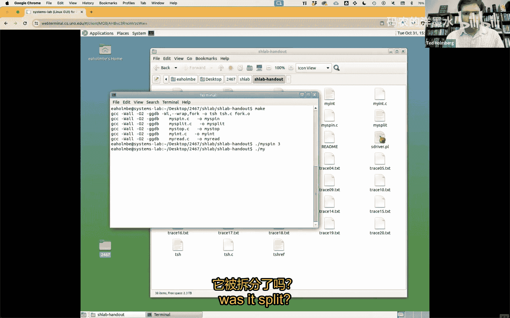
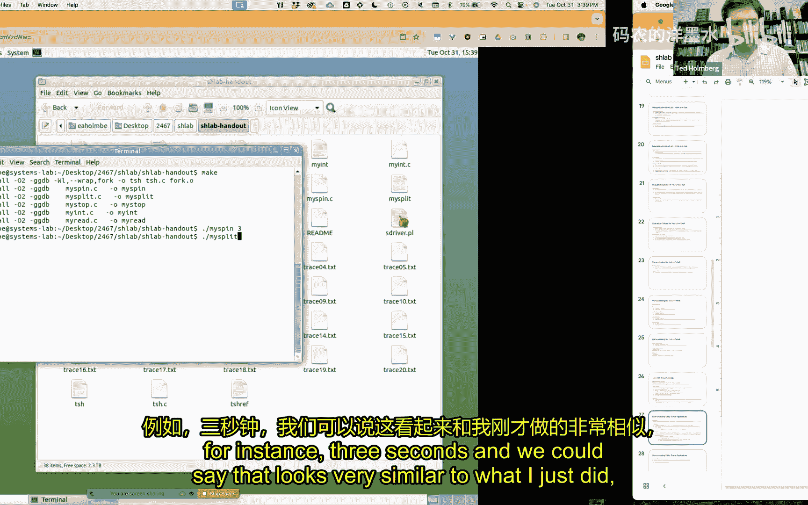
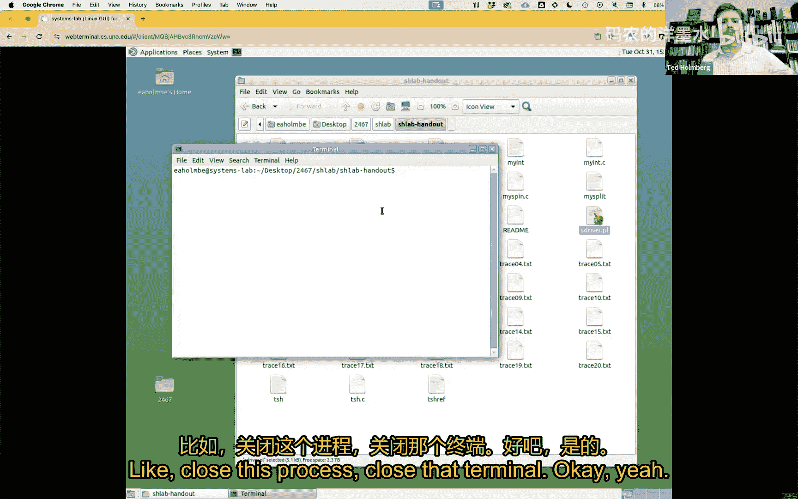
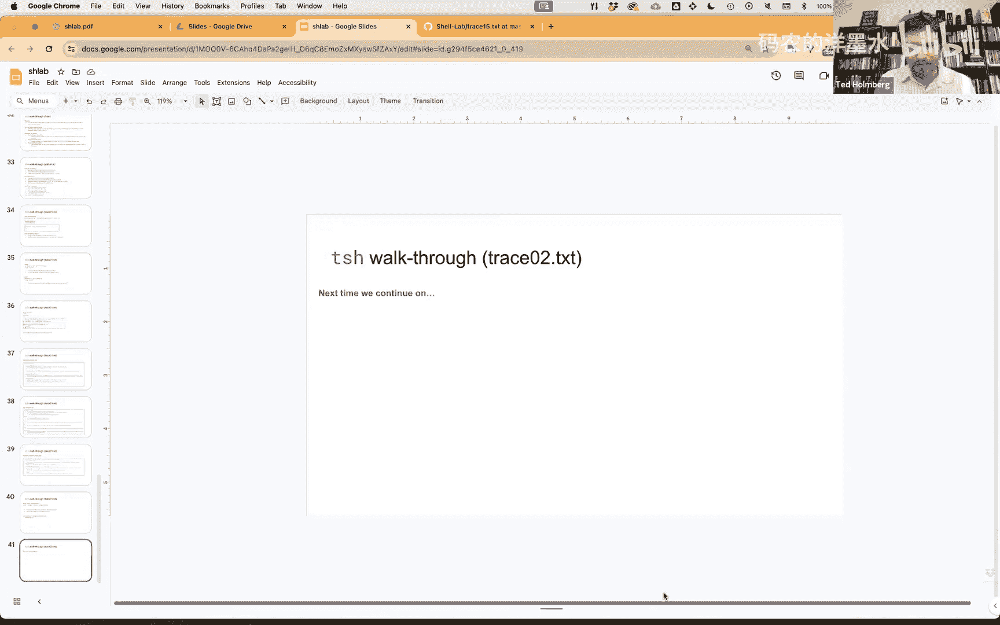

# 【全集】加州理工学院 C语言系统编程 中英字幕 p20 Lecture 20 - Shell Lab part1 -BV1bUzWBLEiC_p20-

Okay welcome to the class this is going to be a video recording considering that this is Halloween week and I don't suppose that you all want to be spending Halloween evening inside of lecture so we will do a entirely video recorded lecture so in this lecture I want to introduce the new lab that we're going to explore we're going to move on to the She lab where we're going to write our own unique shell and so we're going to spend this lecture to really kind of motivate and preface the idea on how we're going to to do this excuse me just a moment。

这意事。Roger had got unplgged okay。So this is I think。

 one of the most quintessential labs that we'll cover over the semester and it'll probably be。

We'll probably go over a couple semesters of working through it and kind of defining it and of course this lab like the other labs is going to be group based team based so try to work in groups talk about issues you might have we'll talk more about that in this upcoming slides。

Okay so let's just do an introduction to our shell lab so the purposes of this assignment is for you to gain a handson understanding of how UniX shells function and also to implement a basic shell program which we'll call TSH T just effectively meaning tiny shell and C that can execute commands handle process control and manage jobs so as opposed to boring you with the concepts of the book I'm going to depend on you to read the book to facilitate your ability to go ahead and do this lab we'll kind of walk through this lab in our lecture time so the big key concepts that are going to be important that we're going to cover that are again in the book but we'll kind of briefly discuss from the slides that you'll need to know to be effective at this lab the shell lab are going to be processes so processes are an instance of a program and execution it's the basic unit of computation in our UniX environment Of course the purpose of a process is it allows us to separate the execution of different。

Programs and provide a concurrent execution other key concepts。

 the concept of forking or a fork so a system call is the fork system call is used to create a new process。

 which is then called a child process that runs concurrently with the process that made the fork which we will then call the parent process so an example of how we might make a fork is we can make a system called fork。

And that's going to create a process it's going to return to as a process ID and so the importance of forking is it's going to be critical for creating new processes in a shell and so this is this is a concept that's really going to be what this lab targets so let's move on to the concept of these parent and child processes the relationship here is that when we have a new process it's created with fork the original processes the parent the new processes of the child and then you have the ability to communicate typically a parent child can communicate through pipes and signals so signaling we'll define that as a way to deliver asynchronous notifications to a process in order to evoke event drivenven actions right because we don't know how long ahead of time the child processes are going to take to run theres needs to be a way to update the parent process to know oh I'm done working and then these are just some common signals we have the aliaaseses here and we'll cover them。

As we go deeper into the slide deck， and then we have how we might use these signals is in the kill method or function that we're looking at here where you can pass a process ID and a particular type of signal and this particular signal will then send an interrupt signal and actually kill that particular process。

And then you have IO redirection， which is another important concept。

 this allows us to alter the standard input output flow of our program。

 of course the purpose of this is allows a program to read input from a file or send output to a file。

instead of to the terminal， and so these are very useful for taking what would normally be terminal display messages or input that you' you're pulling through from your keyboard and redirecting it to an input to an input follow or an output file so that you can use it to di against or you can use it to go and automate the task of providing an input into your application。

Of course we're going to be writing our shell code inside of the C programming language and of course the C languages pretty much embrace that system level programming due to its close to hardware abstraction and our ability to have both that high levelve capability of modeling and then that ability to drop into that lower level methodology of building our our assembly code or how we could reverse engineer and see how our assembly code and then effectively get compile down into and then our code structure so you'll be writing the C functions that handle various shell functionalities but you're going to be giving boilerp code and we're going to take a look at what that boilerp code is in just a moment so in terms of sections for reference in this particular slide deck section three is going to provide some more backgrounds of information on how shells work and what they do and the common shell functionalities that you're going to be concerned about。

And then section4 we'll talk about the details of the specific text to be implemented the lab assignment including being able to parse our commands。

 create processes and implement job controls now you're going to have some helper functions that are going to be pre implementedmented for you and there's going to be some stub functions that you're going to have to go ahead and implement throughout the lab and it's my intent to go ahead and do kind of a walkthrough of this process so you have some kind of guide to follow along。

So in terms of the logistics of the shell lab。As I stated earlier。

 we're going to do a collaborative approach。And so。

What that's really going to mean is this is going to be a collaborative project where I want the students to work in groups of your own making。

To encourage collaboration and to allow you to collectively problem solve on these issues that you're not stuck having to figure out all on your own and so despite the collaborative nature that I really want you to abide by I also。

Feel that it's each of your responsibilities to understand the entire project so as you work in a group I don't want one person to carry or just share code you should have group discussions to ensure that each member is capable of explaining implementing every part of the shell that way everyone comes away with the same sets of knowledge is now one of the most critical tools for this project is going to be your textbook that you have computer systems a programmer's perspective so definitely use that book in fact you might have to look up in certain chapters of that book which i'll go ahead and give you reference to in a moment。

On how to actually solve these， the book examples will actually show you how to solve some of these problems in addition to what we'll cover in some of these slide decks and so when you do use the book。

 which everyone should do， go ahead and cite where in the book when you find your solution you have sourced it from and then in terms of submissions will cover this a little bit more in detail in the future but I'll just iterate that even though this is a group project each student has to submit their own work。

 they're their own code C code file to autoLb because everyone obviously gets individually graded and that gets tracked through autolab。

Okay so a few more things that we should kind of emphasize before moving over there are going to be trace examples and we'll see more of this when we actually kind of download the files and examine them but these trace examples are going to provide what must be executed and you should understand what's happening with these trace examples。

 each of the trace examples， these are the things that are worth the individual points that culminated to the total amounts of points that you get that you end up coming away with for this for this lab so each student obviously should be able to demonstrate how each trace example executes and interacts with their implementation like so you should feel confident that you can go from trace one all the way through trace 16 and understand what your shell needs to do to pass this test and we'll talk more about that when we come to the verifying your shell implementation。

And one way to do this is just to kind of sync up and constantly be in communication with your team。

 dissect the trace examples， talk about them and show what parts of the shell kind of match up to what that task is now there's a single deadline so I'm mainly going to use the PDF documentation as well the PDF documentation state some things that I'm not going to take into account like I do want groupbased projects I'm also only going to have a singular deadline for this project where you don't get like deduce points for not making the first deadline but because there is a single deadline。

 definitely manage your time make sure you do regular check ins with your group make sure that you're making progress because this is probably one of the largest labs that you have inside this class。

And of course， each group member should be able to。Participate in that。Okay， so let's see here。

So in order to go ahead and start your shell lab journey the first thing you're going need to do is the initial setup and so you can go to autolab to initially get your She labb handout tar file now I was having some issues getting this uploaded on autolab so it might actually be S labb or shell lab dash handout tar so just keep that in mind when you follow the instructions to be able to go ahead and download and go ahead and untar it but of course the process by which you will untar this is going to be very similar to what we've done in our other labs and in fact I'll take a moment here to go over and do this process so I'm going to jump to my applications going to go to the internet here going to go to my chrommium browser。

あんかな。Oh I'm already in autolab but here I'll even type out and go to auto web so it brings me to the home screen here I'm going to scroll down to I can either go to Shell labb and I'll just do that shell lab here。

And then inside a shell lab I have this ability to get this handout so i'm going to go ahead and request that handout and there it is and notice yeah there's the the two underscores on this particular one kind of did something goofy there Okay so let me。

Close out of this。And so I'm going to go to my downloads folder。Here啊。

And so inside of my downloads folder is going to be my the lab so here I'll go into 2467 I made a shell lab directory already there's nothing in there so I'll just go ahead and move that in here and this will be my workspace and I'll go ahead and untar that and it'll be very bad and just use the GuUI。

Instead of the command line because it's much more interesting on a video。Okay， there we go， Okay。

 so now let's open up our to our terminal and so now if I go and L us。

I'm going to see all these files in there and in if I open it to here。

 we can see also a graphical depiction of all this excellent Okay。

 so that's how you're going to get all your starter files。

Okay so eventually we're also going to go ahead ahead and run make inside of this directory to make some of the utility applications that's going to allow us to be able to test our shell out we will look at that in just a few moments and in fact let's see what the Readme document on here says so what we have。

M to as capped。Read me。啊。Read me。And there we go we have。You read me on the shell lab。

 all the files and a description of what each of the files are so we can say we have a mag file which is going to compile your shell program and run the test we have this read me file which is what we're reading we have the T the tiny shell code which is our boilerp code this is going be the shell program that you're going write and have to hand in what you're going get a grade on you're going to have a tiny shell reference so this is a binary file you don't have the source code for this is a binary file that's given to you that will execute inside of the systems lab environment and so you can actually compare the output from the reference shell to the code that you go ahead and produce and so the way you get points is that your code your tiny shell has to have all the same outputs and behaviors as the reference tiny shell。

Okay so the remaining files are going to be used to test your shell so we have our shellll driver。

pearl script， this is going to do all the tracedrive shell drivers so when we look at what these traces are we're going to understand how what gets fed into them what is our test harness is this application here and we will actually be able to alias use an alias inside of our make to be able to use that quite easily we have some text files which effectively going to be our test configuration files which are going to feed instructions to our our shell driver script and so we'll take a look at that in a moment too we have our Thell do out which is the example output of the reference shell on all of the 15 traces。

We have then some little C utility programs that are going to be called buyer trace files in order to perform the testing。

 so we have like My spin， which takes an argument n and spins for n number of seconds。

 we have my split which forks a child that spins for n number of seconds。

 we have my stop which spends for n seconds and sends a signal。To to itself。

 and then we'll have my inch or for interrupt that spins for n seconds and sends a signal to itself in this case it's a stop signal in the other case it's an interrupt signal。

Okay， so with that said。Let's talk a little bit about understanding what is a Uniuch shell Let kind of give a motivation and a preface to this。

 What is a shell while a Uniix She was an interactive command line interpreter。

That acts as an interface between the user and the operating system。

So its function is it allows us to interpret commands entered by the user that's us and run programs accordingly and of course shell we'll look at this in a moment。

 but shells have built in commands， but they also have the ability to launch external applications or programs as well。

So。Let's go deeper into this and talk a little bit about a command line interface whenever we talk about a command line we're talking about a sequence of ASCII text words effectively。

 as input by the user which the cell reads or parses into standard input so that are standard in it typically consists of common commands followed by arguments and so your arguments will usually be like have some kind of symbol to to state that as's an argument like a dash and then as a particular letter or it could even be a full word and usually all of the。

The tokens inside of our command line is delimited with white space。

So commands typically start with the program name or a built in command for the shell followed by the arguments that modify the behavior of that particular command or that program that you're looking to launch from your shell so the built in commands versus executable programs let's kind of take just a moment just to to pay。

Respect to that our built in commands would be say for instance like the command jobs are executed directly within the shell itself quits another one that's going to be the first one that we're going to implement that we're going to actually implement that one inside of this this lecture today other commands specify the path to an executable which tells the shell where to go to。

Get the application then to launch it， creating a new process。

So let's talk about jobs and process groups， a job is a set of processes that are started by a single command line and can be controlled together。

So jobs can be run in the foreground where the shell waits for the job to finish before taking another next command or it can also run in the background where the shell immediately returns to the prompt after starting the job and that prompt runs in the background and we are not delayed so let's talk a little bit more about foreground versus background jobs so foreground job by is the one that is usually used by default a commands commands run in the background by default。

It's a really word as sentence sorry but it just means that the shell waits for the job to finish before accepting any new input whereas background jobs we can make a job background by pending an ampers stand to our command line when we run it and that'll make it a background job and then allows the shell to accept new commands immediately without having to wait for that job to complete so just to give you an instance of what that looks like foreground versus background I have this instance where we're calling L kind of list all of your directories。

And so we have our command， we have our argument that's going to modify the behavior and our command the dash L and the dashD and notice since we do not go ahead and follow it up with with an ampersstand that's going to run the foreground so we're gonna have to wait for to produce a result before we can do anything else whereas the second variant all the same command we just have the addition of the Ampersstand which now runs it in the background so let's talk a little bit about job control so a job control refers to the ability to move jobs between the background and foreground and to change their states now typically you have the states of running job a stop job and it harmated job commands for job control include BG to continue a job in the background and FG to move a job to the foreground so you can you can move them back and forth as necessary。

Let's talk a little bit about the signals， signals are a form of software interrupts and when I say software interrupts。

 what I really need to intend to say is it's a form of an inner process communication so that one process can effectively talk to another process within our shell。

 to send a process to perform some kind of specific action。

So these actions are then encoded inside of these signal， so like we said we had Signant。

 which is an interrupt signal typically that can be sent if we do that control C comb on our keyboard and so that can terminate the foreground job。

 we also have the SG TSTP， which is a stop signal typically sent when we do control Z is press and that stops the foreground job until it's continued with a SIG cont or SIGCon continue signal。

Let's talk a little bit about the process group work around。So when a shell script runs。

 it's part of the foreground process group， any child process created inherits this group by default。

 so if you want to prevent a signal from affecting both the shell and its child processes incorrectly a child process that changes processes group using a set PG ID so PG short for process group so set process group by D and then you can pass it these parameters okay just some critical concepts to highlight for you。

 the shell's ability to control jobs is crucial for multitasking and managing multiple processes efficiently and understanding the signals in their default actions is pretty vital for writing robust shell programs and handle your user interrupts gracefully。

Okay， so let's give specifications of what you're actually going to be doing。

For tiny shell so we will have a prompt string and so the shell prompt should display a effectively a message tiny shell and then it's waiting for you the user to supply it with a string of tokens that it can parse and then do something in response to that to signal readiness for the user。

Okay， so once we get passed。So once we get to the point where you're able to prompt the tiny She bin。

 you have your command line interpretation where commands entered by the user consists of a program name or a built in command。

foollllowed by arguments separated by spaces and if the inner command is not a built in。

 then our tiny cell should treat it as a path to an executable only as a new process termed a job and then we should also support input output direction so our tiny shell must allow redirection on program output using the greater than lesson symbols where the greater than is for redirection on input and the less than is for redirection on output just some use cases which you've probably already seen either throughout this semester in prior classes on how we use redirect at the command lineup。

Okay， so more information about the specifications for our tiny shell。

 we need to be able to also support job control signals， so if you do control C。

 it should send an interrupt signal to terminate the current foreground job and if you hit control Z it should send a stop signal to stop the current foreground job until it's continued with a continued signal。

So it should support also your background versus foreground jobs。

 so if a command ends with an ampers stand your tiny shell should execute it as a background job allowing the prompt to return immediately without the ampersstand the job is run by default in the foreground so the sh then weight for its completion before returning to the prompt。

We have to support job identification jobs can be identified by a process ID。

 which we'll call a PID or a job ID， which we'll call a Jid within our tiny shell JIs。

Our job IDs are denoted with a percent sign on the command line。So for instance。

 percent five would represent a Jig5 it's built in commands that we will have to have support in our tiny shell going to be quit。

 which allows us to exit the shell， the jobs command that's going to list all of our background jobs。

 the BG， and then a job ID which continues a stop job in the background or the FFG job which moves a job to the foreground and continues if it' stopped。

We're going to have to be able to handle weeping zombie processes。

 sort of tiny shuting bus handle terminated jobs that have not been weighted on by the parent known as zombies that should print a message if a job terminates unexpectedly due to an uncaught signal。

We need to have the following function implementation。

 so these functions are stubbed inside of our tiny shell。

 but they're not actually have any meaningful behaviors defined find or really co-described to them so you'll have the Eval function。

 which is responsible for parsing and executing your command line。

 you'll have a builtin command or a CMD function which is going to handle our built in commands that do things with our shell。

 such as quit or the FG or the BG or the jobs functions or built in commands that we talked about earlier。

 we'll have the do BGfG function which implements the functionality of BG and FG commands and then weight FG。

 which ensures that the shell waits for the foreground job to complete before moving on to the next task by printinging out the next prompt。

Message。And then also we're going to be responsible for ensuring that there are signal handlers。

 so you're going to have your SIG child handler， which deals with Terminator stop childil processes。

 you'll have your interrupt handler， which handles your signals， and you'll have your stop handler。

 which handles your stop signal events。So。As you're implementing this。

 how are you going to validate your tiny shell how do you know if you've implemented it right Well you're gonna have tools available for testing that's why we have so much files as part of this starter set So for you the tools for testing is you'll have a reference solution which is our tiny shell ref it's going be a Linux executable that acts as the reference behavior for your shell so you're not getting the source code to this。

 but you are getting a executable that you can launch from the command line and you can be the instructions you can even run the tester harness on this and send traces to that well actually look at that over the course of this particular lecture you'll also have the shell driver script that's the S driverri P that's a pearl script a program that runs your shell with specified inputs and checks for the correct output。

So you'll use the shell driver so the shell driver runs。

Our tiny shell can also run our tiny shell reference as a child process and it's going to sync commands and signals based off with the trace file it's going to capture the output from our shell then and allow you to compare against expected results so these trace files are what we're really going to use to evaluate and validate and verify your tiny shell so the trace files provide redettermined sets of inputs and outputs for testing in your shell and the lower number traces are simpler while obviously the higher number traces are going to be much more complex。

So。Let's talk about the testing procedure for being able to actually test your tiny shell while you're implementing it。

 you're going to want to run your shell using the trace file using a command line such as so we're launching from the command line。

 the S driver， the shell driver script。And we're going to give it a particular trace file that you want to evaluate。

 so you put dash T and then trace in this instance it would be the first trace file。

And then you want to give it the arguments on being able to go ahead and what you're launching so in this instance we want the shell that we're launching to be our tiny shell whereas if we wanted to compare to the reference shell we would give it the reference shell so notice this part in both these instances on whether we're running the test script to the test harness on our own implementation versus the reference implementation is the same right it's just this argument on whether it is our tiny shell versus the tiny shell references was going to change and then this latter part the dash A and then inside of the string dash P is going to emit the prompts so we don't see that when it goes and runs the testing。

So we just get the output now there's a much easier way than to run our test procedures than having this big long command that launches again。

 the application and the series of inputs that you're going to require for to launch we have these aliases where you just do make and then if it's trace one you want then test01 test0 two test03 and that automatically。

Effectively effectivelyively alias this line to run the test on trace one or trace two or trace3 on your tiny shell。

 And if you make our test or for reference test0，1。

02 or whatever trace number you're actually on that'll go ahead and run that test harness on the reference again。

 what we're going to see is that you want your。Output to match the output from the reference that's what's actually going to initiate your points so your shell's output should match the reference solution with the exception process Is right those are always going to differ because those are going to be unique so your auto lab will grade your and so you're going to supply you're going to submit your tiny shell C file that's the one that you're going to be encoding and and you'll get points based off of the max number of trace files so this says it's 20 trace files but I have to double check and verify if 20s the actual number but just know you get two points of per trace file。

That is there and then your full number of points is whatever the maximum number of trace files are。

Now， if you want to check the difference。To compare your output with the reference。

 we can go ahead and just do a di。Command inside of our standard shell the shell that you're going to be using not your tiny shell and you can call that make say for instance this is on make test0007 so this would be trace7 on your own implementation for tiny shell this would compare it to the output。

From the make on the so what we're doing is we're doing a redirect。

 So the parentheses prioritizes this operation， so it's going to wait for this to resolve to。

Get the output， the standard out and then that standard out will then be redirected into the D application。

 this dip utility application inside of our shell and so this takes two parameters where it's normally to text files that is comparing the dip between well this will generate effectively to text files and redirect them or the output actually from our standard addresss are standard in here onto our depth so that we can then go ahead and look at the discrepancies without actually having to save the output into files to do the di on。

And then another alternative way that you can go ahead and check is just to run this script check。

Tiny shell script it's a python script and that will do a preliminary check on all your tasks and will notify you of any failures and gives you what your score will be it'll actually give you the culmination the summation of all possible points you can get Of course once you're ready to submit you do have to submit your tiny shell code onto otterla and that's where you will get your official grading so everything up to that point it just allows you to evaluate to see what where you're at in terms of your own grading。

And just some tips for effective testing， always check your work after making any changes and utilize the reference solution from the tiny shell reference just to clarify any uncertainties you might have。

But you're given all the tools you need to test now let's give you some hints and tips that be that will help you along this journey of implementing a shell so first of all。

 recommended reading actually should be required reading this lab heavily pulls from chapter8 of the textbook so learn that chapter very well exceptional control flow read it closely for examples and concepts on control flow in Uni systems and while you can use code excerpts from the textbooks please make sure to cite and explain them inside of your source code so to guarantee that you have a strong understanding of what's happening so that you're not just copy and pacing code but you're getting an appreciation of how shell are actually implemented it。

Now in terms of implementing shell features， IO redirections and signal handling。

 so we'll talk more about that obviously in class and we'll try to do a walkthrough to try to show you how to do some of these traces so that is what my goal is for these next remaining lectures。

Until we get to the end of this lab and the trace files were also going to be a very critical asset to you。

 you'll use those as your step by step guide to ensure that your sales's output matches the reference starting with trace one and moving until you run out of trace files because then you've accumulated all your points then。

And just some important functions you should be aware of would be like weight PID。The k function。

 the fork function the。EX， E，V， E， E，V。The set PG ID and the SG Prog mask functions are all going to be ones that。

Are pre they're given to you， they're ones that you can call from the system。

 but they're going to be crucial for your shell's functionality。When it comes to options with WP。

 you might want to look at these particular options as well。

So the W untraraced and the W no hang options are going to be ones that you'd want to look into and we'll talk more about that as we get deeper and deeper into this particular lab。

Now， in terms of signal handlers， you're going to ensure that you send signals like Sig int and SG S to stop。

To the entire foreground process group with the correct syntax using the kill function。

 consider how you divide responsibilities between your weight FG and your signal child handler functions to possibly use a busy loop and a single call to weight PI so in terms of just some hints for your process groups you set PG ID like we said earlier just to place a child process in its own process group preventing it from being interrupted by signals mean for the shell and ensure that the child unblocks the SG child signal before execute a new program to prevent any kind of race conditions do debug with the debugger right so if for instance you encounter a segmentation fault。

 the debugger can help identify the exact line of C code that causes the issue if you run your shell with the debugger input commands that causes the crash you can use the debugger to examine that。

And just some practical examples， you know， debugging examples we'll look at inside these lectures and just the signal handling。

In terms of how you will be scored， it's just two points per trace file。

 I think some of the trace files were actually eliminated。

 I think maybe the the and we'll see when this is submitted。

 but I don't think that there's actually 20 trace files total so it'll just be the sum of however trace files there are。

But do comment your code because that's really going to be the more interesting thing。

 especially since we're going to be stepping through a lot of this lab inside of our lecture telling。

 so I just want to ensure that everyone has strong understanding as to what's being implemented inside your tiny shell。

And of course you can also test with AutoLb simply by submitting it and waiting for to run its score。

 I might take a few minutes to do that and then it'll go ahead and give you the response and just like all the other labs you can submit multiple times and check your result and you'll get whatever the most recent submission value is as your score and of course you can always just run that check tiny shell Python script because that's effectively what's going to be running an auto lab as well that's what's going to be evaluating to see and give you and grant you your points for this lab。

Okay， so let's talk a little bit more about the tiny shell reference。

codeode that we're going give to you the application we're going to give to you so the TsH ref is going to act as your benchmark to show the expected outcomes when executing commands in our unique shell so we're going to utilize our tiny shell left to validate the accuracy of our own shell implementation by comparing the behaviors so here why don't we go ahead and take a look at this so let me jump over here and let's clear。

It terminal here okay so again when I look at this I see oh yeah look at this I have a couple of executable files I have lots of text files we're going to kind of examine a couple of these the one executable viable executable pile is my tiny shell ra。

And as I said before I don't have the source code for that but I can launch that and so i'm going to launch that and play around to get an idea of what my shell should be capable of and then I have my testing applications so my shell driver application is going to be what allows me to go ahead and kind of launch using all of these traces and these are the traces of we do I see all 20 of these traces。

So then we will have 20 traces that you have to get through。

 each just worth two points so this slide is worth 40 points total。

And then we also have our check tiny shell here as well。

 which will run and do an accumulation of all the possible points that you have for all 20 of your traces。

Okay， so if I want to start my tiny shell right this is going to be the command I can use to launch it for my command line。

 so let's go ahead and do that。That's。Okay， let's clear first and let's do we launch。 Okay。

 so once we launch notice we're given the。Be prompt TSH to say hey on'm the where I'm alert and I was waiting for the user to supply a command line string effectively to to the system standard input so that it can parse it and do something interesting so now one thing to keep in mind is that it's not going to use relative paths you give complete paths to some of the applications you want to run so say for instance if we want to run the Ls application the command line utility we would have to go ahead and give it the full path so slash bin slash Ls and there we go we could see I can go ahead and evaluate and。

Get all of the files and directories inside my current directory I should also be able to do that with any kind of additional augmentation parameters such as being able to try to include permissions or ownership or times stamps so I should be able to parse that right so let's do this again so been。

LOS dash L， and there we go， we could see we could get the same output in our tiny shell application that we should get from our ba shellll or Z shellll or whatever you might be using。

We should be able to check the process status so this should going show you the current process is running into system。

 let's take a look at this。Here we can see our processes right now， all the processes we have are PS。

 our tiny shell reference and bash。And。We can also go ahead and do a background execution and here we can call the sleep application that's going to put the sleep command around the background for three seconds。

 so this is a numerical number of seconds of time we will sleep and we're going to put that in the if we do that as a background notice what's going to happen actually let's do it like this。

Let's do this first。Notice here， if we do that， we waited three seconds。

Before I was able to feed another command into my shell。So here， let's do this。With our ampers stand。

 which is going to make this a background process and you're going to see very instantly it's reporting oh。

This is in the background and we can see I could have instantly started typing a new command to put into my shell right away。

And then we can also just take a look at jobs as well。And we could see jobs。Let's do this again。Then。

Sleep。3。Ampers sandops。W you back。Okay， Ampers stand。

And then let's see let's do jobs and we can see if we do that quick enough that we still have that one job that's currently running and it's going to give be job ID and process ID and now it's complete and what the job actually is so now it's not showing up any longer。

Okay， so we looked a little bit about our tiny shell our reference shell right so this is the behavior that our shell should have when we're done implementing it again。

 we're going to test it using all these trace applications。

 we also have to be able to quit out of it。We don't even have quick implemented in our initial version of our Ti shell。

So there's a lot that's going to have to be done and here I'm going just clear my terminal from my bashll here。

Okay so in order to build our initial code base what we're going want to do is we're going to start with the command make to compile all the provided boilerplate code and this will create the executable files for the source code which will be used to test our shell so this will allow us to actually build our tiny shell which won't be able to do much as we'll see it's going to build an application a simple program called My spin which allows us to effectively just spin for some user specified amount of time end number of seconds effectively I my split which is going to be a program that folks are child that spins for some end number of seconds of my stop which is going to be a program to stop itself for debugging purposes and my int which is a program that generates and interrupts my read which is going to be a program to test shell reading so these are all going to be the quintent little utility the applications that our tester is。

Going to invoke from our shell to try to evaluate its behavior。

To be able to launch backgrounds and foreground and be able to wait and be able just to see how effectively everything is implemented for being able to manage these processes。

So are we going to use it these compiled applications will serve as our test cases to validate our shells functionalities such as our job control inter signal handling they're going to simulate various behaviors of programs that your shell will be able to handle correctly and in fact that's how you're gonna be able to get your points so just some demonstrations of how we might be able to actually use these applications like we can use these applications they're not specific to our tiny shell we can use them from our ba shell or these shell as well so let's take a look at that for instance let's just over here and I have to make them haven't made anything yet right so if I just go make the first thing that's going to do is we should go ahead and make all of these applications and once I have these applications I should be able to launch them just like any other kind of command line utility so my spin and then I give it some number of seconds and we can see we're gonna to have to wait three seconds and now we're back。

And we have what what was the other one was my was it split， I believe it was my split。

 and I could do say for instance， three seconds and we could see that looks very similar to what I just did。

 but actually it's launching a child process。

So if I wanted to like really take a look at that， let's actually launch into。嗯。And also let me。

Let me see here。Should be able to。Yep， launch all of these applications from our tiny shell just like our。

Just like from our bash shell， right that's one of the points of building our own shell。

And let's do this one perfect so we can see we're launching these little applications in our tiny shell and actually why don't we launch some of our other applications just to observe what some of the background execution job controls look like from our so here we're going to the foreground I mean in the background launch my split so let's do this and when we do that we're going to look at both jobs and our programs status。

10，10。Okay， and one that in the background and let's look at jobs and let's look at。

The program status and so here what you can find interesting is that。

We have the job that we're running but notice in our program status because of how My split works is it creates from the parent it creates a child process。

 so now it actually we have two different process IDs right one for the parent one for the child that exists so these are all going to be the interesting things we get to learn about as we develop our tiny shell。

And of course there's other things we can do like learning how to sleep and reap zombie processes or set something to complete we will play around with that as we continue moving forward iss just kind of an illustration of how these utility applications are going to be used by our tiny shell and they're even accessible from just our standard shell that we're using Okay let's take a look at some of the boilr play code for our tiny shell before we start kind of trying to examine this I'm going show you highlights on the slide but then we'll just open up a source code file and look at it so one important thing I want you to look at inside of the source code that I'm going highlight here is struck we have a struck a job structure that is going to have the the Pd and the Jid for a job as well as its current state。

Whether it's the background or foreground or whether it's stopped。As well as the command line。

Any argument for what that that that job is so this is effectively the data that's carried for each job。

The stub functions that we will be responsible for having to complete to get this lab。

Done are going to be these and I think we've already mentioned these prior。

 but they should even have a comment in there that says here are the functions that you will implement。

 that's the EVO that built in CMD， the do BG FG the do redirect the weight FG。

 and then we also have our signal handlers， right our child signal handler。

 our stop signal handler and our interruptop signal handler。

And also one thing inside of our main loop， our main loop is going to be quite big and if we go down to the thing we really want to be evaluating。

 the thing that allows us to constantly feed and new instructions to our shell。

 is going to be what's called or referred to as the Re， which is going to be a read。

 evaluate processed loop。So let's kind of break this down a little bit。

 we can see there's a loop structure。With this wild loop。

 it's it's looped on one because it just keeps working indefinitely every time's it's there's。

The amount of instructions you should be able to feed to your rebel to your shell should be an unlimited amount number until you're ready to quit。

So we're just going to loop indefinitely and then what we have here is we're going to parse。

TheWe're going to read。The the string， the command line that's given to us from the user。

 we're going to evaluate that string so we're going to parse it and see what are the instructions is it a built in command。

 or is it an external application we're trying to launch。

And then we're going to process whatever we evaluated and once we're done processing it。

 then we're ready to read the next instruction from the user so that's what's referred to as Rebel and you'll see that's what's given to us actually inside of our our Thell code。

Our tiny show。Okay， and this is a good opportunity actually just to go and take a look at that so let me go over here and let's take a look at our The so again we have all of this code that we start with let's take a look at RRC code now look I already have an executable I can I can show you what happens when I launched my executable but we'll see。

So we saw how with we'll look at this in more in just a moment。

 but we could see I can launch let me quit I'm already in my reference okay。

 so can quit out of my reference。We actually have something we can launch right the problem is we can't even quit out of their book if I hit quit that's actually the first thing we have to do well let me try to control C well remember control C that's an interrupt that doesn't work either。

Yes。O Z， nope， that doesn't work。Yeah， let's do this let's go to open tab。bye。

Yeah just close that terminal yeah so you can see we have very stubbed out implementation that offers almost no default user interactions we're going to really have to implement all those out。

But with that said， let's take a look at the code that we do have so we can take and examine it。

And so this should have the highlights that I showed you earlier。

 but feel free to look through this code yourself to get a good strong understanding you could see the headers that we're including here。

 you could see what we're defining as our constants in terms of the maximum number of arguments on the command line。

 the maximum line size for command line， the maximum number of jobs at any point。

 and then finally the maximum number of job IDs that we can have。Okay， we have some job states here。

 right， so Fg。As is our foreground job undefined is zero BG is a background job and ST is a stop job。

 so we have some constants that defined our job state。

And then here we can see some of the global variables that we'll have access to in all of our functions。

And we have this structure as well， which is our job structure。

 which I highlighted and showed to you。And then we kind of broke this down。

We have our function prototypes， so again this is what I showed in the earlier slide these are going to be all the functions that we're going to be responsible for having to implement。

And then here we're going to have a collection of our function prototypes。

 this is going to be the list of functions that we are given that we can call upon that are fully implemented。

 so we won't have to make any changes to any of these here so please read through these see if who can't learn what these do as we'll make use of these inside of the functions that we do have to implement。

Then after that， you'll see we have our main function。Which is going to have some various。

Check that it can do it's going to parse the command line。

 it's going to install the signal handlers for us。And it's going to and then here this is this is the part。

 this is the actual rev part， this is going to execute the shell's read eval loop where Eval is going to be one of those functions that we're going to be really responsible for implementing ourselves。

And then you can see there's going to be lots of comments that are going to tell you what are going to be necessary for some of these functions。

 but you see for instance， with EVO， it's just a blank function at the moment， it's just a return。

You can see here。4。Parse line， for instance， parse line is a function that's given to us that should parse the line。

 so we have a very deep implementation for that already。

 but understand what it returns back and why it returns that and then we have felt in command function that takes in。

They a point。Of our arguments an array of arguments。I strings。Or character pointers。

 but right now it doesn't have any implementation just returns back zero because it returns back an inature。

 so that's just a sub implementation。Yeah， and you could see it's just going to be。

A collection of all the functions that are declared as the ones you have to have implemented there's almost no functionality there that's that's what the responsibility of the lab is going to be all about。

Okay， so let's talk about our objective then so your tiny shell should aim to emulate the reference shell。

 as I said earlier， so to ensure the consistency and reliability in performance and output so like a strategy is do incremental testing utilize the 16 is actually 20。

There's actually a。Utilize the。20 provided trace files sequentially to rigorously task and validate the functionalities of your shell against the reference shell。

And again， a referenceial is the TSH RA。And so some guidelines just for testing。

 start with your basic trace files， compare with the reference file and just， you know。

 consistently try to slowly improve。Check for insights， check for abnormal behaviors。

 we already stated what the purpose of the shell driver script is it's to execute your shell program as a child process send those commands and signals based on the trace file and it captures and displays the childs which is your tiny shell standard input and standard error。

And so your trace file format is going to consist of lines that are commands or comments。

So blank and comment lines starting with hashtag are ignored or echoed so those it doesn't try to evaluate driver commands for the testing harness for the pearl script for the s driver the shell driver are not passed to the child where a shell commands are passed to the child through standard in so there are certain key words that are designed to。

Provide behavior to the S driver application。And there's certain key words that'll be inside the trace file that's fed to your tiny shell and your tiny shell is going to try to produce some text based response to that command so just so you know what the heat driver commands are that are going to be in these trace files that don't go to the shell directly we kind of U or change the behavior of the driver' script we're going to be TSTP that's going to send a stop signal to the child。

Int， which is going to send a interrupt signal to the child quit。

 which is going to send a quit signal to the child kill。

 which is going to send a kill signal to the child， close。

 which is going to close the rider and send an end of file to the child to wait。

 which is waits for the child to terminate and then sleep N。

 which is going to pause for end number of seconds。

So if we want to look at what this actually looked like and actually， why don't we just say， oops？

I mean。So let me close this and actually， let's look at we can actually open this up This is a。

This is a pearl script。I mean can say we have some comments in here。

And the comments give us all these same instructions on how this works and what it does now we really don't care about parsing through the actual contents of that once we know what the header comment states in terms of what are the commands。

What are the driver statements that the S driver uses and what are the commands that our shell is going to use we can start looking at we can look at some of these trace files so let's do that the trace files are going to actually act as as a way as a mechanism of testing our shell so it feeds the instructions to the tester to effectively like a unit test of sorts so here we could see the all lower case in this instance quit is going to instruct your。

Tiny shell to quit out And so remember we just tried to do tiny shell like let's do that again Im gonna regret this。

 but our tiny shell is currently if we try to defeat feed it that string right it's not going to do anything it's just going and to move on and say okay what else you want to do it's going to read it's not evaluating it's not processing that request it might not be I mean really read it because I' was able to submit it and then it's just prompted me again we really just have a prompt loop going right now So we're going have to go ahead and implement the evaluate and process portion of our rev loop。

So clearly when we've go to do trace one we could see it's not going to do it what we're going to test this out in just a moment just just to prove this just to and actually work through this first solution so let me go ahead and。

To this， let's go here to open a new close this process， close that terminal okay， yeah yeah。

 they're just stucking our application at the moment and can't do anything about it。

Okay， so this just gives you an illustration of what these traces look like and clearly as we that was the first one and just to give you more preference before we move on any incomplexity。

 you could just see。These race files are going to get more and more complex instructions。

 So you can see the next one is going to。Invoke the LS utility application to list the contents of the directory。

 then it's going to sleep for a second and call it again。

 then it's going to sleep for a second and call it again。

 so it's going to run at a four ground job several times。

And then if I wanted to see the idea is that we slowly implement our tiny shell so we did past trace one then we could work on trace2。

 then once were on trace2， we can we can look at trace 3 which gives us a description of what it does remember anything in the hashtags are ignored but what's fed to our tiny shell is gonna to be everything that's on the uppercase so we could actually launch into our own tiny shelf we wanted to and try to type in these commands you could launch into the tiny shell reference and actually see what happens so actually let's do that just to show you here I'm going do my tiny shell reference and say oh go ahead and launch my spin。

1 as a background application， and then go ahead and do。Noops。There we go and then do that。

So if minus my typo， you could see it should be able to do both those things。

And if it does it successfully， if it produces the same output from our reference shell， your shell。

 then you get credit for that。Okay， so let's talk about how we can actually run those tests。

 So we saw how I could manually kind of type in those instructions。

 but let's actually use the test harness and the easier way to use the test harness。

 as I said before， was to use like these earliestlia instructions。

 where we're can just make our test01， which is going be for the trade 01 text file commands。

 and it'll go ahead and spit out the output as generated from our reference tiny shell。

 So let's try that make。Our test01 of01 so that's reference test01 and we can see oh yeah what we're going to get is it's launching that much more complex pearl script with all of the modifiers that are required to run it the way we expect within then the output we're going to then generate is going to be oh all the comments get displayed and then that's it because the only thing this does is it quits what if we try to run this。

On our current tiny shell that we've done no implementation on whatsoever and we can actually see if we try to do that and if I just hit the make test01 I hang indefinitely because we've never we've never implemented that quit so you could see it's just waiting for that process to terminate but we've never implemented that quit so I'm actually going to have to hit a control C of my on of my test application which is going to bail me out。

And so what we can do now if I wanted to is I can start to。Explore this space。Using the debugger。

So if I wanted to use the debugger， though， what I should do is I should go ahead and。

When I make my file， I should use this dash G。 Did I think I。To， yeah， here we go。

IGive rationales to why I want to do this。But this will make it much easier in fact。

 let's do that really quick to see what happens before we even start implementing anything and so。

So let's do GCC。啊。Dash G， this is going to be able to allow us to have much more robust debugging opportunities with my debugger and then I'm going to do what is this。

 this is my this is going to be my tiny shell that we're going to do。

And then we want the output application name to be TSH。And then bam。 Okay， so now that we have that。

 let's call DBG。 No， let's call。GDV。On our tiny shell。Okay。

 so we will do that now let's set a break point for Eval we know that's one of the things that has to be implemented doesn't do anything。

 we looked at it it's empty so that's why we're not evaluating any commands so let's break on the instance of evalal。

Okay， so we created a breakpoint， let's go ahead and tell it to run。And let's give it okay。

 let's give it something like quick， for instance。And if I do that。

 we can see inside of this break point inside of my command line， so when Eval is called。

We're inside of Eval right so an eval is called yeah main eVval that's our break point we just have that return statement。

 but we could see we have this command line。Which is effectively quit with nuon character。

 So we can see that quit this string of quit is being sent。 In fact， let's say this。

 Let's let us do this， let us。Run again。And let's do a more complicated one。

 let's suppose we did like Ben。L S， dash， L dash。Hey。

And we can say yeah so the entire string no matter what is there is currently being sent into our eval method we're just not doing anything with it so we now know where we need to go to start parsing our our line so let's go ahead and just at least for now quit out of this。

Play out of this， okay。So here， obviously what we'd want to do is use some helper functions to be able to parse this string for us right and as we know there's some strings that's already given to us。

So say for instance。We have well， we're going to want you。Implement our eval。

 we're going to want to implement our our built in command。 So let's let's look at this。

 So one of the functions that we know that we can access and let's open up our T shell C code here is going to be this one。

It's going to be this one so or let's look at our C code here and let's see some of the helper functions that we think might be interesting。

Let's see。That was our end of our list， other helper routines。Let'll do this。

See if there's one that parses， so here are our helper functions。

 one of the first helper functions is a pars log function that we can say takes in a command line from the user it's going to take in a character pointer of a arguments array。

So let's go here and see if we can't。😔，So here we have。

 so we can read the description it's going to parse the command line and build the AGV array。

 the characters enclosed in single quotes are treated as a single argument， that's good。

 that's what we have right and we're going to return true if the user has requested a background job and false if the user has requested a foreground job。

So this is something we should keep in mind where we're turning back an int and this int is going to be effectively。

 let's say one。On the because it's effectively a bullying result， so say for instance， one。

 if it's a background job or non zero value for a background job and a zero for if it's a foreground job。

But this is already implemented， so we should make use of this to parse our strength。Okay。

 so the idea on what we're gonna do。 and let's actually open up our code again。 Let's go。

 I should have closed it。 So there's， there's two functions that we're really probably going to have to make use of for this first phase because we could see right now。

 actually， I didn't show this either。 So I showed how the test output was different。

 But let's look at the alternative way that we could test as well。 Let's look at check。

Tiny shellda pie。Because I'll be using this a lot when we initially launched this， it's launching。

 it's launching。And it might just be hung because we can't even quit out of it。

 So we' let's house this one later。 Yeah， look at this。 This one's causing all sorts of issues。

 So we'll take a look at this one in just a bit。 Let's let's finish implementing this verse。

 this first。啊。Test。Okay， so let's go to our rubble and see what's happening with our rubble and then kind of just drill down with everything。

So we're going to go to our main function， we're going to go to where。Yeah we're doing that okay。

 so here this is where we start executing the shells read evaluate loop and then what we're doing here is let's let's look at this。

 we are going to go ahead and read the command line。Then we're going to evaluate the command line。

 And so notice we're making a call to eval here。 That's what we're looking at before。 if we go ahead。

And jump over to Eval， you can see it doesn't actually have anything。

So let's start to define the behavior free vow that we expect it to have。

So the first thing we're going to want to do is we're going to want to create a argument。Oray。

That will hold the command line arguments once they've been parsed。

And so remember that max Args was a predefined constant that specifies the maximum number of arguments that your shell can handle。

 so we're going to want to implement something like this initially some local variable to handle the parsing to capture the parsing of our all of our arguments。

 so let's go ahead and define that so inside of here。Ass to character minor。RB。And as we said here。

 we are going to define it the size of our max arts。Okay， so now that we've done that。

 the next thing we're going to do is we're going to create a variable。

That's going to hold the integer result from when we try to parse a line。

Indicating whether a process should be run in the background or foreground。

 remember one of the things that parse line does is it checks to say it checks for us。

If it's going to be a background or foreground， then tells us one or zero right a non zero value or zero if it's supposed to be a foreground。

So let's hold something。Let's create something just to store that。

Now the next thing I'm going to do is actually assign to BG the result from parse line which is made for us。

 remember parse line requires two arguments， the command line。

 which when we did a break point on eval， we saw we already get into eval right。

 but then we created the RrgV and we're going to send a reference to ArgV to parse line。

 so it can populate it for us。And actually fill our command line arguments。So here。

 let's do Bg is equal to。Harse line。And so inside of parse line。

 I'm going to send it the command line that' send to us from Eval。

 and I'm going to send it a reference to our a V。ThatSo that it can populate RV based off of the contents and command line。

Excellent。And then the last thing we're going to have to do at for this particular function is we're actually going to want to invoke the built in command Rv remember there's some built in commands that we're going to care about did we talk about what the built in commands are that's going to be like a built in command to the shells quit obviously that's the first one we're trying to do other built in commands would be jobs。

Whi we haven't implemented yet another some other built in commands would be FG or BG if you recall yeah we had a slide that discussed that so we would want to go ahead and have our command line arguments and then send that to our built in command。

Wwhich I think actually returns back something as well。

 we're going to ignore what it turns back so but the built in command we'll look at it。

 it stopped out， just doesn't do anything yet。What you traditionally do with it is it's called with the argument list that we generate from parson on line and then that function is going to check to see if the command is a built in shell command like quit or jobs whatever and if it does it's going to execute it and it'll handle it and if it isn't it's going to return back so that we can bypass and then like effectively fork to create a child process so that we can call whatever non-built in command。

 we want the shell to go ahead and execute if it wants to launch some utility application and run that then return back to the revolution。

So that's the general idea so built in does return back some status that's going to affect future implementations。

 but we're going to ignore that for now and we'll just add in the return data as we actually need it for quitting we're just going to quit out so it's going to not be very meaningful but we are going to have to invoke this and it is something that's built in right if I go back up' let's do this really quick before I even implement it let's do control F。

Build in。Yeah， we could see I have this built in。Function right here it just it just doesn't it just returns zero because it returns an end but if the user has tied the building in command we execute it immediately so we're going to have to implement this and we're giving our argument fee i'm not going implement it yet though because I'll do the break point on it right but we can see we do this is going to be the next thing but let's do some debugging first let me finish out I know that I need to and in fact the other let me we do this。

Because we see this is the stuffub out implementation。

 but if we go to where the prototypes are all defined at we're like oh yeah look that's also the next function under EV that's listed under here functions you will implement and you kind of see that these functions are defined most in a way that we can kind of easily in nicely read through what we'll have to do。

And again， learn the helper routines that we'll rely on。Okay。

 so let's go back down over to our EVval then， so let's jump to EVvalal。And inside of Eval。

 what I'm going to do is we will call that。表见。嗯。CmD， I'm sorry， built in CMD。

And we will pass it in our our， I believe is what it is that we're going to need to do。

 So once we do that， that's going to be the。Basic implementation for just evaluating。诶。

Prot right so we're going to create an array that can hold up to the maximum number of arguments。

 we're going to create a variable that holds whatever the integer value that represents in background versus foreground result we're going to call this helper function parse line passing in the command line and this empty argument array and that's going to populate that for us where then we're going to send that in to our built in command function which we have not implemented yet but now what we can do is oh don't want to do。

Let me get rid of that， so what I do want to do at this moment is save let's save that。

And now let's try testing this again， so here what I can do is let's recompile and again I want to compile so to get the debugger with a dashG that's going to give me the additional debuggers sub court。

Some some additional text and then I can go ahead and I can go ahead。And let's run our。The bugger。

 let's create a break now instead of breaking on eval。 I can still break on eval。

 And I will let's break on eval， but I can also break on。Built in。Command right let's do that Okay。

 now， but yeah。And now let's go ahead and just run。Okay， so I run， it's going to ask for something。

 Suppose I want to hit something like。Let's do something more complex dash L dash A， let's hit enter。

And the reason why I want to try to。Okay， so let's let's let's step through this。

 so let's do next instructions so notice another nice thing about what I get when I use the dash G is I'm actually seeing。

Instruction i'm currently executing not in assembly instructions。

 but actually inside of C instructions， which makes it very nice to kind of read through so here let me go to the i'm just going to hit next and now'm a parse line。

Okay， so at this point I'm parsing line I'm giving it my AV I'm going to go down to the next instruction onto built in command。

 so here now what I want to do is I want to print。Argvy。

And we can actually inspect then inside of our debuer a debugger， the contents of my local variable。

 so I can see， yeah， look， we've successfully parsed the LS。And now let me print out。嗯。

Argv at index1， and that's my dash L nice。 And then finally。

 let me do Argv at index 2 and that's dash A。 and then finally let me do a print of Arg V at。Index 3。

And we could see nope， that's my null character which represents that this is the end of the array so yeah let's let's actually run this again。

And let's actually this time typing quit。And so now if I print my let me go to next。

 so let's walk down this， I'm currently inside of Eval， so here I am now at the theval。

at the command line， I'm defining the and then we're going to the built in perfect。

 so now let me print。Arg v0。And we can say yes， I do have my quit and then I' then off I do my print RV1。

That's going to be my null symbol。 perfectf。 Okay， so yeah。

 we can see we're properly parsing the command lines into tokens。

And each of these tokens are effectively inside of our AV array。

And then we're going to jump actually， let me go down to next then。

 And so that's going to bring me to。The built in command， but remember。

 my built in command is nothing at this point。We we just see we're getting a reference to the RV array getting passed into it Okay。

 so the next thing we need to do now that we see we have examined。

 we've used the debugger to kind of see how code is flowing from our main function to our eval function now into our built in command function we need to do something in response to this Rrgv array to make a decision on exiting out our application if the command was to quit right that's the first thing we have to implement So what are we going to do inside of。

What are we going to do inside of our built in command well let's do the following the first thing we're going to do is we're going to go ahead and we're going to grab quit is so for the quick keyword or for any that built in functions in fact they don't take any argument so we only care about the first element inside of our argument V or RV array so we're going to grab that first element and save it to a variable so let's do that let's go to built in command so let let's quit out of this。

's just clear out of this。 Okay， perfect。 Now let's go to here and actually， let's go to our。

Let's go to our。Built。In。Perfect。And so I'm going to jump here。

 And right now we have no implementation。 So the first thing we're going to do here is we're going to create。

Character pointer and we're going to want to effectively grab our command and that's just going to be the very first element of our RV array so that we can inspect that and do a comparison of it。

Okay， so that's going to be a pointer declared to the first element of Rv then we're going to want to do a string comparison。

 so we're going to want to compare our string the command that we have to the word the literal string quit and so remember since these are。

Effectively non primitive data types right since strings are more complex we have the string comparator function we can call and so if two strings have no differences between them if they are exactly the same it returns back a value of zero。

 so we'll check to see if the result of a string compare between our command and quit。

String is zero and if it is， then we're going to do something in response to that。

 so let's go ahead and type that up。So let's jump here。😔，So if。Inside of here。We do a string compare。

And inside of our string compare， we're going to compare our。Command the string argument。

 the first element from our arguments array to the string level of quit and we want to see if。

That is equal to zero。And if it is。Okay， so if it is。

 then we want to do something in response to that。And so what we're going to want to do in response is we're going to want to go ahead and exit。

Using the standard library， which is available to us and this will just exit our application right so we want to exit we want to call the exit function。

 which will terminate the calling process and just just。To make our application stop。

And it'll give it with the status of zero， which is fine this is what we wanted。

 we requested an exit so it's a zero value is apt for the exit status code here。Okay。

 and and that's it that's that's so so we get the argument array， we grab the first element。

 we compare to see if it's quit， if it is， then we're going to exit， but save that。

And then let's see what happens。So let's close this。😔，So now at this point。

 I feel like this should work。 I can throw it in the debugger。

 or I can just use the testers that I did。 So the first thing Im to do is I'm going to do the make test01。

And try that。 And now。Oh， you know what I need to do？I need to compile my code。W should do that。😔。

Okay， let's clear this。😔，Okay， let's see here。yeah okay。

 so I compiled my code after updating it and now after compiling my code I can go ahead and then make that that first test case and notice so long after I make my changes I want to always recompile after recompiling I could say yeah I'm getting the same output as if I were to do an R test In fact。

 if I wanted to do a comparison cross comparison I can do di if you remember so here I can do di we're going to send the output from our test01 send the output from test01 and the only differenceerence here。

没。Should be。Oh， I got do make， sorry。Make。Our test and make。Test perfect。

 you can see they're exactly the same except just these initial calls to our driver's script。

Which is following because one of our drivers， one of those scripts is touch our TSH ref。

 our tiny shell reference where it's doing ours and in fact another way if you might recall is I actually can validate I I can use the check。

Tiny shell the T dot pie， so let's take a look at that。And here， look at this。

 I got two points on Tra one。So and then now all of a sudden。

 I'm not getting any points on anything else here it's causing all sorts of。Chaos 0。

0 points lots of errors and whatnot， but you could see I already initially saw I got the two points。

Or that first one， which means I successful， which means I can even do this if I wanted to load this into the GDP。

Let's do。Our tiny shell。We can just run our tiny shell， one nice thing about launching。

Arrcineian shells， if we messed it up you can always just exit out without having to do anything inside of our actual or outer shell or terminal so here we can try doing quit and we say oh yeah it quit like normal it worked the way we wanted。

And now I can go ahead and quit out of here and we'll launch it we can launch it this way too we'll just launch it right from the command line until it quit and we say yeah we quit out it works exactly as our reference cell in that regard right this will launch the reference cell typing quit we me see yeah we got the same behavior So that's trace one so we just walked through trace one and the very first actually introducing this。

And so we saw how we could test and evaluate the results of trace one using the di we saw how we can check to see how many points we've accumulated using the python script。

 so the next thing we would do is move to trace two。

 which we will talk about next time I've used up all my time for today to introduce this concept。

 but if I wanted to see what I had to do in Tra two。

Just to motivate where we would go next is I would cat。Trace 2 do c xt。

And then you could see the instructions that are going to be given to the test harness Anyway。

 thank you for spending the time watching this lecture today。

 I will see you all next lecture have a great day。And have a happy Halloween。

