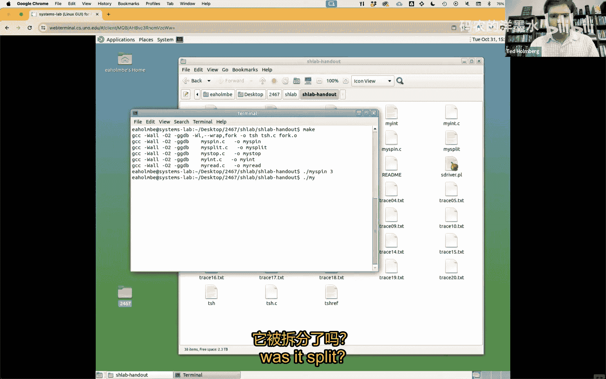
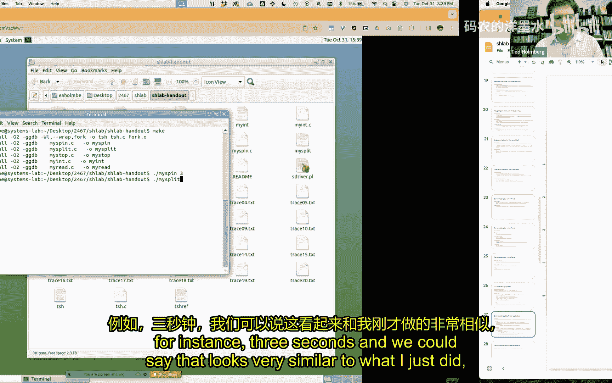
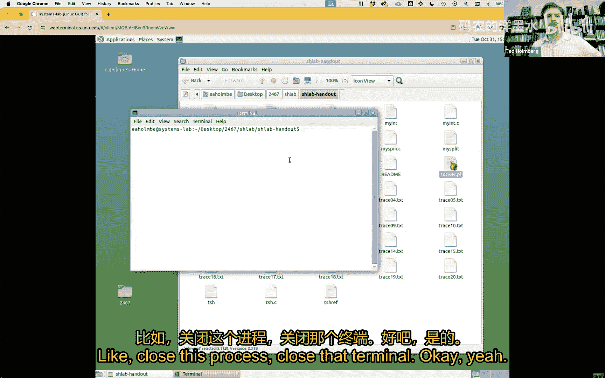
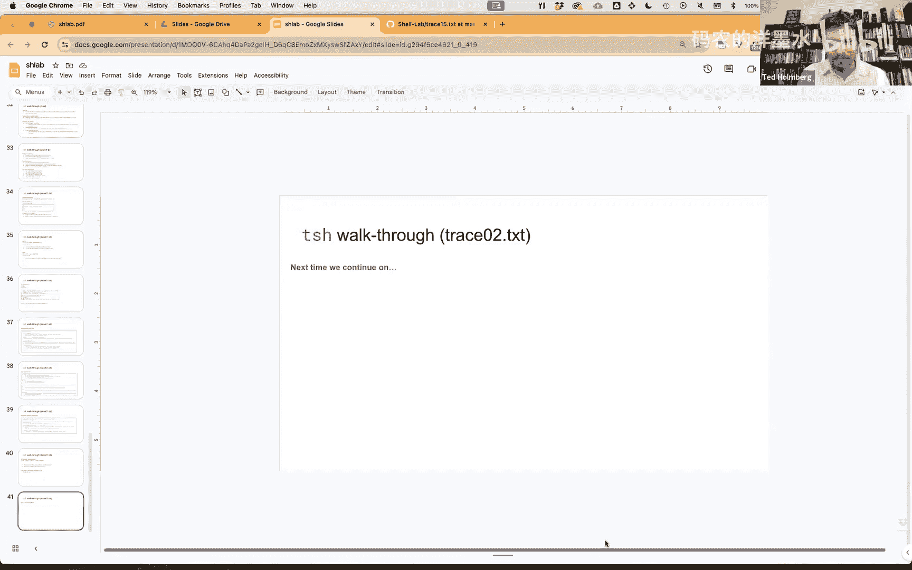

# C语言系统编程：20：Shell Lab 第一部分 🐚


在本节课中，我们将开始学习如何实现一个简单的Unix Shell，名为TSH（Tiny Shell）。我们将了解Shell的基本工作原理，包括进程创建、信号处理和作业控制等核心概念。通过本实验，你将亲手编写一个能够执行命令、处理进程和管理作业的Shell程序。

---

## 概述：什么是Shell？ 🖥️

Shell是一个交互式的命令行解释器，它充当用户与操作系统之间的接口。它的主要功能是解释用户输入的命令，并相应地运行程序。Shell既包含内置命令（如`cd`、`jobs`），也能启动外部应用程序（如`ls`、`gcc`）。

上一节我们介绍了课程和实验的整体安排，本节中我们来看看Shell的基本概念和我们将要构建的Tiny Shell的初始设置。

---

## 核心概念与准备工作 🔧

在开始编码之前，我们需要理解几个关键概念，并设置好开发环境。

### 关键概念

1.  **进程**：进程是程序执行的一个实例，是Unix环境中的基本计算单位。它允许我们分离不同程序的执行，并提供并发执行的能力。
    *   **公式/代码**：在C语言中，进程通过`fork()`系统调用来创建。

2.  **父进程与子进程**：当使用`fork()`创建新进程时，原始进程称为**父进程**，新创建的进程称为**子进程**。它们可以并发运行。
    *   **代码**：
        ```c
        pid_t pid = fork();
        if (pid == 0) {
            // 这里是子进程的代码
        } else {
            // 这里是父进程的代码
        }
        ```

3.  **信号**：信号是一种软件中断，用于进程间通信，以通知进程发生特定事件（如用户按下Ctrl+C）。
    *   **常见信号**：
        *   `SIGINT` (Ctrl+C)：中断前台作业。
        *   `SIGTSTP` (Ctrl+Z)：停止前台作业。
        *   `SIGCHLD`：子进程状态改变（终止或停止）。

4.  **输入/输出重定向**：这允许我们改变程序的标准输入/输出流。例如，将输出从屏幕重定向到一个文件。
    *   **代码**：使用 `>` 和 `<` 符号，在Shell内部需要通过 `dup2()` 系统调用来实现。

### 实验初始设置

以下是获取和设置实验初始代码的步骤：

1.  从课程网站（AutoLab）下载实验材料包（`shelllab-handout.tar`）。
2.  在终端中，使用`tar`命令解压该文件。
3.  进入解压后的目录，运行`make`命令来编译提供的框架代码和测试工具。

运行`make`后，会生成几个可执行文件，包括你的Shell程序`tsh`，以及一些用于测试的小工具程序（如`myspin`、`mysplit`）。

---

## Tiny Shell 规范说明 📝

我们的Tiny Shell需要实现以下功能：

*   **提示符**：显示 `tsh> ` 等待用户输入。
*   **命令行解释**：能够解析以空格分隔的命令和参数。
*   **内置命令**：支持 `quit`（退出）、`jobs`（列出作业）、`bg <job>`（后台继续）、`fg <job>`（前台继续）。
*   **执行外部程序**：对于非内置命令，将其视为可执行程序的路径，并创建新进程（作业）来运行它。
*   **作业控制**：
    *   支持在命令末尾添加`&`符号以在后台运行作业。
    *   支持 `Ctrl+C` (`SIGINT`) 终止前台作业。
    *   支持 `Ctrl+Z` (`SIGTSTP`) 停止前台作业。
*   **I/O重定向**：支持使用 `>` 和 `<` 进行基本的输入输出重定向。

---

## 测试与验证方法 🧪

我们将使用一套完整的测试文件（`trace*.txt`）来验证Shell的实现是否正确。





### 测试工具

1.  **参考解决方案 (`tshref`)**：这是一个已编译好的、功能完整的Tiny Shell。你的Shell输出需要与它的输出一致。
2.  **Shell驱动脚本 (`sdriver.pl`)**：这是一个Perl脚本，它会根据`trace`文件的内容，向你的Shell发送命令和信号，并捕获其输出。
3.  **测试脚本 (`checktsh.py`)**：一个Python脚本，可以运行所有测试并给出当前得分。

### 运行测试

以下是运行测试的便捷方法：

*   测试你自己的Shell：`make test01` (测试trace01)
*   测试参考Shell：`make rtest01`
*   比较两者输出：`make test01 > my.out && make rtest01 > ref.out && diff my.out ref.out`
*   使用检查脚本：`./checktsh.py`

你的最终得分取决于能通过多少个`trace`测试，每个测试通常值2分。

---



## 代码框架初探与第一个功能实现 💻

实验提供了一个C语言框架文件`tsh.c`。其中，我们需要实现几个关键的函数存根（stub functions）。

### 核心函数存根

*   `eval`: 解析并执行命令行。
*   `builtin_cmd`: 判断并执行内置命令。
*   `do_bgfg`: 实现`bg`和`fg`命令的功能。
*   `waitfg`: 等待前台作业完成。
*   `sigchld_handler`, `sigint_handler`, `sigtstp_handler`: 信号处理函数。

### 实现第一个功能：`quit` 命令

让我们从最简单的`quit`命令开始，了解代码流程。

1.  **理解 `eval` 函数**：这是Shell的主循环（`read-eval-print loop`）中的“评估”部分。它接收用户输入的命令行字符串。
2.  **使用 `parseline` 助手函数**：框架提供的`parseline`函数可以帮助我们将命令行字符串解析成参数数组（`argv`），并判断该命令是否需要在后台运行（通过检查末尾的`&`）。
3.  **在 `builtin_cmd` 中处理 `quit`**：
    *   检查`argv[0]`（命令名）是否是字符串`"quit"`。
    *   如果是，则调用`exit(0)`终止Shell进程。

**代码示例 (`builtin_cmd` 函数片段)**：
```c
int builtin_cmd(char **argv) {
    char *cmd = argv[0];
    if (strcmp(cmd, "quit") == 0) {
        exit(0); // 如果是quit命令，则退出Shell
    }
    return 0; // 不是内置命令，返回0
}
```

4.  **在 `eval` 中调用**：在`eval`函数中，先调用`parseline`解析，然后将得到的`argv`传递给`builtin_cmd`。如果`builtin_cmd`返回（表示不是内置命令），我们后续才需要去创建子进程执行外部程序（这是后续实验的内容）。

完成这一步后，你的Shell就已经能够响应`quit`命令并退出了。运行`make test01`，你应该能通过第一个测试用例。

---

## 总结与下一步 🚀

本节课中我们一起学习了Shell的基本概念，设置了实验环境，并了解了Tiny Shell需要实现的功能规格。我们初步探索了提供的代码框架，并成功实现了第一个内置命令——`quit`，使其能够通过最简单的测试用例（trace01）。

下一节课，我们将继续深入，学习如何让Shell能够执行外部命令（如`/bin/ls -l`），这是实现一个功能完整Shell的关键一步。我们将涉及到`fork()`、`execve()`等系统调用的使用，并开始处理进程创建和基本的作业管理。



记住，本实验是循序渐进的，每个`trace`测试都引导你实现一个特定的功能。从简单开始，逐步构建，并充分利用调试器（如`gdb`）和测试工具来验证你的每一步实现。