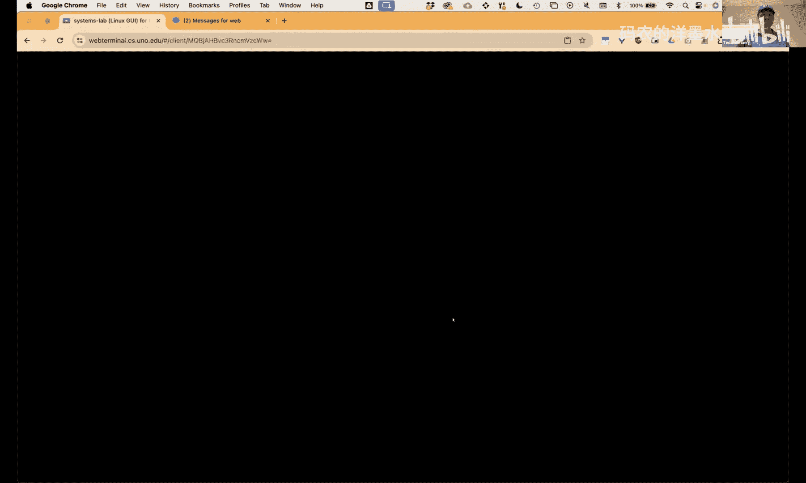
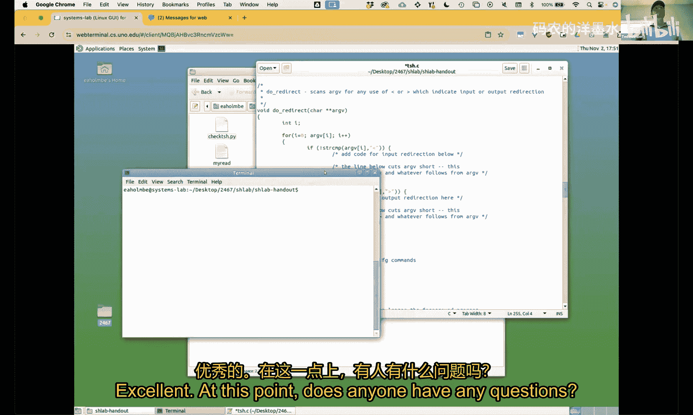

# 【全集】加州理工学院 C语言系统编程 中英字幕 p21 Lecture 21 - Shell Lab part2 -BV1bUzWBLEiC_p21-

2条。So let me go here， 2467。And I'm going go into Shell labb。

 I'm going to go to Shell labb handout and we can see we have all of these files。

 we have 20 trace files， each one of these trace files is worth two points so you have up to 40 points for this lab and you work it out a trace at a time the traces are effectively the set of instructions that are sent to a test harness that will launch your tiny shell so the idea behind She lab as stated in the last class but I'll just highlighted for this one is that you're going to build your own simple tiny shell。

So much of what we've been doing either in Zhell or bash or whatever you've been using as your terminal。

 we're going to build our own version of that very simple version of that and we'll see what system calls we can utilize to go ahead and manage either the built in commands that the shell will respond to or the ability to go ahead and forA process child process and launch a external application and so all of what you've probably many of the commands you've learned how to do inside of the shell or these small little utility applications that you can launch that does a task for you。

And of course， the goal of this lab is to get you more familiar with what's happening underneath the hood of a shell so that you're much more readily equipped to use one。

So I mean it's very rare if ever that you'll ever actually have to build your own shell right。

 but it's a good process， a good academic process to build the tiny one so that you kind of understand what its tasks are kind of getting up it fills in the abstraction of what's happening underneath the hood so that you have a better understanding of how to use it。

Okay， so the very first trace and let's actually launch this， let me go back here。

Let's open up a terminal。Okay， so if I could jump into here and let's see here。So if I look at。

Let's say， for instance， trace one， this is the one we did last lecture。

We can see that it's going to have a combination of lowercase and uppercase anything in the uppercase is not an instruction that's fed directly to your shell is' going to be an instruction that the test harness is going to respond to any of the instructions that are in lowercase or actual instructions that your shell should be able to respond to so for instance we have actually an application that's given to us it's the tiny shell reference。

Which is this， you can play around with this， you can launch this。

And you can see what behaviors the final application should have and so all of your output。

 all of your behavior for your shell that you implement should mimic it should mirror this reference application so when you go to test and evaluatevalu when you go to upload your code onto autolab effectively all of the testing harnesses all of the testing autolab does is given to you so you can test it step by step。

Okay， so with that said。If I wanted to test， so inside this instance for the first one。

 if I type in quit， that should whip me out of the application。UI already。Let's see。 And right now。

 when I launch our actual。Tin shell。It works as well now when you initially go ahead and download your hand in file that's not going to work the very first task you have to do is to implement that quit which is shown in the prior lecture and we're going to move on from that but let's take and examine the source code so that we can recall where we last left off so that we can start implementing the next trace trace two。

So let's jump into here。Let's go into here， this is going to be the code that you're going to be responsible。

For implementing。And I highly encourage you all to go through and read and parse there's a lot of comments。

 so it should be pretty easy to see what you have and then what you're going to have to implement there's a。

Collection of global variables here， which we'll talk about in just a moment。

 we have some function prototypes， these are the ones that you will have to implement over the course of this shell lab to actually make your shell functional。

And these are going to be a collection of functions that are going to be fully implemented that you can utilize in order to as helper functions in order to implement the functions that you're going to need to implement。

And then we have our main function here and our main function has。Our。Effectively our loop。

 which I talked about prior， that's going to be our rebel where we read。

 evaluate process and loop back again。And so this is where we're going to evaluate and so really last lecture we went into this function。

 which was originally just a all it did was return back。

Control to the invoking function and we've added these lines of code。

Where this first line is going to go ahead and create an empty array of the size of whatever the maximum number of abs are。

This second。嗯。Right here the second and actually why don't we consolidate this just make it easier so instead of declaring a variable and then assigning it we'll just initialize it so here recall're callinging this parse line function we pass it to parameters one is this string that is our command line the second is going to be the empty array that will then be populated with a set of values that's parse from our command line and so then this parse line function is one of the helper functions that's given to us so you should certainly read through it just to understand what is going to result from it if you have any additional questions is' actually going to give us a return value of whether the parse string is supposed to be run as a background process or as a foreground process。

Which our later traces is going to really challenge our shell in being able to do。

And this first trace said we just need a quit so we're just using a built in command。

 so the next thing we're going to do is we're going to invoke this other function。

 which is a function that's in the to implement list。So built in command。

 we can give it our array of arguments， our argument vector。

 and it will go ahead and check to see if。The command is a built in command that our shell is going to immediately respond to。

 and if it's not， then we're going to have to execute some external application in response to what the command line has requested our shell to perform。

So like for instance， the Ving command that we're interested in this for this particular trace trace one was the quit command。

 which would effectively exit us out of the shell， as we saw from the reference shell。

So this actually also returns back a value， it's going to return back a value on weather。

It's true or not that it was built in command and when I say true or not that's going to be an integer value right because we're talking about C if it was so we can check to see what the integer value is and determine whether we need to go ahead and continue to do more task in terms of responding to the command line。

 which we're going to do in Tra two， that's what we're about to do。

So let's see here and then we have the built in command， so we added these three lines of code。

And let's see here， let's go to。Oops。不的。Okay。And then we have this function here。

Whi was also an empty function when we first looked at it。

 but I just want to make sure everyone's on the same page and so here we went ahead and we grabbed that argument vector。

 that argument array that was given to us and we index and grabbed the very first element。

To see what our command was， we used the string compare function to compare our command to the string literal of quit and if they were equal。

Then we're just going ahead and exit。And shut down our application and so a return value of zero represents a falsey value of okay。

 that wasn't a built in command， so we have to do something else where we have to respond in some other way。

Okay， so。Once I have this implementation， then I can always test this， I could do my test。Oops。

 I could do my this's actually clear this。We can make test， let's do reference tests。

 we can do the reference test on01。And so it's going to。

Produce some output anything that's in the hashtags or effectively just comments or' just going to echo that to the screen if there is other actions which we'll see in future traces we'll see how that should print out so effectively we run our reference test and then we can run our test and we should get the same behavior we can see we do get the same behavior so we're done with test or trace one。

Another way I could compare them is just using the di， I do a diff。

 I redirect the standard in to di with a make。On the reference test one。And it requires actually two。

Arguments。So we will also make test。one and so if we do that。

 we can see that the only difference between the two is going to be the instructions that actually invokes our cell driver tested so again this is a way of illustrating we're done with trace one。

I can also。Just invoke this。Check。T show。Application and it'll actually cumulatively score you so we can see。

 oh yeah， we got our two points on our first race and we got the two points on the second trace。

 which。Let's see here。😔，Which means that， oh， which means hang on let me。

Go through and make sure that。Let's make sure that we also。Re compile in case I had a task from。

When I was playing around with this earlier， okay， so let's do this again and now I should have two points and hopefully now zero points I should not get the gap perfect。

So I shouldn't be getting any points for phase two because or Tra two because I haven't implemented Tra two yet。

Yeah， perfect。Excellent， at this point， does anyone have any questions？

