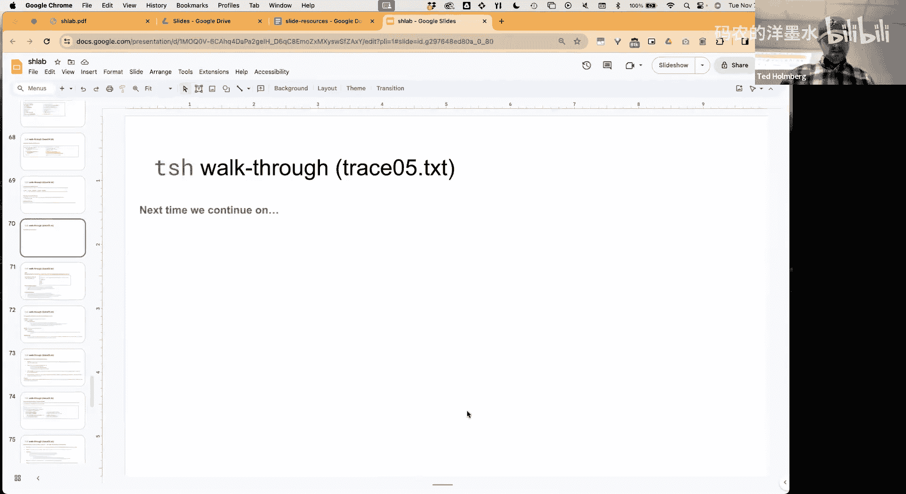

# 【全集】加州理工学院 C语言系统编程 中英字幕 p22 Lecture 22 - Shell Lab part3 -BV1bUzWBLEiC_p22-

Excellent。So in today's lecture， I want to pick up where we last left allll so effectively we had a great presentation last lecture before。

We moved into standard time。So we're going to have much darker days ahead of us very literally。Yeah。

This is now going to be a night class。嗯。But we also kind of reiterated the very first phase of our Shell lab which those instructions should be posted on the playlist from from the October 31st lecture that we had I'll post the one that had the demo soon but we should be at a stage at least in Shell lab which is what we're currently working on where we can start on task two because if I'm not mistaken the lecture that was that's currently available is a complete and full breakdown of what the motivations of Shell lab are and it even goes through and shows you how to complete the very first trace Tra one and how to test it so I want to pick up from there and look at how to accomplish a couple of traces。

I let me get my。Display inside here working。So I want to spend today's class to go ahead and cover traces two and if we have enough time。

 maybe all the way up to trace five。So we'll try to go ahead and work through my goals to try to go through and explain the motivation behind each of the traces to see what's happening with the reference shell versus our shell and then introduce the new concepts that we're supposed to be learning for that implementation and so ideally we can do this within maybe the next two weeks is what my goal is and we'll see how that works out and that'll give me a little bit of lanyat time to see if we can't cover at least rudimentary the concepts for any the last remaining lab that we have。

Okay。Oh。Where is okay so we left off on trace two so next time we're going continue on this so our goal in trace two is again we're going to want to execute our trace2 dot Txt file that's going to be fed into our test harness using our shell driver pearl script and so we can always do a cat on this and i'm going to do that as well to be able to view the contents of these。

Of these trace files because they're designed to be human readable So we we can and in fact。

 each of them have a header comment that tries to convey to you the developer of this tiny shell what。

Functionality your shell is going to have to have in order to pass this particular test。

So in this new trace we're going to have to run a foreground job several times so okay after we have our hashtags we can see that we have a call to the shell application to LS which prints to our standard out the contents of the directory that we invoke this application from。

So now we don't use relative paths， we're using full paths because setting up relative paths is something that your shell would have to accommodate and we haven't implemented that。

So we would make a call from our root directory to our B directory to LS。

 which is the application name， then we're going to go ahead and call sleep。

Which is going to instruct our shell driver pearl script to pause for a second before executing the next command。

 So after we sleep for a second we'll call LS again。

 then we'll sleep for another second and we're going to call LS again Now again。

 at any time I can go ahead and run。This trace on the reference shell to see what the expected output and then we should run that trace on our own tiny shell before we start implementing to see what our current implementation is。

 what our current outputs going to be and then we can compare those and see what do we have to do to try to improve our tiny shell so it's in line with our reference shell because again。

The point of each of these traces is to ensure that。

Your output from your shell is going to be the same as the reference shell now one thing to be aware of is sometimes you might change or implement your code and of forces prior traces to start to start to error out right and that's one of the advantages of running the check the cumulative check to see that all your prior traces still work the way you expect them to。

And we're going to step through that in today's lecture。Okay。

 and so let me set up here so that I'm where everyone else is。

 I'm just going to open up a terminal really quick I'm going to do it。

My Ls here so i'm inside of my handout folder and let me just make sure that we are actually picking up exactly where I expect us to and I don't have any extra lingering implementation inside my system so the first thing going to do is。

Let's do this。 Let's。Let's check。Our tiny shell so we have trace one complete and yeah okay perfect that's exactly what I want to happen and then as soon as it tries to evaluate trace two we're seeing a big diff occur and I don't get points and so that lets you know okay trace one and it works but trace two doesn't another way I could evaluate that and just what we're going to be seeing on the next slide is that I could do with diff。

Between that's send to standard。Out。The results of a call to make on test one。And send to。OnT。Okay。

 but I need R test because that's my reference test and just test。

 let me see if I can't stretch this out so we can see it all in one more。Okay， let's hit and okay。

 so this。Is perfect that's that illustrates that my first test is working and so just to evaluate my second test and we can see。

We have lots of differences。Okay， so now let's stay here。 Let's actually make those in。Isolation。

 so this is the actual output， so if I wanted to take a look at it。WellWhat we see is。We have。

The echo of the comment from our test harness then it looks like we have the printout of our job so this is probably our job ID this is our process ID this looks like the instruction。

Oh， this is on did I do test three？Not what I want。Test two。Okay， let's see here we have。Yeah。

 this is this more in line with what that。Trace was the text of the trace so we can see I have my echo of my my comments and then all the contents of this directory and then we have all the contents of the directory again and then all the contents of the directory again so it prints out the contents of the directory through times Okay so that's what we want let's see what we currently have。

No。Two。Okay， so we're getting， we're getting the echo， but we're not handling。

We're not handling any any actual external application calls because if you remember the last thing that we implemented inside of the evaluation method is to only check to see。

 we can open this up and say， let's see what our current basis is。So if I go to my C code。No。

I hate this idea of when you drag a window too close to the corner decides just to。Maximize。Okay港。So。

We can see， let's see where we last left all。Let's see what our eval is。

 so remember inside of our main loop。We have our rebel， so this is our rebel code here。

And so one of the big things happening in rebel is this eval function that's evaluating our command lines and so right now our eval function is very simple right we had created this。

ArgV array that can hold the maximum amount of arguments then we created a energyte and effect fact let's do this i'm going to compress this logic so i'm going to going to initialize。

Instead of declare an assign， but here what I'm going to do is then I'm going to parse line and I'm going to send it the command line that's sent to us and it's going to tokenize it and fill our AV array。

And then we're going to send now that parsed argue array that's been populated by this parcel line which is a helper function。

 we're going to send that to built in command and right now the only implementation we have in built in command is to check to see if it's quit and if it does we exit our system application so now we're going to have to actually。

Identify that we want to run。A application that is not a built in command that's going to be one of the tasks for trace two。

 and then we're going to have to go ahead and set it up so we can execute it。

So let's see how we can do that。Okay so again to get to the stage we have we've already seen this we're going to make our reference test too we're going to make a reference test and then we're going to make our version and then we do our assessment we've done that we've witnessed in real time what the difference is so now the next thing we're going to do is step through how are we going to improve what we have so we're going have to refactor our eval process we just looked at our eval process and pretty much this the first three lines the ones that are not highlighted are the ones that we've already implemented the ones that are highlighted or what we're going to have to act。

So we see that the shell reads a command from the user or a script right so we've gone through this process。

 it parses the command into constituent parts including the command name and argument。

 the shell checks if the command is a built in command that's what be implemented in trace one。

But if it's not a built in command， the shell is going to use a fork exec mechanism to run the command as a separate process。

And then the shell will wait for the process to finish if it's a foreground jaw。Okay。

 so some key system functions that we're going to have to know about in order to do this is this concept of forRC。

 which is going to create a new process by duplicating the calling process。

 then we're going to have a executable execution vector。

 which is going to replace the current process image with a new and based off a given command and arguments vector。

And for sure that's called XAC V， and then we have the weight pig。

 which is going to wait for a child process to complete。

So these are all things that are provided to us by the system。

 you can go ahead and look at the documentation we'll kind of just briefly describe how we need them。

Now in order to resolve our issue that we're having。

 we're going to implement our Fort exitec mechanism properly to go ahead and execute our external commands。

Okay， so fork。Is a system call that's going to be used to create our new process known as a child process。

 which is the duplicate of the current process， which we will now call the parent。

 the parent process receives the PI， the process ID of the child， whereas the child receives a zero。

If the fork fails and it returns to minus one indicating that some error had occurred typically we want to handle errors right now we're going to ignore error handling with the hope that some future trace is going to try to generate an error and if it doesn't then well we so match the reference trace。

 we just have very nonrobu code。Okay， in terms of the executable function that we have the exec V system call replaces the child's process memory space with a new program so again we kind of duplicate when we create a fork。

 but then we're going to。Override or overwrite the contents with the application we actually want to execute。

 it takes the command name and an array of string arguments， it does not return if successful。

 if it returns that means an error had occurred。😡，And of course， our parents role， the core process。

 the main process that's going to be during the14 after 14。

 the parents should wait for the child's termination using something like weightP to handle foreground tasks for background tasks。

 the parent continues execution and monitors the child asynchronously。So here。So again。

 our step by step on what we want to do in our EVO is and this effectively our pseudo code is we're going to convert the command line string into an array of arguments。

Then we're going to determine we're going to check if the command is a built in and executed if it is。

 so we have in both this function， but we're not yet capturing the return value from it so we're going to just update our code there then we're going to handle the external command so if it's not a built in command and what we want to do is we want to fork a new process and then in that child process we want to attempt to execute the command with the exec V system call and if if exitec V fails then we can print an error message and exit which we might I might not do this in my implementation right I'm going to wait for that trace let's。

Let's do this。I think I might ignore this and see what happens。Let's do this。

 we'll strike through this one。And then in terms of managing our forecast。

 if the command is a forecast process then the parent waits for the child's completion where there's a function。

 another function that we can see weight。FGs work for way foreground that we'll have to implement in fact。

 if we look in our code originally， let's go back up to our code here。

Inside of the functions that we have to implement， we see these are all the functions we have to implement and we see we not only have to implement Eval which we've already touched。

 we not only have to implement the built in command function which we've already touched just with trace one。

 but we're also going to have to implement this weight foreground。

 which will touch a little bit for for trace two， although I don't think it really evaluates whether it is not going to be deep evaluation of this。

 so we'll have to go back and add more logic to this one in a future trace。

And that's going to be true with a lot of these function。

 but we'll iteratively make them more and more complex and as we get deeper into our traces。

 we have to go back and refactor them so that they're more and more robust or handle more and more variety of tasks and handle more responsibilities。

Okay。Okay， let's see here。 Okay， so this is going to be my implementation of based off of my。

And it looks like I do。I want okay， we'll stick with what I have on the slide just to make sure I don't mess things up too much。

Well。We'll check with testing on what we do and don't need that's one thing I do like to do。Okay。

 so let's go， so so based off of this pseudo code， we can actually read line by line what's happening here。

 but instead of reading this entire block， let me jump over so that I can go ahead and just walk through the simple。

So let's jump over here， now let's go to my Eval。So get that down past the main the first function after our main function is our eval function right now it is。

Very it's very lean， so the first thing we're going to do is recall that the built in command function actually returns back a value whether the command was built in or not。

 so if it was a one that returned then we attempted to execute it but it was a built in command and it was executed and if it wasn't a one if it's a zero then it's going to be some external command that for an application that we need to run from our shut。

So let's grab that。Let's grab and let's give this a good readable name like say for instance it's going to be effectively we're treating it's an integer but we're treating as if it's booleing value so i'm going to use a boolean type variable name so is。

Built in。Command。Okay， so based off of that， now I have a read aable。

Field that I can use to go ahead and track what I should do Okay， so now I'm going to check if。It啊。

Is not。A。Hilton。Command。Then I'm going to want to do this code。In this instance。

 if we go and we pass in our argument array and it determines， oh。

 that's not something that's been built in， so it's going to return control back to our eval function。

 we'll get back the value 001 whether it's built in so if it's not built in。

 then we want to do something in response to that。Okay。Okay。

 so the first thing I'm going to want to do is let's u oh， let's indent。

So let's manage the child process because in order for us to go ahead and execute。

 we're going to have to go ahead and fork a child process。So I remember。

 the fork function is going to return back to me a PId。To the parent process。

 and so this would now be the parent process when we invoke for a fork to occur。Okay。

 so now that we've forked it， let's go ahead and check。If。Our PI is equal to zero。20块钱。Okay。

 so if we're in the child process。Then I'm going to grab。I'm going to invoke that。

Execution vector function， another system call function that's going to return back a integer value to me the integer value is recall if it doesn't give back anything。

 it's going to be a zero which means everything is operational if it returns a nonzero value then an error occurred so we'll just handle the error occurring for this we'll try comment and out to see if it has any implications。

 but we'll go through a robust route for now。😡，Okay， so I'm going to grab this value。

And then I'm going to call on this system function。

 and so the system function is going to require two parameters， the first is going to be。嗯。

There we go。The first is going to be the actual call， the application name。

Which is going to be the first element。And then the。

Other is going to be our argument array that could potentially have all the flags or other the other things that we need to send to our application。

So effectively our arguments for that application from the command line so like for instance。

 if it's ls that would be like our dash l that would be like our dash a right all these are important。

Pieces of data that's going to affect the execution of our application。O。Okay， so after I do that。

 I'm going to get back a。A result， so let's check。To see this。Status。And let's see if our status is。

Less than zero。And if it is。Then I'm going to do a print to the。

And I'm going to print just some message that says something along the lines of whatever the argument that you tried to pass in。

 which is presumably the application name。Command， not found。And then new line character。

And then let's also pass in here the very first element inside of our argument vector that represents the application name that we're trying to invoke。

Also we'll do this， why this is defaulted to four。Oh， that's awful。Okay， gap， yeah， okay， gap。

 let's change this。😔，那照。Okay， let's save this at the moment now we're not quite done yet。

 but let's see what happens if we just run the code as it works。

So based off of this implementation let's just see where we're at so I'm going to make sure we save and I'm going to jump into here and I'm going to do Gcc dashG because that allows me to go ahead and have all the great compiler augmentations that we saw last time we were doing this and then I'm going to give it my source code vial and then we make sure that our output is called tiny shellll Thell this has to be S and not C。

Oops。Oh， see this。This is a a strongly type language I have to declare the data type I remember saying it was an end。

 but I guess he I forgot to actually put my。The data type。So's save that。Perfect。Okay。

 so now what I'm just going to do is I'm just going to launch into my tiny shell and see how it's running and just see how this implementation is working based off of kind of how we were playing around with it。

Okay so we launched into our tiny shell and so we know that if we type in quit this is what we did last time to quits us out that's good that's the only built in command we have so now the other thing we need to do is if we do bin slash LS。

Oh yeah so that's that's working right like we can execute Ls but does anyone see something that's kind of funky and in fact let me see I want I want to check something here。

Well， we have a couple of funky things， right？Okay， so let's see this again。So we're getting there。

 we're a little close。嗯。啱话玩啊。Okay， so if I。If I run。We are getting。Our directory to print out。

 but notice my prompt reprints before I get。My result from the LS application。

 but it's not just that I'm not terminating either right like i'm not I haven't returned control。

In fact， if I try to do anything， it's going to cause a segmentation fault to go ahead andcur and that's because we need to go ahead and wait our parent process has to wait for the child process to complete and so if we don't implement that weight fG we're not going to be able to obviously get past this trace so this is an example of like a partial implementation but then we have this small little part that is going to prevent us from moving along。

Okay， so let's go back here。And then check。So what we want to do then is。Inside of here。

 so after we do something with the child process， then the next thing I'm going to want to do is I want to do something with the parent process。

So I'm going to just make a comment here to let me know， okay， this is going to be。

Part of the parent process。And then what I want to do here is I want to check。If。

If it's not a background application。😡，And recall I'm giving this information so what is BG let's take and just re examineamine the code we already have。

 so recall par line。Is a helper function that's fully implement force already so when it parses the line the distinction between when a user supplies us a command is if that command ends with an ampers stand that's going to determine whether it's a foregrounds or background process so we already have the implementation to determine if it's a background or foreground process now if it's a background process we don't want to wait for the application to finish right we just want to keep moving along from our shell。

😡，So we only on the instance that it's not a background process， hence a foreground process。

 because one or the other it's a binary state， then we want to wait for the foreground。

 we we want to wait for the child to finish processing before the parent continues on。

That's the motivation。Okay， so if it's not a background process。

 then we're going to call on this other function that we have to implement。

 we haven't implemented it yet， but we're just going to call on it and in fact it's going to take in the argument of a PI right based off of the PI it's going to wait for that PI to finish processing it and once it does then we can resume with our shut。

😡，Okay， so let' save this。And so now we know。Our EV looks pretty good at this point。

 let's just look at it based off of our pseudocode， we've created this argument array。

 we've called this helper function to go ahead and parse our command line and populate our argument vector and then it returns to us whether we're going to have a background or foreground job。

Then we're going to go ahead and call and send that argument right to built- in command and determine if it's a background command or not。

 I mean a built- in command or not， and if it's not。

 then we're going to start executing this code where I'm going to separate it into forking into a child process and doing what I need to execute the child and then also handle the logic for the parent process if it's a foreground then I'm going to wait and if it's not a foreground then I'm not going to wait。

So now let's jump to the weight Fg。Function and see what its current implementation looks like。Okay。

 so let's jump here， we can see right now iss doing nothing。So what I can do here。

 just to get this to do something just to get it to potentially work and let's see here。

 let's jump here。Is。When I execute my foreground jobs。Such as those in Tra two。

 it should keep the shell interactive while they execute the shell waits for each foreground job to finish before prompting the user for new input so in order to prevent our resource wastage which we see here with the segmentation fold right that's what we're getting。

The shell must wait for foreground process to complete preventing them from becoming orphaned or zombie processes。

 we can use the weight pit without without the the W no hang option ensures the shell waits for the specific child process to terminate。

And so here we need to synchronize between our shell and our foreground process in order for us to go ahead and complete this。

 so we're going to now jump into the weight FG， which is a very simple set of code i'm going to implement it but I'll just read it through really quick I'm going to create just a a variable and undeclared variable which then I'm going to give the address to as a parameter as one of the arguments into my weight Pi function here so for we're going wait for the process with the specified P to finish we're going to use untraed option which can be used also to return if a child has stopped。

And so here we're going to give it the PI， we're going to give it a reference to this status which we can use in the future。

And then we're also going to use this。This option here。

So let's jump into here and do just that so we're going to create。

A variable to maintain our status and right now we will then go ahead and invoke weight P。

And here we'll pass it。The PI that's passed to us， right， we're past the Pd inside as a argument。

Then we will go ahead and provide the address。To our status。And then we will use W。Untraraced。

And we should not， not ungraraced。Untraraced。Excellent。So let's save that。And she。

What the result is on our tiny shell。 So here let's launch into our tiny shell。

 I'm going to quit out。 Yeah， that still works。 Okay， let me try in。Alas and。Now we can see。No， oh。

 you know what？We need to recompile， always remember， recompile。

So it was for and now it wass run again。And now when I do this， you can see。

This works as per expected Now we're waiting for that child process to complete before the foreground picks back up。

 You can see immediately I get all of my。Diirectory consent to print out immediately after issuing this command and now the prompt is now waiting for me to enter a new prompt in which I should be able to go ahead and hit quit which it successfully does so here lets try this again let's launch it's a tiny shell let's see if I can launch this。

And yes。And this。Okay yeah i'm pretty satisfied with how that works so the next thing i'm going to do is let's compare the difference between our reference shell and our current implementation。

 so again let me go ahead and redirect to standard in the results from make our test and then redirect from standard in as the second。

Argument the output from my test on my own shell and we will check there's differences and ideally there that's perfect we see the only differences we have are it's testing that against the reference shell versus the tiny shell。

So now if I。Again， if I go ahead and then go to my check tiny shell。Cumulitive scoring script。

 let's see if I get my two points for trace one and then I am going to get my two points for trace two and then up I ale at trace3 so we are now done with Tra two。

 we can move on。Does anyone have any questions？Or does up to this point make sense so far？

We just double check inside of the chat， okay， I think we're pretty good。And of course。

The last slide I have here is just an illustration of recompile your code。

Something I forgot to do and then we can test in two different ways we could either do the di between the two。

Or we can check with the cumulative score now one thing I advocate you doing is try to experiment with your eval function and remove things if it doesn't make sense and try to understand why all the code that's there should be there。

Right so interactive testing is a good way to ensure we were talking about this earlier in class。

 interactive testing is a good way to firm up what your expectations are on why you have to have code based off of what the environment with the system expect。

And I think like one of the things I said I was going to do was removing that error message。

 let's actually do that。I'll keep it in there but I'm pretty sure nothings going to happen if I removed this error message because we're not testing against this error at all I don't think it's part of our trace what was that in was that in our Eval I believe that was in our eval。

See so。SoLet's jump to our eval here and we can see if I were to comment out this。Okay， so here。

 suppose I。Comment out this if check entirely。And now if I go back and I。Recompile。

And I checked the difference between the two， you can see， yeah， even without handling our error。

 that's not going to affect us in Tra two。Error handling isn't something that we're evaluating here。

 hopefully something we do in the future trace we'll find out because I'll leave it just commented out of my own code right now。

But I don't want to deviate too much from the slide。

 so if I have code on the slides I'm just going to stick with that。

But I want you know it behooves you to try and play around with this in other ways too so if you get lines of code and we talked about a little bit in class and you're like well what if I don't do this thing try it try removing it you could either put in the debugger or you try executing and see what behaviors you get as a result from that and always compare to your your reference shell because the the idea here is it's we're trying to motivate a strong understanding of。

How we're building this shell giving the boiler platelate code that we have and why every line of code we're going to add is going to make a meaningful difference。

Okay， so now let's jump back over here。嗯。Feel like。Here we go。Okay， now let's move on to Tra three。

So for trace three， we're going to execute。With our shell driver like we have been doing。

And of course， we just use the the make to be able to easily do that for us。

 but here we're going to have we're going to test our background job execution so in Tra2 we were。

Challenged with being able to do foreground executions。

 but again if I just do a cat on trace3 Txt I can clearly see the header comment says run a background job and it's very simple there's only two instructions here it's going to run the application my spin with one second and it's going to do that as a background let's just see let's let's remind ourselves what happens when we run that i'm just going to run it from here。

My spend one， okay， so I didn't run as a background and I'm not in tiny shell I'm just illustrating right now。

 not even in the reference shell。Guess I can jump into the reference shell。So let me do that。Os。Okay。

 so I should be able to。I'm going to do it as a foreground where it's going to wait until it's done。

But in my reference shell， we don't have a history。If I add an ampers stand to the tail。

 now this is going to make this a background gel， so which means。

It's going to report to the terminal that a background job is being executed and then or and then immediately。

Give me my prompt again。And so I think the idea here and I don't know how I don't think I'm fast enough for this if we'll do this I'll just do my span a little bit longer。

 let's do four seconds。And then I'll do。Oh， I don't have that。

I think it was our last was it yeah so it'll probably be something like this where it wants you to have one thing print out and then we can actually stay actually let's quit let's。

Well wait， wait until I get to the next slide just say。

Where we make the the M but okay so that gives us an idea of the instructions we want to do so we're going to execute the My spend program for a second in the background and then we're going to execute the Ls command to list the contents of our current directory。

Which is going to be obviously a foreground right we're running as a foreground operation。Okay。

 so let us so now the first thing we do whenever we're assigned a new trace is we want to see what the default behavior is from our reference shell immediately through our tester and then we're are going to compare that to our current implementation。

 so let's do that。So。I'm going to make our reference test on。3， and so we can see， oh yeah。

 look at this and I'm going to scroll up。 let's take a look in particular so we can see the expected output is going to be。

The echo of our comments。Then it's going to be the printout of the background。Job。

And then we're going to have a printout of all of the contents in our directory。

And let's compare that to what we currently have， so let's make。Test three。And oh， well， let's see。

 So let's say here， I'm getting part of that right。

 so I'm getting the echo and I'm getting the printout of the Ls。 we'm not getting。

I'm not getting the A。I'm not getting the。The background process， in fact， if I do a difference。

 it's easier if I do the difference， let's do clear here and let's do the de。Okay， yeah we can see。

 yep， we have one thing that's different it's the fact that we display something when we assign that background when that background process。

 the background job。Okay， so that's what we have to resolve。Should be easy enough， right？So。

It means well。Thinking about how we're going to accomplish this we're going to go into our eval process this is what we're already doing in the eval process so the only thing we have to add into what we're already doing so where again the shell reads and parses the user commands into components it executes the built and commands immediately for external commands and employs that for exec mechanism we talked about in the last trace if it's a foreground job we wait upon it's being finished but if it's a background job we'll allow it to proceed concurrently and we'll track with and add job call。

So helper functions we should know about so there's some helper functions that are fully implemented for us。

 there's the add job function which adds a new background job to the job list it stores the PID the job state and command line ensuring the shell can manage and track the job and there's a PD to JD function called that maps a process ID to its corresponding job ID in the job list allowing the shell to refer to jobs in a user friendlyrily manner so again if there's no matching job is found it just returns to zero。

So in order to resolve our Tra3 issue， what we want to do is we need to integrate the a job into our command execution workflow to handle background processes。

 we have to ensure our ad job successfully logs to each background job and prints in details for user visibility and then we got to mod our EV to use our ad job when starting background jobs。

Okay， so in order to actually implement this， let's take a look at some of the code that we're interested in。

So background jobs we have to track background jobs in order to determine what is currently running and be able to check back their state and whatnot well so if we go into our global variables。

There are some global variables that are declared at the very top of our application。

 the ones that are pertinent right now are going to be this one。

 this is next Jid that's going to be our next job ID to allocate。And it defaults at one。

 and then here you can see we have a structure。For our jobs and inside of our structure， we have our。

Hid。We have a job ID。We have the state， whether it's a background job， a foreground job。

 whether it's an undefined job or stopped job， and then we have right here our command line。

The instructions that were actually assigned to this talk。And then。Right under that。

 you can see we then have a jobs array that's initialized to the size of max jobs。

 which is again defined at the very top。Level of our source code and that's going to hold。

Effectively， our job underscored T strs here。So this is what we're going to utilize in order to add jobs。

😡，Let me say， do it I。Yep， we talked about this。And so。Let's see here。

 let's just make sure so central to the shell's ability to manage our background processes is the jobs array we just looked at we already looked at each of these。

Attribute， so when a background job is initiated should be recorded into that jobs array with a new job ID and marked with the state BG。

The shell can reference this list to provide status updates and allow job control and ensure proper termination of background processes。

Okay so let's see how we can go ahead and implement this so inside of our eval we can see we're just going to add a couple lines of code we're going to add a else clause。

On the instance that it is a background job， so if it's not a background job we're like okay。

 let's wait for the for grant for the for。Ground process to operate。

 But if it is now we're going to have to do something。

 we're going to have to add the background job to our job list and then we're going to have to print the jobs Pi to and the command because that's actually what we're being tested again。

 So we have to make sure our。System out message is the same as our reference show。😡，Okay。

 let me jump in here and actually implement this so we can test this ourselves。

 so here right inside my eval。Function， I'm going to put this else clause。

And inside of our else clause， we're going to， I didn't show this， we talked about it。

 we'll look at it in just a moment， we're going to call this a job helper function。

Which is going to take。In jobs， which is a global variable， it takes in as a parameter。

It's going to take our Pd。That。we get。Right here。We're going to go ahead and get and then here we're going to set so。

Whether it's a background or foreground。I'm going to use a turnernary operator。With Bg。Or FG。

And then the last thing I going to do is I'm going to go ahead and pass it my command line。

And we'll actually look at this parameter we'll actually look at the function make sure we understand what's happening with each of those and the next thing I want to do is I just want to go ahead and call my。

Print statement that's going to have a formatted print statement that's going to have the exact same structure as what our our reference shell has so inside of the box is going to be our job ID。

And then inside of the parentheses is going to be our process I。

And then we're going to have the string， which is the command line for this process associated with this process。

And so here I have another helper function， if you recall， it was PD to JD。

And so I can just pass it my PId and it's going to provide to me it's going to give me back a job ID。

I'm also going to give it my process ID， and then I'm going to give it my command line all our。

Local variables inside of my EVval function。Let me save that and again。

 let me do this just to make sure we're all on the same page。I'm going to go to。A job。We could see。

That add job。Is a fully defined function right here， it adds a job to the job list。

Where it takes in he， our jobs array， it takes in a PId， it takes in a state which is defined。

We have aliases for a state， BG and FG defined at the top of our source code。

 and then it's going to take in our appointmenter for our command line。

Arguments and then it's just going to go through and add that job for us。Perfect， and then if I also。

Check my， what was it， it was my P。To。We can see this is also one of the other hardware functions。

That are defined for me where I pass it a P and it's going to return back to me with a job I and in fact。

If you ever forget what is available to you， recall inside of。

The header section of our code base these are going to be the header routine the helper routines that are provided for us that are fully implemented so get acquainted with these you can see how it'll make our job very useful where we don't reinvent the wheel having to manage this。

O。So now let's see what happens， so let's recompil our code。Okay。

 no issues always good whenever you change any of your source code to recompile and the next thing we want to do is let's let's just launch into to it。

 let's see what happens。Okay， so we've launched into this so we know that we're going to have to do this。

What was it， was it my spin？With one。And so let's do this initially。

It's going to wait a second okay so the foreground process works in our shell。

 so now let's try my spin one and then ampers stand and it goes ah thats exactly the output I want。

Okay， so let me quit out of this， so now we'll start to check， but before we do that。

 let me catch up with my slides with my presentation。Yep。

 and that's the next thing is to make sure you do a verification that after we've tested it out。

We've run our shell， we kind of toed around and explored and like yeah。

 this looks like kind of what the display look like if I issue those commands let's actually do the de so let's do a de。

Between make on test three。And。No， our tests three。It doesn't really matter。

 but I do like to put my reference test in the beginning and then test three here。Then I can see。

Yeah， the only thing that's different are going to be my process IDs and that's okay。

My process IDs are unique。So there's there's no guarantee that I'm going to replicate process IDs between running my applications。

 so I can test to make sure I get points for this by running。My check script。

 my check tiny shell script and so at this point I get two points for trace one and I will get two points for trace2 and I will get two points for trace3 and now here I should kind of crash out of my system because we have not implemented trace four and there we go we see that yeah we do not get those points and we won't get any points moving forward so we only handle the first three traces。

So let's go ahead and clear that and take a look we have 15 minutes left。

 let's see if we can't get past trace four at least。By the time we end today that。

Which let's see if we get through trace four， that represents what 20% of this lab， right？Okay。

 so for trace4， the first thing we want to do is we want to examine the trace file and figure out what is the objective。

 what is the motivation that our shell is now going to have to be upgraded with in terms of its functionality。

So again， the goal。For our traces to ultimately execute and be successful。

 this particular goal is going to be the ability to test another built in function。

 this built in function will be called the jobs command。So now we know right off the bat。

 that means we're going to have to go into built in command and add another evaluation。Okay。

 so here what we can see is after our header comment。

 there's three instructions that's going to be fed to the test harness。

 a call to My spin two as a background process， a call to MySp three that will also be a background process。

 and then a call to jobs。So we already know that MySSp two and three is going to execute that program for two seconds in the background。

 allowing the shell to proceed with other commands and similar with three is's going to execute that in the background allowing our shell to proceed with commands but what's jobs it's a built in command that lists all the background and stop jobs showing their job ID。

 their current state and the command line。That started each job。

So the first thing we should do is we should see what does our reference shell do when we do this trace and then what does our current shell do so let's let's evaluate that so let's make。

Our test4。And we can see。Yep， so we have echoed the header comment and then we have。你。

Two jobs that are printed out because they're background jobs。

 remember each time we make a background job， it send to standard out a print。

That that is a background job， but notice this line here is an invocation of the jobs command displaying all the jobs inside of the jobs list。

So how are we going to implement this well we know we' have to go into built in command what we're already doing inside a built in command is we're getting the command name right that's the first element from our argument vector then we're checking if it's a quick command we exit the program so obviously the next thing we should do is if the job if it's a jobs command。

 then we should print the list of jobs and return one to indicate that we just executed a built in command。

And if we don't do any of that， we've already done this last part。

 otherwise if we didn't do any of the prior statements， those if checks。

 then we return zero to indicate that it was not a Cton K。

So a key helper function that we're going to take advantage of is list jobs。

 which prints the job list。So what are the new actions we need to do inside of our built and command check。

 we're going to check for jobs， we're going to invoke the list jobs function providing the jobs array and we're going return the value of one。

So let's take a quick look， this isn't code we have to write right I usually put code we have to write highlighted in yellow。

😡，What I've started to do in this slide is start printing out the code so we can examine what helper functions we're going to call on。

😡，So in this instance， this is our list jobs function that iterates through the jobs list and prints out the job ID。

 the process ID， the state， the state could either be running foreground or stop and the command line for each active job so this is provided for us just showing you so that you can see what the parameters are you can see what the line by line implementation is for the helper function we're going to rely on it's already given to us in our sourceK。

And I want to highlight， we saw this in the last trace。

 but I'm keeping all of the trace segments of my slide deck autonomous。😡。

And isolated it so we're just going to rehigh that in our global variables， there's a jobs array。😡。

That's being used。Byu the list jobs to be able to iterate through。😡，Okay。

 so now let's actually try to implement this well given the fact that we have these helper functions should be relatively painless and simple。

 we use string compare to compare the command that we parse that we grab in the very first line of our built in command function。

to that of jobs and if there's no difference between them。

 if they're the same right if the result is zero， then we want to invoke that helper function list jobs and provided our global variable jobs where we've been adding jobs to。

😡，And then we just want to return with one。Okay， I'm going to jump through。

So let me also go ahead and do this along with you， so let me go here to jump to my。Built。And。

Command function。好好好。Okay， so here。I need to add after I check to see if it's a quit。

 let's see let's add this new command。So let me make， I'm going to scaffold out and if。Yeah。Okay。

 now I'm going to do the evaluation， the if， we'll do a string compare。Pt。

And we're going to compare that command to。Jobs， the new built in command that we want ourselves to support。

 and so if it is equal， then we will call this helper function。This jobs。Will we pass it in the。Jobs。

And then we will also。Return to value of one。But save that。Now let's see what happens。Okay。

 so fortunately I have my trace there， I'm going to recompile。I'm going to launch my shell。

 my tiny shell。I'm going to try。My spin， I'm going to do four。Perfect。I can say。

I was successfully able to launch one background process。

 I was able to successfully launch another background process。

 I was successfully able to then display the contents of my job。

Now I think the only thing I have to do here then is to evaluate if this trace is done。

So let's go ahead and do what we have been doing let's go ahead and。Do a de。

We're assuming to standard N。The result of the make on my reference tests on three。Three or fourth。

 four， we're on four now， right？On my successful。Okay， and if we're lucky。You see， yeah。

 we get the same output， the only difference is the process ID and that doesn't count against us。

 right？We're not supposed to be able to。Produce an equality on that。太早。So let's go here to check。

And see if we don't get two points for trace one。Two points for trace two。Two points for Tra three。

And finally。Two points for trace4。But。And then we fail on trace five zero points。

 but it's perfect because that is。The trace that we last left off on。

So let's go ahead and control C out of that script clear that and so now we have successfully gotten past the first four traces which represents the first 20% of this assignment right it's a 40 point assignment right there's 20 traces we've done four traces already。

There's only 16 more traces to go。This seems like a good stopping point I only have like five more minutes to go in this class I don't think I can accomplish trace fall and I don't want to stop mid trace I made that mistake last class I do not want to repeat having to reiterate and build everything up and then not have a payoff on that。

So this just seems like a good portion， does anyone have any questions？嗯。最后把。

The God can be big heaven。run stop。Yeah but we will be evaluated on that yes so right now one thing you'll notice I'm doing bare minimum。

😡，Additions to my code base so that I pass that particular trace with the expectation that my codeb is insufficient to pass future traces because I want to motivate what those future traces are for if i'm really robust and I consider all of the header comments between each of the functions and I start implementing ahead I might pass traces which is fine if you're a student but if you're trying to walk through and provide the motivation for each of the traces that's actually kind of a hindrance because it's like oh remember that thing we did four traces ago that's why we passed this trace so i'm trying to avoid that。

But by all means， go ahead and if you see these instances where you're supposed to mutate and even if you can pass this particular trace。

 you know it's going to affect a future trace， implement it now and just make your life easy。

But I'm purposely employing a use a minimum amount of code for each trace just to get the bare minimal success excellent any other questions？

Go I will see you all on Thursday， good luck with the F shot。This particular one。

 probably sometime tomorrow actually I actually have a little spell so I have to wait for it to process。

 so I'll try to get it up by the end of day tomorrow。Yeah， and at the worst。

 I encourage everyone to work in groups as well。I this a better approach where we're walking through the labs and kind of motivating the concepts。

 but as we explore them as opposed to just doing the lectures off of the book itself。

 do you feel like you're learning more this way？嗯。

Thank。因啲佢佢年唔知较。你把呢。