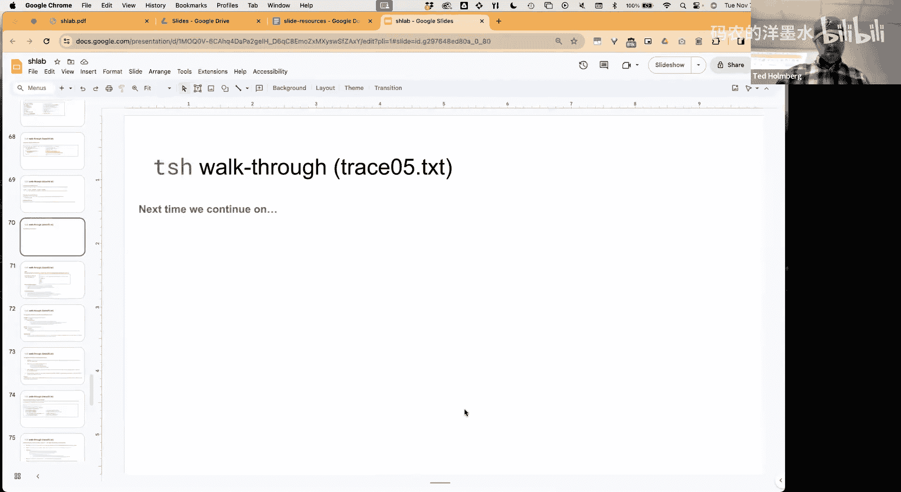

# C语言系统编程：22：Shell Lab Part 3


## 概述
在本节课中，我们将继续构建我们的简易Shell。我们将从上一节课结束的地方开始，学习如何执行外部命令、处理后台作业，并实现`jobs`内置命令。我们将通过完成`trace02`到`trace04`来逐步实现这些功能。

---

## 回顾与目标
上一节我们介绍了Shell Lab的基本框架，并实现了`quit`内置命令以通过`trace01`。本节中，我们来看看如何执行外部命令和处理后台作业，目标是完成`trace02`、`trace03`和`trace04`。

---

## 实现外部命令执行 (Trace 02)

### 目标分析
`trace02`要求我们的Shell能够执行一个前台命令（例如`/bin/ls`）多次。目前，我们的`eval`函数只能处理内置命令。我们需要扩展它以执行外部程序。

### 核心概念与系统调用
执行外部命令需要以下三个关键系统调用：
1.  **`fork()`**: 创建一个新的子进程。
    *   父进程获得子进程的PID。
    *   子进程获得返回值0。
    *   失败时返回-1。
2.  **`execv()`**: 在子进程中加载并运行新程序。
    *   原型：`int execv(const char *pathname, char *const argv[]);`
    *   成功时不返回，失败时返回-1。
3.  **`waitpid()`**: 父进程等待子进程结束（用于前台作业）。
    *   原型：`pid_t waitpid(pid_t pid, int *wstatus, int options);`

### 实现步骤
我们需要重构`eval`函数。以下是需要添加的逻辑流程：

1.  解析命令行，填充`argv`数组并判断是否为后台作业(`bg`)。
2.  检查命令是否为内置命令（目前只有`quit`）。如果是，执行并返回。
3.  如果不是内置命令，则需`fork`一个子进程。
    *   在子进程中，调用`execv`执行命令。
    *   在父进程中，如果这是前台作业(`!bg`)，则调用`waitpid`等待子进程结束。

以下是`eval`函数中需要添加的核心代码框架：

```c
pid_t pid = fork();
if (pid == 0) { // 子进程
    // 尝试执行命令
    if (execv(argv[0], argv) < 0) {
        printf("%s: Command not found\n", argv[0]);
        exit(0);
    }
}
// 父进程
else {
    if (!bg) { // 前台作业
        // 等待子进程
        waitfg(pid);
    }
    else { // 后台作业 (trace03处理)
        // ...
    }
}
```

同时，我们需要实现`waitfg`函数，它使用`waitpid`来等待指定的子进程：

```c
void waitfg(pid_t pid) {
    int status;
    waitpid(pid, &status, 0);
}
```

### 测试与验证
完成上述修改后，编译并运行Shell。输入`/bin/ls`，现在应该能正确列出目录内容，并且在命令执行完毕后，提示符会重新出现，等待下一条命令。运行测试脚本应能通过`trace02`。

---

## 处理后台作业 (Trace 03)

### 目标分析
`trace03`要求Shell能够执行一个后台作业（命令以`&`结尾）。后台作业启动后，Shell应立即打印作业信息并返回提示符，而不等待作业完成。

### 核心概念与辅助函数
Shell需要跟踪所有后台作业。我们使用提供的全局`jobs`数组和辅助函数：
*   **`addjob(struct job_t *jobs, pid_t pid, int state, const char *cmdline)`**: 将一个新作业添加到作业列表。
*   **`pid2jid(pid_t pid)`**: 将进程PID转换为更易读的作业ID(JID)。

### 实现步骤
在`eval`函数的父进程逻辑中，我们已区分了前台和后台作业。对于后台作业，我们需要：
1.  调用`addjob`将该作业添加到`jobs`列表，状态设为`BG`。
2.  打印作业信息，格式为：`[jid] (pid) cmdline`。

修改`eval`函数中处理后台作业的部分：

```c
else { // 父进程，后台作业
    // 将后台作业添加到作业列表
    addjob(jobs, pid, BG, cmdline);
    // 打印作业信息
    printf("[%d] (%d) %s", pid2jid(pid), pid, cmdline);
}
```

### 测试与验证
完成修改后，在Shell中输入`myspin 1 &`。你会立即看到类似`[1] (1234) myspin 1 &`的输出，并且提示符立刻返回。运行测试脚本应能通过`trace03`。

---

## 实现 `jobs` 内置命令 (Trace 04)

### 目标分析
`trace04`要求实现`jobs`内置命令，用于列出所有当前的后台和已停止的作业。

### 核心概念与辅助函数
我们将使用另一个辅助函数：
*   **`listjobs(struct job_t *jobs)`**: 遍历`jobs`数组并打印所有活动作业的详细信息（JID, PID, 状态，命令行）。

### 实现步骤
我们需要在`builtin_cmd`函数中添加对`jobs`命令的支持：
1.  使用`strcmp`检查`argv[0]`是否为`"jobs"`。
2.  如果是，则调用`listjobs(jobs)`打印作业列表，并返回1（表示是内置命令）。

修改`builtin_cmd`函数：

```c
int builtin_cmd(char **argv) {
    if (!strcmp(argv[0], "quit")) {
        exit(0);
    }
    else if (!strcmp(argv[0], "jobs")) { // 处理jobs命令
        listjobs(jobs);
        return 1;
    }
    return 0; // 不是内置命令
}
```

### 测试与验证
完成修改后，在Shell中依次输入：
1.  `myspin 2 &` （启动一个后台作业）
2.  `myspin 3 &` （启动另一个后台作业）
3.  `jobs` （列出作业）

你应该能看到两个运行中的后台作业被正确列出。运行测试脚本应能通过`trace04`。

---

## 总结
本节课中我们一起学习了Shell Lab的三个核心功能：
1.  **执行外部命令**：通过`fork`、`execv`和`waitpid`系统调用，使Shell能够运行非内置程序，并正确处理前台作业的等待。
2.  **处理后台作业**：通过`addjob`函数将后台作业记录到全局`jobs`列表，并立即向用户反馈作业信息，而不阻塞Shell。
3.  **实现`jobs`内置命令**：通过调用`listjobs`函数，使Shell能够查看当前所有后台作业的状态。



至此，我们已经完成了Shell Lab前20%的内容（共40分中的8分）。我们的Shell已经具备了基本的交互能力，可以执行命令、管理前后台作业。在后续的课程中，我们将继续实现更复杂的作业控制功能，如信号处理和前台/后台作业切换。