# 【全集】加州理工学院 C语言系统编程 中英字幕 p23 Lecture 23 - Shell Lab part4 -BV1bUzWBLEiC_p23-

Excellent， so last lecture。We have really been delving deep into。The Shell lab。

Walking through the implementation and talking about those system calls and those helper functions that motivate。

For us， what goes into building a shell？And so we kind of learn these new concepts as we。

Come to grips with having to implement implement a new feature into our tiny shell。

 so I do want to highlight that I think in one of my slides while I was converting my code into these these walkthroughs。

 there was a mistranslation error that didn't affect our traces。While we were testing。

 but they will affect us in future traces and I'll be honest I was beating my head against the wall using the because I wanted to walk through what we're going to do today and I have some test code I played around with and for some reason to the code we wrote in class just would not work with my tester code that I had built the slides off of it's because this function here we'll all have to go ahead and correct this this function to add a job we want to add a job regardless of if it's a foreground job or a background job to our job list right I had accidentally put that instruction inside of this else clause。

When we were first。Implementing this。So we don't want to do that。

We want to add every job to our job list that's going to cause an issue for us if we don't do that。

So make sure that this line of codeile I have to do it myself too。

But make sure that this happens before we check so it should be the first line inside of the parent process。

 we're going to add that job and then we're going to decide what to do if it's a background or foreground job。

So that could just be simple。Cut and paste。And I'm going to do that right now， so let me go here。

And again， for those in class， if y'all are also either on Discord or on zoom if anyone ask inside of the。

Inside of the。The channel， please let me know because I'll be for the most part。

 playing around inside this environment。Okay， let's see here， so we're in Shell labb let me。

Open up a terminal。Perfect， we have a terminal。 and let me also。

Let's go ahead and open up our shell web code Okay。

 so let me do that same change that I just said that you all had to do so that you can see exactly where this is happening at so I'm going to go back towards my eval function。

Right here。And we will。Cut this。Also what is going on here with my formatting it is all crazy。

 let's get our formatting under control。Okay， this is what I commented out last time。

 I'll leave that commented out。Not just remove entirely， but's get that there。Okay， let's get here。😔。

Here。Here。And let's move this here。Where belongs。Oops。Okay。

 perfect let's save that now and now let me jump to my terminal and make sure that everything is working and well pick up where we last left off。

 So if I go here and we compile so。PR code。Okay， up。V my。Here we go。Okay， let's see here。

Let's clear at this for a moment， GCC。😔，嗯 to you see that's see that's。Let's see， no such fire。

 where am I？嗯，是是是。我 search发。😔，Tin shell， I see。谢实。Where's my C code。Wait a second。

Where did my tiny shell go？that's not promising can I delete it。Well。Let's see here。😔，Okay。

 well let's just do this。So inside us。Inside of here， I have that there， okay， let's try this again。

Okay， somehow I must have accidentally deleted it， but for instance since it's open to my text editor。

 I can just res it。Okay， so let's suss this out。嗯，So we successfully got trace one。

We successfully have phase two。We successfully have trace three。Re successful I've traced for。

 and I think this is where we last left off， right？

And so good so now we see right at trace5 that's where we last left off perfect so let's clear out of this so we're right back where we started then。

We are close。And we'll just have open our code and our terminal perfect。Okay。

 so the first thing we want to do， let's go back to our slides then。

And let's go walk through or done Tra four。Okay， so that means we can move on to trace5 so if we're going move on to trace5 let's find out with a motivating feature for Tra5 is going to be so we can see here our goal is listed in the header comment of all of our trace files here it's going to be able to process jobs built built in command。

Before and after jobs finish so up to this point we only have the one building command is it quit is that right？

We haven't we haven't implemented any other built in commands yet for our shell。

 so this is the first time that we're going to build in another built in command that actually does something meaningful beyond just exiting out of our application。

So we can actually see what's going to happen if we look at the trace file。

 we can see we're going to call on that external application to my spin for one second in the background right at the percent and then we're going to do that again to have another background。

Process for three seconds and then we're going to call jobs， which should list the set of jobs。

Then we're going to go ahead and sleep for two seconds and call jobs again。

And then we're going to sleep for two seconds and then call jobs again let's see what the expected behavior is going to be in fact。

 we can actually look at the。You can actually look at the expected behavior I think I improved these in a moment。

 so let's let's just jump into here and we'll actually examine it so let's do make。Our test five。

And here。There we go， Okay， so we can see。We have。The call to My spin one and My spin three。

And then we could see when we call jobs， it's then going to report what jobs are currently roing。

At each of those instances， let's compare this output to what our output from our application is that should be quite evident what it's going to be because we don't have a jobs command。

 but we're going to do it in any way。Oh， we didnt implement jobs。Oh yeah， me too。

We must have done that as four， is that what the last thing we did was？However。

 we can see that there's an issue with our output。So yeah I think actually jobsbs was the Tra4 that we implemented。

 but clearly something isn't working for us correctly right you can see that we are properly spinning up that background process that's the first piece of output that we see when we invoke that。

 remember that prints message to the screen， we're doing the appropriate thing on the second and then what's happening here is look at all this right here running。

 running， running， running， running， running。Whereas here so we're。

Looks like we're double printing is everyone else getting the same thing？Okay。

 and let's see here and let's see what this says here so our observed behavior is the My spin command starts as expected。

 but the jobs command output does not reflect the current jobs statuses correctly listing the jobs as running that should have completed。

Okay， let's talk a little bit with this one in terms of our Uni signals because this is the first time we're really going to start delving into signal handling from our shell。

So signals are a form of inner process communication in UniX systems that are asynchronous notifications that are sent from a process to inform of various events that can occur so these next couple of traces are really going to have us start exploring the signals and how we can capture the signals and do things in response to signals。

So there are various types of signals such as the interrupt signal， they have the kill signal。

 they have the child process signal in terms of default actions these signal has a default action associated with it which could be used to terminate a process ignore the signal or catch catches to perform a specific function so we have custom handlers that are defined inside of our tiny shell and in fact those are things that will have the implement if I go down past the core set of functions you'll see they have some signal handler functions。

Right here， but right now they're completely left blank right I have a SG child handler which is simply just stubed out with a return statement Sig int handler and our our stop signal handler as well so our interrupt our child process and our stop signal handlers so we're going to have to start exploring these I think in order to start accomplishing this next trace。

So of course。The purpose of this trace really and the ones that are coming forward is for us to start getting a better understanding of these unique signals so that we can build our shell in a way that allows us to manage our processes and have a concurrent sets of processes going at on time。

 but also manage the state of what those processes are inside of our jobs list。Okay。

 so let's take and examine some of the code that's given to us so again as we implement our source code it behooves us to examine some of the helper functions and some of the data structures that are provided So one of these is the signal function。

 which is a wrapper for the SG action system call it's a setting a signal handler for a specific signal and ensuring that interrupted system calls or restarted returning the previous signal handler so here you can see we have。

This data structure that we will go ahead and utilize。

And so just to give you an idea of what signal is wrappper class4， again， the there's a system。

Call SG action。Which takes the form of this usage now we don't have to use this directly because signal is wrapping。

Around this implementation， but this just gives you a little bit of information about what the underlying implementation is from the system level and again a good purpose of what the slide intends to motivate is that SIG action provides a comprehensive and reliable mechanism for our signal systems and we're wrapping around that。

Which is and then this code right here is actually in your tiny shelf now why am I emphasizing this this so much because if we go into the very beginning I know normally highlighted code is changes。

 this is just to highlight what we're actually going to look at for this implementation so if we look at the very beginning of the main function we can see that。

These signal。The wrappper class is actually being utilized in the very beginning of our main function to bind certain signals。

That couldn't occur inside of our shell with a callback function。

 which is going to be our specialized signal handler。 So the idea is the reason why we implement。

Our code to handle a signal in these functions is because we're binding this callback function towards getting invoked whenever that signal occurs。

 so that makes sense。😡，Okay， just making sure everyone kind of understands what the concept of a callback function is and what this code is doing and again。

 just to highlight where this code is in particular inside of our actual code base。

 if I was to scroll down。Towards my。Here we go。So if I scroll down to my main function。

 I can see right here， this is where we install all of our signal handlers。Right here。

So these callback functions are being set up by that wrappper class。

 which is now doing that binding so we can create custom signal handling okay。

So the idea is that as we keep exploring this， we understand more and more of what the code that's provided for us is doing。

 it's going to be important if we're going to successfully implement the parts that are missing。Okay。

 so the particular。Signal we're most interested in。

For this implementation for this trace is going to be our SG child in She so SIG childild is the signal that's sent to a apparent process whenever a child process terminates。

 stops or continues right now that signal is being triggered。

 but we're not doing anything in response to it and since we're not doing anything in response to it。

 we're getting the duplicated printnoun。😡，His we're not updating what's happening inside of our jobs list effectively。

Okay， so obviously the purpose of our Sign childil handler then is it's designed to catch and respond to the SG child signals allowing the shell to update the job list and state our information correctly。

😡，So of course， the functionality we're going to care about is when it's invoked is typically going to use something like a weight function to fetch the term the determination termination status to the child process that has changed state。

 ensuring that the shell's job list accurately reflects the current state of the background or the foreground。

 which is what we're not doing yet。Okay， so let's move on。Okay。

 so what is the process by which we're going to implement well we need to check for each shell process that there is。

 we need to get the status of that child process without blocking if no child has existed。😡。

Check whether a child process has changed state and if a child process was terminated by a signal or exited normally remove the job from the list。

 let's just do let's focus on this， we're not worrying about termination it's just say if it exited normally。

😡，We'll worry about termination due to a signal like an interrupt signal for a future。😡，Tras。

 so i'm going to edit that just to say we already care about whether we've exited normally or not。

Okay， so with that said， here are some， and you know what， let me do this。唔见来。到了。Yeah。

 I'm going to cut that。Going to duplicate this in real time。We're going to paste this here， okay。

Okay。Try to。Delutter some of these slides Okay， so we know what the general purpose of what we're going to do in our Sig child handler function in terms of pseudoK。

😡，So obviously the new actions that we're going to do are going to line up nicely with our pseudo code so inside of our SG child handler function。

 we're going to do the weight P function。To check the status of a child process and then the status is going to be determined based off of。

How that process， whether it ended or not。And if the process did end then we are going to call a helper function deletete Jo。

Which will then remove that process from our jobless。

And so if this loop should continue for any additional trial process that might have changed state。

So the key system functions we care about here are going to be weight P which suspends the execution of the calling process until a child specified by our process ID argument has changed state and then we also have this macro。

That checks the exited state。😡，Of our child process itll return true or false whether well it is true or false that it exited or not and then one of the key helper functions that's built into our source code file that we can make use of is a delete job function that's going to delete a job based off of a PI now let's just look through very briefly each of those critical system calls or helper functions that we might care about so weight PI we could see the purpose that we're going to use at least in our cell development is to wait and gather the exit status of a child process。

And so。Here we can pass in a status and it's going to return true or false on whether。😡。

The status that was applied to us。😡，Is consistent with this use case so here a non zero value of the child terminated normally。

😡，Such as calling to exit or whatnot， just because it got complete to its main function and it would be false otherwise。

😡，Okay， so with that said。We also have the delete jobs function。

 this isn't something that we have to implement ourselves。

 but it's good to know what it does so we can see here that it'll iterate through our job list to find and remove a job with a given process ID updating the next job ID if successful so this will allow us to now remove jobs that are complete。

Okay， so with all that said， what is the actual implementation so recall we already have a S child handler function。

 what we're going to want to do is implement it in the following way。

So we're going to start by setting up the data that we might need for this particular function to operate so we'll need a childP we need to track the status。

 which we'll provide a reference to and then it'll get updated so that we can check it。😡。

In future checks of our function call and then finally this is our who control variable do we have another child has next child effectively to step through to iterate through this process so while we have more children process we're going to do the following we're going to go ahead and wait for that child。

States of change and gra status， so now we will now have that PI。😡。

Then we'll check to see if there are more children processes after this one。

 so if our child pit is greater than zero， then that means there's going to be more processes。

So then we'll set our loop control variable based off of that has next to determine whether we're going to do another iteration of this loop。

And then we're going to start responding to the status on so we're going to call that macro。

 if it exit normal， we're going to give it that status， and if it's true that it exited normal。

 then we're going to delete that job using that helper function from the job list。😡。

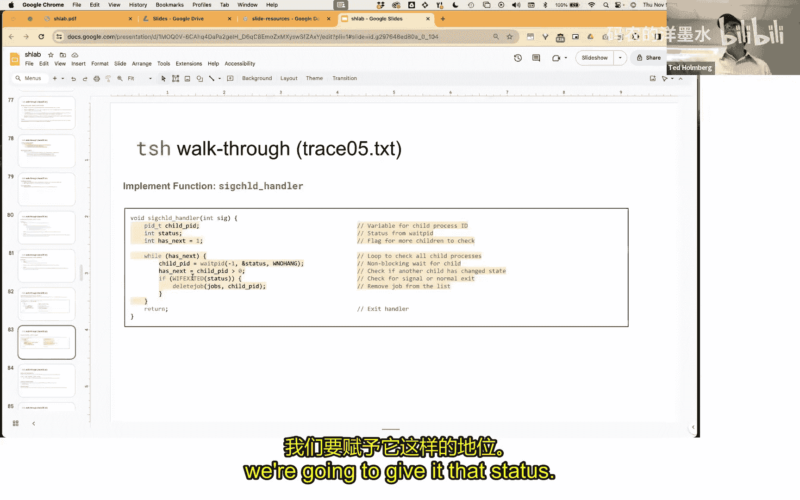

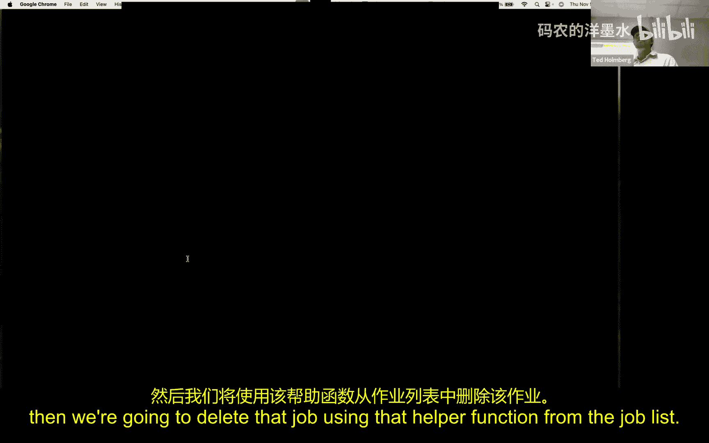

Is this pretty understandable in terms of what this is doing， what system calls it's making？😡，那搞。

Well， let me implement it as well， so let me jump over here。And。So I'm going to go to。

Where my signal handlers are at。That's right here in particular， we're going to do the。

Signal handlers for the child process。And we can read the description。

 I don't know if I formally did that， let's read the description so we know in the future what the role and responsibility of Sig child handler is so the colonel sends a Sig child to the shell whenever a child job terminates becomes a zombie or stops because it receive a Sig stop or a Sig stop signal。

The handler reaps all availables on the children， but doesn't wait for any other currently running children to terminate。

So that is the role of this particular function。OkaySo let's start with the data that we will need over the course of the function of the life cycle dysfunction so here。

We will have a child head。Here we will have a status。

And here we will create a loop control variable that we'll just call has next。

 and we will initialize it to one。Okay， so while。Another thing that you'll see。

I'm pretty fanatical about loop control variables and I hate having expressions inside the body of the evaluation of where loops occur at I like readable variable names that get updated inside the body。

 I think it' it's integral to readable code literary code。Okay， first。

 let's go ahead and get that child P。So oops， what is going on here。Okay， so our child。

 we're going to make that call to that system， that system called。To wait Pi。

And here we're going to supply it with the arguments of minus one。

The address of our status variable and for this instance， we will do。No hang。

We'll update that with untraraced as well when we get to the interrupt signals。

 otherwise that's kind of calls us an issue， but I do like to see when those issues crop up that way it motivates when we have to add in new logics for things that we're trying to behaviors we're trying to capture with our shell so I try to be bare minimal mode with each step to try to identify what we then have to add because it results in erroneous behavior。

Okay， so that should grab us that child process， then based off of that。

 we can determine the new state of our has NA our loop control variable。

 so on the instance that our child pit is greater than zero we'll determine whether we're going to loop over again。

And then what we'll do is if。Now we're going to check。This exit state。

 and this is going to require the status to be passed。 So if that is true that this exit normally。

 then I want to do。In response to that。What is expected？So in this instance， it's to remove that job。

So we have that helper function delete job。And so inside a delete job， we pass it our jobs list。

 we pass and we pass it the child。Hid。To go ahead and do that。Excellent， so let me save that。

So now let me jump over here。It's clear this， yeah， it's clear this。

And the first thing I'm going to do is which。Go ahead and recompile our code and let's do this is fate。

 we're on Trace5， right？So let's see what I reference， oh yeah， let's see。Okay。

 and now let's also do a reference to compare the output。Okay。

 this looks much better right we've now successfully managed deleting the jobs after they've normally exited so now our reference shell and our implementation are online so let's double check but that we're done with this trace by just running our。

Check。So we've successfully completed trace one， we've successfully completed trace two。

 we've successfully completed trace three， we've successfully completed trace four。Hopefully yeah。

 there we go。We successfully completed Tra five。Fingers crossed。有。😊。

And now we should fail at Tracept。Perfect。That's exactly what we want。

 We always want to be failing at the next trace because we didn't intend to implement。Ahead of time。

 right， we're purposely minimally implementing to motivate what the new code is。😡。

That our shell is going to require to manage those new responsibilities。

So let's jump here and so we can see we've successfully done this， we've verified our implementation。

 so let's move on to Tra six， so in Tra six。What is going to be the new thing we're going to try to do well。

 we're going to try to run two background jobs and two foreground jobs。

So we can see if we look at what the tester is going to try to do。

 it's going to invo it's going to execute that my spin program for four seconds in the background。

 then it's going to go ahead and call LS。So as a foreground process and then it's going to do my ST for two seconds as a background process。

 then it's going to call LS again as a foreground process， then we're going to call jobs。

Then we're going to sleep for five seconds and call jobs again， and finally we're going to quit。

So let's take a look， yeah， this is where I think。The slides get better at us being able to evaluate between the expected behavior and the observed behavior。

 so i'm going to run this in the terminal， but what we should highlight is that with our expected behavior we're going to get the echo the description of our trace six。

We're going to get。A message that job one with some P has initiated。

 then we'll get the output from our LS so it's going to just spam our screen with all sorts of file names。

 then we're going to get a message that job two。😡，Has initiated then we're going to get a second output from our call to LS which is going to just spam our console with all sorts of directory names and file names then finally we're going to get status to job one and two display now jobs one and two right those are going to be our background jobs see how job one and two what we're going to see in our observed behavior and the current implementation that we have is we're going to get the description of our tracece that's fine that means that's working as as anticipated we're going to get the initiation of job one okay so far that's the same but then we're going to go and output from our bin that's fine too that's what we should have then we're going to do an initiation of job three I mean of job three which notice it's labeled as three and not two。

So that that's going to be distinguishing different things because dont have we don't care about pigs。

 but we do care about job Is。So that's already a difference then we're going to do our second output of Ls which is going to be the same and so here let me actually one thing I should do then is I should highlight the things that are different just。

So that is different and this last。But when we go and run this。

 we're going to see he's going to nope， don't do that it。this one。Okay， perfect。

Then it's going to display the status for our jobs and it's going to show four jobs it's going to show the foreground jobs and the background jobs we don't want that。

😡，We one those display just the background jobs so let's let's take a look let's see and just do that comparison like I said。

 so i'm going to make the reference test and this is test six。

So that's the echo of our comments description。and now let me scroll up so we can actually really see and then we see okay yeah then we see job one right the background job and then the display from Ls and then we could see here。

Job two， background job and then LS。And then we can see。That job one and job two。

A part of the jobs output put okay， let's compare that with what I said。Our current output should do。

 so we have the echo。And we have job one， we have the LS so far， this is the same。

But now notice here， yeah， instead of being job two。

 this is labeled this job three so that's a big difference then we have our LS。

And then this is the biggest output is showing all the different jobs。😡，Foregrounds and backgrounds。

Okay， so now we have a clue as to what has to update something isn't quite right with the way our jobs command is working。

 so we're going to have to refactor that， we're going to have to fix that。😡，Okay。

 so what we're going to have to do is。What we had done previously。

 I want to say way back in my trace two， we had implemented。😡。

The weight for foreground process to be very simple。

 it just waited for that one basic process to return back。

And and we just use weight pit on that and so weight pit is a let's say。

It's a blocking call and it's fine it's fine for when we do signal management stuff。

 but we're going to want to do something a little bit differently we're the problem is。

When we called weight Pi we didn't do anything with the jobs list right the jobs list was this abstract thing we're just like what is a good way for us to pause for the foreground process to finish terminating before we go ahead and return control back to our application because remember if weight fG was used so that。

😡，Our show wouldn't display the prompt before。Displaying Ls do you remember how that was an issue way back in Tra two and we just did a very simple easy implementation well now we have to think deeper about this now when we're waiting for the foreground process to complete。

We should update our job list or we should wait on our job list or we should be more consistent with our job list accuracy。

Because the job list is how all of our helper functions are maintaining what's running。

 what's stopped， right we're going to track that inside of our job structures。😡，So。

What we're going to do is。We're going to。Update weight FG to retrieve a job using its PI from the jobs list。

😡，And so we want to evaluate in our jobs list， what is the foreground job。

 we're going to exit if there's no corresponding job， but if there is a foreground job。

 we're going to use sleep to implement a non blocklocking wait for it。😡，So just some key features。

 we're going to use system call， sleep， which is temporarily suspends the current process enabling other process to execute。

 and we're going to use a helper function that's given to us inside of our tiny shell code。

 get jobb PID， which is going to find a job by the PI on our jobless。So this is just the。

APpiI effectively for our system call of sleep， the big thing here you can see we can pass it some number of seconds of will return zero if the specified time has elapsed or the number of seconds left to sleep。

In our development sleep is going to be used to pause the execution of our program for a specific duration。

While we wait for our process management to go ahead and do what it needs to do so again I just want to reiterate and examine what a job looks like so recall that a job has a P a job has a JD a job has a state which what we're interested in is it a background job is a foreground job is a stop job。

Is it on defined job， and then we also have the command line。And so get job hit then is。

Given our jobs list and given a P， it will。Search that array。😡，And return back。

The job from the job list that matches that pay。Yeah。Okay， so with that said。

 setting up the helper functions we're going to care about。

 setting up the system calls we're going to care about。

 let's see how we can reauthor our weight FG function to be more compliant with managing multiple jobs at a time so that we don't just hoard jobs without doing things in result to that。

So the first thing I'm going to do is I'm going to。Grab。

TheI'm going to get past a Pd I'm going to use that PId to grab a job from the job list if。😡。

There's no job I'm just going to return out。If a job doesn't exist we're just we're done if a job does exist。

 that means that I can access its P and if it's equal and if the state of that job is a foreground job。

 then I'm going to tell the system to sleep and I'm going to help to keep doing that until that job has been completed。

😡，So here I'm actually going to wait。😡，Where we weren't actually doing waiting before。Not like this。

 with not where we can actually start iterating through the job list before it was just whatever the last process was。

This allows us to start managing multiple processes。

 which is a course or multiple foreground processes。

 which of course is the point of this particular trace。Okay， let's implement this and see。

So let me go into my。So it's going to be up。Here it's right here。

 so this is my current implementation， so I'm going to go ahead and that worked for trace2。

 but now it's time to refactor。我想。Okay， let's see here。Let's go ahead and get ourselves。No。Okay。

 perfect。And。Get。Job P。And inside there， we're going to pass in our jobs list。

And we're going to pass in our PId。And then we're going to check if。You don't have a job。

We're just going to return。And of course there's many ways I could have done this。

 I got to check for his existence and done the while loop， this is fine。And then。

If we got it this far， then that means we do have a job and naked buy we a body here。So from my job。

 I want to access it's。Pid and I want to see if it's equal to the PID that was matched in。

 so while that's true and on this job I want to access its state and if its state is equal to a foreground state。

Then I want to sleep。Excellent， okay， let's jump here。屌得 out。Okay， let's。Ipile this， oops。

 whats what I do here？Wight FG， am I missing？Yeah。Okay， let me just look at the instruction。😔，Okay。

 let's see here。Oh。Se meical。Okay， perfect。And now let's go ahead and check our output。

 so I'm going to do make on test six。And so here we'll have to scroll up just to confirm that。

Is what we would want it to be， oh， I can already see that the tail end looks fine。

So just based off of that， why don't we just run the checker？And so we passed trace one。

We pass race two。We pass race three。We past race four。Yeah， got to tray six， okay， so the next one。

 we should fail and trace seven。Excellent。Okay， so notice here。

Let's move on then we are happy that we got through a trace。

So let's see what the next piece of functionality is， oh let me see some of the messages too。Oh yeah。

 you bring up a good point。So I'll probably supplement some slides with with some of the concepts that。

I'm trying to add in all the slides as it motivates。

 but yeah I might clearly miss some such as these concepts with with no hang or with untraraced or whatnot so as that comes up i'll probably supplement with the slides and I actually have to get these slides too as well so everyone has access to these slides。

Thank you， thank you for that comment。Okay， let's see here。Let's see the next trace。

 if we go and examine what the comment says is we want to go ahead and forward。

A interrupt signal to our forward right。 So right now。

 you can see this is relatively simple in terms of what we're doing。 We're going to set up a。

Are a call to my spin。As a foreground process for four seconds。

Then we will sleep for two seconds and then we will interrupt。

That foreground process was terminated right and in fact， let's see what happens。

With the expected behavior， we'll actually test to see what ends up happening there。

So we can see if we make our reference test， it's going to have。

Two pieces of output from the reference shell is going to echo that header comment and it's going to say job one with some PID number was terminated by signal two。

And so if we go and try to make it with our current implementation of our shell。

 it's just going to echo the headercoma because we're not handling interrupt signals at all right。

 this is a empty return statement。So just to verify that this is where we're at。

 let's make our test seven。Yep， and now let's remove the R for reference so it actually just just tells stars and we can see yeah it's just that trace7 notice it took a little longer to complete because we had to wait before seconds for our application to run to completion before we finally。

came out。Whereas this after two seconds of sleeping， it automatically interrupted it。So。

What is the general process by which we can go ahead and。

Capture that interrupt signal well we have to implement our interrupt signal handler our Sig handler。

 so effectively what we want to do is we want to retrieve the process ID of the current foreground job from the job list。

And if a foreground job exists， we want to use the kill function。😡。

To send a sick in signal to terminate it。So some new actions for。This particular trace。

 which is trace7， is to implement our Signigant handler to correctly handle the signigant signal。

To terminate our foreground process and again， another way to send this interrupt signal from the keyboard would be like hitting control sheet。

Okay， so just some highlights on the functions that we're going to use for our implementation in terms of system functions。

 we're going to use the kill function， but that's going to send a signal to a process or a group of processes。

 typically use to terminate or otherwise signal processes。

 and we also have helper function FGPD foreground P which is going to retrieve the PiI of the current foreground process or zero if there's no foreground processes。

So again， just to take a quick look。And we can see that in order to call kill。

 we have to supply it with a PID and a integer， which is a signal。

 the type of signal that we're sending， we're going to see we're going to use the kill function multiple times。

 but we're going to send it different signals， and we're going to handle those signals differently。

And it's going to return either a zero or a minus1， zero is a success minus one is some error。

So again， the reason why we care about kale is it's used to send signals to processes。

 which can instruct them to either stop or continue or terminate depending on what the action is。

So we're generating those with our signal handler， which will then be responded by our child。

 our SG childil handler， which will then capture that signal evaluated and then report to the user and update the state of our jobs list。

So all of the management of the jobs will actually be done so that's going to become a relatively big function。

Okay， so。So this is just one of the helper functions。

 this is the foreground P we can see it's what it does is it just iterates with the jobless to find and return the process I。

 but I always think it's beneficial just for you to actually tangibly see these helper functions that we're going to make calls to。

Okay， so what's the implementation that we're going to use for our Sig int handler？Well。

 the first thing we're going to do is make a call to that helper function。

So we're going to pass at the global variable of our jobs list。

And it's going to return back to us a Pd。Which is remember it's zero if there's no foraround process。

 it's non zero is it'll be some positive job number because we start counting up at one right when we've seen our job list。

So if our P is greater than zero。😡，Then we're going to go ahead and we're going to kill it。

Now notice we're doing something we're going to call that kill function。

 now notice we're doing something pretty interesting here with this kill Ill call we we're prefacing it with a minus sign。

And that's because we can use the kill function。To signal an entire group of processes。😡。

When we use a negative value。And that's what we're going to want to do。

 We're going to want to go ahead， and。We're going to see well I'm actually going to play around to show you what happens if we do it just for the PID directly or whether it's a process group。

 but the appropriate way to do this is to do a process group。

 but then we have to define a process group。Which we will have will update our eval function to do we haven't done that because we weren't doing any signal handling。

 but now that we're talking about signal handling， typically it's better to do it with our groups of processes instead of our individual processes。

😡，So this is this is one thing and again， the idea is we'll play around see what the behaviors are so you don't the。

Not get through this trace without doing that some'm interacting and then here we also are going to use sickint as the state of what we're going to pass。

So let me actually go in here and implement this。So I'm going to go into here Sig and。

It grab that and if。The PI is greater than zero。We're going to call that kill function on the negative value pig。

And with。They。Excellent。Now， potentially I could also put。I'm not supposed to。

 but just to illustrate how the flow of all this is working。

 I'm going to put a test comment in here just so you can sit， so I'm going to do this。😡。

But this isn't going to stay here， this is for testing abilities because this isn't really the responsibility of the interrupt handler。

 but I'm going to put a flush print。Forat it， call。

 I'm flushing it because when we're handling the signals。

 we want to flush the buffer to ensure that it actually prints out。😡，So since I'm going to do this。

 I'm going to go ahead and pass it。What I'm flushing to， standard out。

I'm going to pass it the formatted string so let me do something like job。Percent D。Let's say。

So that's my job number， that's my process number and comment， something like。Terminate it。Bye。

Signal， and then I'll do percent D and new line character and let us pass in this hi to Jid and then pass it in our Pd。

Let's pass it in our。Hid and let's pass it in the sG。

 which is our parameter here I gets' past S here。 Okay。

 let's just see what happens when I do this and actually what happens if I leave this minus sign out right now too let's just say。

I'm going to jump on over here， clear this。Okay， let's。Go ahead and make。Our test seven。Okay。

And clearly， we're just hanging。Knocking any printouts。Okay。So the next thing we're going to do。

Let's return this back。And let's jump here so what else do we have to do。

 we have to go ahead and we have to update the signal child handler。Which。I will do， but let me。

Let's jump back to this， we're going to jump back to this one really quick。

 I want to jump to having to update our eval。Okay， so we had mentioned that。

In order for us to go ahead and。Set the child process to a new process group so that we can handle our signals appropriately inside of our eval function。

 what we want to do is call this system function set P。G ID， that's our process group ID D。

Whi requires a PI and a process group ID number， so what we're going to do here is in order to set this up is we're going to update one line of code inside of our eval function we're going to call set PG ID our process group ID on our child process which when we go in four is going to be zero and then we're going to make a process group zero。

So I'm going to see that too。Okay， so inside of。Wherein I want to guarantee that my P is equal to zero in this instance。

 we're going to go ahead and call that set。PG IDD and the two parameters I'm going to set are zero and zero。

We save that。Just out of curiosity， let's see what happens if we。Go ahead and。Tryed to call that now。

关系嗯嗯。Still hanging。It's clear this。😔，Also， let's go here。😔，二的。And then make sure that。Okay。

 so ear sets。So yeah， that looks good。And here we have。Oh it's falling。

And here we have here perfect sig handler， okay， we're going to update this in just a moment。

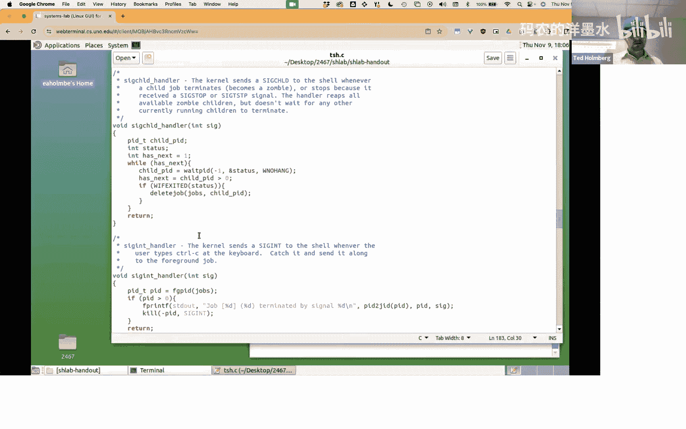

And here we are。Plling our P， thus if pig is greater than zero。

 we're going to go ahead and kill that。

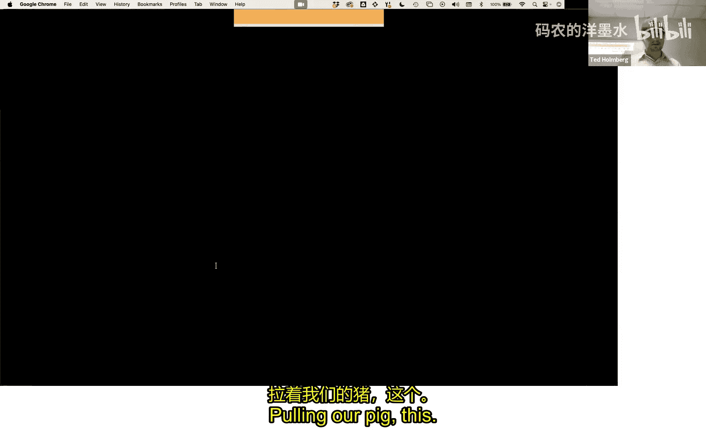

O。The next thing I want to do。怎么。That's perfect， let's finish implementing what we want。😔。

Which say though， I want to make sure that。I make sure that everything is working on to this point。嗯。

Sigant。Kid。Percent the。Your line。Here let me plastic P。Save that。嗯嗯。Okay， oops。

 I got to put standard out。And forget my stream on which to bind that too。Okay， from that string。嗯。

Its fun to me。😔，Hello。Here。Okay。There you go。All right， you know what？No' on here。

Let's find there there。😔，Begning。Job I should be getting a ping there， though。

We can finish implementing this in just a moment。嗯。That be nice。Some check。😔，Well Ill find this。

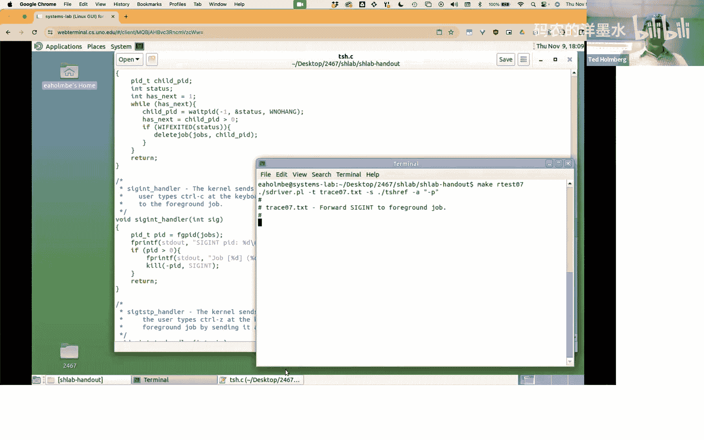

perfecterfect。

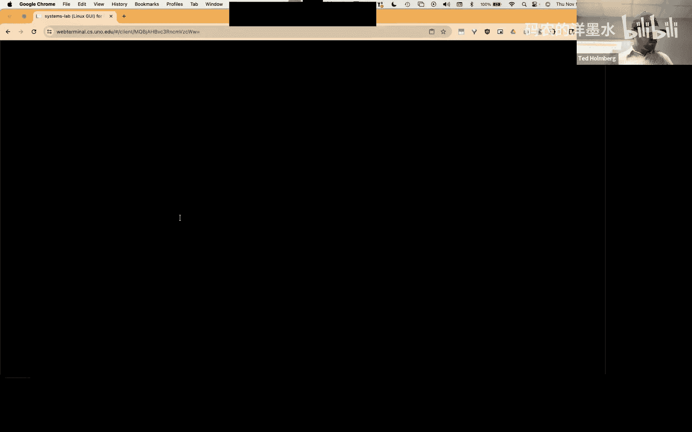

So let me go to my child process that will finish IotT supplementation。

 but we might be doing a little bit of debuggggging。

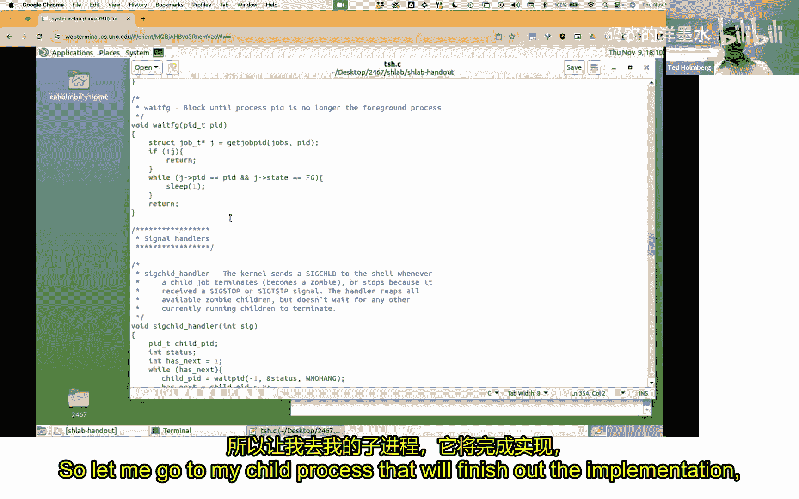

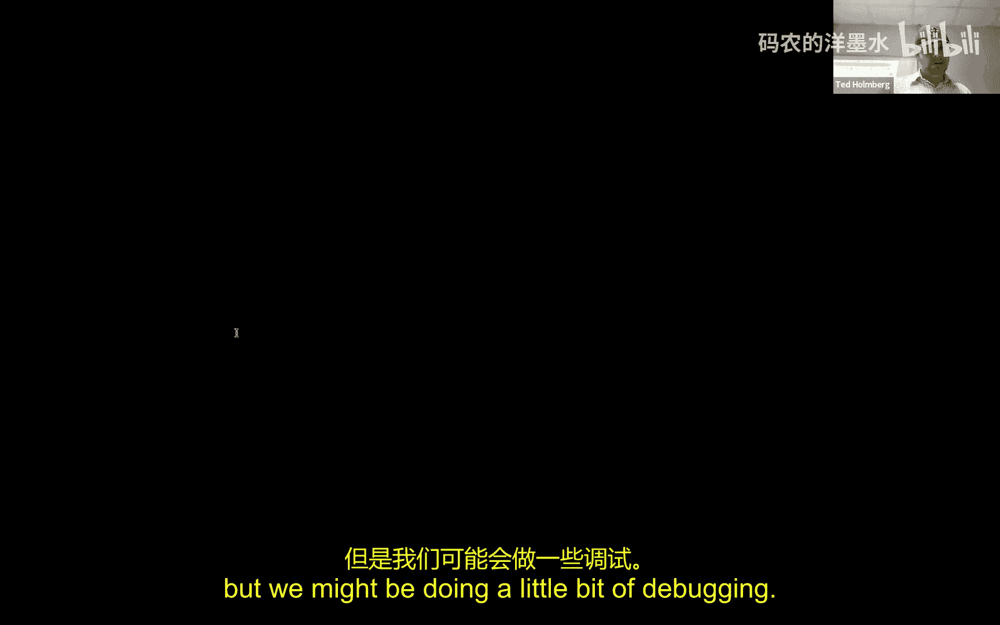

CPG and。But I do want to get through the final implementation before we get through。Oh。

 you got to go backwards。Okay， so let's go here。So I skipped ahead a little bit to we first looked at our SG in handler。

And。I want to show just doing some basic printouts， but we'll take a look at that in just a moment。

And the next thing is we state that that is actually going to be the child。

 the signal child processor that's going to be responsible for monitoring the changes for the state and the child processes。

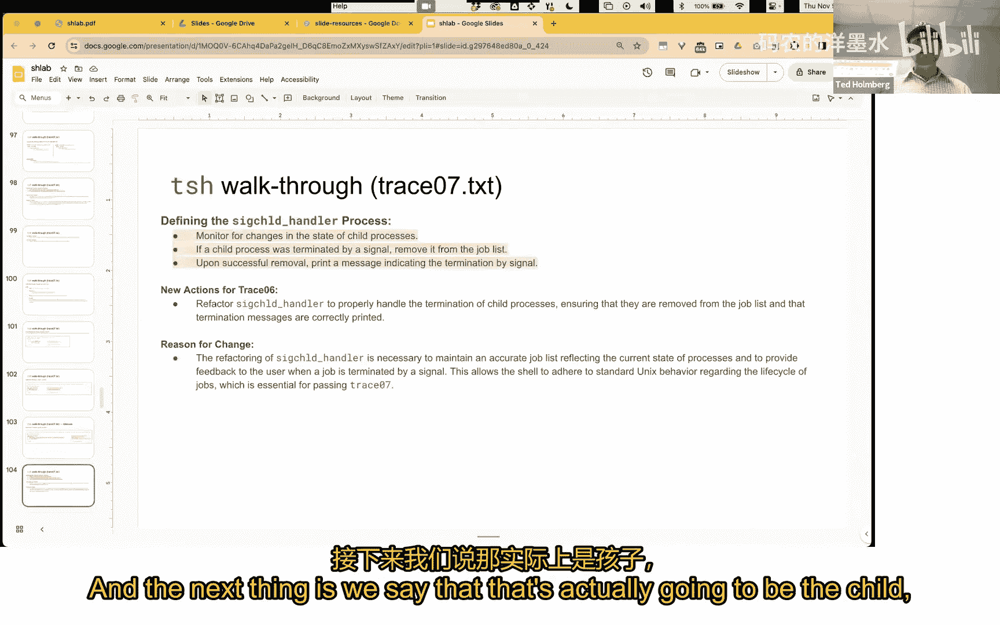

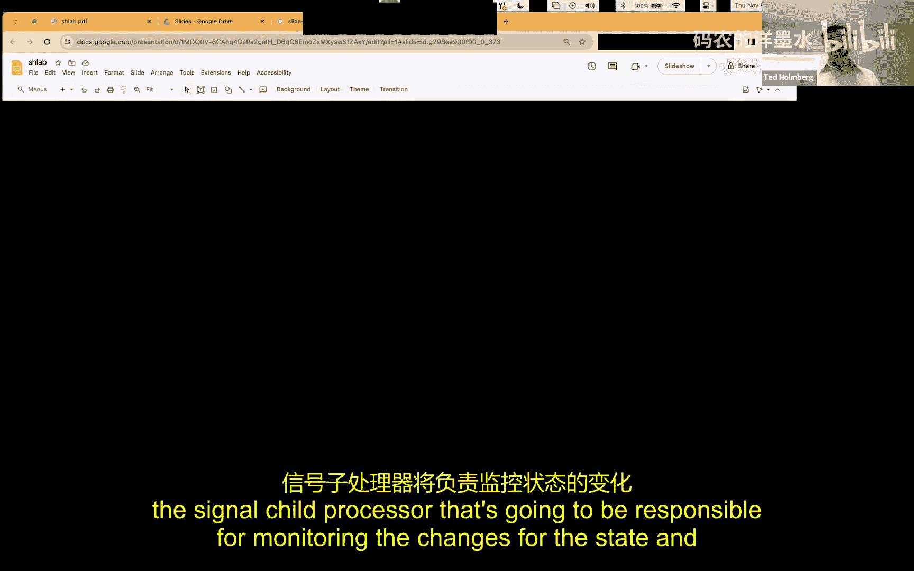

So if the child process was say， for instance， terminated by signal or removed it from the list。

 then we want to do something response to that。So this is going to be a function that's going to grow so we're going to see were going to have this macro that returns true if our child process terminated because the signal was not caught and then this macro is going to return the signal number that caused the child process to terminate so that's going to allow us to get the display we want and again the helper functions we're going to need are going to be the delete job and then this PD to JD function call that converts our process ID to a job ID。

These are just the macros。And this is the delete job which we've seen already。

 so let's do this one last implementation。And so in this implementation。

 you can just see we've already checked to see if we've exited the status。

And if it was a normal exit， then we delete the job， if it wasn't a normal exit。

 if it was a signaled exit from like say for instance， control C。

 then the first thing we're going to do is we're going to grab the job ID。

 and then we're going to try to delete the job on a success。

 we're going to try to print that statement and the savings's going to print with the JI， the PID。

 and then we're going to use this macro that we can send it and the status we're giving that's going to give us the signal number for it。

I'Let me actually implement this。Let we go， see inside of here。Yeah。If。We have our。Okay。

 so on this instance that we are。Got the signal for an interrupt。Then I want to grab though。

Child J and I can grab that with。Hid to Jid， we're going to pass it in that child Pd。

Then I'm going to go ahead and grab the success。On the attempt to delete job。

And here I'm going to pass it in the。Jobs list and then the child Pd。And then here。

 if it was successful。嗯。If it was a success， then I'm going to do this F print F。Standard out。

 actually， let me just copy。This over here since I already had done this once before。

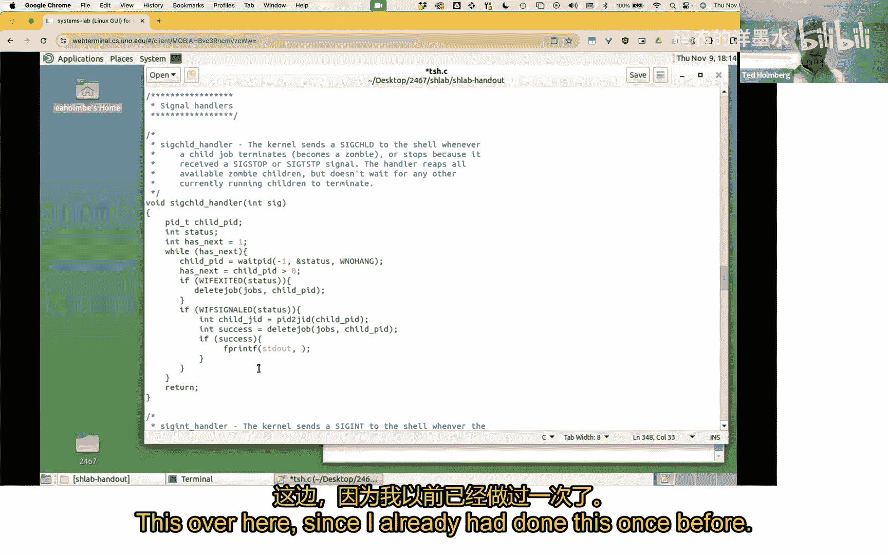

Let us go ahead and effectively prompt this out。

Now the differences is this will be。My child。Jid。This will be my。Child head。And this here will be my。

tererminate。Signal。And then I'll pass it in my status。Okay， perfect， let's save this。I don't know。

 council。Let's go ahead on save。Comment out this line， don't need that。Okay。

 and then I already have where I'm trying to do this process group here。

Trying to grab that foreground job that looks fine to me。

And let me just double check to make sure that I did set up my process group by day inside my EVO。

 so it's， that's process group by day that's going to show everything's safe。And let's just see if。

We can compile。😔，Oops。Going to need to。Correct that。欢回欢。Okay， let's see here。Right there。Status。

Okay can let save that。Jump here。我。Let's see if I'll have luck。I don't think。Oh， there we go。

So at this point， and this is where it gets really weird。

There's no way for us to get through trace eight without getting through Tra seven。

So if I just want to show you this before we call it a day on Tra8 it's going to try to do the forward signal only to the foreground job。

 but we had to do it to a foreground job to begin with so I couldn't think of a way to isolate these two together so once we're on trace seven we should actually be on Tra8 but we're going to confirm that right now by just checking our tiny shell。

So we get two points for trace one two points for trace two two points for trace three if you can find a nonhay way for you to get trace seven。

 but not trace8 let me know and i'll update the slides with the different implementation like I can force it by just like grabbing the zeroth index of the jobs list but that's a very hacky non like that's me implementing to break it not to do a naive implementation that i'm going to grow in in。

And capabilities we could see， I didn't quite get what I wanted here。诶愿。

with the said process group by Jane， yeah yeah that's right yes， yes。

And I was double checking to make sure that I had put it in my eVval function and I'll double check。

 but I'm out of time today， we will circle back and relook at the code。

 make sure everything is working as it should be checked to make sure your string it matches exactly though because that's what's essentially just matching to the string that's coming from our output。

 but we'll pick back up at the tail end of trace 7 once we're done trace7 we should be done with trace8 as well。

 which would put us about 40% through the shell lab right that because there's only 20 traces excellent I will see you all next Tuesday。

It's on the the chat。

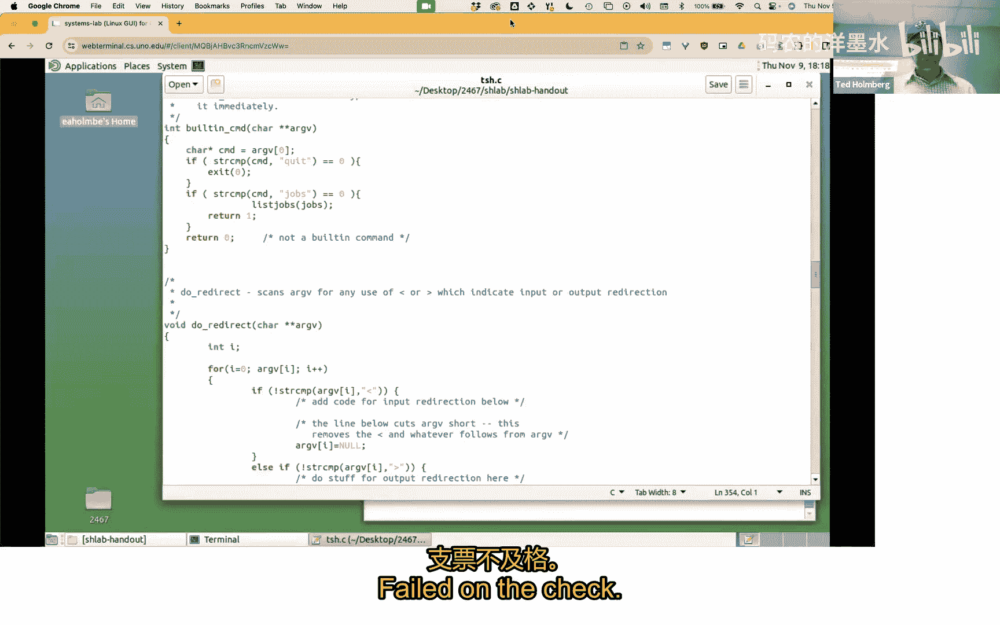

Yes， yeah， I think it's a string error， I think I just didn't get my string error。

