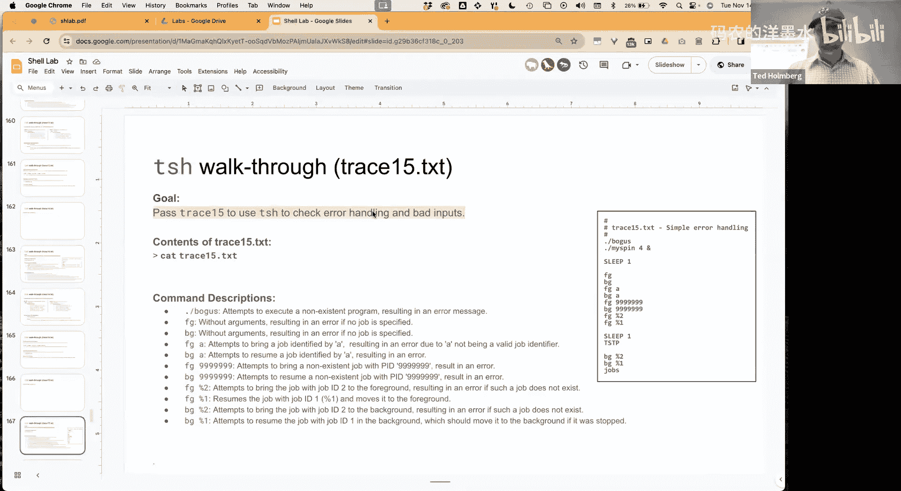

# 【全集】加州理工学院 C语言系统编程 中英字幕 p24 Lecture 24 - Shell Lab part5 -BV1bUzWBLEiC_p24-

Perfect。

Okay， so we're going to continue our walkthrough on Shell lab so last。

Class we left off on tray7 and my intent to show off Tra seven was to show how we could go ahead and kind of capture those signals and print them out right away and was having a little bit issue with that and what I should have done was just kind of。

The problemble with realtime coding endeavors is I needed to comment out my kill function right because I was transmitting that to another part of my code and so there I wasn't doing my printout。

 but if you wanted to play around with that which we don't have to we have the appropriate implementation All right already I would have commented out my kill function。

 which allows that inter communication from one process to another。

 which is the entire point of you doing the signal handling that we were dealing for trace7。

 of course when we completed trace7， we left off on trace8。

 but what you're going to see is that trace8。Is where we forward our interrupt signal only to our foreground jobs。

 Well， we were using a helper function that we get our job from。From the for round。

 right like so that we've already implemented that constraint。

So there's no discrepancy between our current output if I were to test this right away to see how does my。

Tiny shell compared to the reference shell， well if I implemented trace7。

 we should automatically get through Tra state I just I cannot see。

 I can't think of a good way to implement Tra seven by Tra8。

So I'd be interested if you can find a way that makes sense。

 so let's make sure that we are starting off in the same space here let me jump into here into shell labb。

And here， let me。Open terminal。What we have here， let's make sure we have everything perfect before we start looking at trace nine。

 let's just make sure that our first a traces are working the way we expect them to。

So I'm just going to go ahead and run up。Our application check tiny shell of Python script and so gas trace one ages ago。

 Tra two， Tra three。Trace four。You can see as we get deeper into the traces。

 it just takes longer for us to sit through and watch as our code gets。

Evaluates although it is a nice feeling right， say all the positive points accrue trace5。Pe7。

Because we implemented Tra seven， we get trace eight， and here we should fail on trace nine。

And so we'll examine why we'll take a look at the traces like we have been perfect。

So we are right where we expect us to be on。So me can let me clear that， okay。

 so let's jump over to the slides。So'll pass this， we pass that so now we're on to Tra nine and Tra nine。

 our goal is to go ahead and forward our stop signal only to our foreground jobs。嗯。And so here。

We can see if we look at the directives inside of the trace。

 we have a call to do a my spin for four seconds as a background process as a background job。

 we have my spin。For five seconds as a foreground job。

 we're going to call sleep for two seconds from our driver， from our tester application。

 and then we're going to send a stop signal to the current foreground process。

And then we're going to list the jobs。That results from stopping that and so if we take a look at the expected output from our reference tests and we we'll ensure this by actually testing this ourselves where we can compare our expected output to the output that we should likely get based off of our current implementation So here we're going to echo that header comment。

We're going to print。This particular job job one stats。

 then we're going to print jobs two stats and notice jobsbs two stats are going to print out as stopped by a particular signal signal 20。

Then we're going to print out。The jobs， and so we'll see that we have two jobs， one that is running。

The My spend job that is a background job and we're going to see that one of the jobs has been stopped because we sent a signal for it to stop and that's going to be the foreground job。

That we are trying to run for five seconds now， before I implement anything up to this point。

 and if I run my test。What we should see here is we will go ahead and get the echo of our header comments I think eventually i'm just going to drop that first one like we should always get that at this point。

And then we're going to print the first job， that background job because that's a printout that happens when we first launch a background job。

 but notice then we're not going to。😡，Do any additional printout after that。

 we're not going to have this。This printout to our shell to let us know that we've sent a signal of a Spa job and then when we do our job signal we're not even going to we're not even going know。

I don't think we even get jobs to even post anything。So let's take a look here。And let's run this。

 so let's make。The reference test。9ine。Yeah， this is。

That's exactly stopped running stopped yeah that's exactly what we just saw and now let me do this with our tiny shell and we get the comment header。

 we get this first。And then we get nothing else after that。不个。So let's。

Obviously the obvious thing we're going to have to implement。

 we know that there's three signal handler functions that are part of our tiny shell that are currently stubbed out and we've touched upon two of them already。

 right？😡，So。I think we do we touch Paul and just want the interrupt， okay？

So now we're going to touch the second one， the stop signal handler and so the general process by which we're going to handle this is we're going to retrieve the process I of the current foreground job from the job list。

 pretty similar to what we did last time with the interrupt signal and we'll say if a foreground job does indeed exist。

 we're going to use that kill function so we can send that stop signal to suspend it。And clearly。

The actions for this particular trace are going to be all new we're not refactoring or adding to a function that we've touched before。

 so this is going to be all new code inside of our our signal handler our stop signal handler of course the reason that we want to change this is to comply with not only trace9。

 but to ensure that our tiny shell can be responsive to S signals。

Just like any other Unix based system should be able to do so we're trying to build something that's as lightweight toylight compliant as possible to understand what's happening underneath the hood here。

Okay。😊，So some of the key functions we're going to use kill again because kill allows us to send a signal to a process or a group of processes to either terminate。

 suspend or otherwise。Cause a signal to continue。We're also going to use the FG， the foreground。

Process ID function， which is a helper function inside of our tiny shell and that's going to retrieve the pit of the current foreground process or zero if there's no foreground shop So again。

 these are the same functions we use in tray 7。We will see it's going to be a very similar process we've already seen the kill function we're just going to move on we just realized this kill function is a very powerful and useful system called for us to send messages to our processes。

😡，And the messages that we're sending are like status updates， these signals。

And of course we've already seen this， I don't want to spend too much time relooking at the code itself。

 but we can just know that this will iterate through our job list to find and return the process ID of our current forward round job if there is one or zero if there isn't。

So when it comes time to actually implement， we can see the implementation for our soft signal handler is going to look very similar to our interrupt signal handler right we're going to go ahead and make that call to our foreground PID function。

 we're going to pass it to that global array that jobs array that we have it's going to return back to us a PID。

That PI is either zero or it's going to be the PI number， so we'll check if it's greater than zero。

 which means it exists， that job does exist， then we're going to send that kill function。

 we're going to invoke that kill function on that PID and we're going to go ahead and send it the SG the So signal。

 which is an integer value。😡，And then we're just starting to return after that。Okay。

 so let me implement this along with you so I'm going to jump into my code and let me get into my handout I'm going to go down to my teahe here。

Perfect and。Let's step through。To where our handlers are at。

 which is going to be at the tail end of our functions。That we have to implement。Let's see here。😔。

Okay， let's see here， this is right here， so you can see our current implementation is just a return statement。

So let's go ahead and update this。So here I'm going to do Pd T。Hid。

 and then I'm going to call that helper function。I I'm going to pass in my jobs。Aray， and then if。

The pi is greater than 0。Then we're going to go ahead and call this kill function。

And we're going to pass it in the PI and then we're going to pass it in the STG。See。STP。Perect。嗯，可以。

你上。sOh sorry， thank you。Thank you。SIG， TSTP。Perfect。😊，Let's save that。So at this point。

 we're going to go ahead and send that signal now。😡。

Our child process handler is going to have to be responsible for managing that signal。😡。

Because that's one of the roles we said the child process handler is going to be responsible for。

 so i'm just going to go up here since we're already in our code base and we could already see let's see right here we have。

Instances where when we exit out。On a normal。When the process normally exits out。

 we delete that job from our job list if we went ahead and have a signal。

Process and terminate our job。 We won't go ahead and do that here。

So if we look at our signal childs handler， we're currently the。

Let's see here we handle the exited children already。

 that's what we saw here that's that's this instance here。We handle the signaled children。

That's what this particular。Seelection statement is evaluating the new thing we're going to have to do is handle stop children what are we going do to handle stop children that's the new signal we care about well when a job process is stopped we want the function to retrieve the corresponding job from the job list and update the state because remember we have our job list consists of a collection of jobs and one of the attributes of our jobs is to have a state and if we cause one of our jobs one of our processes to stop we should update state to say。

 hey it's been stopped。And then we want to print that information message to our shell。

 to our console。好以有点啊。嗯哼。😊，Yeah， so you can see here， actually， let me just jump。

And reasons for change are obvious right we're sending this signal to a child process we now have to be responsible for doing something in response to that for managing because our shell manages all the processes for us right so now we have to do something in response to that so the key system functions now i've highlighted the new ones but I kept the collection of all of them that are inside of our SG child handlers so if you see all this what you're seeing is how we're growing this function out so the new。

Key system functions that we're going to be interested in are going to be the。

Our our stopped where we can evaluate true if this child process was stopped by delivery of a signal and then we have this stop SG which will return the number of the signal which caused the child to stop these so in our printout message recall that we have a particular signal value such as 20 or two and that's part of our print statement and in fact if we were to print that out inside of our signal handlers that's where the that's the status signal that gets triggered so we can always access that from our from our signal。

Through the use of these calls here。And we'll take a look at that on the next slide then we'll also make use of two helper functions a PD to JD this is going to convert our process ID to a job ID or return zero if we can't find that process ID。

And and then to get a job P， so this retrieves a job structure from the job list associated it with a process I。

So again， I believe these are functions we might have used already。

 but I'm just highlighting we're going to use them again for this implementation。

So just to take a quick look at the system。Functions that we're interested in。

 so notice we return we as a parameter we could pass in a status value。

And so that's going to return back in integer it's going to return non zero value if the child process is currently stopped。

 so again this allows me to do a boolean evaluation on whether the signal was stop or not。

And then here I can pass it in a integer value of the status。

 and so this will give back the signal number that caused the child process to stop。

 whether it was stopped or whether it was terminator or whatever。And then the helper functions。

 this is just the code， but all you really need to know since it's already fully implemented is that our Gijob PID function searches an array of our job structures for a job with a specified PI and if it doesn't exist。

 then it's going to give us back a noll reference。And the PID to Jid function iterates the jobless searching for a matching P and returns the associated job widely thing。

Okay， with that said。The new implementation is going to be as such。😡，Now。Let's walk through。

Because now we're starting to get a little complicated with what's happening inside of the child process and order is going to matter。

In these instances。So just stepping through this function and I'm going to highlight what are the new statements。

 we're going to create a variable to hold our child pit。

 we're going to create a status variable that we're going to pass in and it'll get。

It'll get set by one of the functions that we can then evaluate to determine what the status of a particular process is。

😡，We're going to create a hasz next that's our loop control variable and we're going to set it to effectively true so that we can continually loop until we run out of child processes to evaluate。

So while we have child processes， we will wait。For a child process。

And then we will check to make sure that it's greater than zero。

 this is our loop control variable if we have another child process after this one。

 then we will have to do this。Repetition construct again。

 so all we're doing is updating our loop control variable right now as opposed to the very end。😡。

Now we're going to start doing some selections based off of the status of our child process so we're going to see recall the system functions are kind of like truthy functions theyre like bullying operations we're going we're going to find out if the status that is return to us from this weight pit right this was the system function call we've done previously that's going to update the value status and then we can use that status to find out if our child process with sent a stop signal or a terminate signal or an exit signal right those are the three different states that a process could potentially have outside of just running。

If we're waiting for it。Okay， so if this returns true。

 then that means that this child process was sent a stop signal。😡，So if that is the case。

 then we're going to go ahead and we're going to grab a reference to that job。😡。

Using the child P that was returned to us from that function call。If that job exists。

 so if a job's returns。Then I'm going to access the state attribute。😡。

And I'm going to set it to the ST， which is short for ST。😡，So I'm going to update its status。

 the state， the job state， then I'm going to print out a message。😡。

That's going to match the message that the。Reference show print out。

So I mean I can look at my my test right I see what message it prints that I'm going to mock。😡。

However， that message is delivered to the console to the shell。Okay。

 so if it's not stopped so this is that's where my selection statement ends， if it's not stopped。

 then I'll go ahead and follow the rest of my logic well then if it exited。😡。

I'm going to tell it to delete that job。Which is already implemented。😡，And if it was sent a signal。

 an interrupt signal， then I'm going to go ahead and。😡，Delete that job and if it was successful。

 I will go ahead and print out that message that that job was terminated so recall these two。

Selection statements that we're doing in response to prior signals we implemented in an earlier trace。

But this is what we're implementing now for this choice。Okay。

 so let me jump on over here and actually implement this alongside you。Oh， I need to go down。

 actually。Right here， perfect。If。Okay， so we're going to say F。

And we're going to send it in that status variable。 so if that's true。It's going to go ahead and。

Be consistent。Yet。小子。And。And then we'll pass in jobs and we'll pass in our。Childpi。Perfect。Okay。

 so once I do that， I'm then going to see if my job exists， so if it exists。

Then I want to go ahead and access its state attribute。And I want to set that to be stopped。

And then I want to print out。A message and I'm going to do a flush print too。Responsse to the signal。

 so standard out is going to be my first argument， my stream。And then I'm going to do。

My string so what was it was job and then we'll have some integer value there and then we'll have a set of parentheses and some integer value there one will be my job I the other will be my process I and then i'll put。

Stopped。bye。Signal。And then， I will do。The signal value。

Then a new line and then here the arguments I can put in here I can do my PI to JD so given a PID I can get that job ID and so here i'll pass it in the child。

Pad ups。And then I have the child hitd already so I can just pass that and then finally I can do this call to translate this into my stop signal number。

Here we go， and we will just pass that our status value stretch this out so it all fits online。Okay。

And so I have that let's go ahead and save that and just out of curiosity let's jump back over here and yeah let's let's see if I can go ahead and without making it into a nest multi selectionction just keeping it a set of single selections i'm interested will that go ahead and pass our test let's say let's soops。

So let's go here。This it was a while since I。Hd， okay， and now let's see here， let's make test。

 this is nine that we're currently on。So let's make up。So we have that。We have that。And it is。

Just going to hang there， okay， which is good， so let's。Okay， so。So。Let's say now if。

We update this with the multi selection statement so that。If it stopped， we don't do anything else。😡。

Sa that。Let's recompile。And now let's make that。Now does not look like it's the case。

 so now we have to do some fun troubleshooting。系系需要唔注意。你啲唔系咁嘅。Second a look here。

 let me take quick Andander so if we're at。😔，So here， if we take this。If this exists。

 we update stopped， we print this。And we checked last little good job。😔，Check this。 That's fine。

我 you前面有的声。We shouldn't have to。😔，Yes， that's fine， everything looks。😔。

Yeah I'll do this that yeah this。啊你你。Oh， yeah， Thank you。But you're right。

 I should be doing the process groups though。So I will。I sure。Oh we should also just double check。😔。

Here， so just make sure I'm doing a process group here。Yeah， that's right。And。

Let's check if its greater than making sure that this is greater than zero。And here， yeah。

 cross group there。😔，I can hear。Yeah， that's fine。😔，I'm checking the status here。😔。

We're checking to make sure this exists。We update the state。😔，嗯。冇知得冇得咩。Okay， let's。Okay。

 let's take a look at this。So。Let's take a look at this if we can't。Quickly。

 one of the problems sometimes with a。With live demos sometimes they don't work the way you want。

So let's take a look at what we have here。Something that we do know that works。

Just to make sure that we're not missing anything。So inside of our signal， this is the same。

 right we check do we have a child oh。Oh yeah， yes， I think。Yeah。

This I do remember now I meant to introduce this and did I forget？Let us see if we forgot。

Let's come back up here。Let's go here。Max have destroyed my ability to consider how I copy paste。

Okay。Let's tryry this one more time and then I'll have to make a note if this。Okay， perfect。

The big thing that's missing and I should make a note on this is。

Im meant to add this to the slide and its it's so easy to miss these things when you're turning these things into slides so as we're sending our function call to our child process to get on our weightpi。

 we not just want to go ahead and look at no hang， but we also want to do a bitwise operator as a result to also untraraced。

Because that's the other condition we need to evaluate for a stopped process and so I was going to motivate that but look at what happens when I go to motivate leave something out and and then forget about it myself when I go and make my slides so actually let me go here let's go back to the slides and update that look it's not even in the slides right。

So W。Untraraced。And let's go ahead and。There we go。Because if we don't。

 if we don't look for this particular status as well。

 obviously we're just going to hang indefinitely because we're never triggering。

 we're never getting back a child so what this does is recall weight pit is going to give us back a child that has changed in some way。

But if we don't give it all the conditions in which it might have changed。

 it just won't give back anything and then we don't we just lock up and stay。

In a way that does not allow us to finish that trace。Excellent。

 so has everyone else been able to actually get it working on their system with that change perfect。

Okay， so。Let's clear this。Okay， so just to make sure that I am complete with。

This particular trace I'm going to run through and check and I should。Get from trace one， trace two。

 trace three。Therese four。I'm just going to start doing the makes because it's going to start getting a little lengthy to do this each time。

Trae 6。Tre 7。Tracce 8。And。Perfect， one more trace from 50% done。Let's see what happens here and。

We can see we then fail， okay， let's see why we're failing。But jump to。The next trace so in trace 10。

 if we examine the directives inside of this trace file。

 we can say this is going to process a new built in command， the background command。So clearly。

 we have an implementple。Background command， so we can see all these others we've seen before starting the My spin application for four seconds and as a background job。

 starting the My spin operation as for five seconds as a foreground job sleeping for two seconds that's what the tester does。

 sending a stop signal。😡，Then printing out the jobs which we have implemented。

 but then this is the new function， we haven't seen VG and then when we see percent2 percent2 is giving the job ID if it's just a number。

 then it's giving the process ID so there's one of two ways that we can tell it。😡。

A particular process to sense the background。So。we need the ability to move our processes that are currently at the foregrounds to the background that's that's the goal here so now if I were to compare my output I highlight it where the differences are so a lot of what's nice is we're starting to get a deep enough implementation that a lot of our output matches our reference show but the line six and eight here are going to respond back that there's no command a command not found there let me see if that's actually what I get to so I might to commented that out and know。

Previous trace。Okay， so let me make sure I'm compiled and let me do make test let me do reference us first make sure that that is accurate。

 so here this is 10。We get our echo and yep， we get what looks like the output we looked at before。

And now let me do instead of the reference test my the test on my own shell， so here we can see oh。

 i'm not even getting those those command not bound let me get congruent with the slides。And go。

 let me see， I think I had， was that inside of my eval？So I believe I commented out if I didn't。

I did not comment it out I went ahead and so。So here it is if。

Our status is whether is greater than zero， I believe， is the condition there。Do you remember。

 I believe it's greater than zero？Think if we get a non zero value。And we want to do print F。

And what was？Command not found。Okay。Is there a period well we'll see？The man not O and Bg， Okay。

 so no period， but it looks like there was a。Percent S。

And then let's then probably a new line character。And then let's see here that would have been our。

Yeah are at index0， Okay， let's save this。And see if I can't get myself back in line with the slides because I'd hate to have an implementation that is different。

So okay kind。And let's go ahead and make that test 10。Let's see， let's see if it's this way then。

啊 perfecterfect。So I get my background command knock downs perfect， perfect， perfect。Okay。

 so let us clear out of this and then start implementing guess。Background function。

So if we look in our built in command， what we're currently doing is we get the command name and then if it's quit。

 then we exit the program if it's jobs， then we print the list of jobs and return to one to indicate that it was built in command if it's BG then we want to invoke a。

Other function that we have to implement ourselves。

 it's going to be the do BG FG function that's really going to be responsible for handling the background logic and pass it。

 and then we want to pass it our command line arguments。So's if it's not any of that stuff。

 we're just going to return a zero to indicate that was not a built in command so again。

 we're going to update our built in command to offload this work to this other function。

 but this function is not implemented。So the implementation of this is easy。

 it looks like what we've been doing before， but what we're going to do is we're going to go ahead and tell。

We're going to send our argument vector over to this empty function。

 which we're going to move on and actually do something with in just a moment。

So let me jump into my code here。Yesす。See here， which is a curiosity。

I should really look up the implementation。Okay， let's see it here。

I want to say it's just greater than less than。But if it runs into issues。

 then we'll know where to debug。Okay， let me jump into my built in command。

So in up deal in command here， let's add a new selection statement if。We do a string compare。

And our string compares between our command。And the word Bg。And if that is。Equal。

 there's no difference between the two。Then what we want to do is we want to call do。BG FG。

 and we're going to send it our argument vector。And then we will also， after we've done that。

 return a1 to indicate that that was a built in command。ok。😊，食饭。Just make sure we will compile。

Cler this。Okay。Okay so the next thing we need to do is actually implement the do background foreground process so what are we going to have to do in just basic natural language well we need to set up a pointer to reference a particular job we need to set up pointers for our command and our parameter of the built in command I do that for readability I always like my code to be as readable as possible so I will add additional lines just to create variables that make the rest of my expressions more understandable if the parameter provides a job I in the form of。

A percentage sign and then some number， we will which is our job I do。

 we would convert that into an integer with a to I that's from ASII to integer a built in function we'll take a look at that in a moment and retrieve the job using the helper function get job J。

Now， if the command is a background job。We're going to send a continuous signal。

 the SGConant to the jobs process group ID and set the jobs say to be background and then print the job details to the console。

So again， we haven't implemented this function when we go to this function we'll see this function is going to be I think just a return statement so everything's going to be new in it so all new actions for this particular trace and of course the reason why we have to make this change is to allow us to make jobs either background jobs or foreground jobs and itll also allow us to signal a stop jobs to continue again。

就。So some key functions you should be aware of while we've seen some of the other signals here we're going to look at the continue signal or we could also think that is an unpaed if you were paused or stopped so it's a process that has been stopped so in the context of our job control to use resume processes that were previously stopped using the SIG stop。

A2 I short for ASI to integer is the standard C library function used to convert a string to an integer。

We've already seen the kill function， but again， it's a way of sending。Enter a process。

 communication， and we've already seen the get Job J function。So here， again。

 just like the other functions that are similar， we can go ahead and pass this to the kill function to send it as a particular status。

A2I is pretty simple， we pass it a character pointer and it will translate that into an integer value it'll return an integer value that if it represents an integer。

And so here we're going to have a lot of code that we're going to have to put in here。

 it looks like a lot of code is not actually。Let's parse it out and just step through it initially。

 so here i'm going to create a variable to hold my job and I'm going to default it I'm going to initialize it to just be a no reference。

😡，Here I'm going to grab at element zero from my argument vector， that's going to be the command。😡。

Because I want to evaluate the command。Presumably Bg。And then BG has to be。

 BG can't be called on its own， it has to be given a argument。😡，A parameter。

 so I'm going to save the parameter which is going to be the next element in my argument vector and that's either going to be a percent sign and a number which is my job ID。

 which is the only thing we're evaluating at this particular step or it could be a process ID now if I was really good I would go ahead and implement both the process ID logic and the job ID logic simultaneously but I'm only trying to pass this particular trace so I'm going to do minimal implementation。

😡，So I'm going to check to see if my。First character。

 this is a this is a character string right so if the first character is indeed a percent sign。

 then what I'm going to do is I'm going to grab。The address。哦。My first parameter。

 the parameter after the percent sign。And I'm going to pass that to a to I remember it requires a character pointer it's going to it effectively takes a string or ASI text and converts it into an integer data type。

 so I'm going to give it that address address and then I'm going to get back my job ID as an integer value once I have that I'm going to be able to call the helper function。

 get Jo Jid， pass it that global jobs list I have pass it the Jid as an integer value and I should get back a job。

😡，Then once I had， so at that point， if that is successful， this is no longer all， right。

 this actually then has a value。If it does have a value or it doesn't matter if it has a value or not。

 I'm then going to move on and I'm going to see， is the command that was provided to us the BG command？

😡，If it is because the reason why we're going to check this is that in a future trace this do BGfG is responsible for not only moving processes to the background but also moving background processes to the foreground so that's going to be a future logic we're going to have to implement in the in some future trace so on the instance of it being VG where we take a forward a foreground process and move it to the background we're going to go ahead and issue that kill function we're going to grab the P from our job。

😡，Structure。And then we're going to send the Sig conant to the continuous signal。😡，To that。

 and then we're going to access the state。Of our job and we're going to change it to be a background job。

 and then we're going to print out the status。😡，See， so it looks like a lot of code。

 but when we step through it， it all makes a fluent sense for exactly what we want to do for this particular race。

😡，So let me go ahead and actually implement this here for myself。

So what was this this was inside of my doBG， so let me go here。

Do B G FG so we can see that's where we are calling it in built in command。

 And right here it's currently just a return。 So i'm going to now implement all the same things that I just told you about。

 So here let's get our。So we have astruct。Job tea pointer。And we will just call this our job process。

Saw P and we will set that to null。And then what we will do is we will have our character pointer from our character pointer。

 I'll just call this command and we'll grab RV because。When I read clearly this。Technically optional。

 but to me， seeing CMD and Para is a lot more readable than seeing RGV0 and RGV1。你 then we个照。

And the reason why I use program and not argument is because I have ArgV an argument vector and I don't want variable names that are too close。

 so I always try to find an an alternate noun that represents the same thing if I already have a variable that's closely labeled so that it's not confusing。

😡，To give justification on some of that Okay， so then once we do that I'm going to check， okay。

 let's do the logic what if my parameter is a job ID， if my parameter is a job ID。

 then I'm going to look at the first character in my parameter and see if it's equal to a percent sign。

So if it is， then we know how to go ahead and grab that job using his job ID。

I will go ahead and create that character pointer， we'll just call it J。

 and I'm going to grab the address。From this character string of my PRm at index one。

 so after the percent sign， which should now be a number。Percent two is what's inside of our trace。

 right？Okay， so once I have that。T， why。Okay。Okay， so once I do that， I can。Okay， I can。

I'm expecting to get a integer。In response to that，s what we're going to call a to I。😡。

And we're going to pass in our J。And then once we have that。

 we can try to set the value of our job process。Where we can get job。啊。Jid。

And here we will do jobs and we will do gymib。Okay， so once I have that， this should set this。

Value here， So now i'm going to do another check if this is the background command。

 so if and so here we'll do our。String compare， we will do string compare with the command and DG and if that has no difference。

Then what I want to do in response to that is I want to issue。

I'm going to invoke the kill function and from the kill function。

 I'm going to access my job and my job is going to have a PI。Attribute。

 so I'm going to send that to the kill function。 and then also I need to tell it what is a signal associated that we're actually transmitting to the continue signal。

Then the next thing I want to do is I want to go into my job。

And I want to access it state and I want to。Change that to be a background job。

And then what I want to do is I'm going to go ahead and print that out， I'm just going to do print F。

And let's see here， the print statement is going to be what is is a it's a box notations。

 so there we go percent D that's going to be probably my job ID then my process ID and then what we want to do is our command line。

And then also we want to do well I think that's。I think that's all we need and then what we're going to do is jo team。

To Jde。Do I mind doing line， let's say I do new line？So if I want new line character。Okay。

 so we'll do that， we will do job P。And access the PI。And then finally， we'll do job。

P and access the command line of our job structure， Okay， perfect， but save that。

And then let's test this out。Let me go here。The pile。Let me go here and make this actually a string。

Not a character。It's clear this。😔，Okay， and now let's saw。Let's make test 10。No。

 I guess I don't need that new line character。Excellent， okay。So now。

 just to make sure that this this is on。We are getting points for it we want to check and let's see if we're getting what if we're getting。

Half of our points for this lab at this point。If we pass 10 traces， then we're at 20 points。P7。

Okay has anyone checked it already are you getting your points perfect， perfect？

Trace nine and finally our trace 10。Yes， so now we're 50% of the weight done， let's move on。

 trace 11。We should fail here， yep， and we do fail at trace 11， which why do we fail at trace 11。

 I'll let you have a guess。If we look at the directives in the tester。

 we can see it's calling the FG command。So clearly。

 once we start learning how to make a foreground process， a background process。

 the next trace is going to challenge us to make a background process， a foreground process。

And that's exactly what we're going to do and you could see it's using the same mechanism to use a job ID so we're still going to defer at this point using the process IDs until some future trace we know that's somewhere down the line。

So just keep that in mind。So what we want to do here is clearly won't want to implement the built in fG command so what do we have to do if I actually do a printout you see we're going to get these command not founds fG command not found and because we're not finding that notice the changes we're going to have here so we're here let's see this these all print this prints out。

And then this stop is stop by signal where that never happens because we're just doing command and not found and then it's still trying to run it so it's never updating the status。

The way it should， because we haven't implemented the functionality to affect the status。

 so that creates a a domino effect in。The printout statements between our reference tests and our。

Our other test so really what we have to do is we got to go to our built in command process。

 we got to add in another string compare inside of there we got to see if the command that was supplied was fG and if it is then we're also going to invoke that。

😡，To do BG FG， well that's super simple right we don't even have to make a new entry we could just do an or on there。

 so let's do that。😡，So I'm going to jump here。So I'm in this function。

 I already have a function that invokes。BG， F2， BG， FG， so I could almost just do a or。

Paste and change this to Fg instead of Bg。 So if the command is。A background command， a BG command。

 or a FG command， a foreground command， we're going to do BG FG and send it the argument vector。Okay。

 so what's the next thing we have to do that was the easy part， right？

So the next thing we have to do is。Just like in the logic for our doBGFG， where we checked。

Is the command BG and then we do something to make a foreground command act like a background command we're going to see if the command is a FG command and if it is we need to make a background command act like a foreground command。

😡，So think about the nuanced difference between the two so clearly the things that we're going to require for this implementation are all the same functions we used before in prior traces。

 but the important one is remember on foreground process that our process waits until that child process is done before we continue on。

That's a big distinction between our background and forground processes。😡。

Our logic is we're going to check to see if our command is FG， if it is。

 we're going to still send that kill command。😡，I should do it to the process group。

 remind me to edit that remember put the minus sign in front of your PI I don't know if I did that before。

 but I do want to do that。I want to update the state of my job to be a foreground job。

 and then instead of printing out the state， I'm just going to wait FG。

 which we already implemented before because that's what we do for foreground jobs。😡，Okay。

 but that said， let's actually do it。So here we did that。So inside of here， we can see。

I'll start by just copying this。So here if。My command is an FG command。I'm going to update this。

 I want to do process groups。😡，Notice it works with just the process ID and not the process group ID D。

 but it's going to help us with some traces in the future and I haven't made those slides because I started making them with these the minus sign already with the process group ID D I'm going to update the state to a foreground job instead of printing out。

So instead of doing this。I said that I was going to wait。

And here I'm going to pass it the P for my job process。Let's save that。And actually， let's do this。

 let's check the status， so let's clear this。I'm going to say after I do that just to show the slides。

 the slides say we should check our output。So let's make test 1 11， cis 11。

Let me make sure I compile， it's important to compile。Yeah， this is Tes 11。Okay， yeah。

 that looks like the output that I got with my reference test， right？Yeah， but looks the same。

 so let's do this。Os。And let's just。Momentarily run through and just verify that we're getting our two points so that we can move on。

And in fact， I think you're going to see something's interesting here while this runs in the background。

 I'm going to jump over to my slide deck。😡，And we're going to say。That。This trace here。

 trace 12 uses。😡，Our tiny shell to afford an interrupt signal to every for round process group since we have been。

😡，Prefaceing， whenever we use the kill function， we've been putting a negative sign negative sign in front of our process ID right if we just do the positive sign like I've done earlier today that works but that only works for that one process if I put a negative sign it allows the system to know kill all those processes in that group。

😡，So we should， because we've been using the negative sign， we should automatically get through 12。😡。

we're compliant with that in fact， 13 checks to see if we can kill all the signals so 12 sees if we can kill all the processes inside of our interrupt signal handler。

13 sees if we can kill all the processes our foreegground processes inside of the stop signal handler。

And 14 is going to check to see if we're killing all the processes inside of our do background foreground。

 so every time we're calling the kill function， if we at least put the negative sign in front of the PI。

 that's going to get you through 12， 13 and 14。😡，Which means let's go back over here。

If I look at the points I have， I'm up to Tra 15 now。

So we are now 75% of the done was done with shell lab but the important aspect。

And I'm going to change these slides。😡，If I were to do this again so that I fail on 12 13 and 14 where I have to go in and put a negative sign in front of my call to my kill function to illustrate that that's what's going to make those pass but because we did that so I just want to make sure everyone understands why we pass those。

Okay， so I'll leave you all off on。What we will talk about next time， there's only five traces left。

 these slides are available to you right now， these slides will get you all the way up to Tra 18。😡。

The only ones that are missing off the slide deck are the redirects so the next thing we will be looking at will be the error handling that's the thing I kept kicking off right the thing that I kept booting off to the side was we'll make it work well make it work we don't care about faulty input we don't care if the user supplies us with something we don't want right we guess what in the real world you want to build something that's full tolerant you need to respond if something was put in in error so the next trace will focus on doing the on check error handling simple error handling to make sure we've been catching those easy to catch things so you can see what this directedive is is nothing but a lot of bad input well look at that next lecture or you can look at it ahead of time through the slide deck and move along but that's going to be error lecture today this will be fun to go through and reedit and make。

Some corrections so that we can get through all these bad inputs。

 but I'll also reiterate what we want to do starting next lecture as well。Okay。

 does anyone have any questions？Well， then I will see you all on Thursday。可没有。Yes。

 so the videos I have so I had a question when will the videos be posted I have just downloaded all the videos and made everything I need to go ahead and upload them so I will upload them tonight now and just like it' was my intention to try to get them up when the slides are up but it's just been too busy。

So I have them primed to just have to upload。So look out for those。

It should be up later this evening。Yes。

