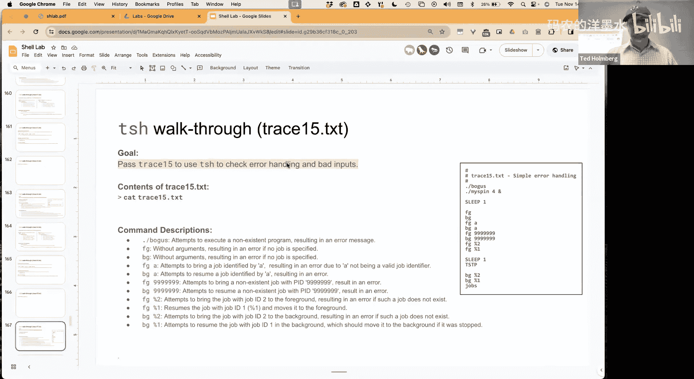

# Shell Lab：第24讲：Shell Lab 第五部分


在本节课中，我们将继续完成 Shell Lab 项目。上一节我们实现了对中断信号的处理，本节我们将重点实现停止信号的处理，以及 `bg` 和 `fg` 这两个内置命令，从而实现对作业的挂起、恢复和前后台切换控制。

---

## 概述与回顾

在上一节中，我们实现了 `SIGINT` 信号的处理，能够将中断信号转发给前台作业。本节我们将处理 `SIGTSTP` 信号（通常由 `Ctrl+Z` 触发），它用于挂起前台作业。此外，我们还将实现 `bg` 和 `fg` 命令，用于在后台和前台之间切换作业状态。

我们的目标是让 `tsh`（tiny shell）能够像标准的 Unix shell 一样，响应这些信号和命令，管理作业的生命周期。

---

## 处理停止信号 (`SIGTSTP`)

首先，我们需要处理 `SIGTSTP` 信号。这个信号应该只发送给当前的前台作业，使其挂起。

### 实现 `sigstp_handler`

我们需要在信号处理函数中获取当前前台作业的进程ID，并向其发送 `SIGTSTP` 信号。

```c
void sigtstp_handler(int sig) {
    pid_t pid = fgpid(jobs); // 获取前台作业的PID
    if (pid > 0) {
        kill(-pid, SIGTSTP); // 向整个进程组发送停止信号
    }
}
```

**关键点**：
*   我们使用 `fgpid` 辅助函数来获取前台作业的 PID。
*   使用 `kill` 系统调用发送信号。注意，我们使用 `-pid` 来向整个进程组发送信号，这有助于通过后续的测试用例。
*   发送信号后，子进程会进入停止状态，但我们需要在 `sigchld_handler` 中更新其状态并打印信息。

---

## 更新子进程处理器 (`sigchld_handler`)

当子进程因信号而停止时，`waitpid` 会返回，并设置相应的状态标志。我们需要在 `sigchld_handler` 中捕获这种情况，更新作业状态，并打印提示信息。

### 识别停止的进程

我们使用 `WIFSTOPPED(status)` 宏来判断子进程是否被信号停止。

```c
void sigchld_handler(int sig) {
    int status;
    pid_t pid;
    while ((pid = waitpid(-1, &status, WNOHANG | WUNTRACED)) > 0) {
        // 处理停止的进程
        if (WIFSTOPPED(status)) {
            struct job_t *job = getjobpid(jobs, pid);
            if (job != NULL) {
                job->state = ST; // 将作业状态更新为“停止”
                printf("Job [%d] (%d) stopped by signal %d\n",
                       pid2jid(pid), pid, WSTOPSIG(status));
            }
        }
        // 处理已终止的进程（之前已实现）
        else if (WIFEXITED(status)) {
            deletejob(jobs, pid);
        }
        // 处理被信号终止的进程（之前已实现）
        else if (WIFSIGNALED(status)) {
            printf("Job [%d] (%d) terminated by signal %d\n",
                   pid2jid(pid), pid, WTERMSIG(status));
            deletejob(jobs, pid);
        }
    }
}
```

**关键点**：
*   `waitpid` 的选项 `WUNTRACED` 至关重要，它使得 `waitpid` 在子进程停止（而不仅仅是终止）时也立即返回。没有这个选项，shell 会在等待停止的作业时挂起。
*   `WSTOPSIG(status)` 用于获取导致停止的信号编号。
*   我们更新作业状态为 `ST`（停止），而不是将其从作业列表中删除。

---

## 实现 `bg` 内置命令

`bg` 命令用于将一个已停止的作业在后台继续运行。它接收一个作业标识符（如 `%1`）作为参数。

### 1. 在 `builtin_cmd` 中添加命令识别

首先，我们需要在 `builtin_cmd` 函数中识别 `bg` 命令，并调用相应的处理函数。

```c
int builtin_cmd(char **argv) {
    if (!strcmp(argv[0], "quit")) {
        exit(0);
    }
    if (!strcmp(argv[0], "jobs")) {
        listjobs(jobs);
        return 1;
    }
    // 识别 bg 和 fg 命令
    if (!strcmp(argv[0], "bg") || !strcmp(argv[0], "fg")) {
        do_bgfg(argv); // 调用统一的处理函数
        return 1;
    }
    // 如果不是内置命令，返回 0
    return 0;
}
```

### 2. 实现 `do_bgfg` 函数

`do_bgfg` 函数负责解析参数，找到对应的作业，并发送 `SIGCONT` 信号使其继续运行，同时更新其状态。

以下是处理 `bg` 命令的核心逻辑：

```c
void do_bgfg(char **argv) {
    struct job_t *job = NULL;
    char *cmd = argv[0]; // 命令名，是 "bg" 或 "fg"
    char *arg = argv[1]; // 参数，如 "%1" 或 "1234"

    // 1. 参数检查
    if (arg == NULL) {
        printf("%s command requires PID or %%jobid argument\n", cmd);
        return;
    }

    // 2. 解析参数：判断是作业ID（%开头）还是进程ID
    if (arg[0] == '%') { // 作业ID，如 %1
        int jid = atoi(&arg[1]); // 将字符串转换为整数，跳过'%'
        job = getjobjid(jobs, jid);
    } else if (isdigit(arg[0])) { // 进程ID
        pid_t pid = atoi(arg);
        job = getjobpid(jobs, pid);
    } else {
        printf("%s: argument must be a PID or %%jobid\n", cmd);
        return;
    }

    // 3. 检查作业是否存在
    if (job == NULL) {
        printf("(%s): No such job\n", arg);
        return;
    }

    // 4. 处理 bg 命令
    if (!strcmp(cmd, "bg")) {
        // 发送 SIGCONT 信号，让停止的作业在后台继续运行
        kill(-(job->pid), SIGCONT);
        // 更新作业状态为后台运行
        job->state = BG;
        // 打印作业信息
        printf("[%d] (%d) %s", job->jid, job->pid, job->cmdline);
    }
    // 处理 fg 命令的逻辑将在下一部分添加
}
```

**关键点**：
*   `atoi` 函数用于将字符串参数转换为整数。
*   `kill(-(job->pid), SIGCONT)` 向整个作业进程组发送继续运行的信号。
*   将作业状态更新为 `BG`（后台运行）。

---

## 实现 `fg` 内置命令

`fg` 命令用于将一个作业（无论是停止的还是后台的）带到前台运行。其实现与 `bg` 类似，但有两个关键区别：
1.  需要将作业状态改为前台运行 (`FG`)。
2.  需要调用 `waitfg` 函数等待该前台作业完成。

### 在 `do_bgfg` 中添加 `fg` 逻辑

在同一个 `do_bgfg` 函数中，我们添加对 `fg` 命令的处理：

```c
void do_bgfg(char **argv) {
    // ... (前面的参数解析和作业查找代码与上面相同)

    // 检查作业是否存在
    if (job == NULL) {
        printf("(%s): No such job\n", arg);
        return;
    }

    // 处理 bg 命令
    if (!strcmp(cmd, "bg")) {
        kill(-(job->pid), SIGCONT);
        job->state = BG;
        printf("[%d] (%d) %s", job->jid, job->pid, job->cmdline);
    }
    // 处理 fg 命令
    else if (!strcmp(cmd, "fg")) {
        // 发送 SIGCONT 信号，如果作业是停止的，则使其继续运行
        kill(-(job->pid), SIGCONT);
        // 更新作业状态为前台运行
        job->state = FG;
        // 等待这个前台作业完成
        waitfg(job->pid);
    }
}
```

**关键点**：
*   对于 `fg` 命令，无论作业之前是停止(`ST`)还是后台运行(`BG`)，我们都发送 `SIGCONT` 信号。
*   将状态设置为 `FG` 后，调用 `waitfg` 函数。这个函数是我们之前实现的，它会阻塞 shell，直到指定的前台进程不再存在。

---

## 测试与通过多个追踪用例

完成以上实现后，我们的 shell 应该能通过多个测试用例：
*   **trace09**： 测试 `SIGTSTP` 信号处理。
*   **trace10**： 测试 `bg` 命令。
*   **trace11**： 测试 `fg` 命令。
*   **trace12-14**： 这些用例检查信号是否发送给了整个进程组。由于我们在 `kill` 调用中使用了 `-pid`（负的进程ID），我们的实现应该能自动通过这些测试。这体现了向进程组发信号的重要性。

此时，我们已经完成了 Shell Lab 大部分核心功能，能够处理作业的创建、终止、停止、继续以及前后台切换。

---

## 总结

本节课中我们一起学习了 Shell Lab 的关键部分：
1.  **停止信号处理**： 实现了 `sigtstp_handler`，将 `SIGTSTP` 信号转发给前台作业。
2.  **更新子进程状态**： 在 `sigchld_handler` 中使用 `WIFSTOPPED` 和 `WUNTRACED` 来捕获并处理停止的作业，更新其状态并打印信息。
3.  **实现作业控制命令**：
    *   `bg` 命令： 让已停止的作业在后台继续运行。
    *   `fg` 命令： 将作业带到前台运行，并等待其完成。
4.  **进程组信号**： 强调了使用 `kill(-pid, sig)` 向整个进程组发送信号的重要性，这是通过多个测试用例的关键。



通过这些实现，我们的 `tsh` 已经具备了基本的作业控制功能。在接下来的课程中，我们将处理错误输入和I/O重定向，使我们的 shell 更加健壮和完整。