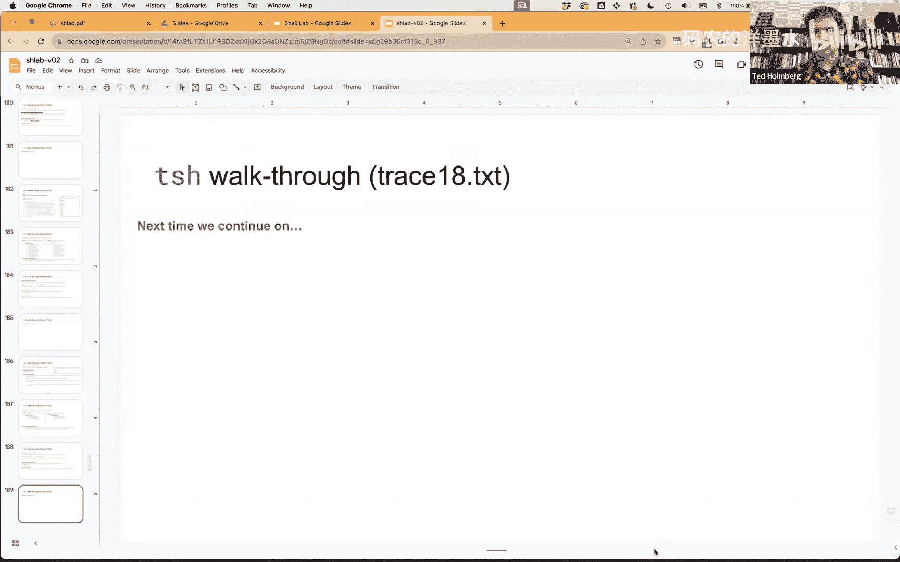

# 【全集】加州理工学院 C语言系统编程 中英字幕 p25 Lecture 25 - Shell Lab part6 -BV1bUzWBLEiC_p25-

Okay so。We're going to start to continue on shellll lab where we last left off。

 I believe when we last left off we had just gotten past trace 14 so trace 14 was。

When we had implemented the ability to go ahead and handle us process groups as opposed to process IDs now of course。

 because we're using the negative sign in our P for each of our kill calls for each of our kill functions whenever we used the kill function that already did that job for us so when we ran traces 1213 and 14 we were able to bypass those without much implementation change so that leaves us to the next trace 15 where up until now we've been doing minimal implementations into our tiny shell and as a result of that as a consequence of that we've been able to pass traces however。

We haven't done any error handling and now we're finally getting to a trace that's going to check for。

Errors that might commonly occur from the shell where the user might supply inadequate or incorrect or malformed commands and so we should do something in response to that we're going to see we should do something in response to that from the reference shell because when we go and look at the the trace we're going to see just that but before we start looking at Tra 15 let's just make sure that our we're up to trace 15 so i'm going to open up。

Our。Tiny shell， I mean， our shell lab。So let me open this into a terminal or actually I again tear and then open this into a terminal。

And then what I'll do is I'll move this off to the side here。😔，Go into here， perfect Le me。

Run our check。And while we're waiting for this check to proceed because now we've moved a decent amount into our traces。

 just want to I want to just prove that we've gotten our point allotments up into this point so we'll let that one in the background let's take a look at the motivation behind trace 15 so trace 15 and we're going to pass it for our tiny shell we're going to have to check our era handling for bad inputs and so we can see trace 15 looks quite dense our header comments as simple error handling let's take a look at some of the output here and then we'll do our comparison contrast between the expected output from our reference tiny shell and then our behavior that we have currently from our tiny shell。

So we can see this first。Call here。t slashbogus so we're trying to invoke a command that is a nonexistent program so we would expect when we try to do that from our tiny shell we'll likely expect to get some kind of error message from that which we're not doing anything with and if we are doing something with that from a prior slide in the future omit that so that that gets handled here so we're going to pretend like we haven't handled that if we did because it has interesting consequences about how we have to think about that。

Then we have a background job that we're spinning up the MySp application for four seconds。

 we're going to have our test harness sleep for one second now we're going to call the built in commands background and foreground now recall that both background of foreground will resume a job or move a job into the to become a foreground job foreground process or a background process however it requires either a job ID or a process ID。

And here we've omitted either， so this should likely go ahead and result in a error message as well。

Then after that， we're going to call the built in command again。With。A alphanumeric letter。

 Now recall if the P is in the form of an integer value， which is a valid argument to Fg or Bg。

 or we can use a job Id， which uses as its initial character， a percent sign。 but thereafter。

 it should be a numerical value。 So the。Alpha numer value of a is clearly a malformed argument it sit it's it's an inappropriate value to pass as as an argument and so that should also generate an error then we have。

A call to foreground and background providing an adequate illegal。Process ID， however。

 this is a process ID that's too large and will be nonexent， so this should also result in an error。

 then we're going to have a call to a foreground。Using a job ID。😡，Now， in this instance， the job I。

Will be out of bounds as well we've try to invoke two applications。

And so here one was bogus so this is not a real application， then we have this one here。

 we have this single application， so there should be no job。

Two to speak of so this should actually generate an error since that should be out of bound of the jobs list and at the time that we run that。

This one seems like it's plausibly legal， a foreground to job ID D1。

 then we will tell our test harness to sleep for one second。Then we will send a stop signal。

To our shell。To go ahead and stop that process then we will then be able to go ahead and issue a background on job ID2。

 which again there is no job ID2 so this should also result in a error message then here we will resume our stop job in the background since job ID1 should be legal and then finally we will print out the state of jobs so there's a long list of commands here but we can see presumably it's all to go ahead and just test what kind of responses our tiny shell does when we provide it inputs that are wrong that that it can't successfully execute on。

Okay， so with that said， let's jump back over here and we can see we have our final current state of everything here。

 let me see here。For our first several traces all the way up to 15 we've passed and this is where we last left all so perfect our code should be compliant with where we expect it to be let me clear out of that now let me go ahead and open up our tiny shell because this is what we will be coding in me jump this over here。

Perfect， okay， so let's take a look at what we currently have。

 I'm actually going do the side by side because it's easier。

 but then we'll verify inside the terminal'll see that it's correct。

 So if I were to go ahead and make the reference test 15。

 I should get a lot of output and we're going step through this a little bit at a time。

 if I go and make our test 15 for just our tiny shell on on our reference shell。

 we're going to see I get a lot less output。 And so we could see a lot of this output are going to be the error messages that we should be sending to the standard's displaying out from our console to alert the the user that they provide it。

Bad inputs into our tiny shell。So if we start at the look and let me run these in isolation so we can make sure that our own code is at the same level。

 so I'm going to do Ref shell first。round 15。Okay so let's make that so we get the header comment that's echoed out then。

Stepping through like we said before we're going to try to make the call to that bogus application so we get a message do sbogus command not found。

 then we're going to spin up that background application my spin for four seconds so we're going get the message from that now we're going get these two error messages and we can actually see we can use the reference shell to see the format in which our console error messages should be so here we can see a foreground command requires either a PI or a job ID and the background command requires a PI or a job ID so of course that's when we try to issue with the alphamer no when we issued BG and FD with no arguments whatsoever。

And now the instances where we try to invoke BG and Fg with an alphanumeric value。

 something outside the balance of a integer value or a job ID which starts with a percent sign and then a integer value。

 then we would get these。Eror messages。Now we tried to go ahead and do something in relation to a malformed。

Pid， so if the pit is out of bounds， if it's not a if it's not a P that exists。

 so it's a valid pit but doesn't exist， then we'll say no such process and we'll give it the P that we attempted。

that's both on Bg and fG then here， this is the instance where we tried to go ahead and move to the foreground a job ID of two and we said there's only one job in the job list so that's causing that error then this was。

Where we tried to move the job。Id1 to the foreground。 and that worked。 Now。

 we're going to try to move the job Id。To to the background and recall that we sent the soft signal at this point。

 but again， we can't move a job I that's not existent so we get that error message again and then here we're going to go ahead and have。

Successfully moved our job ID of one to the background where it can then start rerunning its it's sent the continuous signal and so therefore when we call jobs we're finally going to get that output from jobs so stepping through we can kind of see where all of our output comes from now。

If I currently go into here with my。Make on my tiny shell the current thing i'm getting here i'm getting the echo right and then i'm getting the i'm not getting the error message on the bogus i'm getting the fact that we did successfully spin up my spin that external application four seconds as a background job and so then we're going to go ahead and have this that stop where it just gets terminated and then we're going to have what's the printout here too so we have a couple of things happening here so when we go to tackle a lab like this one of the best things that we can do is step through。

Line by line from what we have in our expected behavior and see if we can't build out our observed behavior because there's a lot going on here so we don't we shouldn't try to tackle it all at once。

 we're going to iteratively improve our code base， a set of lines at a time。

 a set of errors at a time until we have complete correspondence between our reference test and our tests。

 our tiny shell and the reference shell。Okay， with that said。

 let's move to the first line the first output that's different and that's going to be this error message where there was a a commands not found there's no application called bogus so if we are giving a application name that is incorrect then we have to issue a error message in this regard so where do we go to evaluate this well。

This is some data that we already have access to in our eval function。

 so let's jump to our eval function and we clear this too。

So what I'm going to do is I'm going to jump to my eval。

So this is our eval function as it currently stands now the。Recall that external applications。

 anything that's not a built in application。Is going to go ahead and。Fork fork out a process。

And then it's going to take that child process ID so if the P is zero。

 then we're going to go ahead and set it into its own process group。

 and then we're going to go ahead and call this the executable vector where we're going to go ahead and override the clone the fourth process with the actual call to the process that we want to do or call to the application that we actually want to do so recall that the application command is going to be the element one or the zero index into our argument vector so we're going to post that as our first argument and then as a second argument we're going to pass it the entire argument array。

And so it's going to attempt。To invoke and run that。Oh。

 take take that forked process and run that application there and recall that it's going to go ahead and provide back a value and if it provides back。

A value that is less than zero。Then that means an error occurred and so up to this time all we did was blindly expect hey run this application。

 this is my MySp application， this is my Mysp application and it would run in the background this is the first instance where we're trying to run an application that is going to result in a negative value being returned from this。

System call， and since we're already saving the status。All we have to do now is set up a check。

 so let's check， let's try this。So we can put a selection statement here。

There go and so in by this selection statement， let's check the conditions so the conditions is going to be on our the status from this call to the to execute on this on the argument vector。

So if the value of that is less than zero， that means that an error curve we're trying to execute this。

 then we can go ahead and provide feedback some kind of prompt of sorts to the or an alert to the a message to to the user so here i'm going to use a print F inside the print F recall that the format of this is we're going to give the command that they tried to provide so percent S will represent that command then a colon。

Colon， then we're going to command。Not。Found and then we're going to do new line character。

 and then we have to go ahead and。Replace this placeholder value with the actual command and we have that command recall call inside of our argument vector at index zero。

Okay， so this gets us there partially。This looks good。

 but let's see what happens when we run this because what we want to do is we want to try to get this output you know。

 on here， so let's see where we're at so let's recompile our code。

Okay compiles fine now let's do a make so let's make test 15 we're going to make that we get the echo of our header we're getting this command here。

 but look at this other output that's generating from that at this time so we can see that we're getting this call to my spin。

Then we're getting that this job was terminated by Sign 11。And then we're getting this call here。

 how does that compare to what we had so here these two are looking fine so far。

Right in terms of our observed behavior， we did get this bogus command perfect。

 we're now getting this call to my spin， which is what we want， yeah。

 so these two lines and then we're jumping to job one terminated by signal 11。

Now we have an issue here where we're generating a second printout of this here if I were to continue implementing。

From this point， I'm always going to keep getting this duplicated print。😡。

And so to kind of save you some headaches and to kind of give you a concept and if I remember。

 I'll comment this out so that you can see，The importance of this next step。

 but we want to we want to not have this line here that line clearly should not be there throughout the entire juncture let's think about what's happening here because we're missing one line of code。

What we have here is we're creating a forked process。Okay。Now， inside the child of the fork。

 we're going to set it to its own process group。 Then we're going to go ahead and send to the system call the ability to go ahead and。

Run the application we want in this work process and if it's successful。

 it's going to return a non negative number。And then it would run that process until completion。

 and then we would do something else。Now if it errors it's going to give a negative value but we still have that fork process don't we right it's still been forked and we haven't successfully been able to override the current forkness of it so the current parents remember it creates a the child is a cloned effectively of the parent until we override it with a new application to run if we fail to give it a new application to run it's still going to have the signature of its parent so when we check this and we say oh the status was a negative number let's go ahead and print this command not found we also have to then。

Make that process。Go away and how do we make a process go away well the same way we make the process in our quick command to go away we can use the system call to exit we should do that on this for process as well because if we don't do this it's going to cause massive headaches later on。

Okay， and then we got to give it a numerical value since now we are exiting because of a unsuccessful one。

 since this isn't a successful completion， we will use a status code。

 we'll use status code of one to illustrate that this was a that this was exit due to an error。

And so now now with that in there， let's compare， let's clear this。

 let me go and make my test 15 and oh wait I have to。

I have to compile can't forget every time we make changes to our code let's recompile and now we will go ahead and run our test 15 we get the echo to the comment we get that hey。

 this is a bogus command and now。We're going to run this command in the background。

And so instead of getting that error message with Sign 11 because we were spawning an incorrect well。

 now instead of getting that that that error signal， the interrupted in the double print。

 we've successfully killed that process， we've exited out that child process。

 whenever we have generated an incorrect application name or command name for our shell。

 so this is what we want。Okay， so let's see here， this is the implementation。

 we just walked through this， this was inside of our eval function。

And here now this is where we should be at we successfully have the echo header comments。

 we successfully have this idea that this bo application is command not found we successfully spin up as a background process our My spin for four seconds now the next thing we're going to have to do is take care of this foreground command requires PI or job ID error message and this background command requires PI or job ID。

Which we don't get at all currently， so now the these。

If we think about what function is responsible for evaluating and determining the correctness of this input is going to be inside our doBGFG function right because that's where we're really managing all of the logic for being able to move a process to the background or foreground and then having to continue so。

What we can see here is we can just make a simple check up till now。

 we just kind of trust that when Bg or Fg is issued that it's followed with an argument now recall one thing that we did when we implemented this we created some very readable variables to illustrate how our。

How our command line is effectively imputed into our system where the at index0 of our argument vector would represent the command。

 and then the second or the second element there the element at index one in our argument vector would then be the parameter or the argument that's being passed to that command So since we have our variable set up here。

 we simply check initially to see， okay， is our parameter no， does it not have any value。

 and if it is， then that means we've only gotten the command by itself。

 we didn't get an argument associated with it So now we can go ahead and produce this error message where that command requires an argument of either the rapid or job I and then we'll have to return out of our function when that it's done。

Because we don't want to do any more logic we haven't been given enough。

Enough input to be able to do anything in response to this request。

 So we'll just exit out of this function then。 So let's jump into our code and let's go to our B G do B G FG。

 So let me jump there。屌 go。Okay， so here it's pretty simple before we do anything else in this function。

 what we want to do is we want to check。If that parameter is known。Perfect。And then if it is。

Then what we want to do is we want to print out that very specific message that is。

Given to us from the reference shell， so it was going to be percent as。Command。Requires。Pid。Or。

Saw by day。Argument and then a new line character， and then we will go ahead and。

Replace this placeholder value of our percent S with the command that was provided in because this could be one of two command either the bg or the Fg as we saw inside of the tiny shell output then again once we're done that we need to make sure that the rest of that function does after this does not get。

Execut it so we'll just return out of the function from here， but save that。Let us clear this。

 let's make sure that we can compile this code every time we make a change， we should recompile。

And then we will go ahead and test our function app， let's test。

The tiny the reference shell so let's see the reference shell and so here's going to spit out all this up to this point this is where we're at。

This is the next two pieces we're going to be looking for， this FG command requires PI。

Or job I D argument。 And this B G command requires P or job I D argument。 Okay， so let us now run。

The test for just our tongue shell and we can see， yeah， look at this now we're getting。

This output here up to BG command requires PId is the same as here， that's excellent。

So now we can examine the next state。Okay I'm going to clear this just to keep my terminal nice and clear。

Okay， so moving back to my slide deck， you can see， okay， yeah， so far。

 all of the output from our observed behavior matches up to our reference time you show up until now。

 these new set of error messages where it says FG argument must be a PI or percent job ID and。

Very similar BG argument must be a PID or job ID so clearly these are these instances when we are trying to pass in FG and BG with just a alpha alphamer letter or something that does not conform to our expected input for either a PID or a job ID。

 clearly the ones we just solve where when we just call BG and FG without any parameter now here though we have to check to save the parameter is valid。

What is a valid parameter Well， if it either is a number right so this is technically valid。

 it just might not。Exist so if it's a process I it's just going to be an integer value if it's a job I。

 the first character of the argument string is going to be a percent sign and then the。

The rest of that string will then be integers that represent the ID for that job。Okay。

 so we can check to see if it's neither of those two things and if it's neither of those two things。

 then we can say， okay， that is you gave us a improper argument for the job。

So let's see here so this is where we last left all so the logic on how this could look then is we can just simply check those two different conditions inside of a selection statement so we can check inside of our parameter。

Which is the argument that's passed to the command。

 we can look at the very first character so this the character at index zero and that character。

Is not equal to a percent sign then it's like， okay。That。Could be， that means that it's not a job ID。

😡，And。If the parameter。If inside of our parameter， the first value is at index0。

 so the very first character is not a digit， so there's a system called is digigit where we can pass it in a text character and it will let us know if it is a numerical digit if this returns false。

 then this is a way of determining if that was a legal value or not now。

 I'm going to stop us here and just say I am doing the simplest implementation possible just to pass these traces。

 clearly if you look at this logic， there are conditions that can occur that are edge cases that are not captured by this logic。

And so I would leave it to you to make the error handling more robust right my here is not to create a very robust resilient。

 full tolerant tiny shell it's to show you how we can walk through this process and what considerations we have to put into in order to pass these traces but when you see these conditions from tiny shell what you should really endeavor to do is actually try to capture all of the potential edge cases that can lead to malform bad faulty commands and be able to go ahead and respond to that so I'm just highlighting that this logic works for our trace but clearly you could probably you could probably look at this and see oh I can send this type of input and this shell implementation not going to catch that and you're right that is absolutely correct and if you see that see if you can't find ways。

To make a more sophisticated logic to be able to catch those instances you might consider anyway。

 with that said， these are the conditions that we need just to guarantee that we have a job I for our trace checked and so in response to that if it isn't a job I and if it's not a。

If it's not a。If it's not a。A processcess ID then we're going to print our message and then of course what we need to do is also return out of this function because we don't want to execute any of the following logic because we don't have anything that is suitable to be able to do that right we don't have a job ID or process ID so we can't do anything。

Okay， so let me jump here， so now let me do this if check。A if。

There we go and so what we said we were going to do here is if。

The index of Ramm zero is not equal to a percent sign。 And so keep in mind。

 I'm going to go ahead and use a。Character for comparison because we're indexing to get into a character string a character array to get a single character for comparison and we need to check two different conditions so if it's neither a percent character。

And it's that first character is not a digit。So we'll call that system call is digit and then we'll check the not condition on that。

So and is it's that first character is not a digit well then that's not a job by so it's either God that first character either has to be a digit or it has to be a percent sign。

Okay， so in this instance， let's go ahead and have our error message and。

Let's do what was it percent as colon， so that's going to be the command and it's going to be the argument。

Must be。Pig。Or and then percent sign and。Just to highlight in case you hadn't seen this before since we're using formatted print statements and since the special character。

 the flag character， the Sinel character that represents hey。

 we're about to insert a special character into the string。

 this isn't a normal character is the percent sign。

 well then the percent sign is normally followed with something like an S to represent oh this will be a placeholder for a string or percent D oh that's going to be a placeholder for a decmal。

 well if we want to actually print a percent sign well since it's already marked as a special character we have to do percent percent and it'll print out a single percent sign so just in case you were unfamiliar with a syntax。

 a percent percent and a formatted print statement that's just what's happening there。Okay。

 and then we have our job ID and then we have our new line character and then what we'll do ahead is go ahead and then passing the command to replace this placeholder value here and again we cannot forget we need to have this return statement。

Okay， we will save that now let's go here。And let's compile our code， our code is compiled。

 now let's compare so here let us make the reference test。

There we go so we get our echo we get the bogus we get the call for our mypan applications run in the background we have our foreground and background requires a P so that's just when we call them without any argument we get these errors Okay this is your。

Argument must be a P or job I， so this is the set of error messages we're trying to attempt to get on our shell this time。

 so let's go ahead and see if we get that let's go ahead and make on just our test shell so we get our echo。

We get。Our error message where Vogus command not found。

 we successfully go ahead and call my My spin in the background。

 we have our foreground command requires Pi background command requires Pi and these are the two new。

 which look perfectly they're in line with exactly where we're right here。All right。

 so if we wanted to validate and verify we can see yeah so the first seven lines of output now match one to one。

 so once we do that we can then look at the output from our reference shell， we can see okay。

What is the next set of lines that we're not getting we can see okay it's going to be these no such process 9999 we're moving it to the foreground we're moving it to the background。

 we're calling BG and FG on a nonexistent process ID so now recall again as just like I stated earlier we're not going to be super robust in our error handling we weren't super robust when we initially implemented our do BG FG function because all this time we've been saying a valid parameter for BG and FG is a job ID or a process ID but up until until this time we've never actually implemented the logic。

For being able to use a process ID。For Bg and Fg。So we'll have to implement that and at the same time while implementing that we'll also have to check make that check to see if that process ID is valid or not so what's the logic that's going to drive this but first of all recall let's go back here into our2BG FG so recall that there's three pieces of data that we local data that we kind of initially set up for this function there's going to be a job。

Poiner that we set to know。 And so that's the process job that we're either going that we're going to update to either go to the background or the foreground and then send it a signal to continue there's going to be the command from our argument array。

 which is going to be at index error and there's going to be the parameter that's associated with that command inside of our argument array Okay。

 with that said， what we need to do is， well， first of all。

 let's do the logic that's going to allow us to go ahead and。

Just use a process ID to update a job state。So here， so underneath these errors here。

 so after so provide it we don't exit out of our function because we don't have a parameter or because our parameter is illegal。

 if it's invalid， let's then check right ahead of this line where we last implement if it's for a job ID。

 let's check for a process ID。So what we're going do here is we're going do the inverse of the check if it was invalid so just like in for a job ID we were checking okay is the first character in our parameter string a percent sign and if it is oh that means that's a job ID we're going to go ahead and grab the address of that job ID sorry an index1 right we're going get that character pointer for that we're going to send that to that system call a to I so from ASI to an integer value that'll give us our job I number and then we can get the job from that and then set that job from there so if that's the concept that drives how we do that with job ID well and the reason why we knew wasn't valid for a job ID is if it's not that first character is not a percent sign well if that first character is not a digit。

That means we're going to that means if it is a digit then that's our process I did so that's what we're going to check so inside of here。

We're going to call the system function is digit and then inside of our parameter。

 we'll just check the first character to see if that first character is a digit if it is。

 then we'll treat that as our job ID。Excellent。Now the next thing I want to do is I can go ahead and。

Describe it。Let's grab the P then so what we can do is。

We are going so since we know that this parameter is a digit。

SeeIf the first if the first character is a digit， we're going to assume all the other characters are a digit。

 so then we're just going to sell send the perm。To the system call A to I to convert the ASII text into an integer now again。

 that's relatively brittle， but we're just going to make that assumption for this implementation。

Okay， so that should return us an integer that represents our P our process I Okay。

 so once we have that， then we can say， okay， let's take that local variable that that variable that we had defined at the top of our function job P our job process。

 which is null and we're actually going to now assign it with。Yet。Job。

And PI so we can use the PI to get a job from our job list and so what we're going to do is we're going to pass it our PI to do that Okay。

 so here now if you look we're in parity with our job ID logic and I'm sorry our process ID logic this is for the process and this is our job ID logic。

On how to get a job and recall then after that， we oscillate and disarment if it's a background job or a foreground job。

 we do something in response to that。Okay， so this now is the implementation that actually satisfies being able to use either a process ID or a job ID to go ahead and move to the next set of logics into this function。

 but recall we also have to add in that error message if I stop now and we can look at this。

If I don't。Good job Pi， let make sure that I have called this correctly。嗯。先 good job。😔，Let's see。嗯。

Okay， let's take a look。If。It's a good job kid。😔，Oh， I also need a pass in jobs。

So we that get job PI requires two arguments， the jobs array， and then a PI。

Just like a job Jid requires a jobs array and a Jid。So can't forget the argument list if I was good。

 I would have looked at the。The API before making that call。that's okay。

And now let's go ahead and try to make that。And so here we're going to echo out our comment。

We're going to go ahead have our Bogus app。We're going to have my the background application running for four seconds。

 my spin， we get the FG command requires BG command requires。

 we get the FG and BG and then look at this we're just kind of hanging here indefinitely。

On this instance， because we've done something we。We're not doing anything in response to this here and so okay。

 finally， so after finally our four seconds。It finally clears out。

 but notice we didn't get the error message that we anticipate because we didn't implement the error message。

So now what we need to do here is。But notice it did run it did run all the way through。

 but it didn't interrupt any jobs and stop jobs and move things and print errors so what we now want to do is we now want to update this new implementation here。

Such that if job is null， if we go to job P， we give it this PI and it doesn't give us back anything because were call dysfunction。

 get job P and we can take a look at it。Itit job P， let's take a look at this function。

We can see that。It's given the jobs array。 it's given a P。

 it's going to go through and find the job where that pit matches inside of that structure。

 But if it doesn't find anything， it's going to return to nu。 So we default our job process or job P。

With null， and then this could potentially return a null if it doesn't exist。

So let's go back to the do BG Fg， let's jump to that。And so that we can update our logic。 So here。

 then that means that。After we try to attempt to set this job P。

 we need to check to make sure it actually has a value and if it doesn't。

 then that means that that process。Did not exist inside of our jobs list。

 So here what we can do here is we check job P。Is equal to null。Perfect。

And so if that doesn't get set。We're going to do that print statement。So here we're going to print。

Now the if I remember correctly。The format of this print statement has our process ID inside of parentheses。

 and then we'll just print out a integer value， so decal value percent D。

And then we're going to do a colon and then the error message is going to be no。No such process。

And then we will do a new line and then we are going to replace that percent D with the PI since that is what we're attempting to use to get our job ID and when that occurs again。

 we don't want to try to execute the logic。That。Tries to actually do the BG or FG。

 so we will simply then return out of this function if we do get into this exceptional case。

So now let's go to our terminal， let's clear this let's。Recompile， let's make our reference test。

On 15。And then what we will do is we will make our own test if we could see this is the output we're going to be looking at at this step。

 let's see if ours looks the same。Up to that point and yeah， it looks like that looks great。

 So here these first lines now look very similar to all of these lines here。And again。

 it's still executing because we're not doing anything。In terms of。

In terms of these final kind of steps of being able to。Move things to the background。As we'll see。

Because there are some commands that are legal and that's what's happening there， okay。

So at this point， we can say。After that implementation。

 yeah the first nine lines of output from our tiny shell task should now match the reference shell task。

 so now the next line is going to be a temp line where it's going to attempt to use an invalid job ID。

To try to go ahead and move a， I believe it was a jump to it。

I believe it was this one here so here so we've we've successfully done this amount of the directors inside of our test case。

 so this is the next output that should generate an error we're going to try to take this background。

Pro of my spin and we're going to try well not this one this this one。

 this is why we're hanging for a couple seconds because it's successfully doing this foreground。

Move of our job I So recall' called there's no job I too right the only job I we have is this my spin so we're trying to move a job I of two into the foreground which should result in an error message and so that's what we're not getting currently so we're going have to update that so clearly what we're going have to do to update that is very similar to what we just did for our process I when after we set our job I we're going to check okay。

 did we actually get a job。instance did we actually get a job reference based off of the job ID if our job is still nu that means we did not。

 which means we have to print a error message to alert the user hey。

 you gave us an invalid job ID or you gave us a job ID that is nonexistent and then we'll return out of the logic for that as well because the core concept that drives the both the selection statement for the process ID and the selection statement for the job ID is to set the job P variable so that we can do something interesting with it so if at either instance it's not set then we have to exit out with an error。

Okay， so that's going to be in this part of the logic here。

 so here I can jump I can just go ahead and check if my job P is equal to no oops I can't have a。

So that's going to be our check there， then what we want to do is。

We need to go ahead and print out that message then， so we're going to do print F。

And then the format of this message is it's going to be。A percent。

Right so the percent sign and then it's going to be whatever the ID value that the job ID value is given。

 so we're going to give it the same kind of formatting that it expects the user to provide instead of our error message so the first two percent signs we're going to print a single percent sign and then that percent D is going to replace with the integer value that got passed in in this instance the value2 then we're going to put the message no such job。

And then we'll do a new line character。And then we will pass it to Jid。

And then we have to return out。Perfect and then once we do that we can go here we can clear this no we can clear this yes we can go ahead and compile our code make sure there's no issues or errors or syntax mistakes then what we'll do is we'll print out our reference。

Task。So we get the echo of our header comment and so the thing we're interested here is right there's no such job and so here let's actually now make our test。

And we can see here。By completing that， so now we have percent note so this is on our reference zone let me let me actually。

Increase this so we can actually look at it so bogus。Tip Bo guess， right？

The successful running up our background application in the background， right， that's that matches。

Here is FG， BG command requires Pi or J， that's here。

Then we have the FGBG argument must be a P or job ID， yeah。

 that matches this this is going to be no such process。

That matches here and now the newest things is and actually let's look let's look at it so we have our。

jobb ID I see that a job one stop by signal so that's the soft signal that we send then no such job can be moved into the background and we successfully move our job one to the list and then we are calling our jobs so actually that and that match。

So that was the last error is preventing us from actually getting 100% compliance with our reference test。

 so now if we compare our reference test to our tiny shell test， we should actually get all the same。

Binds they should be compliant we should be done now so now just to ensure that we're done we should call we should just look at the fact that whether we pass a test or not I mean we have the same output that we should。

 but we will validate that by just calling a。By just calling our tester application to go ahead and accumulate and sum up the amount of points we've approvedccrued and so。

While we do this。What you'll likely see is。We might pass more than just test 15 too， so if we do。

 we'll take an examine as to why， and I think I'll be very evident why that's the case。

And while we wait for that， let's take a look at a preview with the expectation that this is going to pass so when we would continue on trace 16。

 if we examine trace 16， it just puts all the other traces together。

 which means so long as we followed the guidelines put forth in these test directives in traces run through 15。

 this is just doing a series of combination calls to our tiny shell。And so here we can see， okay。

 so in order to portray 16 to properly pass， we have to have the appropriate error message if we try to call this bogus application we have to be able to put this My spin application into the foreground for 10 seconds we have to successfully be able to sleep it which is going to send a stop signal to the foreground application and I'm sorry I'm sorry not that send interrupt signal the sleep is for the test harness just to sleep for one second we need to successfully interrupt that that My spin application though because the idea is that we're not going to wait 10 seconds for that we' testing our ability to actually interrupt that application then we need to successfully put my My spin application for three seconds as a background application we're going to wait a second and then we're going to put another background application in the background for four seconds we're going to call jobs to make sure that the jobs or're putting that all the current jobs。

Then what we can do is since we should have a job one ID。

 we're going to move that into the foreground， which is then going to send it a continuous signal。

 our job one should be this one right here。We're going to sleep and then we're going to send a stop signal to the entire process group。

And and then we're going to check our jobs and then what we're going to go ahead and do is it set as a background。

Our job ID of three。And then our job ID of one， and then we'll check jobs and then our our foreground of one。

And then we'll do a quit and so let's see here we're done passing this。

 so I just want to see where we're at。Actually， it says that my。Let's say let's do a de。

Saying I failed， so let's see here， let's do a dev make sure that all my outputs are correct。

So let's make。Our task 15 and let's。Make test 15 so sometimes because our。

The validation is based on the exact formatting of our strings， let's just validate。

 let's verify that there's no differences between these actual outputs except for the process ID numbers。

 which is going to be what we expect。Okay， so clearly the calls to whether it's a tiny shell or whether the reference shell are going to be different that's expected。

 this should the only difference here if we look at it is actually the process ID that's fine oh here we go。

FG argument must be paid。Or。Job I。So this should not be different， so let me see。

 what am I seeing here？FG， FG， BG， it's that argument must be a P or。Job I。Argument must be a P。This。

 and then this is fine， and then。Okay， so something is going on here， so Ill just have to fix this。

I not。Seen instantly。あ誰人したよ。Argument looks correct， must be， oh， I see， must be a Pd。Okay。Must be。

Apid。Or job ID， Okay， so again， you could see。The logic is there， but just as equally important。

 we have to match word for word letter for letter and we'll bys symbolble the exact expectation of what these error messages are from our reference shell。

 so we have to pay a lot of attention to that。Which is why it's good to check these deaths。

Okay so now here yeah does not say that anymore let's clear that and so here let me just run this in the background one more time just to confirm and this again is why I wanted to check to make sure that I accrued all the accumulated points just to make sure I didn't have some little typo such as that and one of my error messages this is the particular trace where you might fall into that pit in particular。

Okay so while that's working， let's actually take a look let's go back and talk about Tra 16 a little bit more。

 we can see that Tra 16 is simply just putting in all the concepts that we've implemented in our prior 15 traces and we look at all these directives so if we've done everything successfully and we get city we have all of our command descriptions here if we've done everything successfully then we should automatically pass that and so we can actually see based off the output that all of our observed behavior should match with our expected behavior from the gate go we can see we're going to get that bogus command not found because that's not a real application and we're going to successfully going to go ahead and run that foreground application Ill remember since it's foreground application the shell is going to just wait。

 but then we're gonna to send an interrupt signal when we send the interrupt signal it prints out a message hey that job one was terminated by signal。

Two， which we get here。Then we're going to go ahead and do two jobs in the background right so we've terminated that first job but now we have a background job MySp three and we and when we do a background job it prints that to our display we'll also go ahead and do another background job so now we'll have two jobs in our job list and now if we hit our if we do our jobs printout it should say oh there's two jobs running in the background which we did here。

Now we're going to go ahead and stop a job that's let's see here that's going to be。She。

We can see where we go ahead and stop。And so we can see now that when we go ahead and check to our jobs list。

 we can see that there's one stop job and one running job and we can see that we did。

And so that's what we have here。And now we're going to try to move here into the background a job three。

 so we should get an error message that we just recently implemented in Tra 15 no such job。

And so then what we're going to do is then we're going to。Successfully moving into the foreground。

 job one， right？And so that's going to actually happen and then we can see that oh that sends a continue signal to the job that was stopped so now it's going to continue running so when I call my jobs list at the end it's going to show me the same output put here and here。

So no changes should be made to our shell to successfully put complete trace 16 and if we look at our accumulated points。

 we have successfully gotten the pass on our trace。15。

 but we've also have the pass on our trade 16 because hey， our trade 16 is just。

Doing everything from traces1 through 15 and then notice because of our implementation we even get a pass on trace 17 we don't actually get a fail until we get to trace 18。

 19 and 20 we're going to look at that in just a moment but then we're going to stop this particular lecture let's just take a look at trace 17 to understand why we're passing that this actually is just going to check whether we can handle the stop signal or the interrupt signal that comes from other processes instead of the terminal and because we use the signal handlers。

In the way that we did， it does go ahead and。And stop。

 it does go ahead and utilize the signals that come from other processes instead of the terminal itself。

So here it's using the My stop application to be able to do that， you can see a call from My stop。

Is and my interrupt， it's going to send those signals into our into our。

Into our shell so we could see that the expected output would be that job one stop by signal 20 and then we're going to run this my stop job and then we're going to see that yeah。

 that this job too was terminated by signal two and we're going to get the exact same output because of the way we implemented our signal handlers。

And so what that means is that we have successfully implemented everything up until to。Trase 18。

 which is really going to be the traces that start to focus on redirects。

And so we will pick that up in our next lecture。Thank you for watching if you have any questions。

 please let me know。

