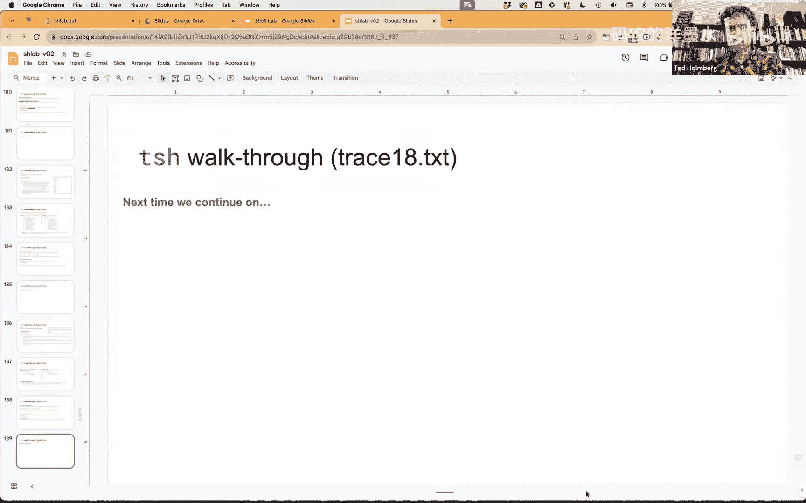

# Shell Lab：第25讲：Shell Lab 第六部分


在本节课中，我们将继续学习 Shell Lab。上一节我们实现了处理进程组（而非单个进程ID）的能力，并通过了 trace 14。本节我们将重点关注错误处理，学习如何让我们的 tiny shell 在用户输入无效或格式错误的命令时，能够像参考 shell 一样给出恰当的提示信息，并通过 trace 15 和 trace 16。

## 概述：处理错误输入

到目前为止，我们的 tiny shell 实现了基本功能，但尚未处理用户可能输入的错误命令。trace 15 专门用于测试 shell 的错误处理能力。我们将逐步分析 trace 15 的预期输出，并修改我们的代码，使其能够处理诸如“命令未找到”、“参数缺失”、“参数格式错误”以及“指定了不存在的进程或作业”等情况。

## 分析 trace 15 的预期行为

首先，让我们查看参考 shell 运行 trace 15 的预期输出，以明确我们需要实现哪些错误信息。

以下是 trace 15 的关键测试点：
1.  执行一个不存在的程序（如 `./bogus`），应输出 `./bogus: Command not found`。
2.  调用内置命令 `fg` 或 `bg` 时不提供任何参数，应输出 `fg command requires PID or %jobid argument` 或 `bg command requires PID or %jobid argument`。
3.  调用 `fg` 或 `bg` 时提供一个非数字且不以 `%` 开头的参数（如 `a`），应输出 `fg: argument must be a PID or %jobid`。
4.  调用 `fg` 或 `bg` 时提供一个不存在的进程ID（如 `9999`），应输出 `(9999): No such process`。
5.  调用 `fg` 或 `bg` 时提供一个不存在的作业ID（如 `%2`），应输出 `%2: No such job`。

我们的目标是让 tiny shell 的输出与参考 shell 完全一致。

## 实现错误处理

我们将按照 trace 15 的执行顺序，逐步在代码中添加错误处理逻辑。

### 1. 处理“命令未找到”错误

当用户尝试执行一个不存在的程序时，`execve` 系统调用会失败。我们需要在 `eval` 函数中捕获这个错误。

**修改位置：`eval` 函数中执行外部命令的部分。**

```c
if (execve(argv[0], argv, environ) < 0) {
    printf("%s: Command not found\n", argv[0]);
    fflush(stdout);
    exit(1); // 子进程因错误退出
}
```

**关键点：** 打印错误信息后，必须调用 `exit(1)` 让子进程退出。如果不退出，这个失败的子进程会继续执行父进程（shell）的代码，导致意外行为。

### 2. 处理 `fg`/`bg` 命令缺少参数的错误

当用户输入 `fg` 或 `bg` 命令但没有提供参数时，我们需要提示用户正确的用法。

**修改位置：`do_bgfg` 函数开头。**

```c
void do_bgfg(char **argv) {
    // ...
    char *cmd = argv[0]; // 命令是 "fg" 或 "bg"
    char *arg = argv[1]; // 参数

    if (arg == NULL) {
        printf("%s command requires PID or %%jobid argument\n", cmd);
        fflush(stdout);
        return; // 直接返回，不执行后续逻辑
    }
    // ... 后续处理逻辑
}
```

### 3. 处理 `fg`/`bg` 命令参数格式错误

参数必须是纯数字（进程ID）或以 `%` 开头后跟数字（作业ID）。否则应报错。

**修改位置：`do_bgfg` 函数中，检查参数格式。**

```c
    // 检查参数格式：既不是数字开头，也不是 % 开头
    if (!isdigit(arg[0]) && arg[0] != ‘%’) {
        printf("%s: argument must be a PID or %%jobid\n", cmd);
        fflush(stdout);
        return;
    }
```

### 4. 处理指定了不存在的进程ID

如果参数是数字，我们将其解析为进程ID（PID），并尝试在作业列表中查找。如果找不到对应的作业，说明该进程不存在或不属于当前 shell 的子进程。

**修改位置：`do_bgfg` 函数中，处理 PID 的逻辑之后。**

```c
    if (isdigit(arg[0])) {
        // 参数是 PID
        pid_t pid = atoi(arg);
        struct job_t *job = getjobpid(jobs, pid);

        if (job == NULL) {
            printf("(%d): No such process\n", pid);
            fflush(stdout);
            return;
        }
        // 找到作业，继续处理...
    }
```

### 5. 处理指定了不存在的作业ID

如果参数以 `%` 开头，我们将其解析为作业ID（JID），并尝试在作业列表中查找。如果找不到，应报错。

**修改位置：`do_bgfg` 函数中，处理 JID 的逻辑之后。**

```c
    else if (arg[0] == ‘%’) {
        // 参数是 JID
        int jid = atoi(&arg[1]); // 跳过 ‘%‘ 字符
        struct job_t *job = getjobjid(jobs, jid);

        if (job == NULL) {
            printf("%%%d: No such job\n", jid);
            fflush(stdout);
            return;
        }
        // 找到作业，继续处理...
    }
```

## 验证与通过 trace 15

完成以上修改后，重新编译并运行 trace 15。你的 tiny shell 输出应该与参考 shell 的输出逐行匹配（除了进程ID可能不同）。确保所有错误信息的措辞和格式完全一致，包括空格和标点符号。

通过 trace 15 意味着你的 shell 具备了基本的错误处理能力。

## 关于 trace 16 和 trace 17

上一节我们介绍了如何通过 trace 15。本节中我们来看看 trace 16 和 17。

*   **trace 16** 是一个综合性测试，它串联了之前所有 trace（1-15）中的操作。如果你的 shell 成功通过了之前的 trace，那么 trace 16 应该会自动通过。它测试了前台/后台作业管理、信号处理（SIGINT, SIGTSTP）以及我们刚刚实现的错误处理功能的组合使用。
*   **trace 17** 测试 shell 处理来自其他进程（而非终端）发送的 SIGTSTP（停止）和 SIGINT（中断）信号的能力。由于我们在之前的课程中已经正确实现了信号处理程序（`sigchld_handler`, `sigint_handler`, `sigtstp_handler`），它们能够处理来自任何源的这些信号，因此 trace 17 通常也会自动通过。

## 总结

本节课中我们一起学习了如何为我们的 tiny shell 添加健壮的错误处理机制。我们实现了以下功能：
1.  捕获并报告“命令未找到”错误，并正确终止出错的子进程。
2.  检查内置命令 `fg` 和 `bg` 的参数是否存在、格式是否正确。
3.  验证用户提供的进程ID（PID）或作业ID（JID）是否真实存在于当前 shell 的作业列表中，并对无效情况给出精确的错误信息。

通过这些修改，我们成功通过了 trace 15（错误处理）、trace 16（综合测试）和 trace 17（外部进程信号测试）。这些工作为 shell 的稳定性和用户体验打下了重要基础。在接下来的课程中，我们将开始实现更高级的功能：输入/输出重定向。



