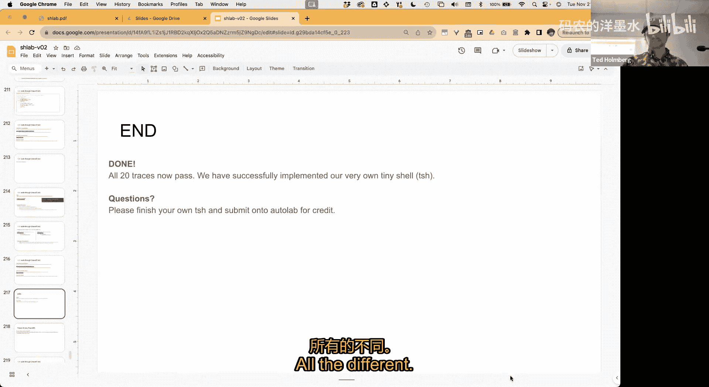

# 【全集】加州理工学院 C语言系统编程 中英字幕 p26 Lecture 26 - Shell Lab part7 -BV1bUzWBLEiC_p26-

Okay。So。We're at the very tail end of the semester I think we have today's lecture and then lecture next week or boss roll write into Thanksgiving I think we have one lecture next week on Tuesday if I're not mistaken I don't believe we're allowed to have lectures on Thursday I think。

Correct me if I'm wrong， I think。Lectures on December 1st。Which is a Friday。

 but I think the last day of class according to the UNO calendar is a。Is on Wednesday。Okay。

So if that's the case we have today's lecture and then we'll have the next lecture so on today's lecture I really want to go ahead and complete out the final traces so I had just released a video previously showing how to get through traces 15 16 and 17 of that video obviously Tra 15 is the longest because。

The other two traces are contingent on the prior 15 traces as long as you've implemented everything correctly for the prior traces。

 you should be able to go ahead and complete 16 and 17。So that said。

 the last bit of our shell implementation that we'll have to do is going to really deal with redirects。

And so I think this is kind of a also a critical section to kind of examine because this is going to show us how we can manage files at the system level in terms of being able to open。

 close。And write to them and whatnot so we'll take a look at that and I also reopened up all the the due dates into auto lab and gave them a deadline of December 1s。

So that you'll be able to use the content from these lectures to supplement that okay with that said I want to move on to Tra 18 and then we'll do a follow up once once we kind of cover this then we'll kind of piece everything together。

And talk about how we're going to sum up the results of this show。

So if we left off on Tra 17 and let's confirm that that is in fact the case。

 so i'm going to jump over to my。Shawaab。Going to open up a terminal。

And let's see here the last so me make。Our test 17， this is where I'm claiming we last left off。

So our reference。Task shows we get that output， and then our test shows that we will get。

This output which looks it looks the same to me I mean minus the Ps and again。

 just to confirm we can do a summation to make sure we get points from trace one all the way to trace 17。

 but while let this run in the background let's go ahead and look at what trace 18 is going to go ahead and request with the assumption that we're going to get points for trace one through 17。

Okay， so if we go and just inspect the contents of trace 18 that has all the directives to our test harness。

 we can see that this particular trace。Revolves around attempting to redirect。And output to a fire。😡。

So we can see， obviously the header comments always allow us。

An idea of what this trace is trying to do and then we can kind of pick through line by line what's happening here so we can see on this this first command。

We're invoking。That the LS application to go ahead and list the contents of。

The the the specify files and redirect the output to this file here so traditionally we've been printing out the contents of our application to standard out which then displays to our monitor into into whatever our display is so the。

Symbol here。The greater than symbol when put into a。

Shell command as part of your as part of your set of arguments can redirect from your standard out to a particular file i'm sure you've already seen this before many times now our shell should also。

Offer that implementation like that's an expectation that if whether you're using bash or sea shellll or whatever right whatever shell。

You're using there's an expectation that you can do redirects。Okay。

 so the first the first line here is clearly we're trying to redirect from our standard out to this file test set out then the next command is we're going to call on the cat application inside of our binary directory to go ahead and display out the contents of test set out to ensure that。

It actually holds the content。From the prior call。Then we're going to go ahead and call LS。

 and we're going to pass it in our S driver Pearl script。

And we're going to send that out to test that out and then we're going to cat that again to ensure that there's been a change in the contents so this means so let's think of a couple things that has to happen here。

This， when we first make this command here。There is no test that file in our directory this means we have to be able to create a file。

 right？😡，Okay， and so then once we create that file， we've altereded it， we've written content to it。

 then we're going to read that file using this this cat。Application to display the text。

Then when I go and do this second this third command here， which is the second redirect。

This file already exists， so now what we have to do is overr it。😡。

And then we're going to redisplay the contents there。And then finally。

 we want to make sure that we can also delete it， we're going to remove that so it doesn't exist any longer。

Okay， so let's see， let's make sure so we can see here in my evaluation。

So we could say all the way up to 17， yes， I have passed。

 so we've left off on these last couple traces， Tra 18， trace 19， Tra 20， all dealing with redirects。

perfecterect， let me while I'm here， go down here and open up my。Source code。Okay。

 so let's take a look at the difference between the output from the reference test 18 versus our tiny shell 18 we can see that we're going to get this expected behavior。

Of。S drive。pl and then t ourtiy shellll。c this is when we call our reference tiny shell。

 this is going to be the output we're going to get。

When we go to call before we implement anything inside of our tiny shell we're going to get and so i've decided to start highlighting red and green green is where we're consistent with the reference shell from the get go the red illustrates instances where there's a difference between our tiny shell and our reference shell so you can see obviously it doesn't understand it can't parse the。

The redirect。Symbols because we haven't we haven't tethered them。

 we haven't provided any logic for parsing those， so it's going to say can't access this as if that's a file because that's what it's looking for at this point think that's a file name。

Then it's going to try to access test。 out， but we haven't created test that out right we haven't added an implementation for authoring contents to a file。

😡，And so since we do that twice， we're going to get those errors again。And then finally。

 when we try to remove there's no test that that to remove so clearly all the file management stuff has not been implemented and so that's really what the discrepancies are and so what we're going to have to do for this trace is。

Implement the file handling operators for us to be able to。Complete this trace。

If we want to accomplish this， the first place we should kind of consider。

What to do is inside of our eval function， right our eval function is inside of our rebel。

Where we read， evaluate。Process and loop the evaluation function is going to do the heavy lifting。Of。

Deciding how to parse those command lines and then sending it to the appropriate helper functions so there is a helper function that will need to invoke inside of our eval function so that when we do go ahead and decide that it's not a built in function so the first thing we do in the evalal function if you recall and let's step through this we parse the command line just so that everyones reminded about what we're doing here and again what's highlighted yellow is going to be the new logic added into the preexisting logic so we're going to parse that command line to identify the command and its argument we're going to determine if a command should run in the foreground or background。

We are going to if it if if。If it does run。a if it's not a built in command。

 we're going to fork a new process。So that we can execute it at that stage。

 once we fork a new process， we need to check to see if we have to do redirect because then we're going to have to parse that command line for potentially file in and file out names to redirect our standard in standard out or standard error。

😡，Then we can set the child process to a new process group to handle the signals appropriately。

We can execute the command using the exactec V the exact vector system call in the child process in the case of a foreground process we have to wait for that command to complete and for background processes we add that job to the job list and return immediately we add the job to the job list regardless but yeah that's pretty much the logic so this is going to be the new thing we're going to have to do where we're going to refactor our eval to ensure that each child process potentially redirects the IO to be appropriate file it。

And of course， the motivation behind this change is this will allow us to do the redirects as we need to to complete this sts and we want to do that because we're trying to build a facsimile of shell a shell。

 and so all shells have to handle these redirect。Operations。Okay。

 so the helper function we're going to depend on is going to be do redirect it's going to scan our argument vector for any use of the greater than or less than symbols。

 which are the operators to indicate that we're going to go ahead and redirect to standard in or to standard out。

😡，Now we're given this function it's a helper function。

 but it's one that's only simply stubed out there's minimal implementation in there this is not one of the functions that's completely just a return statement。

 but it does almost nothing we'll take a look at it right now if we look at do redirect we can see。😡。

There is our we're getting our arguments。Aray in。We have a loop control variable of I that we're going to go ahead and declare we're going to create a four loop that's going to initialize at index zero and go through。

All of the indexes。AndWhat's happening there of our？Good fine。也都看。Yeah， that's not the code。

We're going to go ahead and initialize through all of our indexes and in fact。

 why don't we look at the actual code now。So anyway， we'll go through all the indexes of our。

 we're going to then check to see if that index is a less than symbol if it is。😡。

Then we're just going to go ahead and set it to no。

Then we'll do an L7 and see if it's a greater than symbol and if it is we're just going to set to。

 so really what we've been doing this entire time is just kind of removing those symbols。What。Or。

I mean， we've never called this and we're not doing anything with it。

 but all it does is it goes in and it kind of removes those and it just sets them to know。😡，M， yes。

Yes。So no real implementation there yet， but what we need to do is go into our EVL and we're going to have to。

 once we've offloaded this work from our EVvalal function to the do redirect because that's where that logic is supposed to go。

 then we'll start fleshing out how to actually make that logic work。😡，啊。Darring。Okay。

 so let's go into our EVval function and actually set this off while we do the a。都不是通知啊。你出你原声。诶啊啊。Um。

I'm going to bring this up actually in the tail end no there will definitely be bonus opportunities and remind me to cover this again there will be bonus opportunities and I'm going to explain how that's going to work。

So please remind me when we're done with the going through the traces and we talk about moving forward how that's going to work。

Okay， so let's jump here。Okay， so here I have my eval。And so inside of my eval function。

 what I want to do。Is after we fork。We're going to go ahead and we're going to call that do。Redirect。

And we're going to pass it our argument vector。Let just make sure that I'm in the same space here。As。

P expect。Perfect， okay， and so here。Then once we do that， let's go。2。

Are do redirect because that's going to be the next thing。

 So we're calling that now once we forked a process to go ahead and try to parse。

So that we could set up the redirects for that， so here is the implementation。That we just covered。

And I'll be congruent if this is the default implementation， this is fine。

 I'm going to be more congruent with what I've been doing。They both result to the same， but for me。

 the logic is clear instead of nodding that I like to actually just do an equality check to zero。

 it's more characters， but to me it illustrates that there's a difference of zero as opposed to nodding the results。

Okay， let's save that。Okay so let's talk about what we now have to do for that next part to work so we now know do redirect is going to be this helper function。

 so right now what it does is it its through each element in our argument vector to find redirection symbols either greater than or less than and then sets the redirection symbol and the file name in the argument vector to null to prevent them from being interpreted as command arguments。

 which is what's been causing some issues for us， but what we're going to want to do is in between that for this particular trace。

And actually， let's see what happens before we start talking about the logic。

 let's see what happens if we try to just compile our code。And run it now。Okay， let's see this is。To。

Okay， perfect。So， again。We at least。Didn't get one of the errors， right？

Which was it couldn't open up a file that was the last than symbol。But clearly。

 we're still not dealing with any of the file stuff。Okay。

 so what's going to be the logic for how we're going to manage this let's look at the pseudo code first so that we can just kind of explain the step by step process so。

After we iterate through each element in our argument vector looking for a greater than a lesson simple。

 if we see the output redirection。Then what we're going to want to do is。

We're going to want to open the specified file with right only access creating the file if it doesn't exist and truncating if it does。

😡，So what we're going to do is we're going to use the system call。😡。

Open with these flags and we'll talk about what these flags are in just a moment。😡。

Then we're going to also have to set file permissions for read and write access to the user because remember。

 we have to write to it and we have to be able to read from and to when we do the CA。

And then we're going to use a system called Duke2， so we're going to use a system call open and to open a new file or just to open a file and it generates it if it doesn't exist already。

 that's going to be one of the that's what these flags are going to help us with。

And then we're going to be able to use Duke2， which is another system call。

 which is going to redirect the standard output。Which we can express like this in our code。

There's a a。There's a label for it， a constant label。

To the newly opened file ensuring that our output command is written to the file and then once we've done that we are going to close using the file descriptor after duplicating to avoid any kind of resource leaks and to make sure that we unlock we we unlock ourselves from that file so that other applications can potentially access that file if we don't close it from one application the next application won't be able to lock it and be able to read from it that's all yeah。

Okay， so once we have that so let's go in through the key system functions so usually after we go through the pseudo code you kind of go and explain this a little bit more detail。

 so we have O underscore WR only we can think of that as standing for open for writing only and I tried to highlight or bold that which makes it make sense it's a flag that's specifically used for that open system call to specify that a files to be open for writing。

The O create stands for open create that's a flag which is used with our open system call to indicate that if the specified file does not exist。

 it should then be created。And then O trunk stands for open trunkncate。

Which if the file already exists， it can successfully open for right operations。

And so its length will be truncated to zero effectively clearing the files contents。

 allowing us to overwrite on the file。So we're wrong caing， we're just following caing et ce。Okay。

 so some other system calls and system functions that are worth knowing mode T。

Is effectively going to be a structure or it's。It's going to be a type where it's used for a system calls like open for setting our file permissions it's used when we create a new file or modify the permissions of an existing file so when we create a file we're going to use the mode to when we read from a file we won't need that so you'll see there's two different set of parameters between this trace and the next that will be making use of for the open call so now here for。

The mode we're going to use the set iode read user and set iode for right user。

 so this is going to allow us to set the file permissions。

When we make this open system call so that we can give the necessary privileges to that file。

 so again， we need to issue read and write。Our privilegerivis。

And so an iNote is a data structure at the system level that maintains kind of all the permissions and information。

 the metadata associated with that file。The actual system call。

 so all of these are pretty much representative of particular attributes that we're using。

 the actual system calls we're going to be using is the open system call which is used to open a file and then we're going to pass this flag values so we can set the permissions and all the different attributes that we have to have for that file。

2 is going to be a system call that's used for duplicating a file descriptor。

 it's essential for redirecting our standard input and output。😡。

So that we can go ahead and implement these traces。

We have a closed function which is going to allow us to close a file descriptor and so this system called is going to release the resources ensure the changes up to the file are saved and finally。

 since for this trace we're dealing with redirecting the standard out。Well。We can use。

This constant here that represents standard out file number。

 which represents the standard out file descriptor for our system， and usually that has a value one。

 but we use the alias to ensure that our code is readable and whatever it is。

It actually works for our software。And then if we just look at the API， we could see with open。

 we are we provided a path name as the first parameter， the flags。For our file。

 which effectively are represented as an integer value。😡，And then the mode。

 which is going to give the privileges。And so typically with the mode。

 we're going to really use this third parameter on the instances where we use the flag to create a file if we're not going to include the flag to create。

 we don't necessarily have to include a mode。Now， since we are going to create。

 we are going to include that on this instance。With a close function。

 we just have to provide it the file descriptor that we want to close。😡。

And it's going to return back a zero on success or a minus one in case there was an error that I mentioned here。

 I didn't mention on open， I should have mentioned on open。

 what happens when we open a file is it does return back an integer value and that inger values is the file descriptor so that we can recall that file later on so we can close it。

So we can track our file， this particular file by its file descriptor。And again。

 a file descriptor is going to be a non negative integer on a success or minus one on a failure again。

 if i'm implementing any kind of error management， i'm looking at what those integer values are returned at and then i'm resolving to do some kind of print statement to the user to allow them to know that。

there was some kind of error or fault in what they requested。

And then Duke two is going to take in a old file descriptor。

 which is an integer value and a new file descriptor， which is an imageteger value。

 the first is the file descriptor that is to be copied。

And the new file descriptor is going to be to which the old file descriptor is duplicated。

 so the concept of redirect is the software is sending all of the content to our standard out file。

 our standard out stream and when we do a redirect we want to take everything that's being copied into that and duplicated into our file。

😡，So that we can get we can get that behavior with this system call。And just so you know。

 the particular。We'll have a couple of constants that represent our standard out file number。

 our standard in file number， and our standard error file number。Okay。

 so now let's look at the actual implementation after talking about the pseudo code after reviewing some of the system calls and system fields that are available to us。

The implementation is going to be as such so we are already so in the instance that it's the greater than symbol。

 the the redirect for output symbol。😡，We're going to set our flags now we looked at the function call on open。

 we know that the data type for our flags resolves to be an integer value。😡。

We stated that for the ability to potentially create a new file or truncate to a preexisting file such that we have right only privilege or with only right only operations we're going to use。

😡，These particular。Values， and we're going to go ahead and do a。Or operational on them。

 a bit wise or operational on them。Okay， that's going to set。

That combination is going to set the value that we need for a flag to send to open。

 that's the second parameter that we need for open。

Then what we're going to have here is we're going to go ahead and set our file mode。

So we said that our file， the privileges we would need would be the ability to read and write。

So we're going to set the i node read user privilege and we're going to set the i node right user privilege and again we're going to use a bit wise。

Or operation。To be able to get those two， and then we're going to save that into our file mode。

 which is going to be that data type mode T。Okay， so this is my third parameter。

So now when I go to call open， the file name should be inside of our command line argument。😡，So。

At all， I is the instance in which we have a。😡，Les than， I mean， I'm sorry greater than symbol。

 so that means the thing immediately after the eye。😡，Is going to be my file path。

Or the file name that we're redirecting our。😡，System dot out contents into。

So we're going to pass that as our argument as our first argument。

 we're going to pass our O flags as our second argument and then we're going to pass that file mode as our third argument。

 then this should return to us our new file descriptor。Which is an integer value。

 we need that because we pass the new file descriptor and the old file descriptor。😡，To the dupe2。

Function。Such that it will grab the contents from standard out and author it into our file。

 and then when we're done we will then close。Our new file descriptive。And then after that， we still。

 we still have to go into all and after we've set all that up， we've got to remove。That operator。

Okay， let me go and implement that。So inside of here。你 do。Oh。Let's see here。So we're going to do。

A O flags？And we said our O flag is going to be the open。Or right？Only。And are open for。Create。

The open。Or the。嗯。Here we go。Perfect。Okay， so that's going to be our flags and we're going to have to get our mode since we're creating the file so we're going to call this file mode。

And then what I'll do here is it's going to be set。I knowed。For read。User。And set。

Iode for right user。Perfect。And then once we do that， we can then go ahead and call。

 let's do our new file deor， we can call our open function and we can pass it our RV at I plus1。

We can pass it our O flags。And we can pass it our file node。And then once we do this。

 we can go ahead and call to do two so we will do。Do two and we will pass it the parameters of our new file descriptor。

And are standard out。Yes。File number。Perfect。And then finally， we're going to close that。

Once we've done once we've set up the pipeline。Picking then up new。New file descriptor。Excellent。

 let's save that。 Let's compile， make sure that we don't have any issues with。Our implementation。

 it seems that I've compiled fine through curiosity。

 I'm just going to go ahead and test to see what happens if I do a make on test 18 and we can see oh。

 this looks like。This looks like it's correct。So if I do a di between those。

And the nice thing about this is we don't have to contend with process IDs triggering my di。

So let me widen this so that I can try to get this all on my line。Yeah， so clearly the。Tiny shell ra。

 tiny shell。You know such file to set out up this is。It seems to be。In contrast here。

Inss such files remove， let's pull check。So if they're running Yeah， very， yeah。Yeah。

 it looks good to me and in fact， what we can do here。Is while we set up the。For 19。

 we will check just to make sure we get those points。

We'll let this run in the background it's going to take a few moments。

But let's presume based off of the output that we saw， just inspecting our tester。Against。

Our tiny shell and a reference shell that we've completed that satisfactory well。

 then what's the next thing we need to do Clearly with trace 19。

 it should be obvious that if the goal of trace 18 was to implement。The redirect for output here。

 we're going to redirect for input。😡，So if we look at the comment here we can see test whether the shell can properly redirect input yep that's exactly what we're going to do and there's only one thing it does right it's going to re it's going to take my re dot C and redirect that。

Into the dot my read 10。And so let's see what the output is going to look like even initially。

 so we can see that when we call my read。Using the tester， so if we make our test the reference S 19。

 it's going to say， oh， it's going to read 10 bytes from standard input。And then from。

From that file is going to read the character。Slash and then character read asterisk and then character read blank space。

 blank space， new line character， then character red blank space。

 then character read asterisk then character read blank space then character read M and Y and R so we could see the behavior of my read which is an application in of itself right we don't really care about how that's implemented。

 but we could see when we pass that argument in1 between 10 bytes from that。

Whereas here we haven't implemented any readdirects。

 they're just going to read zero bytes from standard input because it's not reading from a file right there's nothing in standard input。

Okay， so these are going to be our discrepancies here。

 so obviously we're going to have to go ahead and implement our do redirect so that we can also。

Take the contents of a file and copy it over into our standard In。😡，And then here we go。

 we can see we did indeed pass Tra 18， right， that was the success。So。

Let's think about what we have to do and redirect to do that well， fortunately。

 do redirect is checking for both。Input and output redirections， so we just have to add logic。😡。

On the instance， when it's an input redirection。😡，So if it is an input redirection。

 which is the less than symbol， we're going to open the specified file with read only access。

 so that means we're going to use that open system call that we saw just last trace。😡。

And we're going to have to use the flag O for open read only， so O R D O only。😡。

And then we're still going to want to use that Duke2th system call to redirect the standard in put。😡。

Which we have the Alias standard in underscore file number。😡，To the newly opened file again。

 we don't like magic numbers， right， so we always use。

Greetable constants to represent these very critical system file numbers。Then once we're done that。

 well that's it， then then we can kind of close our new file deor after duplicating it to avoid resource leaks and then we can go ahead and set the redirection samples。

So the new concepts that we're introducing what we've already seen open truncate open create open for writing only so obviously there's a open for reading only and that's what our O。

RD only is four。And then we saw the standard out file number where clearly there's also a standard and file number。

So then the actual implementation for this would be inside of the selection operation for the lesson symbol we're going to use as our flag。

Open read only。And then we don't need a mode because we're not creating a file。😡。

So on our open system call， we're going to pass it in。

 presumably after that symbol is going to be the name of the file that we're going to try to open。

 so we're going to grab at index i plus one。😡，From our argument vector， that file name。

 and then we're going to pass it the flag， the open flag。

 so that we can do this for read only and it's going to attempt to open that and if it's successful it's going to give us a nonne file descriptor。

😡，Yeah。We'll then take that non negative file descriptor。

 we're going to pass that to our do2 along with our standard input file number。😡。

And then we're going to close that new file descriptor once we've gotten all that plumbing put together。

Okay， let me implement this myself。So inside of here。We're going to go ahead and set our flags。嗯，这个。

Okay， so let's see here。Our。O flags and we're going to set that to be our open。Read。Only。

And then what we're going to be able to do is。Call that open system call。

So we're going to capture the new file descriptor from that。

 so we're going to pass it from our argument vector。At I plus1。

The file name and then we're also going to pass it are open flags。

And then once we have that new file descriptor， we can go ahead and call D2 on that。

Where we will pass it that new file descriptor， and then we'll also pass it is standard in。

File number。 And then once we're done that， we're going to cope and call close。

Close on our new file descriptor。And we will save that。O。And then of course。

 what was already implemented was after we do all the plumbing。

 we go into ArgV eye and wenll that out。We remove it because we've handled that part of our command law。

So let's see if we can't。Compile and make sure there's no errors with their implementation for me it compiled fine so there's no syntax issues there and now let's see here we never actually did we inspected the slide but i'm going to do a make。

😡，R task 19。Okay， so that's what the slide said， Let me expand my。

Let me expand this and now let me do make test 19 and we could say， oh yeah， perfect。

 that looks exactly the same now。And in fact。We can verify this。By going and just。

Running our check on our T show and while we go ahead and work on that check。

 let's take a gander at what the last and final traces and what you're going to probably notice is that trace 20 is just going to do IO redirection with both input and output。

So it's going to。Use one file to redirect into the My read application for 40 characters。😡。

And then it's going to output that。To slash Dev slash nu。So。

If we implement it trace 18 and 19 correctly， we're done with Tra 20。😡，So let's say。

What we should get if it does work， what we'll see once we get there is that our expected behavior would be to read 40 bytes from standard input。

And so our observed behavior should show the same thing。

 read 40 bytes from standard input when we send something to null， it's just discarding it。Okay。

 so then this is a moment of truth， have we completed the cell lab？Got in Tra 15。And。16。U。Yes。

 we can see。We passed trace 17 trace， I'm sorry， we're doing these right here， we pass trace 18。

 trace 19 and by consequence of those two traces passing， we've also successfully passed trace 20。下あ。

We are。Done with the base of shell lab。All 20 traces are successfully implemented you should now have all the tools and explanation and slides and video lectures to be able to successful and hopefully explanation so like I said。

Bonus， right？You were asking about bonus and I was going to wrap in， how is that going to fit？

The next thing I want to do then is talk about。How we're going to do our final。So like I said。

 you're going to have the opportunity to work in teams。

To effectively create a presentation that goes into a deep explanation of how a shell works using this code as a basis。

😡，If you want to get bonus material， you can make this code better。

You can add functionality to it that we did not add。

 you can add full tolerance in it that we have not， added it， identify weak points， implement it。

 and in your presentation to me show me how you've improved this tiny shell to be better than the one that I've implemented here in class。

😡，Yeah just as long as it doesn't fail any of the traces。

 so you have to still pass the 20 traces and then we can drop into your tiny shell and you can show me how you've made it better in some kind of way and explain the logic behind it and show me how you've done that。

Does that makes sense， and so that's what we're going to do as our final。

Is there any questions yes so at any time once you're prepared send a request to meet with me we will meet through zoom I'll schedule and i'm expecting it to be。

However， I will give you。I'll let you go for as long as you need to be able to do a presentation。

 but your presentation should be no shorter than about 15 minutes。😡。

But I'll give you as long as you need to be able to go deep into a great explanation of how a shell。

 how this shell application works。And so I'll give until now until the final day of exams as your ability to get this done and once you're ready just send me a an invite like hit me up on discord and schedule with me a effectively well do a presentation through zoom so I'll let you share your screen coordinate whoever with whoever is in your group to go ahead and be the point person。

To be able to kind of show off your screen。So that we can have。And not just like a code overview。

 but like whatever， however you present the content。

 and then you could show me your additional implementations。

Let me make sure that there's no questions inside here。No questions in chat。Yeah， excellent， okay。

 so if there's no other questions really this was the final lecture lecture I wanted to have。

 I think we still have one technical lecture left， but there's not going to be any new content in it。

😡，So what we'll probably do for our last lecture is just make sure that everyone is grouped up and making progress。

 so I will have a check in to make sure that everyone's assignments are turned in。

 everyone's done feels good at where they're at with the lab work and that everyone is where they think they need to be for the presentations that we're going to do for tiny shell。

So what we can think of our very last day of lecture as a group meetup debt。

And just so you know December 17th is the last day of， so you cannot schedule any time after that。

 so be mindful of your time there's plenty of time to do this。

There's plenty of time to do this so just be aware and coordinate with your team members okay。

 does anyone have any other questions？把这。Yeah， so December 7th is the last step。Did I say 7 or 17'？

Yeah， I mean this semester's ending really early we're not getting any lectures in on December really so it's its it's nice。

 but I think next semester also begins really early。

 I think we begin like January 6 or so8 yeah it it's pretty early。Okay。

 well I will end our lecture here today after kind of alluding on how the final is going to be。

 I will post this last video lecture up as soon as Zoom is done processing it and then you can all get to work。

Excellent， I will see you all next Tuesday。We saw all the different files。

嗯就是。