# 003：远程过程调用 (RPC) 🖥️➡️🌐

在本节课中，我们将要学习分布式系统中的一种核心通信机制——远程过程调用。我们将通过一个在线支付的例子，了解RPC的工作原理、实现方式以及它在现代软件架构中的应用。

## 概述

上一节我们介绍了客户端-服务器模型作为分布式系统的一个例子。本节中我们来看看另一个非常实用的例子：在线购物支付系统。这个例子清晰地展示了不同公司提供的服务如何通过网络协同工作。

## 在线支付：一个分布式系统实例

想象你正在使用一个在线商店购物。你选择商品后，需要输入信用卡信息进行支付，然后商品才会被寄送给你。这里发生的情况是：实际处理信用卡支付的支付服务，通常由一家与运营在线商店不同的公司提供。

因为处理信用卡支付是一项非常专业化的活动。所以，有公司专门从事信用卡支付业务，而另一家公司则专注于提供商店和商品，这是合理的。

那么具体过程是怎样的？当你在某个在线商店输入信用卡号时，在线商店会向支付服务发送一条消息。该支付服务运行在由另一家公司提供的不同节点上。

这条消息将包含你的卡号详情、扣款金额以及其他各种信息，例如账单地址等。所有这些信息都被发送到支付服务。

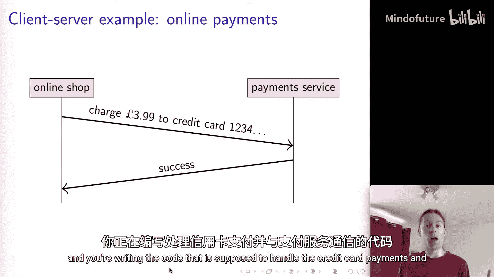

支付服务随后会进行一系列复杂的操作：它与卡支付网络（如Visa、Mastercard）通信，卡支付网络再与发卡银行通信。它们确保你的账户有足够的资金，并确认可以完成扣款。如果成功，它们会反向完成所有流程，并可能进行额外检查，例如让你输入密码或发送短信验证。最终，支付服务会向在线商店返回一条消息，指示支付是否成功。这是一个每天都在真实使用的、非常具体的分布式系统实例。

## 代码视角：远程过程调用

现在让我们看看代码可能是什么样子的。假设你是为在线商店方工作的程序员之一。

你正在开发运行在线商店的软件，并编写处理信用卡支付以及与支付服务通信的代码。你写的代码可能类似这样：假设代码库中有一个`Card`对象，你可以创建它的新实例，并传入信用卡号、有效期和背面三位安全码，将这些信息打包成一个`Card`对象。

```javascript
let card = new Card(number, expiry, cvv);
```

然后你调用一个函数。你有一个包含支付服务的对象，并调用其上的`processPayment`方法。你传入想要扣款的卡对象、扣款金额以及货币类型。然后，根据操作是否成功，你执行订单履约。

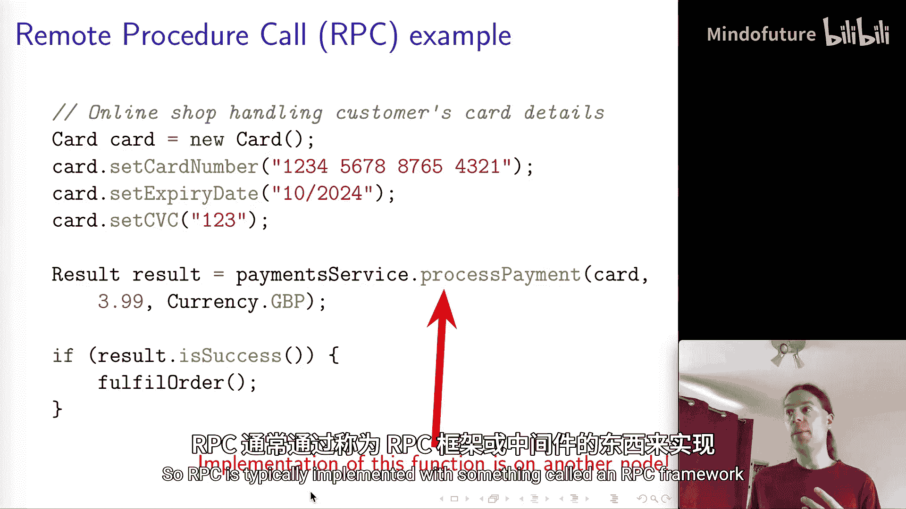

这里发生的事情很有趣。因为仔细想想，支付服务运行在不同的节点上，由不同的公司运营，它并不属于在线商店的代码库。

所以，当你调用这个`processPayment`函数时，该函数的实现并不在你的程序中。其实现位于互联网连接另一端的某个节点上。实际上，这个看起来像函数调用或方法调用的操作，在底层被转换成了某种网络通信。

这被称为**远程过程调用**。也许“远程函数调用”是更好的名字，但“远程过程调用”是这个概念的常用术语，我们将沿用这个名称。Java称之为**远程方法调用**，这本质上是同一个概念的不同说法。

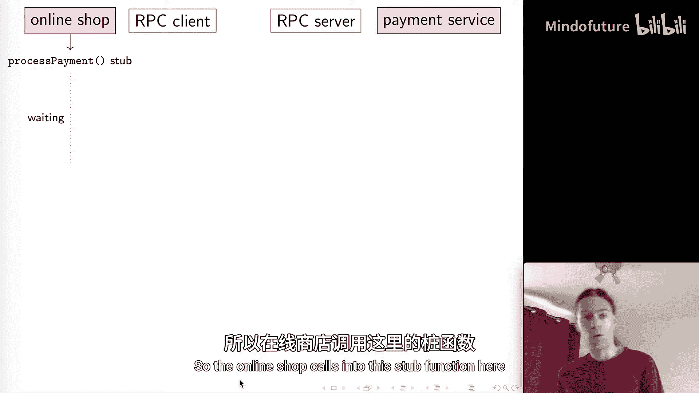

## RPC 的工作原理

让我们看看RPC是如何工作的。RPC通常由一个称为**RPC框架**（有时也称为**中间件**）的软件实现。这个软件负责在你的编程语言中的函数调用和网络的消息传递之间进行转换。

当在线商店的代码调用`processPayment`函数时，它无法直接调用另一个节点上的函数，因为你的编程语言通常不支持这样做。相反，RPC框架提供了一个称为**存根**的东西。

这个存根函数具有与你想调用的远程节点上的函数相同的类型签名，看起来也一样。你想调用`processPayment`函数，我们创建的就是这个存根函数。它并不实际处理支付，而是向实际处理支付的服务发送消息。

因此，在线商店调用这里的存根函数，RPC客户端需要获取传递给该函数的参数，并将它们转换为可以通过网络发送的消息。这个从编程语言参数到网络消息的转换过程称为**编组**。

编组（我也称之为编码）接收函数参数，并以某种可以发送到网络的方式进行编码。例如，它可能使用JSON。在这个例子中它使用了JSON，也可以使用某种二进制格式。具体格式并不重要，但它最终变成了一串字节，我们可以将其打包成消息通过网络发送。

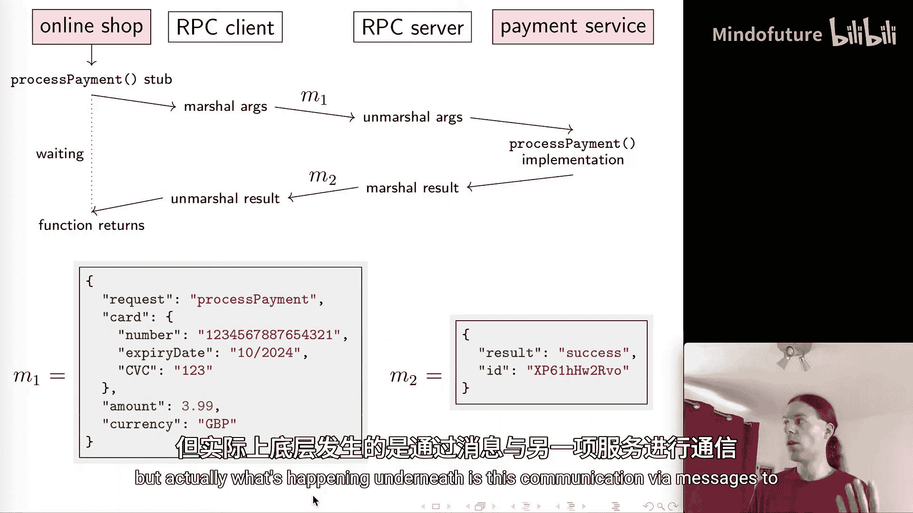

在接收方，RPC服务器将收到这条消息，并将其转换回服务器端的函数调用。现在，这里才是`processPayment`函数实际实现所在的地方。在RPC服务器端，这个函数将被调用，并执行处理支付所需的所有操作，这可能包括与卡网络和银行通信、更新数据库以及执行一系列额外操作。

最终，这个函数将返回，并希望它能告诉我们信用卡支付是否成功。同样，这个函数的返回值也需要被编组。我们以相反的顺序执行完全相同的操作：RPC服务器编组函数的返回值，将其作为消息M2发送回网络；RPC客户端解组它，将其转换回你所用编程语言的数据类型；然后函数最终返回。

这样，我们就实现了一种“伪装”，让我们感觉像是在本地调用函数，但实际上底层是通过消息与另一个服务进行通信。

## 位置透明性与现实挑战

我们在这里追求的理想状态是：对一个不同服务的函数调用，看起来就像一个本地函数调用。因为我们知道编程语言中的函数是什么样子。我们非常希望RPC看起来就像那样。这个原则被称为**位置透明性**。

资源的位置——即你调用的`processPayment`对象是在你自己进程的本地地址空间中，还是在互联网连接的另一端——我们希望这是透明的，我们希望无法区分这两者。

然而，现实并非如此简单。正如开头所说，网络的问题在于它可能失败。你可能通过网络发送了一条消息，但消息没有到达。当然，你可以重发，但那样你会多次扣款吗？如果我们打算重发消息，必须非常小心。

消息可能丢失，我们如何处理重试？消息也可能延迟。可能消息实际上已经送达，但由于某种原因，网络中的某个小故障导致消息延迟了一段时间，这也可能发生。还可能发生的情况是，处理此函数的服务在执行我们函数的过程中崩溃了。在这种情况下，它将无法发回响应，但它可能已经部分处理了我们的请求。

我想我们可以在这里使用事务，是的，ACID。可以看到这里有很多开放性问题。从根本上说，调用远程资源的函数调用似乎与调用本地函数完全不同。它们根本就是两件不同的事。我们可以让它们看起来有些相似，可以给函数类似的类型签名，但是调用远程函数有所有这些在本地执行中根本不会出现的错误情况。

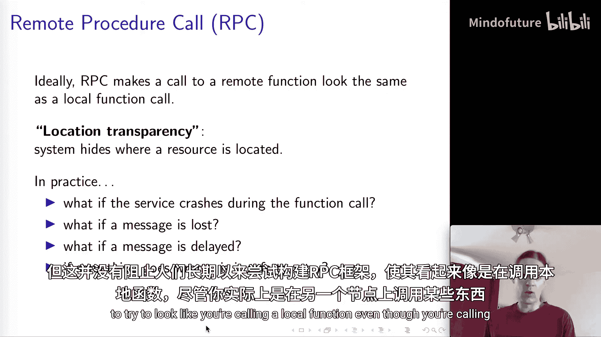

## RPC 的发展历程

但这并没有阻止人们长期以来尝试构建看起来像在调用本地函数的RPC框架，即使你是在调用另一个节点上的东西。这可以追溯到80年代，当时“RPC”这个术语首次被创造出来。

像一些微系统就有这个东西，它被用来构建NFS（网络文件系统），我们将在课程后面更多地看到它。然后在1990年代，这是一个非常热门的话题，人们谈论面向对象的中间件，出现了像CORBA这样的东西，当时非常热门，但现在没人用了。后来出现了一系列竞争技术，比如Java的远程方法调用，与CORBA属于类似类型。

我们不会深入所有这些细节，只是在这里提一下名字，因为你可能在职业生涯中遇到它们，至少以前见过是好的。就在2015年，谷歌推出了另一个RPC框架，叫做gRPC。如果你想做RPC，你可以使用它，也可以使用其他东西，这并不重要。

如今非常常见的是被称为**REST**的东西。它代表“表述性状态转移”，有点拗口，但它实际上是一套关于如何使用HTTP的原则。REST的狂热爱好者不喜欢将REST视为RPC，他们喜欢将REST和RPC视为两种不同的哲学。但本质上它们是同一种东西。它们仍然是关于通过向远程服务发起网络请求来调用代码并使其发生某些事情，并以编程语言中合理优雅的方式将整个过程打包。

## RESTful 风格的 RPC

这种构建RPC的RESTful方法变得如此流行的一个原因是，网络浏览器支持发起HTTP请求。你可以在网络浏览器中运行一些JavaScript代码，这些代码可以向服务器发起HTTP请求，构造它想要在请求中发送的任何数据，发送出去，并可以接收服务器返回的响应。这种技术有时也被称为**AJAX**。

它看起来像这样：如果我想用JavaScript实现这个信用卡支付的例子，我可能首先创建一个包含RPC函数调用参数的对象`args`，其中包含金额、货币、卡号、账单地址等。

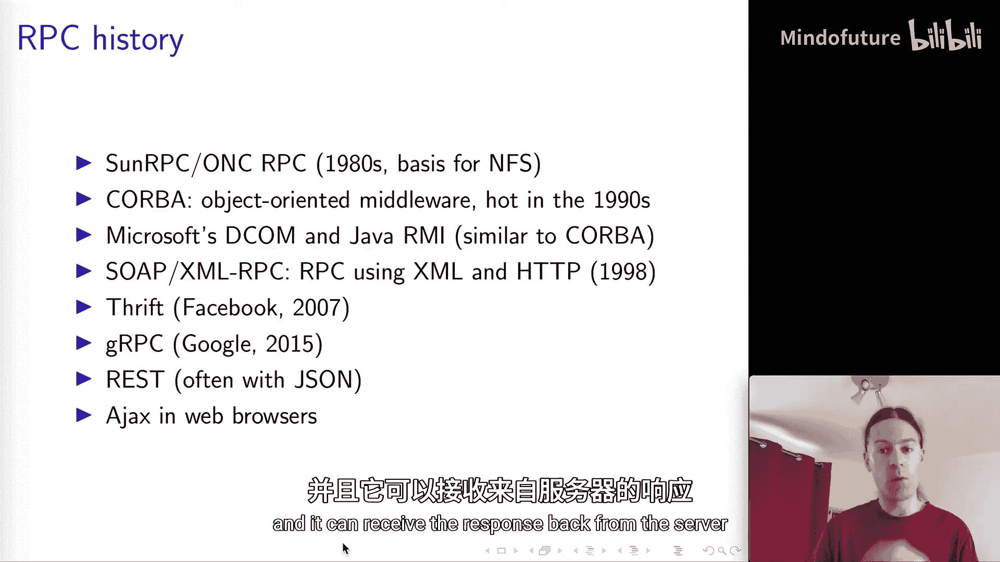

```javascript
let args = {
    amount: 100,
    currency: "USD",
    card: {number: "1234...", expiry: "12/25", cvv: "123"},
    billingAddress: "..."
};
```

然后我构造这个请求对象，指定我想使用的HTTP方法。`POST`是通常用于提交表单、在服务器上更改某些状态的方法。我现在将使用`JSON.stringify`函数将参数转换为JSON字符串，并可以告诉服务器我提供的数据类型是JSON。

```javascript
let request = {
    method: "POST",
    headers: {"Content-Type": "application/json"},
    body: JSON.stringify(args)
};
fetch("https://example.com/payments", request)
    .then(response => {
        if (response.ok) {
            return response.json();
        } else {
            throw new Error(`HTTP ${response.status}`);
        }
    })
    .then(data => success(data))
    .catch(error => failure(error));
```

然后我们在这里有两个处理程序。`then`情况下的回调函数在网络请求收到成功响应时被调用。如果我们从服务器得到了响应，那么这里的`response`变量就变成了那个响应，然后我们执行这里的代码。我们可以查看从服务器得到的响应，看它回复的状态码是否表示成功。如果表示成功，响应可能又是JSON，我们可以通过调用`response.json()`将其解组回JavaScript对象，然后调用`success`函数来指示我们从服务器得到了成功的状态。否则，如果状态码不成功，我们可以用状态码调用`failure`函数。当然，我们可以做更详细的错误处理，但这只是基本思路。

这是我们从服务器得到响应的情况。当然，消息可能丢失。所以我们可能没有从服务器得到响应。在这种情况下，例如，请求可能只是等待30秒，如果30秒内没有收到任何东西，它就会说超时。我们放弃。消息可能已经送达，也可能没有，我们并不真正知道，但我们会给你一个网络错误。这就是这里发生的情况。

所以在这个`catch`情况下，我们有另一个回调函数，如果网络请求没有从服务器得到响应，它就会被调用。在那种情况下，我将再次调用那个`failure`函数并传递错误。在实践中，你可能想向用户显示消息并解释出了问题。

无论如何，这就是你如何进行RPC的基础知识，以及如何在JavaScript中通过HTTP使用REST API。正如我所说，这种模式在网络浏览器中变得非常流行。现在大多数网站都会使用这种技术向服务器发起HTTP请求而无需重新加载整个页面。它只是在你的网络浏览器中运行的JavaScript，就像一个客户端程序，执行这些网络请求。

## 企业级系统中的 RPC

但非常类似的技术也用于服务器间的通信。这种技术在大型公司中尤其流行。

在大型企业中，你有这些运行公司所有运营的庞大软件系统。这些软件系统太大、太复杂，无法仅仅作为一个程序运行在一台计算机上。有时仅仅因为其巨大的复杂性，有时也因为它们必须处理的大量数据，它们是分布式系统。所以你有多台计算机上的多个节点，共同提供这个大型组织（可能是一家银行或零售商）的部分基础设施。

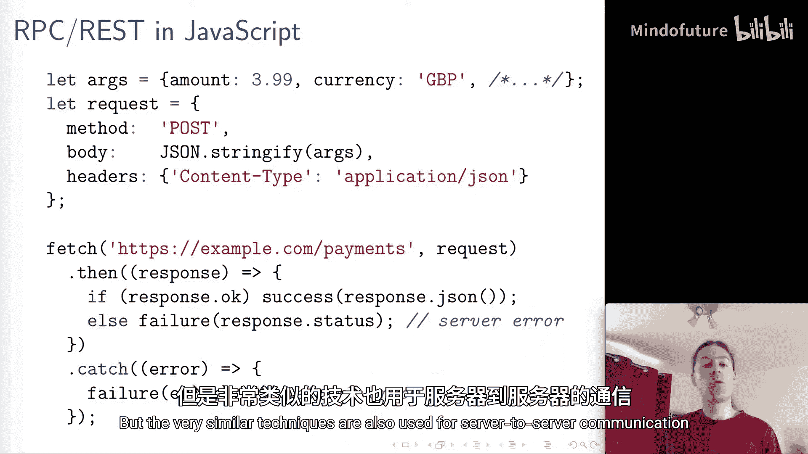

这一大堆软件被分解成所谓的**服务**。将一大块软件分解成服务的方法被称为**面向服务的架构**，或者现在一个更现代的术语是称之为**微服务**。

这只是让程序运行在不同的节点上，通过RPC进行通信。因此，RPC是允许这些软件片段相互交互的关键机制。

让我告诉你更多关于在这种设置下的RPC。我们已经在网络浏览器中见过它，但在面向服务的架构中，你通常谈论的是在数据中心内运行的服务。它们可能运行在同一个数据中心的多台不同服务器上，但通常它们都是通过数据中心网络进行通信的服务。这些不是运行在你的终端用户设备（如手机或笔记本电脑）上的服务，而是数据中心端的服务。但无论终端用户设备与服务器通信，还是服务器与其他服务器通信，我们都可以同样好地使用RPC。

在这些大规模企业系统中，你会遇到它们使用一大堆不同的编程语言，因为它们有一些旧的系统。它们可能有一些用COBOL写的旧系统，然后有一些用C++写的稍新的系统，接着有一些用Java写的更新的系统，然后还有用当前最新、最时尚的编程语言写的最新系统。这些系统需要相互通信，因此RPC实际上可以提供一种机制，实现这些用不同编程语言编写的系统之间的互操作性。

## 接口定义语言

这确实意味着，如果函数调用者和被调用的代码是用不同的编程语言编写的，你现在必须确保类型签名能以某种方式匹配，因此必须执行一些数据类型转换。

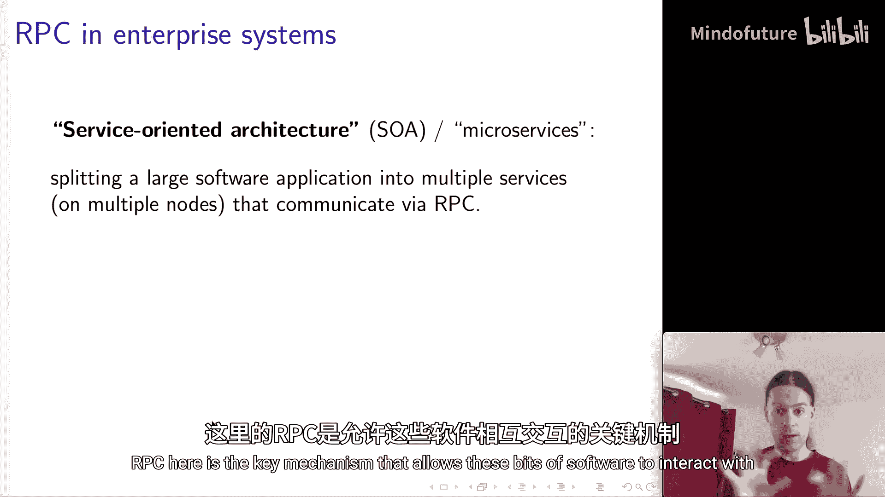

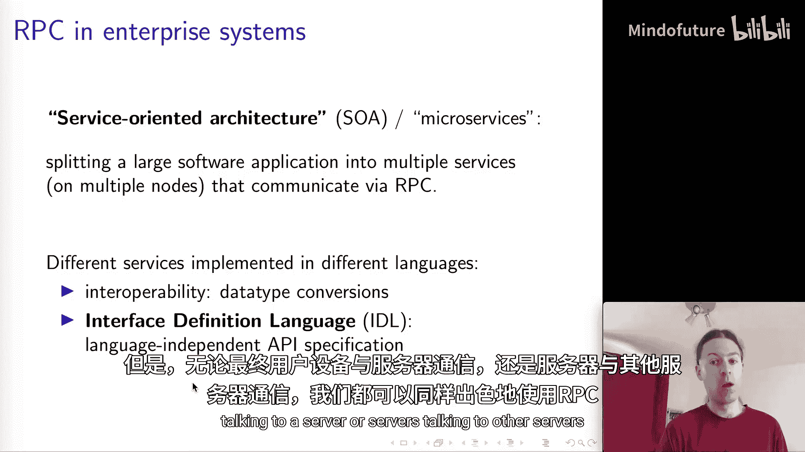

这通常通过一种称为**接口定义语言**的东西来实现。IDL本质上是一种用于指定函数调用类型签名的方式，它不特定于任何一种编程语言。

这是一个IDL的例子。这个例子取自gRPC，谷歌的RPC框架，它使用一种叫做Protocol Buffers的IDL。细节并不重要，我只是想让你感受一下它是什么样子。

在这里，你可以有一个消息类型的规范。我们可以有一个`PaymentRequest`消息和一个`PaymentStatus`消息作为两种不同的消息类型。然后在这里，我们有一个服务的规范。一个`PaymentService`提供一个名为`ProcessPayment`的RPC函数调用。它以`PaymentRequest`作为参数，并返回`PaymentStatus`作为其返回值。

```protobuf
message PaymentRequest {
    Card card = 1;
    int32 amount = 2;
    Currency currency = 3;
}

message Card {
    string number = 1;
    string expiry = 2;
    string cvv = 3;
}

enum Currency {
    USD = 0;
    EUR = 1;
    GBP = 2;
}

message PaymentStatus {
    bool success = 1;
    string transaction_id = 2;
}

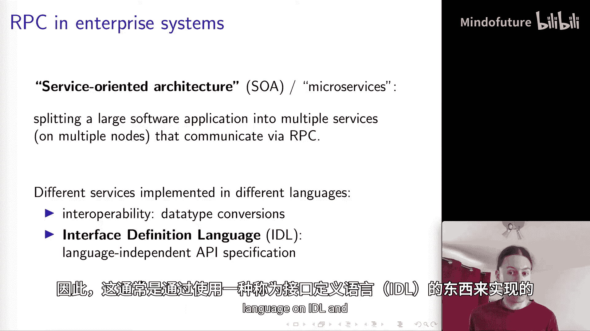

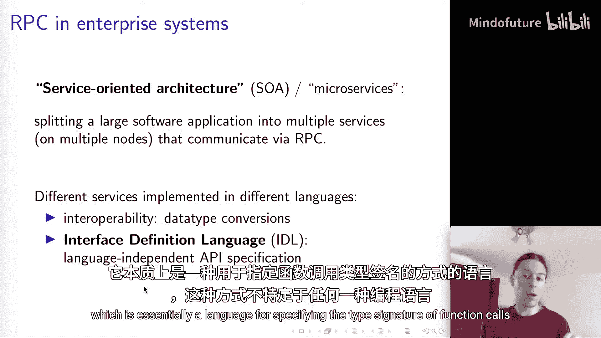

service PaymentService {
    rpc ProcessPayment (PaymentRequest) returns (PaymentStatus);
}
```

然后在这里我们可以说，`PaymentRequest`由什么组成？它由一个`Card`、`amount`和`currency`组成。而`Card`又由卡号、有效期和背面三位安全码组成。`currency`可能是一个枚举，指示可能的值。忽略这里的12、34这些值，其细节对本课程的目的并不重要。

但你可以看到，我在这里使用像`int32`这样的数据类型来表示这是一个32位有符号整数，这是一种相当通用的数据类型，你会期望大多数编程语言都支持这种东西。同样，`string`数据类型非常常见。枚举，如果语言不支持枚举，可以将其转换为整数之类的东西。`bool`也是一种常见的数据类型。你可以争论卡号应该是字符串还是足够位数的整数，以便容纳16位数字，无论我们怎么考虑。但你明白了基本原则：这是一个独立于语言的规范，描述了RPC的样子。

RPC框架可以获取这个IDL规范，并在你所有喜欢的编程语言中生成代码。这样，它就可以为RPC客户端和RPC服务器生成存根，使得在调用方和被调用服务方编写执行RPC的代码变得容易。

## 总结

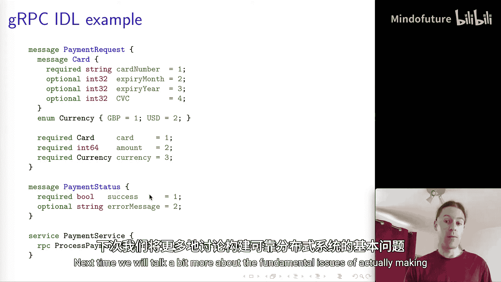

本节课中我们一起学习了远程过程调用。我们从一个在线支付的实例开始，了解了RPC如何让不同节点上的服务像调用本地函数一样进行交互。我们探讨了RPC的基本工作原理，包括存根、编组和解组过程，以及追求“位置透明性”的理想与现实网络不可靠性带来的挑战。我们还回顾了RPC的发展历程，从早期的CORBA到现代的gRPC和广泛使用的RESTful API。最后，我们看到了RPC在大型企业微服务架构中的关键作用，以及如何使用接口定义语言来实现跨编程语言的互操作性。RPC是构建分布式系统，尤其是服务间通信的基石。下次课，我们将更深入地探讨构建可靠分布式系统所面临的基本问题。