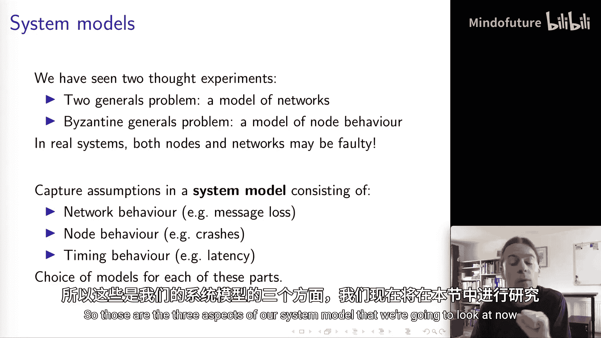
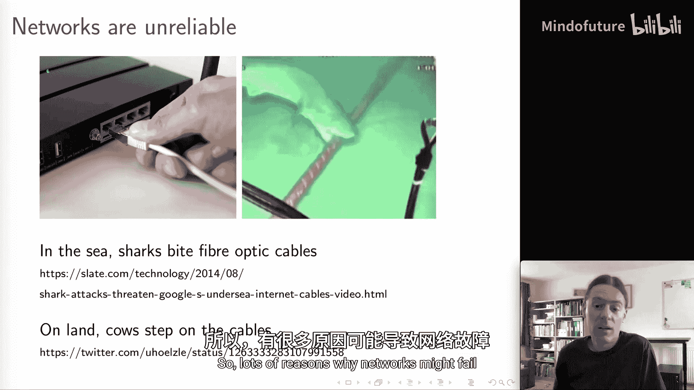
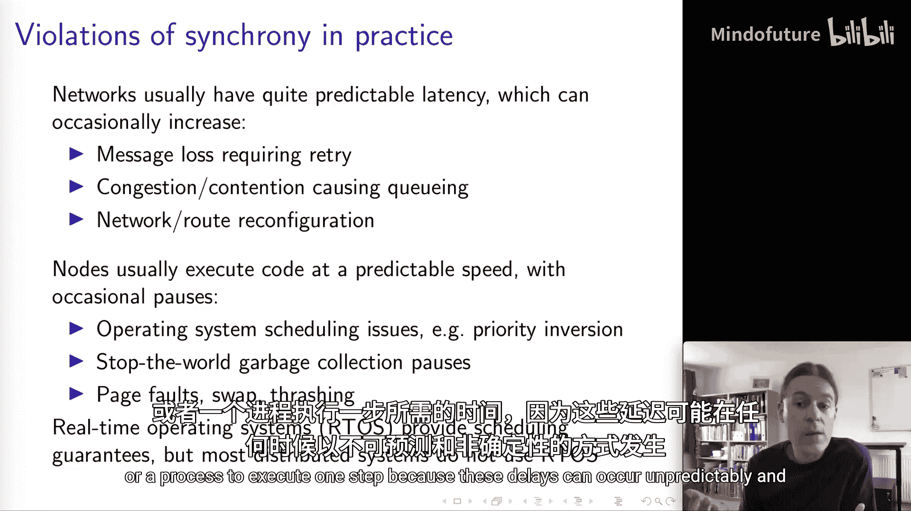
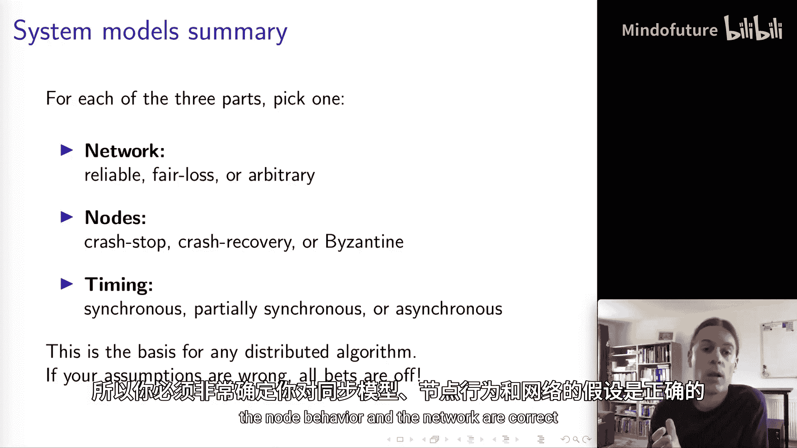

# 006：系统模型 🧩

在本节课中，我们将学习分布式系统设计的基石——系统模型。我们将探讨如何对网络、节点和系统时序的行为做出假设，这些假设是设计任何分布式算法的基础。

## 网络行为模型 🌐

上一节我们讨论了拜占庭将军问题，其中假设网络可靠但节点可能不诚实。现在，我们将把这两个方面结合起来，构建一个更全面的系统模型。首先，我们来看看网络可能的行为方式。

网络是不可靠的，消息可能因各种原因丢失，例如网络拥塞、硬件故障，甚至一些意想不到的事件（如鲨鱼咬断海底光缆或牛踩踏地面光缆）。为了在更抽象的层面进行推理，我们通常假设点对点通信，并选择以下三种可靠性模型之一：

以下是三种主要的网络链路模型：

1.  **可靠链路**：这是最简单的模型。假设消息**总是**能送达。如果发送了消息，它就会被接收；如果接收了消息，那它一定曾被发送过。链路不会丢失消息，也不会凭空伪造消息。公式表示为：`发送(m) ⇒ 最终接收(m)` 且 `接收(m) ⇒ 曾发送(m)`。但消息可能被重新排序。
2.  **公平丢失链路**：这是一个更现实的模型。每次发送消息时，它都有**非零的概率**被送达。如果消息未被送达，发送方可以不断重试。我们假设在无限长的执行时间中，只要持续重试，每条消息**最终**都会在某个有限时间内被送达。公式表示为：`持续重试(发送(m)) ⇒ 最终接收(m)`。
3.  **任意链路**：这是最弱的假设，模拟了存在主动恶意对手（如不安全的公共WiFi所有者）的网络。对手可以任意丢弃、篡改、重放或伪造消息。这实际上是当今互联网一个合理的部分模型。

此外，还有一个重要概念是**网络分区**，即节点本身运行正常，但它们之间的通信链路在一段有限时间内被中断。分区最终会被修复，但中断时间可能很长。

有趣的是，我们几乎可以将一种网络模型转换为另一种。例如，通过持续重试和接收端去重，可以将**公平丢失链路**提升为**可靠链路**。同样，通过使用TLS等加密协议，我们几乎可以将**任意链路**转换为**公平丢失链路**（除非对手完全阻断所有通信）。

## 节点行为模型 💻

了解了网络模型后，我们来看看分布式系统中的另一个核心组件——节点的行为模型。节点也可能以多种方式发生故障。

以下是三种主要的节点故障模型：

1.  **崩溃-停止**：这是最简单的模型。我们假设一个进程可能在任何时刻崩溃，并且**永远不会恢复**。崩溃后，其所有内存中的状态都会丢失。这模拟了硬件被永久摧毁的情况。
2.  **崩溃-恢复**：在这个模型中，节点可能崩溃，但**之后可能会恢复**。崩溃时，内存中的状态会丢失，但已写入稳定存储（如磁盘）的数据在恢复后仍然存在。节点也可能永远无法恢复，因此崩溃-停止是此模型的一个子集。
3.  **拜占庭故障**：正如拜占庭将军问题中所描述的，拜占庭故障节点可能以任意方式偏离指定的算法。它可能表现出恶意行为，同时试图伪装成正常节点。我们对这类节点的行为不做任何限制。

我们通常将节点分类为**故障的**或**正确的**。一个节点如果是故障的（例如崩溃或表现出拜占庭行为），则它不再遵循算法；否则，它就是正确的。一个节点通常无法直接知道另一个节点是否正确。

## 时序模型 ⏱️

最后，我们来探讨分布式系统的第三个关键方面——时序模型。系统的时序假设深刻影响着算法的设计和可行性。

以下是三种主要的系统时序模型：

1.  **同步模型**：这是一个非常强的假设。我们假设消息传递和节点执行步骤都有一个**已知的、确定的上界时间**。例如，任何消息的延迟都不会超过某个最大值，每个计算步骤的执行时间也有上限。在此模型下设计算法相对简单，但假设过于理想化。
2.  **异步模型**：这是另一个极端，我们**不做任何时序保证**。消息可能在任何时间（甚至多年后）到达，节点的执行也可能在任何点被无限期暂停。这为算法设计带来了巨大挑战，但做出的假设最弱，也最安全。
3.  **部分同步模型**：这是前两者的折中，也是现实系统最常采用的模型。系统在大部分时间表现得像同步模型（消息延迟和处理速度有界），但偶尔会进入异步状态（例如，由于网络分区、垃圾回收暂停或系统负载过高导致延迟激增）。算法设计者不知道当前系统处于哪种状态。

假设同步模型是危险的，因为现实中的延迟可能远超预期。例如，网络分区修复可能需要数小时，垃圾回收可能导致进程暂停数分钟，操作系统的调度也可能引入不可预测的延迟。因此，大多数实用的分布式算法都需要在部分同步甚至异步模型下保持正确性。

## 总结 📝

本节课我们一起学习了构建分布式系统模型的三个核心维度：

1.  **网络模型**：我们根据可靠性需求，可以选择**可靠链路**、**公平丢失链路**或**任意链路**模型。通过重试和加密技术，可以在不同模型间进行一定程度的转换。
2.  **节点模型**：我们根据节点可能发生的故障类型，可以选择**崩溃-停止**、**崩溃-恢复**或**拜占庭故障**模型。这决定了算法需要容忍何种程度的节点异常。
3.  **时序模型**：我们根据对系统延迟的把握程度，可以选择**同步**、**异步**或更符合现实的**部分同步**模型。错误的时序假设可能导致算法在现实环境中彻底失效。

这些抽象选择至关重要。设计分布式算法时，必须明确并确保其系统模型假设与实际运行环境相符。例如，若假设了崩溃-停止模型但实际存在拜占庭节点，算法将无法正常工作；若假设了同步模型但系统偶尔出现高延迟，算法的所有保证都可能被破坏。理解并正确运用这些模型，是设计健壮、可靠分布式系统的第一步。