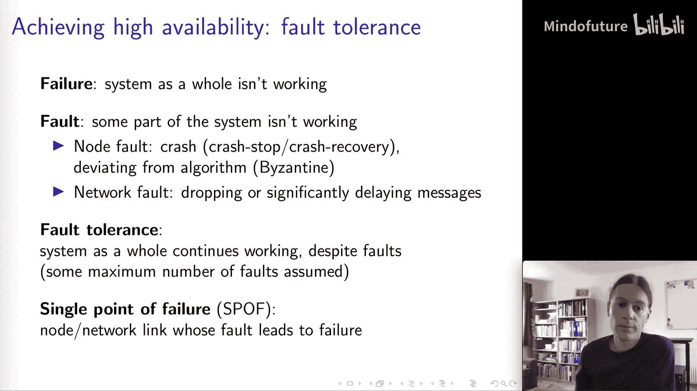
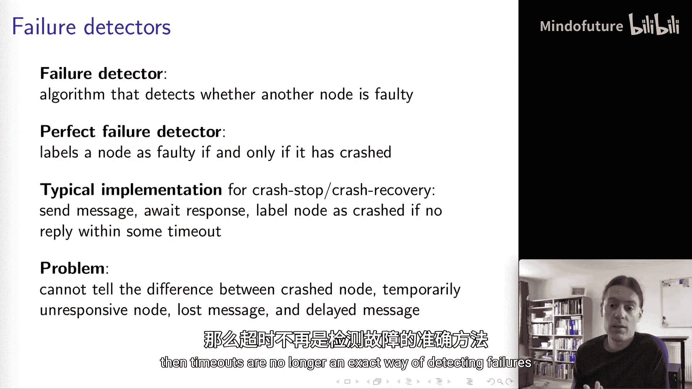
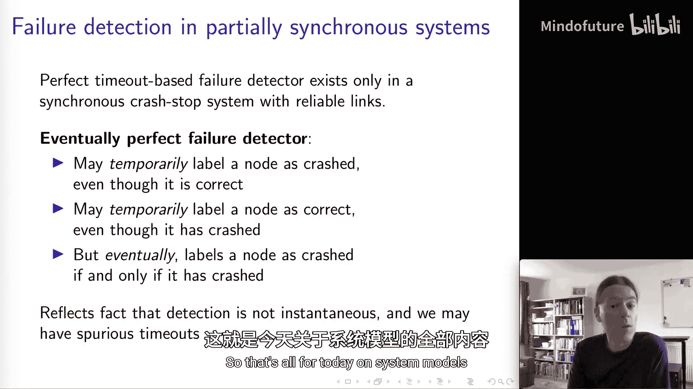

# 007：容错与高可用性

在本节课中，我们将要学习分布式系统中的容错与高可用性。我们将探讨如何定义服务的可用性，理解故障的概念，并学习如何通过故障检测器来构建能够容忍部分故障的系统。

## 概述

在讲座的最后部分，我们将讨论一个实际生活中的故障处理场景：构建高可用服务。想象一下，你正在运营一个在线商店，你很可能希望这个商店能够7天24小时不间断地提供服务。因为无法预知客户会在何时访问你的商店并购买商品。任何服务不可用的时段都意味着潜在的收入损失。在某些情况下，服务甚至可能与客户签订合同，明确规定服务需要达到的可用性百分比。

## 可用性模型

我们通常用服务正常运行时间的比例来衡量其可用性。例如，一个服务99%的时间正常运行，意味着一年中大约有3到4天服务不可用。当然，这可能是由多次较小的故障累积而成。如果将可用性提升到99.9%，则每年最多允许9小时的停机时间。你可以继续增加“9”的数量来追求更高的可用性。例如，传统的固定电话网络据称设计为“五个9”（99.999%）的可用性。电话网络通过非常保守的设计来实现这种极高的可靠性，而移动网络和互联网通常无法达到这种水平。

在可用性上下文中，常见的术语是SLO和SLA。SLO（服务等级目标）是你为自己设定的服务可用性目标。它可能规定需要获得正确响应的请求百分比、允许的最大响应时间（例如200毫秒）以及测量的时间周期（例如，在一天内所有请求中达到99.9%）。而SLA（服务等级协议）则是服务与其客户或消费者之间的合同，明确了预期的服务等级。

## 实现高可用性：容错

为了实现这种高可用性，在分布式系统中我们通常采用的方法是**容错**。故障是指系统的某个部分无法正常工作。我们讨论过节点故障（例如崩溃）和网络故障（例如网络分区）。我们希望系统能够容忍一定数量的故障。说系统能容忍所有故障是没有意义的，因为如果所有节点同时崩溃且所有网络链路同时中断，系统显然无法做任何事情。

但我们可以设定，例如，在少于半数的节点崩溃时，系统整体仍能继续工作。这意味着在三节点系统中允许一个节点崩溃，或在五节点系统中允许两个节点崩溃，剩余节点仍能继续运行服务。

在一个允许部分节点或网络链路故障的系统中，我们避免了所谓的**单点故障**。单点故障是指，如果某一个特定节点崩溃，就会导致整个系统不可用。如果我们能设计一个没有单点故障的系统，就意味着我们可以移除系统中的任何一个组件，而系统整体仍有望继续工作。

## 故障检测

为了实现容错，我们通常首先要做的是检测故障，然后才能处理它。检测故障的机制被称为**故障检测器**。这个术语有点奇怪，实际上叫“故障检测器”会更合理，但“故障检测器”是常用的术语，所以我们沿用。

故障检测器可以是一个软件算法、一块硬件或其他任何用于检测另一个节点是否故障的机制。理想情况下，我们希望拥有一个**完美的故障检测器**，即总能准确告诉我们另一个节点是否故障的机制。

我们通常实现故障检测器的方式是使用**超时机制**。我们向一个节点发送消息，要求它如果存活就回复。如果我们在一定时间内没有收到回复，我们就认为该节点已经死亡（崩溃了）。这种方法很实用。但不幸的是，正如我们在系统模型中看到的，如果我们假设一个部分同步甚至异步的系统，那么超时并不一定意味着节点已经崩溃。超时也可能是因为我们发送的消息或回复在网络中丢失、被延迟，或者节点本身还活着，只是正经历一次长时间的垃圾回收暂停，一分钟后才会回复你的消息。

发送检查消息的一方无法区分没有回复是由于网络问题、随机延迟，还是节点确实已经崩溃。如果我们有一个同步系统模型，并且只假设崩溃-停止故障（而非拜占庭行为），我们可以构建一个完美的故障检测器。但是，一旦进入部分同步模型，超时就不再是检测故障的精确方法。

## 最终完美故障检测器

在部分同步系统中，我们能做到的最好情况是构建一个**最终完美故障检测器**。这个术语很有趣，它意味着故障检测器有时可能会出错。它可能因为消息恰好被延迟了一点而检测到超时，即使另一个节点实际上还没有崩溃。这意味着超时并不能准确指示崩溃已经发生。同时，故障检测也不是即时的。如果崩溃发生，我们可能需要一段时间才能检测到它。因此，在一段时间内，我们可能会有误报（认为正常节点故障）和漏报（未检测到已故障节点）。

但是，**最终**，故障检测器会将一个节点标记为崩溃，当且仅当它真的崩溃了。这意味着任何暂时怀疑另一个节点故障的情况都会停止，只要节点确实正常，我们就会恢复认为它是正确的。同样，如果一个节点故障了，我们最终也会检测到它。这就是我们在故障检测方面能做到的极限，但它仍然非常有用。即使我们只有这种最终完美的故障检测器，它也足以构建一些有用的算法，我们将在未来的讲座中看到。

## 总结

本节课中，我们一起学习了分布式系统中的容错与高可用性。我们了解了如何用正常运行时间的比例（如“几个9”）来衡量服务可用性，并认识了SLO和SLA。为了实现高可用，系统需要能够容忍故障，避免单点故障。我们探讨了故障检测器的作用，特别是在部分同步系统中，我们只能构建“最终完美”的故障检测器，它虽然不完美，但仍然是构建可靠分布式算法的重要基础。