# 011：逻辑时间

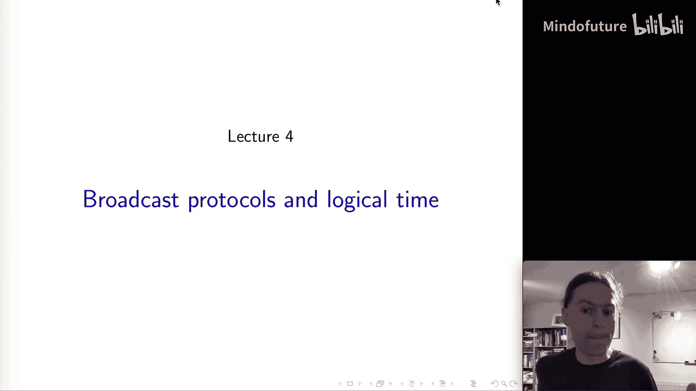

在本节课中，我们将要学习分布式系统中的逻辑时间概念。我们将探讨物理时钟的局限性，并介绍两种逻辑时钟方案：Lamport时钟和向量时钟。这些方案旨在捕获系统中事件之间的因果关系，而非物理时间流逝。

## 背景：物理时钟的局限性

上一节我们介绍了物理时钟同步，本节中我们来看看物理时钟在捕获因果关系时可能存在的问题。

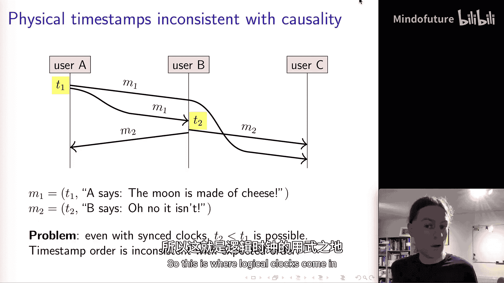

考虑一个场景：用户A发送消息M1：“月亮是奶酪做的”。随后，用户B回复消息M2：“不，它不是”。直观上，M1应该发生在M2之前。然而，即使在使用NTP同步后，物理时钟仍可能为M1分配一个晚于M2的时间戳。这导致时间戳与我们期望的因果顺序不一致。

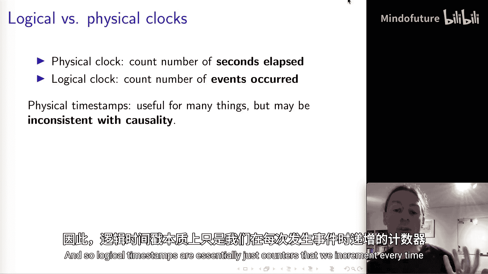

这种与因果关系的不一致是物理时钟的问题。逻辑时钟正是为解决此问题而设计的。

## 什么是逻辑时间？

逻辑时钟是分布式系统中使用的一种替代性时钟定义，专门用于捕获系统中事件之间的因果关系。

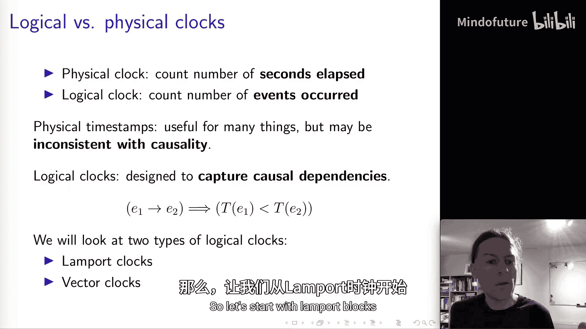

逻辑时钟并非测量物理时间（如地球自转或公转），而是关注事件发生的数量。逻辑时间戳本质上是计数器，每当有事件发生时递增。这意味着它们随时间向前推进，但与物理时间没有直接关系。

## 逻辑时钟的核心目标

逻辑时钟的关键目标是捕获因果关系，特别是“发生在先”关系。如果事件A发生在事件B之前，我们希望事件A的时间戳小于事件B的时间戳。这是我们对逻辑时钟的基本期望。

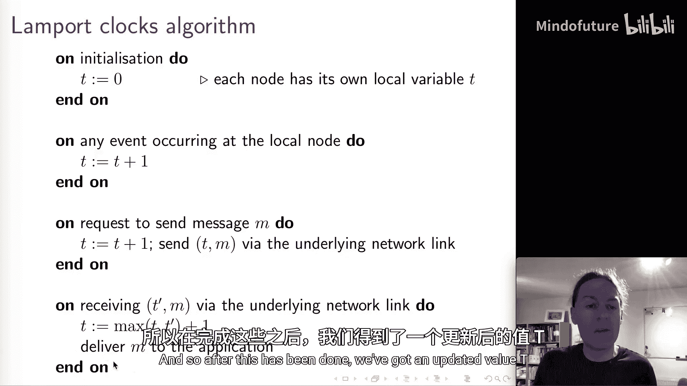

我们将探讨两种逻辑时钟构造：Lamport时钟和向量时钟。两者都满足捕获因果关系的需求，但在其他方面具有略微不同的特性。

## Lamport时钟

我们从Lamport时钟开始，它以Leslie Lamport的名字命名，该算法大约在1978年发表。

Lamport时钟算法相当简单。以下是其工作原理：

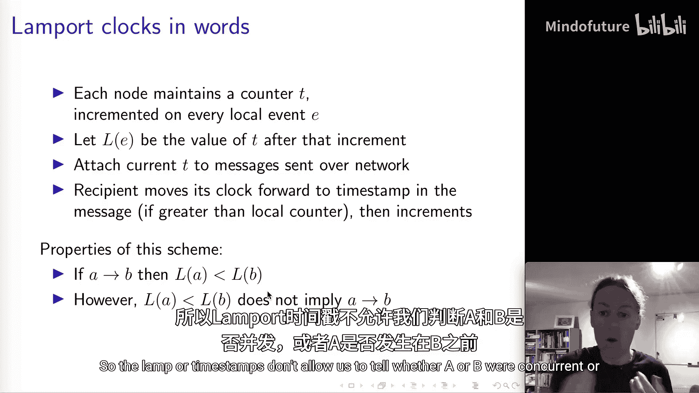

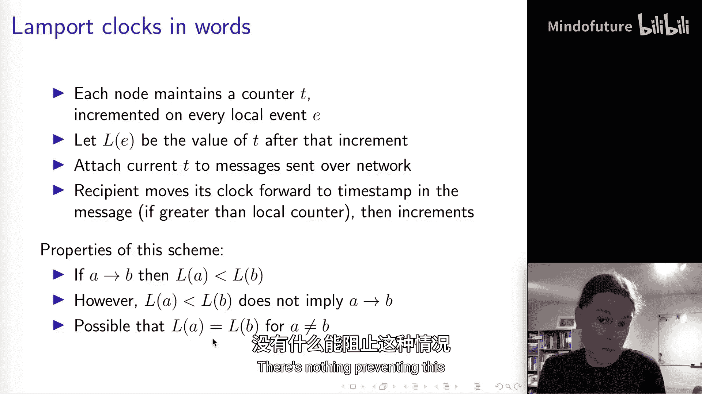

在每个节点上，我们有一个变量 `T`，系统启动时初始化为0。每个节点都有自己的 `T` 副本。每当节点上发生事件（如本地执行步骤、发送消息或接收消息）时，我们就递增 `T`。

以下是算法的具体步骤：

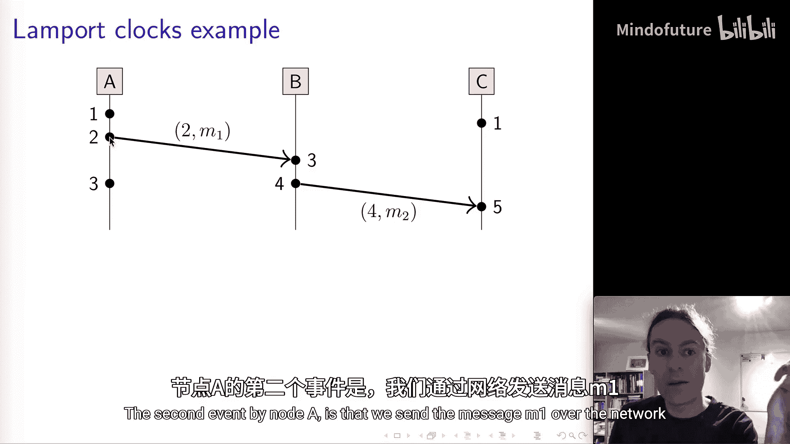

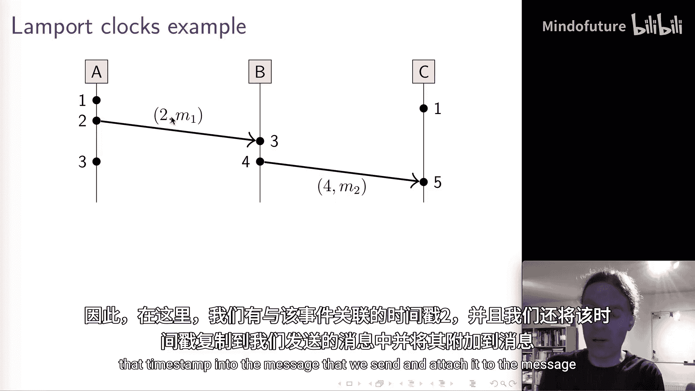

1.  **本地事件**：任何本地事件发生时，递增 `T`。
2.  **发送消息**：发送消息前，先递增 `T`（作为本地事件）。然后将递增后的 `T` 值附加到消息上。因此，发送的消息是 `(时间戳, 实际消息)` 对。
3.  **接收消息**：当接收到一个带时间戳 `T'` 的消息时，接收节点查看自己的本地变量 `T`，并更新 `T` 为 `max(T, T') + 1`（加1是因为接收消息本身也是一个事件）。更新后，将消息传递给应用程序。

### Lamport时钟的性质

让我们更深入地看看Lamport时钟的性质。

每个事件 `E` 都与一个Lamport时间戳 `L(E)` 关联。该方案保证了以下性质：

*   **因果一致性**：如果事件A发生在事件B之前，则 `L(A) < L(B)`。
*   **逆命题不成立**：如果 `L(A) < L(B)`，这**不**意味着A发生在B之前。A和B也可能是并发的。我们只能断定B没有发生在A之前。
*   **时间戳可能重复**：不同的事件可能具有相同的Lamport时间戳。

### 示例与唯一标识

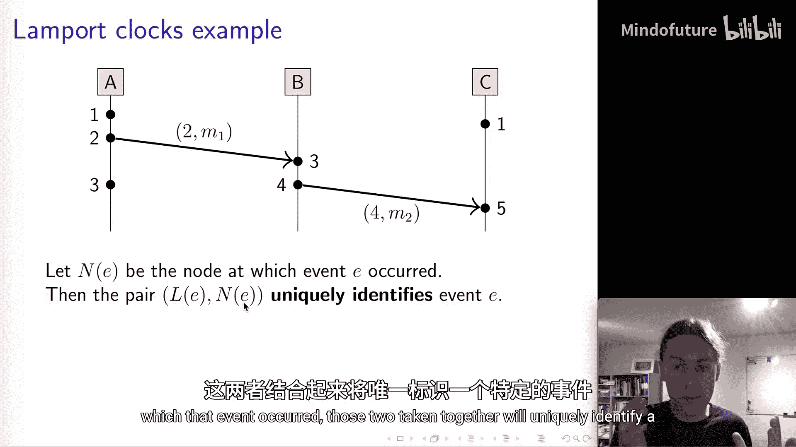

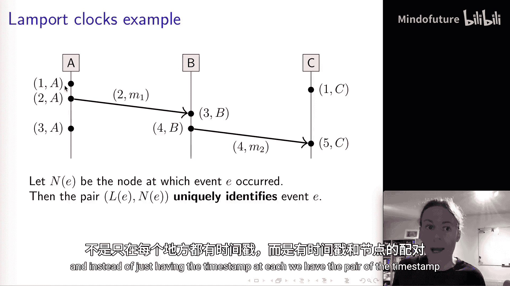

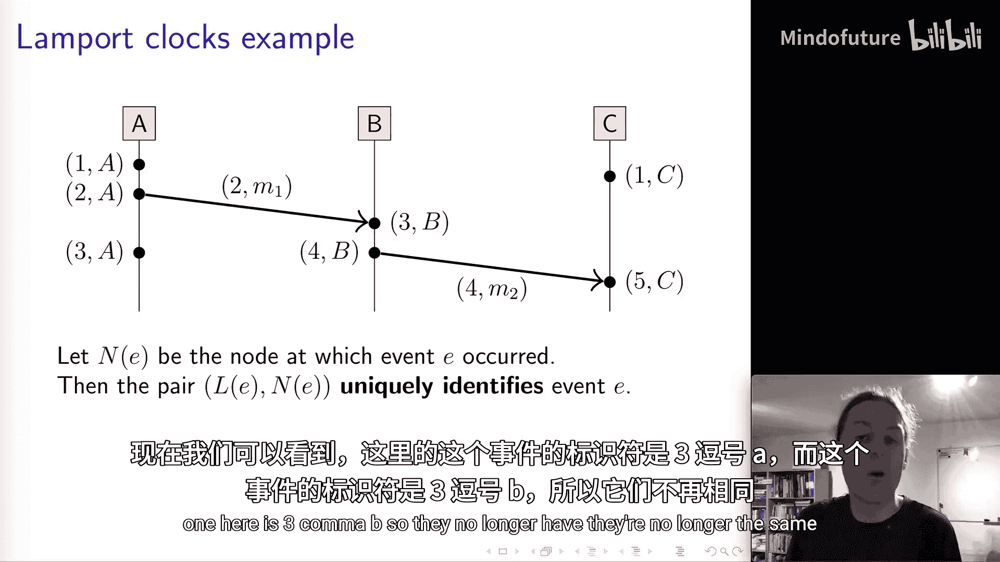

让我们通过一个具体例子来理解。

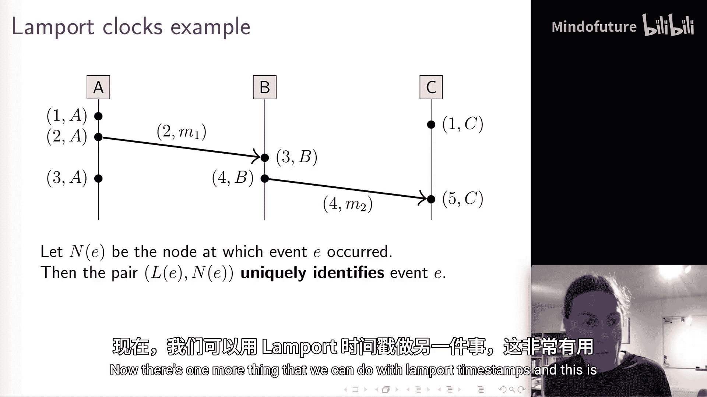

图中展示了事件和消息流。注意，存在时间戳相同的事件（例如时间戳1和3的事件各有两个）。

为了使时间戳全局唯一，我们可以将Lamport时间戳与事件发生节点的名称组合。由于在单个节点内，时间戳是唯一递增的，因此 `(时间戳, 节点名)` 对可以唯一标识系统中的任何事件。

### 定义全序关系

Lamport时间戳的一个非常有用的特性是可以用它们定义全序关系。

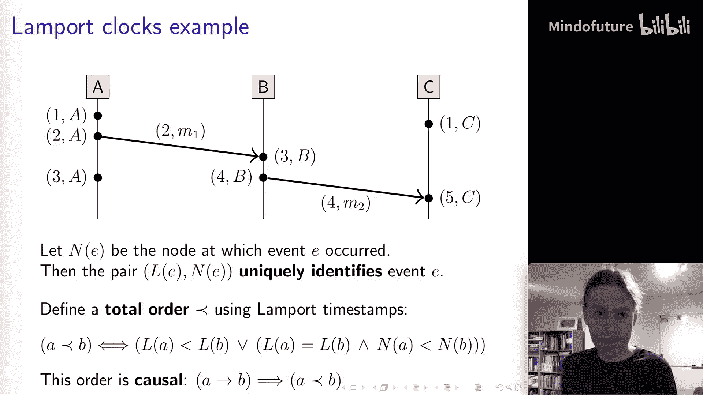

对于两个事件A和B，我们定义全序 `≺` 如下：
`A ≺ B` 当且仅当：
1.  `L(A) < L(B)`，或者
2.  `L(A) == L(B)` 且 `节点名(A) < 节点名(B)`（假设节点名可按字典序比较）。

这个顺序是一个**全序**，意味着对于任意两个不同事件，我们总能确定谁先谁后。并且，这个全序与因果关系一致：如果A发生在B之前，则必有 `A ≺ B`。

因此，Lamport时钟为我们提供了一种为系统所有事件附加时间戳的方法，能够捕获“发生在先”关系，并允许我们基于时间戳定义事件的全序。

## Lamport时钟的局限性与向量时钟

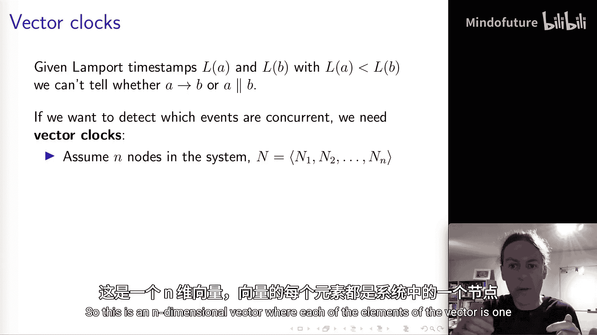

尽管有用，Lamport时钟仍有局限。

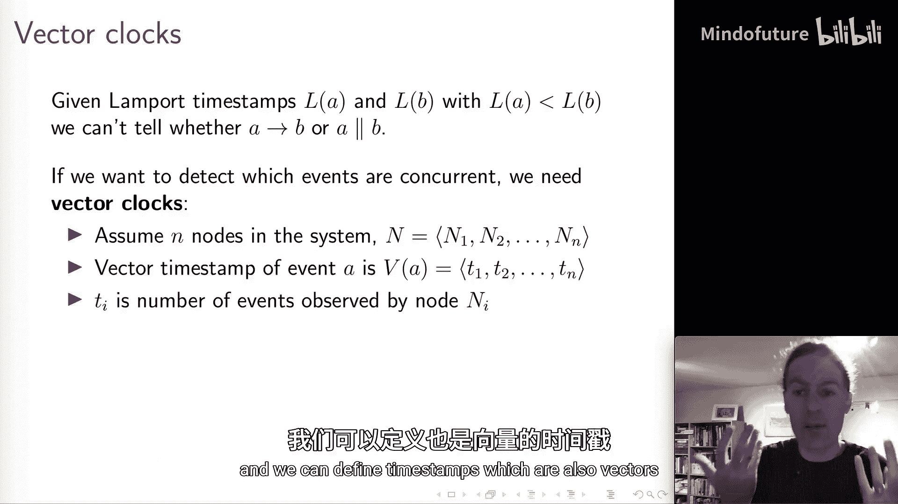

主要局限是：给定 `L(A) < L(B)`，我们无法区分是“A发生在B之前”还是“A和B并发”。我们只知道B没有发生在A之前。

有时，能够区分并发关系和先后关系是很有用的。这就是向量时钟的用武之地。向量时钟是另一种逻辑时间方案，允许我们进行这种区分。

## 向量时钟

向量时钟的工作原理如下。首先，我们假设知道系统中所有 `n` 个节点的名称。

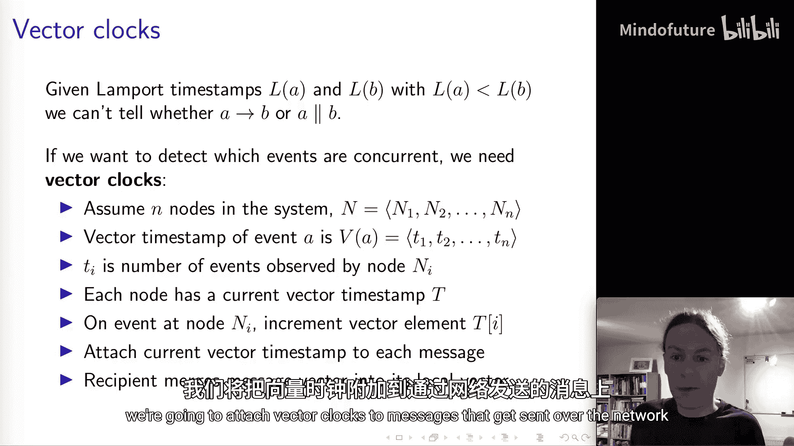

时间戳现在是一个向量（或数组），包含 `n` 个整数，每个整数对应一个节点。

向量 `T = <T1, T2, ..., Tn>` 中，`Ti` 表示我们已观测到的在节点 `i` 上发生的事件数量。

### 向量时钟算法

每个节点本地维护一个向量 `T`，初始化为全零。

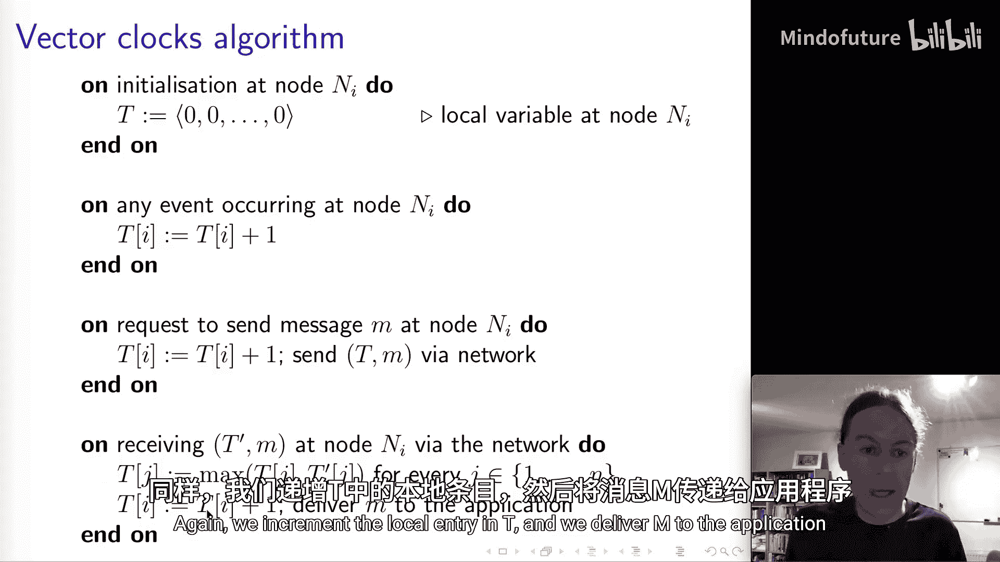

算法规则如下：

1.  **本地事件**：当在节点 `i` 上发生本地事件时，递增向量中对应节点 `i` 的条目：`T[i]++`。
2.  **发送消息**：发送消息前，先递增本地节点条目，然后将整个向量 `T` 附加到消息上发送。
3.  **接收消息**：当收到一个带向量时间戳 `T'` 的消息时：
    *   合并：对向量的每个元素 `j`，设置 `T[j] = max(T[j], T'[j])`。
    *   递增：将本地节点（接收方）对应的条目递增：`T[接收节点索引]++`。
    *   交付：将消息传递给应用程序。

### 示例与语义

让我们看一个例子。

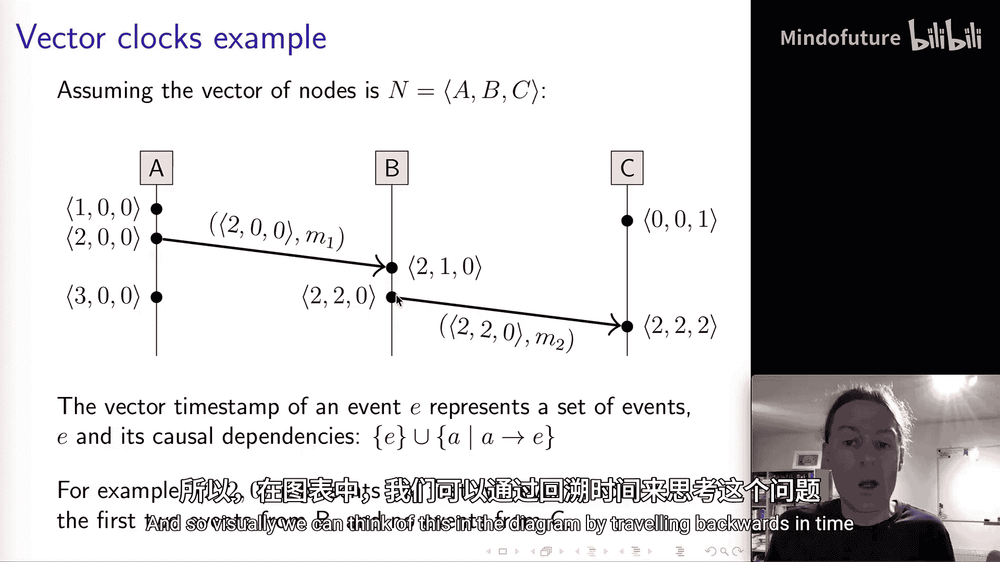

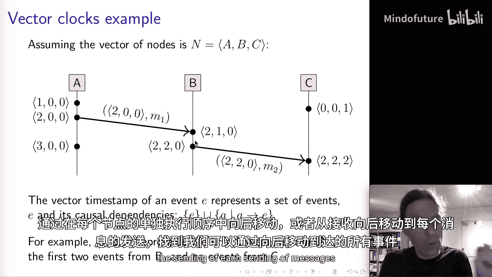

图中展示了向量时钟如何更新。向量时间戳具有深刻的语义：一个向量时间戳 `T` 代表一个**事件集合**，即该事件本身及其所有前驱事件。

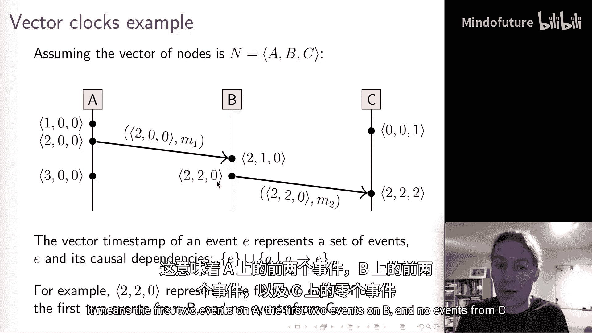

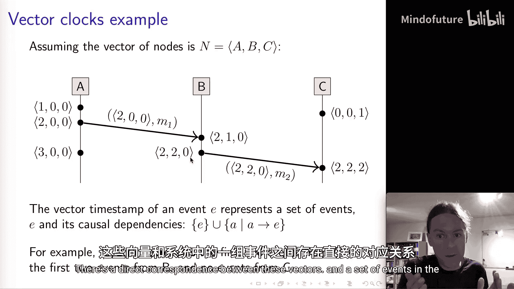

例如，时间戳 `<2,2,0>` 表示：包含了节点A的前2个事件、节点B的前2个事件，以及节点C的0个事件（即未包含C的任何事件）。这可以通过在事件图中从该事件反向追溯得到验证。

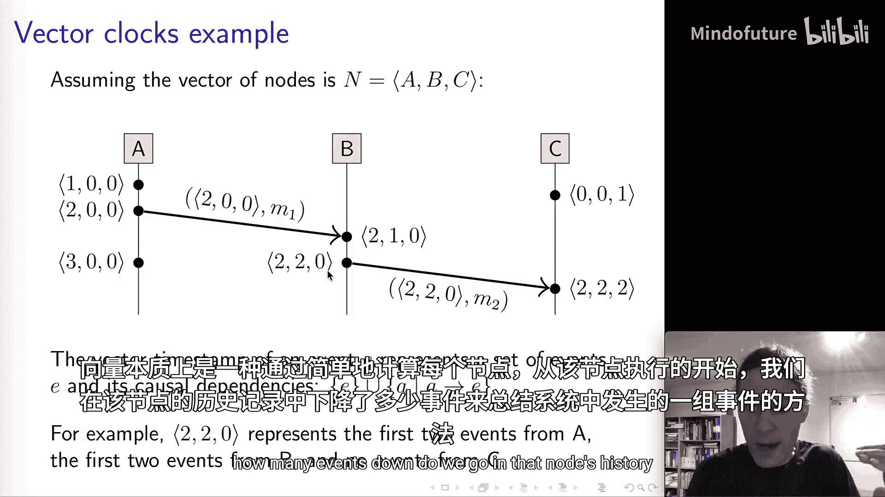

### 比较向量时间戳

基于向量的语义，我们可以定义比较操作：

*   **相等**：`T == T'` 当且仅当所有对应元素相等。
*   **小于等于**：`T ≤ T'` 当且仅当对于所有 `i`，有 `T[i] ≤ T'[i]`。
*   **严格小于**：`T < T'` 当且仅当 `T ≤ T'` 且 `T ≠ T'`。
*   **不可比**：如果 `T ≤ T'` 和 `T' ≤ T` 都不成立，则 `T` 和 `T'` 不可比。

关键联系在于：向量时间戳上的 `≤` 关系精确对应了它们所代表事件集合的**子集**关系。

### 向量时钟的强大性质

向量时钟提供了比Lamport时钟更强的性质。

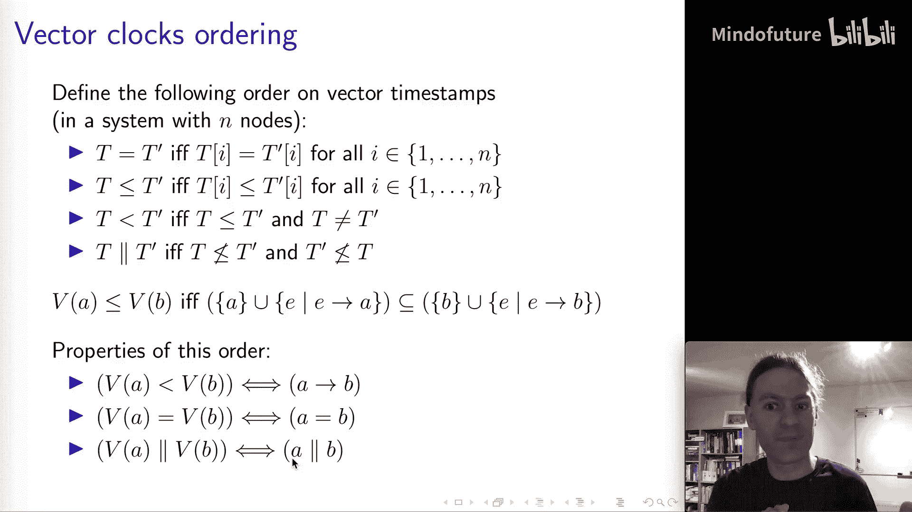

对于事件A和B，设其向量时间戳分别为 `V(A)` 和 `V(B)`，则有：

1.  **捕获因果关系**：`V(A) < V(B)` **当且仅当** 事件A发生在事件B之前。这是一个双向蕴含关系。
2.  **唯一标识事件**：`V(A) == V(B)` **当且仅当** A和B是同一个事件。
3.  **检测并发**：`V(A)` 和 `V(B)` 不可比 **当且仅当** 事件A和B是并发的。

因此，向量时钟不仅捕获了因果关系，还提供了一个算法来精确计算“发生在先”关系，并能明确判断两个事件是否并发。这是Lamport时钟所不具备的关键能力。

## 总结

本节课中我们一起学习了分布式系统中的逻辑时间。

*   我们首先指出了物理时钟在维护因果关系上的不足。
*   接着，我们介绍了**Lamport时钟**，它是一种简单的逻辑时钟，通过递增计数器和在消息中传递时间戳来保证：如果事件A发生在B之前，则 `L(A) < L(B)`。我们可以用 `(时间戳, 节点名)` 对唯一标识事件，并基于此定义与因果一致的全序。
*   然后，我们探讨了Lamport时钟的局限：无法区分“先后”与“并发”。
*   最后，我们深入学习了**向量时钟**。向量时钟为每个节点维护一个计数器，通过向量合并和递增来更新。向量时间戳对应事件及其前驱的集合。通过比较向量时间戳，我们可以精确判断两个事件是“先后发生” (`V(A) < V(B)`)、是“同一事件” (`V(A) == V(B)`)，还是“并发” (`V(A)` 与 `V(B)` 不可比)。向量时钟提供了对“发生在先”关系的完整算法化刻画。

逻辑时钟是理解分布式系统事件顺序和构建一致性协议的重要基础工具。