# 017：共识问题概述

在本节课中，我们将要学习分布式系统中最棘手也最重要的问题之一：共识。我们将探讨共识与全序广播的关系，理解为什么需要共识算法来自动处理领导者故障，并介绍共识算法的基本模型和核心思想。

上一讲我们讨论了状态机复制，这是一种将数据从一个副本复制到另一个副本的有效方法。为了实现状态机复制，我们需要确保所有副本以相同的顺序看到相同的更新，这可以通过全序广播来实现。这就引出了一个问题：我们如何实现全序广播？

## 实现全序广播的一种方法

我们之前看到的一种方法是，通过一个特定的专用节点（我们称之为领导者）来发送所有消息。这个节点将对所有消息进行排序，并确保它们以相同的顺序在所有节点上被传递。

然而，如果该领导者崩溃，或因网络问题、硬件故障等原因变得不可用，那么这种全序广播方法就会停止工作。现在，核心问题是如何处理领导者不可用的情况。

## 处理领导者故障的选项

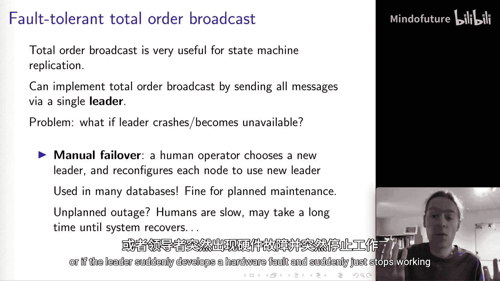

一种选择是手动切换到新的领导者，这个过程称为故障转移。手动意味着有一个人类操作员在领导者故障时收到通知，然后由他来选择一个新的节点作为领导者，并重新配置系统。

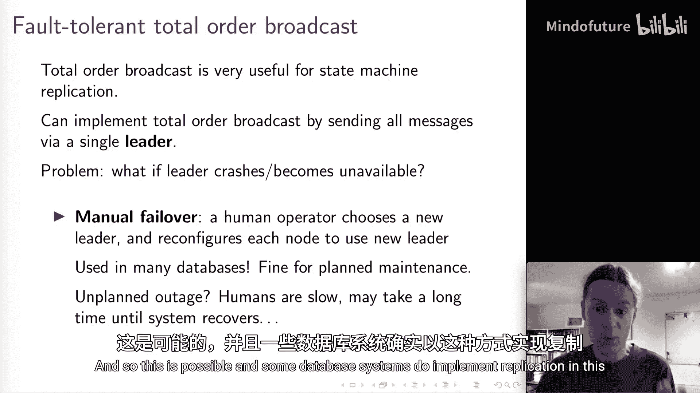

以下是手动故障转移的步骤：
1.  操作员收到领导者故障的通知。
2.  操作员选择一个新节点作为新领导者。
3.  操作员重新配置系统，将所有跟随者指向新领导者。
4.  新领导者开始承担全序广播的职责。

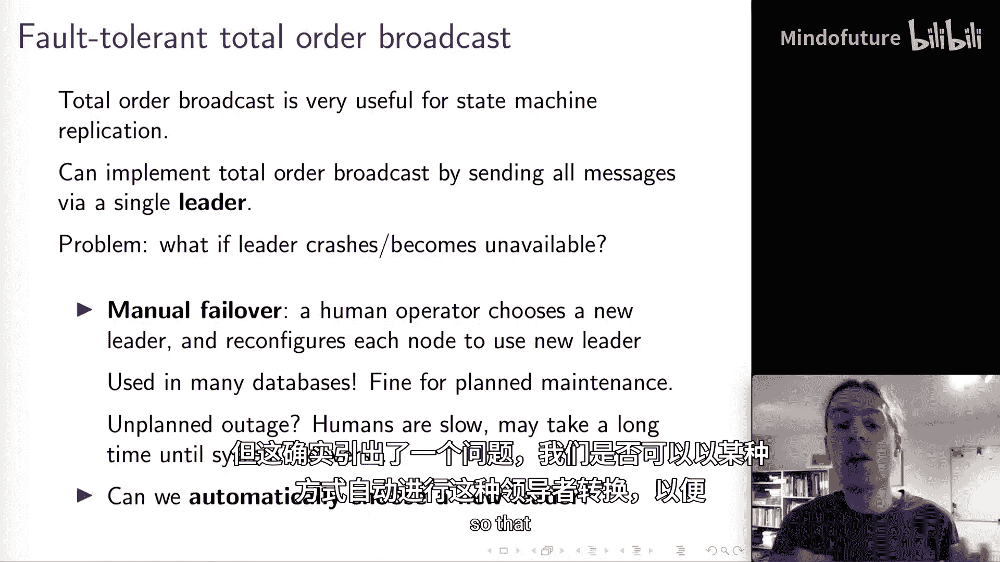

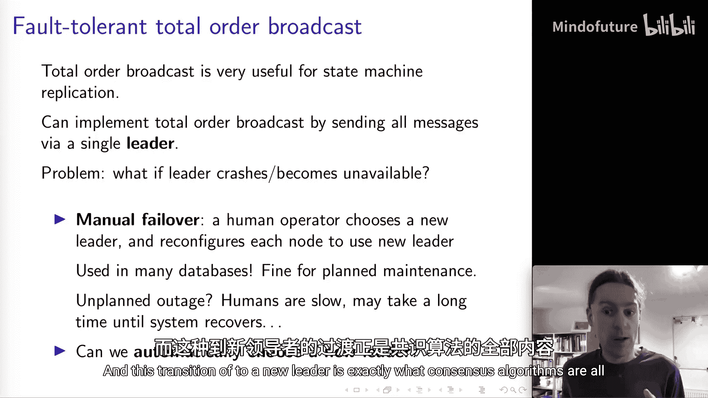

如果你能提前知道领导者将要下线（例如，计划内的维护），这种方法可以很好地工作。你可以提前将领导者角色转移到另一个节点，然后安全地关闭原节点。

不幸的是，当领导者意外崩溃或突然出现硬件故障时，这种方法就无能为力了。在这种情况下，很可能在最不方便的时间（例如凌晨三点）发生故障，需要有人被叫醒并登录系统进行手动重新配置。

虽然一些数据库系统确实以这种方式实现复制，但这引出了一个问题：我们能否以某种方式自动完成这个领导者切换过程，从而避免在凌晨三点把人叫醒？

## 共识算法的作用

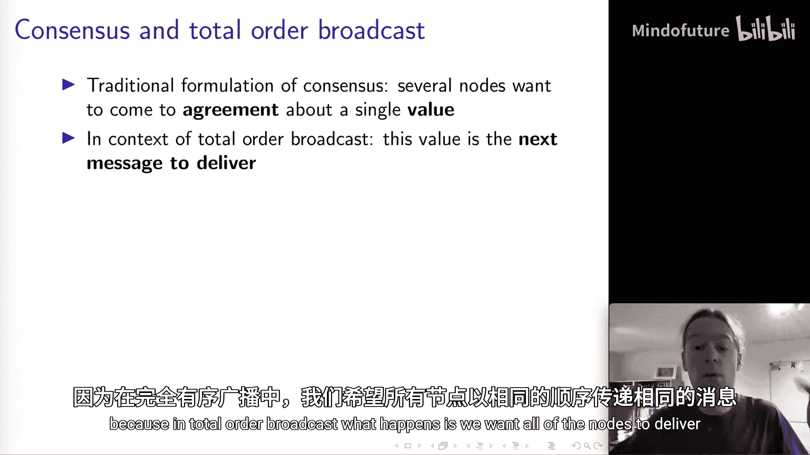

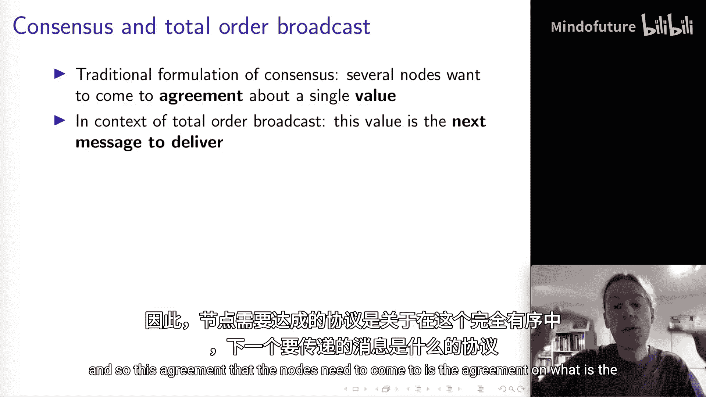

切换到新领导者的过程，正是共识算法的核心所在。

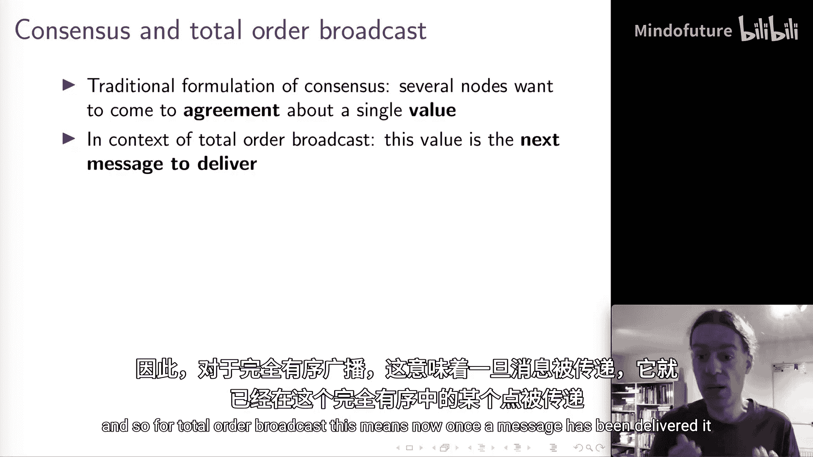

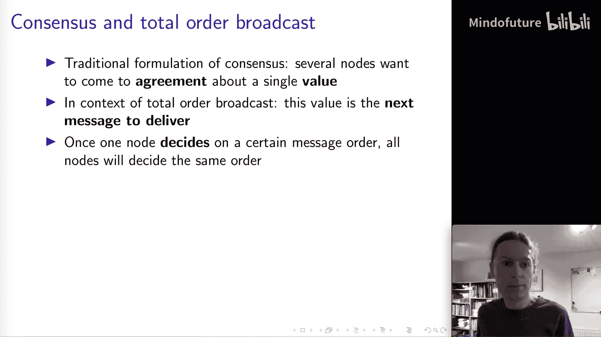

共识和全序广播是两个不同的问题，但它们实际上密切相关。传统上，分布式系统中的共识问题被表述为：多个节点各自可以提议一个值，你希望所有节点就同一个值达成一致。这就像几个朋友决定今天去哪里吃午餐，他们提议不同的餐厅，然后通过某种过程，其中一个提议会被选中，然后所有人都去同一家餐厅。

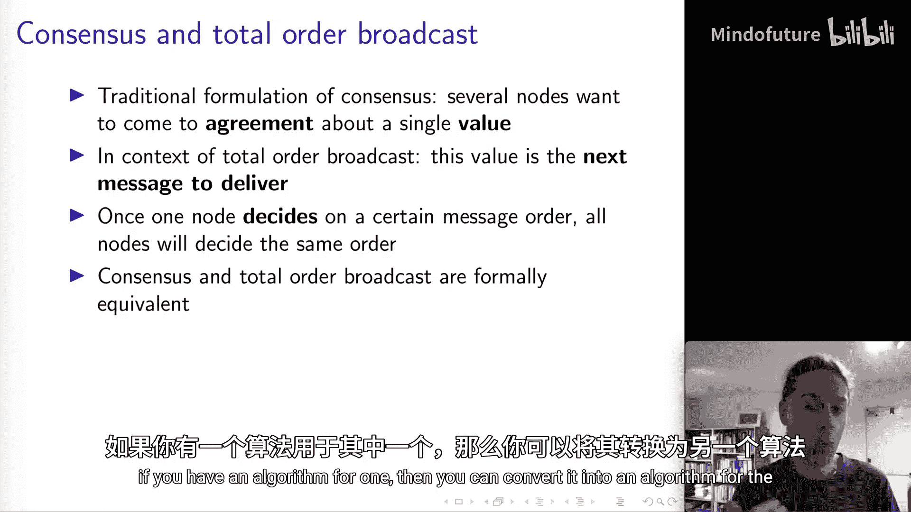

你可以将其视为等同于全序广播。在全序广播中，我们希望所有节点以相同的顺序传递相同的消息。节点需要达成的一致，就是关于在这个全序中下一个要传递什么消息的一致。你可以为每个需要传递的消息执行一次共识，共识将保证所有节点做出相同的决定。当一个节点决定了一个特定值时，在全序广播术语中，就意味着它传递了那条消息。

共识保证了一旦一个值被决定，就不会再改变主意。对于全序广播，这意味着一旦一条消息被传递，它就在这个全序中占据了一个确定的位置。

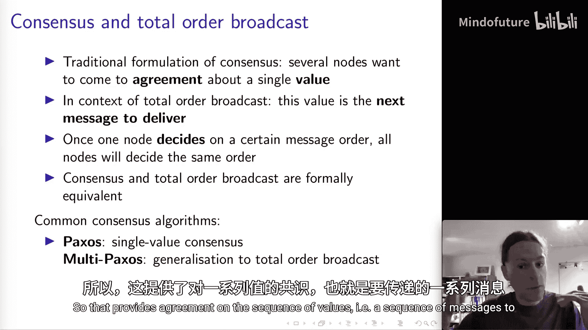

因此，共识问题和全序广播在形式上是等价的。这意味着如果你有一个解决其中一种问题的算法，你就可以将其转换为解决另一种问题的算法，反之亦然。

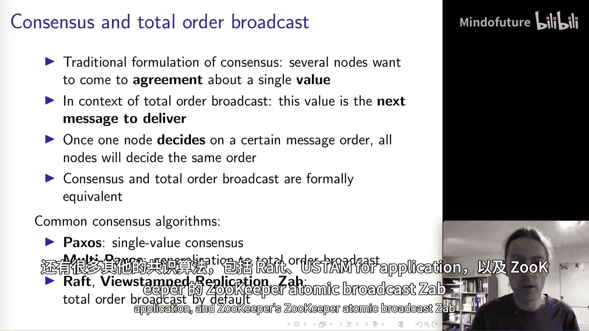

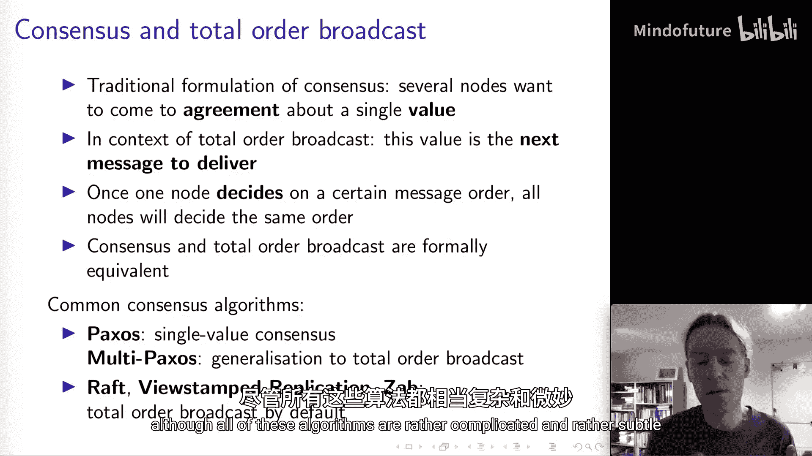

## 共识算法简介

经典的共识算法叫做Paxos。Paxos实际上只对单个值进行共识。但有一个Paxos的扩展叫做Multi-Paxos，它实际上提供了全序广播，即对一系列值（一系列要传递的消息）达成一致。

还有一系列其他的共识算法，包括Viewstamped Replication、ZooKeeper的ZooKeeper Atomic Broadcast（Zab）。这些算法实际上被设计为直接提供全序广播。

在本讲中，我们将更详细地研究Raft算法，因为它可能是最容易理解的，尽管所有这些算法都相当复杂和微妙。

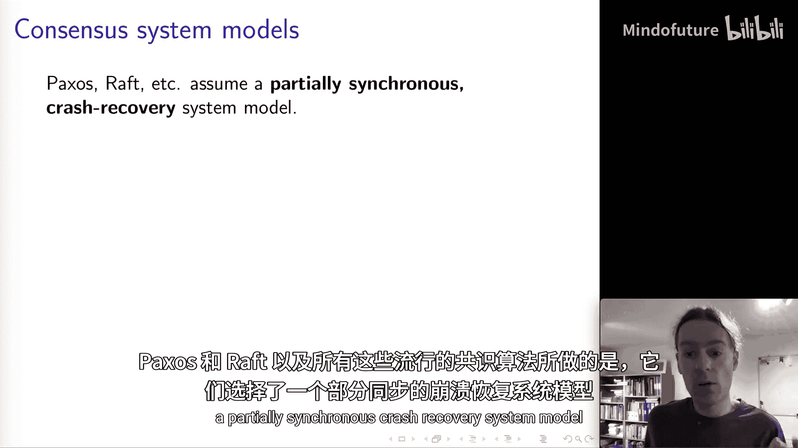

## 系统模型的重要性

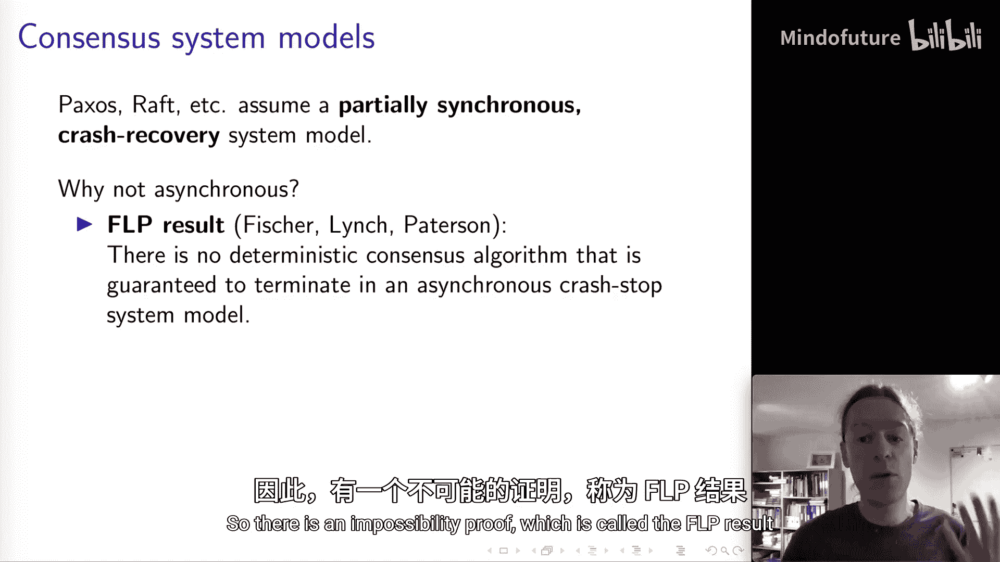

现在，请记住我们在第二讲中讨论过的不同系统模型，这在讨论共识时变得非常重要。

关于节点行为，我们可以在崩溃-停止、崩溃-恢复或拜占庭（节点可能任意恶意行为）之间选择。关于网络，我们是否假设公平丢失？关于同步性，我们假设异步系统、部分同步系统还是同步系统？

Paxos、Raft和所有这些流行的共识算法选择的是部分同步的崩溃-恢复系统模型。你可能会问为什么选择这些特定的模型。特别是同步性问题很重要，因为我们已经说过完全同步的模型是不现实的，因为在真实系统中确实存在网络延迟和各种延迟，所以我们不能依赖消息延迟的任何上限。我们真正能期望的最好情况是部分同步，即大多数时间网络表现良好，但偶尔会出现消息长时间延迟或节点长时间暂停执行的情况。

理想情况下，我们希望共识即使在异步系统中也能工作，在那里我们不做任何时间假设。但事实证明，这实际上是不可能的。有一个称为FLP不可能性的证明，证明了在异步系统中实现一个总能终止的共识算法是不可能的。即使你只允许崩溃-停止故障，也总会存在共识算法的某些执行过程，使得算法无法终止。

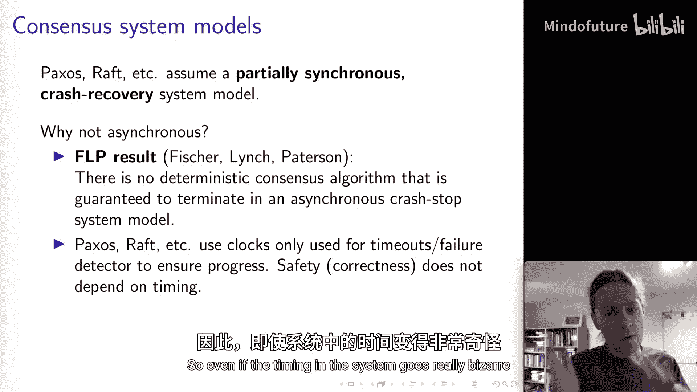

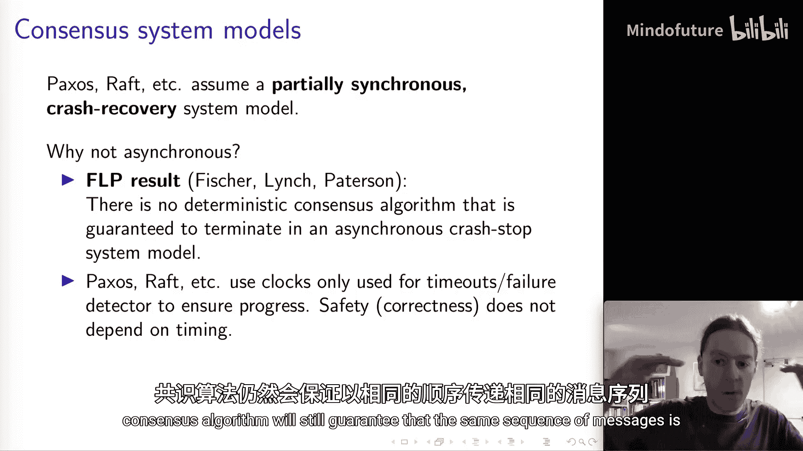

因此，如果你想要终止性，即希望算法取得进展并最终决定某个值，或者希望全序广播最终传递一条消息，那么我们必须做出这些时间假设。我们必须至少假设部分同步，这实际上意味着我们使用时钟进行超时，或者换句话说，我们使用基于超时的故障检测器来判断领导者是否失败。

重要的是，算法的正确性实际上并不依赖于时间。即使系统中的时间变得非常奇怪，共识算法仍然保证相同的消息序列以相同的顺序被传递。时间只影响传递何时发生。因此，如果系统中发生了很多奇怪的延迟，那么消息的传递可能会延迟一段时间，直到系统自行恢复。所以，时间确实影响系统的活性，但不影响安全性。

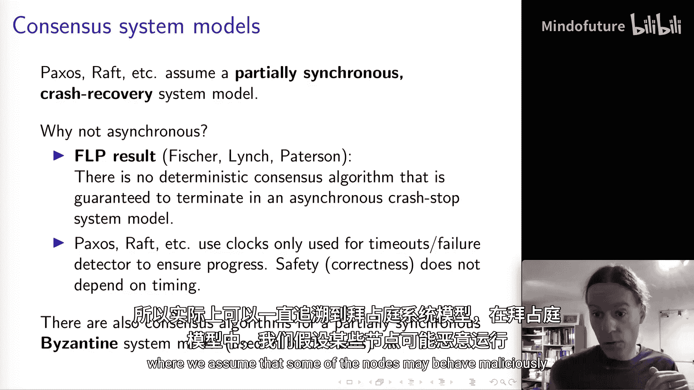

## 拜占庭容错共识

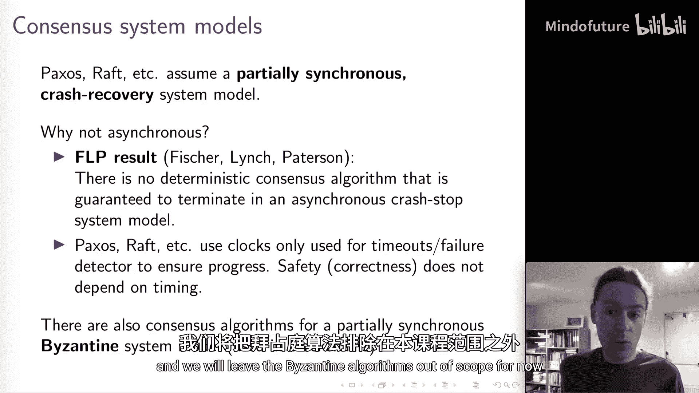

也可以弱化关于崩溃-恢复系统模型的假设。实际上，可以一直弱化到拜占庭系统模型，即我们假设某些节点可能行为恶意。在这种系统中进行共识是可能的，这类拜占庭容错共识算法被用于一些加密货币和区块链等领域。

然而，这些拜占庭容错算法比崩溃-恢复算法复杂得多，效率也低得多。因此，在本课程中，我们将只关注Raft，它是一种非拜占庭算法，只假设崩溃-恢复模型。我们将暂时把拜占庭算法排除在讨论范围之外。

## 共识的核心：领导者选举

如前所述，共识的关键是需要选举一个领导者。一旦我们有了领导者，该领导者就可以决定消息的传递顺序。我刚才提到的所有共识算法实际上都使用领导者来对消息进行排序。关于它们如何使用领导者以及如何选举领导者的细节，因算法而异。我将重点介绍Raft的具体做法。

我们使用超时，即使用本地时钟来怀疑领导者是否失败。请记住，在部分同步系统中，故障检测器并不总是准确的。可能我们认为领导者崩溃了，而实际上领导者工作正常，只是存在网络问题阻止了我们与领导者的通信。这就是为什么我说我们只能怀疑领导者崩溃，而永远无法确定超时发生时是否真的是领导者故障。

我们希望共识算法能够防止同时出现两个领导者，因为如果有两个领导者，它们可能会做出矛盾的决定，那么我们算法的所有保证都将失效。这种你有两个不同的领导者都认为自己是领导者的情形被称为脑裂。如果这种情况发生在分布式系统中，通常意味着坏消息，很可能导致数据损坏或丢失。

因此，我们希望避免脑裂。共识算法必须设计得非常小心，以避免出现脑裂。

## Raft中的任期与投票

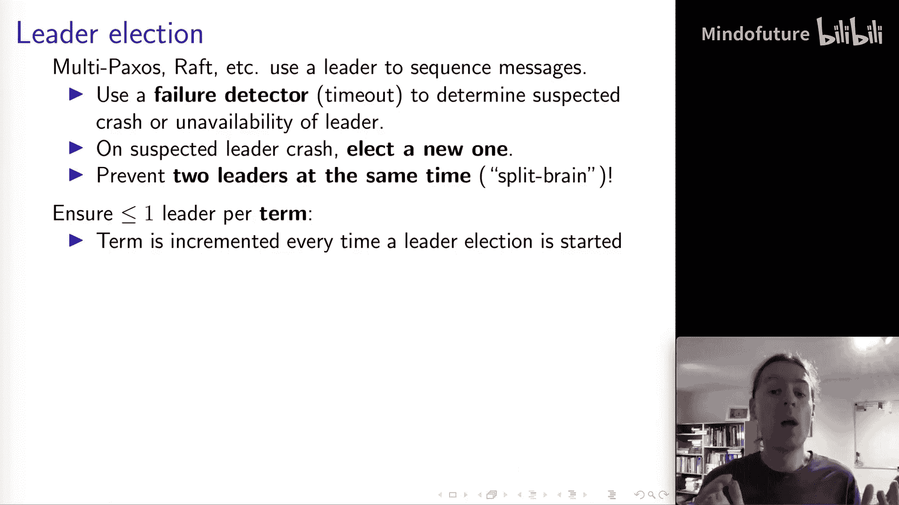

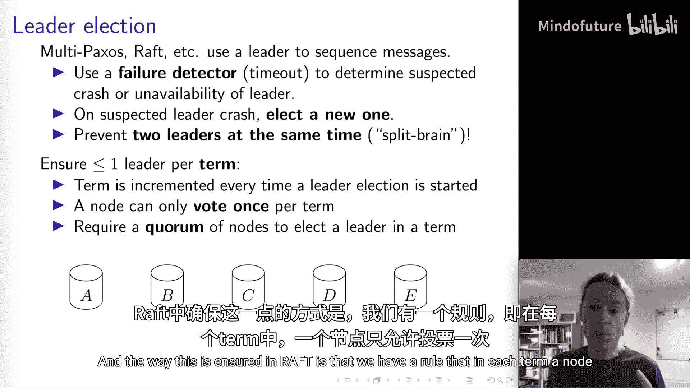

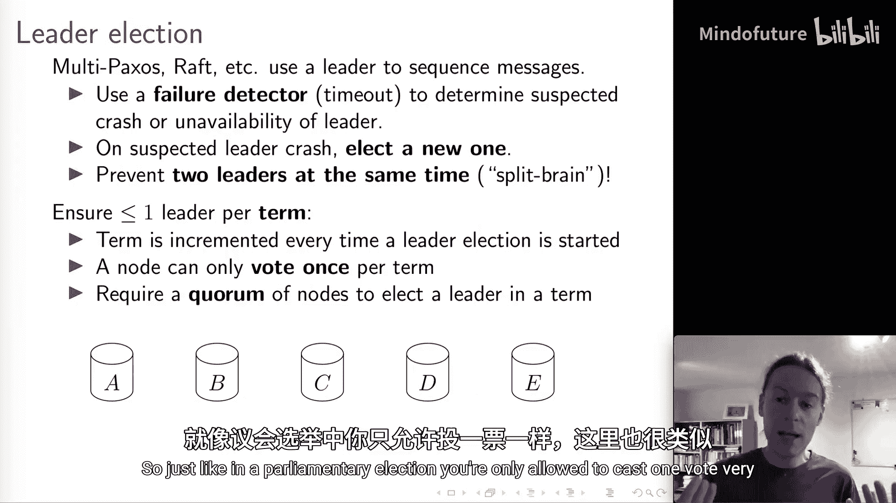

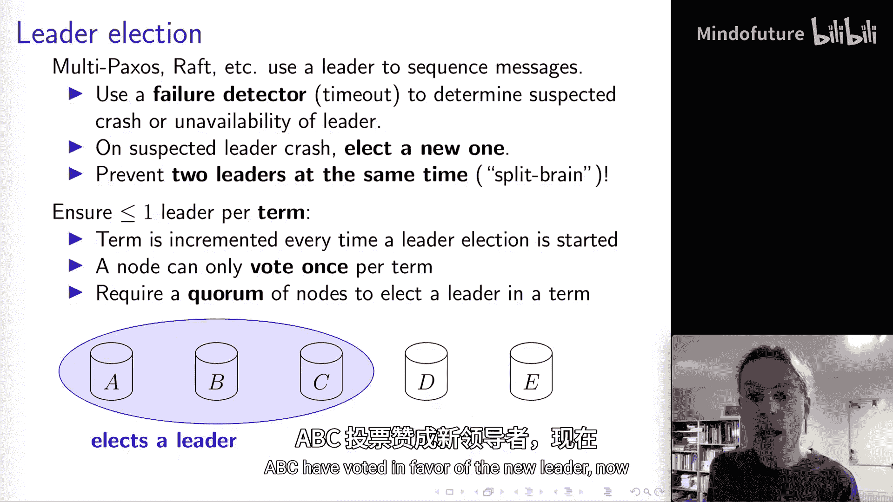

Raft实现这一点的方式是引入了任期的概念。任期只是一个整数变量。每次进行领导者选举时，该选举都在某个特定的任期内进行。每次我们开始一次新的领导者选举，我们只需递增任期。Raft中领导者选举提供的保证是：在给定的任期内，最多只能选举出一个领导者。有可能一次领导者选举失败，导致在该任期内没有选出领导者，但绝不会在一个任期内有超过一个领导者。

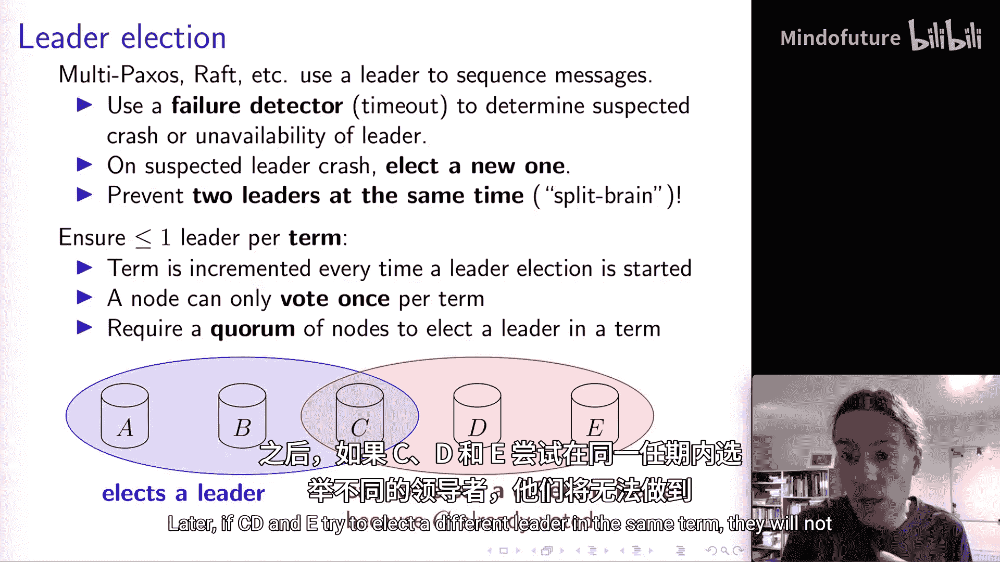

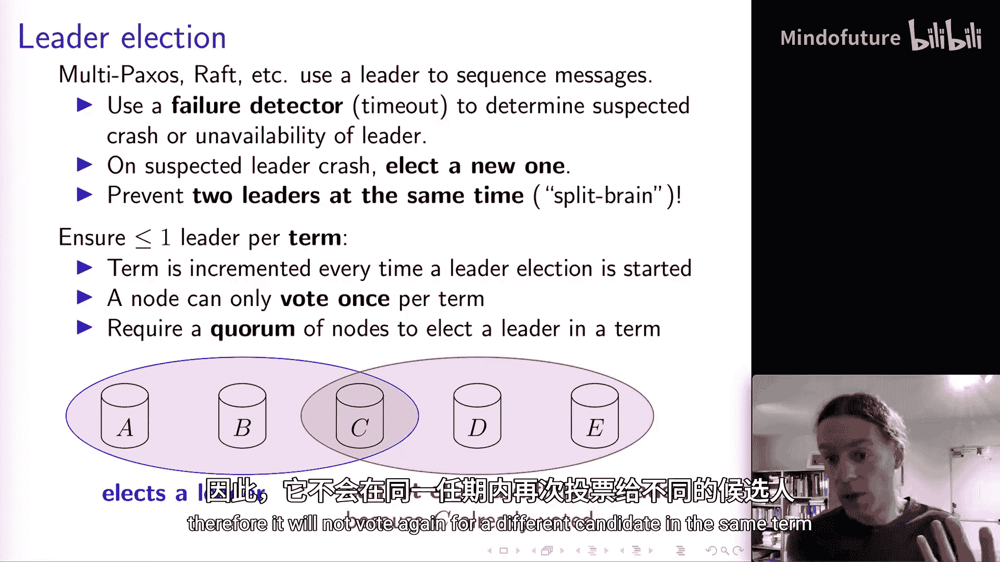

Raft确保这一点的方法是制定了一条规则：在每个任期内，一个节点只允许投票一次。这就像议会选举中你只能投一票一样。假设我们有一个五节点的系统，其中A、B、C三个节点投票赞成选举一个新领导者。之后，如果C、D、E试图在同一任期内选举一个不同的领导者，它们将无法成功，因为C知道它已经在这个特定任期内投过一次票了，因此它不会在同一任期内为另一个候选者再次投票。在新的任期中，开始新的领导者选举，那么每个节点都可以再次投票。

## 法定人数与容错

我们通常要求在共识算法中，每次我们想要选举一个领导者时，都需要一个法定人数的节点在该特定任期内投票赞成该领导者。例如，如果我们有五个节点，那么我们可以有一个多数法定人数，即五分之三。任何三个节点都能够选举出一个新领导者，这意味着系统可以容忍两个节点不可用，而剩下的三个节点仍然可以取得进展，并在必要时选举出新领导者。这就是我们获得容错能力的方式。

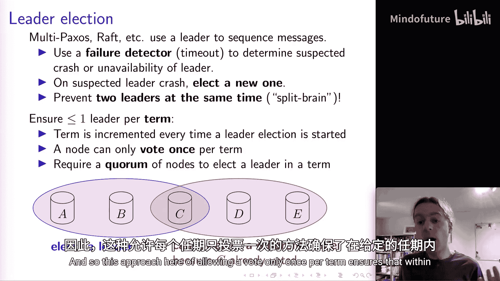

这种每个任期只允许投票一次的方法确保了在给定任期内，存在唯一的领导者。

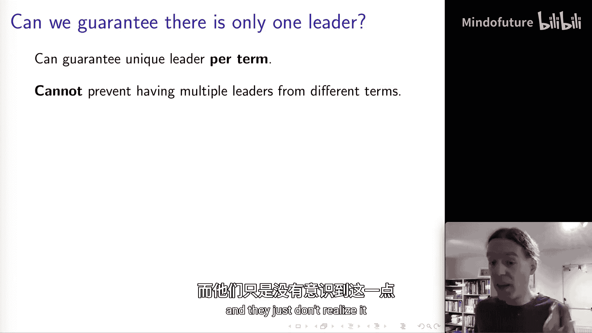

## 处理不同任期的领导者

然而，这并不能保证我们不会出现多个领导者。因为可能发生的情况是，不同任期内有不同的领导者，而它们彼此并不知道。

想象这样一个场景：我们有三个节点1、2、3。假设节点1在任期T被选为领导者。但随后发生了网络问题，节点1无法再与节点2和3通信。节点1仍然存活，节点1仍然是领导者。但现在节点2和3听不到来自领导者的任何消息了。因此，在某个时刻，节点2和3会说，我们的领导者可能死了，所以我们要在一个新的任期（比如任期T+1）选举一个新领导者。节点2和3将在它们之间选举一个新领导者，例如节点2成为新领导者。现在系统实际上有两个领导者：节点1是任期T的领导者，节点2是任期T+1的领导者。这看起来像是脑裂，对吧？我们有两个领导者。这很糟糕，我们不希望处于这种情况。但不幸的是，由于网络中断，节点1无法知道它已经被取代，不再是领导者了，因为通信根本无法通过。

因此，我们实际上需要处理这种可能性：系统中可能同时存在不同任期的不同领导者，这些领导者可能在一小段时间内做出矛盾的决定。尽管如此，我们必须确保全序广播的属性不被违反。

## 两阶段决策原则

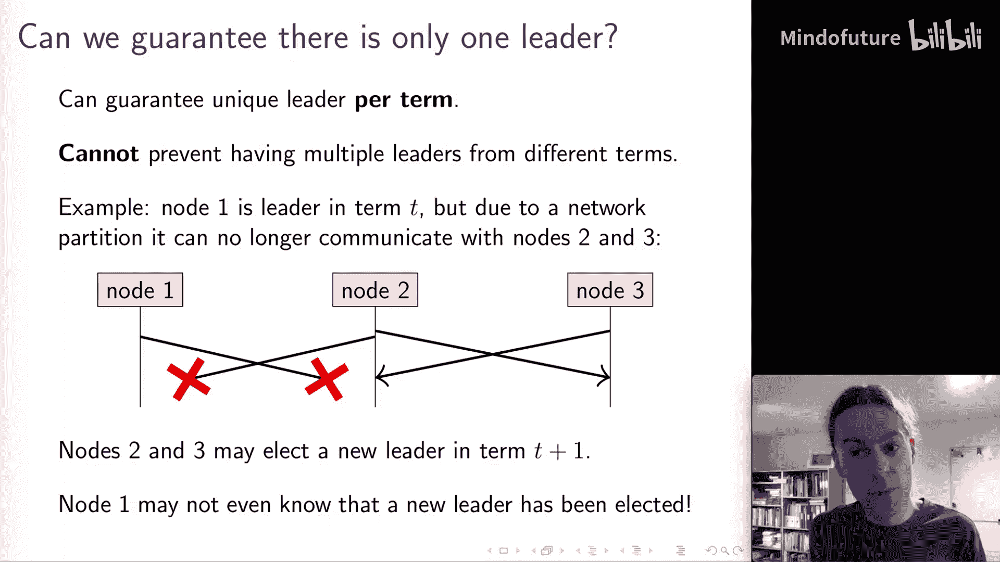

共识算法处理这个问题的方式是：如果一个领导者想要决定传递某条消息，该领导者不能独自做出这个决定。相反，领导者必须再次去询问一个法定人数的节点，它们是否同意传递某条消息。

通信流程大致如下：首先，左边的节点需要被选举为领导者，因此它会联系其他节点，询问它们是否同意它成为新领导者。其他节点回应同意。现在它获得了赞成成为领导者的法定票数，因此左边的节点在一轮选举后成为领导者。现在，领导者想要传递一条消息。但如前所述，领导者不能简单地自行决定传递一条消息，而是必须再次去找跟随者，询问它们是否同意在任期T中将消息M作为下一条消息传递。只有当法定人数的跟随者再次回应表示同意（“好的，我们同意这条消息M在任期T中”），并且跟随者只有在没有听说过任期T+1的任何其他领导者时才会做出积极回应，领导者才能安全地决定传递M，并可以告诉其他节点，M现在是全序广播中要传递的下一条消息。

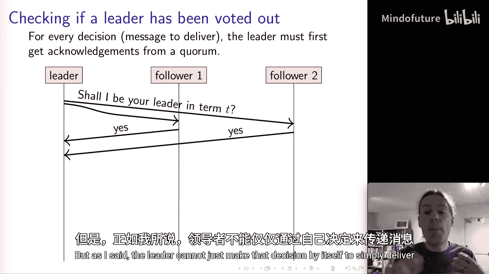

这就是我们拥有的两阶段投票原则：首先，一个节点需要获得法定人数节点的投票当选为领导者；然后进行第二轮，领导者检查是否可以决定将某条消息作为下一条消息。这实际上是所有我们见过的共识算法的基本原理。

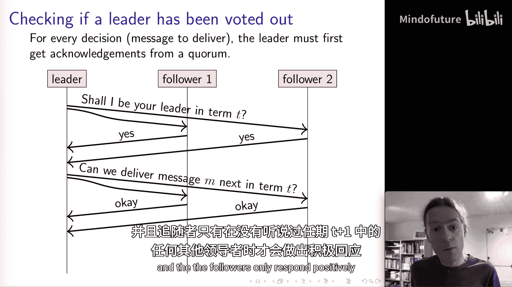

在下一节中，我们将详细探讨Raft如何实现这个特定的系统。

## 总结

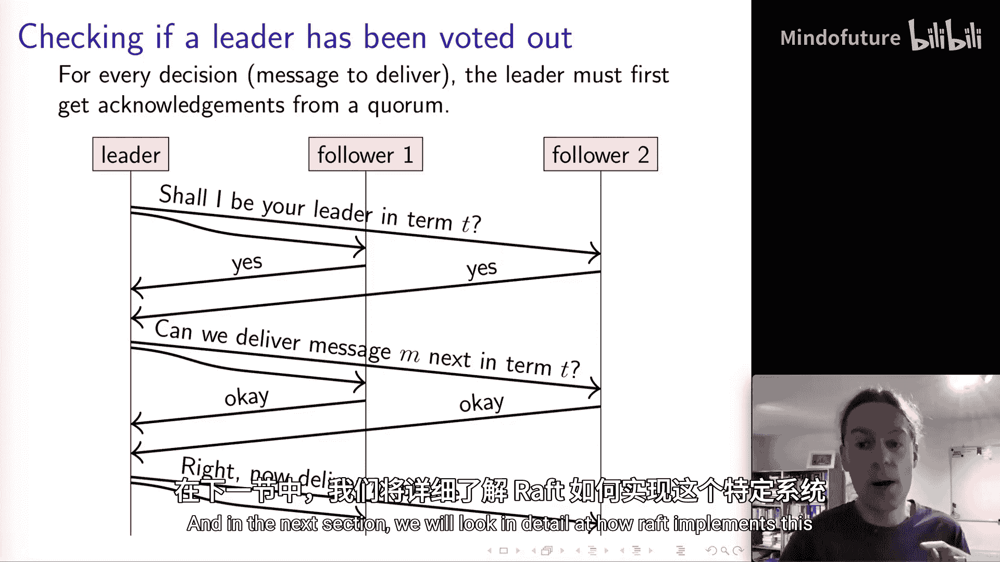

本节课中，我们一起学习了分布式系统中的共识问题。我们了解到共识与全序广播的等价关系，以及为什么需要共识算法来自动处理领导者故障，避免手动干预。我们介绍了共识算法通常基于部分同步和崩溃-恢复的系统模型，并解释了FLP不可能性定理为何要求我们做出时间假设。我们探讨了Raft算法通过引入任期、单次投票和法定人数机制来确保领导者唯一性的核心思想，并最终理解了共识算法通过两阶段投票（领导者选举和日志提交）来保证一致性和避免脑裂的基本原理。这些概念为理解具体的共识算法（如Raft）奠定了坚实的基础。