# 020：线性一致性 🧩

在本节课中，我们将要学习一种称为“线性一致性”的一致性模型。我们将探讨其核心思想、它与实时性的关系，以及如何在分布式系统中实现它。

## 概述

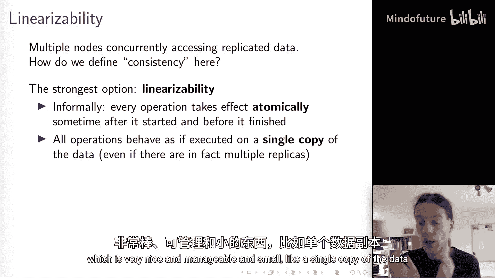

之前我们讨论了两阶段提交和原子提交，它们确保了在节点崩溃情况下的数据一致性。然而，在并发场景下，当多个节点同时读写数据时，我们同样需要确保操作之间的一致性。线性一致性就是为并发系统定义的一种特定的一致性模型。它是目前广泛使用的最强一致性模型。

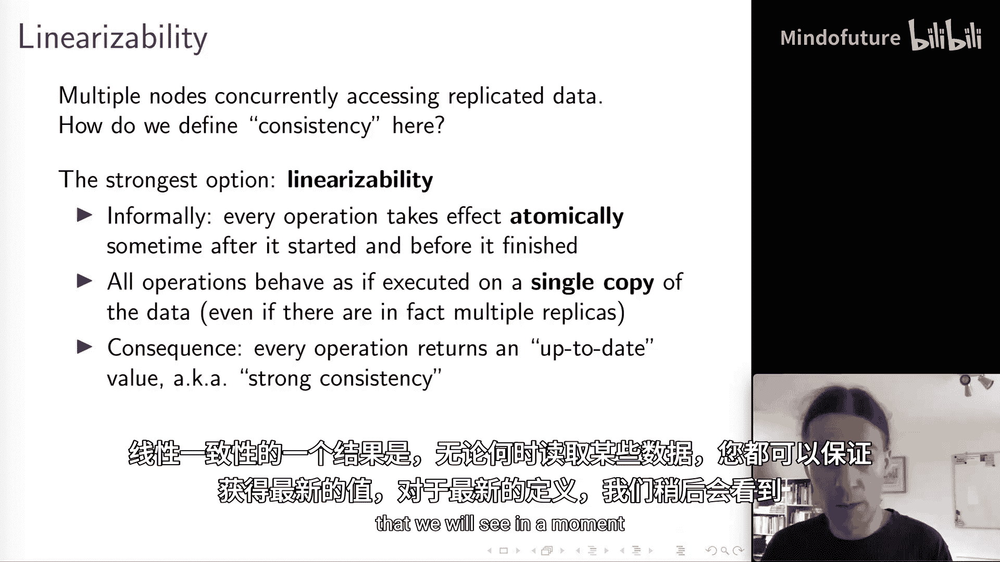

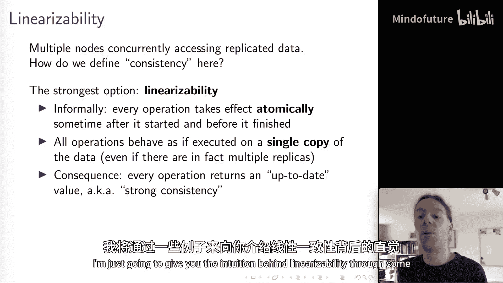

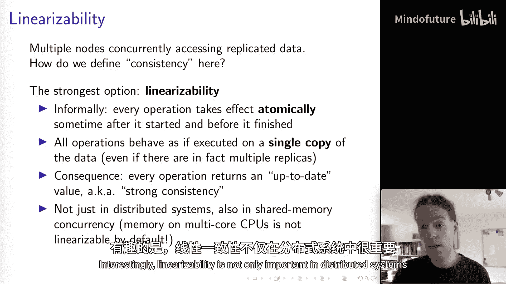

## 线性一致性的核心思想

线性一致性的核心思想是：整个系统表现得就像它没有被复制或分布式一样。换句话说，系统表现得好像数据只有一个副本，并且所有操作都在这个单一副本上原子性地发生。

从客户端的视角来看，即使系统中有多个副本，它看起来也像是只有一个数据副本。这非常有利于编程，因为它将分布式系统的复杂性简化为一个易于管理的、类似单一副本的模型。

**核心公式**：`系统行为 ≈ 单一数据副本 + 原子操作`

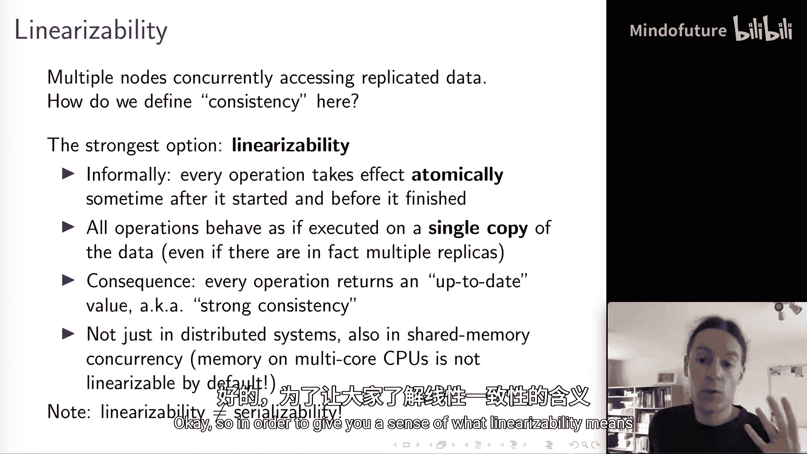

## 线性一致性的含义与重要性

线性一致性的一个直接结果是：当你读取数据时，保证能获得一个“最新”的值（我们稍后会定义“最新”）。这有时也被称为“强一致性”，但“强一致性”这个术语定义模糊。我们将坚持使用有明确定义的“线性一致性”。

有趣的是，线性一致性不仅对分布式系统重要，在单台计算机的共享内存并发场景中同样适用。原因在于，多核CPU的每个核心都有自己的缓存。一个线程写入内存的值可能先进入其核心的缓存，而另一个在不同核心上运行的线程读取同一内存位置时，可能看不到第一个线程写入的值，因为它的缓存尚未更新。因此，在单台计算机内部，由于多级缓存的存在，也会出现类似分布式系统中副本不一致的行为。

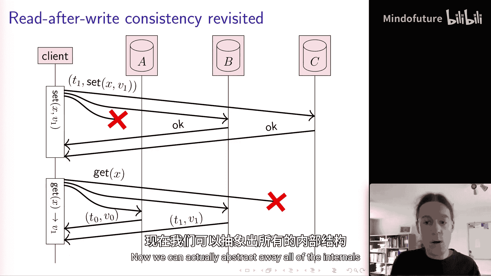

## 线性一致性与可串行化的区别

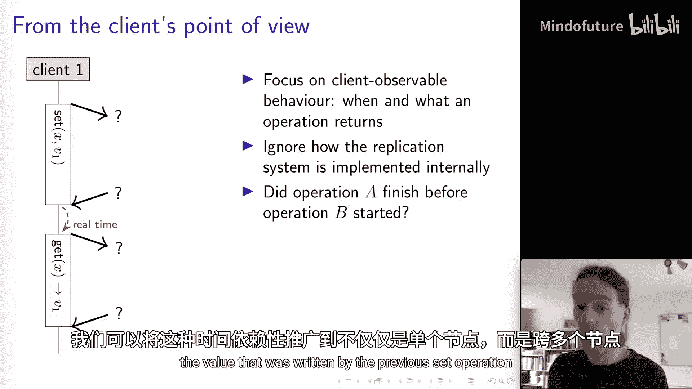

需要特别注意的术语是：**线性一致性**和**可串行化**不是一回事，尽管它们看起来相似，但含义完全不同。
*   **可串行化**是事务之间的一种隔离形式，它关注的是多个事务的执行效果等同于某种串行顺序。
*   **线性一致性**是关于多个副本表现得像单一副本。

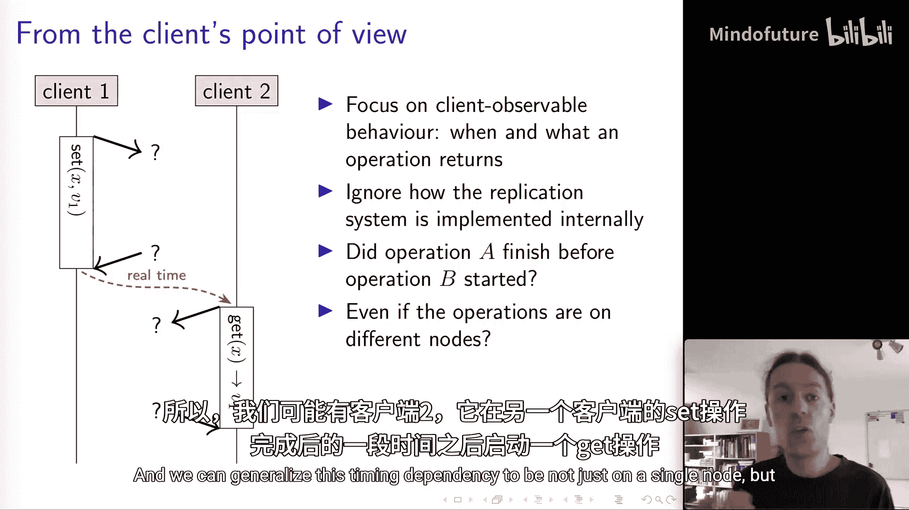

它们是两个非常不同的概念。

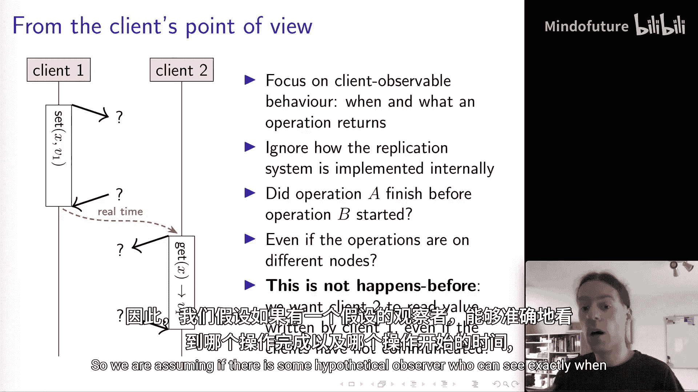

## 通过读写一致性理解线性一致性

为了理解线性一致性的含义，让我们回顾之前讲座中提到的“写后读一致性”。在读写仲裁的背景下，如果一个客户端写入一个值`V1`到对象`X`，并向一个仲裁组发送写请求，成功后，同一个客户端再发起读请求。从客户端的视角，每个操作都有一个执行时间段（从发送请求到收到足够响应）。

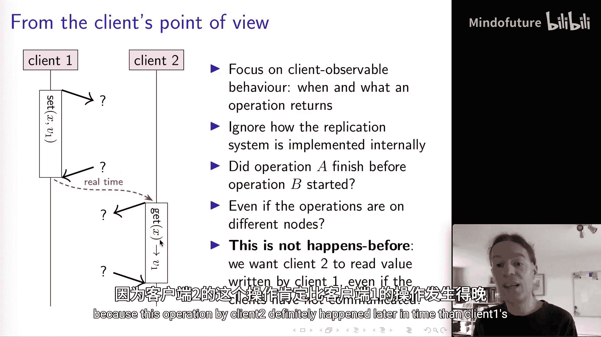

我们可以抽象掉内部实现细节，仅从客户端的视角来定义一致性模型。这很有用，因为它意味着我们的模型不依赖于特定的系统实现或分布式算法。

在上面的例子中，读操作在写操作**完成后**才开始，存在一个时间上的先后依赖。因此，我们期望读操作能看到至少和之前写操作一样新的值。

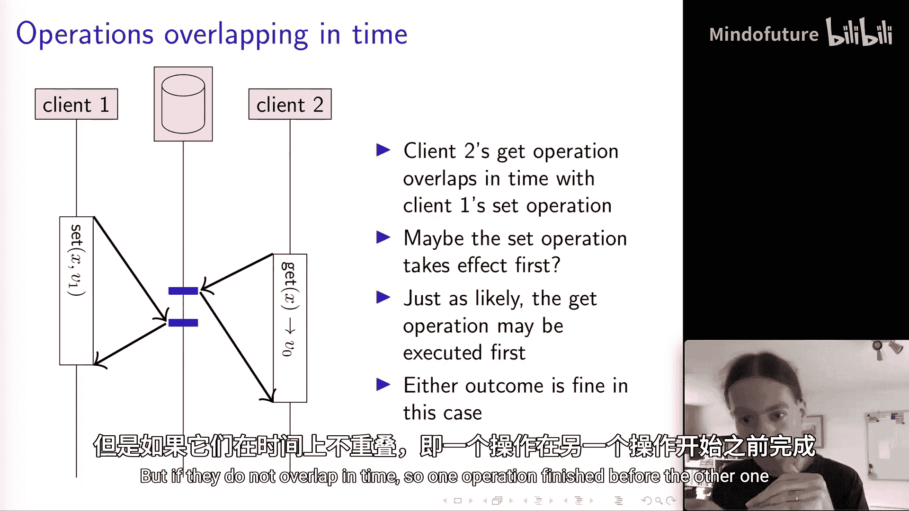

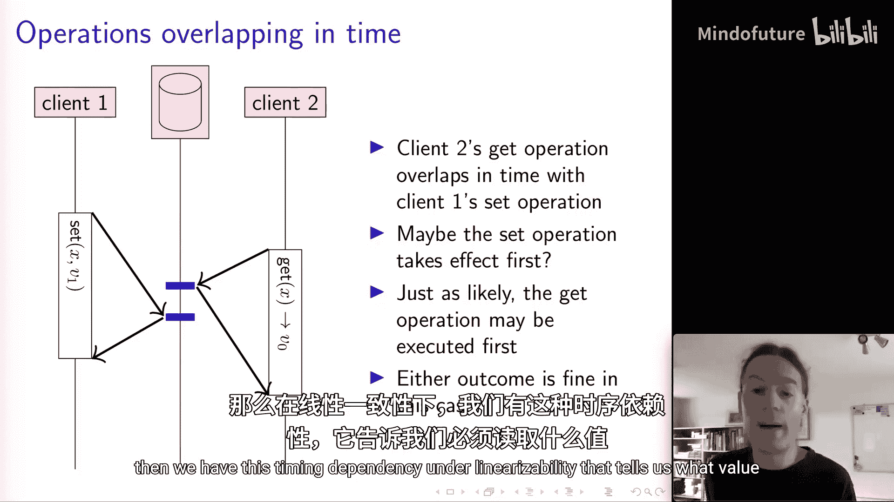

## 跨客户端的实时依赖

我们可以将这种时间依赖推广到多个客户端之间。例如，客户端2的读操作在客户端1的写操作**完成后**才开始。根据线性一致性，由于存在这种实时依赖，我们期望客户端2也能看到最新的值`V1`。这正是单一数据副本上原子操作应有的行为。

这种时间依赖看起来像“happens-before”关系，但两者不同。
*   **Happens-before** 是根据消息的发送和接收来定义的，与物理时间无关。
*   **线性一致性** 是根据**实时**来定义的。我们假设存在一个能精确观察操作开始和结束时间的观察者。即使两个客户端之间没有直接通信，只要一个操作在另一个操作结束后才开始，它们之间就存在实时依赖，后者必须能看到前者的更新。

另一方面，如果两个操作在**时间上重叠**，那么它们可以以任意顺序生效。例如，一个写操作和一个重叠的读操作，读操作可能返回旧值或新值，这两种情况在线性一致性下都是允许的。因为线性一致性只要求一个操作在其开始之后、结束之前的某个时间点原子性地生效。

## 仲裁读写足以保证线性一致性吗？

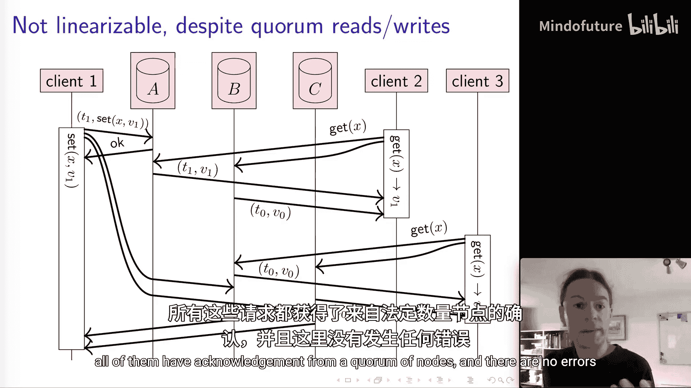

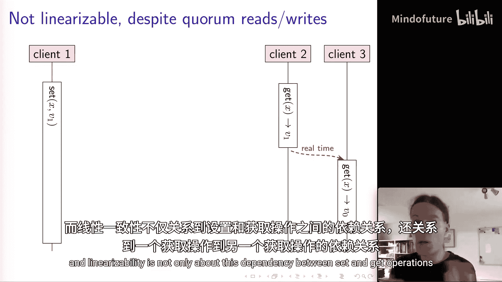

我们讨论了使用仲裁写和仲裁读来实现写后读一致性。你可能会问，这足以保证线性一致性吗？答案是否定的。

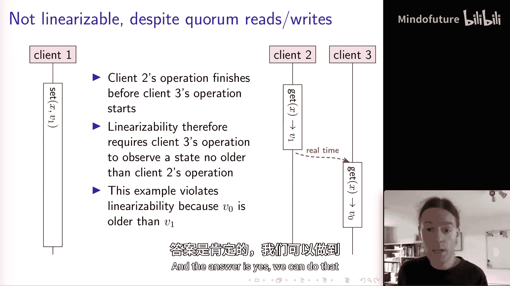

以下是一个反例：
1.  客户端1发起写操作`set(x, v1)`。由于网络延迟，只有副本A快速收到了更新，副本B和C尚未更新。
2.  客户端2发起读操作`get(x)`，它从副本A和B（一个仲裁）获得响应。通过比较时间戳，它看到了来自A的新值`v1`并返回。
3.  接着，客户端3发起读操作`get(x)`，它从副本B和C（另一个仲裁）获得响应。此时B和C都还没有`v1`，因此客户端3读到旧值`v0`。

问题在于：客户端3的读操作在客户端2的读操作**结束后才开始**，存在实时依赖。根据线性一致性，客户端3应该读到至少和客户端2一样新的值（即`v1`），但它却读到了`v0`。这违反了线性一致性。

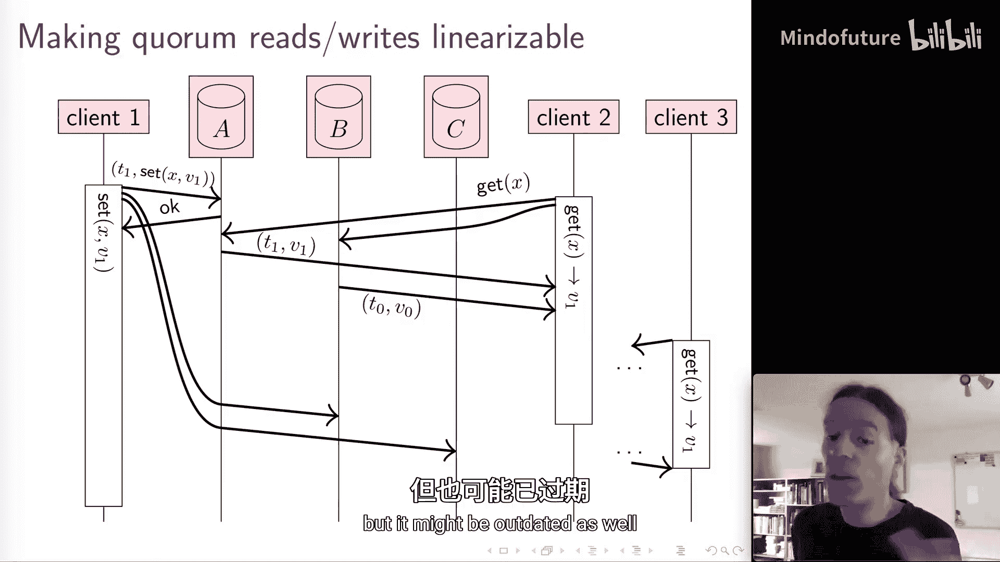

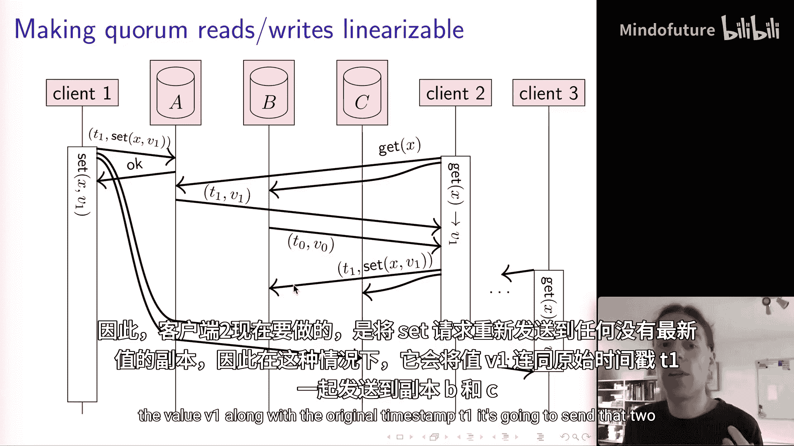

## 如何修复：带读修复的仲裁读

我们可以修复这个算法使其满足线性一致性，方法是在读操作中加入**读修复**。

流程如下：
1.  客户端2发起读请求，从仲裁（A和B）获得响应，并识别出`v1`是最新值。
2.  客户端2不立即返回，而是将最新值`v1`（连同其时间戳）重新发送给那些拥有旧值的副本（本例中是B和C）。
3.  客户端2等待至少一个副本确认更新（确保`v1`存在于一个仲裁中），然后才将`v1`返回给调用者。

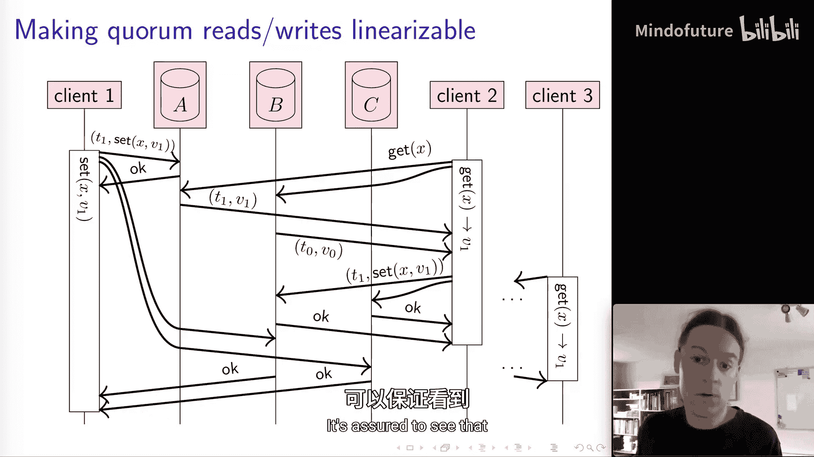

通过这种方式，在读请求完成时，最新值已经确保存在于一个仲裁组中。因此，任何后续的读请求只要访问一个仲裁，就一定能看到这个最新值。这个算法（ABD算法）可以保证`get`和`set`操作的线性一致性。

## 实现线性化的比较并交换操作

上述算法处理的是无条件的“盲写”。但在并发写入时，可能会发生覆盖冲突。我们通常还需要`compare-and-swap`这样的原子操作。

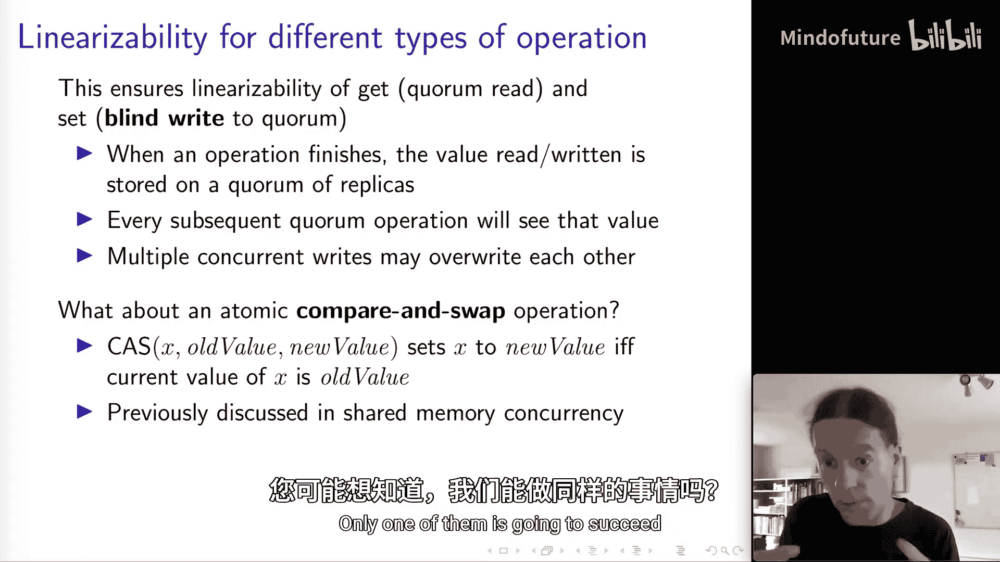

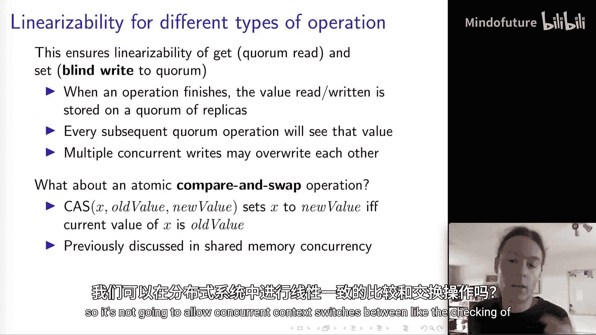

在单机系统中，CAS是CPU提供的原子指令。在分布式系统中，我们也能实现线性化的CAS操作，但需要使用不同的算法——**全序广播**。

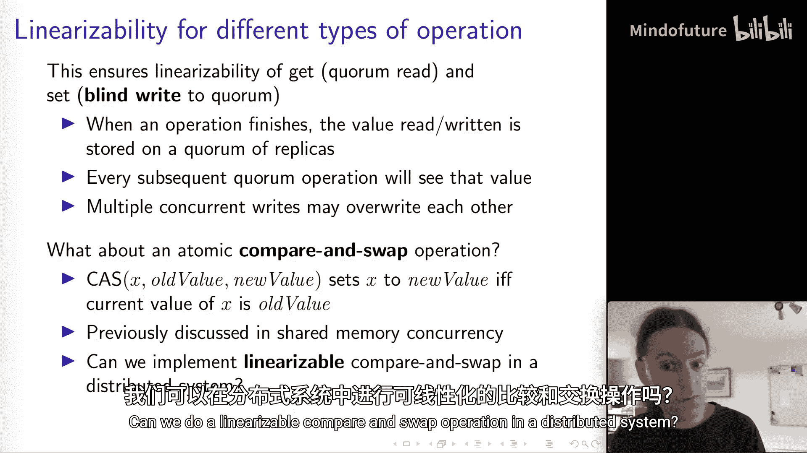

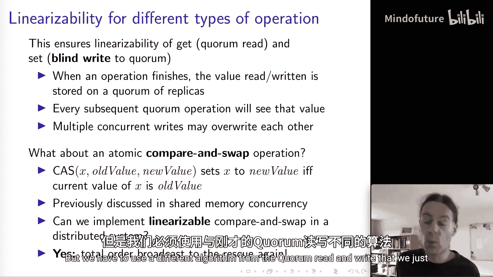

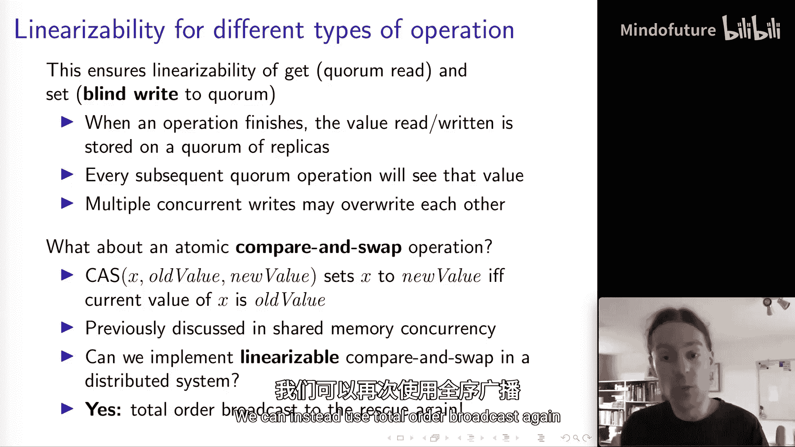

实现线性化的`get`和`CAS`操作的算法非常简单：
1.  无论是`get`还是`CAS`操作，客户端都将其包装成一条消息，通过**全序广播**发送给所有副本。
2.  客户端等待该消息被全序广播协议**送达**。
3.  当消息被送达时，所有副本以**相同的顺序**处理这些消息。
4.  对于`get`消息，副本读取本地状态并返回结果。
5.  对于`CAS`消息，副本检查当前值是否等于预期旧值，如果是则原子性地更新为新值并返回成功，否则返回失败。

由于全序广播保证了所有副本以相同顺序处理所有请求，这本质上等同于**状态机复制**。所有副本的状态保持一致，从而实现了线性一致性。这是一个非常简洁的构造。

## 总结

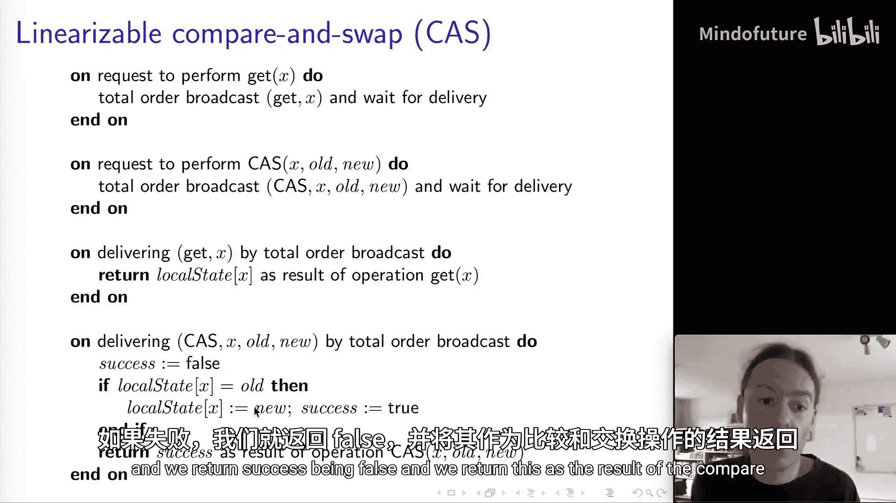

本节课我们一起学习了线性一致性。我们了解到：
1.  线性一致性是一种强一致性模型，要求系统表现得像单一数据副本。
2.  它基于**实时**定义操作之间的顺序依赖。
3.  简单的仲裁读写不足以保证线性一致性，需要引入**读修复**机制。
4.  对于更复杂的原子操作（如CAS），可以基于**全序广播**来实现，这提供了所有副本上操作的全序视图，是构建线性化系统的强大工具。

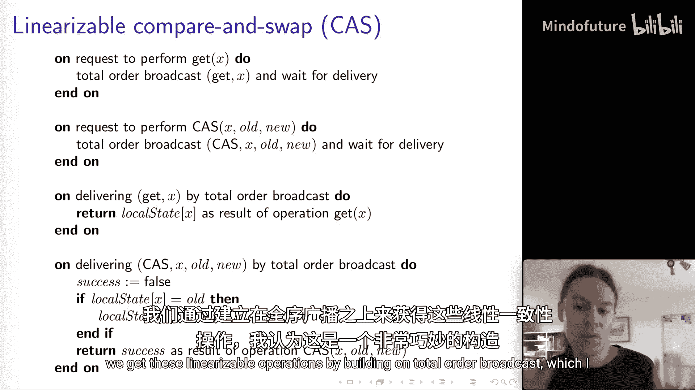

理解线性一致性是设计可预测、易于推理的分布式系统的关键一步。