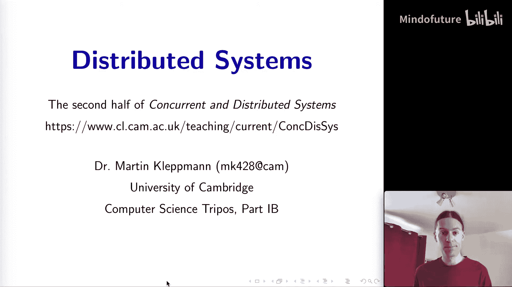
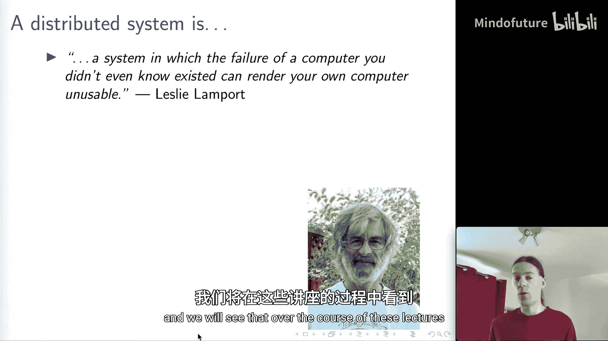
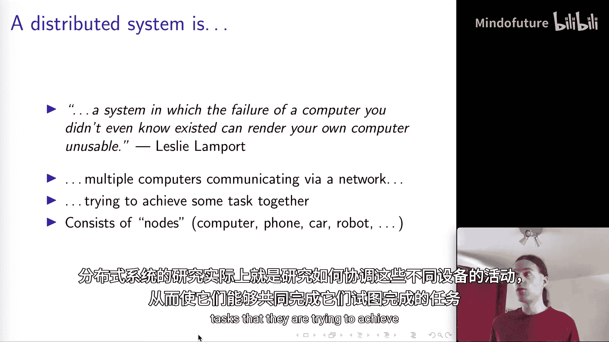
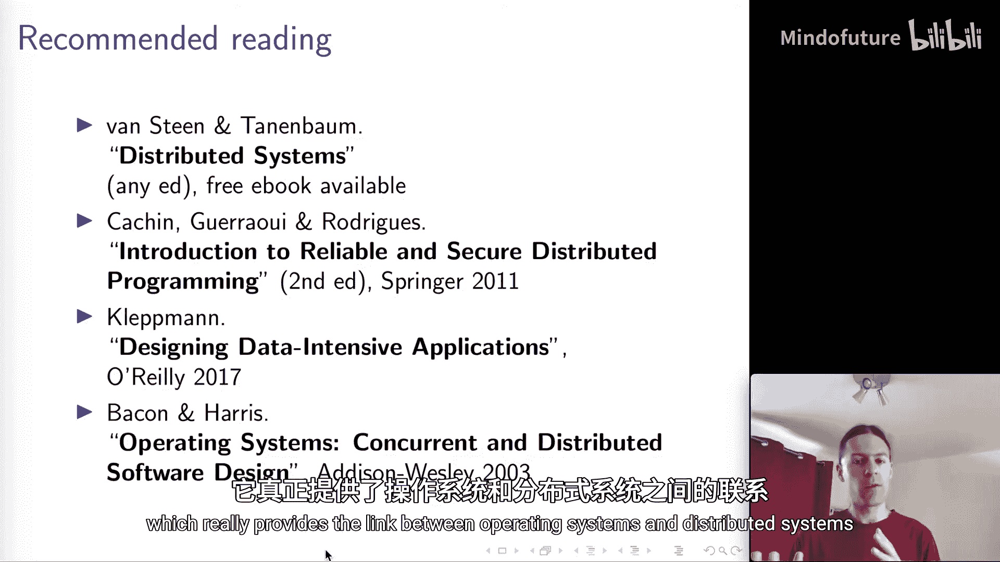
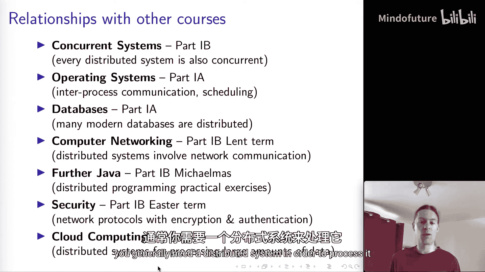
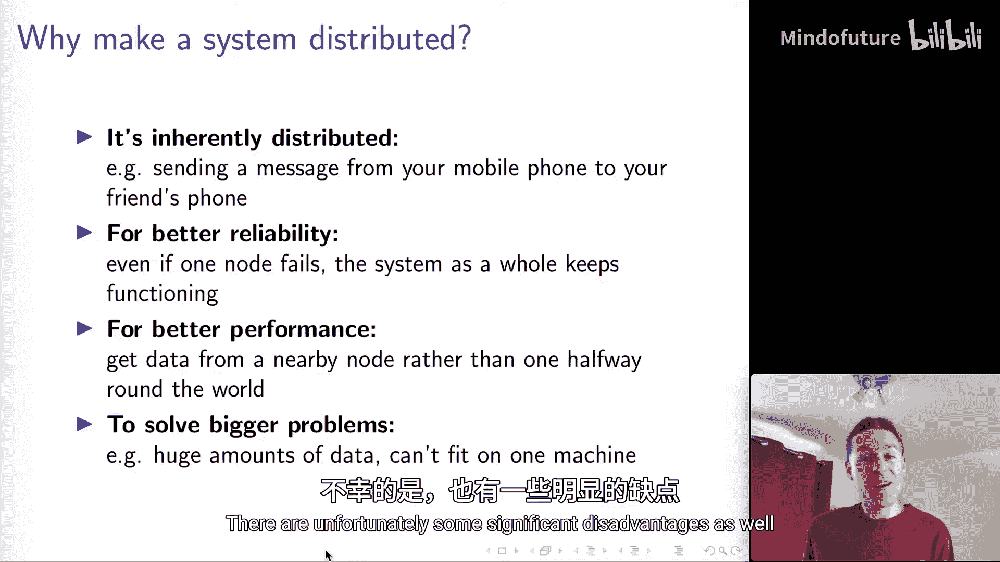
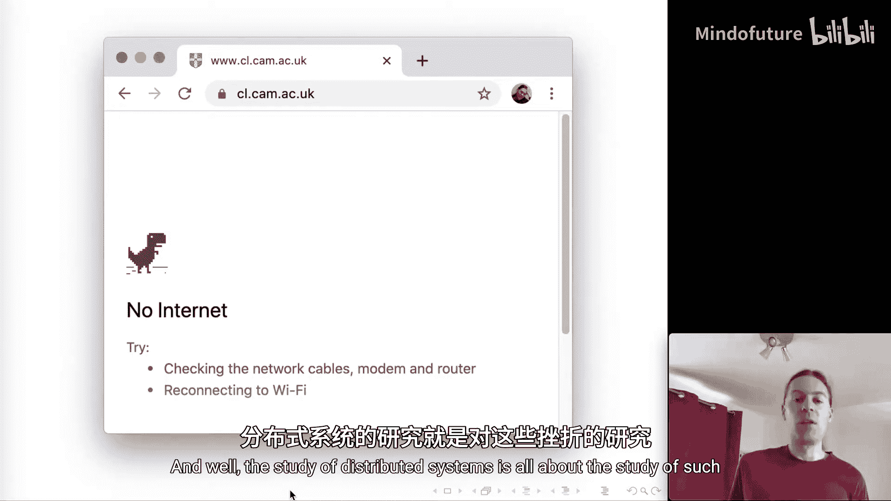
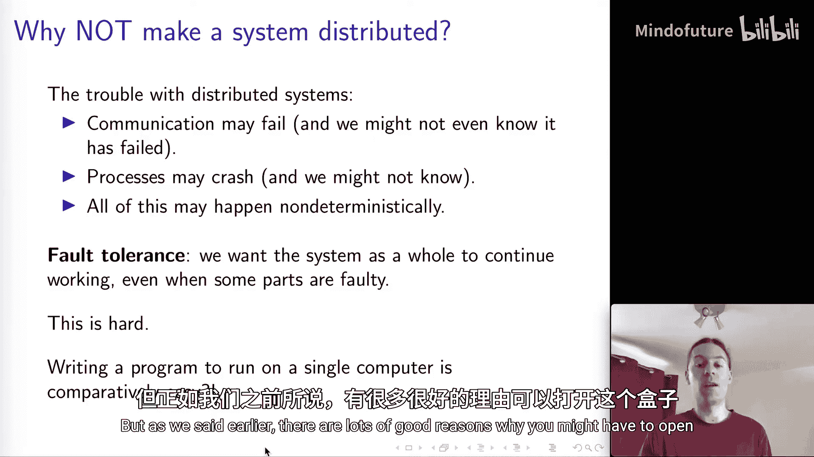

# 【剑桥大学-•-中英】分布式系统讲座-p01-P01-Distributed-Systems-1.1---Introduction--BV1NwQhYeEyV_p1-

Hello everybody。 My name is Martin Kckman and I'm going to be giving the next eight lectures on distributed systems。

 This is the second half of the course on concurrent and distributed systems and so in the first half of this course you've seen a lot on concurrency that occurs within a single process so when you have especially when you have multiple threads within a single process that are performing operation concurrently you have seen how to deal with mutual exclusion。

 for example， and various algorithms for ensuring safe concurrency Now in this kind of concurrent system you have all of the threads usually sharing a single address space and so you can just pass a variable from one thread to another thread and that variable can contain pointers or references to arbitrary objects and this will work because the memory addresses that one thread can access are the same as the memory addresses that another thread can access。

Now when we move to distributed systems this changes so in distributed systems we still have concurrency。

 we still have multiple processes and multiple threads performing operations concurrently potentially but we also have the additional challenge that now we're talking about not just a single program running on a single computer but multiple programs running on multiple computers where those computers are communicating via a network and this aspect that we are now introducing this network is part of what makes a distributed system distributed another aspect is also that we don't have a single shared address space anymore。

 so a pointer that makes sense in one process if you send it over the network to another process running on a different computer。

 that pointer will not necessarily make any sense to the recipient of that message and so we have to think about different ways of sharing data between these concurrent entities。

So。A definition of a distributed system a somewhat joking definition provided by Leslie Lamport is that a distributed system is a system in which the failure of a computer he didn't even know existed can render your own computer unusable whether this is a good definition or not we can debate。

 but Leslie Laport is a bit of a legend in the area of distributed systems and we will see various aspects of work that he's done over the decades。

 and of course lots of other people have done work in this area。

 and we will see that over the course of these lectures。

 So more generally I think I would define a distributed system as one in which you have got multiple computers or computing devices。

 these devices might be smartphones， they might be robots， they might be self-driving cars。

 they might be desktop computers they might be servers in a data center。

 So any sort of computing device really， and these computing devices are communicating by some kind of network。

Which might be the Internet。 And they are trying to achieve some kind of task together。

 And the study of distributed systems is really the study of how do we coordinate the activities of these different devices in such a way that they achieve together the task that they are trying to achieve。

So I will start with a little bit of background first just the administrative things to get that done。

 So first of all， if you want any further background reading on this course。

 hopefully the lecture notes will be reasonably self-contained but of course further detail is available in books if you're interested there are several different styles of books that I've put here on the list so the textbook by Van Stein and Tanbaum is a sort of systems level overview so this it comes at distributed systems from quite an applied angle of real applications that real people use and discusses howaldi's work and discusses the various implementation details of it it doesn't go as far into the theory as some of the other books but it's more practically oriented if you like the theory then the second book on this list is a good choice so the textbook by Kaim Garri and Rodriguez is an excellent but quite detailed。

Overview of distributed systems theory so it goes into a lot more depth than we have time to talk about in this course。

 but if you want to read more about a theory， this is an excellent book。

I also wrote a book in this area called Designing Data intensivetensive applications。

 This book is a bit more oriented towards distributed database systems。

 so it's not just not just distributed systems in general。

 there's a lot of other databases content in there but it's and this book is more oriented towards industrial software engineers。

 so people who are working professionally with distributed databases will probably find this kind of book useful。

And finally， there's the Bacon and Harris textbook。

 which was already recommended for the concurrent systems part of this course。

 which really provides the link between operating systems and distributedd systems。

Okay so this course is also connected to various other courses in the trippo。

 most obviously concurrent systems that this course is part of。

 also operating systems which you studied last year。

 so all of the background that you have there on processes and inter process communication and scheduling of processes。

 all of that stuff is relevant for this course also the databases course is connected to distributed systems because as I mentioned just now many modern databases are in fact distributed and they use a lot of the techniques that we will talk about in this course and so using modern databases often involves using distributed systems as well。

There's a strong connection between distributed systems and computer networking because as I said。

 distributed systems involves network communication generally。

 the difference between the two courses is that the computer networking course is mostly about how do you actually get the bytes over the wire from one device to the other device。

 So what did a network protocols look like that enable devices to communicate and then distributed systems builds on top of computer networking and saying。

 okay， assuming we now have this mechanism for devices to communicate how can we now ensure that these devices behave in the ways that we want。

There's connection to further Java， so there's programming exercises that involve a bit of distributed computing。

 the security aspect of distributed systems are very interesting and they are covered in a course in Easter term that's dedicated just a topic of security and finally in next year's cloud computing course build upon distributed systems because cloud computing is all about being able to flexibly process large amounts of data and if you have sufficiently large amounts of data you generally need a distributed system in order to process it。

Okay， so I gave a brief definition of what a distributed system is。 The next question is then why。

 like why should we go to all of this effort of making a system distributed。

 Why can't we just use a single computer and keep things simple。 And well。

 one reason is that some application， some types of things you want to do computers are inherently distributed。

 So if you want to send a message from your phone to your friend's phone。

 This inevitably involves two different phones and a network， So this is a distributed system。

 There's no way around it， There's no way of building a messaging system that is not distributed。

 If you want to be able to communicate across different devices。

And so building this type of software is one reason why we might be interested in distributed systems。

 but there are many other reasons as well。 So another good reason for being interested in distributed systems is that it actually allows us to make systems more reliable and the reason for this is say you have multiple computers which are each performing part of some job。

 if one of those fails， maybe one of them has to be rebooted， for example。

 or one of them has a hardware failure， then maybe the remaining computers can take over the work from the failed computer。

 and so now this allows the system as a whole to continue functioning even though one of the computers involved in it has actually gone down。

Another reason we might want to make systems distributed is for better performance。

 so for example in internet distributed systems you might have users all around the world。

 you might have some users in the UK， some users in the US， some users in New Zealand。

 some users in South Africa， wherever。And there are large distances between these different places and so network communication from one of these places to the others is always going to take a little while。

 you know you're talking at least 100 milliseconds simply because of the speed of light that it takes for communication to travel from one continent to another。

😊，And so one reason why people are interested in distributed systems is to make systems faster by putting data closer to where the people are。

 So if you have some users in multiple different continents。

 you can have computers in multiple different continents and if you have each user communicating with the computer that is most local to them。

 then you avoid the long distance intercontinental communication as part of the delays that are added to their communication So making systems distributed allows us to make them faster potentially。

And finally， another reason why people build distributed systems is to solve bigger problems than they could with a single computer。

 So some computing problems are simply very large scale。

 So think of scientific computing examples like， for example， the the CEern。

The particle accelerator in Switzerland that includes the large Hadron collider。

 they have a vast computing infrastructure involving a million CPU cores。

 and God knows how many hard disks in order to just take all of the data that they're gathering from the particle accelerator and process it and analyze it and try to use this to discover new particles。

 for example， Now， this scale of task would simply be not be possible to achieve on a single computer because there is no supercomputer that is big enough to be able to handle these vast volumes of data。

 so。Simply solving this problem of analysing such large volumes of data has to be done on a network of lots of small computers and those computers have to distribute the work amongst them and they have to work together in order to achieve the tasks that the scientists are trying to do。

And so。This is really one of another key area in which we can use distributed systems is to solve bigger problems。

Now， those are the advantages of making systems distributed。

 they are unfortunately some significant disadvantages as well and the main disadvantage that you will be well familiar with is whenever you're trying to do something over a network。

 that network might not be working for some reason and so everyone has experienced what it's like for the internet to be down or for your w-fi signal to be weak or in some rural part of the country and your cellular data signal is weak and you're trying to load a map or something like that。

 everyone has experienced this kind of frustration before and well the study of distributed systems is all about the study of such frustrations。

So we assume whenever we are building a distributed system that involves communication over a network。

 that networks are not perfectly reliable。 And so it is always possible for communication to fail。

 It is always possible that。Because because if it's a w-fi network， you might be out of range。

 if it's a wired network， somebody might have unplugged the wrong cable if it's any type of network it might just be temporarily overloaded and so it might be dropping messages。

 maybe even somebody might be maliciously trying to interfere with the network and cause it to to drop packet maybe be causing a denial of service attack。

 for example， there are many reasons why communication might not work from time to time。

 and so we have to build systems that are robust so that even if communication is interrupted from time to time。

 the system as a whole still functions in some correct way where of course we can define what we mean with correct。

 but we want it to continue functioning。Another thing that can go wrong in distributed systems is that some of the processes that running the code might crash and for example。

 if you have a system consisting of multiple computers and you reboot one of them。

 you probably want the remaining computers to carry on the task of serving user requests。

And so what we want here is that one of the processes is temporarily out of action。

 and we want the system as a whole to still continue nevertheless。 And finally。

 all of these failures can happen non-deterministically and that is we simply don't know when they happen。

 they could happen at any moment unpredictably and we still have to ensure that the software works nevertheless。

So what we often strive for in distributed systems is what is called as what is known as full tolerance。

 which means that even if some part of the system is faulty， some part of the system is not working。

 the system as a whole still continues providing the service to the users and so。

This is one of the main challenges in distributed systems。

 How do we make things in such a way that they can tolerate faults？In fact。

 making things distributed and full tolerant is so difficult that a lot of people who work professionally on distributed systems think at oh well。

 if you can solve a problem on a single computer， it's basically easy。

 so if you can solve a problem on a single computer。

 you'll probably have a much better time just keeping it on one computer。

 not overcomplicating things， not going into a distributed system setting。😊。

And so all of the problems， this Pandora's box of problems that arise with distributed systems。 Well。

 we should try and open that only if we actually have to。 But as we said earlier。

 there are lots of good reasons why you might have to open that box。

