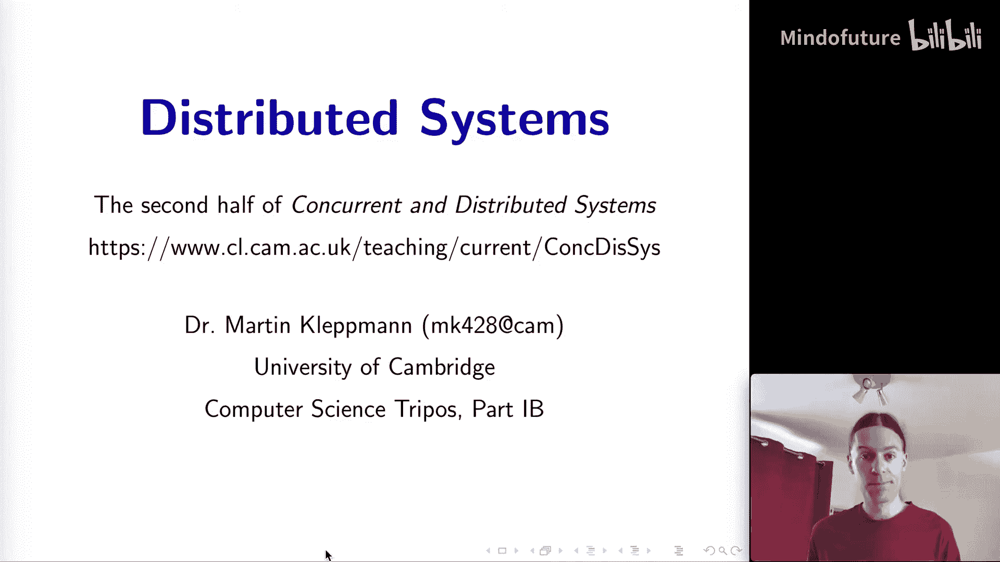
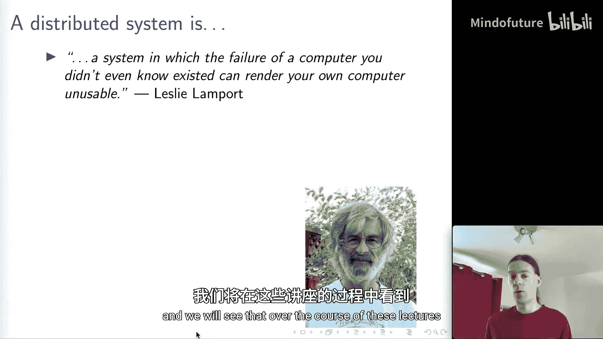
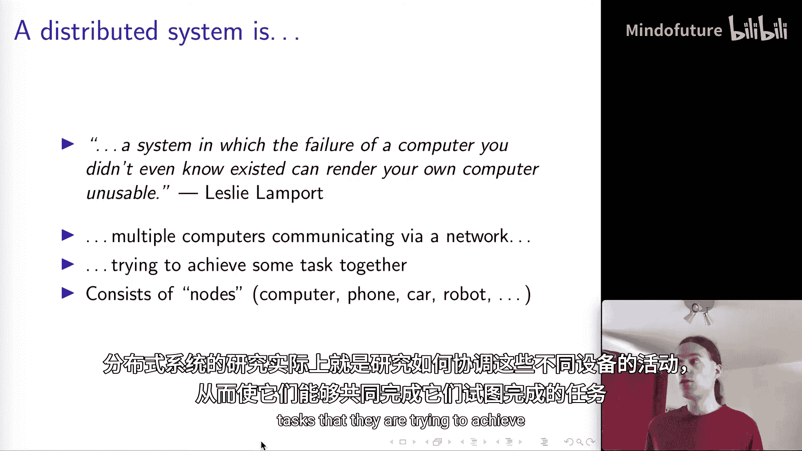
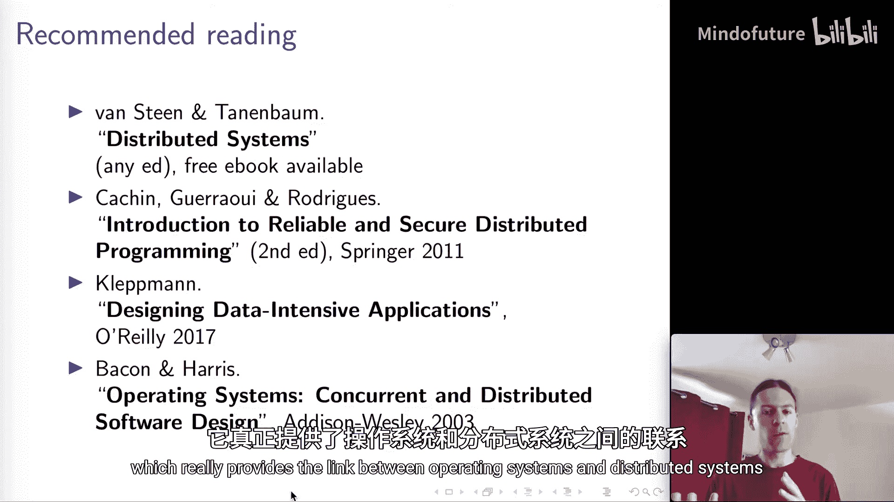
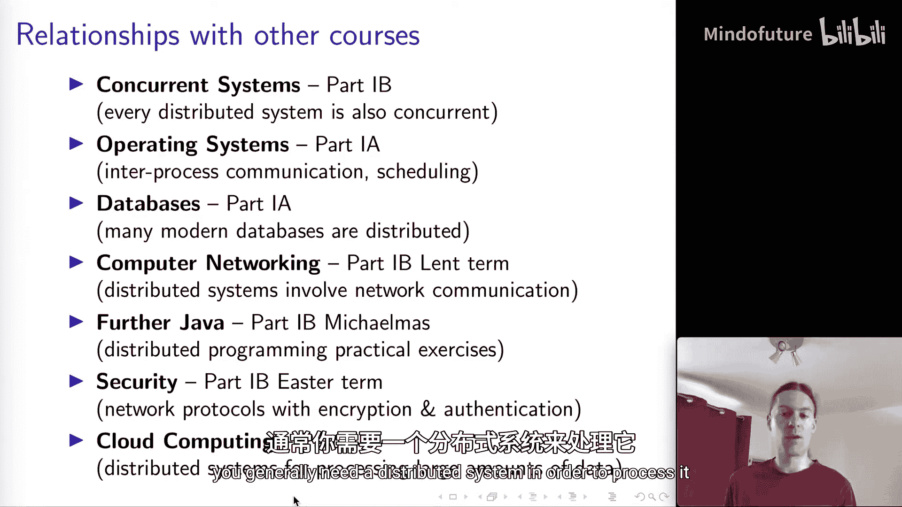
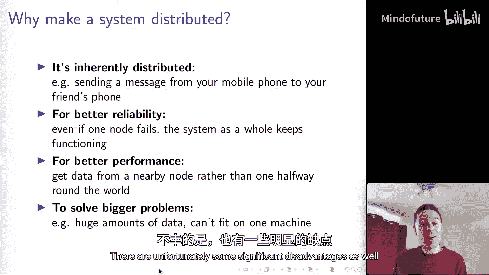
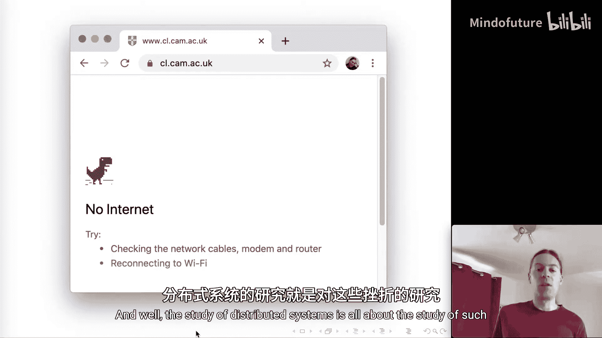
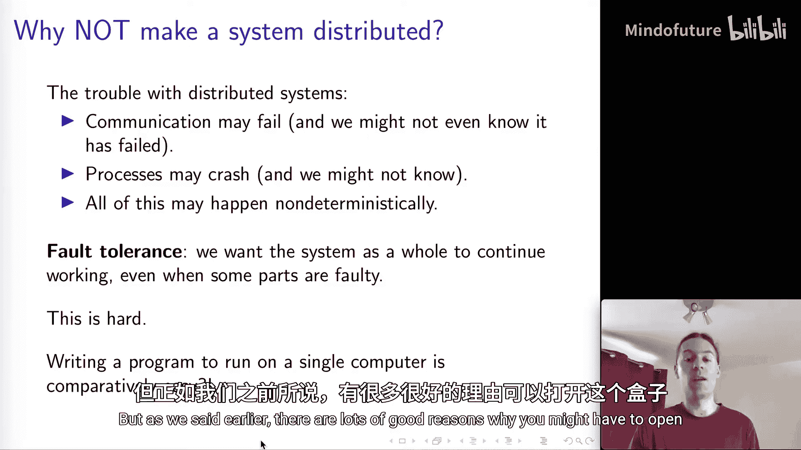

# 分布式系统：P01：引言

在本节课中，我们将要学习分布式系统的基本概念，了解它与并发系统的区别，并探讨构建分布式系统的动机与挑战。

上一节我们介绍了课程的整体背景，本节中我们来看看分布式系统的具体定义。

## 什么是分布式系统？

在并发与分布式系统课程的第一部分，我们学习了单进程内的并发。例如，当单个进程内有多个线程并发执行操作时，我们学习了如何处理互斥以及确保安全并发的各种算法。在这种并发系统中，所有线程通常共享一个单一的地址空间。因此，你可以直接将一个变量从一个线程传递给另一个线程，该变量可以包含指向任意对象的指针或引用。这是可行的，因为一个线程可以访问的内存地址与另一个线程可以访问的内存地址是相同的。

当我们转向分布式系统时，情况发生了变化。在分布式系统中，我们仍然存在并发性，仍然有多个进程和多个线程可能并发执行操作。但我们还面临一个额外的挑战：我们现在讨论的不是在单台计算机上运行的单个程序，而是在多台计算机上运行的多个程序，这些计算机通过网络进行通信。引入网络这一方面是使系统成为“分布式”的原因之一。另一个方面是我们不再拥有单一的共享地址空间。因此，在一个进程中有效的指针，如果你通过网络将其发送给运行在不同计算机上的另一个进程，该指针对消息接收者来说可能毫无意义。所以，我们必须思考在这些并发实体之间共享数据的不同方式。

莱斯利·兰波特给出了一个略带玩笑的分布式系统定义：一个分布式系统是指，一个你甚至不知道其存在的计算机发生故障，都可能导致你自己的计算机无法使用的系统。无论这是否是一个好的定义，我们都可以讨论。莱斯利·兰波特是分布式系统领域的传奇人物，我们将在后续讲座中看到他多年来的多项工作成果。当然，该领域还有许多其他人的贡献。

更普遍地说，我认为可以将分布式系统定义为：一个由多台计算机或计算设备组成的系统。这些设备可能是智能手机、机器人、自动驾驶汽车、台式机或数据中心中的服务器。任何类型的计算设备都可以。这些计算设备通过某种网络进行通信，例如互联网。它们试图共同完成某项任务。分布式系统的研究，实质上就是研究如何协调这些不同设备的活动，使它们能够共同完成试图实现的任务。

## 课程背景与关联

上一节我们定义了分布式系统，本节中我们来看看本课程的相关背景和与其他课程的关联。

首先是一些管理事项。如果你希望获得本课程的进一步背景阅读材料，虽然讲义内容本身应该足够完整，但如果你感兴趣，书籍中提供了更多细节。以下是几种不同风格的参考书：

*   **《分布式系统：原理与范式》（范·斯蒂恩、坦嫩鲍姆著）**：这是一本系统层面的概述书籍，从实际应用的角度探讨分布式系统，讨论其工作原理和各种实现细节。它不像其他一些书籍那样深入理论，但更偏向实践。
*   **《分布式系统导论》（凯姆·加里、罗德里格斯著）**：这是一本优秀但相当详细的分布式系统理论概述。它比本课程有时间讨论的内容要深入得多。如果你想了解更多理论，这是一本极好的书。
*   **《数据密集型应用系统设计》（作者本人著）**：这本书更偏向分布式数据库系统，不仅仅是广义的分布式系统，还包含许多其他数据库内容。它更面向工业界的软件工程师，对于专业从事分布式数据库工作的人来说可能很有用。
*   **《操作系统：三易其稿》（培根、哈里斯著）**：这本书在本课程的并发系统部分已被推荐，它真正提供了操作系统与分布式系统之间的联系。

本课程还与三一课程体系中的其他多门课程紧密相连：

*   **并发系统**：本课程是其一部分。
*   **操作系统**：你们去年学习过。其中关于进程、进程间通信和进程调度的所有背景知识都与本课程相关。
*   **数据库**：正如刚才提到的，许多现代数据库实际上是分布式的，它们使用了我们将在本课程中讨论的许多技术。因此，使用现代数据库通常也涉及使用分布式系统。
*   **计算机网络**：分布式系统与计算机网络有很强的联系，因为分布式系统通常涉及网络通信。两者的区别在于，计算机网络课程主要关注如何实际通过线路将字节从一台设备传输到另一台设备，即实现设备通信的网络协议是什么样的。而分布式系统则建立在计算机网络之上，探讨在假设我们已有设备通信机制的前提下，如何确保这些设备按照我们期望的方式运行。
*   **进阶Java**：包含涉及分布式计算的编程练习。
*   **安全**：分布式系统的安全方面非常有趣，在复活节学期有一门专门讨论安全主题的课程会涵盖。
*   **云计算**：明年的云计算课程建立在分布式系统之上，因为云计算的核心就是能够灵活处理大量数据。当数据量足够大时，通常需要一个分布式系统来处理。

## 为何构建分布式系统？

上一节我们了解了课程的背景，本节中我们来看看构建分布式系统的动机。

我们简要定义了什么是分布式系统。接下来的问题是：为什么？我们为什么要费尽心思构建分布式系统？为什么不能只用一台计算机，让事情保持简单？

一个原因是，某些应用、某些你想做的事情本质上是分布式的。例如，如果你想从手机向朋友的手机发送一条消息，这必然涉及两部不同的手机和一个网络。这就是一个分布式系统。无法绕过这一点，构建一个非分布式的消息系统是不可能的。如果你想在不同设备间通信，就必须如此。

构建这类软件是我们对分布式系统感兴趣的一个原因，但还有许多其他原因。

另一个对分布式系统感兴趣的好理由是，它实际上可以提高系统的可靠性。原因是，假设你有多个计算机，每台都执行某项工作的部分任务。如果其中一台出现故障（例如需要重启或发生硬件故障），那么剩余的计算机或许可以接管故障计算机的工作。这样，即使参与系统的一台计算机宕机，整个系统也能继续运行。

我们可能希望使系统分布式的另一个原因是为了获得更好的性能。例如，在互联网分布式系统中，用户可能遍布全球，有的在英国，有的在美国，有的在新西兰，有的在南非等等。这些不同地点之间距离遥远，因此从一个地点到另一个地点的网络通信总是需要一些时间。由于光速限制，跨大陆通信至少需要100毫秒。因此，人们对分布式系统感兴趣的一个原因是通过将数据放在离用户更近的地方来使系统更快。如果你在多个大洲都有用户，你可以在多个大洲部署计算机。如果每个用户都与离他们最近的计算机通信，那么就可以避免长距离的跨大陆通信带来的延迟。因此，使系统分布式有可能让它们更快。

最后，人们构建分布式系统的另一个原因是为了解决单台计算机无法处理的大型问题。有些计算问题规模非常庞大。以科学计算为例，比如瑞士的欧洲核子研究中心粒子加速器（包含大型强子对撞机）。他们拥有庞大的计算基础设施，涉及一百万个CPU核心和数不清的硬盘，仅仅是为了获取从粒子加速器收集的所有数据并进行处理、分析，试图以此发现新粒子。这种规模的任务根本无法在单台计算机上完成，因为没有足够大的超级计算机能够处理如此海量的数据。因此，分析如此庞大数据的任务必须在由许多小型计算机组成的网络上完成，这些计算机必须在它们之间分配工作，并协同合作以完成科学家试图实现的任务。这确实是我们可以使用分布式系统的另一个关键领域，即解决更大的问题。

## 分布式系统的挑战

上一节我们探讨了分布式系统的优势，本节中我们来看看其面临的重大挑战。

以上是使系统分布式的优点。不幸的是，也存在一些显著的缺点。主要缺点大家都很熟悉：每当你试图通过网络做某事时，网络可能因某种原因无法工作。每个人都经历过互联网中断、Wi-Fi信号弱或在乡村地区蜂窝数据信号弱导致无法加载地图等情况。每个人都经历过这种挫败感。而分布式系统的研究，很大程度上就是研究这种挫败感。

因此，我们在构建涉及网络通信的分布式系统时，总是假设网络并非完全可靠。通信总是可能失败。原因可能是：如果是Wi-Fi网络，你可能超出了范围；如果是有线网络，可能有人拔错了线缆；任何类型的网络都可能暂时过载，从而丢弃消息；甚至可能有人恶意试图干扰网络，导致丢包，例如发起拒绝服务攻击。通信时不时失效的原因有很多。因此，我们必须构建健壮的系统，即使通信偶尔中断，整个系统也能以某种正确的方式继续运行（当然，我们可以定义“正确”的含义），我们希望它能继续运行。

分布式系统中可能出错的另一件事是，运行代码的某些进程可能会崩溃。例如，如果你有一个由多台计算机组成的系统，并且你重启了其中一台，你可能希望剩余的计算机继续承担服务用户请求的任务。因此，我们这里希望的是，即使一个进程暂时停止工作，整个系统仍然能够继续运行。

最后，所有这些故障都可能非确定性地发生。也就是说，我们根本不知道它们何时发生，它们可能在任何不可预测的时刻发生，而我们仍然必须确保软件能够正常工作。

因此，我们在分布式系统中经常追求的是所谓的**容错性**。这意味着即使系统的某些部分出现故障、某些部分无法工作，整个系统仍然继续为用户提供服务。所以，这是分布式系统的主要挑战之一：我们如何构建能够容忍故障的系统？

事实上，使系统分布式和容错是如此困难，以至于许多专业从事分布式系统工作的人认为：如果你能在单台计算机上解决问题，那基本上就很简单。所以，如果你能在单台计算机上解决问题，最好就让它保持在一台计算机上，不要把事情复杂化，不要进入分布式系统的领域。因此，对于分布式系统带来的所有问题（这个潘多拉魔盒），我们只有在确实必须时才应该尝试打开它。但正如我们之前所说，有很多充分的理由可能迫使你打开那个盒子。

## 总结

本节课中我们一起学习了分布式系统的基本介绍。我们了解了分布式系统与单机并发系统的核心区别，即引入了网络通信和缺乏共享地址空间。我们探讨了构建分布式系统的四大动机：处理本质分布式的应用、提高系统可靠性、提升性能（尤其是通过地理分布减少延迟）以及解决单机无法处理的大规模问题。同时，我们也认识到分布式系统面临的主要挑战是网络和节点的不可靠性，以及由此带来的容错需求。理解这些基本概念是深入学习后续分布式系统技术和算法的基础。