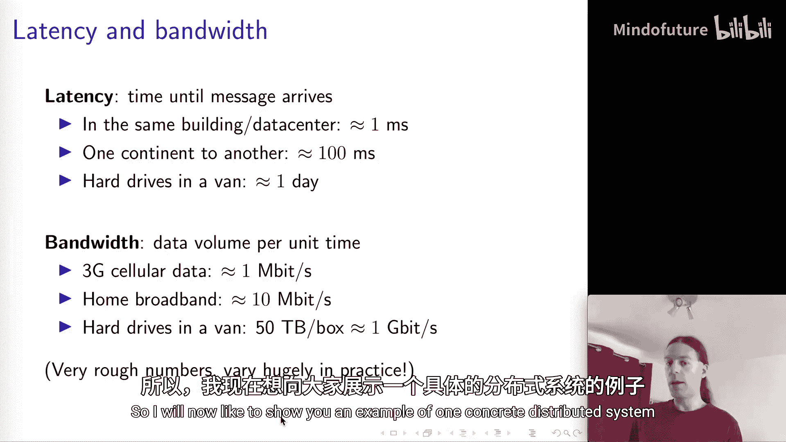
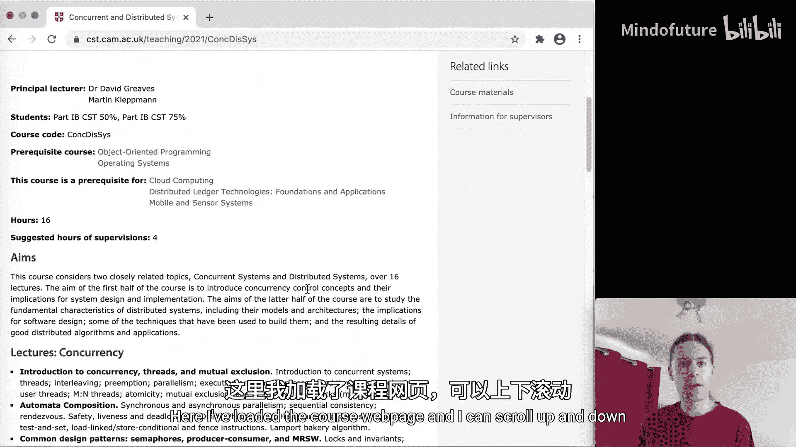
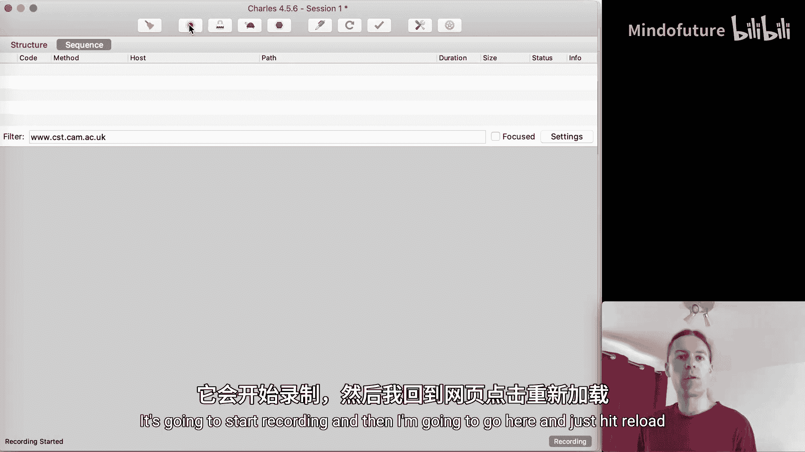
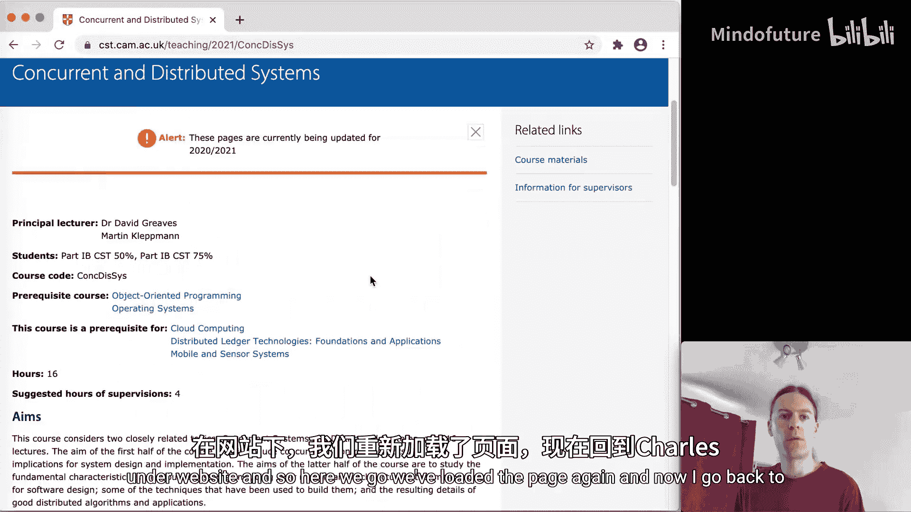
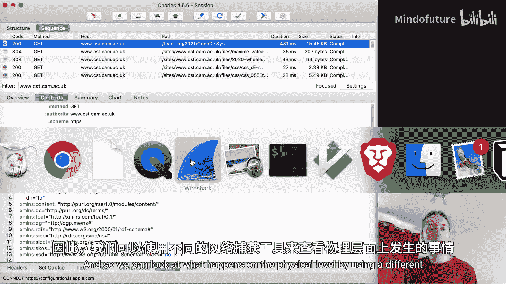
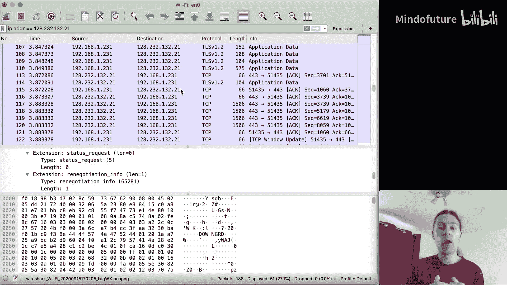
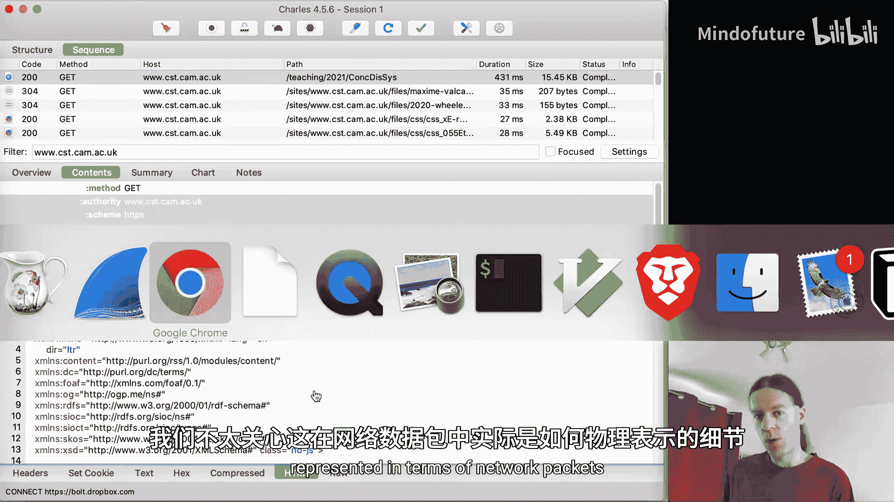
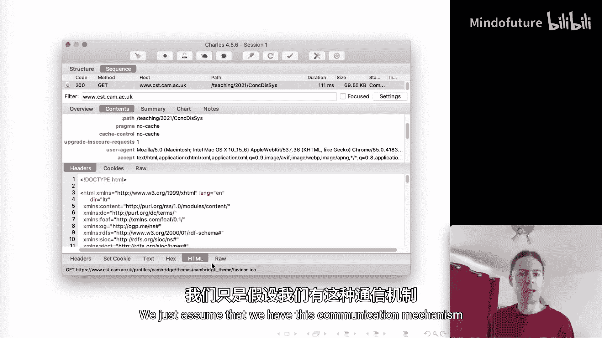

# 【剑桥大学-•-中英】分布式系统讲座-p02-P02-Distributed-Systems-1.2---Computer-networking--BV1NwQhYeEyV_p2-

ThisSe I will talk a bit more about the relationship between distributed systems and computer networking so in distributed systems。

 generally any computing device that is involved in a system we call a node so a node could be a phone or a laptop or server in a data center or any of the other things we talked about earlier and the fundamental abstraction of distributed systems。

 the communication abstraction is that one node can send a message to another node that's it that's the entire basis of distributed system one node sends a message to another node and this captures all of the possible modes of communication that can happen Now in practice of course there are lots of different types of network and different ways of getting a message from one node to another so examples of that would be if you're at the university you will be probably using university provided w-fi or college provided wifi if you're at home you probably have a home。

Innet connection， if you're sitting in a coffee shop。

 you will probably be using the wfi there if you're out and about in town you'll probably be using some cellular data on your phone。

That's only like the network that you connect to directly on top of those there are the backbone networks in that form the internet and there are lots of different types of network operated by all sorts of different companies。

 some of those go via cables， copper cables， some of them are fiber optic cables。

 some of them go underneath the Cs， some of them go via satellite and so on。

 all sorts of ways of getting messages from A to B。

 In addition there are all sorts of physical communication mechanisms such as electrical pulses on a wire。

 radio waves or lasers going down fiber optic cables or even hard drives in a van what hard drives in a van that's not a network connection。

 I will argue that is also a mechanism from getting messages from A to B。

 So if what you have is a very large amount of data that you want to send to somebody else。

 maybe to transfer it to a different data center then actually sending。

That data over the internet can be kind of slow and expensive and it can actually make more sense to load all of the data onto a bunch of hard drives。

 load a box of hard drives into a van， drive a van to the destination and when it gets to the destination you can then download all of the data back off the hard drives and store them in whatever system they need to be stored in and this people do this in practice actually and Amazon web services。

 for example which is a big provider of data center services。

 they actually have this service where you can rent a box of hard drives from them and it will come as in a career service and you can load all of your data onto it it takes about 50 terabytes or so on one of these boxes and send it back and so of course this is a very slow form of networking because it might take a day or a couple of days for the data to arrive but it is also quite a high bandwidth form of networking that you can transfer large quantity。

of data and I would argue that from a distributed assistance point of view this is just another messaging channel。

 it's another way of getting a message from A2B， the distinction is just the latency and the bandwidth of those different networking channels。

So latency varies hugely depending on what sort of network you're looking at。

Within the devices on your home wfi for example， or within servers in the same data center。

 you probably get like a millisecond， maybe less than a millisecond depending on how congested the network is latency that is the time that it takes to communicate from one device to another if you're going over the internet and you're talking to a server that is located on a different continent then it's probably more like on the order of 100 milliseconds of course hard drives in a van probably takes a day or a couple of days but still you it's just another networking channel in terms of bandwidth this varies hugely like 3G phone might have like a megabit per second if you've got a good signal it might be more like 100 kilobits per second if you've got a poor signal home broadband might be like 10 megabits。

 of course it varies very much how close you are to the next provider whether you have fiber and so on。

Roughly estimating the bandwidth of hard drives in a van well if you take one of these boxes and it takes a couple of days to do the whole loading data onto it。

 getting it to the other place， getting the data back of it again you can probably estimate it at roughly being a gigabit per second or something like that if you use one box of course you can send multiple boxes in which case you can increase that number。

 those are just very rough numbers but just sort of to give you an idea of the order of magnitude that we're talking about with these。

So I will now like to show you an example of one concrete distributed system which is a system that you use every day and that system is the web and so the web we can now analyze through a distributed systems lens and see what actually happens when you load a website in a web browser and so what happens there is that we have two communicating entities first of all you've got the client which is the web browser running on your computer or your phone and you've got the server which is usually located somewhere in a data center and when the client wants to display a web page it makes a request so a request is just a message that gets sent over the network and that request is targeted at a particular server and it contains the path of the URL that you're trying to load so you notice in a URL you have the HEP maybe S。

Double slash then comes the server name and then from the single slash onwards is the path。

 And so the bit before that first slash is the server name which is going to be the destination where we send the message to and what follows after that is the path which is then contained within the message that we send to that destination and so that message if you want to load a web page。

 we call that a get request and it contains the path and the server then will respond with the content of that web page。

And so that is probably an HTML page if it's just the plain web page。

 but it could also be an image or it could be a video file。

 or it could be a PDF document or anything like that。

And so what we have here is a simple protocol consisting of two messages。

 a request from the client to the server and a response from the server back to the client containing the data that the client ask for So I'd like to now give you a little demo of what this actually looks like and so of course。

 you know what the web browser looks like here I've loaded the course web page and I can scroll up and down。

And I can now record the messages that are sent and received over the network using a network capture tool。

 So here I'm going to use a tool that's called Charles and I'm going to put it into recording mode It's going to start recording。

 and then I'm going to go here and just hit reload on the website And so here we go we've loaded the page again and now go back to Charles and we can see that we've now accumulated a whole bunch of requests。

 So each line here is one request message that was made from the web browser to the server and it also contains the response that was sent back from the server to the client。

 And so here we can see， for example， this the first request here was for this path here。

 which is the path on the web browser you can see here in the URL that matches up with this path you can see it's a get request to load a particular website you can see a bunch of information like the user agent here。

 for example， is essentially a di version of the。

Web browser that so I'm using， so it identifies the client software version。Here， this accept header。

 this is indicates what file types the web browser understands。

 So it understands HTMLm and various other image formats and stuff like that。

 Then there's a whole bunch of other stuff here， like how it， what sort of compression it accepts。

 what sort of language I speak and so on。 So all sorts of stuff here。

And what you see in this panel here is the request message and then in the lower panel here you see the response message and here the response message to this here contains some HTML and you can see like the whole content of the HTML page I can scroll down it's a bit boring。

Okay， and we can have a look at other requests here as well。 So you can see this here。

 This looks like it's a picture。But it's downloading and。Eta， heres some CSS， some style files。

 and so on。So。😊，What we have is this very simple request response messaging。Protocol。

At the conceptual level。 So at the conceptual level here， at the distributed systems level。

 we're just talking about one message， one response。 Now。

 what happens at the underlying physical network level is a little bit more complicated。

 And so we can look at what happens and a physical level by using a different network capture tool。

 So I'm going to use a tool here。 that's called wirereshark。

And that will this will actually capture rather than capturing at the HtDP level。

 capturing the request and response。 It's going to capture the individual network packets。

 So let's see what happens here。 I'll start recording and then I'll go back to the web browser and I'll reload again。

And go back here and hit stop and here。We now see oh， a lot of activity again。

 And so here in Wishark， every line in this table is a single network packet。😊。

And so here you can see that there's a packet sent from one IP address to another IP address。

 so the9192168 that is the device that is the IP address of my laptop on which I'm recording this right now。

 this 1，2，8。232 etc that is the server that is the name of the web server of the computer lab website that I' am connecting to。

And so here you can see it's connecting using the TCP protocol， Don't worry too much about that。

 You'll learn a lot more about TCP in the computer networking course。

 But the bottom line of this is there's a lot of back and forth you can see。

 And then here there's some encryption that happens because it's an H TPS connection and you can see there here' is the name of the website that I'm connecting to。

To serve the name that I'm connecting to and so on。 and so。

On the physical level what's happening here on the network is that we have all of these network packets going back and forth and the reason that we have lots of packets is that there's a maximum size of each packet you can see here in this column it has the size。

 the length in bytes of each packet and you can see the length only goes up to about 1500 bytes here another with 1500 bytes but none that are bigger than that。

And that's because networks have this maximum size of a packet。

 And so if you want to send a message that is greater than the size of a single packet。

 you have to split it up into multiple packets。 And this is exactly what the TCP protocol does。

 So the TCP H TDP runs on top of TCP。So HtTP has this request message response message paradigm。

 but a request might be bigger than a single network packet and a response is quite likely bigger than a single network packet as well so then HTTP uses TCP underneath and TCP breaks down these big messages into small network packets that are small enough that the network can deliver them and then on the recipient's side TCP puts all of the network packet back together again to give us one large chunk of bytes and so this is now like an important thing to keep in mind in distributed systems when we're talking about messages being sent and received we're not talking about individual packets because a message may well be bigger than a single network packet and so that message then has to be broken down into small network packets so the message is really a higher level conceptual object that gets sent back and forth between between。

to nodes and how exactly this gets broken down to to the in on the packet level。

 that's something that we leave to the computer networking people。

 So for distributed systems point of view， we can just assume that we have this mechanism through which we can send these requests and these responses here and we don't care too much about the details of how this is actually physically represented in terms of network packets。

 We just assume that we have this communication mechanism。

