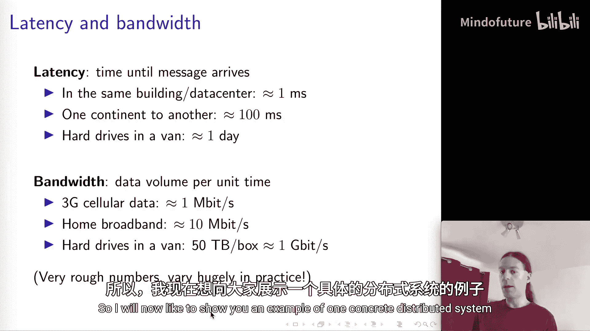
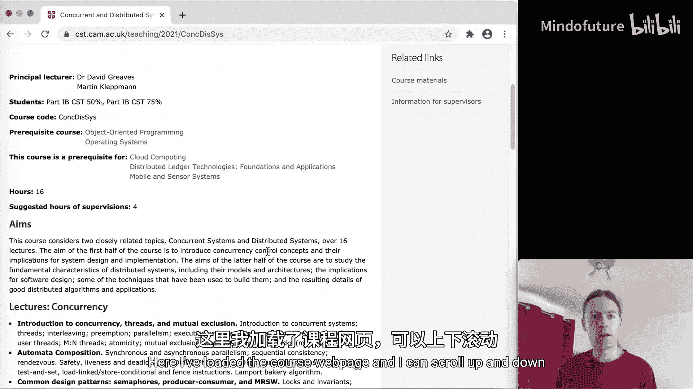
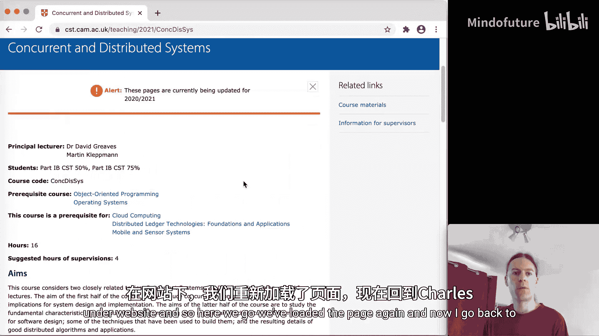
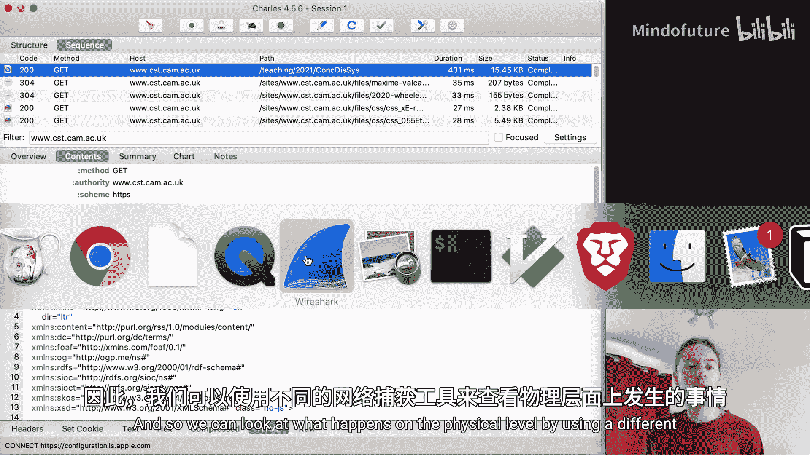
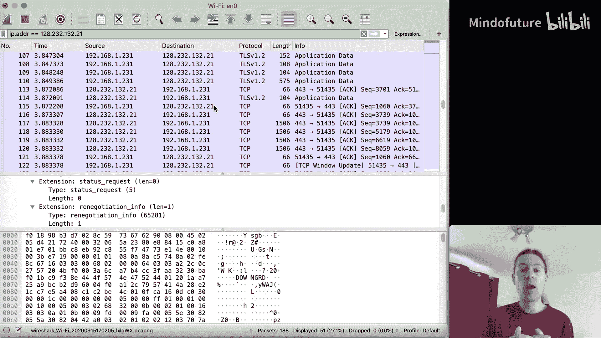
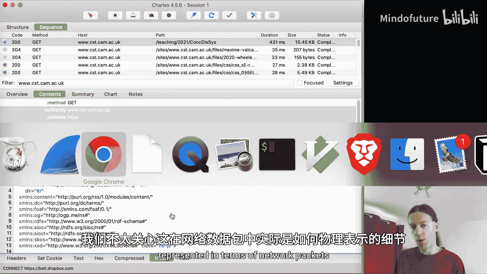
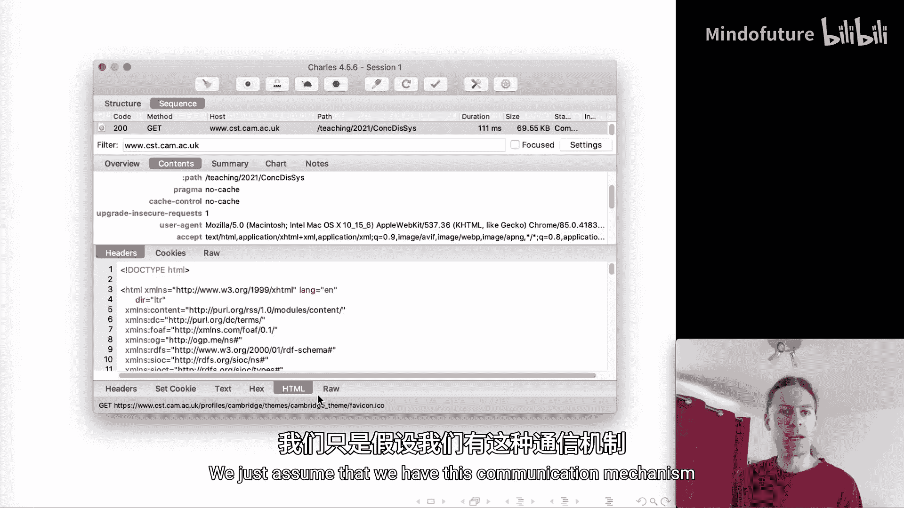

# 分布式系统：P02：分布式系统与计算机网络

在本节课中，我们将探讨分布式系统与计算机网络之间的关系。我们将从分布式系统的基本通信抽象开始，了解不同类型的网络和通信机制，并通过分析万维网（Web）这一具体实例，来理解分布式系统中的消息传递是如何在实际中运作的。

## 节点与消息：分布式系统的基本抽象

在分布式系统中，任何参与计算的设备都被称为一个**节点**。节点可以是手机、笔记本电脑、数据中心里的服务器，或是我们之前讨论过的任何其他设备。

分布式系统最根本的通信抽象是：**一个节点可以向另一个节点发送一条消息**。这就是分布式系统的全部基础。这个抽象涵盖了所有可能发生的通信模式。

## 多样化的网络与通信机制

在实践中，存在多种不同类型的网络和消息传递方式。以下是一些例子：
*   如果你在大学，可能使用大学或学院提供的Wi-Fi。
*   如果你在家，可能使用家庭宽带连接。
*   如果你在咖啡馆，可能使用那里的Wi-Fi。
*   如果你在户外，可能使用手机上的蜂窝数据。

这些只是你直接连接的网络。在这些网络之上，还有构成互联网的主干网络，由各种公司运营，形式多样：有些通过铜缆，有些通过光纤，有些通过海底电缆，有些通过卫星等等。

此外，还有各种物理通信机制，例如电线上的电脉冲、无线电波、光纤中的激光，甚至**卡车里的硬盘**。卡车里的硬盘？这听起来不像网络连接，但我认为它也是一种将消息从A点传递到B点的机制。

如果你有大量数据需要发送给他人（例如传输到另一个数据中心），通过互联网传输可能既慢又昂贵。实际上，将所有数据加载到一堆硬盘上，把硬盘装进卡车，然后开车运到目的地，可能更有意义。当卡车到达后，你可以将数据从硬盘下载并存储到需要的系统中。这在实践中确实有人这么做。例如，亚马逊网络服务（AWS）就提供这样的服务：你可以从他们那里租用一个硬盘盒，通过快递服务寄送，将数据加载到上面（一个盒子大约能装50TB），然后再寄回。当然，这是一种非常慢的网络形式，因为数据可能需要一两天才能到达。但它也是一种高带宽的网络形式，可以传输大量数据。从分布式系统的角度来看，这只是另一种消息传递通道，是另一种将消息从A点送到B点的方式。区别仅在于不同网络通道的**延迟**和**带宽**。

## 延迟与带宽：网络通道的关键指标

延迟因网络类型而异，变化巨大。
*   在家庭Wi-Fi内的设备之间，或同一数据中心内的服务器之间，延迟可能在**1毫秒**左右，甚至更少（取决于网络拥塞程度）。
*   如果通过互联网与位于不同大洲的服务器通信，延迟可能在**100毫秒**的量级。
*   卡车里的硬盘可能需要**一两天**，但它仍然只是一个网络通道。

带宽同样变化巨大。
*   3G手机的信号好时可能达到**1兆比特/秒**，信号差时可能只有**100千比特/秒**。
*   家庭宽带可能在**10兆比特/秒**左右（具体取决于你与供应商的距离、是否使用光纤等因素）。
*   粗略估计，卡车里的硬盘带宽：如果你使用一个盒子，整个过程（加载数据、运输、卸载数据）需要几天时间，其带宽大约为**1吉比特/秒**。当然，你可以发送多个盒子来提高这个数字。

这些只是非常粗略的数字，旨在让你了解我们讨论的数量级。

## 案例分析：万维网（Web）

现在，我想展示一个具体的分布式系统实例，这是一个你每天都在使用的系统：**万维网**。我们可以通过分布式系统的视角来分析它，看看在网页浏览器中加载网站时到底发生了什么。

在这个过程中，有两个通信实体：
1.  **客户端**：运行在你电脑或手机上的网页浏览器。
2.  **服务器**：通常位于某个数据中心。

当客户端想要显示一个网页时，它会发出一个**请求**。请求只是一个通过网络发送的消息，它指向特定的服务器，并包含你试图加载的URL路径。

在URL中，`http://`或`https://`之后，第一个`/`之前的部分是**服务器名**，它是消息发送的目的地。第一个`/`之后的部分是**路径**，它包含在发送给目的地的消息中。

如果你想加载一个网页，我们称这种消息为 **`GET`请求**，它包含路径。服务器随后会用该网页的内容进行**响应**。这可能是一个HTML页面（如果是纯网页），也可能是一张图片、一个视频文件、一个PDF文档等等。

因此，我们这里有一个简单的协议，由两条消息组成：一条从客户端到服务器的请求，以及一条从服务器返回客户端的响应（包含客户端请求的数据）。

## 网络消息捕获演示

接下来，我想通过演示来展示这在实际中的样子。当然，你知道网页浏览器长什么样。这里我加载了课程网页，可以上下滚动。

现在，我将使用一个网络捕获工具来记录通过网络发送和接收的消息。这里我将使用一个名为 **Charles** 的工具，并将其置于录制模式。它会开始录制，然后我回到浏览器，重新加载网站。

页面重新加载后，回到Charles，我们可以看到已经积累了一大堆请求。这里的每一行都是一个从网页浏览器发送到服务器的请求消息，同时也包含了从服务器返回客户端的响应。

例如，这里的第一个请求是针对这个路径的，它与浏览器URL栏中的路径匹配。你可以看到这是一个加载特定网站的`GET`请求，还能看到一堆信息，比如这里的**用户代理**，它本质上标识了我正在使用的网页浏览器版本。这里的**Accept头部**，表示网页浏览器能理解哪些文件类型（如HTML和各种图像格式等）。还有很多其他信息，比如它接受哪种压缩方式、我说什么语言等等。

在这个面板中，你看到的是请求消息。在下面的面板中，你看到的是响应消息。对这个请求的响应包含了一些HTML，你可以看到整个HTML页面的内容（虽然有点枯燥）。我们还可以看看其他请求，比如这个看起来像一张图片，这里是一些CSS样式文件等等。

因此，在概念层面上，我们拥有这个非常简单的请求-响应消息协议。在分布式系统层面，我们只讨论一条消息和一条响应。

## 物理网络层面的复杂性

然而，在底层物理网络层面发生的情况要复杂一些。我们可以使用另一个网络捕获工具来观察物理层面发生的事。这里我将使用一个名为 **Wireshark** 的工具。它将捕获单个网络数据包，而不是在HTTP层面捕获请求和响应。

让我们看看这里发生了什么。我开始录制，然后回到网页浏览器再次重新加载。完成后，回到Wireshark停止录制。现在我们看到，哦，又是一大堆活动。

在Wireshark中，表格中的每一行都是一个**单个网络数据包**。你可以看到一个数据包从一个IP地址发送到另一个IP地址。例如，`192.168...` 是我录制视频的笔记本电脑的IP地址，`128.232...` 是我正在连接的计算机实验室网站的服务器IP地址。

你可以看到它使用**TCP协议**进行连接。不必过于担心这个细节，你会在计算机网络课程中学到更多关于TCP的知识。但这里的要点是，有很多来回的通信。然后这里发生了一些加密，因为这是一个HTTPS连接，你可以看到这里是我正在连接的网站名称等等。

因此，在物理网络层面，发生的情况是所有这些网络数据包来回传输。我们有很多数据包的原因是每个数据包都有最大尺寸限制。你可以在这里的“长度”列看到每个数据包的大小（以字节为单位），长度最多大约到1500字节，没有比这更大的了。这是因为网络有数据包的**最大尺寸限制**。

所以，如果你想发送一条大于单个数据包尺寸的消息，就必须将其拆分成多个数据包。这正是**TCP协议**所做的事情。HTTP运行在TCP之上。HTTP有请求消息-响应消息的模式，但一个请求可能大于单个网络数据包，一个响应也很可能大于单个网络数据包。因此，HTTP使用底层的TCP，TCP将这些大消息分解成足够小的网络数据包，以便网络能够传输它们。然后在接收方一侧，TCP将所有网络数据包重新组装起来，形成一个大的字节块。

## 分布式系统的视角：消息与数据包

这是分布式系统中需要牢记的一个重要概念：当我们谈论发送和接收**消息**时，我们谈论的不是单个数据包，因为一条消息很可能大于单个网络数据包。因此，消息必须被分解成小的网络数据包。**消息**是节点之间来回传递的更高层次的概念对象。

至于如何精确地将其分解到数据包层面，那是计算机网络领域人员关心的事情。从分布式系统的角度来看，我们可以假设我们拥有这种机制，通过它我们可以发送这些请求和响应，而不必过多关心这些在物理网络数据包层面是如何具体表示的。我们只需假设我们拥有这种通信机制。

## 总结

在本节课中，我们一起学习了分布式系统与计算机网络的关系。我们了解到，分布式系统的核心抽象是节点间的消息传递。我们探讨了现实中多样的网络类型（如Wi-Fi、蜂窝网络、光纤乃至“卡车里的硬盘”）及其关键指标——延迟与带宽的巨大差异。通过分析万维网这一实例，我们看到了客户端与服务器之间简单的请求-响应协议是如何在高层运作的。最后，我们认识到，在物理网络层面，这些高层消息会被拆分为更小的数据包进行传输，但对于分布式系统设计而言，我们更关注消息层面的抽象，而将数据包处理的细节留给底层的网络协议。