# 【剑桥大学-•-中英】分布式系统讲座-p03-P03-Distributed-Systems-1.3---RPC-(Remote-Procedure-Call)--BV1NwQhYeEyV_p3-

So we saw the web as one example of a distributed system consisting of a client and a server let's look at another practical example。

 which is imagine you're using some online shop to buy something and so what you want to do is you want to enter your credit card number on this shop after you've chosen the stuff you want to buy and then you check out and you pay with your credit card and then you get the goods shipped to you so what happens here is that the payment service that that actually processes this credit card payment is usually provided by a different company from the company that is running the online shop。

Because processing credit card payments is a very specialized activity。

 so it makes sense that there are companies that specialize in just doing credit card payments and another company specialises in actually providing the shop and the goods and so on。

So what happens？When you enter your credit card number on some online shop is that the online shop will send a message to this payment service。

 which is running on a different node provided by a different company。

And this message will contain the details of your card number and how much they want to charge to that card and various other information。

 maybe your billing address and so on。 This all get sent to the payment service。

The payment service then does a whole lot of complicated stuff they talk to the card payment network such as Vi Mastercard。

 the card payment network then talks to the bank that issued your card。

 they make sure that you actually have money in your account and then they make sure that the payment can be taken and if it's successful then they go through all of this in reverse and maybe they do extra checks to like make you enter a password or send your text message or whatever it might be and eventually hopefully the payment service then sends a message back to the online shop indicating whether the payment was successful or not and so this is very concrete example of a distributed system that is really used like this every single day。

Now let's have a look a bit at what the code might look like。

 so imagine you are one of the programmers working on the side of the online shop。

So you're developing the software that runs the online shop and you're writing the code that is supposed to handle the credit card payments and talk to the payment service And so the code you write might look something like this here。

 so let's assume that there's a card object in in your code base and you can create a new instance of this card object and you can give it the credit card number and the expiry date and the three digits on the back and you can package all of this up as a card object。

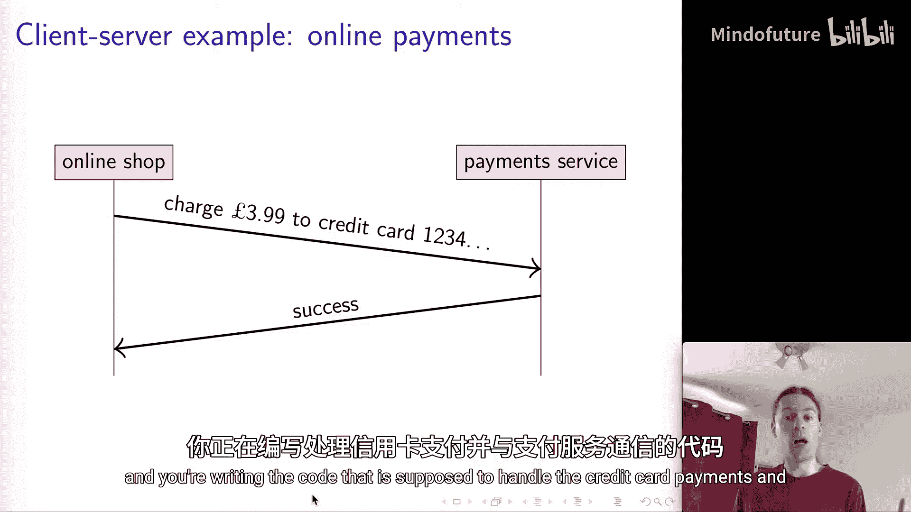

And then you call this function， so you have some object that has this payment service and you call a process payment method on this function and you give it the card that you want to charge and you give it the amount that you want to charge it and the currency in which you want to charge it and then depending on whether this is successful or not you then fulfill the order。

 So this is quite interesting what is happening here because if you think about it。

The payment service is running on a different mode， run by a different company。

 It's not part of the code base of the online shop。

So what is happening here is when you call this process payment function。

The implementation of that function is not within your program。

 the implementation is somewhere on another node at the other end of an internet connection and what is actually happening here is what looks like a function call or a method call is actually underneath being translated into some kind of network communication。

And this is called a remote procedure call， maybe a remote function call would be a better name。

 but remote procedure call is what this thing is typically called and so we're just going to stick with that name。

Java calls to help the same thing remote method invocation， again。

 just a different word for essentially the same idea。

And so let's have a look at how RPC a remote procedure call works。

 so RPC is typically implemented with something called an RPC framework or it's called middleware sometimes this is a piece of software that performs the translation between the function call in your programming language and this message passing of the network。

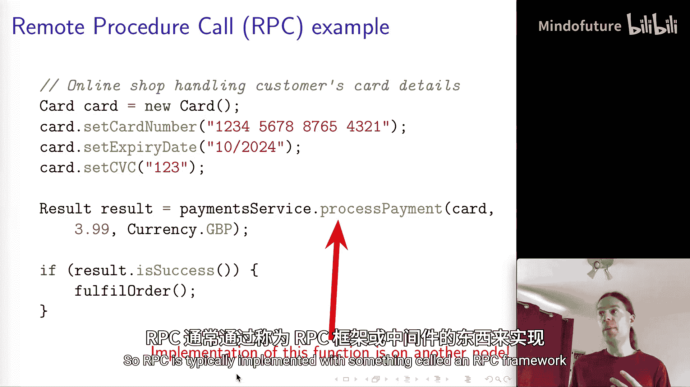

And so when the code of the online shop calls this process payment function。

It can't directly call the function on a different node because your programming language doesn't support that normally。

 Instead， the RP PCC framework provides what is called a stub。 So the stub function。

 it has the same type signature and it looks the same as the function on the remote node that you want to call。

 So you want to call this process payment function。

And what we make is this stub function that doesn't actually process the payment， but what it does。

 it sends a message to the service which thens process the payment。

 So the online shop calls into this stub function here and the RPC client needs to take the arguments that were passed to that function and translate them into a message that can be sent over the network and this translation process from arguments in your programming language to message of the network is called marshalling。

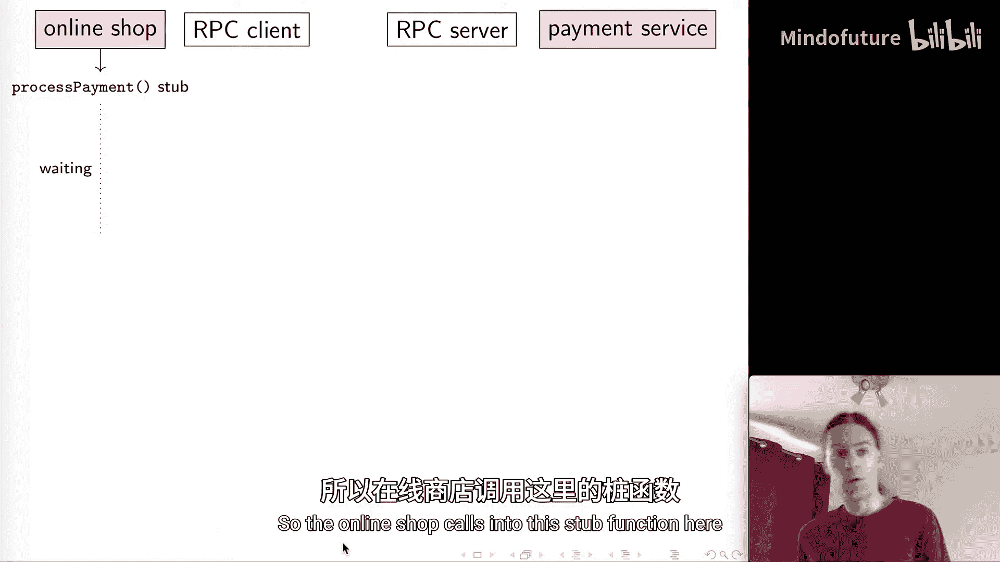

And so marshalling or I call it encoding as well takes the function arguments and encodes it in some way that can be sent over to network So for example it might use Jason in this example it uses Jason it could use some kind of binary format the format it doesn't really matter but it becomes then essentially just a sequence of bytes that we can pack into a message send over the network and then on the recipient side the RPC server is going to receive this message and it's going to translate it back into a function call on the server side。

And so here now this is where the actual implementation of the process payment function lives and so here on the RPC server side now this function is going to get called and it's going to do whatever is necessary in order to make this payment happen and that will probably involve talking to the card network and the bank and updating some databases and doing a whole bunch of extra stuff。

And eventually dysfunction function will return and hopefully it will tell us whether the card payment was successful or not。

 so the return value of this function again needs to be marshahalled。

 we do exactly the same in reverse so the RPC server marshals the return value of the function sends it back as a message M2 of the network the RPC client unmarshals it and turns it back into the data types of the programming language that you're using and then eventually the function returns and so what we've done now is to kind of pretends that this what we're doing is calling a function locally but actually it's happening what's happening underneath is this communication via messages to another service。

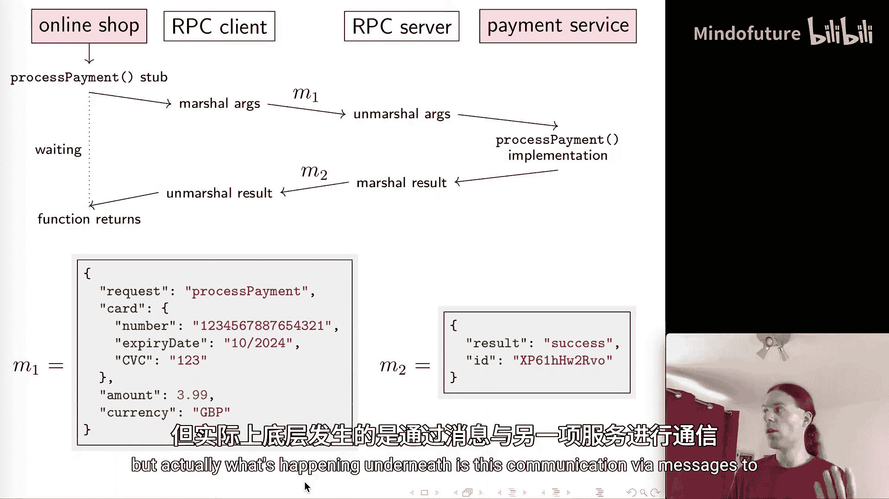

So。😊，The ideal that we kind of want here is that the local function call， sorry。

 the function call to a different service looks just like a local function call because we know what functions in our programming language look like。

 We would quite like the the remotes。The RPRPC to look just like that。

 And this principle is called location transparency。

 So the location of where your resource is located。

 that is whether the object that you're calling your process payment on whether that's an object in your own process in your local address space or whether it's somewhere on the other end of an internet connection。

 we want that to be transparent， we want not to be able to tell the difference between the two。

However， actually reality doesn't look that simple because， as I said in the beginning。

 the trouble with networks is that they can fail。 so it can be that you send a message over the network and the message does not arrive。

You could send it again， of course， but then are you going to charge a credit card multiple times。

 We have to be quite careful if we're going to send messages again So messages might be lost what do we do about retries messages also might be delayed so it might be that the message did actually get through but for some reason there was some networking hiccup somewhere that caused the message to be delayed by a while that could happen as well It could also happen that the service that is processing this function crashed in the middle of handling in the middle of executing our function in that case it won't be able to send us back a response but it might have partially processed our request。

I guess we can use transactions here， acid yes， okay you can see there are a lot of open questions here and fundamentally it seems like actually making a function call to a remote resource is something totally different from calling a local function。

 They're simply two different things。 we can make them look somewhat similar we can give to functions a similar type signature。

 but but calling a remote function has all of these error cases that simply don't arise in local execution。

😊，But that hasn't stopped people from trying to build RC frameworks over a long time that try to look like you're calling a local function。

 even though you're calling something on another node。

 So it started right back in the 80s when the term RPC was first coined。

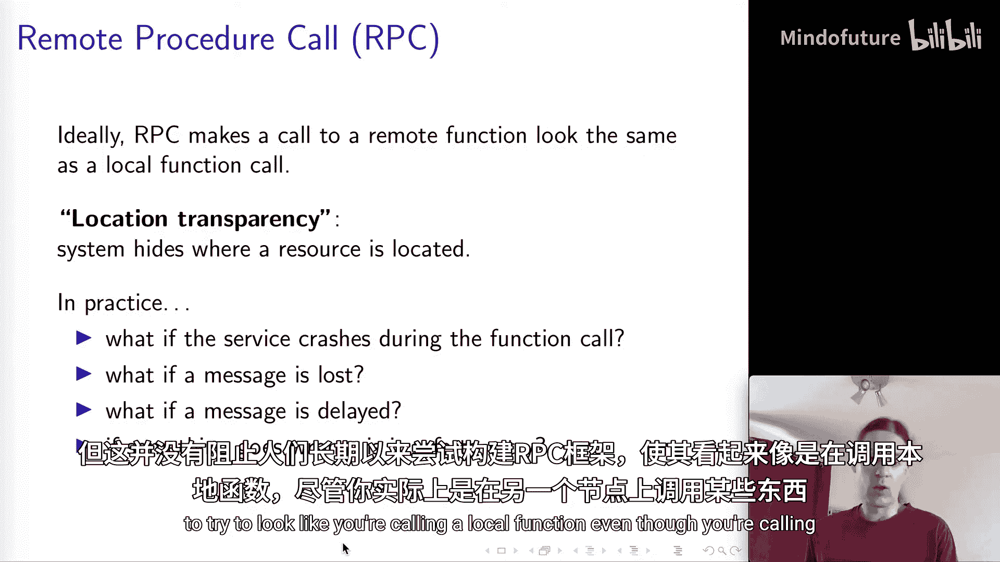

And like some microcrosystems have this thing and it was used to build NFS。

 the network file system which we'll see more later in the course。 And then in the 1990s。

 this was a very hot topic people then talked about objectoriented middleware and there was this thing called Coba which was like really hot nowadays nobody uses it anymore then there were a whole bunch of competing technologies like Javas remote method invocation is kind of of a similar type to Corbra We won't go into the details of all of these I'm just mentioning the names here because you might encounter them in your careers and so it's good to at least have seen them before。

 and you know， just as recently as 2015， Google brought out another RPC framework It's called GRPC for Google's RPC。

 and you it's fine if you want to do RC。 Why not you can use it， you can use something else。

 it doesn't really matter。What is common， very common nowadays is actually something called rest。

 this stands for representational state transfer， a bit of a mouthful。

 but it's really a set of principles for how to use HTTP people who are keen enthusiasts of rests don't like to think of rest as RPC。

 they like to think of rest and RPC as two different philosophies。

But essentially the same kind of thing。 So essentially they're still about invoking code and causing something to happen in a remote service by making some network requests to it and packaging the whole thing up in some reasonably nice way in your programming language。

So one reason why this restful approach of building RPC was became so popular was that web browsers support making HtTP requests so you can have some jascript code running within a web browser and this code can make HttP requests to a server and it can construct whatever data it wants to send in that request send out and it can receive the response back from the server this technique is sometimes also called AjaX and it looks something like this so if I want to implement this credit card payment example in ja I might first of all create this object ags containing the arguments to the function call for the RPC so that' will contain the amount and the currency and the card number and the billing address and so on and then I construct this request object which says which HttP method I want to use so post is the method that's used for submitting forms usually when you're changing some state on server I'm now going to take the arguments and turn them。

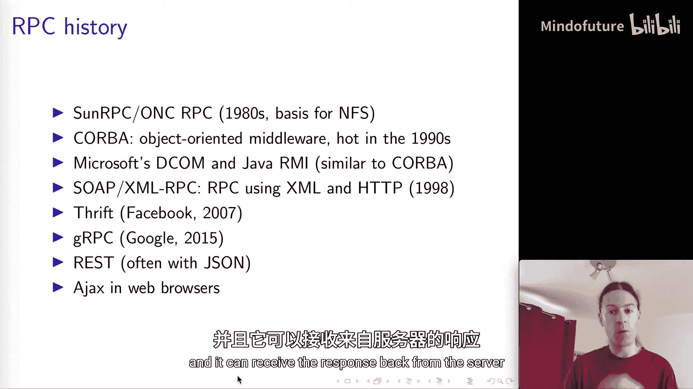

Into adjacent string using the adjacent or stringify function and I can tell the server that J is the type of data that I'm providing so I'm providing the file type essentially。

 and then I can call this URL which means actually sending an HttP request to this URL example do co slash payments with all of the details specified above and then we have these two these two handlers down here So the then case has a function call back here which gets called if that network request receive resulted as in a successful response。

 So if we got a response back from the server then this variable response here becomes that response and then we execute this code here。

So we can now look at the response that we got from the server and see whether the status code that that it replies with indicates success or not。

 So if it indicates success， that means the response is probably Jason again。

 so we can unmarsll that back into objects in jascript by calling this Json function and then call the success function to indicate that we got a successful status back from the server。

 otherwise， if the status code was not success， then we could call a failure function with the status code。

 example， Of course we can do more detailed error handling， but that's just the general idea。

 So this is the case where we got a response back from the server。 Now， of course。

 messages can be lost。 And so it might be that we don't get a response back from the server。

 And in this case， for example， the request might just wait for 30 seconds and if it doesn't receive anything within 30 seconds。

 it's going to say timeout。We give up the message might have got through or might not。

 we don't really know， but we're going to give you a network error。 and that's what happens here。

 So in this catch case here we have another callback function which gets called if the network request did not result in a response from the server and in that case I'm just going to call that failure function again and past the error in practice you would probably want to show the user message and explain that something went wrong。

Anyway， so this is the basics of how you would do RPC and this is how you would use a rest API over HDP in JavaScript。

And this pattern has become very popular， as I said， for web browsers。

 so and most websites now will use this kind of technique to make HTTP requests to the server without reloading the whole page。

 and so it's just JavaScript running in your web browser that acts like a client side program which is performing these network requests。

But the very similar techniques are also used for server communication。

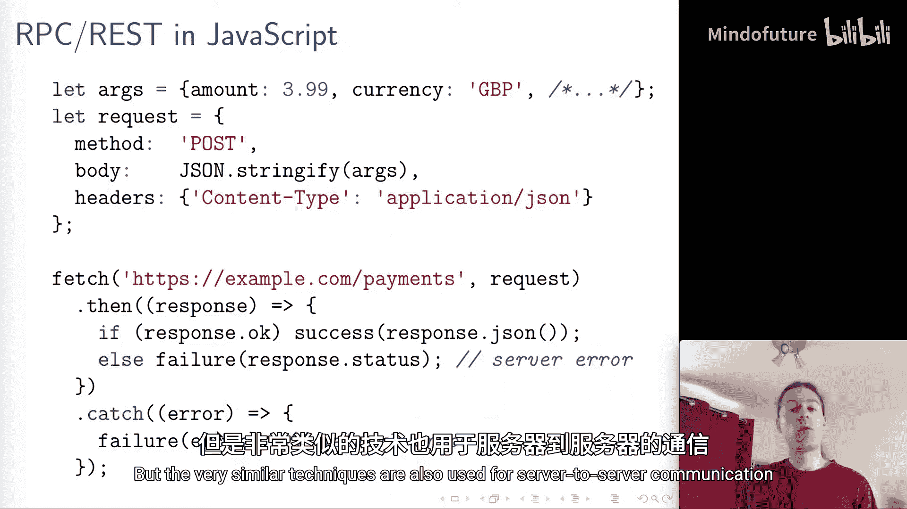

And so this technique is particularly popular in large companies， so in large enterprises。

You have these huge software systems which are running all of the operations of the company。

And these software systems are far too big and far too complex to have just like a single program running on one computer。

 so simply because of the sheer complexity， sometimes also because the large amounts of data that these things have to process。

 they are distributed systems， so you have multiple nodes running on multiple computers which are all providing part of the infrastructure of this large organization call it meant might be a bank or a retailer or whatever。

And。And this， this large。A bunch of software is broken up into what are called services and approach where you break down a large piece of software into services called a service oriented architecture。

 or some people now a more modern term is to call it microservices。

And this is just having programs running on different nodes which communicate via RC。

 And so RC here is the key mechanism that allows these these bits of software to interact with each other。

 And so I'll tell you a little bit more about RC in these kind of settings。

 So we've seen it in a web browser， but here in in service oriented architecture。

 you're normally talking about services that are running within a data center。

 and so they might be running on multiple different servers in the same data center。

 but generally they are all services talking over the data center network。

 So these are not services running on your end user device like your phone or your laptop。

 but they are data center side services， but we can use RPC equally well regardless of whether it's like end user devices talking to a server or servers talking to other servers。

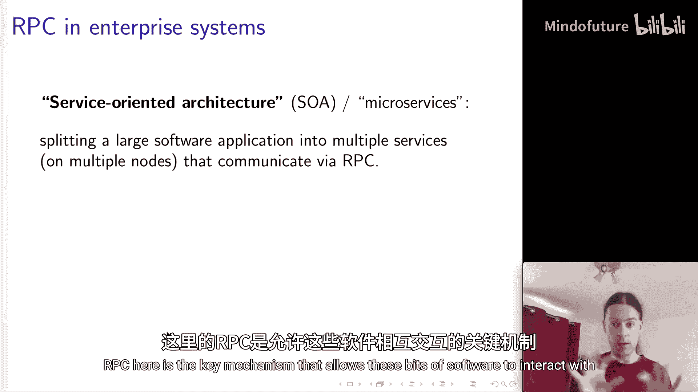

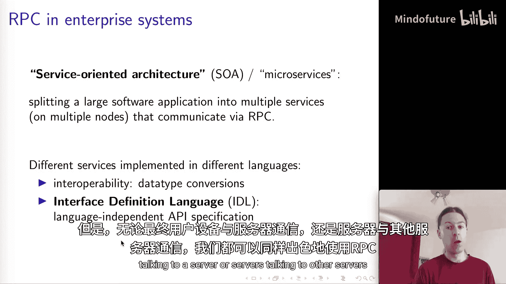

What you do get in these largescale enterprise systems is that they use a whole bunch of different programming languages because they have some old systems。

 you know they might have some old systems written in Cobal。

 then they'll have some slightly newer systems written in C+ plus then they have a bit newer systems written in Java and then they'll have the latest systems in whatever is the latest most fashionable programming language right now and these systems need to talk to each other and so RPC can actually provide a mechanism for interoperability between these systems written in different programming languages。

Now this does mean that， you know， if the function caller and the code being called。

 if they're written in different programming languages。

 you now have to make sure that the type signatures will match up somehow and so you have to perform some data type conversion and so。

This is often implemented using something called an interface definition language on IDL and which is essentially a language for specifying the type signature or function calls in a way that is not specific to any one programming language。

 So here's one example of what an Il looks like。 This example is taken from GRPC。

 the Google RC framework it uses an Il called protocol buffers。 The details are not important。

 I just want to give you a bit of a flavor for what this looks like。

 And so what you have here is you can have a specification of a message type so we can have a payment request message and a payment status message as a two different messages type and then down here we have the specification of a service So a payment service has an RPC offers an RPC function call which is called process payment It takes as argument。

 a payment request and it returns as its return value a payment status。

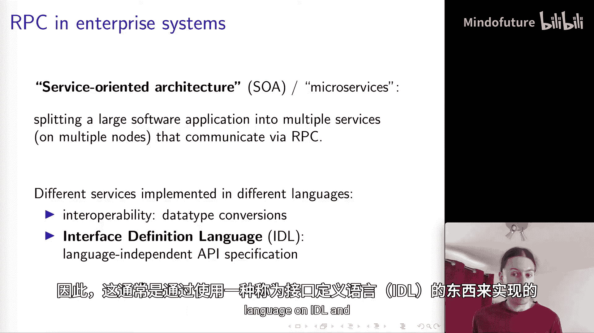

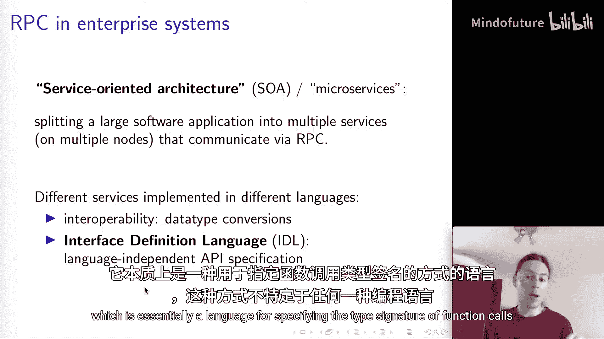

And then up here we can say， what does a payment request consist of while a payment request consist of a card and amount and a currency and a card in turn consists of a card number and expiry date and three digits on the back and the currency might be an enum indicating the possible values ignore those12。

34 values here the details of that are not important for the purposes of this course。

 but you can see here I'm using data types like in32 to indicate this is a 32 bit。

 signed integer and that is like a fairly generic data type that you would expect most program languages to support that kind of thing likewise here string data type is very common an enum if the language doesn't support enums you could translate it into just an integer or something like that。

 Booleian again is a common data type。 So you can argue should the card number be a string or should be an integer with sufficient digits that you can have 16 digits。

 whatever we。A about that。 But you get the general principle。

 This is a language independent specification of what the RPC can look like。

And the RPC framework can take this IDL， can take the specification and generate code in all of your favorite programming languages。

 and so that way then it can generate the stubbs for both the RPC client and the RPC server that make it easy to write code that performs the RPC on both the caller side and side of the service that's being called。

So that that's RPC next time we will talk about a bit more about the fundamental issues of actually making reliable distributed systems。

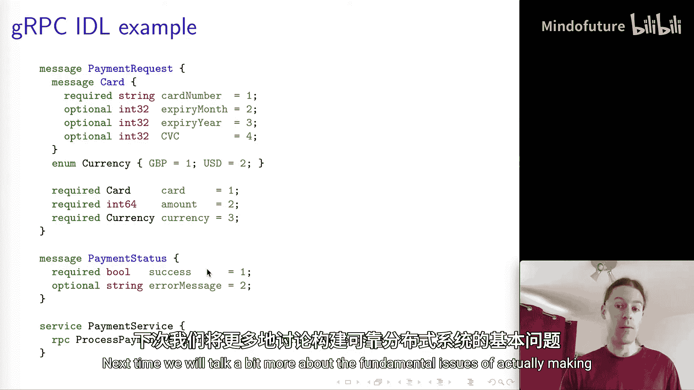