# 分布式系统：P04：系统模型与两将军问题 🧠

在本节课中，我们将从具体的分布式系统实例转向更抽象、更通用的模型。我们将探讨分布式系统的**系统模型**，即设计分布式算法时所做的一系列假设。系统模型至关重要，因为它精确地定义了系统中可能发生和不可能发生的故障类型。

上一节我们介绍了客户机-服务器系统，本节中我们来看看两个经典的分布式系统思想实验：**两将军问题**和**拜占庭将军问题**。我们将从两将军问题开始。

## 两将军问题 ⚔️

这个问题的背景是一个军事类比。有两支军队，每支军队由一位将军指挥。他们计划共同进攻并占领一座城市。

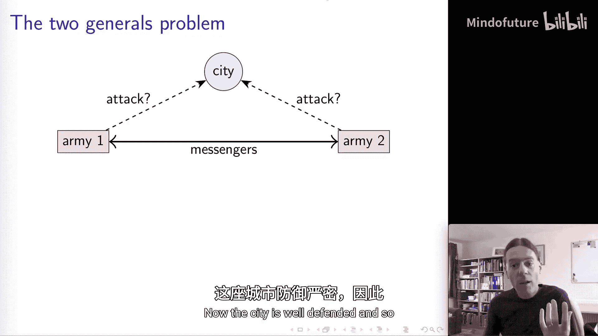

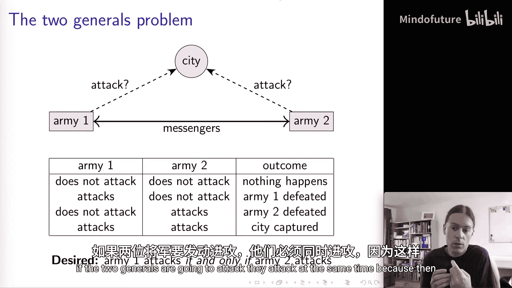

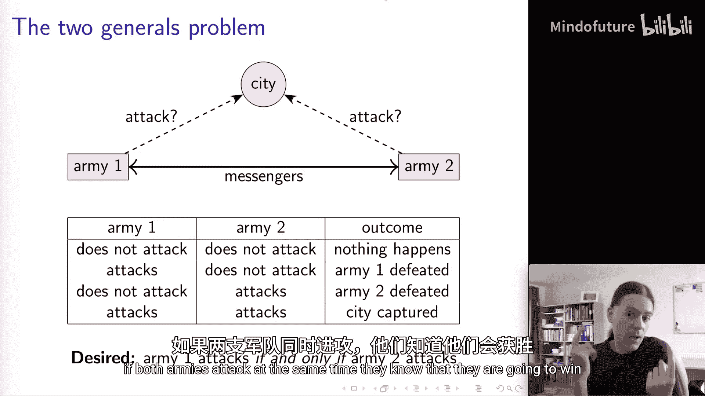

这座城市防御坚固。如果只有一支军队单独进攻，它将被击败。因此，至关重要的是，如果两位将军决定进攻，他们必须**同时行动**，这样两支军队才能获胜。

以下是可能发生的情况：

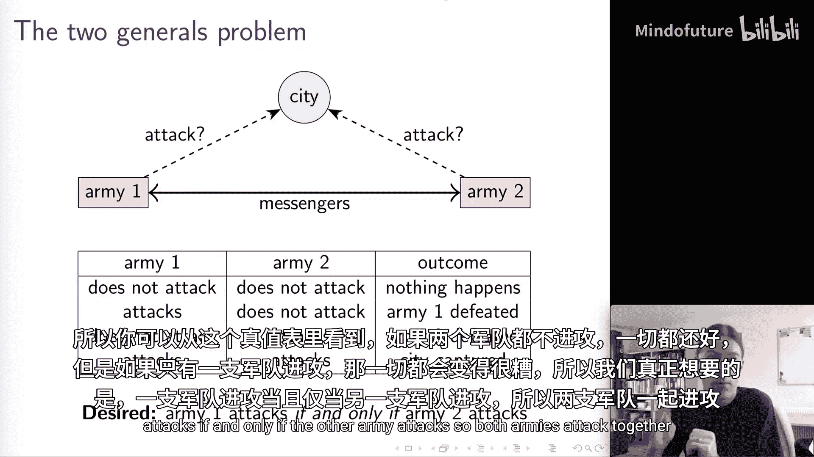

| 将军A进攻？ | 将军B进攻？ | 结果 |
| :--- | :--- | :--- |
| 否 | 否 | 无事发生 |
| 是 | 否 | 将军A战败 |
| 否 | 是 | 将军B战败 |
| 是 | 是 | 胜利 |

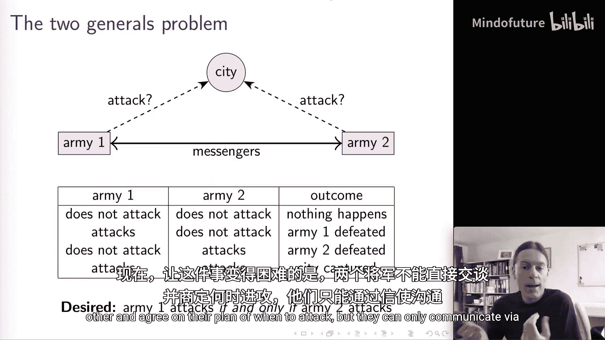

从真值表可以看出，我们真正希望的是：一支军队进攻**当且仅当**另一支军队也进攻。即双方必须共同行动。

**公式表示：**
`进攻(将军A) == 进攻(将军B)`

然而，困难在于两位将军无法直接对话来商定进攻计划，他们只能通过**信使**进行通信。信使在穿越森林时，可能会被城市守军捕获。

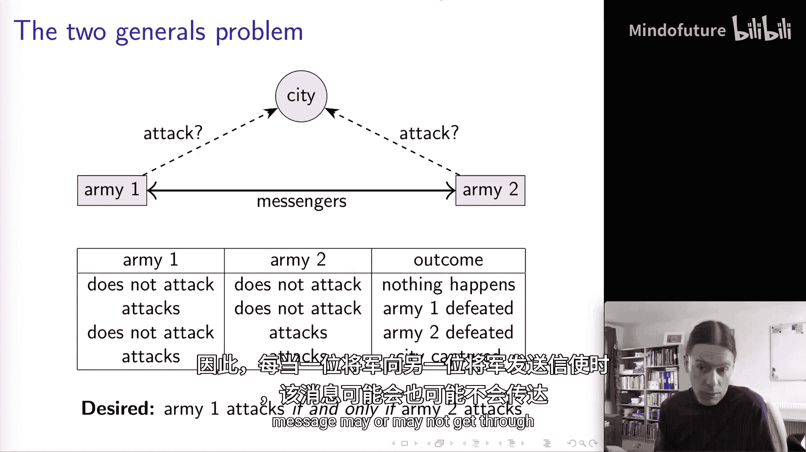

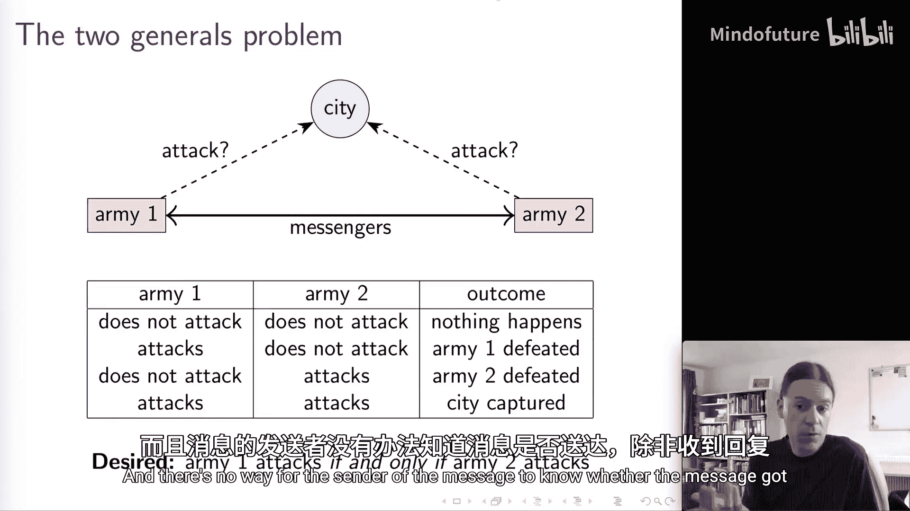

因此，每当一位将军向另一位将军派遣信使时，消息**可能送达，也可能丢失**。发送方除了收到回复外，无法知道消息是否成功送达。

## 通信的不确定性 🔄

让我们设想一个场景。例如，将军1决定在11月10日进攻。他发送消息给将军2：“我们将在11月10日进攻，你同意吗？”

将军2收到消息后回复：“同意，我们将在11月10日共同进攻。” 但不幸的是，回复消息被捕获了。因此，将军1没有收到回复。

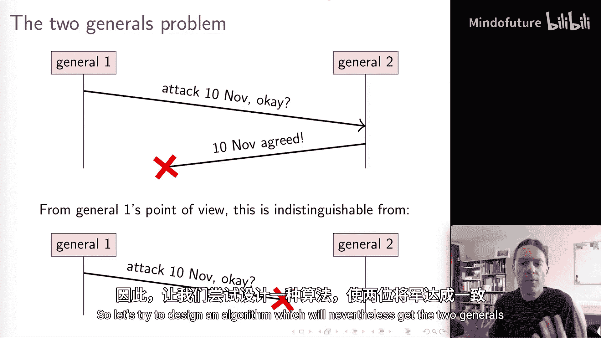

这是可能发生的一种情况。另一种情况是：将军1发送的初始消息“11月10日进攻”在途中丢失，从未送达将军2。将军2没有收到任何消息，因此也不会回复。最终结果同样是将军1没有收到回复。

在这两种情况下，将军1观察到的唯一现象都是**没有回复**。但将军1无法区分：究竟是因为初始消息未送达，还是因为回复消息丢失了？这两种情况对将军2而言截然不同：第一种情况将军2已同意进攻；第二种情况将军2甚至不知道进攻计划。

## 设计协议的困境 🤔

让我们尝试设计一个能让两位将军达成一致的算法。

首先，从将军1的角度看，他有两个基本选择：
1.  无论是否收到回复，将军1都**总是进攻**。
2.  将军1**等待并只在收到将军2的肯定回复后才进攻**。

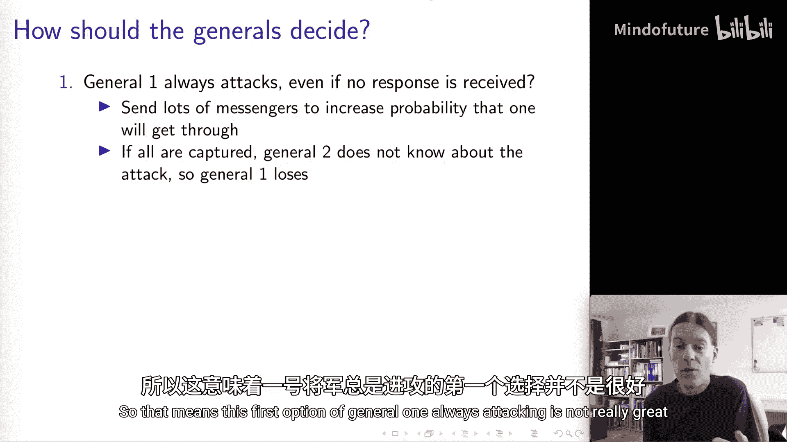

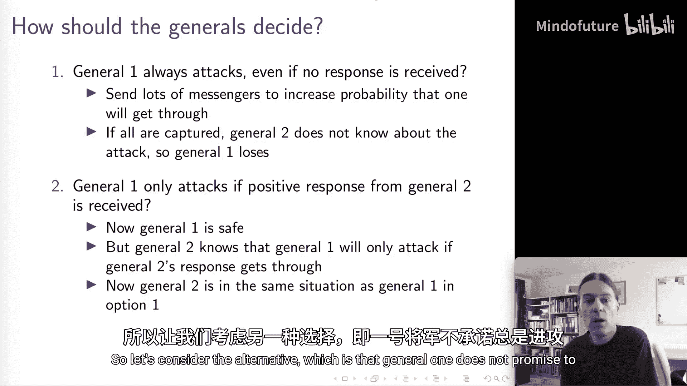

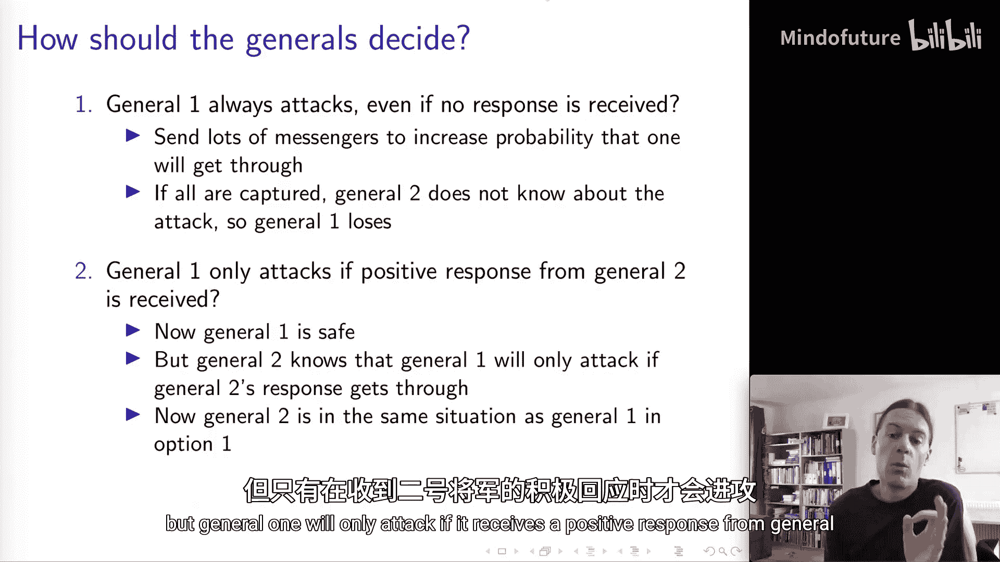

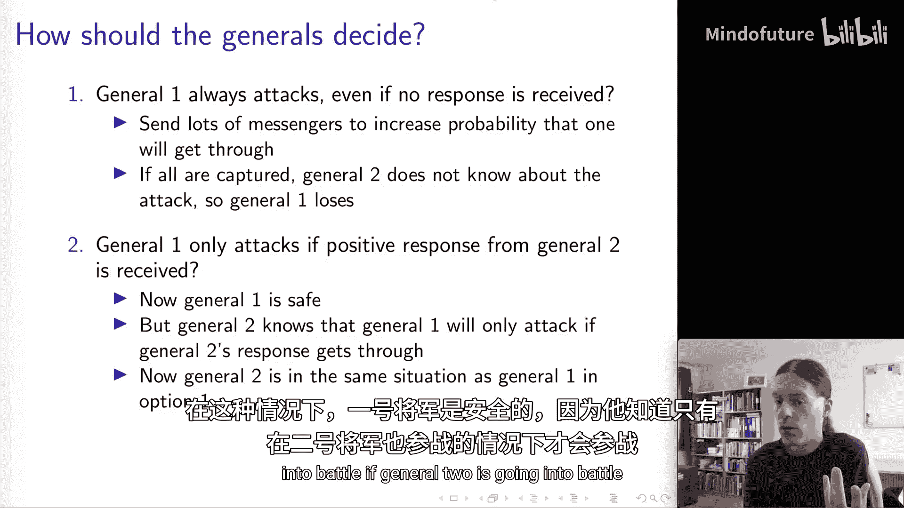

**考虑第一种选择：将军1总是进攻。**
为了让将军2也进攻，将军1可能会向将军2发送大量信使，反复传递进攻消息。如果其中一条消息送达，将军2知道将军1总会进攻，因此将军2参战是安全的。然而，有可能所有信使都丢失了。这种情况下，将军2不知道进攻计划，将军1将孤军奋战并失败。因此，这个选择并不理想。

**考虑第二种选择：将军1只在收到肯定回复后进攻。**
这样将军1是安全的，因为他知道只有在将军2也参战时自己才会进攻。但现在，从将军2的角度看，问题出现了。将军2知道，将军1只有在收到自己的回复后才会进攻。因此，将军2陷入了与第一种选择中将军1相同的困境：要么承诺总是进攻（有孤军奋战的风险），要么等待将军1的回复。

这可能导致一个潜在的**无限消息链**：“我会进攻。”“好的，如果你进攻我就进攻。”“我说了我会进攻。”“但只有在你进攻的前提下我才进攻。”…… 他们需要来回发送消息，在获得双方必将共同进攻的绝对确定性之前，可能会形成无限循环。

## 问题的核心：缺乏共同知识 🧩

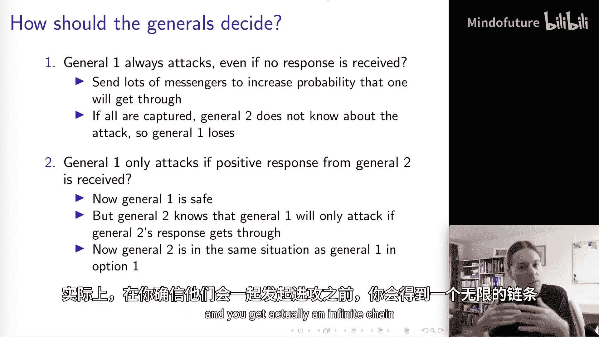

在分布式系统中，这被称为**缺乏共同知识**的问题。系统中没有一种知识状态，使得一个节点知道某事，并且知道另一个节点也知道此事，并且知道另一个节点知道我知道此事…… 如此循环。无论我们来回发送多少有限序列的消息，都无法获得绝对的确定性，保证将军1进攻当且仅当将军2进攻。

**核心结论：** 在可能丢失消息的异步通信模型中，**无法确保两个分布式进程就一项协作行动达成完全一致的共识**。

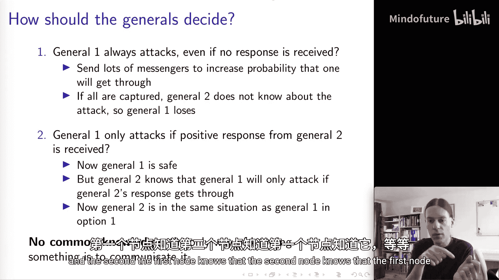

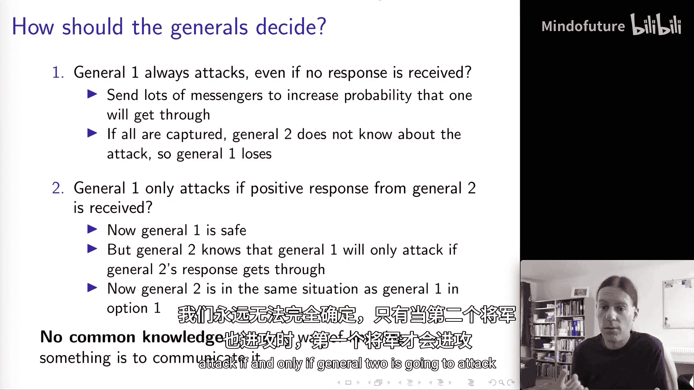

## 现实世界的类比：在线支付系统 💳

现在，让我们将这个抽象的思想实验应用到一个具体例子中。上一讲我们提到了在线商店通过RPC调用支付服务来扣款的例子。

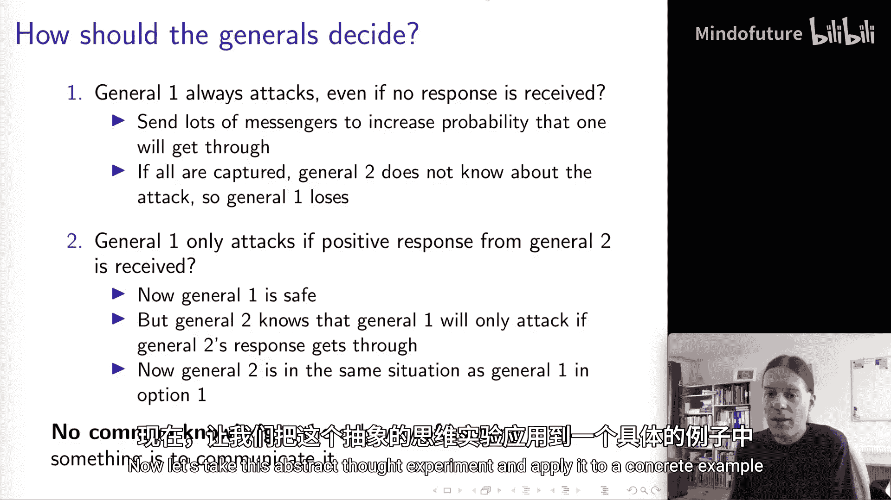

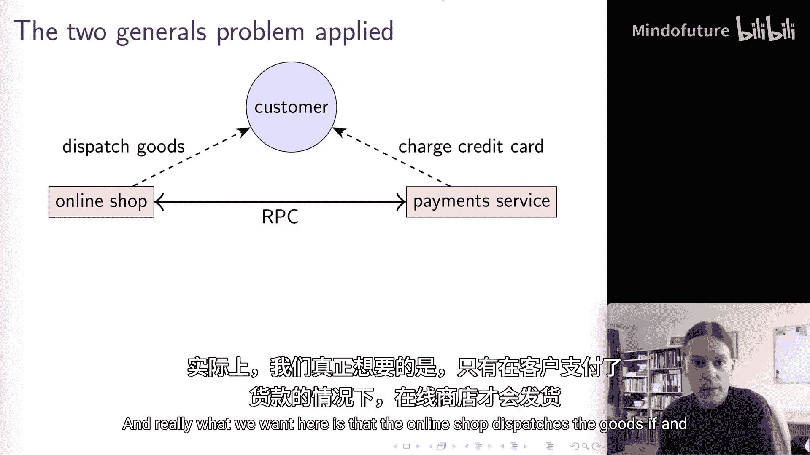

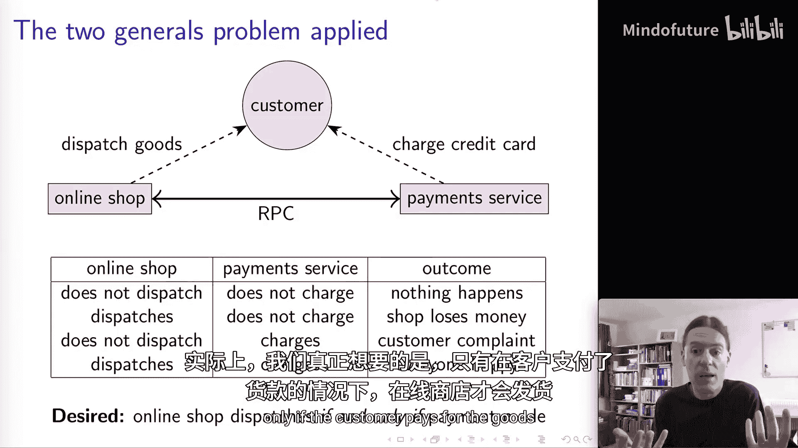

我们真正希望的是：**在线商店发货，当且仅当客户成功付款**。

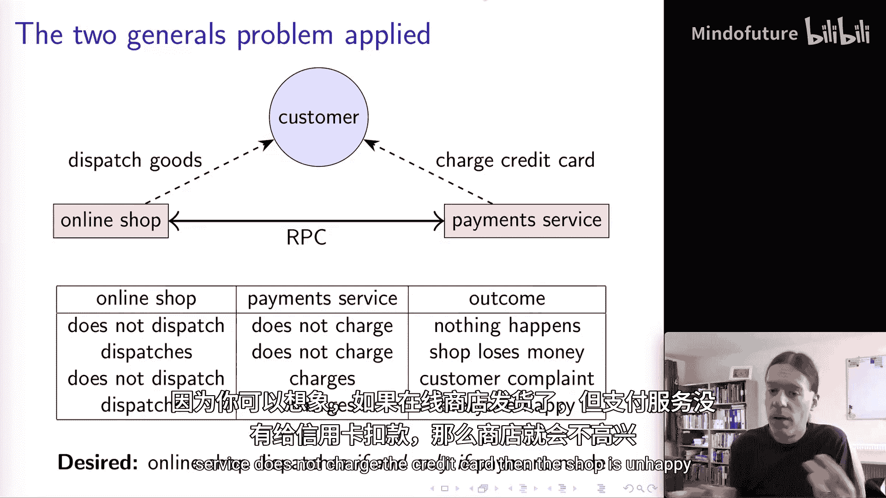

因为：
*   如果商店发货了，但支付服务未扣款，商店会蒙受损失（免费送出了商品）。
*   如果商店未发货，但支付服务扣了款，客户会不满（被收费却未收到商品）。

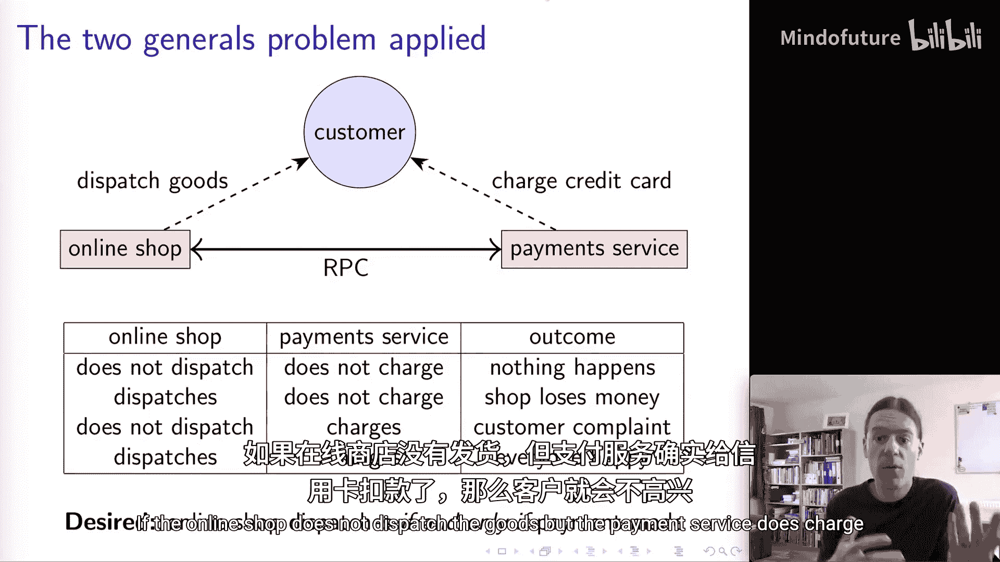

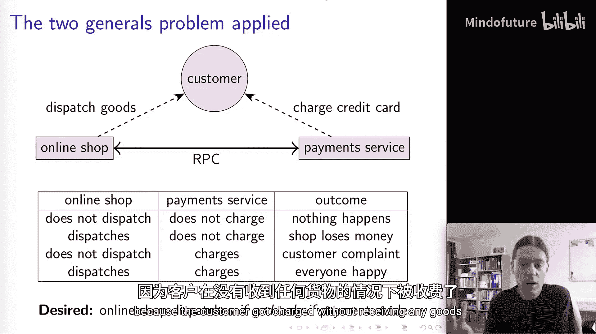

这看起来与两将军问题极其相似：`发货(商店) == 扣款(支付服务)`。

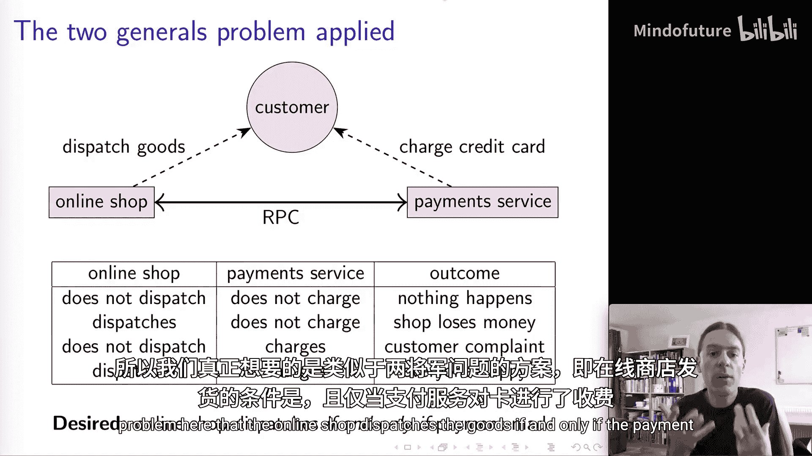

在线商店与支付服务之间的RPC调用，就像两将军问题中穿越森林的信使。消息（请求或响应）**可能丢失**。因此，实际上在线商店和支付服务无法绝对确定地保证“一个动作发生当且仅当另一个动作发生”。

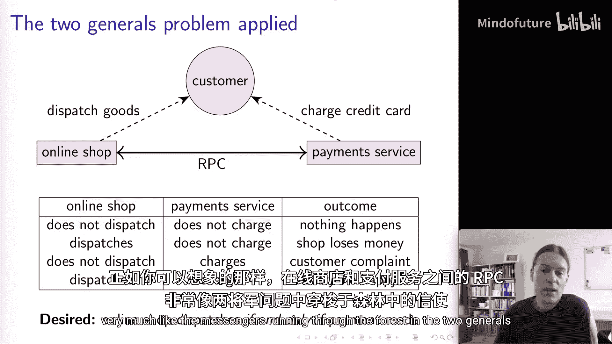

## 实践中的解决方案 🛡️

然而在实践中，在线购物系统确实能工作。原因是存在一系列**二级保障机制**来确保一个合理的结果。

以下是几种常见的处理方式：
1.  **撤销操作**：支付扣款是一个可撤销的操作。如果商店缺货无法发货，它可以向客户道歉并**退款**，使系统回到安全状态（既未发货也未有效扣款）。
2.  **对账与查询**：当网络恢复后，在线商店可以主动查询支付服务：“我之前请求的那笔扣款，到底成功了没有？” 支付服务可以告知结果，双方据此协调状态。
3.  **倾向于执行并补偿**：在某些设计中，支付服务可能倾向于先执行扣款，即使它不确定商店是否会发货。因为如果后续出现问题，仍然可以通过退款来补偿。这引入了一个“最终一致性”的模型，而非强一致性。

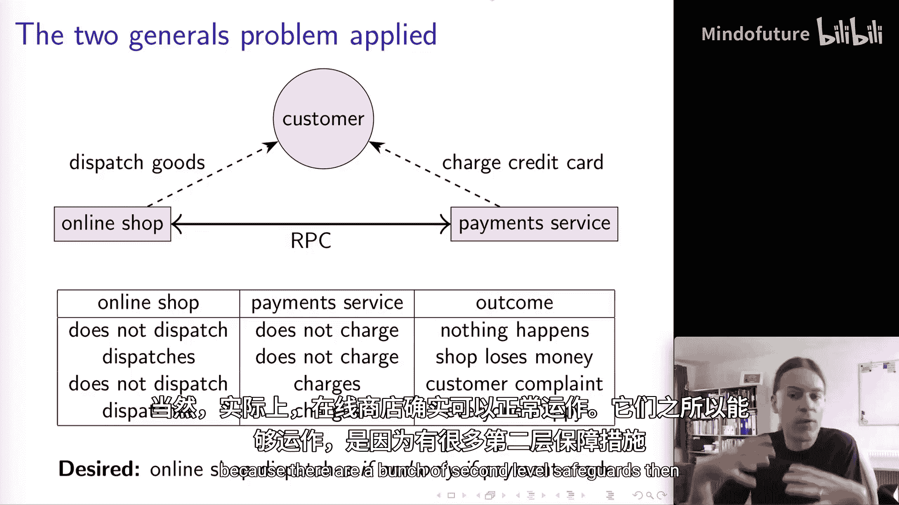

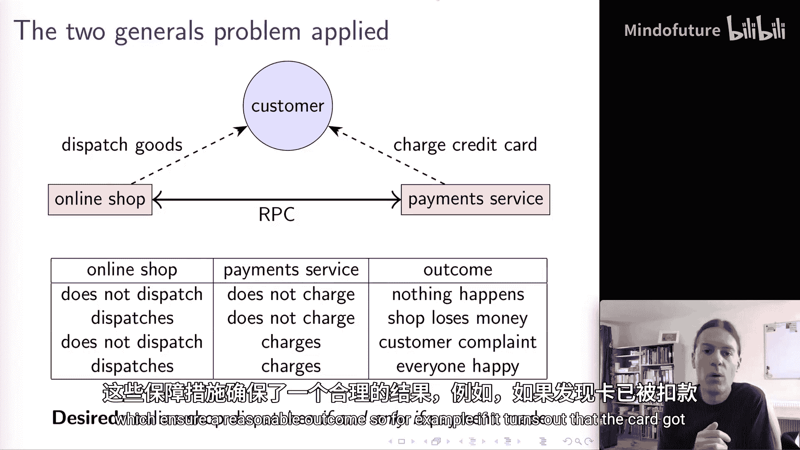

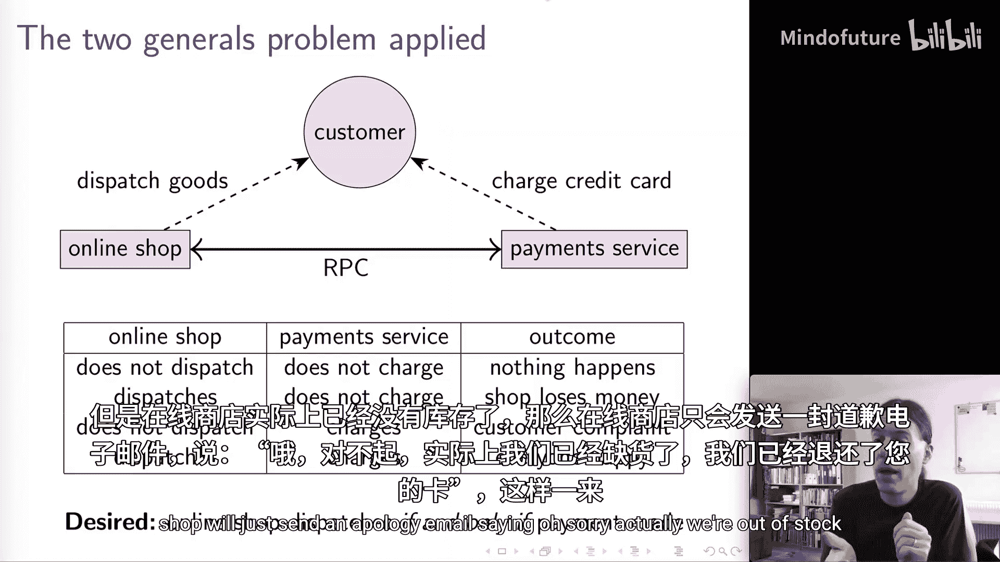

正是这些机制，使得在线购物问题在实践中不等同于无解的两将军问题。但两将军问题依然深刻地揭示了分布式系统中，**由于消息传递的不确定性而带来的根本性挑战**。

## 总结 📚

本节课我们一起学习了分布式系统中的一个基础思想实验——**两将军问题**。我们了解到：
1.  在**异步通信且消息可能丢失**的模型下，两个进程无法就一项协作行动达成完全确定的共识。
2.  问题的核心在于缺乏**共同知识**，以及确认消息的确认消息本身也可能丢失，导致无限递归。
3.  该问题揭示了分布式系统协调行动的根本困难。
4.  在现实系统中，我们通过引入**可撤销操作（如事务）、对账机制和补偿流程**等方法来规避这一理论上的不可能性，实现业务的最终一致性。

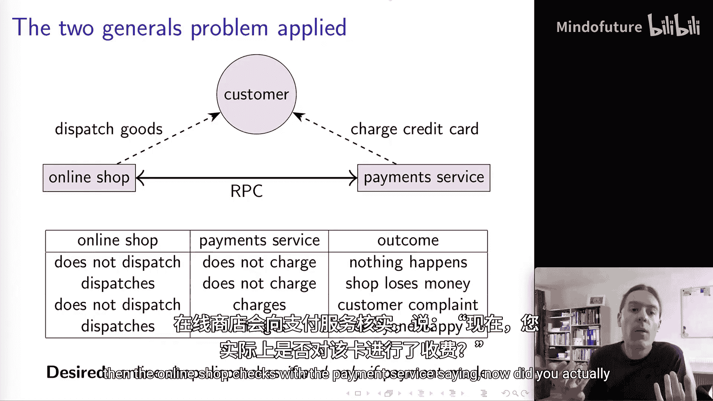

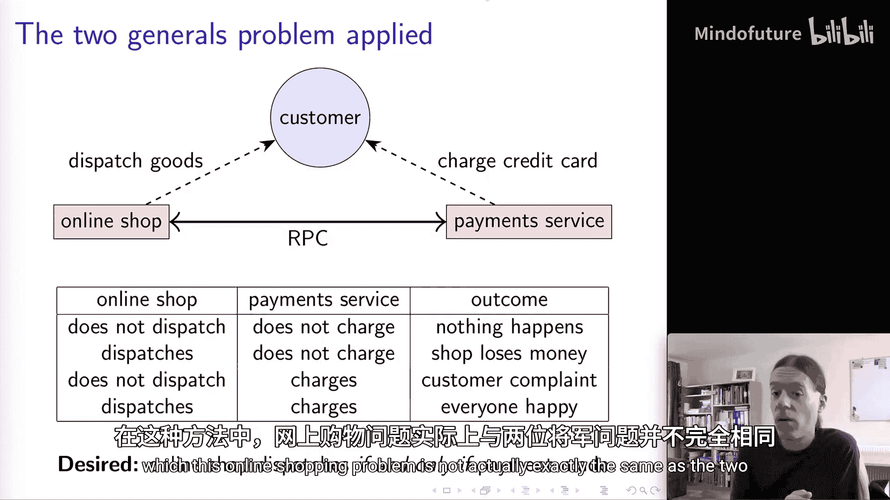

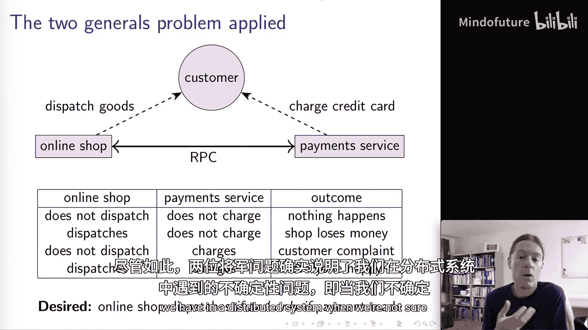

理解两将军问题，是理解更复杂的分布式共识算法（如Paxos、Raft）和系统模型的重要基础。在下一讲中，我们将探讨另一个经典问题：拜占庭将军问题。