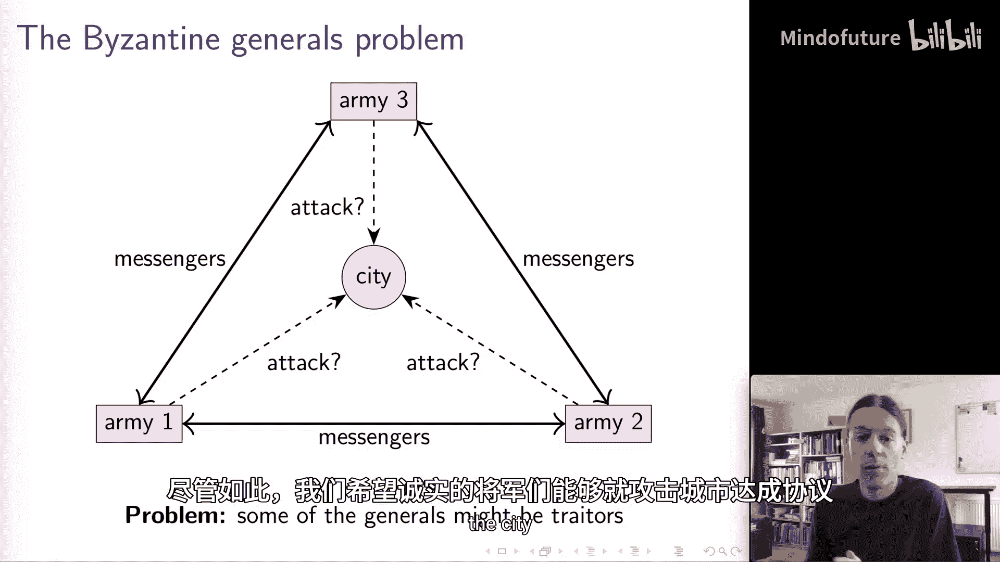
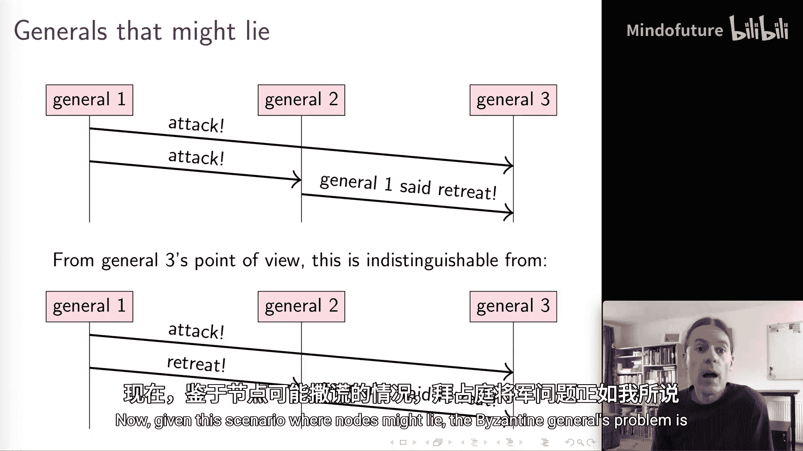
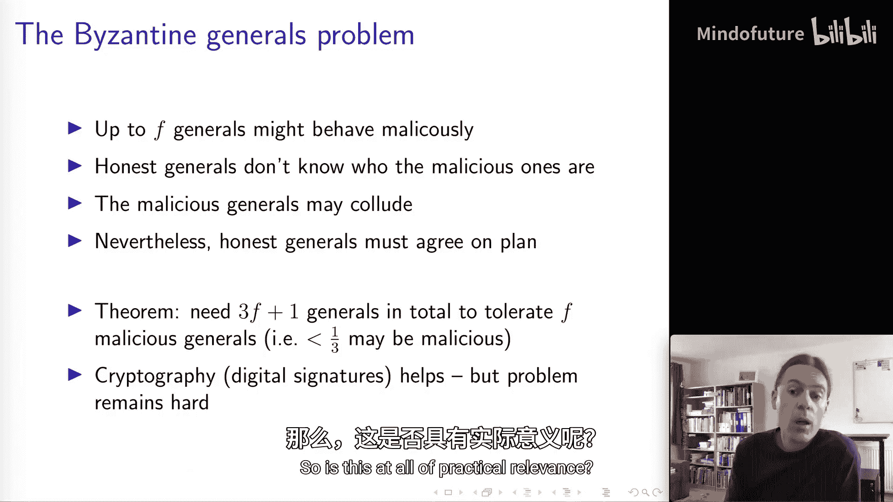
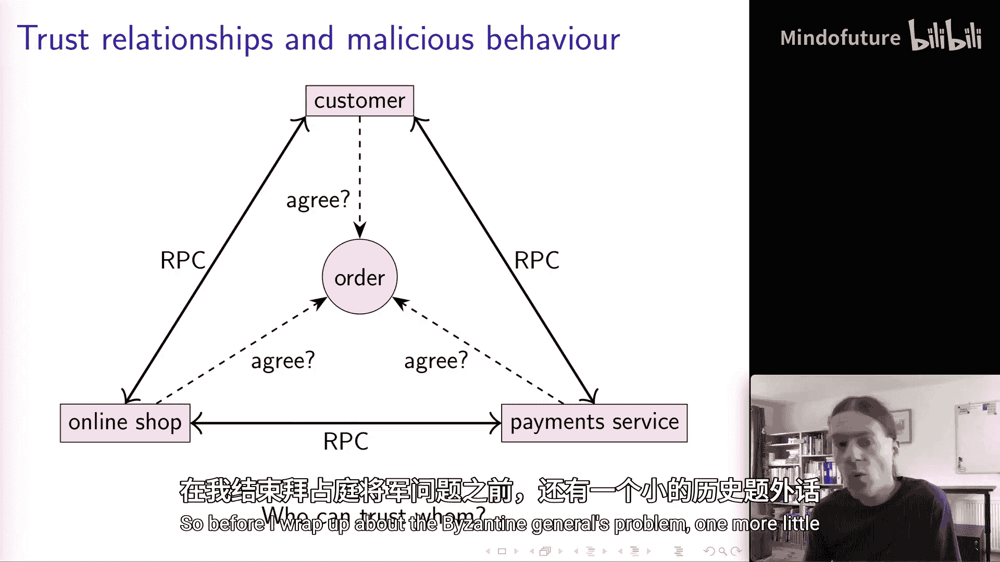
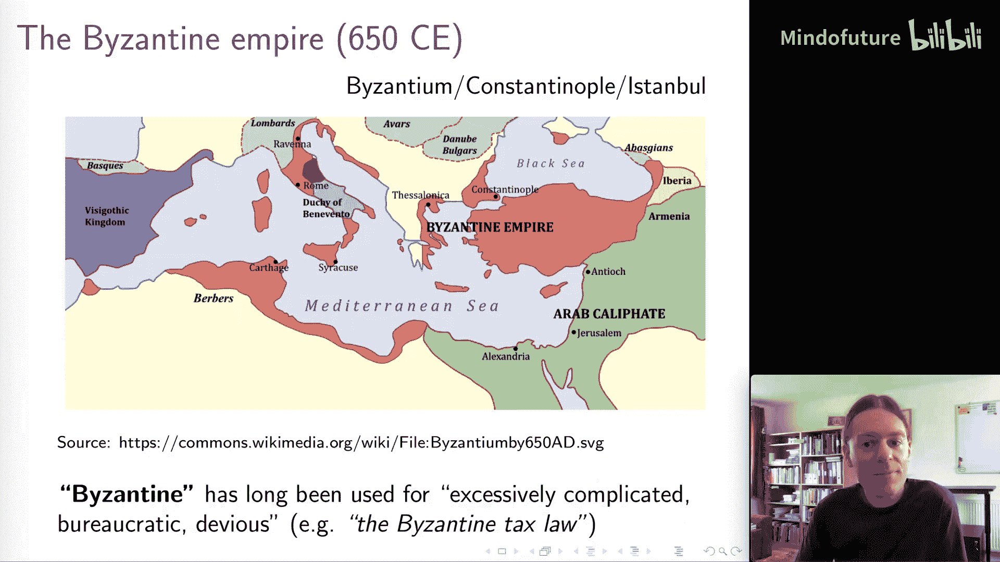

# 【剑桥大学-•-中英】分布式系统讲座-p05-P05-Distributed-Systems-2.2---The-Byzantine-generals-problem--BV1NwQhYeEyV_p5-

The second thought experiment that I want to discuss is called the Byzantine general's problem Before I get into the details。

 a question of pronunciation， is it Byzantine or Byzantine generals well。So as far as I know。

 the standard British pronunciation of this word is actually Byzantine and Byzantine is the American pronunciation。

 However， in computing， it seems to be most common to use Byzantine。

 And so I'm just going to stick with the pronunciation Byzantine。

 because that's what everyone else in computing seems to do。

 So the Byzantine general's problem is similar at first glance to the two generals problem。 That is。

 again， we've got generals leading armies。 again， the armies want to attack a city。 In this case。

 we might have three or more armies。 we might have any number of armies。

As before the generals communicate by Meenger and as before we want the armies want to agree on the date of attack soda to ensure that they attack at the same time。

Now， we make the problem easier in one way and harder in another way。 So easier first of all。

 is we assume that messaging is reliable。 So in this case。

 we're going to assume messengers don't get captured。

 but any message that gets sent will actually be received by the appropriate recipient to make the problem harder we are now going to assume that some of the generals are actually not loyal。

 they are traitors。 They are malicious。 they are going to try to actively undermine the other generals。

 so they are going to lie and deceive and generally misbehave in any sort of way as they wish。

 they might even work together and nevertheless， we want the honest generals to come to an agreement about the attack of the city。

 So let me give an example of the problem that might arise due to some generals being malicious。

So here in this example， General 1 sends a message to attack to Generals 2 and 3。

 the same message attack and General 3 receives that message as expected。

 General 2 receives the attack message and then sends a message to General 3 saying retreat。

 So what General2 here is doing is lying。 General2 claims that General 1 sent a retreat message when。

 in fact， General General 1 sent an attack message。 So in this case here。

 General 2 is the one who is being malicious。Unfortunately， from the point of General 3。

 it's not easy to tell what is actually happening because from the point of General 3。

 what could have just as equally well happened is this one。

 So it could be that General 1 sent an attack message to3 and General 1 sent a retreat message to 2 and General 2 is actually faithfully repeating that retreat message that it got from General 1。

 So in this case， in the lower case here， General 2 is being honest because General 2 is just reporting honestly。

 what General 1 said。 And it's General 1， who is being malicious。

 by sending contradictory commands to Generals 2 and 3。

So this is the core of the problem here from the point of view of General 3。

 it's impossible to tell the difference between these two scenarios。

 and so it's impossible for General3 to tell whether General 1 is being malicious or whether General 2 is。

Now， given this scenario where nodes might lie， the Byzantine general's problem is， as I said。

 the desire that is the problem is that we want all of the honest generals to come to an agreement。

So now the problem is that the honest generals don't know who the malicious generals are。

 but we are going to assume some maximum number of generals being malicious。

 So let's say that up to F generals are malicious out of N generals in total。

The honest generals don't know who the malicious ones are。

 but the malicious generals may know who the other militiaious generals are。

 And so they might actually even work together in some coordinated fashion to try to deceive and trick the honest generals。

 and nevertheless， our requirement is that the honest generals agree on a plan。

 So we can't claim we can't get the malicious generals to agree on any part of the plan because we are assuming that they might misbehave in arbitrary ways。

 And so it's impossible for us to make any statement about what they are going to do。

 But we can make a statement about what the honest generals are going to do。

 And that is they will what we want them to do is to all attack on the same day。 Now。

 they are several different variants of the Byzantine general's problem that vary in in the details of how exactly it's set up。

 But a typical result that we can prove about some of these variants is that if we have a maximum of F malicious generals。

 then we need。3 F plus one， at least3 f plus one generals in total in order to tolerate those F generals being malicious。

 That is less than one third of the total number of generals can be malicious。

 So if we have three generals。 and one is malicious。

 the problem is unsolvable in order to tolerate a system with with one malicious general。

 we need at least four。And as f equals one。 we need at least four generals in total。

 So three honest ones and one miicious。 if we want a system which two generals might be malicious。

 we actually need7 So five honest and two malicious generals。

 Now the problem becomes somewhat easier if we assume that we can use cryptography。

 And so I won't going to details of that in this course。

 there's more detail on this in the security course and in the cryptography course that you will have next year。

 And But what we can do here is use something called a digital signature。

 which is a form of message in which it can be proved that a certain party sent a certain message。

 And so in this case， for example， it would allow General 2 to prove what command General1 sent to General2 and proved that to General 3 in a way that General 3 would be convinced that General 2 really is honest So。

ography does help， but it doesn't make the problem the Byzantine general problems magically simple。

 so even if we do assume that we can use cryptography， the problem remains difficult。

So is this at all of practical relevance， you might ask。

 So let's adapt this earlier example that we've had a few times now of the online shop and the payment service。

 And let's take in this case， the customer as a third party in this。

 So we have this kind of threeway relationship between the shop。

 the payment service and the customer。 and we want all three of these parties to agree on the status of a transaction or status of an order。

 So we want the online shop to ship the goods only if it agrees with the payment service。

 that the payment actually happened and if the customer actually agree that they did actually order this thing and the customer agrees on on the amount that was charged the card and so on。

 So all of these parties need to agree。 And in real life。

 the trust relationships between these three parties might be quite complicated。

So if you think about it from the perspective of the online shop。

If there was some way how people could order goods from an online shop without paying for them。

 you can imagine that fraudsters would be using that pretty quickly。

 and they would be ordering all sorts of expensive things without paying for them。

 And so the online shop would not be happy then。 So from the point of view of the online shop。

 the customer needs to be treated as potentially malicious。

 because if the customer was just blindly trusted， then they might start doing fraudulent activity like that。

 And so in that case， we do have this kind of untrusting relationship。

What about the online shop and the payment service， the relationship。 Well。

 you can imagine maybe the payment service doesn't quite trust the online shop because otherwise someone might set up a fraudulent online shop。

 use， say， stolen credit card numbers to try and process transactions and get money without actually shipping any real goods。

 So in that case， probably the online shop doesn't， sorry。

 the payment service doesn't fully trust the online shop。

 but maybe the shop does trust the payment service。

 So it might be this kind of asymmetric relationship。 so。As you can see here。

 the trust relationships in real life get rather complicated。

 You do end up in these situations where one party does not trust another party。

 and they nevertheless want to get something done。 And so in that sense。

 Byzantine behaviour is real and practical。The Byzantine general's problem is， of course。

 a simplification of this kind of scenario because it's treating all of the generals as as symmetric。

 for example。 But nevertheless， the Byzantine general's problem is a useful starting point for studying these kind of situations in which the participants don't fully trust each other。

So before I wrap up about the Byzantine general's problem， one more little historical digression。

 you might be wondering where the name Byzantine comes from。 So this comes from the Byzantine Empire。

 which also known as Byzantium， the former East Roman Empire。

 which after the collapse of of the Roman Empire。 this was the eastern part of it and its capital city。

 was Constantinople， which was formerly known as Byzantium， which is now where Istanbul。

 is located in in Turkey。 And so for some reason in the 20th century， early 20th century。

 I think the term Byzantine became used in order to describe。

scenarios where things are excessively complicated or incredibly bureaucratic or potentially even devious。

 For example， tax legislation or these kind of thing。

 Not entirely sure why that that meaning of Byzantine occurred because there's no historical evidence。

 really that the Byzantine empire was any more or less malicious than than any other empire but anyway。

 that's where it came from。 So the the term Byzantine had this meaning long before it was used in the context of computing。

 So it outside of computing， it has had that meaning for a long time。

 So that's all under Byzantine general's problem for now。

