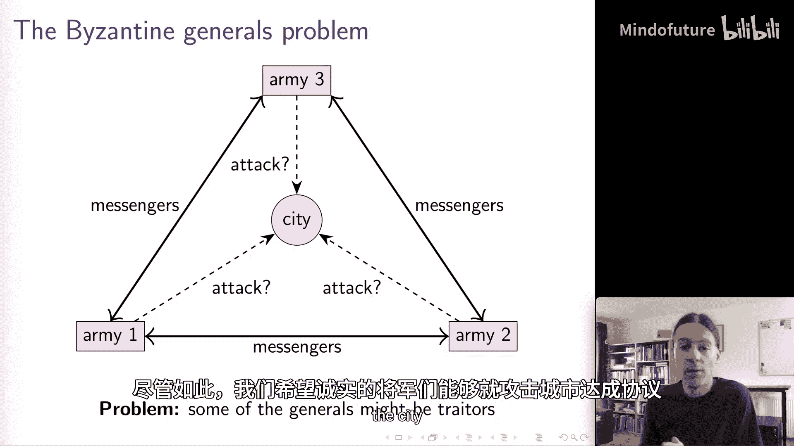
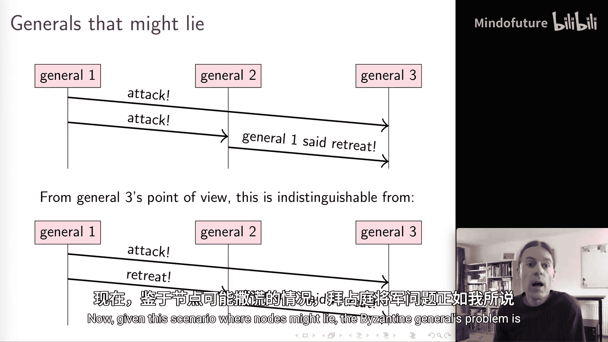
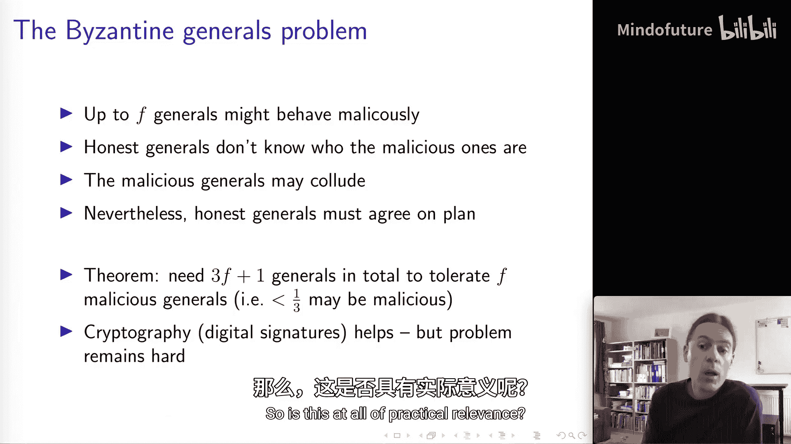
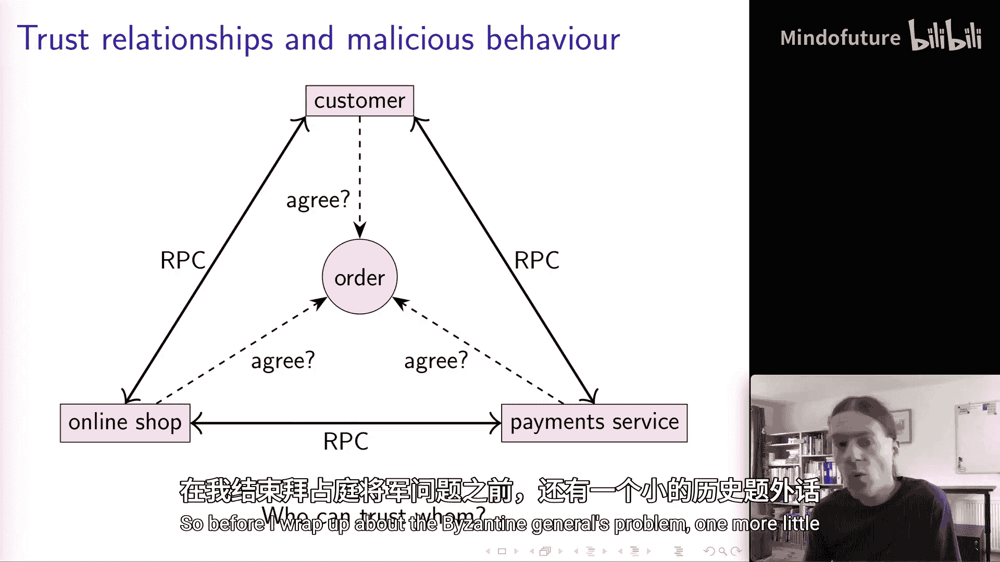
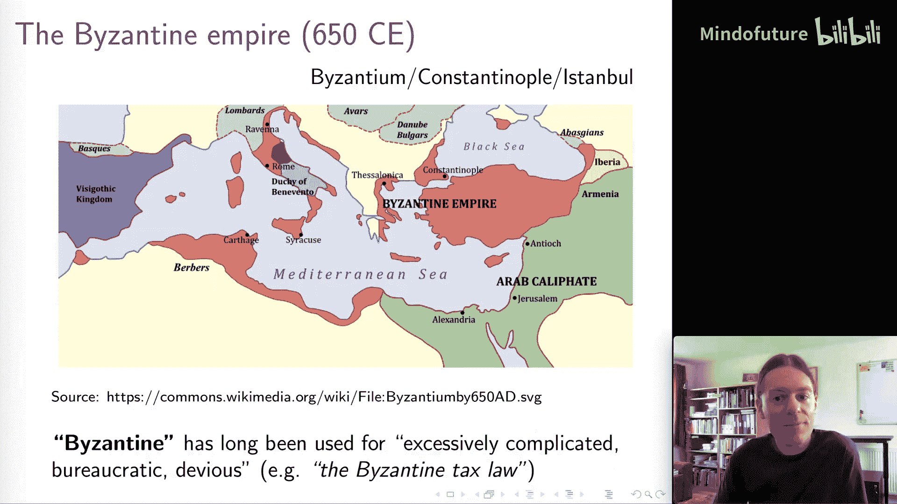

# 分布式系统：2.2：拜占庭将军问题 🏰

在本节课中，我们将要学习分布式系统中的一个经典思想实验——拜占庭将军问题。我们将探讨其基本设定、核心挑战，以及它在现实世界中的实际意义。

## 概述

拜占庭将军问题是一个关于在存在恶意或不可靠节点的情况下，如何达成共识的分布式系统模型。它比之前讨论的两将军问题更复杂，因为它引入了“叛徒”（即恶意节点）的概念。

## 问题设定

上一节我们介绍了两将军问题，本节中我们来看看一个更复杂的场景。拜占庭将军问题最初看起来与两将军问题相似。我们同样有将军率领军队，军队希望攻击一座城市。但在这个问题中，我们可能有三支或更多的军队，数量不限。

与之前一样，将军们通过信使进行通信，并且我们希望军队就攻击日期达成一致，以确保它们同时发起攻击。

现在，我们在一个方面使问题变得更容易，在另一个方面则使其变得更难。首先，更容易的方面是我们假设消息传递是可靠的。在这种情况下，我们假设信使不会被俘获，任何被发送的消息都会被适当的接收者收到。

为了使问题变得更难，我们现在假设一些将军实际上并不忠诚，他们是叛徒。他们是恶意的，会试图积极破坏其他将军的计划。他们会撒谎、欺骗，并以他们希望的任何方式胡作非为，他们甚至可能协同工作。尽管如此，我们希望诚实的将军们能就攻城计划达成一致。

## 核心挑战

让我举一个例子，说明由于某些将军的恶意行为可能引发的问题。

在这个例子中，将军1向将军2和将军3发送了“进攻”的消息。将军3如预期收到了该消息。将军2收到了“进攻”消息，然后却向将军3发送了一条消息，说“撤退”。

这里的将军2正在撒谎。将军2声称将军1发送了“撤退”消息，而实际上将军1发送的是“进攻”消息。所以在这种情况下，将军2是恶意的。

不幸的是，从将军3的角度来看，很难分辨到底发生了什么。因为从将军3的角度看，同样可能发生的是另一种情况。

也可能是将军1向将军3发送了“进攻”消息，而向将军2发送了“撤退”消息，然后将军2只是诚实地转达了它从将军1那里收到的“撤退”消息。在这种情况下，将军2是诚实的，因为它只是如实报告了将军1所说的话。而将军1才是恶意的，因为它向将军2和将军3发送了相互矛盾的命令。

这就是问题的核心所在。从将军3的角度来看，无法区分这两种情况，因此将军3无法判断是将军1还是将军2是恶意的。

## 问题定义

鉴于节点可能撒谎的场景，拜占庭将军问题，正如我所说，其核心在于我们希望所有诚实的将军能达成一致协议。

现在的问题是，诚实的将军不知道谁是恶意的将军，但我们将假设恶意将军的数量有一个上限。假设在总共N名将军中，最多有F名是恶意的。

诚实的将军不知道谁是恶意的，但恶意的将军可能知道彼此是谁。因此，他们甚至可能以某种协调的方式合作，试图欺骗和愚弄诚实的将军。尽管如此，我们的要求是诚实的将军们就一个计划达成一致。

我们无法声称能让恶意的将军同意计划的任何部分，因为我们假设他们可能以任意方式胡作非为。因此，我们无法对他们的行为做出任何断言。但我们可以对诚实的将军将要做什么做出断言，那就是我们希望他们都在同一天发起进攻。

## 解决方案与限制

拜占庭将军问题有几种不同的变体，其细节设置各不相同。但关于其中一些变体，一个典型的结果是：如果我们最多有F个恶意将军，那么我们需要至少 **3F + 1** 名将军来容忍这F个恶意将军的存在。

这意味着恶意将军的数量必须少于总将军数的三分之一。例如：
*   如果我们有三名将军，其中一名是恶意的，那么问题无法解决。
*   为了容忍一个恶意将军（F=1），我们至少需要四名将军（三名诚实的和一名恶意的）。
*   如果我们希望一个系统中可能有两名恶意将军（F=2），我们实际上需要七名将军（五名诚实的和两名恶意的）。

## 密码学的作用

如果假设我们可以使用密码学，问题会变得稍微容易一些。本课程不会深入探讨其细节，你将在明年的安全课程和密码学课程中了解更多。

但我们可以在这里使用一种叫做**数字签名**的技术。这是一种可以证明某个特定方发送了特定消息的消息形式。例如，在这种情况下，它将允许将军2向将军3证明将军1发送给将军2的命令是什么，并以一种让将军3确信将军2确实是诚实的方式来证明。

因此，密码学确实有帮助，但它并不能神奇地让拜占庭将军问题变得简单。即使我们假设可以使用密码学，问题仍然很困难。

## 现实意义

你可能会问，这到底有没有实际意义？让我们来调整一下之前多次提到的在线商店和支付服务的例子。

这次，我们把客户作为第三方加入进来。这样，我们就在商店、支付服务和客户之间形成了一种三方关系。我们希望这三方都能就交易状态或订单状态达成一致。

我们希望在线商店只有在它与支付服务就“付款确实已发生”达成一致，并且客户确实同意他们订购了此商品，客户也同意从其卡中扣除的金额等情况下，才发货。

所有这些参与方都需要达成一致。在现实生活中，这三方之间的信任关系可能相当复杂。

从在线商店的角度来思考：
如果存在某种方式让人们可以在不付款的情况下从在线商店订购商品，你可以想象欺诈者会很快利用这一点，他们会订购各种昂贵的东西而不付款。那么在线商店就不会高兴。因此，从在线商店的角度来看，客户需要被视为潜在的恶意方，因为如果盲目信任客户，他们可能会开始进行此类欺诈活动。所以在这种情况下，我们确实存在这种不信任的关系。

在线商店和支付服务之间的关系呢？你可以想象，也许支付服务并不完全信任在线商店，否则有人可能会建立一个欺诈性的在线商店，使用（例如）被盗的信用卡号来处理交易，在不实际运送任何真实商品的情况下获取资金。因此，在这种情况下，可能支付服务并不完全信任在线商店，但商店可能信任支付服务。所以这可能是一种不对称的关系。

正如你在这里看到的，现实生活中的信任关系变得相当复杂。你最终会陷入一方不信任另一方，但他们仍然希望完成某件事的情况。从这个意义上说，拜占庭行为是真实且具有实际意义的。

当然，拜占庭将军问题是这类场景的简化，例如，它将所有将军视为对称的。尽管如此，拜占庭将军问题是研究参与者不完全信任彼此的这类情况的一个有用的起点。

## 历史渊源

在结束关于拜占庭将军问题的讨论之前，再讲一点历史题外话。你可能想知道“拜占庭”这个名字从何而来。它来源于拜占庭帝国，也称为拜占庭，即东罗马帝国。在罗马帝国崩溃后，这是其东部部分，其首都曾是君士坦丁堡，以前称为拜占庭，现在位于土耳其的伊斯坦布尔。

出于某种原因，在20世纪早期，我认为“拜占庭”一词开始被用来描述那些过度复杂、极其官僚主义，甚至可能诡诈的场景，例如税法之类的东西。不完全确定“拜占庭”这个词为何具有这种含义，因为没有历史证据表明拜占庭帝国比其他帝国更恶意或更不恶意，但无论如何，这就是它的来源。因此，“拜占庭”一词在用于计算领域之前很久就有了这个含义。在计算领域之外，它长期以来一直具有这个含义。

## 总结

本节课中我们一起学习了拜占庭将军问题。我们了解到，这是一个在存在恶意节点（“叛徒将军”）的情况下，如何使诚实节点达成共识的分布式系统模型。其核心挑战在于诚实节点难以区分信息矛盾是源于发送方的恶意，还是中间转发方的恶意。我们探讨了解决该问题的基本条件：要容忍F个恶意节点，系统至少需要 **3F + 1** 个节点。最后，我们看到了该问题在电子商务等多方互不信任的复杂现实场景中的实际应用，并了解了“拜占庭”一词的历史渊源。

