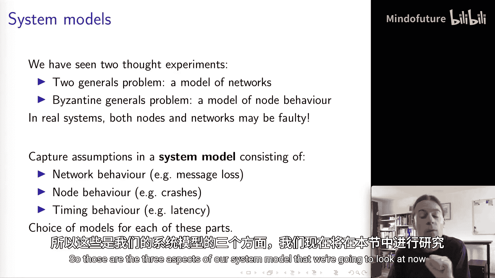
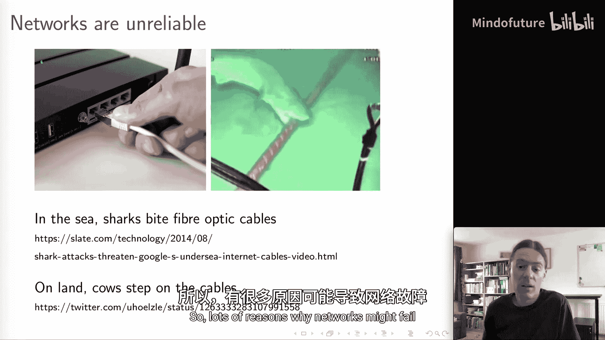
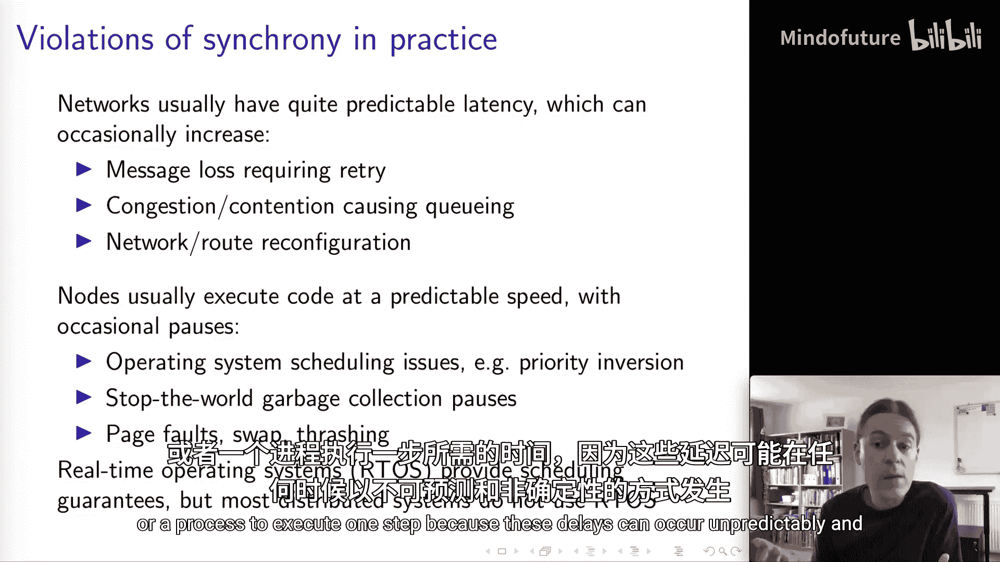
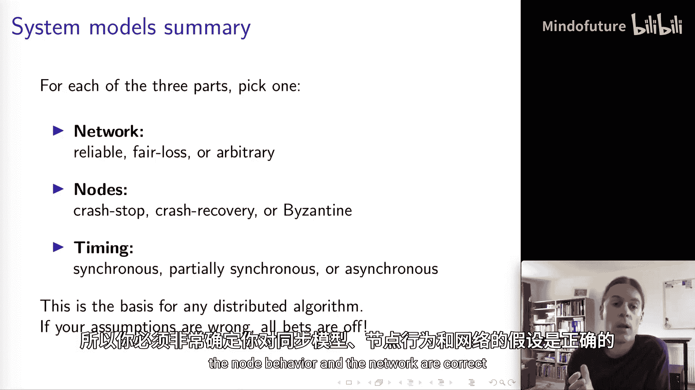

# 【剑桥大学-•-中英】分布式系统讲座-p06-P06-Distributed-Systems-2.3---System-models--BV1NwQhYeEyV_p6-

We've now seen the two generals problem and the Byzantine generals problem in the two generals problem。

 we assume that nodes are honest， but messages might get lost in the Byzantine generals problem。

 we assume that messages are reliable， but nodes might be dishonest。 So now， well。

 we should put the two together really and try and design system models for system in which both nodes and networks might go wrong in various ways。

 And so this is really the foundation of any algorithms in distributed systems。

 we need to assume certain things about what properties the system is going to have。 And typically。

 we do that by looking at three different areas of interest。 So first of all。

 we need to describe how we assume the network is going to behave。 Secondly。

 we're going to assume how nodes are going to behave。 And thirdly。

 we need to assume how the timing in the system is going to work。

 So the timing affect both networks and nodes。 So those are the three aspect of a system model that。

Going to look at now in this section。 let's start with networks。

 So I've repeated over and over again that networks are unreliable。

 but just to reemphasize that there are many reasons why message might get lost in a network。

 Some of them are just temporary overload buffer gets full and so a message gets dropped。

 but also there some more fundamental problems， even if you designed carefully so that your buffers never overflow some human operating system might just unplugged the wrong network cable。

 and that means the network will be interrupted for the time that this network cable is unplugged no way around it。

 There are also various other curious interactions which with nature that happen。

 So Google was observing， for example， on their subea fiber optic cables that there were strange dam。

 observed strange damage on on these cables， and they installed some underwater cameras and actually managed to observe sharks biting into their cables。

 you can see the video at the。Here on the slide， do watch it。 It's incredibly cute。 On land。

 people have observed problems with cows stepping on fiber optic cables。 So fiber optic cable。😊。

Was supposed to run along a power line， but ended up trailing underground。 cow steps on it。

 and the cow makes enough of a kink in the cable that the light can't get through the kink in the fiber optic cable。

 And thus the network link gets interrupted。 This stuff really happens。 honestly。

 So lots of reasons why a networks might fail。 Let's take distribute bit more abstract level so that we can reason about it in in a more formal way。

 So typically in distributed systems。 And when we're designing distributed algorithms。

 we are going to assume some kind of point to point communication。

 So we're going to assume that messages have one sender and one recipient。

 And they are sent over a bidirectional link so that the recipient can then reply back to the sender。

 So that's everything， the type of link we've been talking about so far。

 And we can then choose how how reliable we are going to assume this link is。

And so the simplest model to program against is if we simply assume that the link is reliable。

 and that is that messages always get through。 If a message is sent， then it is received。

 and if a message is received， then it is sent。 then it was previously sent。

 So the link doesn't lose messages。 and the link also doesn't fabricate messages out of thin air。

 So a messages only received if it was sent。 We're going to assume that messages can be reordered。

 And so that is quite a strong assumption， of course。

 because links may not actually be this reliable in practice。 but we'll get to that in a moment。

The second assumption we could make about network links is what is called a fair loss link。

So a fair loss link is one in which whenever you send a message。

 it has a nonzero probability of being delivered。 So when you send a message， it might get through。

 it might not get through。 But if you keep repeating descending of that message。

 then we're going to assume that eventually it will get through。

 We're not going to make any assumptions about how long that might take。

 So it might take a long time until the message does finally get through。

 But we're going to assume that if you assume an infinitely long execution time， there will。

 at some point within a finite amount of time， be a point when every message is delivered。

And the third， the weakest assumption we could make about network links is arbitrary。

 So the network link is allowed to do anything。 We can model this in terms of a malicious active adversary who modifies the network traffic。

 And so this actually does happen on the on the real Internet if you're connecting to a coffee shop Wiifi。

 the owner of that wfi could be interfering with your network packets in arbitrary ways。

 And that means they might not just be looking at your network communication and like eavesdropping on it。

 but they might actually modify the packets。 They might they might record packets and then replay them at some later point of time。

 They might pretend to be some website and spoof it。 And of course， they might drop messages as well。

 And so an arbitrary link is allowed to do any of these things。 and and unfortunately。

 this is actually a reasonable model of how the Internet works today。Now。

 the final piece of terminology that I want to introduce here is the concept of a network partition。

 So a network partition is just if you have some nodes where the nodes are still continuing to run fine。

 but the communication link between them is interrupted。

 Usually we talk about this interruption of being for some finite period of time。

 So eventually the network partition does get repaired and at some point in the future。

 they will be able to communicate again， but the period of interruption might be quite substantial。

 and this is an important thing to keep in mind。 So you might have systems， for example。

 where one subgroup of nodes is able to communicate a different subgroup of nodes is able to communicate but those two groups can of communicate between them because the network link between the two groups is interrupted。

 so this could absolutely happen。So now the interesting thing with the three models of network behavior is that it's actually almost possible to convert one model into another。

 So in particular， if we have a fair loss link we can turn a fair loss link into a reliable link and the way we can do that。

 if we simply keep retrying messages until they get through and on the recipient side that means we might get duplicate messages so we have to also deduplicate the messages on the recipient side and because with a fair loss link we are assuming that if we keep retrying a message will'll eventually get through then。

It is actually possible to turn this into a reliable link。

 because we're assuming it will eventually get through and And therefore， by keep retrying。

 it will eventually get through。 Of course， we're not saying anything about how long that is going to take。

 It could potentially take a very long time for a message to get through。

 but it will eventually get through。Interestingly， it's all also almost possible to convert an arbitrary link into a fair loss link。

 And the way we can do that is by using a cryptographic protocol such as T L S。 So T L S。

 which stands for transport layer security， is what gives you the little green padlock in the browser。

 It's what gives you the S and H T P S。 So it's a security protocol that allows。

Typically a client and a server to communicate in a way that is resilience to people interfering with the network traffic。

 so even if there's some active adversary on the network who is manipulating your network communication。

 the TlS protocol is able to guarantee that if the communication is successful。

 then it hasn't been tampered with and it is authentic communication， it hasn't been spoofed。

 you doesn't have some other person impersonating the website you're trying to communicate with and so on。

And the communication is private because it's encrypted。 And so by using a protocol like Tls。

 we are actually able to almost change an arbitrary link into a fair loss link。

 The only thing we cannot do is if the active adversary just decides to block all communication ever In that case。

 of course， nothing is going to get through and you can't turn that into a fair loss link because we can't make any guarantee that eventually a message will get through if you keep retrying。

 But if we're willing to assume that the adversary will only interfere。

 say with a finite number of packets， then we could say that okay。

 the arbitrary link can be actually upgraded to a fair loss link and from there through retrying and de duplication。

 we can actually turn it into a reliable link。So that's our model of network behavior。

The next part of the system model is how do nodes behave。So， of course。

 nodes might fail in various ways as well。 And the first type of fault that we want to consider here is a crash fault。

 And so in the crash stop abstraction for a process。

 what this means is that we assume that a process might crash at any moment。

 And once a process has crashed， then it will never come back again。 It's just dead forever。

So this is a simplifying assumption， of course， that it's going to be dead forever。 In some cases。

 this is accurate。 So if you， if your node is your phone and you drop your phone in a toilet and the phone is there after broken。

 you know the phone has suddenly disappeared off the face of the earth and it's never going to come back again It's never going to be able to communicate again。

 So therefore this you can model this as a crashtop failure。

 So the crash might not just be a software crash。 It could also be a catastrophic hardware failure where a node is simply destroyed and it will never be able to come back again。

 but in other systems， we might want to assume actually that nodes might crash and then come back again。

 it might recover after some period of time。When a node crashes。

 we probably want to assume that any inmemory state that it had is lost so any state that is not written to disk or to other some non-volatile storage will be lost。

 but any data that is stored in in stable storage is able to survive the crash and will still be there after the node recovers Of course a crash recovery model nodes might still crash and never come back again so that's still a possibility。

 we're just adding the additional possibility that a node might recover after a crash。

And the third model of nodes is Byzantine， so exactly as in the Byzantine general's problem。😊。

What it means for a node to be Byzantine fault0 is just it deviates from the algorithm。

 So we specify an algorithm that all of the nodes are supposed to follow。

 but a Byzantine fault0 node may not follow the algorithm。 It might pretend to follow the algorithm。

 It might be it might do stuff to try and make it look honest。

 even though it's actually behaving in some malicious way。

 So we're not going to constrain the behavior of a Byzantine  fault0 node in any way。

 We're just going to assume that it can do anything that it wants。 including malicious behavior。

 And so a piece of terminology here is we can always categorize a node as either  fault0 or correct。

 So a node is  fault0 if it crashes， for example， or in a Byzantine model。

 fault0 is a node is fault0 if it deviates from the algorithm， a node is correct if it's not faulty。

 So those are two possibilities。 Now we don't necessarily one node does not necessarily know whether another node is correct or fault0。

 and we will come to the。Problem of fault detection in a little while。

So we've talked about models for network， models for nodes， the third part is models for timing。

And so here again， they are one of three choices that we could make。

 So the first choice we could make is a synchronous system model。 And in a synchronous system model。

 we assume that basically everything takes a known length of time。

 So when we send a message over the network， there is some maximum time after which the message will be either either delivered or lost。

 But we assume that no message will take longer than some maximum amount of time to arrive。Also。

 we're going to assume that nodes always execute their code at a known speed。

 So every step of execution， every step of the algorithm。

 there's an upper bound for the length of time that that execution is going to take。

 This is a very strong assumption。Now。Another assumption we could make is a partially synchronous model where for some periods of time。

 the system behaves as in asynchronous model and for other periods of time。

 it behaves in a way that's asynchronous。 And so I need to explain asynchronous。

 So in an asynchronous model， we make no timing assumptions at all。

 So that means if you send a message over the network。 It may arrive in 20 years time。 Okay。

 we're not making any guarantees about how long it's going to take for messages to arrive。

 We assume no upper bound on message latency。 Of course。

 it might be that messages are mostly delivered quite quickly。

 but we're just not going to make any assumptions about the maximum latency that might occur。

Moreover， we're not going to make any assumptions about how fast nodes are going to execute the algorithm。

 so we're going to assume that a node might pause its execution at any moment and just like stop executing its steps for a while and then later resume executing again and of course this can happen because a thread can be suspended as you know。

 and so a thread can just pause execution for a while and then resume executing sometime later。

And so we have here a synchronous model as one extreme where where like we're making very strong assumptions about the network latency and the no processing speed and the asynchronous model where we're making no assumptions at all。

 So the partially synchronous model is kind of a compromise between those two where we're saying that actually the asynchronous model is great if we can work in the asynchronous model。

 but there are certain problems that simply cannot be solved in the asynchronous model。

 So in some cases we do have to make timing assumptions， but at the same time。

 it's unsafe to assume that those timing assumptions are always true。

Because if you write an algorithm in the synchronous model。And the system is ever asynchronous。

 If this， if the system ever takes longer than your upper bound to deliver a message， for example。

 then your algorithm might fail catastrophically。 So the algorithms are very。

 very sensitive to your timing assumptions here。And in most cases。

 it is very dangerous to assume a synchronous model because real networks do， in fact。

 behave in partially synchronous ways。 So partially synchronous model is really our compromise where we're saying most at the time。

 the system is well behaved and kind of synchronous and occasionally it just goes weird and occasionally。

 messages take a really long time to arrive and occasionally nodes are really slow to execute。

 And then at some point， they'll return back into a synchronous state。

 But we don't know whether they are asynchronous or synchronous right now。

So let me just explain the problems of assuming synchrony。 So you might think that， you know。

 usually networks are quite fast。 and usually， you know， if you send a message。

 then it'll be arrived， it'll arrive within some maximum time。But unfortunately。

 there are lots of reasons why why messages might take longer occasionally。

 And so one reason might be that a message is lost and needs to be re trieded。

 And so like we had earlier， in our case of upgrading a fair loss link to a reliable link。

The cost of that。Upgrade in reliability was that potentially we have to wait for a very long time。

 If there's a network partition， we might have to wait for minutes or even hours or even days before the message gets through。

 So in this case， we can't assume any upper boundary really on。

 on message latency because it might be up to the length that it takes for a network partition to be healed。

Other reasons why network latency might suddenly increase just congestion and queuing in the network。

 or there have even been examples of a network reconfiguration where packets just get stuck in a switch buffer for over a minute before they're eventually delivered。

 And so even in in data centre networks， which are normally very well managed。

 it is possible to actually occasionally have really extremely high message latency。

 And so any algorithm that we design must take must take into account this possibility that occasionally messages might take a very long time to arrive。

In terms of the execution speed of nodes， again， we would expect normally like computers run at a kind of fixed speed。

 you know a fixed clock speed。 So we don't expect that to vary very much。

 But there are many reasons why a nodes execution might be interrupted for a little while。

 So as you know from the concurrent systems part of this course。

 you can have a context which you can have a thread that temporarily gets suspended。

 while other processes run。 And so this might take a while before the operating system scheduler comes back and start running your thread again。

 especially if there's some kind of problem going on like priority inversion in the system。

 it could be that a processes actually paused for a significant amount of time before it gets to run again。

 And as you know from multithreading。A， a process can or a thread can get paused at absolutely any moment。

 There's， you know， any point in the in the code， it could decide to， to pause。

 And so even at the most inconvenient place possible in an algorithm。

 you might have a thread pause or a context which。Another real problem that happens in practice is garbage collection。

 So in a language like Java， for example， which performs automatic memory management and which uses garbage collection to free up memory。

 you can have what is called a stopped the world garbage collection pauses where the garbage collection just has to stop all of the running threads for a while while it performs the garbage collection。

 and those pauses can last minutes。 sometimes if you have a large large heap size。So that， again。

 is another reason why a process or a thread might just just pause execution for a while。

 And finally， of course， there are lots of other things in an operating system that cause variable delays such as page faults and so on。

 especially if memory is tight。 So it is possible to get around these things。

 So realtime operating systems will provide scheduling guarantees。

 they might guarantee that your code always runs runs at least once every 10 milliseconds。

 But most distributed systems are not built on realtime operating systems。

 they're built on general purpose operating systems which make no guarantees about how processes are going to get scheduled。

 And even if you are using a realtime operating system。

 It's very hard work to actually ensure that those timing guarantees always hold。

So for most practical distributed systems， we cannot assume any upper bound on how long it might take for both a message to be delivered or a process to execute one step you know because these delays can occur unpredictably and nonterministically at any point。

So that's a summary， this is what we talked about system model contains of consists of three parts。

 theres we can make an assumption about the network how reliable we want the network to be reliable。

 fair loss or arbitrary。😊，We make an assumption about how network， how nodes are going to behave。

 so are we going to assume crash stop where crash means a node never comes back or crash recovery or even Byzantine behavior of nodes。

 And then thirdly， for the timing we can choose between synchronous or partially synchronous or asynchronous execution。

And these choices of abstraction are absolutely crucial。

 So if you are designing a distributed algorithm， you have to be absolutely certain that your assumption of。

 in regard to these are correct。 So， for example， if you are assuming a crash recovery model and actually。

 you have some Byzantine nodes in your system， the Byzantine nodes are just going to destroy your algorithm。

 So if you think they are going to be Byzantine behavior。

 then you have to take account for it in the algorithm and the algorithm has to be designed to tolerate Byzantine behavior。

It， it is perfectly fine if you're going to assume this is a fully trusted system。

 It's not going to have any Byzantine nodes and just assume only crash stop or crash recovery。

 That's fine。 You just have to be very sure that your assumption is correct。 Likewise， with timing。

makingking synchrony assumptions， as I said， assuming a synchronous model when actually your system is partially synchronous is very dangerous。

 it's very likely that if you assume a synchronous model and it goes partially synchronous even just for like 10 seconds somewhere。

TheAll of the guarantees of your distributed algorithm are off。

 So you have to be very sure that your assumptions in terms of the synchrony model。

 the no behavior and the network are correct。

