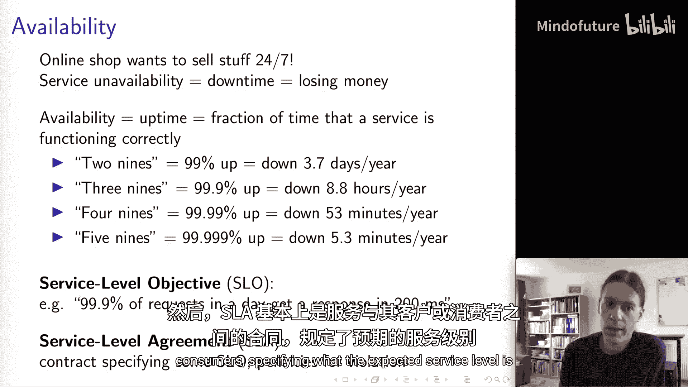
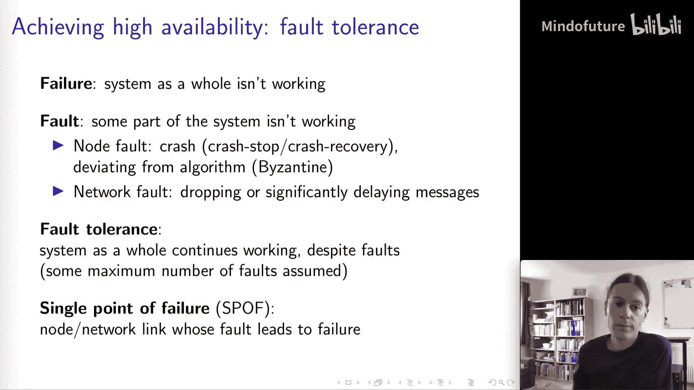
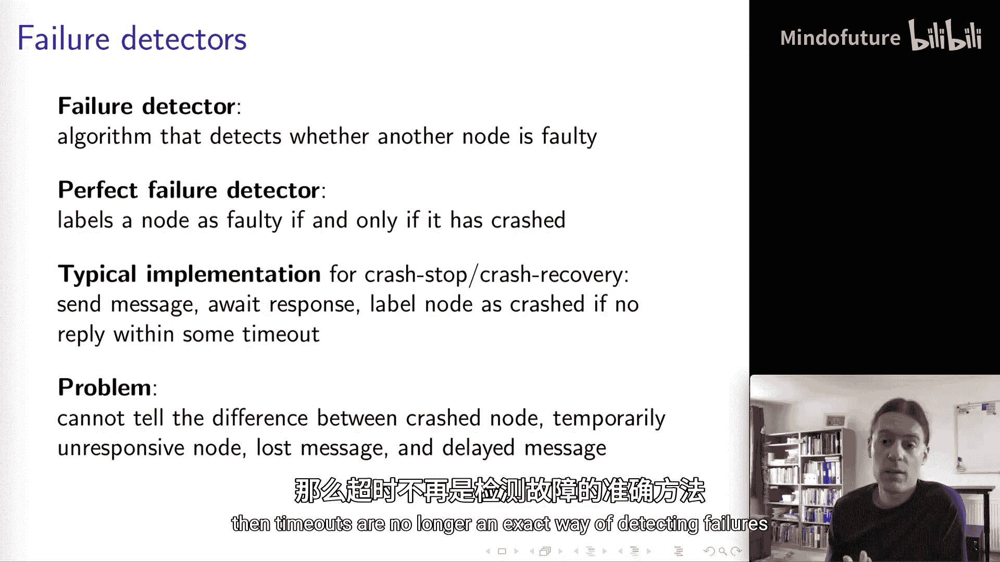
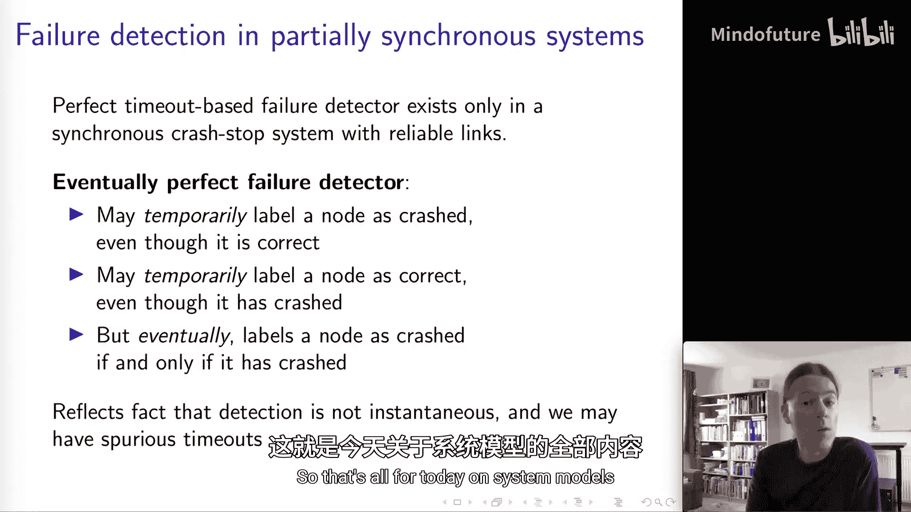

# 【剑桥大学-•-中英】分布式系统讲座-p07-P07-Distributed-Systems-2.4---Fault-tolerance--BV1NwQhYeEyV_p7-

In the last bit of this lecture， I want to talk a little bit about a practical real life context for faults。

 handling faults and making highly available services。 So imagine you are running an online shop。

 for example， you probably want that shop to be available 24 hours a day，7 days a week。

 because who knows what time of day or night， somebody might decide that they want to go and look at your shop and maybe buy something。

 And so any time during which your shop， your service is not available actually means losing money。

 in other cases， you might imagine that a service may even have contractual relationships with with with its customers specifying what percentage of time a service needs to be available。

 And so a typical model for how we usually talk about available is the fraction of time during which a service is functioning correctly。

 And so for a service is functioning correctly99% of the time， for example。

 that means that there might be 3 to4。A year during which the service is not available in total。

 though， of course， this might be several smaller outages。 or if you go up to 99。9% of the time。

You're allowed a maximum of nine hours per year of outage and you can increase this further to as many nines as you like。

 So the telephone network， for example， is apparently designed for five9s。

 and so this is the old fashioned fixed line telephone network， not mobile networks。

 certainly not the internet。 they don't have this sort of availability。

 the telephone network is designed in a very conservative way in order to achieve this this very high reliability。

 but it is possible。 and typically terms that you get in the context of availability is SL and SLA。

 So an SL， a service level objective is the goal that you are setting yourself in terms of the availability of a service。

 So this might specify the percentage of requests that need to get a correct response where maximum time that it's allowed to take for that response。

 say 200 milliseconds or。and the period of time over which you're going to measure it。

 So you' going to take that 99。9% over the course of all of the requests made in one day。

 for example。 And then SLA is basically a contract between a service and its customers or its consumers specifying what the expected service level is now。

In order to achieve that sort of very high availability。

 the way we typically do that is in distributed systems is by fault tolerance。

 So a fault is when some part of the system isn't working。 We talked about node faults。

 which might be a crash， for example， or network faults， which might be a network partition and。

What we want is the system to tolerate some number of faults。

 So it doesn't make sense to say that the system will tolerate all faults。

 because if all of your nodes crash at the same time and all of your network links go down at the same time。

 the system is not going to be able to do anything。 Obviously。

 there there's no way it can make any progress in that case。

 But what you might be able to say is that the system as a whole will continue working。

 if fewer than half of our nodes have crashed， for example。

 So you allow one out of three to crash or you allow two out of five to crash and the remaining nodes can still continue running the service。

And so in a system in which some parts of the some nodes or some network links are allowed to be faulty。

 we avoid what is called a single point of failure。 So a single point of failure would be。

 say one node， that if that one node crashes， then the system as a whole becomes unavailable。

 But if we can design a system without a single point of failure that means that we can take out any one component of the system and a system as a whole will hopefully still continue working。

In order to enable to tolerate faults， usually the first thing we have to do is to detect a fault。

 and then we can handle it。 So the mechanism for detecting a fault is known as a failure detector termminology is a little bit odd。

 It ought to actually be called， should be called a fault detector that would make more sense。

 but a failure detector is the common term that is used。 So we're going to stick with that。

 So a failure detector is， it could be like a software algorithm or it could be a piece of hardware or something。

 some mechanism for detecting whether another node is faulty。 And ideally。

 what we would love to have is a perfect failure detector that is some mechanism that is always accurate at telling us whether another node is faulty or not。

Now， the way we typically implement failure detectors is we use time at。

 So we simply send a message to a node and say， hey， please respond to this message if you're alive。

 And then if we don't get a response within some amount of time， then we say， well， okay。

 we didn't get a response。 that node must be dead。So it must have crashed or something like that。

 And this is fine。 this is practical。 But unfortunately。

 as we have seen in the context of our system models。

 if we assume a partially synchronous or even an asynchronous system。

 then a timeout doesn't necessarily tell us that the node has crashed because an timeout could also happen because we sent a message and the message was lost in a network or the response was lost in a network。

 or the message was delayed in the network and it will actually still arrived。

 it just hasn't arrived yet， or the response was delayed in the network。

 or maybe the node is actually alive， but it's just experiencing a long garbage collection pause。

 and so it will respond to your message in one minute's time once it's finished its garbage collection。

😊，Or of course， the node might have crashed and it's impossible to tell the difference between any of these because it's impossible for the sender of these check messages to tell whether the absence of a response is due to a network problem or due to just some kind of random delay or due to problems because the node has actually crashed。

Now we can build a perfect failure detector if we have a synchronous system model and if we're going to assume only crash stop failures and certainly not going to assume any Byzantine behavior in the system。

But， but， you know， as soon as you go to a partially synchronous model。

 then timeouts are no longer an exact way of detecting failures。

 So the best we can do in a partially synchronous system is what is called an eventually perfect failure detector。

 I love this term。 I， you know， nobody's perfect， I like to think of myself as eventually perfect。

 maybe you are also eventually perfect。 And then in the context of a failure detector eventually perfect means that the failure detector might be wrong from time to time。

 So the failure detector might detect a timeout， even though the other note hasn't actually crashed yet。

 just because a message happened to be delayed a bit。

 So means a timeout does not accurately indicate that a crash has happened。 Also。

 failure detector is not immediate。 So if a crashes happened。

 it might actually take a while until we detect that crash。

 The the detection of the crash is not instantaneous。 So we might be wrong。

 We might have both false positives and false negatives for a while。

But eventually， the failure detector labels a node as crashed if and only if it really has crashed。

 So that means that any temporarily suspecting another node of being failed will will stop and will go back to thinking that a node is correct。

 provided that a node really is still correct。 and also， if a node has failed。

 then eventually we will detect it as failed。 And so this is about the best we can do in terms of failure detection。

 But it's still quite useful。 So even though we might have this failure detector。

 that is only eventually perfect。 This is actually sufficient in order to build some useful algorithms。

 as we will see in some of the future lectures。So that's all for today on system models。😊。

