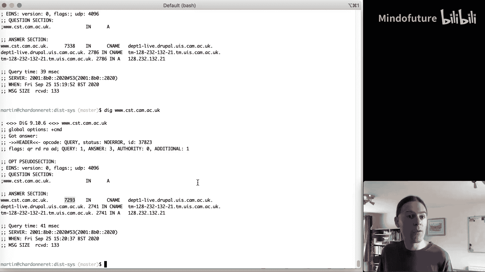
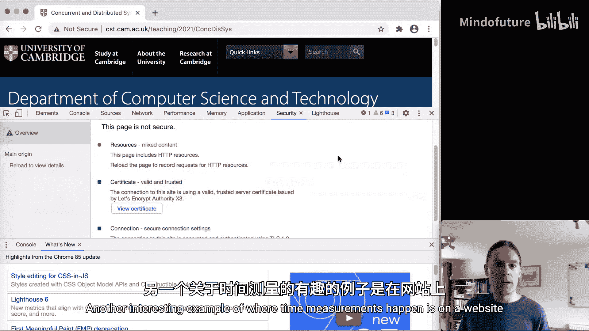
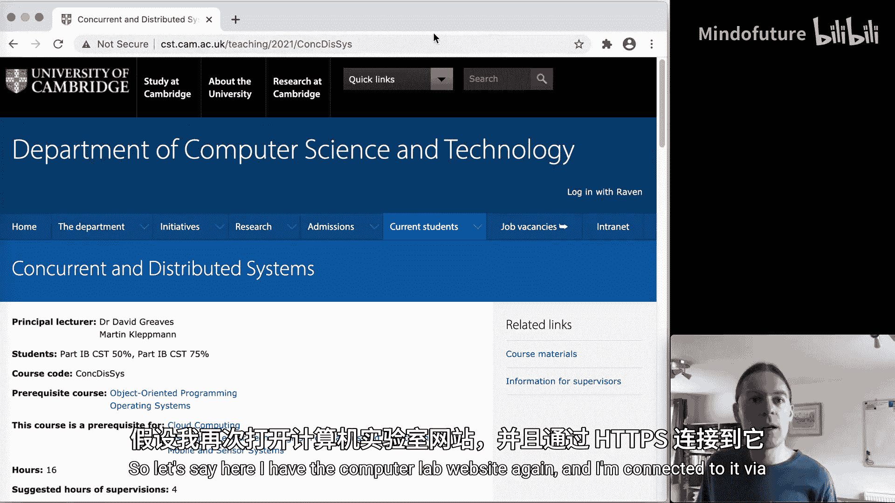
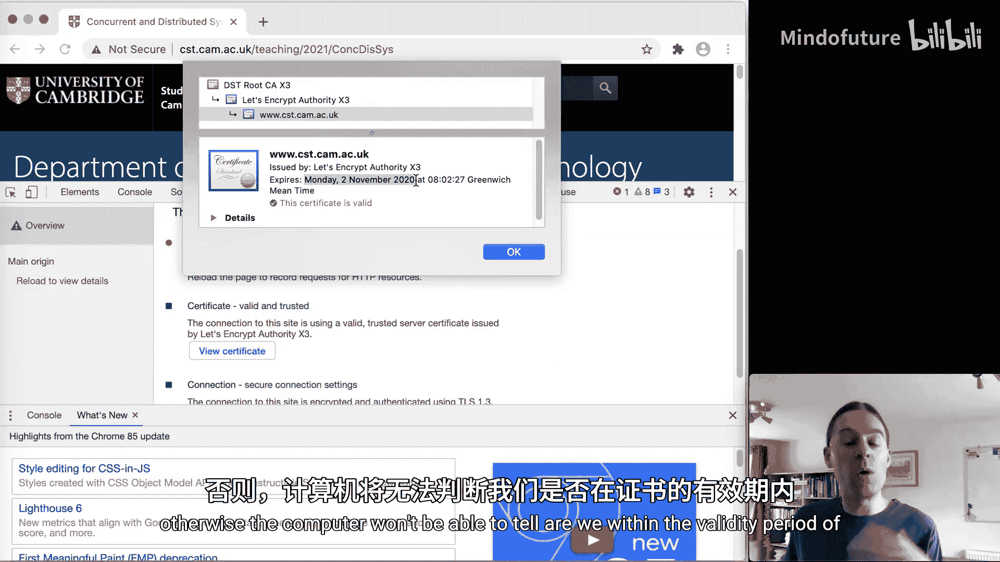
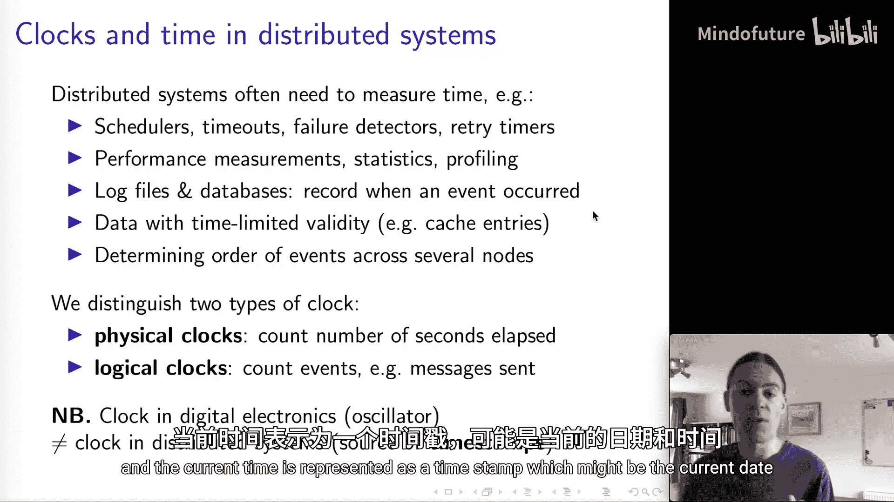
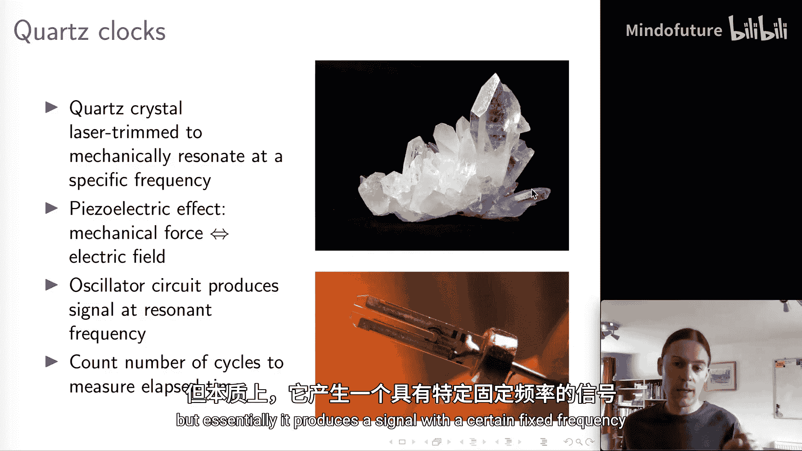
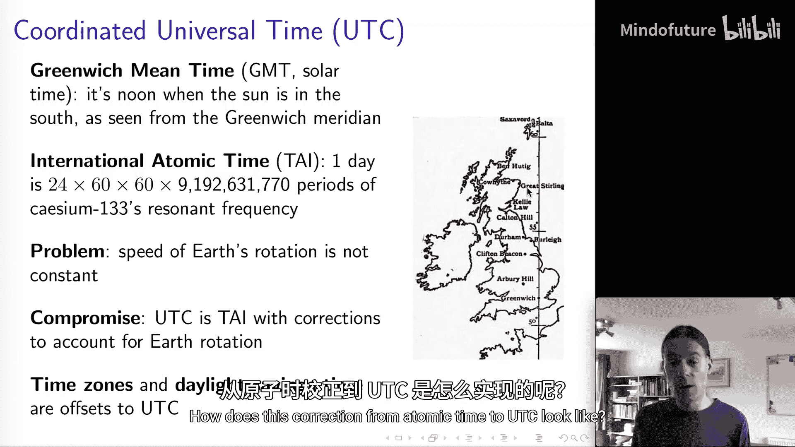
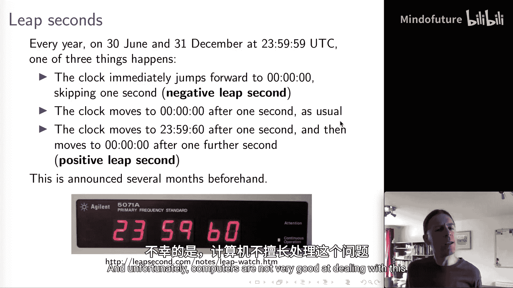
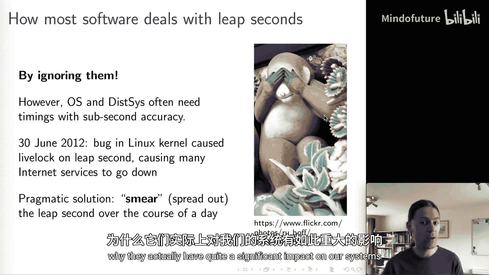

# 【剑桥大学-•-中英】分布式系统讲座-p08-P08-Distributed-Systems-3.1---Physical-time--BV1NwQhYeEyV_p8-

Hello everyone welcome to the third lecture of distributed systems today we're going to have fun talking about time and clocks and ordering of events in a distributed system so let me start with a little puzzle something that you can ponder about and I will resolve this towards the end of this video。

This is an incident， a real incident that occurred in 2012 on 30th June。

 where system administrators at a whole bunch of different companies and services had a really bad day。

 because for some reason， a whole lot of servers all locked up and stopped responding to requests all around the same time sometime in the middle of the night。

 So what might have happened， Why did servers across a whole bunch of different companies all fail at the same time。

We'll have a think about that and answer we'll come later。

 So I want to talk about time and time is very useful in distributor systems and in operating systems。

 just to remind you of a couple of uses of time for example in an operating system scheduler you want to context switch after a process has been running for 10 milliseconds maybe so you have to measure those 10 milliseconds if you want to send some kind of timeout。

 then of course you have to measure our time last lecture we talked about failure detectors which again rely on measuring whether youve got a response or not within a certain period of time if you want to retry sending messages over a network again。

 you probably want to wait for a certain time all of those require measuring time other things that require measuring time the performance measurements。

 So how long has a process been running for how much CPU time has it been using if you want to profile a system in order to improve its performance that also relies on time measurement in log files you probably want to record the date and time。

Wch a certain event happened。 So， for example， a certain user logged in at a certain date at a certain time。

 you want to record that in the log in databases， you might want to record when something happens。

 So at which point did a user make a purchase for example。

 what date at what time did that purchase occur。An interesting one is data that is only valid for a certain period of time。

 so in a cache for example you might want data and the cache not to live forever but to be expired from the cache after it has been there for a while so I'll give one concrete example of this we could use DNS so the DNS system for resolving domain names to IP addresses we can query so we can do something like this。

I'm going to query the computer lab website here and it's going to give me back the IP address of of that website。

 And if you look at this answer here， you can see in the second column， there are these numbers。

 And these numbers are the time to live in seconds of these records。

 So what does mean is that you're allowed to cache the results of this DNS query for a certain period of time here 7000 seconds。

 So that's about two hours or something like that。The results are allowed to be cached。

 but then after that time has elapsed， then we need to refresh the query and we need to rerun the query in order to get press data so that if somebody wants to change the DNS record then it will eventually propagate to everywhere I can now actually rerun this a couple of seconds later and see that now 7338 has gone down to 7293 because that number of seconds has elapsed while I was talking right now another interesting example of where where time measurements happen is on a website so let's say here I have the computer lab website again and I'm connected to it via Https which means that it has here a certificate。

 so a Tls certificate which is used as a mechanism to check that we're actually talking to the correct server not to some fake server that is trying to impersonate this website and if I've viewed a certificate Well again a certificate is valid only for a certain。

Piod of time。 So it has an expiry date here。 So this certificate expires on the 2 November 2020。

 I'm recording this video here at the end of September 2020。 So at the time when I'm speaking here。

 the certificate has got just over a month still left before it expires。

 And so it will get renewed from time time every couple of months so that it keeps keeps being fresh But here again。

 this requires my in order for my computer to check whether the certificate is valid。

 my computer needs to know what the current data is。

 because otherwise the computer won't be able to tell are we within the validity period of this certificate or not。

 So that's another interesting use of time。

And then finally， we use time measurements in order to determine in a distributed system in which order certain events occurred。

 and we'll talk about that more later in this lecture。

So there are two types of clock that we encounter in distributed systems and we distinguish them as called physical and logical clocks Ph clocks are the type of clocks that you know from everyday usage they count the number of seconds that have elapsed。

 they tell you what time of day it is and what date it is and that's the type of clock that we're talking about in this lecture。

 logical clocks I will come to in the next lecture。Now， just a little terminology clarification。

 the term clock is also used in digital electronics and you've come across it there where it means a signal which produces pulses of ones and zeros at a certain regular frequency。

 in distributed systems we use the word clock in a slightly different way。

 So the meaning in distributed systems is a clock is something that you can ask for a timestamp。

 So it tells you what the current time is， and the current time is represented as a timestamp which might be the current date and time。

So the way that most computers implement clocks nowadays is using qua qua crystals。

 so this is literally a piece of quars typically not a natural quartz crystal but an artificially grown one but it's still silicon dioxide and it's cutped to a certain size and into a certain shape using lasers and it then mechanically vibrates。

 so it mechanically resonates at a certain frequency and the frequency at which it resonates can be tuned by cutting off bits of the crystal using lasers。

Now quartz is also a pieso electric material， which means that if you apply an electric field to it。

 it induces a mechanical strain in the material and also the other way if you apply a force to it。

 then it creates an electric field and so you can use this interplay between the mechanical motion and the electric field in order to create a fairly accurate oscillator that resonates at a fairly accurate frequency so there's a little bit of electronics around the quartz crystal but essentially it produces a signal with a certain fixed frequency now。

This frequency is quite predictable and this makes quartz clocks quite accurate。

 but are certainly not perfect because there are always going to be certain manufacturing differences between one crystal and another。

 they won't oscillate at precisely the same frequency there will be a little bit of an error Moreoverover。

 the ressonant frequency of a quartzs crystal actually depends on the temperature。😊。

And so the crystals that are used for quartz ocillators are tuned and they are selected and created in such a way that their frequencies quite stable around room temperature around 20 to 25 degrees C。

But as you deviate from this temperature significantly。

 there's actually a quadratic decrease in the clock speed。 and so if you。

 if you're in a very hot server room， for example， where you know you might reach significantly higher temperatures than your typical room temperature。

 then this actually can have a significantly impact on on the frequency at which the clock is running。

So the clock speed is measured in parts per million usually this is just like percent but rather than dividediding by 100 we divide by a million and so you can work out like if you have a one ppm error that would mean that the clock goes wrong by about 32 seconds per year now most quartz clocks will be like maybe 20 ppm or something like that order of magnitude。

 of course， depending on the temperature as a rule of thumb。

 probably most clock errors will be below 50 ppm。Now， if that is not accurate for you。

 not accurate enough for you， you can use an atomic clock。 Atomic clocks are much。

 much much more accurate and they are based on quantum mechanical effects。

 So they actually use ceessium atoms of a certain isotope of ceium and they if you remember any quantum mechanics atoms have discrete energy levels the difference between those energy levels corresponds to certain resonant frequencies of the atom and as one particular energy transition which is at a fairly friendly to measure frequency of about 9 gigahHz So you get about9 oscillations of this per second and this is actually how the second is now defined。

 So the Si unit of one second is defined to be exactly 9 billion192 million blah blah。

Periods of this particular signal generated from this particular ressoninant frequency of ceium atoms。

 Now， this is incredibly precise。 Of course， the clocks are not that cheap。

 but you can just buy a clock off the shelf if you have the money I'm not entirely sure exactly how much they cost。

 but these are sort of the best estimates are was able to get off the internet。 And well。

 if you have an atomic clock， you can do some interesting things with it like you can use you can build GPS。

 for example， So if you want a very precise clock signal。

 one way of getting that clock is actually to use GPS。

 So the same system that you use on your smartphone to tell you where you are right now on a map。

 It works by having a bunch of satellites that orbit the Earth and each satellites carries an atomic clock。

That broadcasts its current clock and its current location periodically。 And so the GPS receiver。

 it receives the signals from several of these satellites。

 it calculates the time difference between when the signal was sent by the satellite and when the signal was received by your phone and from that time distance and the speed of light。

 it can work out the actual distance in space between you and the satellite and from that it can work out where you are。

 Now there's a lot of details that go into making this accurate but for our purposes know all we're actually interested in right now is time。

 not location。 and you can use GPS satellites as a very accurate way of getting time and clocks。

 Now this does rely on being able to actually pick up the signal from the satellite。

 So if you're in a data center there's probably so much shielding and the electromagnetic interference that you can't actually pick up the signal。

 so you have to put an antenna on the roof of the data center。

 but this is something that people actually do as a way of getting。Were clocks。

So so much about how clocks actually work now how is time defined。

 so you might have come across term UTC， the universal coordinated universal time。

 which is the reference time that is used for all of our time zones we use nowadays。

How is UTC actually definediant， we have to be precise about this。

 and so you've probably come across the term GMT Greenwich mean。

Which unfortunately the meaning of that has changed over time。

 its original meaning was time based on astronomical observations。

 so it was literally when does when is the sun in the south if you are looking at the sun from the Greenwich Observatory so you can literally go to Greenwich in southeast London and visit the observatory there and see the Meriddian at which it was defined that when the sun is in the south as seen from this particular place then it is noon now it the time varies a little bit over the course of the year。

 so that way we actually average this over the course of the year。

 but the idea still this is time based on astronomical observations。Now I just said atomic locks。

 they define time using Cium atoms so using quantum mechanics and so this is now actually how time is defined the international atomic time is let's take atomic locks we take a couple of hundred atomic locks spread around the world we synchronize those and we count exactly the number of oscillations we have from this Cm reant frequency and that tells us how many seconds have elapsed Now these two things don't unfortunately match up exactly so we have two different definitions of time one based on astronomy。

 the other based on quantum mechanics and these two things don't exactly match up。

 they're pretty close， but especially the observations based on astronomy are problematic because the speed of the rotation is not actually entirely constant actually the earth wobbles a little bit and sometimes it turns a little bit faster and sometimes it turns a little bit slower and this is affected by earthquakes and by tides and by all sorts of weird complicated effects。

The result is that well we want to use atomic time because that's much more precise than this wobbly Earth time。

 but at the same time we want our time to be consistent with how the earth rotates around its axis and so the compromise is UTC the compromise is we take atomic time international atomic time and we apply some corrections to it based on astronomy and that will give us a time that is founded on quantum mechanics but still consistent with astronomic observations it's a bit of a complication but that's what we've ended up with and so this is how UTC is defined and time zones and like all of the summertime winter time all of these are defined as offset to UTC now and so like if you're on the East Coast U for example you'll be in like UTC+5 for example。

Now， how does this correction from atomic time to UTC look like。

 the answer is the correction takes the form of leap seconds。

So if you've all heard of leap years before， leap years are very familiar thing。

 this is a different concept but it's similarly weird it's even more weird actually and so a leap second is an extra second that can be either inserted or removed on a certain date and so every year there are typically two dates on which a leapse may or may not happen and that is the 30th of June on the 31st of December in principle I think it can happen at the end of every month but these are the two months that are typically used。

😊，And。At that point， a few months before the leapsecon may or may not happen。 astronomers decide。

 okay， how fast has the earth been rotating for the last couple of months， Okay。

 do we need to insert a second or not to keep the UTC greatly consistent with the rotation of the Earth。

 And so depending on what the astronomers decide， then the clock may or may not have an extra second。

 And so this means actually that so if there's a second subtracted， then there is no 23，59，59 second。

 the clock goes 58， and then immediately jumps to 0。After one second。

 so the 59 second is simply skipped， or we could have a regular second。

 or we can have an additional second in which the clock goes from 59。

59 to 60 and then to 0 after 2 seconds。 So we've inserted an extra second at 23，59 and 60。Now。

 this sounds complicated。And it is。 and unfortunately。

 computers are not very good at dealing with this。 So there are two typical representations of time that are most commonly used in computer programs Firstly。

 Uniix time， which is simply a number an integer counts the number of seconds since an arbitrary point in time。

1 of January 1970 was arbitrarily picked as this is called the Unix epoch and we count a number of seconds except that Uniix time is defined as not counting the leap seconds。

 or rather the standard simply doesn't say anything about leap seconds。

 It's simply implied that well， I don't know who cares about leap seconds， whatever。

 but it is defined in terms of UTC。 So it's not actually UTC。

 it's kind of at international atomic time， actually rather than UTC。 but everyone says it's UTC。

 So what is this thing Also then is this other format of representing dates and times。

 which is Io 8601。

Which is based on yearmon day， hour minutecond。 This is convenient because it's easy for humans to read。

 but now it means we have to convert between these two representations and so conversion firstly needs needs you to know the calendar So we know how the Gregorian calendar works。

 we have 365 days in a year except we add an extra 29th of February leap years。

 if the year is divisible by four， but not if the year is divisible by100。

 but if the year divisible by 400， then we do add a leap day after all。 fine so that's a leap years。

 but then actually in order to correctly convert these formats。

 we should also take leap seconds into account because they also determine the the number of seconds that have elapsed since the first of January 1970 because they've been。

 I think over 20 leap seconds inserted since that point。Well。

 how do you think software deals with these problems of leap seconds？You guessed it So ignores it。

 Soft goes la la la la lah， there are no leap seconds I don't care and just hopes that the problem goes away。

😊，Unfortunately， the problem does not go away。And。Now of course some applications。

 it doesn't really matter because， you know one second here or there for many applications really doesn't make a big deal of difference。

 you know if you want to have on your Facebook status update at what time you posted the Facebook status update。

 if that's wrong by a second， nobody's going to care。

But in operating systems and distributed systems， often we do actually rely on quite accurate time measurements with subsecond accuracy。

 And in that case， actually the difference of one second can be rather significant and that means we do actually have to care about these leap seconds which brings us to the solution of the little puzzle that I presented at the beginning of this lecture。

 which is what is what on earth happened on the 30 June 2012 for all of these system to go out down at the same time。

 Well， the answer was a leap second happened。 and there hadn't been a leapse for a couple of years before that And so during those years。

 of course， the Linux kernel and all other software was updated and the bug was introduced and as a result there was actually a live lock conditions that of when the leapse happened。

 the system went into live lock and so it was just spinning 100 percent CPU and not getting any useful work done。

 and even rebooting the computers didn't actually help What the administrators figured out then was that you actually had。

reset the system clock and that somehow cleared out the bad state in the Linux kernel and allowed us to fix those computers again。

 but you can imagine that that was a really bad day for administrators of these systems who rebooted the systems and they still didn't work。

Now a solution is now more widely used which tries to get around this problem that most software does not know how to deal with leapsecond correctly and the solution is called smearing leapse smearing which is rather than if we're going to insert a leapsecon rather than inserting it at one particular moment。

 how about we just spread that leapse out over the course of a whole day So let's say， for example。

12 hours before and 12 hours after the leapse is supposed to be introduced we just slow down the clocks ever so slightly enough so that then。

In total， one additional second has elapsed over the course of this period。

 but without this discontinuity of time where we've added that extra second。

 which confuses all of the software。And this is it's kind kind of a hack really。

 it's not a very elegant solution， but it might be pragmatically the best that we can come up with just given the problem of so much software is out there that doesn't know how to deal with leap seconds and realistically we're not going to manage to update all of that software So probably this smearing approach it' the best we have but anyway that is the backstory of leap seconds and why they actually have quite a significant impact on our systems。

