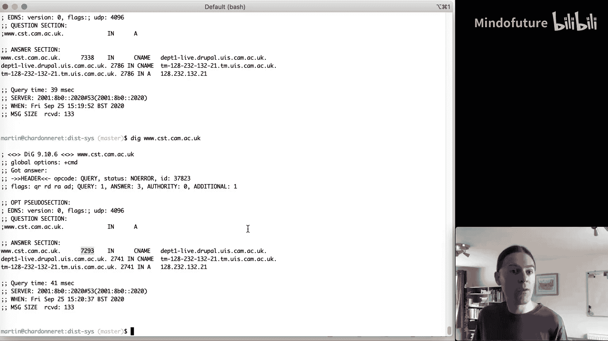
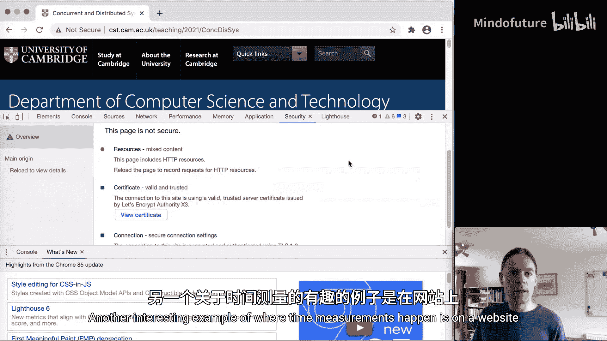
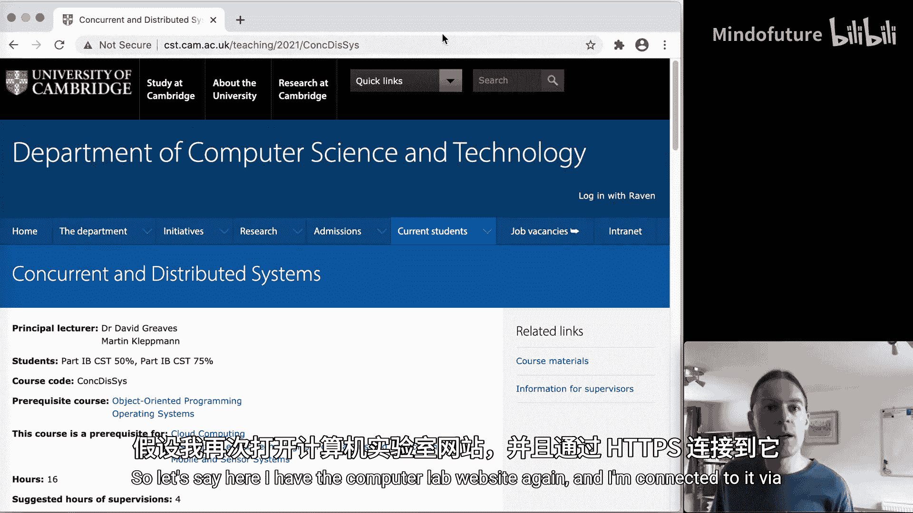
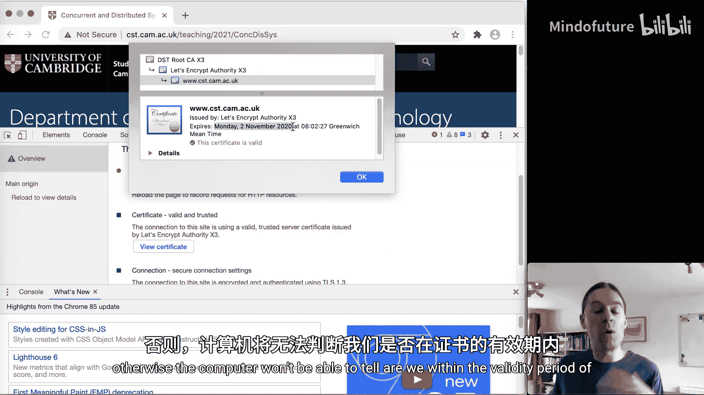
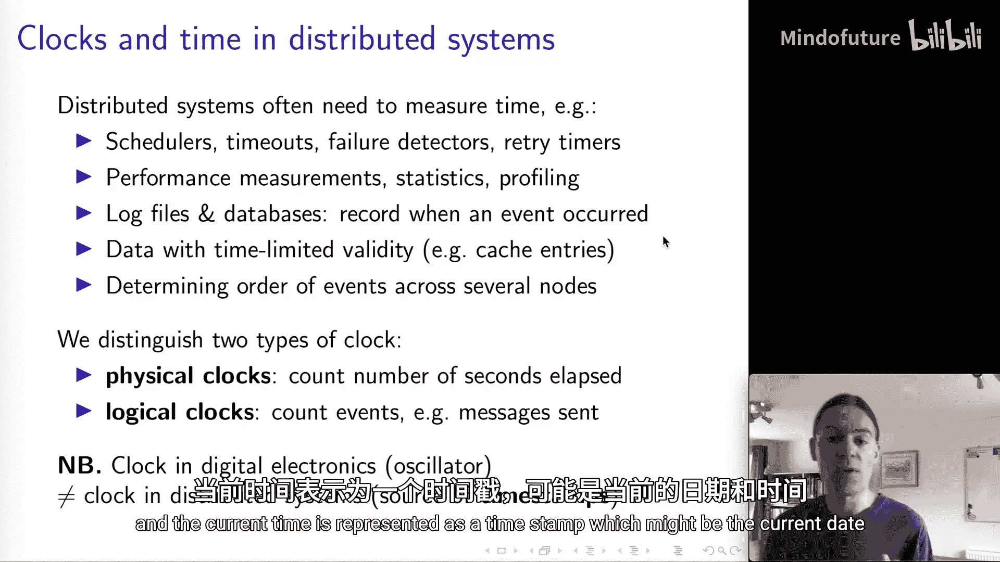
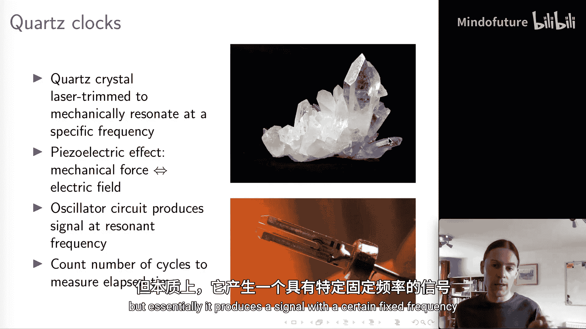
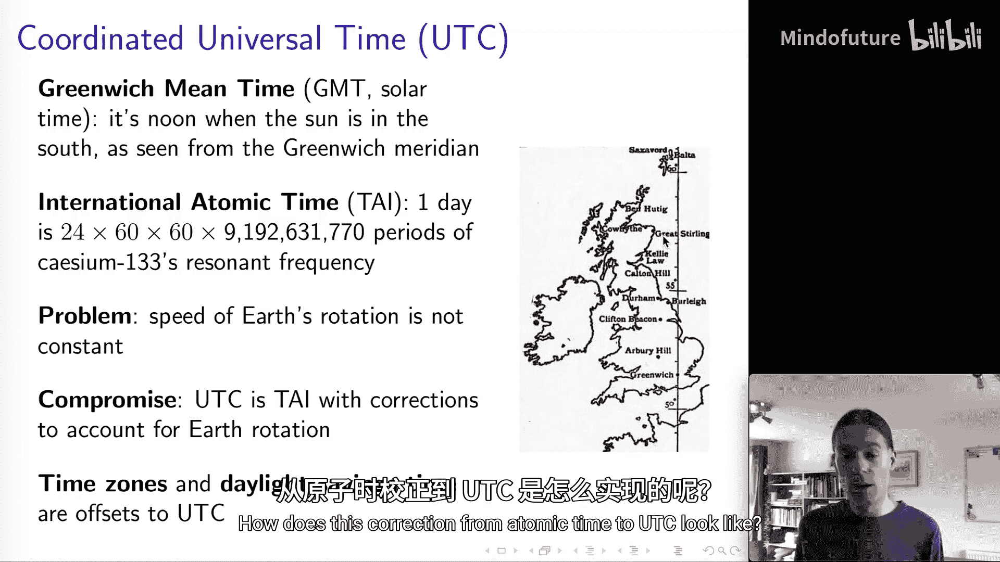
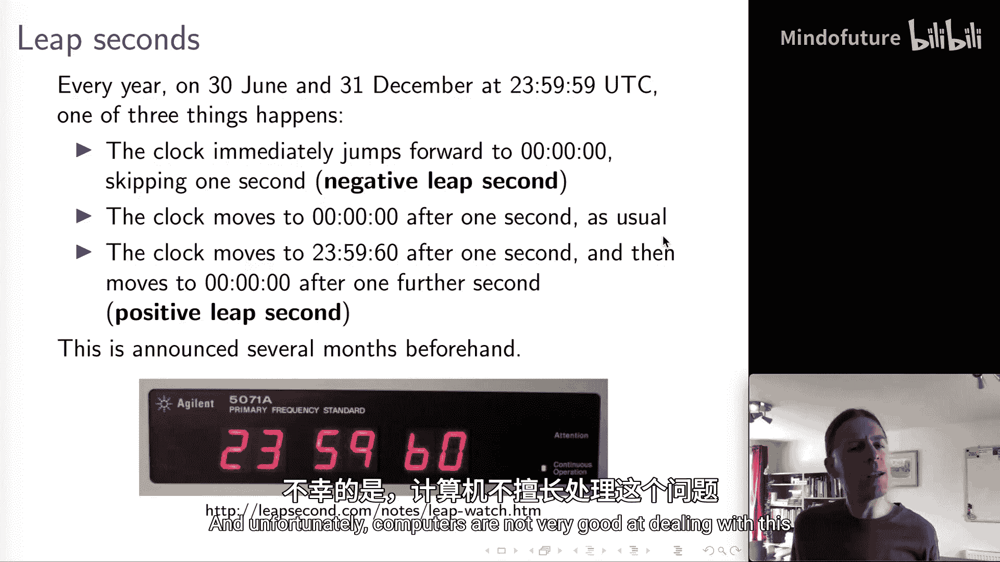
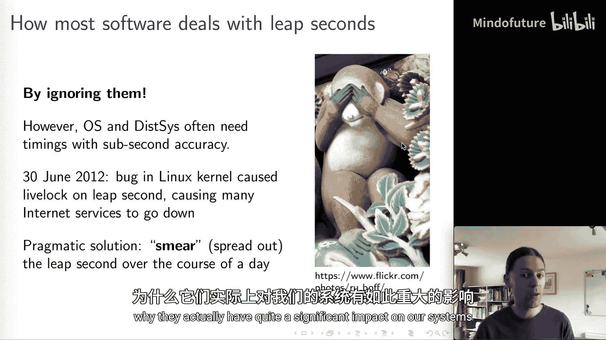

# 分布式系统：第三讲：物理时间 ⏰

在本节课中，我们将要学习分布式系统中的物理时间。我们将探讨时间在计算机系统中的重要性、时钟的工作原理、时间的定义方式，以及一个由时间同步问题引发的真实案例。理解物理时间是理解分布式系统中事件排序和协调的基础。

## 时间在系统中的用途

时间在操作系统和分布式系统中扮演着至关重要的角色。以下是几个关键用途：

*   **调度与超时**：操作系统调度器需要测量时间片（例如10毫秒）来进行进程切换。网络通信中的超时重传机制也需要精确计时。
*   **故障检测**：上节课讨论的故障探测器，依赖于在特定时间段内是否收到响应来判断节点状态。
*   **性能分析**：测量进程运行时间、CPU使用率等性能指标，都离不开精确的时间测量。
*   **日志记录**：在日志文件中记录事件发生的具体日期和时间，例如用户登录时间。
*   **数据库时间戳**：记录数据操作（如用户购买）发生的精确时间点。
*   **数据有效期**：许多数据具有时效性。例如，DNS记录中的**生存时间**字段，允许缓存该记录一段时间（如7000秒），过期后需重新查询以获取最新数据。
*   **安全证书验证**：HTTPS使用的TLS证书有明确的**有效期**。客户端需要知道当前时间，才能验证证书是否在有效期内。
*   **事件排序**：在分布式系统中，确定事件发生的先后顺序是核心挑战之一，时间测量为此提供了基础。

## 时钟的类型与工作原理

在分布式系统中，我们主要区分两种时钟：**物理时钟**和**逻辑时钟**。本节课我们聚焦于物理时钟，它就是我们日常使用的、能告诉我们具体日期和时间的时钟。

需要澄清一个术语：在数字电子学中，“时钟”通常指产生固定频率脉冲的信号。而在分布式系统中，“时钟”指的是一个可以查询**时间戳**的组件，时间戳代表了当前的日期和时间。

### 石英时钟

现代计算机大多使用**石英晶体**来实现时钟。石英是一种压电材料，施加电场会引起机械形变，反之亦然。通过精密切割石英晶体，可以使其以特定频率机械共振，从而产生非常稳定的振荡信号。

石英时钟的精度通常用**百万分率**来衡量。例如，1 ppm的误差意味着每年偏差约32秒。典型的石英时钟误差在几十ppm的量级。然而，石英的共振频率会受温度影响，在高温服务器环境中，时钟速度可能会显著变慢。

### 原子钟与GPS

对于更高精度的需求，可以使用**原子钟**。原子钟基于量子力学原理，利用铯原子特定能级间的跃迁频率（约9,192,631,770 Hz）来定义时间。国际单位制中的“秒”正是基于此定义。

原子钟非常昂贵，但我们可以通过**GPS**系统间接获得高精度时间。GPS卫星搭载原子钟并广播其时间信号。接收器通过计算信号传播时间差来定位，同时也能获得极其精确的时间信息。数据中心常通过在屋顶架设GPS天线来同步时间。

## 时间的定义：UTC与闰秒

我们日常使用的协调世界时**UTC**，是国际参考时间。它的定义融合了两种时间：

1.  **国际原子时**：基于全球数百个原子钟的平均值，极其稳定精确。
2.  **天文时**：基于地球自转观测（如历史上的格林尼治标准时间GMT）。

由于地球自转速度并不恒定（受地震、潮汐等影响），原子时和天文时会产生微小偏差。为了保持UTC与太阳日的同步，引入了**闰秒**机制。

闰秒可能在每年6月30日或12月31日的最后一分钟被插入或删除。例如，在插入闰秒时，时钟会显示 `23:59:59` -> `23:59:60` -> `00:00:00`。

## 计算机中的时间表示与闰秒问题

计算机程序通常使用两种时间格式：

1.  **Unix时间戳**：一个整数，表示从 **Unix纪元**（1970年1月1日）开始所经过的秒数。其标准通常忽略闰秒。
2.  **ISO 8601格式**：人类可读的日期时间格式，如 `2023-10-27T14:30:00Z`。

在两种格式间转换时，需要处理复杂的日历规则（闰年）和**闰秒**。然而，大量软件选择忽略闰秒，这导致了严重问题。

### 案例分析：2012年6月30日的服务器故障

现在，我们可以解答课程开头提出的谜题：为何在2012年6月30日，众多公司的服务器在同一时间宕机？

**答案正是闰秒**。当时，操作系统内核（如Linux）在处理插入的闰秒时出现了Bug，导致系统进入**活锁**状态，CPU占用率达到100%且无法处理任何请求。即使重启服务器也无法解决问题。最终，系统管理员发现需要通过重置系统时钟来清除内核中的错误状态。

这个事件凸显了物理时间同步在分布式系统中的关键性和脆弱性。

### 解决方案：闰秒弥散

鉴于大量遗留软件无法正确处理闰秒，一种实用的解决方案是**闰秒弥散**。其核心思想是：不在某一瞬间插入或删除一整秒，而是在闰秒事件前后的一段时间（例如24小时）内，将时钟速度略微调慢或调快，从而将这一秒的调整“平滑”地分摊掉。

虽然这更像一种“打补丁”式的方案，但在现有软件生态下，它可能是最可行的 pragmatic 选择。

## 总结

本节课我们一起学习了分布式系统中的物理时间。我们了解了时间在系统调度、日志记录、安全验证等方面的重要作用；探讨了石英时钟和原子钟的工作原理及其精度；明确了UTC时间的定义以及令人头疼的闰秒机制。最后，通过2012年的真实故障案例，我们看到了时间同步问题可能带来的严重后果，并了解了“闰秒弥散”这一现实中的应对策略。理解物理时间的特性和局限，是构建健壮分布式系统的重要基础。在下一讲中，我们将探讨不依赖绝对时间的**逻辑时钟**，看看如何仅通过事件间的相对关系来排序。