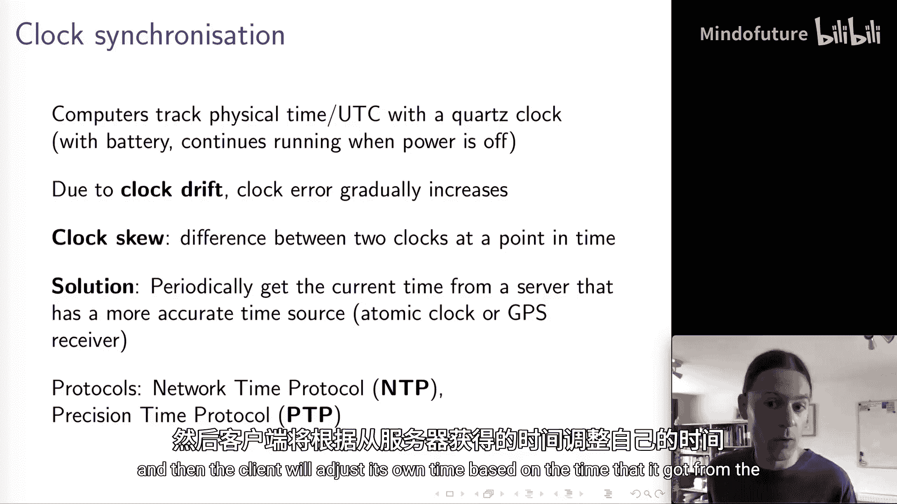
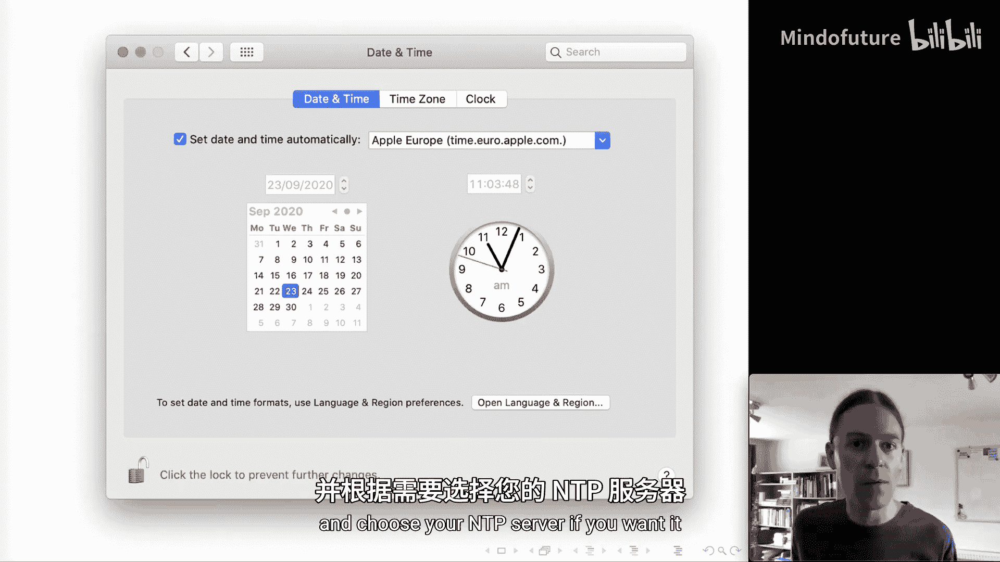
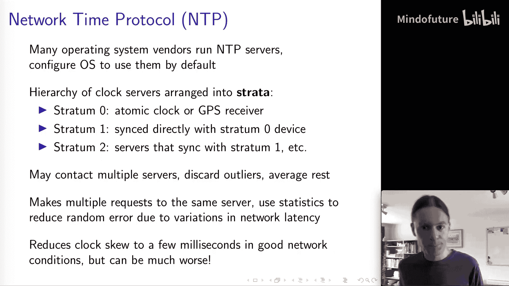
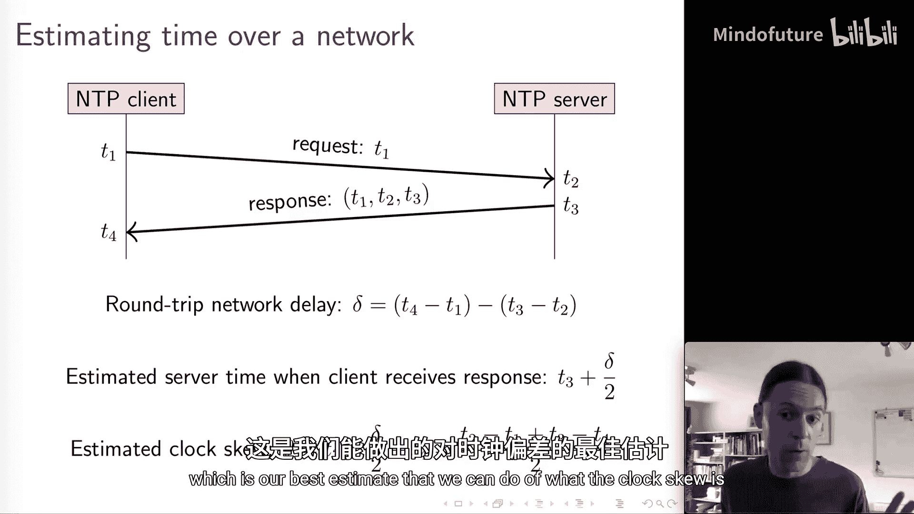
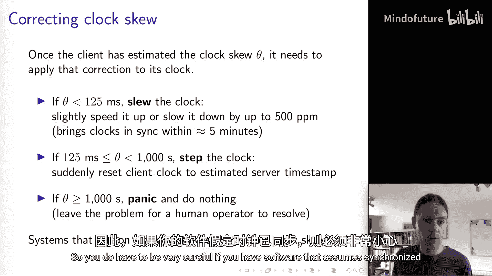
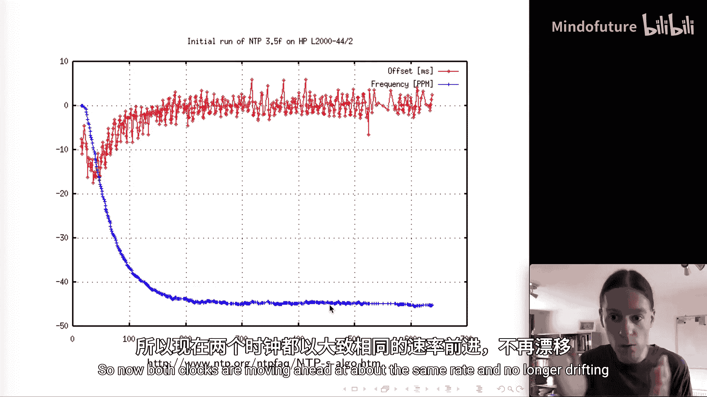
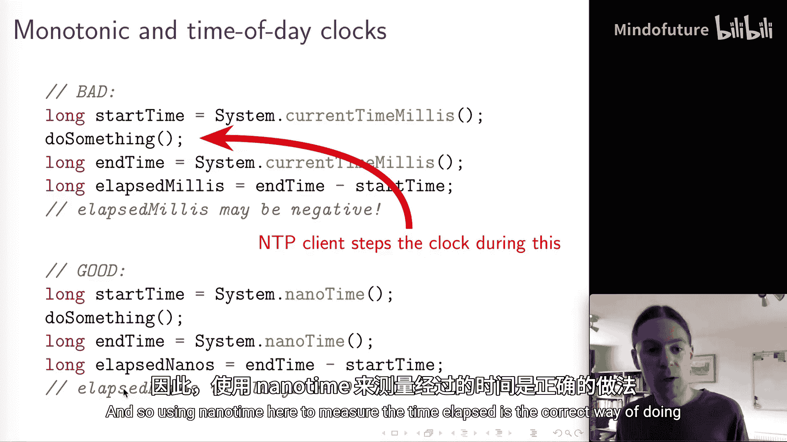
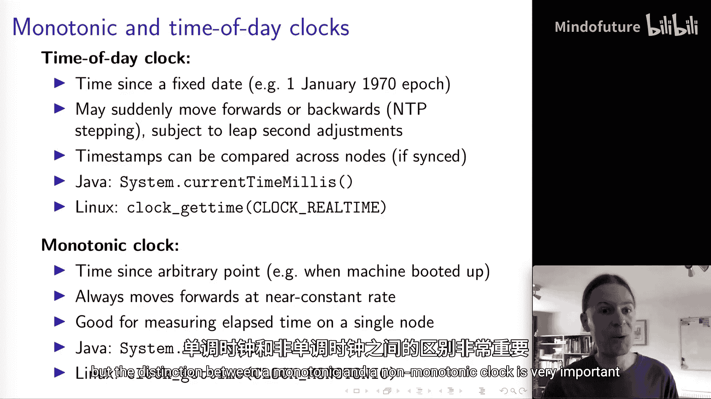

# 【剑桥大学-•-中英】分布式系统讲座-p09-P09-Distributed-Systems-3.2---Clock-synchronisation--BV1NwQhYeEyV_p9-

Next we're going to talk about clock synchronization。

 so we've established every computer pretty much contains a quartz clock。

 not an atomic clock because atomic clocks are too expensive and too bulky。

 so what we need to do is make do with these less accurate quartz clocks and we have to somehow try and make the clocks reasonably accurate。

 nevertheless。So these quartz clocks will drift a little bit because their rate does not match up exactly with what the correct clock tick rate should be。

 and we end up with clock Q So clock Q is if we look at two different clocks at the same instant in time and we compare the timestamps from those clocks clock Q is the difference between those two and what we want to do with clock synchronization is to minimize this queue as much as possible。

Now in the types of networks that we have in asynchronous or partially synchronous networks。

 it is not possible to reduce the clock sked to zero。

 the best we can do is to reduce it as much as we can。

 but there's always going to be a bit of an error tolerance remaining。

Now the way that we typically do clock synchronization in practice is using a protocol called NTP。

 the network time protocol， there's also another protocol called PTP but we won't talk about death in this course。

And the way NTP works is that there's a server， and we assume the server has some accurate clock source。

 such as an atomic clock or GPS receiver， and clients can query a server and ask it for the server's current time。

 And then the client will adjust its own time based on the time that it got from the server。

 So NTP is very widely deployed almost all operating systems that are used nowadays。

 have Ntp built in。 So for example， in Macs， the setting dialogueo looks like this here。

 you can choose the Ntp server here， type in your own In this case I've got time。

 apple co as as my time server。 But most other operating systems will have a very similar looking dialogue where also you can adjust and choose your NTP server if you want。

Now the way that enTpy works。😡，Is that servers are arranged into what are called Strrata。

 so stratum1 is just the accurate time sources that is atomic clocks or GPS receivers Stratum1 is a server that is connected directly to a stratum zero time source。

Statum 2 is a server that is not directly connected to an accurate time source。

 but which gets its time from a stratum 1 server and stratum stratum3 server gets its clock from a stratum 2 server and so on。

 And so there are a whole bunch of statistical techniques and tricks that are used in order to try and improve the quality of our estimates of time。

 So one thing that NTP does is， for example， to query multiple servers if they are available。

 because it could be that one of those server is misconfigured or it's got a fault or something and so it's reporting a wildly inaccurate time。

 And so if you're querying three servers or five servers。

 then you can detail if there's one of the servers， which is a real outlier。

And the other servers are all quite close together in that case NTP can exclude that outlier and just keep the data points from the servers that seem to be reliable。

 Another technique that has used is to query a server not just once but multiple times over the course of several minutes and so that will then ensure that at least any random variations in network delay can hopefully get filtered out Now if there are systematic variations in network delay having multiple samples won't help you but at least multiple samples will reduce the random error and with NTP if you have a good quality network connection。

 it is possible to get your clock synchronized to the server within a couple of milliseconds sw。

If you are on a poor quality network connection over some kind of busy wfi over a heavily loaded internet connection。

 then the accuracy could be much， much worse than that。

 so you always have to be careful when assuming synchronized clocks。

Now。Let's have a look at how NTP estimates the clock queue between the client and the server It works by sending a message over a network again。

 as usual， so we have a request message that could send from the client to the server and as the client is sending this message it records the clock according to the client's timestamp。

 the timestamp T1 which is the timestamp at which the client sent out this message and it copies that timestamp T1 into the request message。

The NTP server， when it receives that message， it will also record the time according to the server's own clock at which it received that timetamp and we'll call that T2 which sorry at which it received that message。

 we'll call that T2。Now the server might take a little bit of time to process the message。

 but eventually the server will reply。And T3 is the timestamp according to the server clock at which the response got sent out。

 So now the response is going to contain all three times stamps so far。

 So T1 simply gets copied from the request over to the response。

 The server doesn't do anything with T1。T2 and T3 came from the server clock as the arrival time and the response time respectively。

 and finally when the response is received by the client。

 the client again records the timestamp according to the client's clock at when that response was received and so we have now four timestamps and from those timestamps we are going to try to work out what the skew is between the two clocks。

So first of all， we can work out how long that the message is spent traveling through the network and we're going to call that the total network delay delta and that time has' got to be t4 minus t1。

 so that is the total time that it spent from the client's point of view from the time it sent a request to the time it received a response minus the time message was spent processing on the server。

 So minus t3-2， which is the processing time on the server and the remaining time has has got to be then the total time that was spent in a network by the response and the request taken together。

 Now what we don't know is the breakdown of those two how much time did the request spent in the network and how much time that the response spent spend in a network。

If you want to work out that oneway network late and see you need synchronized clocks。

 and the whole point of this exercise here is that we don't have a synchronized clock。

 we're trying to build a synchronized clock。😊，So we don't have a way of measuring that one way network latency。

 We can only measure the sum of the two network latencies put together。

 But what we can do is just make an assumption that the network latency is symmetric in both directions。

 So we're going to assume that the request latency is the same as the response latency。

And if this is true， then the response latency will be delta over 2。

 because it's just going to be half the total delay。

 So this means now we can estimate the times stampamp that the server should have at the moment in time when the response is received by the client。

 So from the client's point of view， it's time T4。 But we know that the server sent its response at T3。

 and we're going to estimate that the response spent Delta over to traveling through the network。

 and so we're going to estimate that at the time when the client receives the response。

 the clock under server says T3 plus deta over 2。 That's our estimate of the server's clock。

Now that we have an estimate of the service clock， we can estimate the clockq because we can just take our estimates of the service clock minus t4。

 which is the client's clock and that will give us the instantaneous difference in time between the two clocks at that moment and then if you substitute in Dlta and simplify the expression you get this expression here which is our best estimate we can do of what the clockq is。

Now that we have to skew between the two clocks， the client can correct its own clock and tries to bring it in sync with the server and what the client does in that situation now depends on how big the clock skew is。

So firstly， let's look at a case where the clock queue is fairly small。

 so let's say the is less than 125 milliseconds in this case what the client is going to do is to slightly speed up or slow down its clock as necessary in order to bring it in line with what the surface is and so it's going to change its clock rate at most by 500 pmM。

So at most by half a millisecond per second adjustment。And so over the course of a couple of minutes。

 this means that hopefully the client clock and the server clock will sort of drift together and converge towards the same state。

 and this is called sleing the clock that is the term that NTP uses for this。

If the sw is too big between the client and the server， then then NTP is going to step the clock。

 which means it's simply going to forcibly adjust the clock。

 and so even if if this might mean moving the clock backwards or moving it forward。

 but it's just going to jump right to the time stampamp estimated from the server clock and from then onwards。

 it's going to try and do everything smoothly， but there is this initial discontinuity of time where the client steps its clock。

And finally， it could happen。😊，That NTp decides that Sku between the client and the server is so big that NTp refuses to adjust the clock。

 It just says， no， I'm not going to do anything。 I'm going to assume that something has gone very wrong。

 I don't know if the client's clock is very wrong or a server clock is very wrong。

 but this is just so bad I'm not going to do anything here。

 it's going to leave the adjustment for the human operator to solve。

 So this means now if you do have software that is relying on clocks being synchronized。

 you have to be very careful to actually measure the clock s between the clocks and make sure that it doesn't get too big because it could happen that an Np client ends up in this panic state and just refuses to sync its server to sync its clock with the server。

 And so you've got then an Np client whose clock is way off。

 It might be half an hour or more wrong compared to the server。 and Np is not going to correct it。

 So you do have to be very careful if you have software that assumes synchronized clocks。

This is an example of sleing in action。 So you can see here the red line here is the sw。

 the offset between the two clocks， and it starts off at about 10 milliseconds offset and then the correction gets applied so that it ends up being round about zero clock sw and the blue line is the tick rate at which the client clock is running and so the client here has applied sleing up to about -45 ppm so that means that the quartz crystal in the client must have been a bit fast。

 it was running a bit fast by about 45 ppm and by slowing down the quartz by 45 ppm now the NTp client has brought the tick rate of the client roughly in line with the server。

 So now both clocks are moving ahead at about the same rate and no longer drifting apart。

So this is very nice but。😊，The consequence of NTP is that you have to be very careful when writing certain pieces of code。

So this is a piece of code that is very likely going to occur in all sorts of different software where you have some function that does something。

 do something here and you want to measure how long that function takes to run。

 And so in order to measure that time， you simply take a timestamp from the clock before you start to function and you take another timestamp after you finish the function and then you calculate the difference between the two。

This is an example here in Java， but this could just as well be in any other programming language。

 it's not specific to Java Now what could happen is that NTP decides to step the clock right while youre in the middle of executing this do something function。

And the stepping the clock means that now the times stampamp returned by current time milllies after the the do something is going to be somehow wildly different from what it was before。

 So it could be that the time time the clock was moved backwards。

 in which case this difference in timests could end up being negative and who knows what your software is going to do if it measures a negative amount of time eappsse。

Things could crash or things could go badly wrong in all sorts of interesting ways。

 Also it could be that this number ends up being far too large because if the client NTP client steps the clock forwards in that case now it's going to have in time being much bigger than a much greater timestamp than it ought to be and so the difference will be greater than it ought to be。

So if you want to do this kind of time measurement。

 it is not good to rely on a clock like current time milllies。 Instead。

 what you should do is use a different API。 So Java provides this other function here called system dot nanotime。

And nanotime is designed for this kind of thing。 So there's the superficial difference。

 current time millise uses milliseconds， Natime users nanoseconds。

That's just the superficial difference。 The real difference is that nanotime is what's called a monotonic clock。

 and monotonic clock is one in which NtP stepping will not affect it。

So this clock is not going to suddenly jump forwards or backwards as the name name size as the name says monoonic clock means that it moves forward at a more or less constant rate。

 Sleing will still affect it because that improves the accuracy of the clock。

 but it's not going to suddenly jump with a discontinuity。

 And so using nanotime here to measure the time elapsed is the correct way of doing this。

So this difference between monotonic and time of day clocks is very important。

 so the time of day clock is， for example， the Java's current time milllies。

 which gives you the time elapsed since a fixed reference point in the case of Uni timestamps it's this 1s of January 1970 epoch date。

Whereas a monotonic clock， the value you get back from it is some arbitrary time since， for example。

 this particular computer booted up。 So this means that。

The timetamp by itself doesn't really mean anything。

 You can't send a timestamp over network to another computer and compare those because two different computers will have booted up at different times。

 And so their mono monotonic timestamps are simply not comparable。

 but you can use the monotonic clock for time measurements。

Because if you calculate the difference between two timestamps from a monotonic clock。

 then the time will have moved forward at a near constant rate between those two timestamps。

 And so that's a meaningful measure of time elapsed。

 whereasas if you do that sort of difference with time of day clocks。

 then you are affected by jumping due to NTP， you are also affected by leap seconds。

 potentially which we talked about earlier。 So these are very bad for measuring elapsed time。

But on the other hand， time of day timests， you can compare across different computers。

 if you remember earlier the example I had of the TL S certificate。

 which was valid until a certain date。 If my computer wants to check whether that certificate is still valid。

 Well， it has to have the accurate current date。 Otherwise。

 it's not going to be able to compare the times stampamp in the certificate with the current times stampamp on that computer。

 So in this case， we do have to use a time of day clock and do we do have to synchronize those clocks across multiple machines because otherwise we're won to have accurate timestamps。

So as I said many programming languages and operating systems provide APIs for this in Linux for example。

 there's the clock get time call and you can pass an argument to it set which tells it whether you want the real-time clock which is the time of day clock or you want the monoonic clock but in other languages there will be similar APIs for this you will have to check the API documentation。

 but is important to keep in mind this distinction if you do need to measure times。

 it's not just about the resolution of the clocks but the distinction between a monotonic and non-mononic clock is very important。

