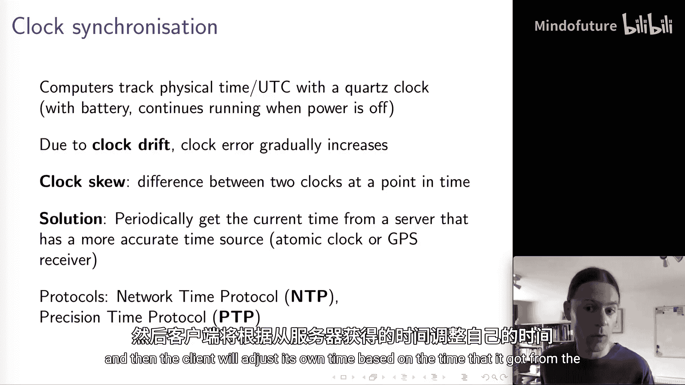
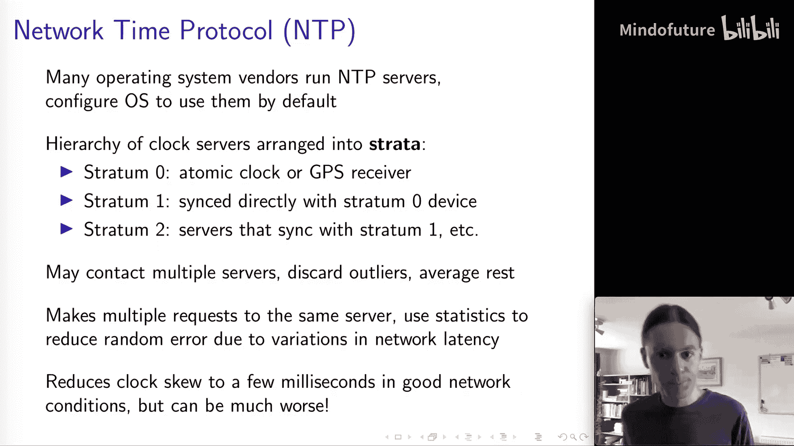
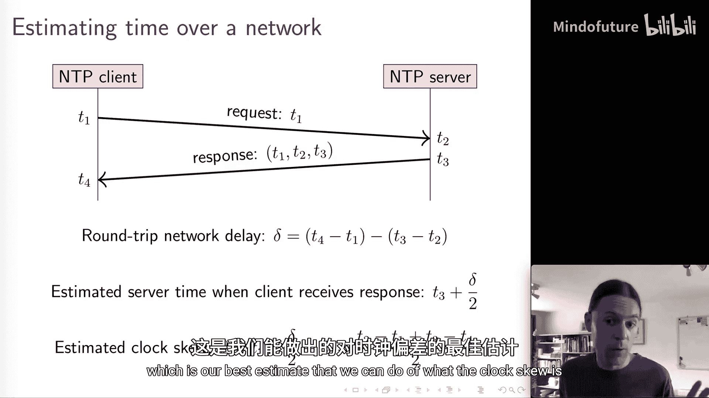
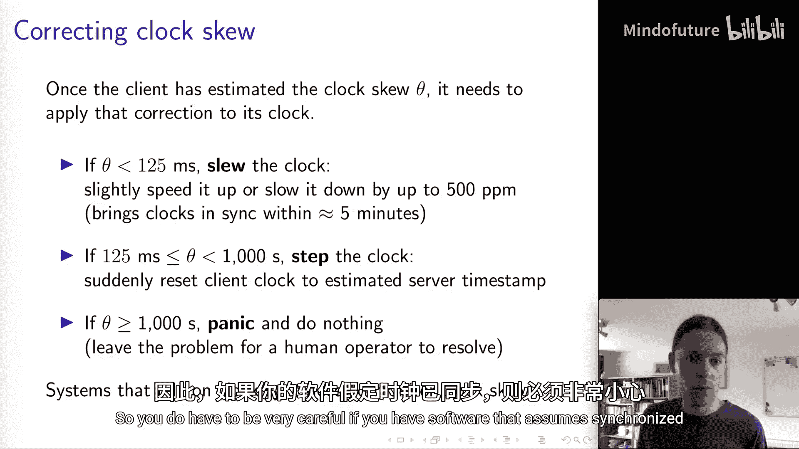
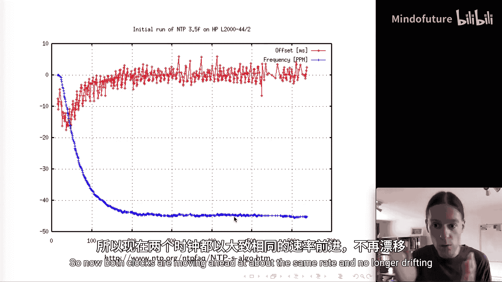
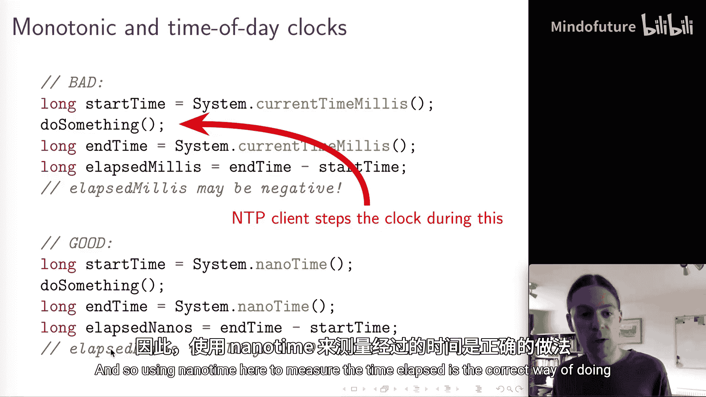
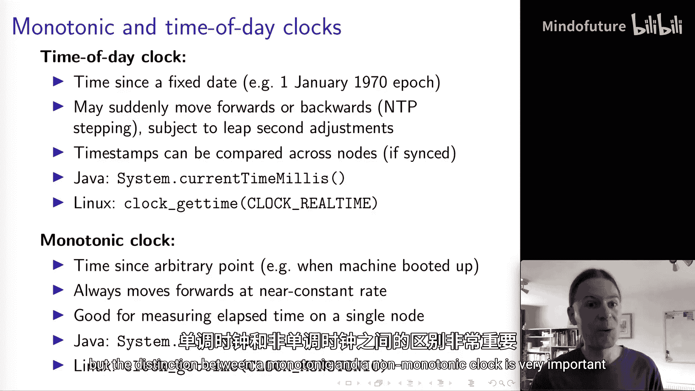

# 分布式系统：3.2：时钟同步 ⏰

在本节课中，我们将要学习分布式系统中的时钟同步。我们将探讨为什么计算机时钟会存在误差，以及如何使用网络时间协议（NTP）来同步不同计算机上的时钟，使其尽可能保持一致。

## 石英时钟与时钟漂移

上一节我们讨论了分布式系统中的时间概念，本节中我们来看看如何让不同计算机的时钟保持一致。




每台计算机内部通常都包含一个石英时钟，而非原子钟，因为原子钟过于昂贵和笨重。因此，我们需要利用这些精度较低的石英时钟，并设法使其达到合理的准确性。

这些石英时钟会产生漂移，因为它们的计时速率与正确的时钟滴答率并不完全匹配。当我们比较同一时刻两个不同时钟的时间戳时，它们之间的差值被称为**时钟偏差**。时钟同步的目标就是尽可能减小这个偏差。

在异步或部分同步网络中，不可能将时钟偏差减小到零。我们所能做的是尽力减小它，但总会存在一定的误差容限。

## 网络时间协议（NTP）简介



为了同步时钟，实践中通常使用一个名为**网络时间协议**的协议。NTP的工作原理是：假设存在一个拥有精确时钟源（如原子钟或GPS接收器）的服务器，客户端可以向服务器查询其当前时间，然后根据从服务器获得的时间来调整自己的时钟。

NTP被广泛部署，几乎所有现代操作系统都内置了NTP客户端。例如，在Mac操作系统中，设置对话框允许用户选择NTP服务器。大多数其他操作系统也有类似的设置界面。

## NTP的层级结构与优化技术

NTP服务器被组织成所谓的**层级**。以下是NTP的层级结构：
*   **层级0**：精确的时间源，如原子钟或GPS接收器。
*   **层级1**：直接连接到层级0时间源的服务器。
*   **层级2**：不直接连接精确时间源，但从层级1服务器获取时间的服务器。
*   **层级3**：从层级2服务器获取时间的服务器，依此类推。

NTP使用多种统计技术和技巧来提高时间估计的质量。以下是其中一些关键方法：
*   **查询多个服务器**：如果可能，NTP会查询多个服务器。这有助于识别因配置错误或故障而报告极不准确时间的服务器，并排除异常值。
*   **多次采样**：NTP会在几分钟内多次查询同一服务器。这有助于过滤掉网络延迟中的随机波动，从而减少随机误差。

通过NTP，在高质量的网络连接下，可以将时钟同步到与服务器相差几毫秒以内。然而，在质量较差的网络连接上，准确性可能会差得多。因此，在假设时钟已同步时，必须非常小心。

## NTP如何估计时钟偏差

现在，让我们看看NTP如何估计客户端与服务器之间的时钟偏差。它通过网络发送消息来工作。

客户端向服务器发送请求消息时，会记录其本地时钟的时间戳 **T1**，并将 **T1** 放入请求消息中。服务器收到消息时，会记录其本地时钟的时间戳 **T2**。服务器处理消息后，会发送回复，并记录发送回复时其本地时钟的时间戳 **T3**。回复消息中包含 **T1**、**T2** 和 **T3**。最后，客户端收到回复时，会记录其本地时钟的时间戳 **T4**。



现在我们有了四个时间戳，可以尝试计算两个时钟之间的偏差。

首先，我们可以计算出消息在网络中传输的总时间，称为总网络延迟 **Δ**。从客户端的角度看，总时间为 **T4 - T1**。减去服务器处理消息的时间 **T3 - T2**，剩余的时间就是请求和响应在网络中花费的总时间。

我们不知道请求和响应各自花费了多少时间。要计算单向网络延迟，需要同步的时钟，而这正是我们试图解决的问题。因此，我们只能测量两个方向网络延迟的总和。

我们假设网络延迟在两个方向上是对称的，即请求延迟等于响应延迟。如果这个假设成立，那么响应延迟就是 **Δ / 2**。

基于此，我们可以估计在客户端收到响应的那一刻，服务器时钟应该显示的时间。从客户端的角度看是 **T4**，但服务器是在 **T3** 时刻发送响应的。我们估计响应花费了 **Δ / 2** 的时间在网络中传输。因此，我们估计当客户端收到响应时，服务器时钟的读数为 **T3 + Δ / 2**。



现在我们有了服务器时钟的估计值，就可以估计时钟偏差了。时钟偏差 **θ** 的估计公式为：
```
θ = (T2 - T1 + T3 - T4) / 2
```
这是我们对时钟偏差的最佳估计。



## 时钟校正策略

在计算出两个时钟之间的偏差后，客户端可以校正自己的时钟，尝试与服务器同步。客户端采取的行动取决于时钟偏差的大小。

以下是NTP的三种校正策略：
*   **偏差较小（例如 < 125毫秒）**：客户端会通过**微调**时钟速率来逐渐对齐服务器时间。它会以每秒最多0.5毫秒的幅度加快或减慢时钟，使两个时钟在几分钟内逐渐收敛。这称为**驯服**时钟。
*   **偏差较大**：NTP会**步进**时钟，即强制将时钟直接调整到估计的服务器时间。这可能导致时钟向前或向后跳跃，造成时间上的不连续性，之后再进行平滑调整。
*   **偏差极大**：NTP会拒绝调整时钟，进入“恐慌”状态，将问题留给人工操作员解决。这意味着如果软件依赖时钟同步，必须主动测量时钟偏差，防止其变得过大，否则NTP客户端可能停止同步，导致时钟严重错误。

## 驯服时钟示例

这是一个驯服时钟的实际例子。图中红线表示两个时钟之间的偏差，开始时大约有10毫秒的偏移。应用校正后，偏差最终趋近于零。蓝线表示客户端时钟的运行速率。客户端通过将时钟速率减慢约45 ppm（百万分之四十五），使其石英晶振的速率与服务器大致对齐，从而两个时钟不再漂移。

## 编程注意事项：单调时钟与挂钟时间



NTP的存在要求我们在编写某些代码时必须非常小心。例如，一个常见的需求是测量某段代码的执行时间。一种直观但错误的方法是使用获取当前日期时间的函数（如Java的 `System.currentTimeMillis()`）在代码段前后取时间戳并计算差值。

问题在于，NTP可能在代码执行期间步进时钟。如果时钟被向后调整，计算出的时间差可能为负值；如果向前调整，时间差可能异常巨大，这可能导致软件崩溃或行为异常。

正确的做法是使用**单调时钟**。例如，Java提供了 `System.nanoTime()` 函数。单调时钟的关键特性是：NTP的步进调整不会影响它。这个时钟只会以大致恒定的速率向前走，不会突然跳跃。因此，使用单调时钟来测量经过的时间才是正确的方法。

单调时钟与挂钟时间（即日期时间）有重要区别：
*   **挂钟时间**：如 `System.currentTimeMillis()`，给出自某个固定参考点（如1970年1月1日）以来的时间。它可以跨计算机比较，用于验证证书有效期等场景，但受NTP步进和闰秒影响，不适合精确测量时间间隔。
*   **单调时钟**：如 `System.nanoTime()`，其返回值是自某个任意点（如计算机启动）以来的时间。时间戳本身没有跨机器的可比性，但用于计算同一台机器上的时间间隔是准确可靠的，因为它不受NTP步进影响。

许多编程语言和操作系统都提供了相应的API。例如，在Linux中，可以使用 `clock_gettime` 调用，并通过参数指定需要的是实时时钟（挂钟时间）还是单调时钟。在编写需要测量时间或依赖时间戳的代码时，理解并正确选择这两种时钟至关重要。



本节课中我们一起学习了时钟同步的重要性、NTP协议的工作原理及其层级结构、时钟偏差的估计算法，以及NTP的三种校正策略。我们还重点区分了单调时钟与挂钟时间在编程中的不同用途，这是构建健壮分布式系统应用的关键知识。