# 【剑桥大学-•-中英】分布式系统讲座-p10-P10-Distributed-Systems-3.3---Causality-and-happens-before--BV1NwQhYeEyV_p10-

In the last part of this lecture， we are going to look at the relative ordering of different messages and different events that can happen in distributed system and how we might use time in this context。

So let's start with an example again， let's start with an example of a discussion thread on the internet and you know one of those typical highbrow discussions where one user says the moon is made of cheese and another user response to them saying no you are wrong so we are going to model this kind of discussion thread here let's say we have user1 sorry user A here who says the moon is made of cheese sends that message M1 two users B and C and we're going to just assume our usual system model of let's say reliable network links but message might be delayed or might be reordered as usual。

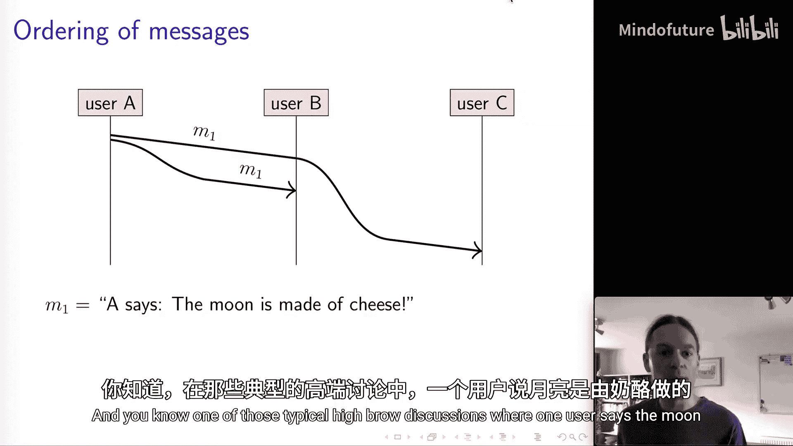

And so it can happen that user B receives message M1 fairly quickly。

 and user C receives that message a little bit later just because it's been delayed a bit in the network。

 That's fine。Now。Then user B responds to message1。 user B receives M1 and says， no。

 the moon is not made of cheese and sends that as message M2 back to user A and also to user C。 Now。

 what can happen is what you see in this diagram here is that user C actually receives M2 before receiving M1。

 And this is kind of confusing because if you imagine user C is looking at this thread。

 user C first Cs。 Oh no it isn't。 And then the moon is made of cheese。 So even though oh， no。

 it isn't really should be a reply to the moon is made of cheese。 we have ended up reordering those。

 And we've got the reply before the thing that is replying to。This is pretty confusing。

 so let's think about how we might be able to formalize this problem and how we can create algorithms that solve this problem。

So。This is based on this idea that one thing happened before another。

 I think we can agree that M1 happened before M2， because if M2 is a response to M1。

 then M1 must have happened first， this' kind of some kind of logical time in the system here。

 But let's see what happens if we attach timestamps to each message。

 So let's say that when user A sends message M1 user A also uses a's local clock to generate a timestamp T1 and attaches that timestamp T1 to the message M1。

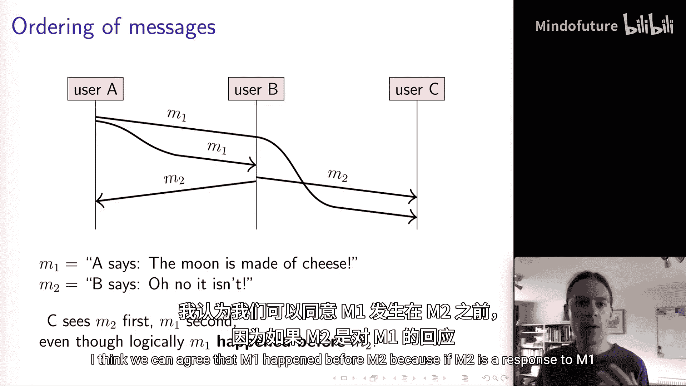

And then also when user B receives M1 and sends M2。

 user B gets a timestamp T2 from B's local clock and attaches that timestamp to the M2 message that is sent to the other two nodes。

AndNow we're going to assume that these are， of course， physical time of day clocks。

 we're going to assume that the clocks are synchronized using something like MTP。But。

It could still happen， even synchronized， if clocks are synchronized。

 it could happen that the timestamp T2 is actually less than the timestamp T1。

This could happen because the clock queue between two nodes in a system might be greater than the oneway network delay between those two nodes and even with NtP synchronization we cannot rule out the possibility that the clock queue is greater than the one way network delay than one way network latency and so in this case here M1 is experiencing some kind of latency but that latency is smaller than the clock queue between users A and B。

 and in that case if users B clock is running slightly behind and A's clock is running slightly fast then you could end up with T2 being less than T1 and so our whole aim of this exercise was to ensure that messages get put in the right order according to time but even using time here we have not actually been able to put the messages in the right order because the timestamp order is inconsistent with our understanding。

Of which messages of reply to which other message？

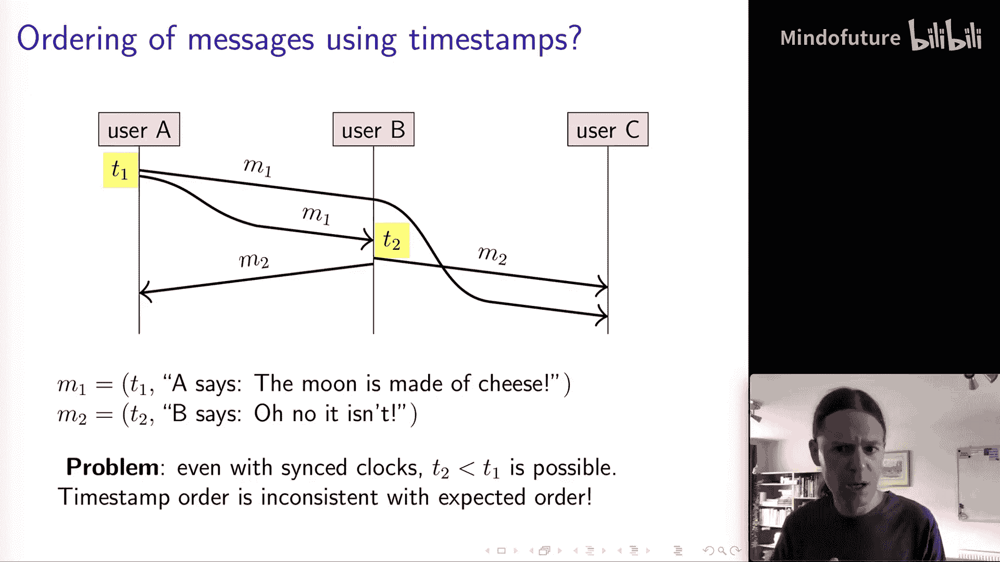

So how do we solve this problem？What we do in distributed systems is we use something called the happensapp before relation。

 and so this is a mathematical model of activity that has happened in a distributed system。

And so when we're talking about activity in a distributed system， first of all。

 we need to define what are the things that happen， so we'll say the things that happen are events。

 an event can be just one process sorry one node in the system making a local execution step。

 one node doing something that can be an event or an event could be a message that one node sends to another so the sending of the message is one event and then the receiving of the message is another event if the message arrives。

 then the receiving would be another event。And so now we can define a relation。

 which is a set of pairs of events。That describes how those events relate to each other and this happens before relation is written as A arrow B if A happened before B。

And we say that A happened before B， if at least one of three things is true。

 So the first thing is that the two events A and B happened in the same node and a occurred before B in that node's local execution order。

 So that means we are here assuming that each node is a single threaded process that is just doing one thing after another。

 So there's no ambiguity about the order in which things happened on a single node。

 if there's a single thread， then things only happened one after another。

 and we can define exactly which thing happened first and which happened second。

 So we're going to assume that for each node， there's a strict total order of all of the events that happened on that particular node。

If we did wanted to support multi threaded processes。

 then we could have each thread being a separate node for the purposes of this model here。

 so we can just assume single threads for now。And and so we're going to say that A happened before B。

 if they happened on the same node and they were executed， a was executed before B， that makes sense。

Secondly， we're going to say that A happened before B if。

A is the event that a certain message M was sent， and B is the event that that this same message was received。

So for the purpose of making this unambiguous， we have to assume that messages are unique because otherwise you could have two different events for descend sendinging of the same message。

 which of course could happen in a real system but it makes the thing difficult to model mathematically so for simplicityimp's sake here we just assume that every message that is sent is unique and if we wanted to actually make message unique in practice we could attach some kind of sequence number and the id of the node that sent a message。

 for example， we could attach that to every message。

we could pick a long random number for every message and that would be sufficient to make every message unique。

And so this， again， this happens before relationship makes sense because a message can only be received after it has been sent。

 and so it makes sense for the sending of that particular message to happen before the receipt of that message okay。

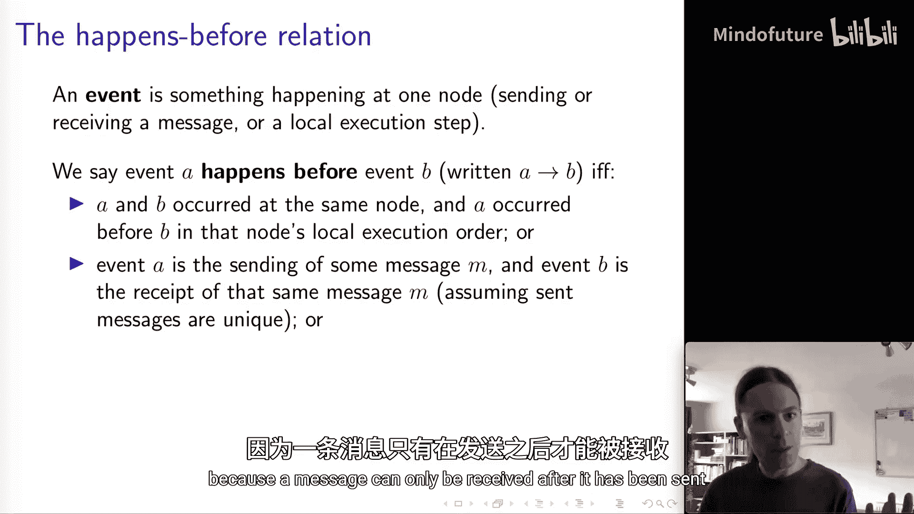

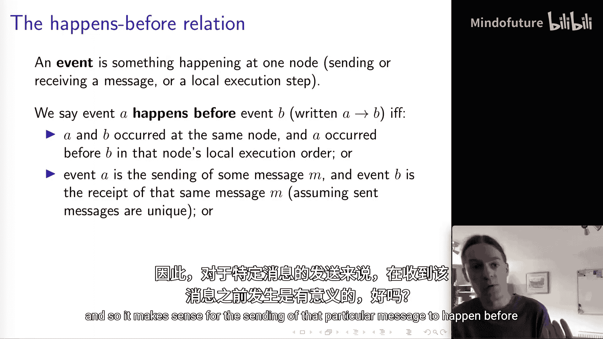

So those are the first two clauses of happens before。

 The third is simply if we can find some event C， such that A happened before C and C happened before B。

 then it must also be the case that a happened before B。

 So this is simply taking the transitive closure of the first two points and extending the whole thing into what is called a partial order。

 So a partial order is it， it behaves a bit like a a less than relationship between two things。

 So it allows you to compare two things and say which one happened first。 But there might be some。

 some things that are incomparable， according to this order， where we simply。

 it is not the case that a happened before B or B happened before A， The two are simply unrelated。

 It is not the case that either one happened before the other。 And in that case。

 we say that A and B are concurrent。 And we write it with this little double bar is parallel sign here。

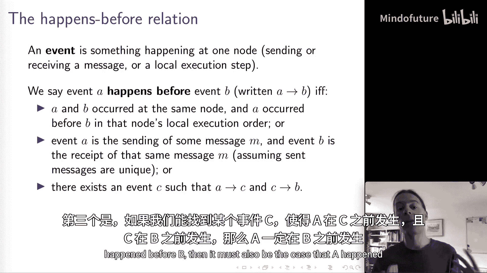

So this is interesting here now for any two events A and B。

 it turns out that there are only three possibilities。

 either A happened before B or B happened before A or the two are concurrent and one of the exercises in the notes asks you to actually prove the fact that these are exactly the three possibilities that can happen。

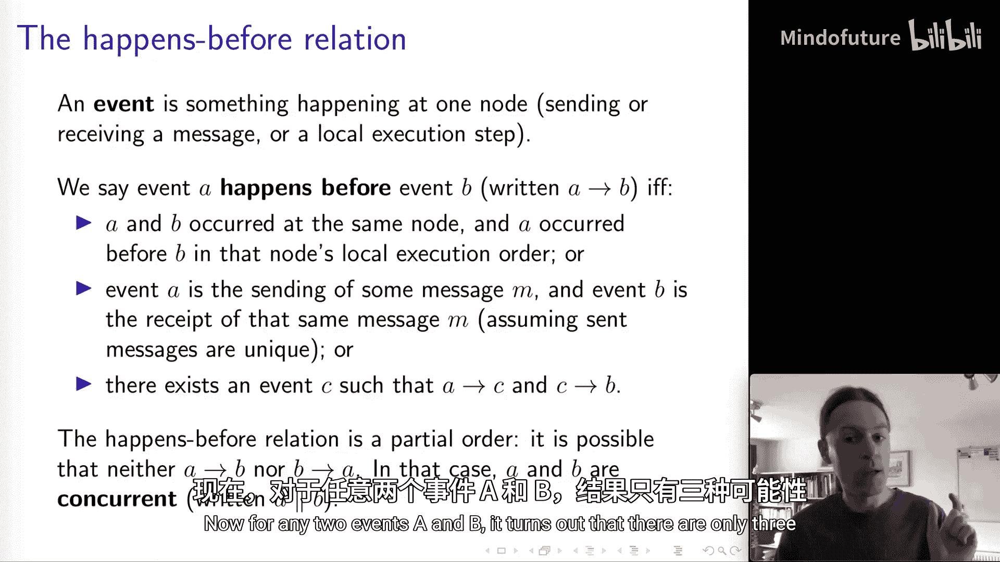

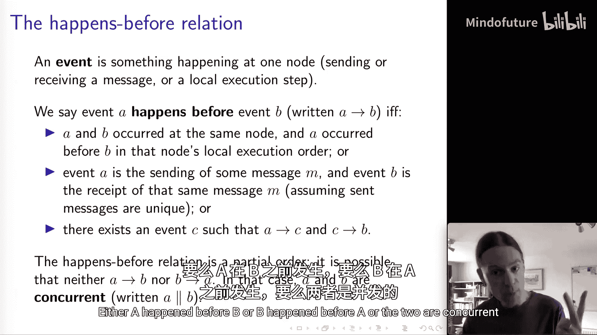

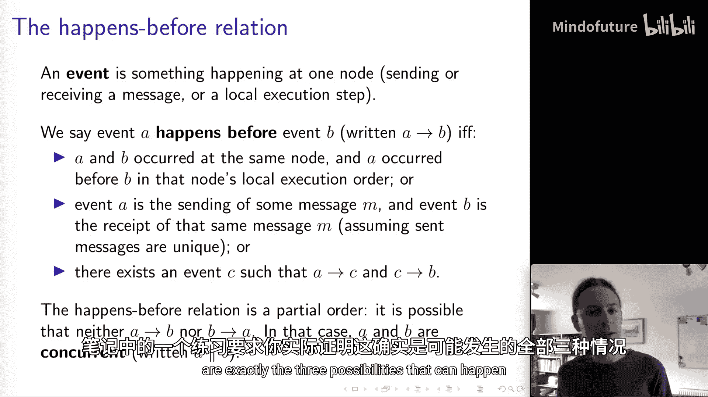

So let's look at an example of that happens before relationship。😊。

So here we've got events are represented as these little black blobs and messages are sent of the network with these arrows as usual。

 and we've got three nodes here and so we're going to build up the happens before relationship from the individual clauses and so firstly due to the order of events happening in a particular node well here node a executed A before B therefore a happened before B。

Notode B executed C before D， so therefore C happened before D and node C executed E before F。

 so therefore E happened before F， okay， so far so clear。Secondly。

 now due to messages sent and received。The sending of a message happens before the receipt of that message。

 so therefore B happens before C， because that is message M1 travelling over the network and also D happens before F because that is messaging message2 traveling over the network。

So now we've got all of these relationships between some of the events。

 now we extend this whole thing with the transitive closure and so due to the transitive closure。

 for example， A happened before C and A happened before D。

 essentially what you can imagine here is we can take a path through this graph you can imagine any path that moves forward in time on a node or that moves from descend sending of a message to the receipt of that message and then move through other nodes and you can take any path through this graph as long as you are always moving forward in time。

 then you will get from any a that happened before any other event。

 and so here for example you can get from a all the way to F A happened before F because you can go from a to F by traversing these to message sends。

But for example， you cannot get from A to E because going from A to E would require going backwards in the node order of C。

 and that would not be allowed。 And so that means that for example， A and E are concurrent。

 So A did not happen before E E did not happen before A the two are simply concurrent。

 which means they are independent one event did not know about the other when it happened。

 concurrent does not literally mean simultaneous。 It doesn't mean happened literally at the same instant in time。

 It just means the two events did not know about each other when they occurred。 And so therefore。

 A is concurrent with E B is concurrently all A BC and D， they are all concurrent to E。

 but E and F are not concurrent， of course， because of the order of on on C on user C。

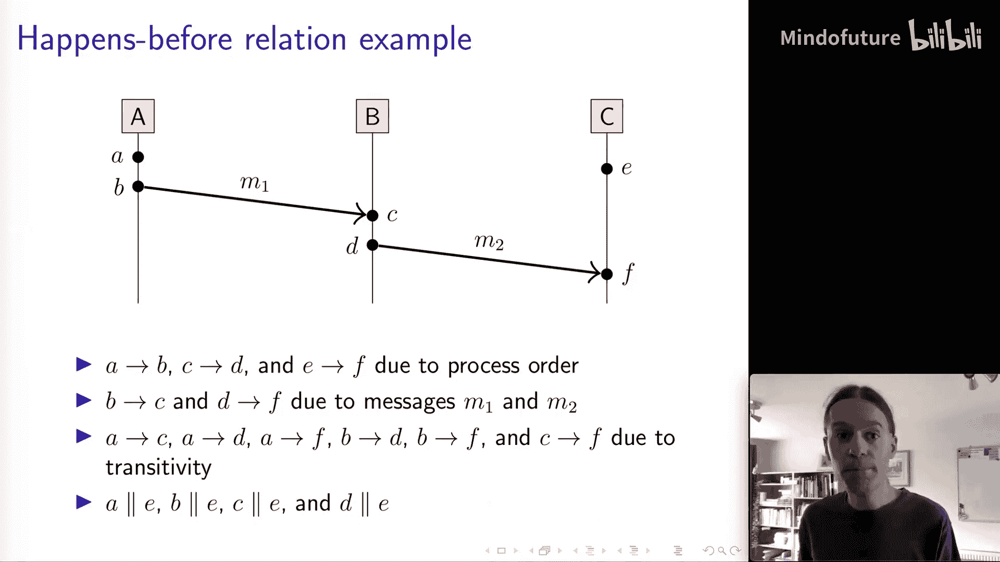

So that's what happens before relation and that happens before relation is very closely connected to the concept of causality in distributed systems in particular。

 if A happened before B， then it might be the case that a caused B or a influenced B in some way So there's some information flow that has happened from A to B whereas if the events A and B are concurrent。

 we know that a cannot have caused B and B cannot have caused a there's no causal relationship between the two So this concept of causality is actually taken from physics where typically people reason about events that happen far apart in space and the distance and time that it takes the speed of light to travel between those things。

 So if you have two events happening on different planets say or even in different galaxies。

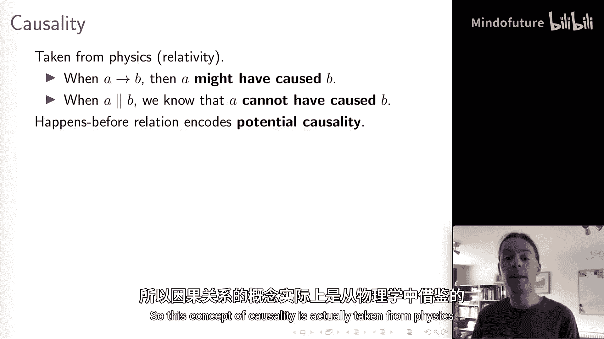

And so they are very far apart in space， but you could have those events happening around about the same time。

 They don't have to be exactly at the same time， but they're happening fairly close together in time。

 but fairly far apart in space。 then we can draw this spacetime diagram here so we can draw this diagram where imagine that you send out a beam of light from event A at the time when event A occurs and you send it out in all directions。

 And so then as time goes here downwards and space is from left to right So this time sorry this light just spreads through space at the speed of light。

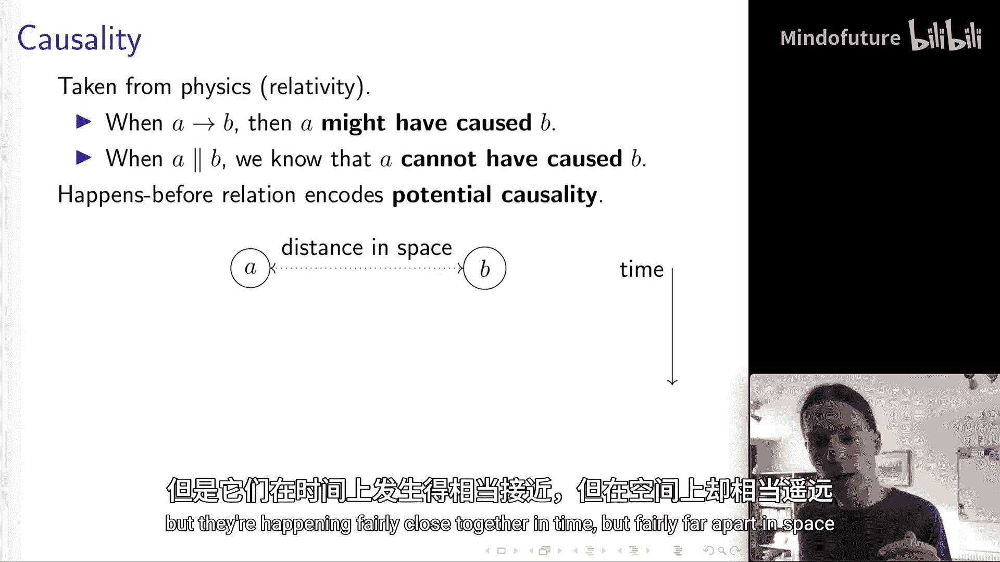

And any event that happens within this cone here with it， this is called a light cone。

That event might somehow be dependent on a， but you can see B here is way outside of the light cone of a and also a is outside of the light cone of B。

 so the information from from B at the time when B occurred could not possibly have got to A by the time A happened and likewise the information when a happened could not possibly have got to B by the time B happened simply because that would have required information to travel faster than the speed of light and we as far as we know in our universe。

 it is not possible for information to travel faster than the speed of light。

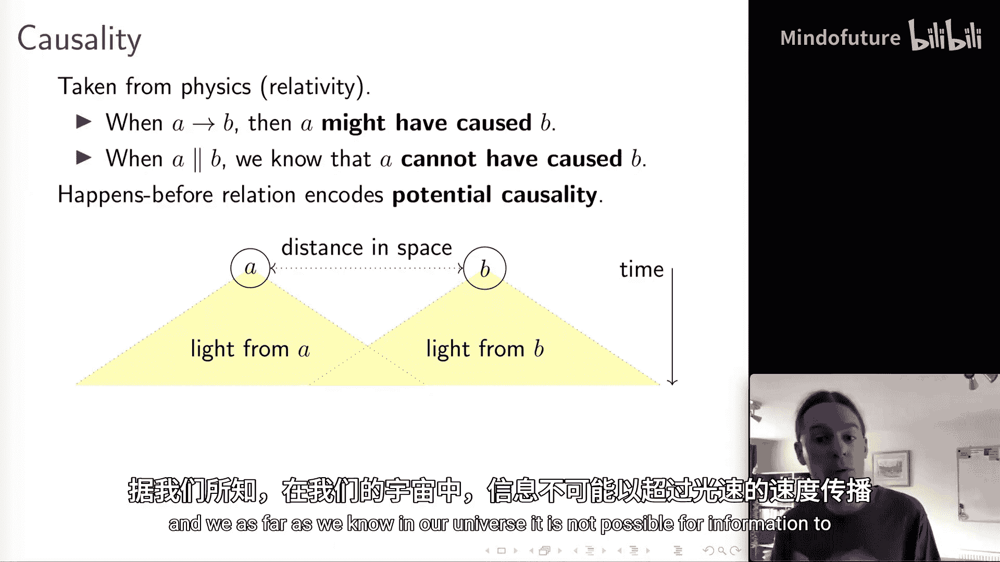

So this event C here， for example， that could be influenced by A or B。

 but B and A cannot influence each other。

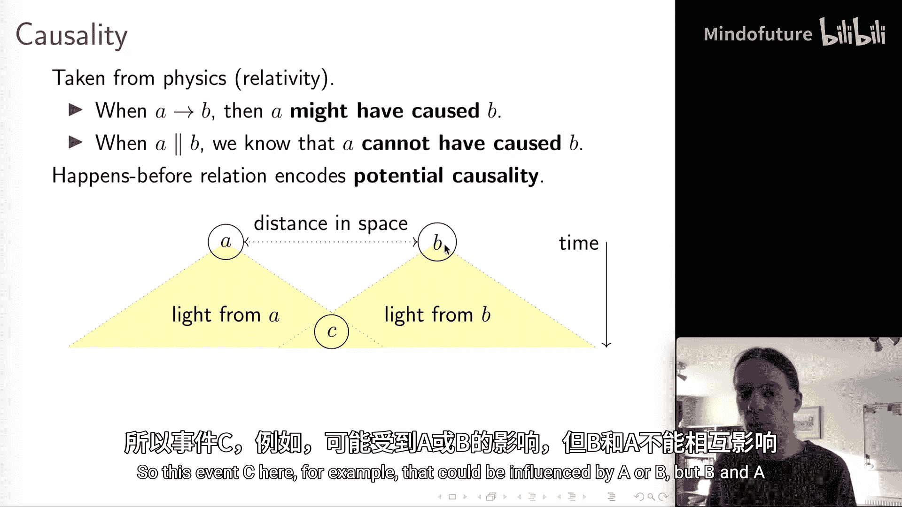

And so this concept from physics is very closely related to what we have in distributed systems。

 in distributed systems which typically talk about messages flowing over a network rather than light traveling through the universe。

 but essentially it's the same idea its reasoning about which events could possibly have affected each other。

😊，And once we have got this potential causality and this happens before relationship。

We can now order events。And so remember in our case of first。

 the moon is made of cheese and then the reply to it， oh， no， it's not。

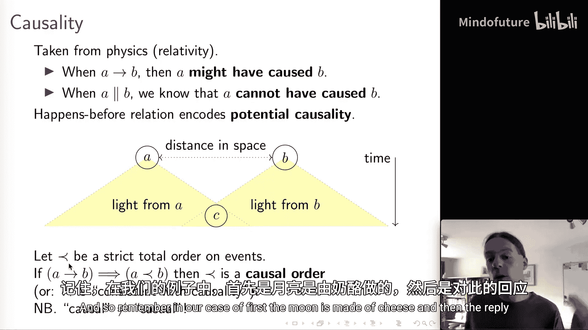

What we want is for the moon is made of cheese to come first in this order of the conversation thread and then the reply to come second in that order and here because we have a causal relationship between M1 which is the moon is made of cheese。

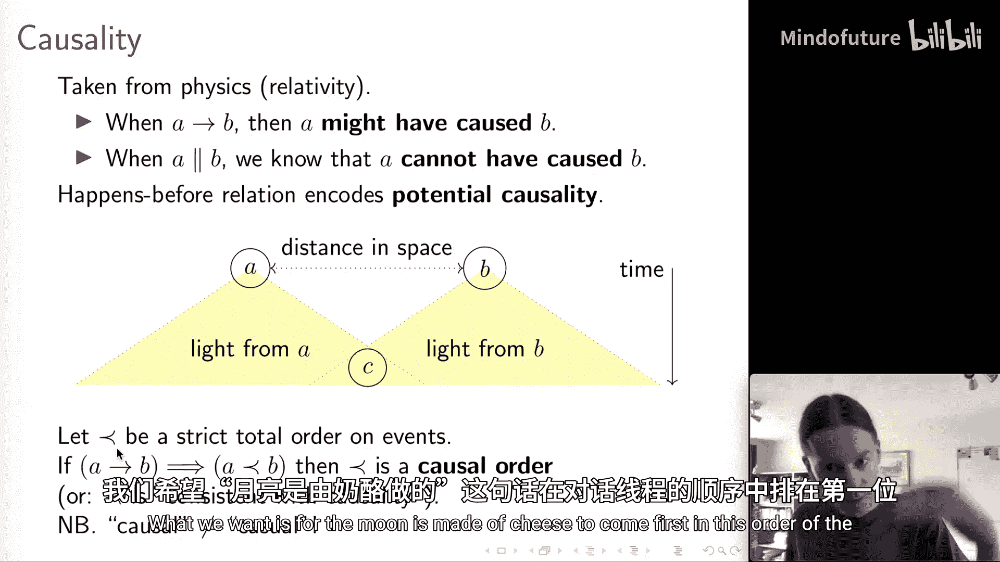

And M2， which is the reply to M1。 So there's a causal relationship between the two。

 And so therefore A happened before B， the message1 happened before message 2。What we want is that。

Any order that we put the messages into should be consistent with that。

 So whenever a happened before B， then a occurs before B in that causal order。

 this is called a causal order。 That is it's a way of putting the events in the system into an order in such a way that they are consistent with causality。

 That is if one thing happened before another thing then they appear in the correct order。

 but if two things are concurrent， then they could appear in either order。

 because you know one could have happened before the other。

 there's no real way of saying which one happened first。

 So in that case they could be ordered arbitrarily。

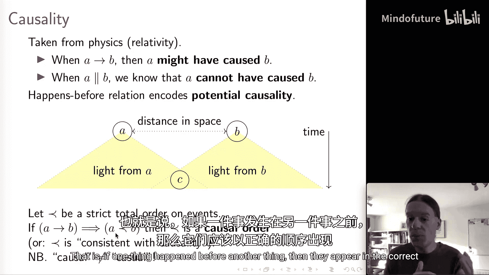

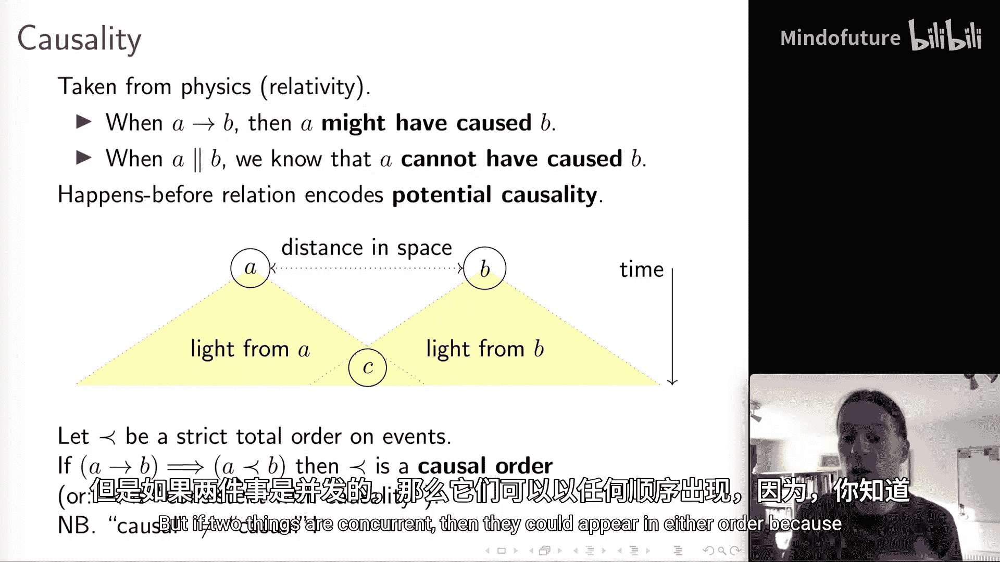

So this is a very useful concept。 And we're going to use this in the next lecture when it comes to building upon this idea of the happens before relationship and making some actual distributed algorithms that implement this。

 The last thing I will just point out is it's very easy to confuse the word causal with the word casual because just two letters are swept around。

 I keep having to double check it myself as well。 So just that as a little detail to watch out for if you're writing about distributed systems。

 you probably mean causal， not casual。😊。

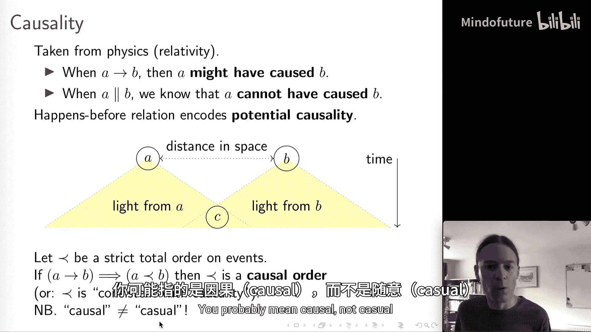

So see you next time。