# 分布式系统讲座：P10：因果关系与“先于发生”关系

在本节课中，我们将学习分布式系统中不同消息和事件的相对顺序，以及如何在此背景下理解和使用“时间”的概念。

## 概述

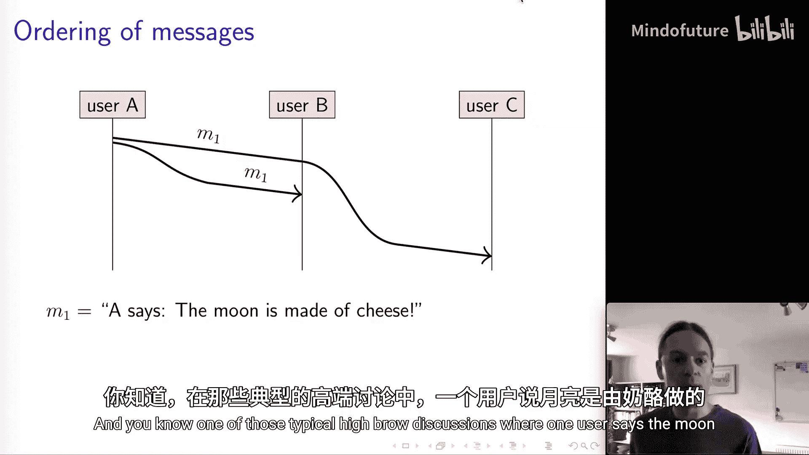

上一节我们讨论了分布式系统中的时间问题。本节中，我们将探讨一个核心概念：“先于发生”关系。这是一种不依赖物理时钟，而是基于事件间逻辑因果关系来定义顺序的数学方法。我们将通过一个例子开始，理解为什么需要这个概念，然后学习其形式化定义，并探讨它与物理学中因果关系的联系。

## 从一个例子开始

让我们从一个互联网讨论帖的例子开始。假设用户A发送了一条消息M1：“月亮是奶酪做的”，给用户B和C。我们假设网络链路可靠，但消息可能被延迟或乱序。

用户B可能很快收到M1，而用户C由于网络延迟稍晚收到。这很正常。接着，用户B回复M1，发送消息M2：“不，月亮不是奶酪做的”，给用户A和C。

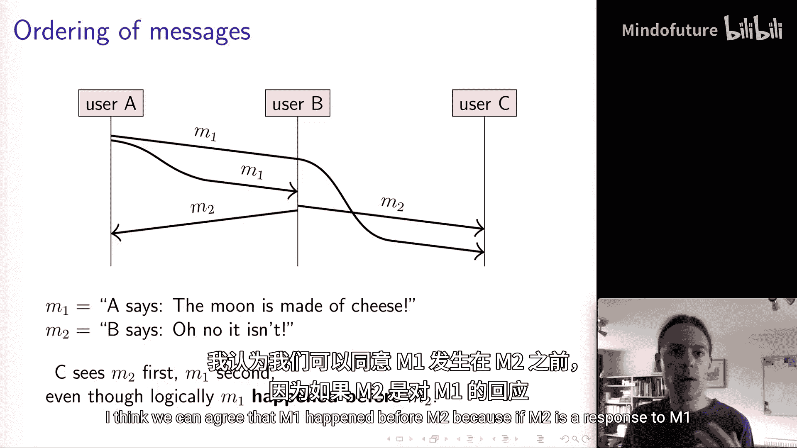

现在可能出现图中所示的情况：用户C在收到M1之前先收到了M2。这会造成困惑：用户C先看到回复“不，月亮不是奶酪做的”，然后才看到原始论点“月亮是奶酪做的”。尽管M2本应是M1的回复，但它们的顺序被颠倒了。

这显然是个问题。我们需要思考如何形式化地描述这个问题，并创建算法来解决它。

## 物理时间戳的局限性

我们可能会想到为每条消息附加时间戳。假设用户A在发送M1时，用其本地时钟生成时间戳T1并附加到消息上。用户B在发送M2时，用其本地时钟生成时间戳T2。

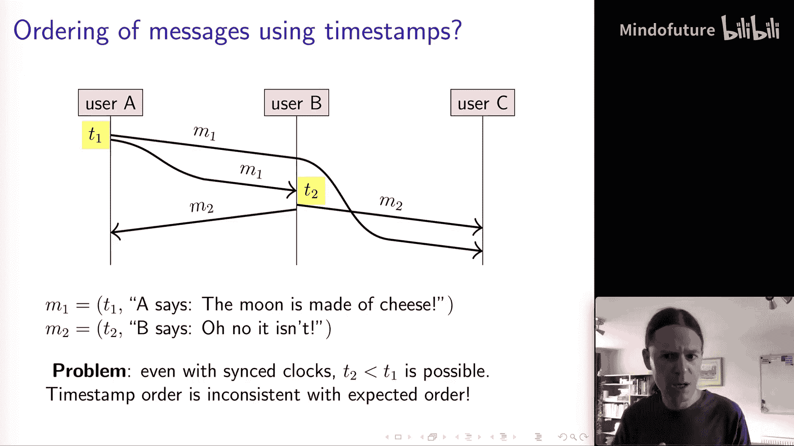

即使我们使用类似NTP的协议同步了时钟，仍然可能发生T2 < T1的情况。这是因为系统中两个节点间的时钟偏差可能大于它们之间的单向网络延迟。即使时钟同步，也无法完全排除时钟偏差大于网络延迟的可能性。

在这种情况下，M1的延迟小于A和B之间的时钟偏差。如果B的时钟稍慢，而A的时钟稍快，就可能导致T2小于T1。我们使用时间戳的目的是确保消息按正确的时间顺序排列，但即使使用了时间戳，我们仍可能得到与逻辑因果关系不一致的顺序。

那么，我们如何解决这个问题呢？

## “先于发生”关系

在分布式系统中，我们使用一种称为“先于发生”关系的数学模型来描述系统中的活动顺序。

首先，我们需要定义系统中发生的事情，我们称之为**事件**。一个事件可以是：
*   一个节点执行的一个本地步骤。
*   一个节点发送一条消息（发送事件）。
*   一个节点接收一条消息（接收事件）。

“先于发生”关系是一个事件对的集合，描述事件间如何关联。如果事件A先于事件B发生，我们写作 **A → B**。

我们说 **A → B** 成立，当且仅当满足以下三个条件之一：

1.  **同一节点上的顺序**：事件A和B发生在同一个节点上，并且在该节点的本地执行顺序中，A在B之前执行。我们假设每个节点是单线程的，因此单个节点上的事件顺序是明确的总序。
2.  **消息的发送与接收**：事件A是发送某条**唯一**消息M的事件，事件B是接收同一条消息M的事件。为确保唯一性，实践中可以为每条消息附加发送者ID和序列号或一个长随机数。
3.  **传递性**：如果存在某个事件C，使得 **A → C** 且 **C → B**，那么 **A → B** 也成立。这实质上是前两点的传递闭包，将关系扩展为一个**偏序**。

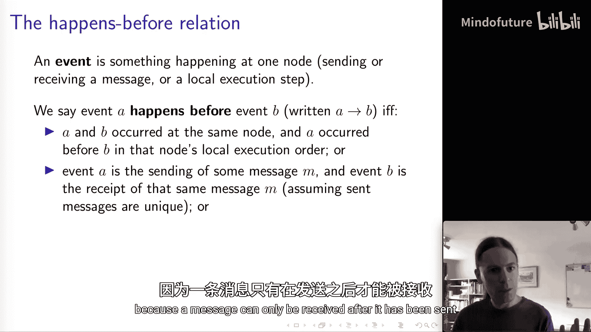
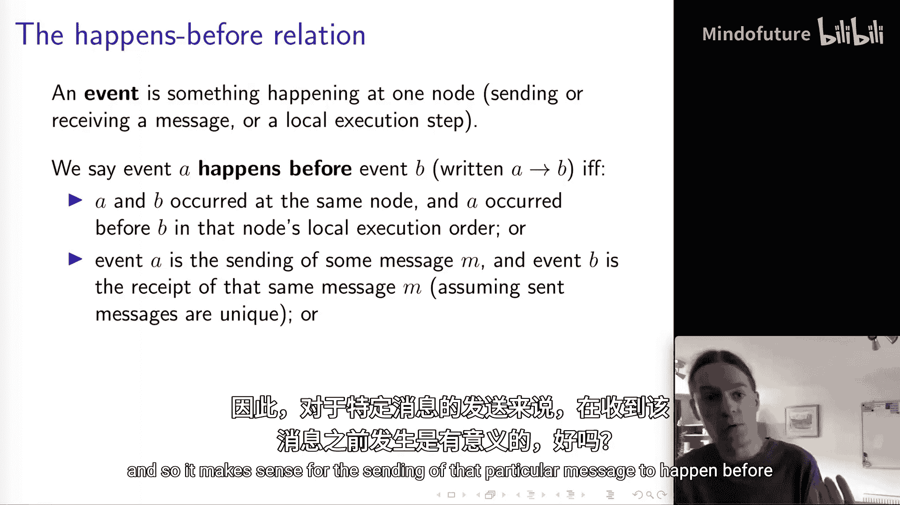

偏序类似于“小于”关系，它允许我们比较两个事件并确定谁先发生。但也可能存在一些事件是**不可比较**的，即既不是 **A → B**，也不是 **B → A**。在这种情况下，我们称事件A和B是**并发的**，记作 **A || B**。

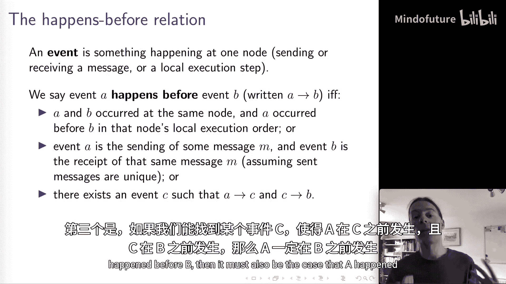

对于任意两个事件A和B，只有三种可能性：
*   A → B
*   B → A
*   A || B

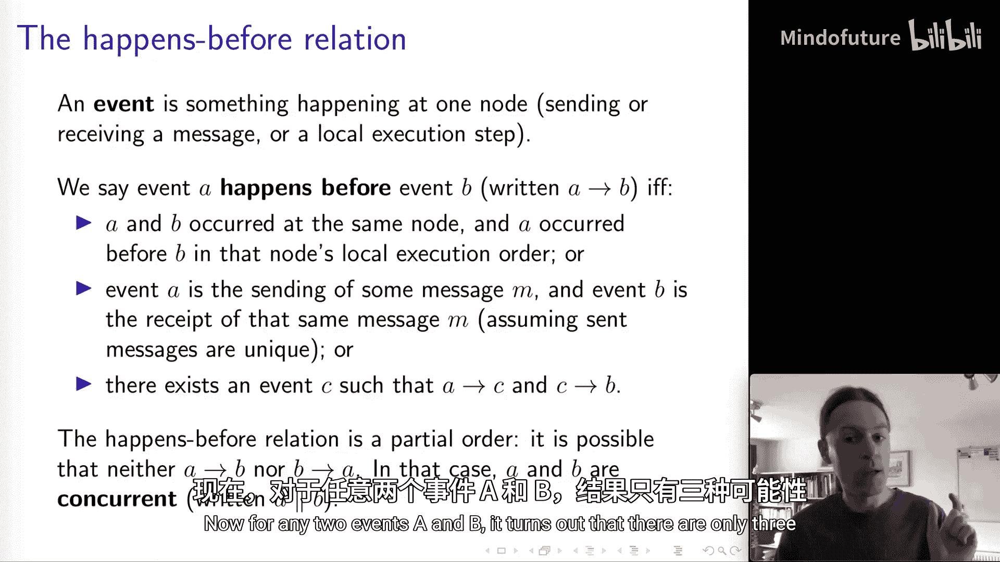
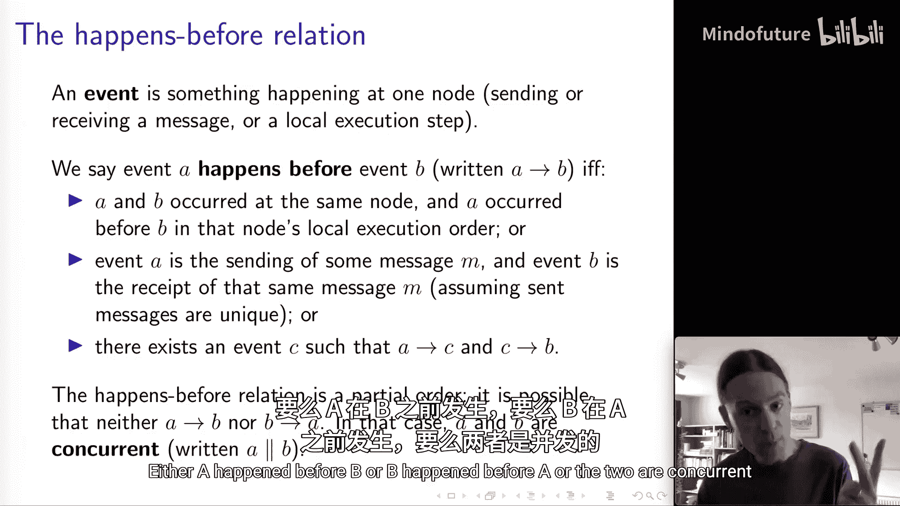
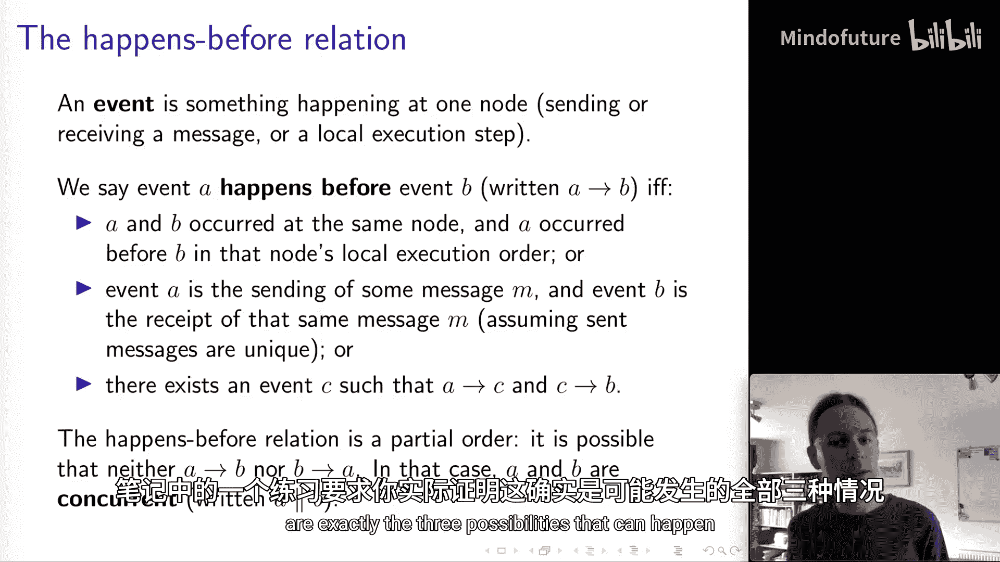

## 关系示例

让我们看一个“先于发生”关系的例子。图中事件用黑点表示，消息通过网络箭头传递。

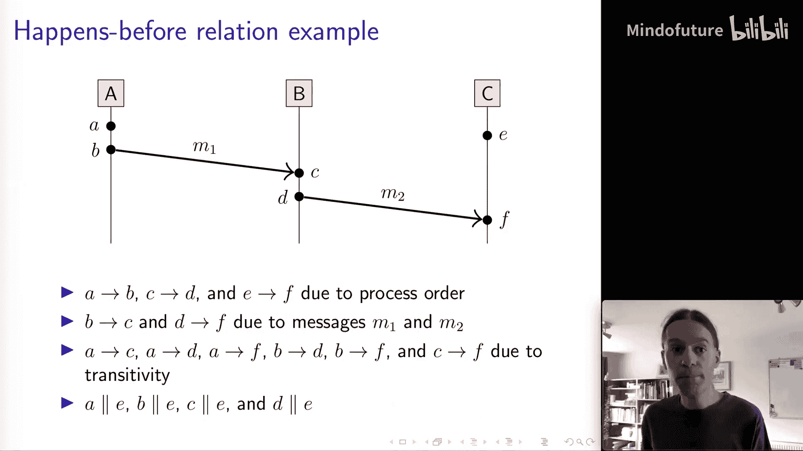

根据定义：
*   **同一节点顺序**：在节点A上，a在b之前执行，所以 **a → b**。同理，**c → d**, **e → f**。
*   **消息发送与接收**：消息M1的发送(b)先于其接收(c)，所以 **b → c**。消息M2的发送(d)先于其接收(f)，所以 **d → f**。
*   **传递性**：利用传递性，我们可以推导出更多关系。例如，因为 **a → b** 且 **b → c**，所以 **a → c**。进一步，因为 **a → c** 且 **c → d**，所以 **a → d**。最终，我们可以得到 **a → f**。

然而，我们无法从a到达e，因为那需要在节点C上逆时间方向移动（从f到e），这是不允许的。因此，**a** 和 **e** 是并发的 (**a || e**)。同样，**b, c, d** 都与 **e** 并发。

**并发并不意味着同时发生**，它只意味着两个事件发生时彼此不知道对方的存在，它们之间没有信息流动。

## 与因果关系的联系

“先于发生”关系与分布式系统中的**因果关系**概念紧密相连。如果 **A → B**，那么A可能以某种方式导致或影响了B，即存在从A到B的信息流。反之，如果 **A || B**，那么我们知道A不可能导致B，B也不可能导致A，两者之间没有因果关系。

这个概念源自物理学。考虑发生在空间上相距很远、时间上接近的两个事件。我们可以绘制一个时空图。

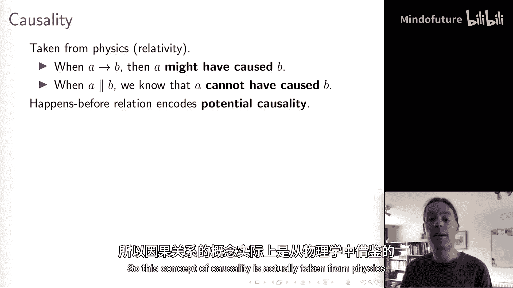

假设从事件A发生时，向所有方向发出一束光（信息），它以光速传播。

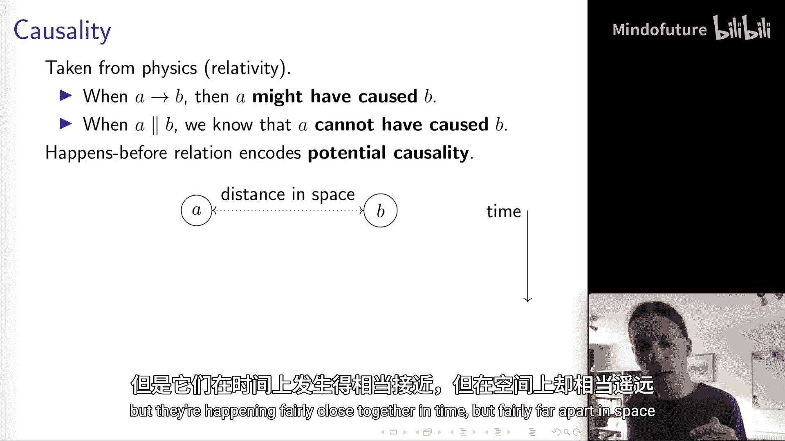

发生在A的**光锥**（图中锥形区域）内的事件可能受到A的影响。但事件B位于A的光锥之外，同时A也位于B的光锥之外。

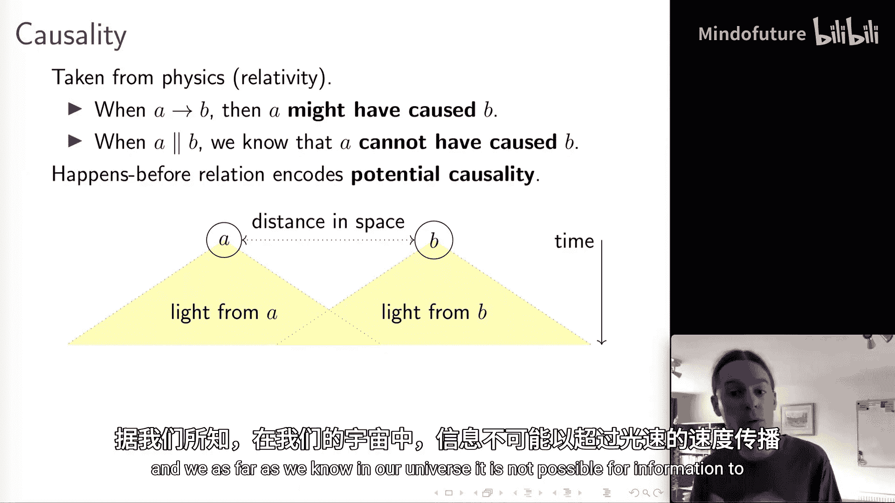

这意味着在B发生时，来自A的信息不可能到达B（反之亦然），因为这要求信息传播速度超过光速。因此，A和B没有因果关系，它们是并发的。而事件C则可能受到A或B的影响。

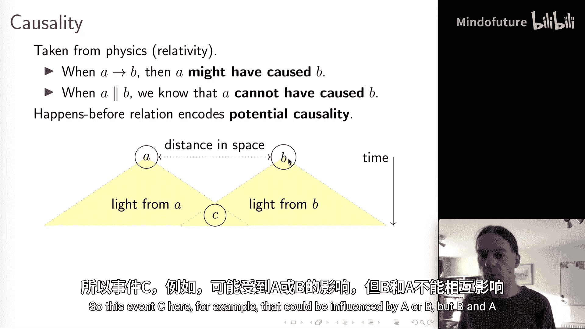

分布式系统中的“先于发生”关系与此类似，只不过信息是通过网络消息而非光来传播。其核心思想都是推理哪些事件可能相互影响。

## 因果顺序

回到我们最初的例子，我们希望“月亮是奶酪做的”(M1) 在对话线程中排在前面，而其回复(M2)排在后面。

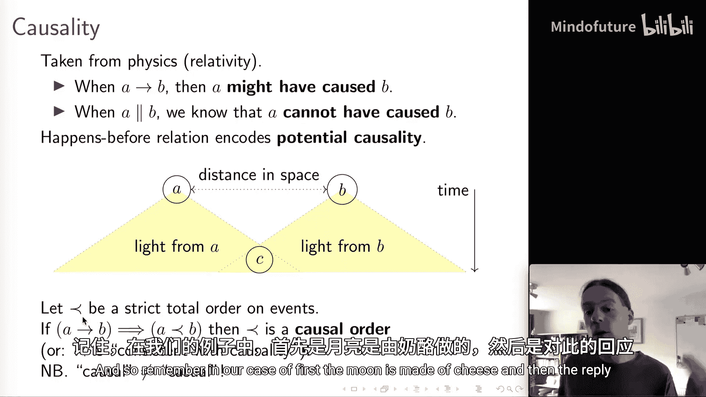

由于M1和M2之间存在因果关系（M1 → M2），我们希望任何对消息的排序都**与因果关系一致**。

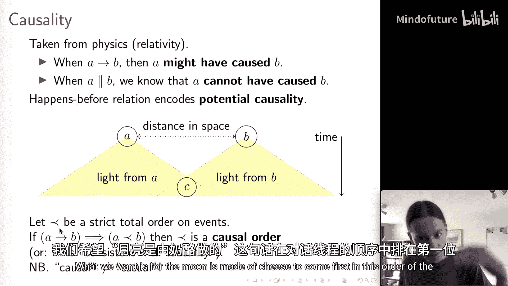

这种排序称为**因果顺序**。它是一种将系统事件排序的方式，要求如果 **A → B**，那么在排序中A必须出现在B之前。对于并发的事件（**A || B**），它们可以以任意顺序出现，因为没有确定的先后关系。

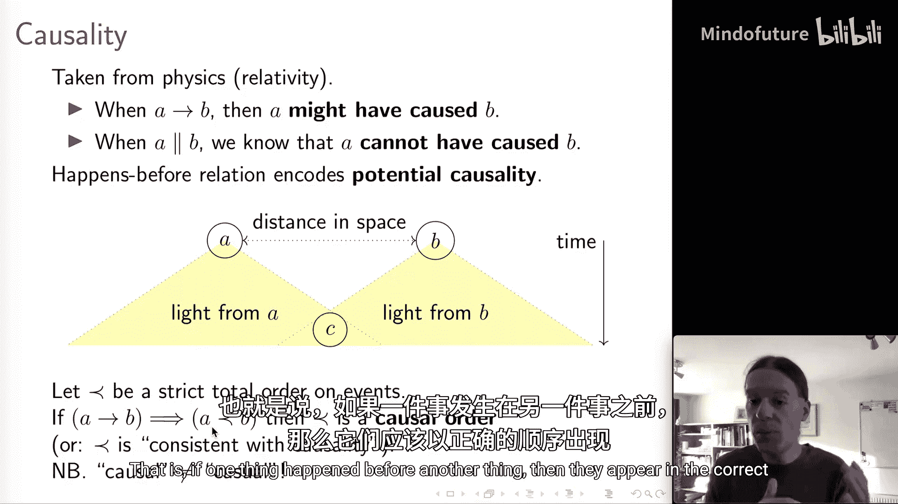
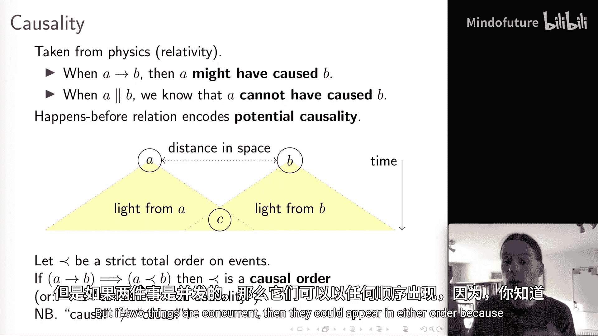

这是一个非常有用的概念。在下一讲中，我们将基于“先于发生”关系，构建实现这种因果顺序的实际分布式算法。

最后提醒一点：注意单词 **causal** (因果的) 和 **casual** (随意的) 很容易混淆，写作时请仔细检查。

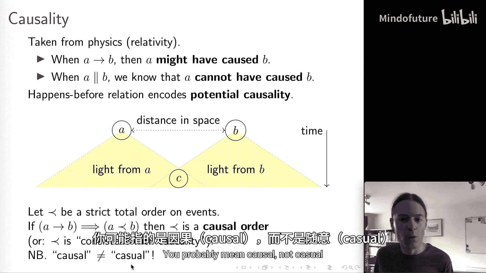

## 总结

本节课我们一起学习了分布式系统中的“先于发生”关系。我们首先通过一个消息乱序的例子，认识到物理时间戳在保证逻辑顺序上的局限性。接着，我们形式化地定义了“先于发生”关系，它基于事件在同一节点的顺序和消息的发送/接收关系，并通过传递性构成一个偏序。我们了解到事件间要么存在“先于发生”关系，要么是并发的。这个概念与物理学中的因果关系（光锥）紧密相连，用于描述事件间潜在的影响。最后，我们引出了因果顺序的概念，即一种与“先于发生”关系一致的全局事件排序方式，为后续构建分布式算法奠定了基础。下节课我们将继续深入。