# 【剑桥大学-•-中英】分布式系统讲座-p11-P11-Distributed-Systems-4.1---Logical-time--BV1NwQhYeEyV_p11-

Hello everyone， welcome to Lecture 4 of Disbuted systems Today we will be talking about broadcast protocols and logical time。

😊。

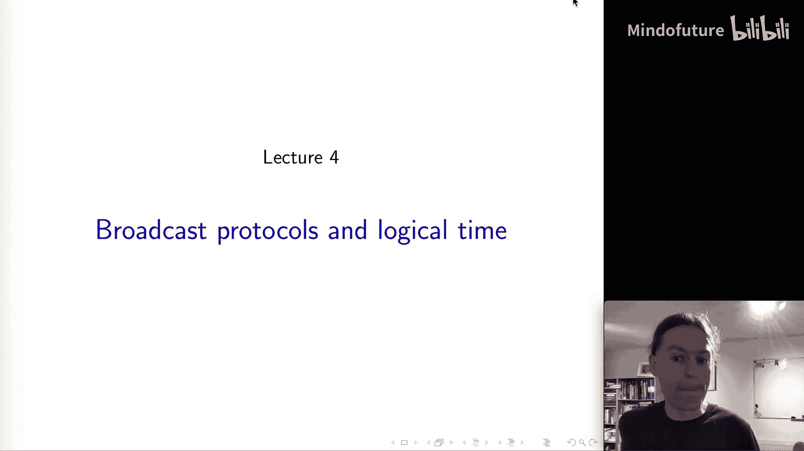

As background， remember this slide here from the last lecture where we have the case of two messages。

 First message1 is user A says the moon is made of cheese。

Message 2 is user B replies to this replies to M1 saying， oh no， it isn't。

 And what could happen with physical clocks is that the timestamp of message1 ends up being greater than the timestamp of message 2。

 So could be the case that those timestamps are inconsistent with the order that we intuitively expect of those two messages。

 that those messages are inconsistent with causality。 Now， this is a problem with physical clocks。

 even after we' have gone to all of this effort to synchronize them using using NTp。

 even then it could happen that you get these inconsistencies with causality。

 So this is where logical clocks come in。 logical clocks are an alternative definition of clocks that are used in distributed systems。

 which are specifically designed to capture the causal relationships between the events that happen in a system。

 And so logical clocks。

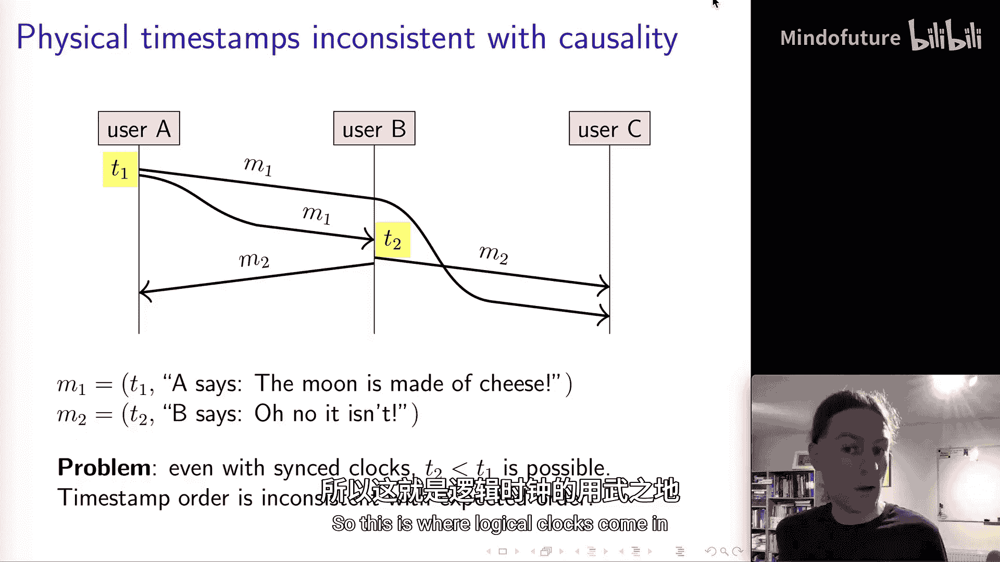

They are sort of clocks。 They are not clocks in the sense of measuring how long it's been。

 measuring how far the sun has the earth has turned around the sun。

 measuring how far the earth has rotated around its own axis， those kind of things。

 that's all physical time。In logical time， we're not actually interested in how many seconds have elapsed。

 Instead， what we're interested in is how many events have occurred。

 And so logical time stamps are essentially just counters that we increment every time when something happens。

 And so this means they do move forwards in time。 they get greater as stuff happens。

 but they don't have a direct relationship to to physical time。

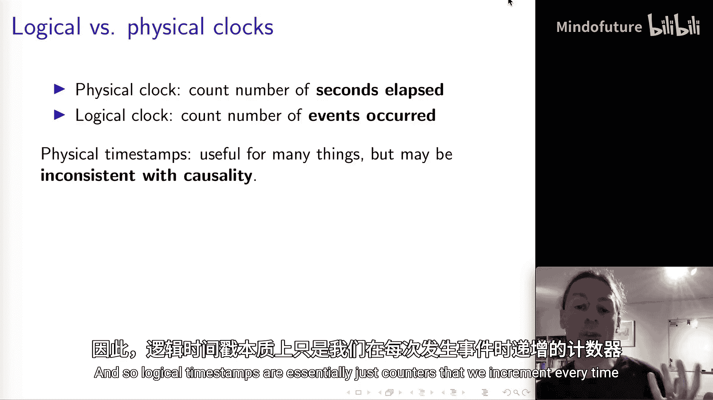

So the key thing that we want of a logical clock is that it captures causality。

 it captures that happens before relationship in particular if event if event one happened before event2。

 then we want the timestamp of event one to be less than the timestamp of event two this is like a minimum basic thing that we expect of our logical clocks and we're going to look at two different constructions of logical clocks。

 lamp or clocks and vector clocks， both of these satisfy this need to capture causality but they have slightly different properties in other areas as we shall see。

So let's start with Laport clocks， these are named after Leslie Lamport who published this algorithm in about 1978 or so。

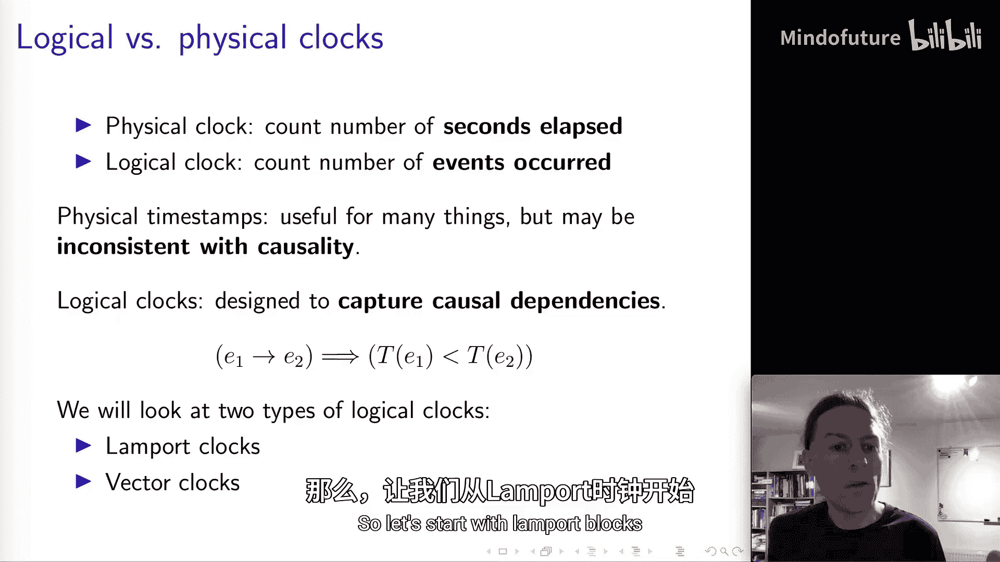

And this has really been a classic of distributed systems， and the algorithm is fairly simple。

So the algorithm starts at every node， we have a variable that we call T and this variable is initialized to0 when we start up the system and each node has its own copy of this variable each node has its own T and every time when some event occurs at a node we just increment T so an event could be some local execution step taking place or could be sending a message or receiving a message in all of these cases we just increment T。

Now every time we want to send a message over the network。

 we increment T as usual as for any local event and also we take the value of T after incrementing it and we attach that to the message so the message we send is actually the pair of a timestamp and the actual message and that is what gets sent over the network now when one of these pairs is received at the other end the node that is receiving the timestamp that sorry don node that is receiving the message takes the timestamp out of the message T prime is the timestamp in the message。

And it looks at its own local variable T， and it updates T to be the maximum of either its own local existing timestamp or the timestamp in the message plus one。

 incrementing it again like for every local event。And so after this has been done。

 we've got an updated value T and we deliver the message to the application。

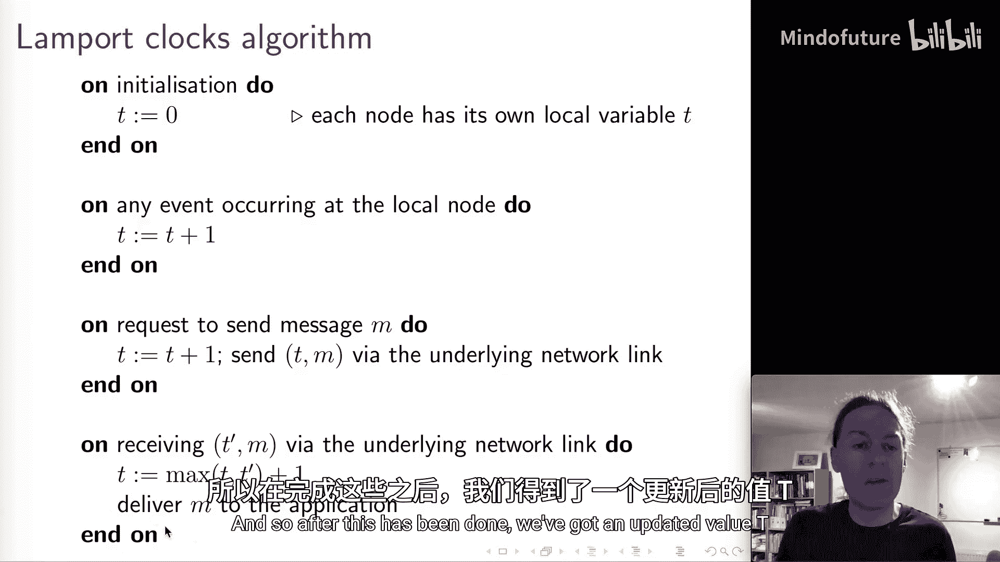

So let's look at a bit of around lampport clocks so we have this counter T here on each node and we can associate a particular value of T with every event so let's say that some local event occurred that call that event E for every local event we increment the counter so after that increment we take the value of that counter and associate it that with that event E and call that L of E for Laport clock。

As I said we attach those values over on the messages that we send over the network as well and so these lampport clocks have some very nice properties first of all。

 if event A happened before event B， then the scheme guarantees that the lampport timestamp of event A is less strictly less than the Laportt timestamp of event B and there's actually an exercise in the lecture notes that asks you to prove that this is indeed the case。

However the converse is not true， so if we have two lamp or timestamps and we compare them and we find that L of a is less than L of B。

 that does not imply that A happened before B， it could also be the case that A and B work incurren so the lamp or timestamps don't allow us to tell whether A or B work incurrent or if A happened before B the only thing we can do is we can rule out that B happened before A because if B happened before A then the timestamps would have to be the other way around。

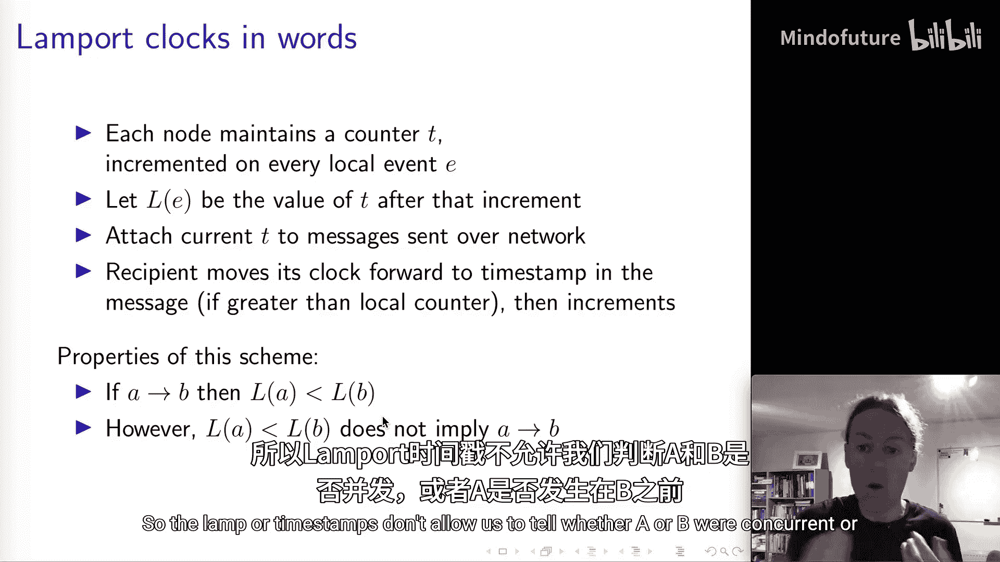

Another thing that can happen with these land port timestamps it's possible that we have two different events with the same timestamp。

 there's nothing preventing this。

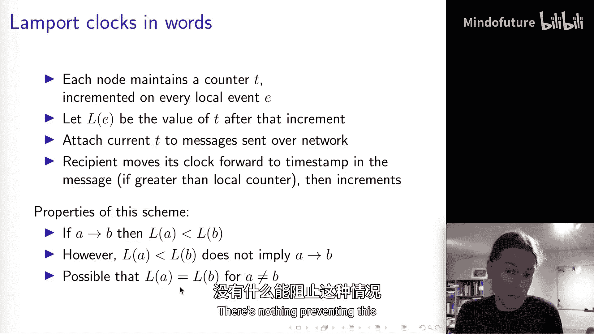

So let's have a look at a concrete example here so here we've got an execution with some events。

 the events are again little black blobs and we have messages sent over the network。

 so here for the first event by node A we just increment the counter for that local event。

 the second event by node A is that we send the message M1 over the network and so here we have the timestamp2 associated with that event and we also copy that timestamp into the message that we send and attach it to the message。

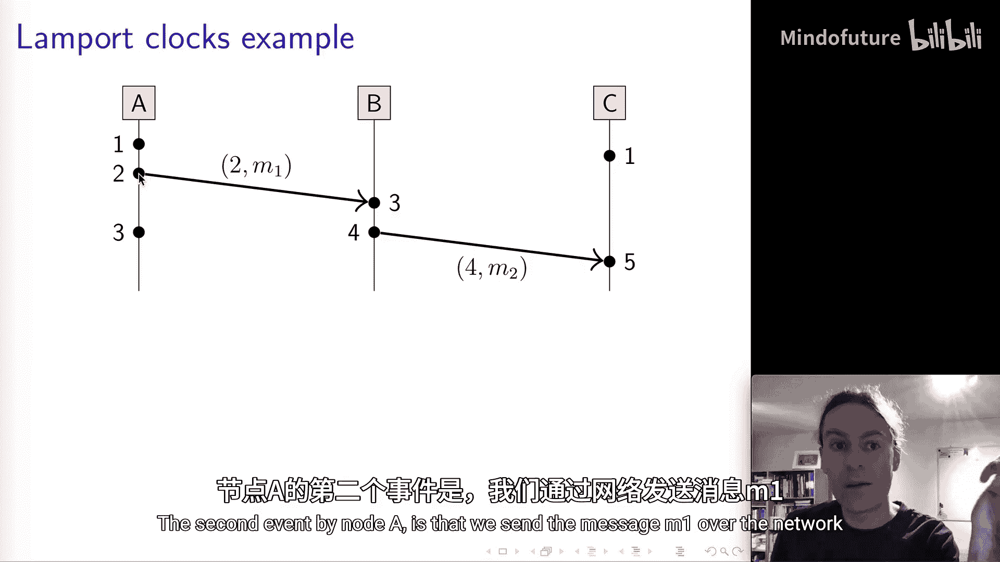

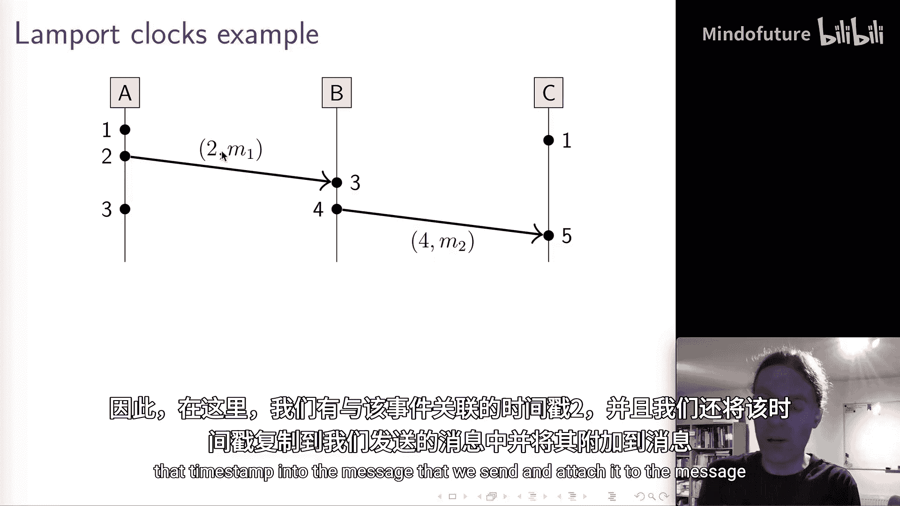

Now， here， when B receives M1。The before that， the local timestamp or at B will just be 0 because no events have happened so far at B。

But when the time when the message with timestamp2 arrives at B。

 we move the local timestamp forward to B and incremented by one again。

 So we end up with three as this timestamp of the receive event。

Then next local event happens at B and that gets the timestamper4。

 that timestamper4 gets attached to the message M2 that's sent over a network。

 and so here likewise at node C again， the local timestamp at C gets moved forward to 4 plus1。

 which is5。Now， a few things to notice here， one is， for example。

 that there are two different events with the same timetamp 3。

 and there are also two different events with the timestamp one。And so。

One thing we might want to do is to have timestamps that uniquely identify events in the entire system。

 and we can do this by combining the lampport timestamp with the name of the node at which that particular event occurred。

 So if we say here， for example， if you look at the events that happened at a。Within the scope of A。

 each of the events has a unique timestamp because we always increment。

 we never generate two events at the same node with the same timestamp。And so therefore。

 within one particular node， each event timestamp is unique。 So if we combine。

 if we assume that each node has a unique name here like A B and C。

 and we combine the lamp or timestamp of an event with the name of the node at which that event occurred。

 those two taken together will uniquely identify a particular event that combination is a unique identifier so we could actually update this diagram here。

 and instead of just having the timestamp at each we have the pair of the timestamp and the node。

 and now we can see here this event here has an ident of three comma A。

 or as this one here is three comma B。 So they no longer have they're no longer the same。

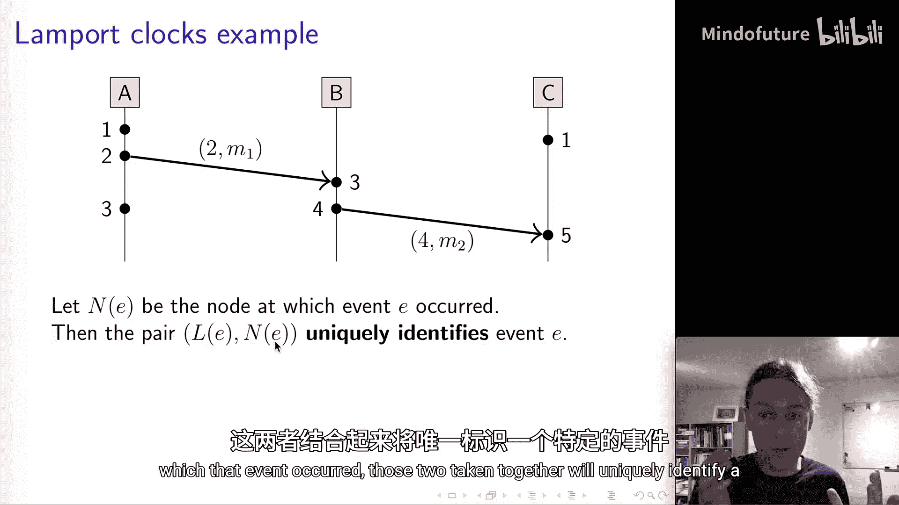

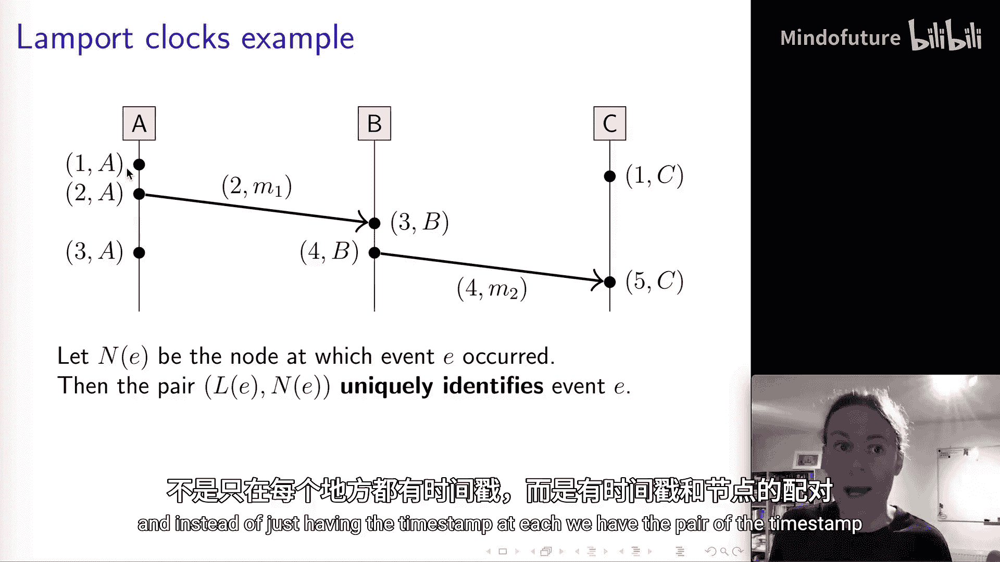

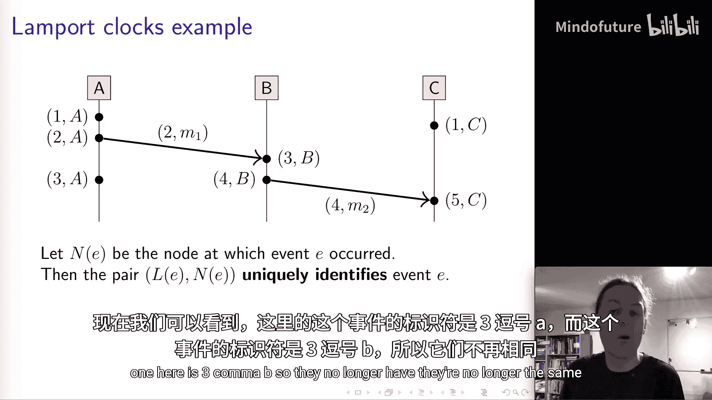

Now， there's one more thing that we can do with lampor time stampamps， and this is extremely useful。

 And that is we can define a total order using those。 So let's say we have two events A and B。

 and we can define that A is less than B， according to this little curly Lean symbol here。😊。

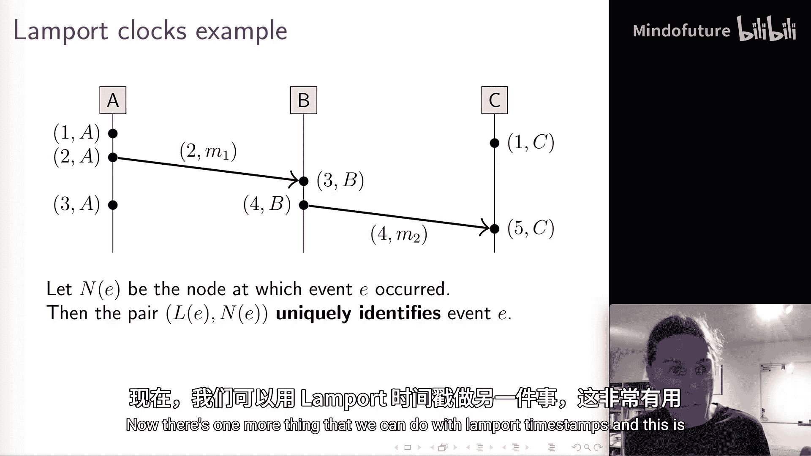

A is less than B， if and only if。The lamp port timestamp of a is less than the time of lamp port timestamp of B。

Or if A and B have the same lamp or timestamp， but the name of a of the event A is is less than a node name of event B。

 So this is assuming we have some way of comparing node names like A B and C。

 we could just have like a Alexquiographicic comparison of those so that a comes before B and B comes before C。

 for example， and so this now means we can define an ordering on these events。 by first of all。

 looking at their lamp or timestamps and if the timests are the same we break ties using the name of the nodes。

And this ordering here。😡，It's a total order。 that means for any two events。

 if they're distinct events， it is always the case that either A is less than B or B is less than A。

It's not a partial order。 And it happens before relationship was a partial order in which some events are incomparable if they are concurrent。

 But here， this is a total order， which means any event that happened anywhere in the system。

 we can always put them one after the other， according to this order。

And this order is consistent with causality， which means that if event A happened before event B。

 then it is always the case that a is less than B according to this total order。

 and that follows directly from the fact that the lamp or timests are consistent with causality。

So that's what lampor timestamps are。 They essentially give us a way of attaching timestamps to all of the events in a system in a way that captures that happens before relationships。

 so we can now define this order， this total order over the events using their timestamps so we can use the timestamps as a way of detecting the order of the events that happened in a system。

 and in our example of the moon being made of cheese。

 it would certainly be the case that the first message would have a lower timestamp than the reply to that message。

 this is what lampor timestamps lampor clocks guarantee。

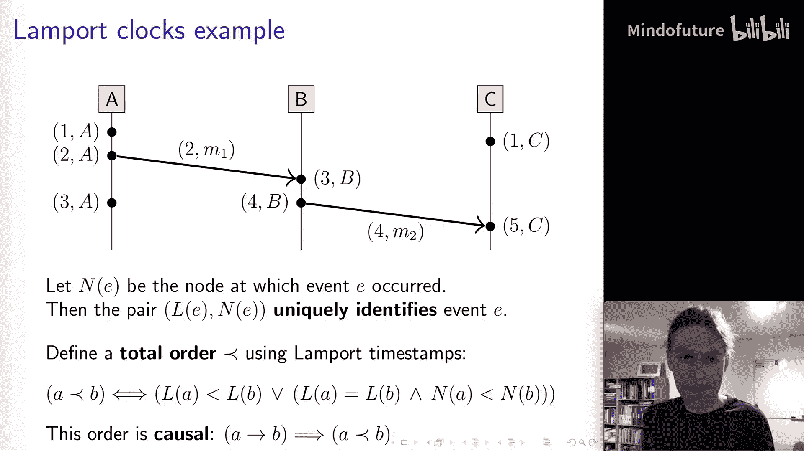

But there are still limitations， so lamp port clocks are not perfect。

One limitation is that if you are given the two lamp port timestamps， L of A and L of B。

 and let's say L of A is less than L of B， you can't actually tell whether A happened before B or if A and B are concurrent。

We can tell that B did not happen before A because if that were the case。

 the lamp port timesstones would have to be the other way around。 So we can tell something。

 but we can't actually tell the difference between two events that ha concurrent and two events where one happened before the other。

 So it might also be useful to have a scheme of logical clocks in which it is possible to tell the difference between two events that hark concurrent and two events where one happen before the other。

 And this is where vector clocks come in。 The vector clocks are a different scheme for logical time。

 That allows us to tell this difference。So vector clocks work as follows。 first of all。

 we're going to assume we know the names of all of the nodes in the system。

 let's say we have lowercase n nodes in the system and we're just going to put them in a vector。

 So this is an n dimensional vector where each of the elements of the vector is one of the nodes in the system。

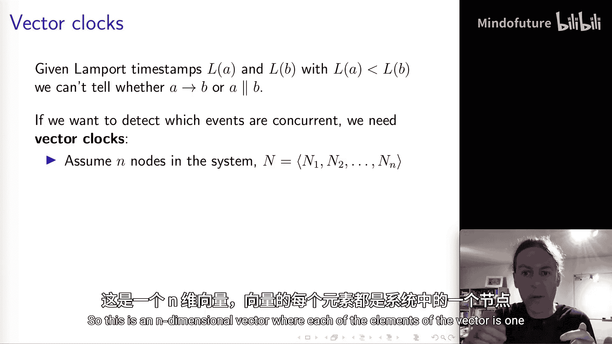

And we can define times stamps， which are also vectors。 So in this case。

 we have a a timestamp here consists of a sequence of integers。

 and we have one integer for every node in the system。

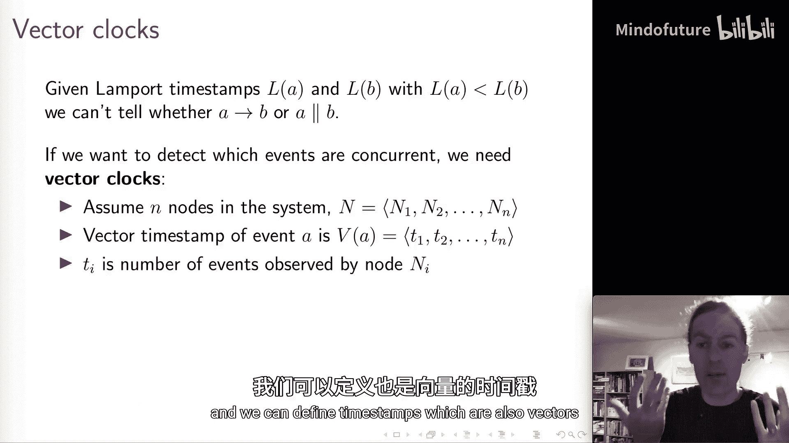

Now this is here written using these angle brackets as vector notation。

 you could equally well think of this as a list or array of integers。And so。Now。

 for every event rather than associating a single number with it。

 we associate this vector of numbers with each event and the meaning of these numbers is that for the I entry in this vector here。

 TI， that is the number of events that we have observed happening on node I。

So we're counting events like we did in the Laport timestamps。

 but now rather than mixing all of the nodes together into a single counter。

 we actually have a separate counter for every node for the number of events that have occurred on that particular node。

Now we can like with the Laport timestamps， we can attach a vector timestamp to every event。And。

There are certain rules for updating for updating these timestamps。

 so if we want to compute the timestamp for a particular event。

 the first thing we do is every time that an event occurs at a node NI。

 we increment the particular entry， the particular element of that vector corresponding to that particular node。

 so I'm going to just use these square brackets here this notation just like the array subscript in many programming languages it's just a way of referring to the I element of this vector or this array T here。

Like with the lampport timestamps， we're going to attach vector clocks to messages that can sent over the network。

 and there's an algorithm for merging those。 And we're going to look at this algorithm。 Now。

 so here we start in a way that is somewhat similar to the lampport clocks。

 and that is every node locally has a timestamp。 In this case， the timest is not just an integer。

 but it's a vector of integers， which starts off as being all zeros。

 So we have one entry in this vector for each node in the system， So this is a vector。

 this n elements long here。

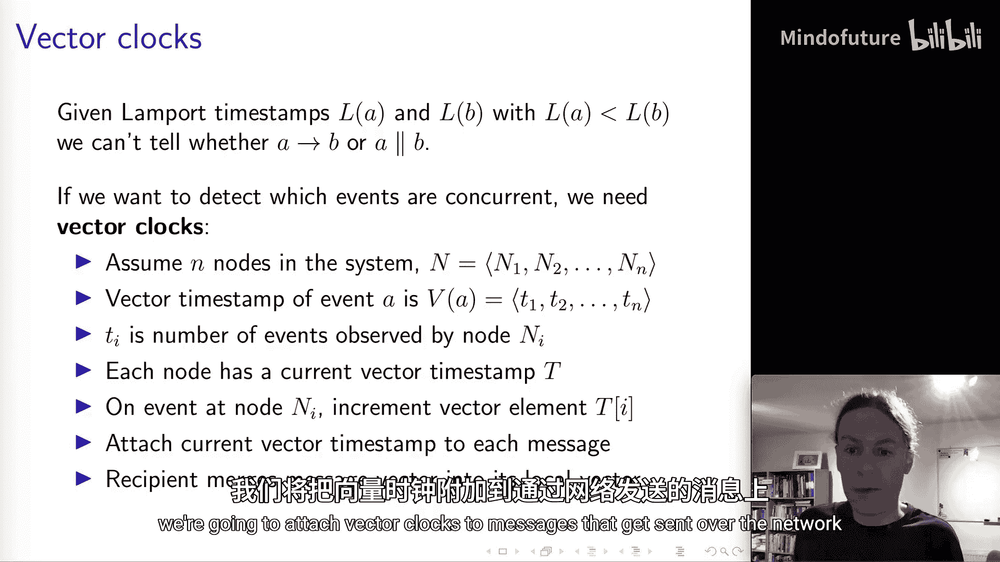

And every time a local event occurs somewhere in the system we're going to increment the the particular vector element corresponding to the node at which that event occurs。

 So an I processes some event， it increments its own entry in the vector。

When we want to send a message over the network again。

 we increment our own entry into the vector like for every local event。

 and then we attach the vector T to the message that could sender of the network Now when we receive one of these messages over the network。

 say T prime is the timestamp in the message。Now we are going to merge the recipient nodes current local time T with the timestamp in the message T prime。

 and the way we're going to merge those is we're going to go through the two vectors element wise。

 and so we're going to take the first element of T and the first element of t prime。

 I're going to take the maximum of those two， and that becomes the first element of T。

 we're going to take the second element of t to second element of t prime。

 take the maximum and so on。 So element wise， we take the maximum and the result is this updated variable T here。

Then again we increment the local entry in T and we deliver to the application。

 so let's look at an example of what this actually looks like here。

 so I'm going to write my vectors as being a is the first entry in the vector B is the second entry in the vector and C is the third entry and so here when the first local event happens at a that means a increments its own entry in the vector so that means the first entry becomes one and the remaining entries in the vector remain unchanged。

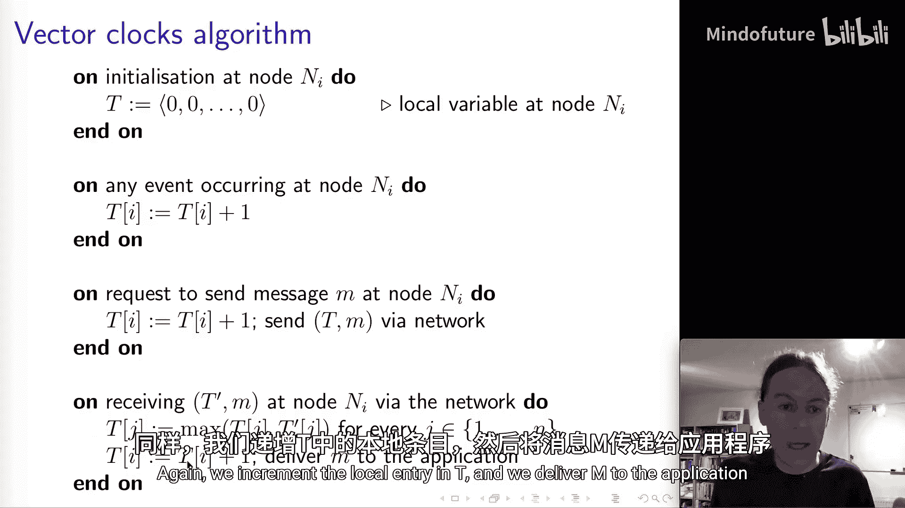

On the second event here， again， we increment its own a increments its own entry。 So this becomes 2。

0，0， and 20，0 is the vector that is attached to message M1 as it's sent over the network。Now when 20。

0 is received by B。😡，It does the element wise maximum。

 so that means it also ends up with 200 and then it increments its own entry now because this is B executing now it increments the second entry of the vector clock and so we end up with 210 as the timestamp of this particular event。

On the next event by B， we have 2，20 because again， it's a local increment。

220 is a message that is the timestamp that gets attached to message M2 as it gets sent over the network。

 And again we have the element wise maximum here when it gets received。 So here。

 even though there was the previous event on C that previous event will have had 001 because it's an executed on node C。

 which is incrementing the third entry of the vector。

 But then here we do the element wise maximum and the increment of C's entry。 So we get 222。

So one way of thinking about these vectors here is that a vector represents a set of events。

And so let's take， for example， this222 sorry220 here， the second event on B。

This represents the set of events， which is this event itself plus all of the events that happened before it。

 so if that's this event E， that's the set of E union， all of the events that happened before E。

And so visually， we can think of this in a diagram by travelling backwards in time and finding all of the events that we can reach through traveling backwards either on each node's individual execution order or by going backwards from the receipt to descending of each sending of messages。

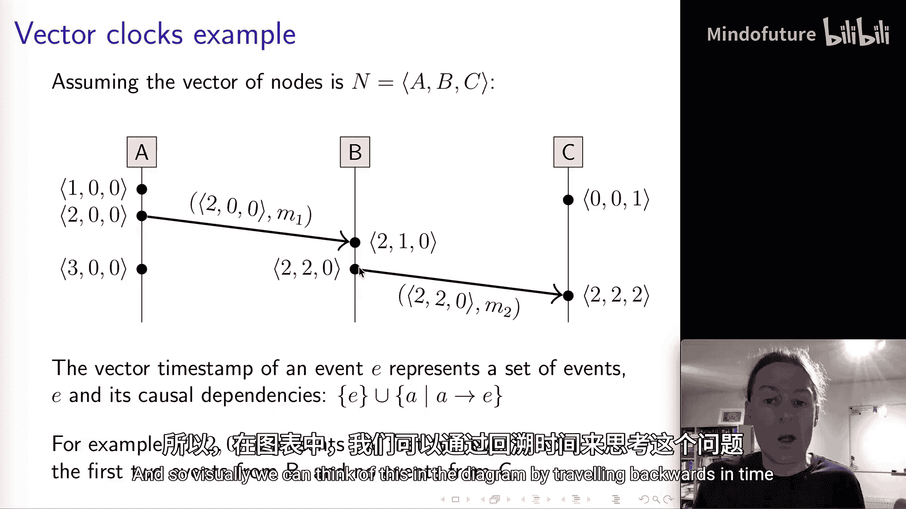

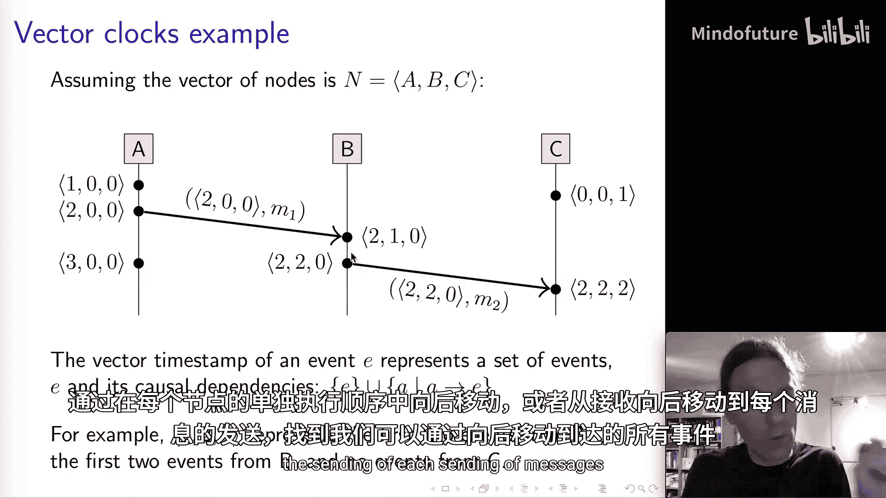

And so here that means from 220 we can get back to 210， we can can get back to 200 and 100。

 so we can reach these four events here by going backwards from 220。

 we can reach the first two events on A and we can reach the first two events on B but none of the events on C by going backwards from this event and that's why it has 220 it means the first two events on a。

 the first two events on B and no events from C。

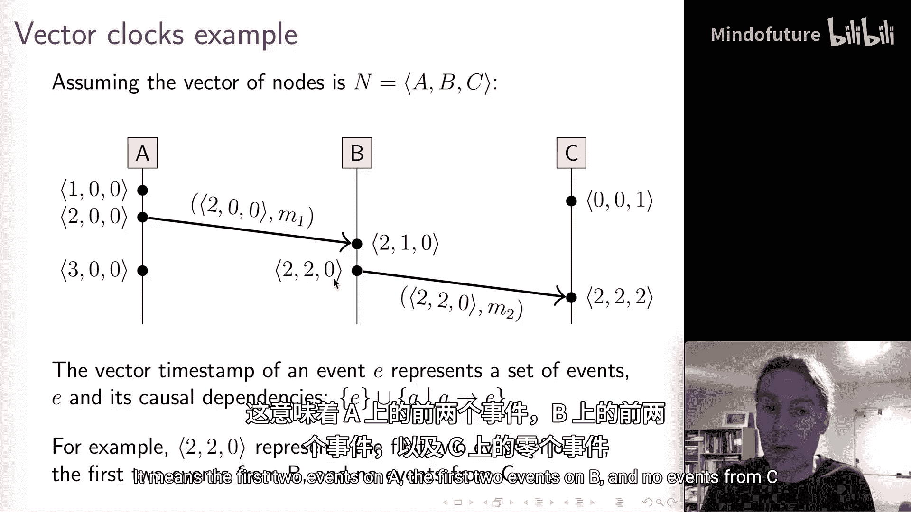

So here you can see this correspondence， there's a correspondence between these vectors。

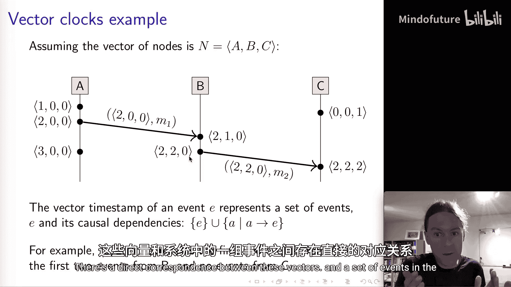

And a set of events in the system， the vector is essentially a way of summarizing a set of events that occurred in the system simply by counting for each node from the start of that nodes execution of how many events down do we go in that node's history。

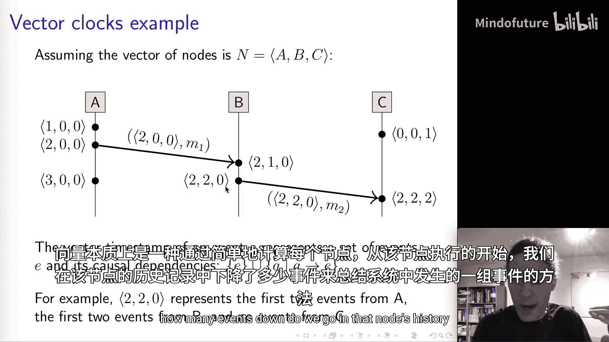

So， now。Now that we've defined these vectors and the algorithm for computing the vectors。

 we can now compare them。And so first of all， we're going to say that two vector timestamps are equal if each of the elements are equal。

 so T equals t prime if for each of the elements I T subscript I equals T prime and subscript I。

And so this is just a straightforward equality。 Also， similarly。

 we define the less than or equals operator。 So t less than or equals t prime。

 if element wise for each we compare the two vectors。

 Look at the first element of t and the first element of t prime and if that's less than or equal and the second one is less than or equal and the third one is less than or equal。

 if all of them are less than or equal， then we say that that t as a whole is less than or equal to t prime。

We can define strict inequality strictly less than simply as being t less than equal to t prime and then not being equal。

 which means that there must be at least one element in which they differ。

 but they might be the same in all of the other elements。And finally。

 it is possible that for two vector times stamps， t and t prime。

 neither is t less than or equal to t prime nor is t prime less than or equal to T。 and in that case。

 we say that t and T prime are incomparable。And now this here。

 you can relate back to what I just said about sets of events。

 So remember we said that here this vector clock of a here corresponds to the set of events of a plus all of the events that happened before a。

And the vector times stamp of B corresponds to the set of events。

 B plus all of the events that happened before B。And now this less than we relationship on the vectors corresponds exactly to a subset relationship on those two sets of events。

This is quite interesting now， this gives you a nice way of reasoning about these what these vectors actually mean because since they correspond to sets of events。

There's a subset relationship between the two and it might be the case that one is a subset of the other。

 or it might be the case that neither is a subset of the other because there are some elements that they don't have in common。

And so now this order that we have defined on these vector timestamps is very useful because it corresponds exactly to the happens before relationship。

 So it gives us a partial order。😊，And this partial order is consistent with causality。 So。

 first of all， we have the fact that。Given two events， A and B。The vector clock。

 nor vector timest of a is strictly less than the vector times stampamp of B。

 according to this order above here， if and only if a happened before B。

So this is now for the lamp or times stamps。 We only had a one way implication。

 We had that if A happened before B， then the times stamps are are less than one。

1 less less than the other。 But with vector clocks， we have an if and only if relationship。

 it's a bidirectional implication。So we can also conclude that looking at two times stamps。

 if one is less than the other， then we know that A must have happened before B。

It's also the case that the timestamps uniquely identify events。

 So if two events have the same vector timestamps， that means that those events are the same。

 and like so this is again a bidirectional implication， it's an only if and only if。And finally。

 if the two timestamps are incomparable， according to the definition up here。

 that means that the two events are concurrent and if the two events are concurrent。

 then their timestamps will be incomparable。So what we now have here using vector clocks is a way of computing to happens before relationship。

 So far the happens before relation has been essentially this this abstract definition。

 we can by looking at the diagram of the events on paper we can work out what thing happened before。

 which other thing， but that's not an algorithm for computing it， whereas here with vector clocks。

 we actually have an algorithm for computing exactly which event happened before which other event。

And we have a way of telling whether two events are concurrent or not。

So this is the really interesting thing about vector clocks that Laport's clocks do not have。

So these have been the two types of logical time that we're going to look at in this section。

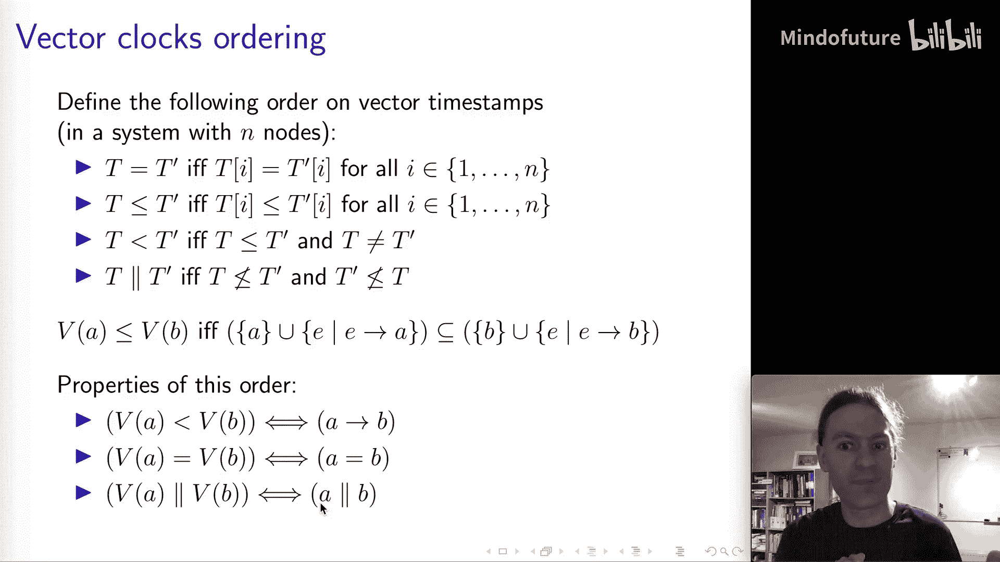