# 【剑桥大学-•-中英】分布式系统讲座-p12-P12-Distributed-Systems-4.2---Broadcast-ordering--BV1NwQhYeEyV_p12-

Next， we are going to look at broadcast protocols。 This might seem like a bit of a sudden jump from logical time。

 but actually， as we will see in a moment， there's a strong connection between the two。

 So broadcast protocols generalize the type of network communication that we can do in a distributed system。

 So so far we've been considering point to point communication where one sender sends a message to one recipient over the network the message may or may not arrive but it's still one to one communication between two nodes in broadcast or multicasts communication we generalize this to a group of nodes so that one node may send a message to all of the nodes in the group at the same time。

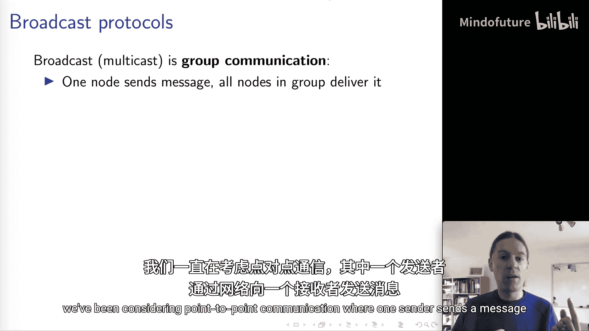

Now， this for the purpose of this course， we're mostly going to assume that the set of nodes in the group is fixed and known in advance。

 but in general you may well of course have a system in which nodes can join and leave or be added or removed by an administrator and that is certainly something that real protocols need to deal with。

So one particular thing that we want of a broadcast protocol is full tolerance。

 and this means that say one of the nodes in the group is faulty。

 all of the remaining nodes should still be able to continue broadcasting and delivering messages as before。

 so we don't want a single faulty node to make the entire system grind to a halt。

There are a couple of different implementations of broadcast or multicast。

 One that you might have come across in the context of computer networking is that some local area networks support broadcast or multicasts at the hardware level。

 actually， and this is quite useful on local area networks。

 generally that kind of multicast does not work over the public internet。

 And so what we will consider in this course is more general form of multicast or broadcast where we assume that the underlying network only provides point to point messaging as in Unicast。

 and we are going to build broadcast protocols on top of that。

 So the underlying network just allows us to send a message from one node to one other node。

 but on top of that， we can build broadcast as an abstraction that we can then use for higher level protocols。

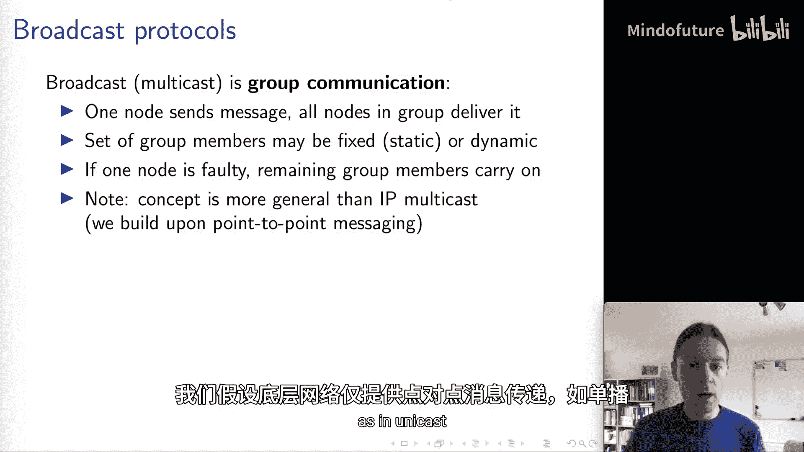

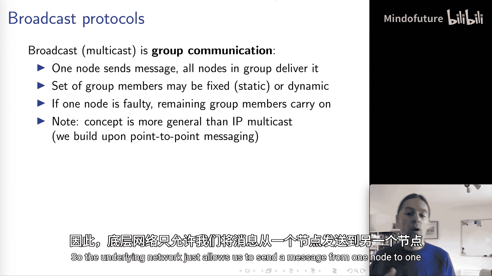

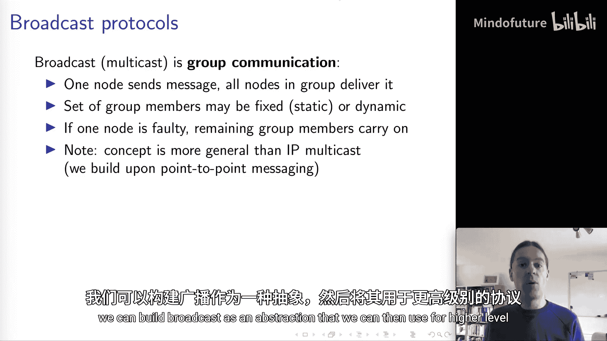

So if you think back to the discussion of system models in lecture2。

 we have the distinction between fair loss links and reliable links and of course most network links are fair loss。

 but you can make them reliable by retransmiing messages exactly the same distinction happens in broadcast protocols except here that a network that might lose message we call best effort broadcast typically。

Best effort broadcast just means one node tries to send message to all the other nodes。

 but it may or may not arrive， especially if the sender crashes， for example。

 the message might not reach all of the other nodes。

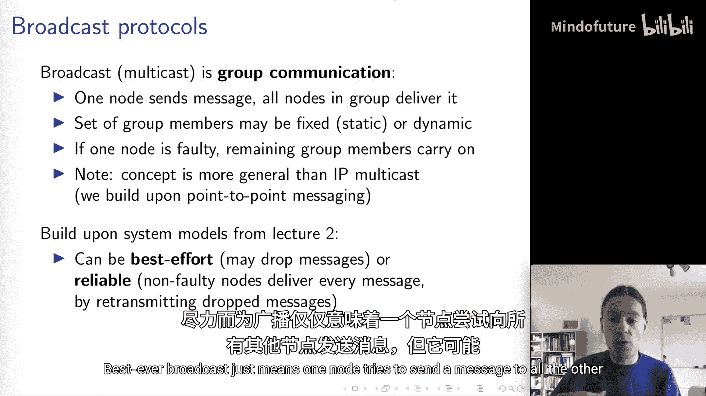

Or we can make it reliable。😡，Which again relies on retransmitting lost messages。

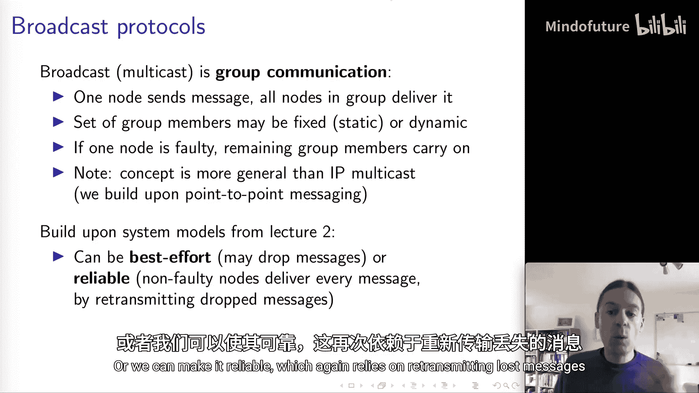

Like in the context of system models， we are going to assume not asynchronous system。

 not a synchronous system model， but an asynchronous or partially synchronous system model。

 which means that we're not going to assume any upper bound on message latency。

 So in a reliable broadcast protocol， we can say that a message will eventually go get through。

 but we're not making any promises about how long it might take until the message might get through。

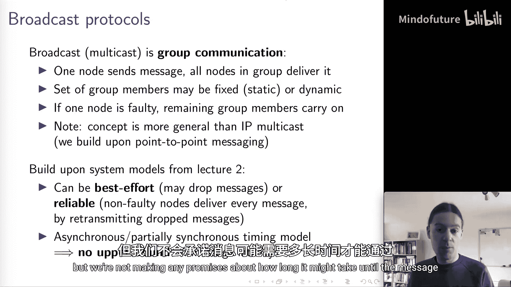

Okay， so that's the background on broadcast。 I should introduce a little bit of terminology before I get into the details。

 and that is in the context of point to point network links。

 We have talked about sending and receiving messages over the network。

Whereas in the context of broadcast protocols， we talk about broadcasting a message and then delivering it as the counterpart。

 So what happens is the application on one node wants to broadcast a message to the entire group。

 we call this action to a broadcast。

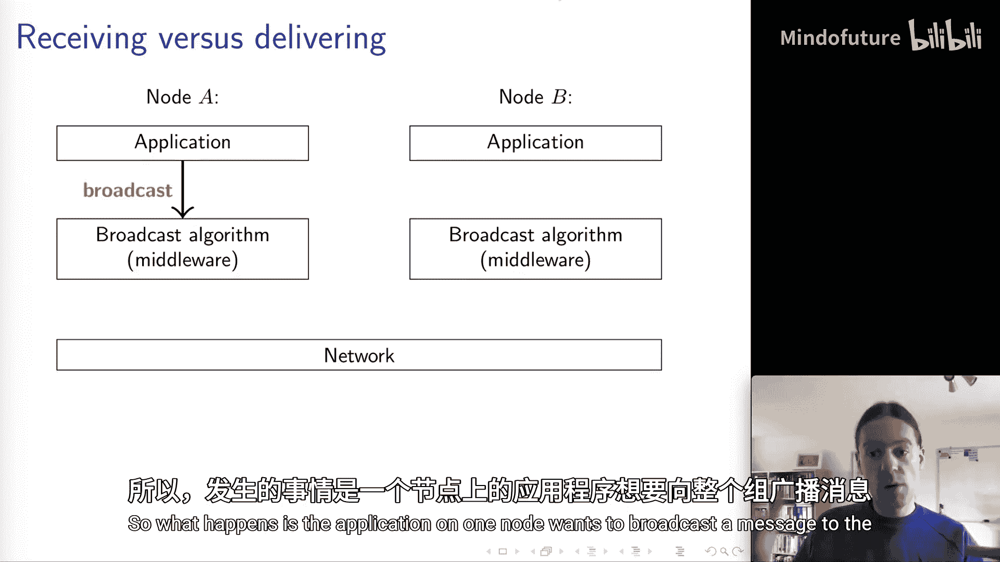

And then the underlying broadcast algorithm may send or receive multiple messages over the network。

 And these are then point to point messages that are sent or received。And on some other node。

 those messages might be received， they get again picked up by the broadcast algorithm and the broadcast algorithm at that point then at some point then delivers the message to the application。

 So here the delivery is the counterpart to the broadcast and one detail that happens here is that when the broadcast algorithm receives a message it might not immediately deliver that to the application。

 it may actually have to wait for a little bit before that message is ready to be delivered because we want to ensure that the message are delivered in a certain order。

So this is just a terminology we are now going to look at a couple of different broadcast abstractions and I'm going to talk about each of these individually so I won't go into too much detail right now The point here is that these are all forms of reliable broadcasts so we're assuming we have a mechanism for retransmission which ensures that all of the messages eventually get through now we want to distinguish different types of broadcast based on the order in which messages get delivered。

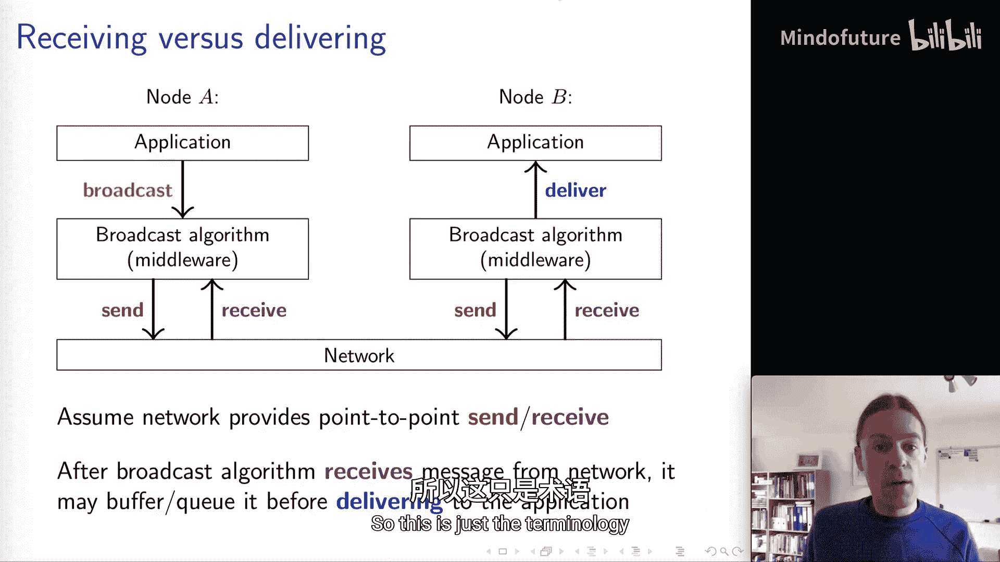

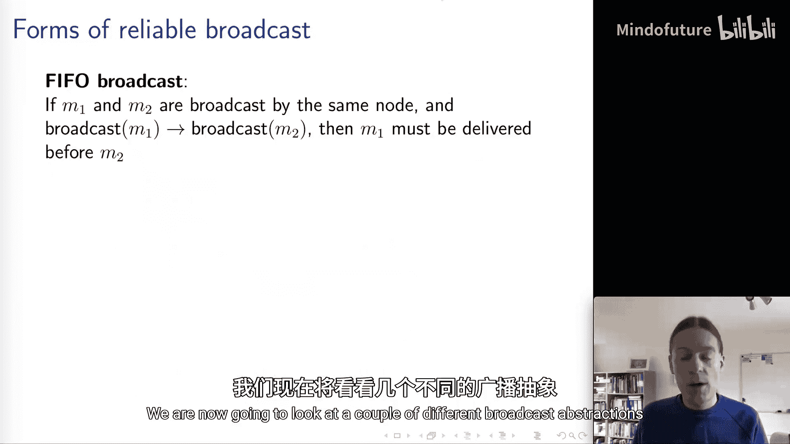

And so the first one that we're going to look at is PIO broadcast and in PIO broadcast。

 the ordering property is that if two messages are broadcast by the same node。

 then all nodes will deliver those messages in the same order as they were broadcast。

So for any messages broadcast from one particular node， they remain in order。

 but for any messages broadcast by two different nodes。

 there's no guarantee about the order in which they might arrive。

 So let's look at an example of what this actually looks like。 So here we have， again， three nodes。

 A B and C A wants to broadcast message M1 to the group。

 And so it sends that message over the network to C and to B。

 And notice also that a sends the message to itself。

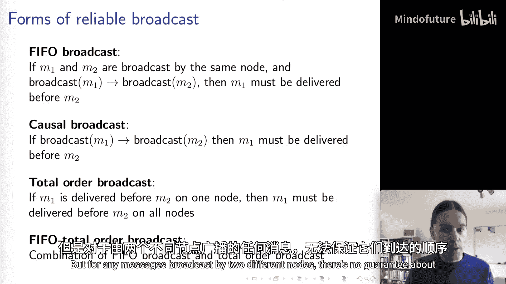

Which is here denote by this little loopback arrow。Now this might seem unnecessary because why。

 why do you need to deliver a message back to yourself Because the sender of the message already knows what message is it sent。

 it doesn't need to receive it again， The reason why a node delivers a message to itself will become apparent when we talk about total order broadcast shortly So for now just assumed us as a little quirk that the guarantee of the broadcast protocol is also always that it delivers a message to itself。

Then after M1 has been delivered， note B decides that it wants to broadcast message M2 to the group。

 And so it sends M2 over the network to A and C， and it also delivers M2 to itself。 And then finally。

 node A wants to broadcast message M3。 So again， it sends that message over the network to B and C。

 and it delivers。M 3 to itself。Okay， so this is50 broadcast。 So what we require P0 broadcast。

 as I said just now， is that because M1 and M3 are both broadcast by the same node。 A。

 we require that all nodes deliver M1 before they deliver M3。

 and we can check that this is the case here。 A delivers M1 here and then delivers M3。 Okay。

 B delivers M1 then delivers M3。 and C also delivers M1 and then delivers M3。 Okay。

 all fine all of the nodes deliver these messages in in the right order。

 Now there are actually several possible orders that would be valid here under 50 broadcast。

 in particular， the message M2 that is sent by B。 That can be ordered arbitrarily with respect to A's messages because we are not making any guarantees about ordering across different nodes and B and M2 was sent by B。

 So this means that it's okay for M2 to be。Delivered before M1 and M3 or in between the two or after the two。

 and all of those are fine。 And so here， for example。

 we can consider these two different executions in which the messages are delivered。

By C in a different order。So in this case here， M1 is delivered first， then M2， then M3 In this case。

 M2 is delivered first， then M1 then M3。 and both of these orders are valid under50 broadcast。

 even though in this case here， for example， the message M2。

 you would say that happened after M1 in a causal sense。

 but still P0 broadcast makes no guarantees about delivering M2 after M1。

 If you do want that kind of ordering property， you need causal broadcast。

 So causal broadcast ensures that messages are delivered in causal order。

 And that means that if the broadcasting of one message happened before the broadcasting of another in the sense of the happens before relation。

 then those messages must be delivered in that order that matches that happens before relation。

 And that's what we have here。 So first of all， M1 is broadcast by A and it's received by B and C and is delivered by B here。

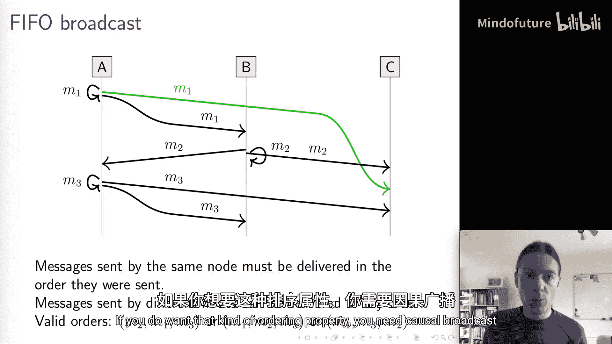

And then after B has delivered M1， B wants to broadcast M2。And so here。

 M2 may have a causal dependency on M1， and therefore we require that all of the nodes must deliver M1 first and M2 second。

Next。The node A might broadcast a message M3。 again。

 it sends out of the network to the other two nodes and it delivers the message to itself。

 And in this case， notice that the broadcast of M2 is concurrent with the broadcast of M3 because on a M2 is delivered after M3 is broadcast and on B M3 is delivered after M2 is broadcast。

 So these two messages do not depend on each other。 So in this case here。

 what we require is that any messages that have a causal dependency are delivered in causal order。

 And so in this case here we have a causal dependency between M1 and M2。

 and we have a causal dependency between M1 and M3 because M1 and M3 where broadcast by the same node A。

 but there's no causal dependency between M2 and M3。

 And so this means M2 and M3 can be delivered in either order， which means that here again。

 we have two different orders for。

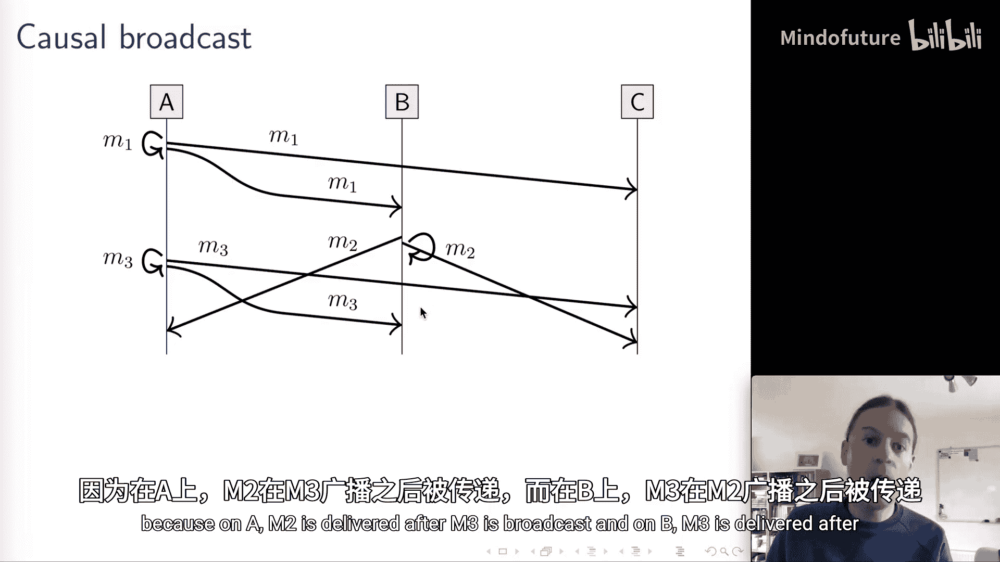

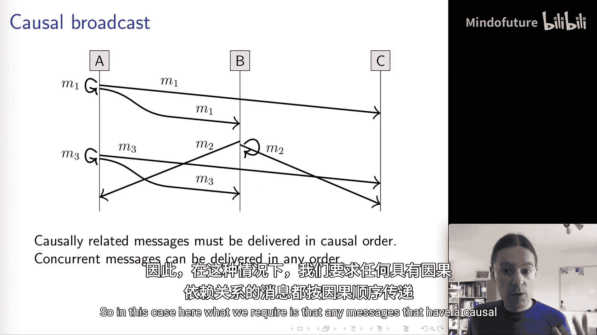

Of delivery for C。 And both of these are okay under the broadcast under the causal broadcast。

 So here in this case， we have C first delivering M1， then M3， then M2。 in this case here， we have。

See， first delivering M1， then M2， then M3。 And these are both valid orders。

 We can swap around the delivery order of M2 and M3。Now， notice here， for example。

 that a delivers first M3 then sorry， first delivers M1， then M3， then M2。

 whereas B delivers first M1， then M2， then M3。So both of these orders are valid causal orders。

 but they are not the same。And in some cases， we actually want to require that all of the nodes deliver messages in the same order。

 And if that is what we want， we need to move to what is called total order broadcast。

 So total order broadcast。

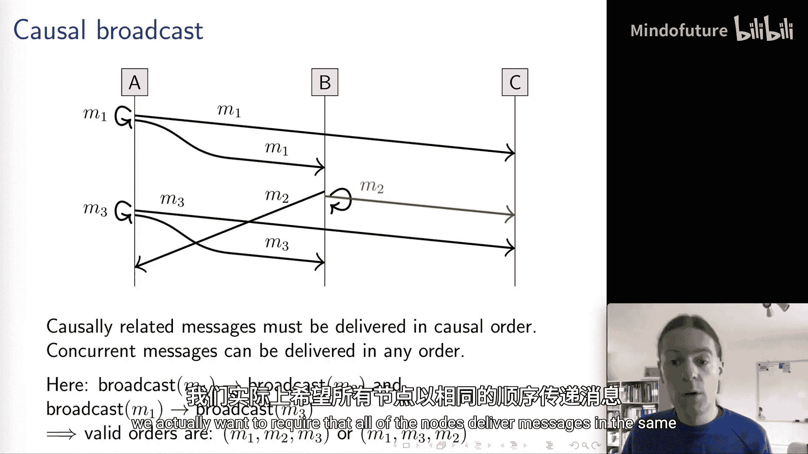

Puts all of the messages that are broadcast in the system into a total order。

 that means it's always clear which one came first。

And it ensures that all of the nodes deliver messages in that same order。

 so there's agreement between all of the nodes on the order in which the messages should be delivered。

So in this example， again， we start with M1 broadcast by a， then we have M2 broadcast by B。

 which happens after M1 and finally we have a message M3 that is broadcast by a again。

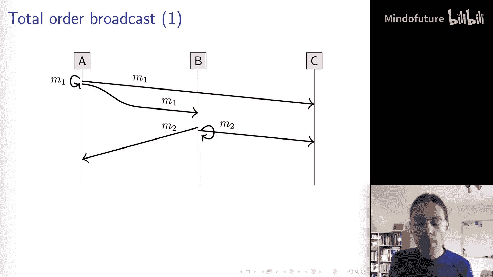

Now， in this case。Something somewhere has to decide on the order in which these will be delivered。

 Let's say that the order that was decided is to deliver first M1， then M2， then M3。 Okay。

 and so we can see on C， for example， that's what happened。 C first delivers M1。 Then it delivers M2。

 Then it delivers M3。 So C is deliver them in the correct order。 Let's look at B here。

 B first delivers M1。 Then it delivers M2 to itself。 Then it delivers M3。 Okay。

 so B also delivers the messages in the correct order。 Let's look at node A here。

 Note A first delivers M1 to itself。Then it broadcasts M3。 but wait。

 it's not allowed to deliver M3 to itself yet， because the order that was decided is that M2 must be delivered before M3。

 So therefore， note A cannot immediately deliver M3 to itself Instead。

 it has to wait for first for M2 to arrive and M2 to be delivered by a。

 and only then is a allowed to deliver M3 to itself。

So this is now where this delivery to self becomes very interesting and crucial because you can see that sometimes this there has to be this delay。

If message if a node wants to deliver a message to itself。Now， here M1 M2。

 then M3 is one possible order of delivering these messages。嗯。

It could also be that we decide on a different order。

 so a different valid order might be for the delivery order to be M1 M3， M2。

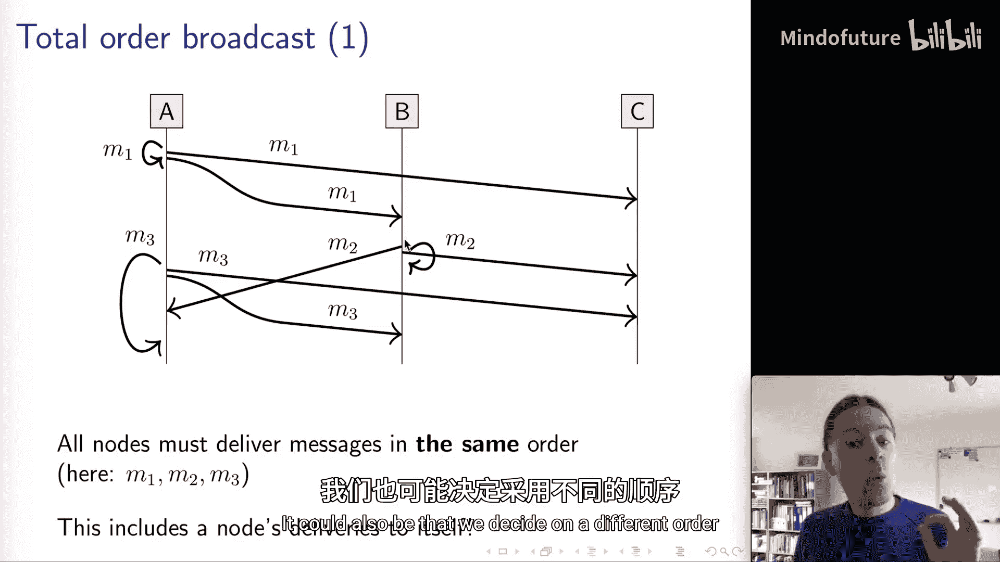

And that is also fine as long as all of the nodes deliver the messages in that same order。

 And so here again， we have start with C So C first delivers M1， then M3。

 then M2 notice here that it's possible that C receives M2 over the network before it receives M3 in which case C will have to delay the delivery of M2 until after M3 has arrived。

 So here this is called a holdback in the broadcast algorithm。

 it's often necessary for a message to be held back if it's not yet ready to be delivered because if we're waiting for some other message to arrive first。

 and that has happened here in the case of C。In the node B for the delivery order to be 1，32。 Well。

 first we deliver 1， then M3， but we can't sorry， then we broadcast M2。

 but we can't immediately deliver M2 to ourselves。 We have to first wait for M3 to be delivered。

 and then we're allowed to deliver M2 to ourselves at B。And on node A， things are simpler now。

 So first we deliver M3 to ourselves， then we deliver M2 to ourselves。 Then first， we deliver。First。

 we deliver M1 to ourselves， Then we deliver M3 to ourselves。 And finally。

 M2 arrives over the network， and we deliver M2 to ourselves。

 So both of these here are valid executions of total order broadcast。

 The crucial thing is just that whatever order。 The messages get delivered in that order has to be the same for all of the nodes。

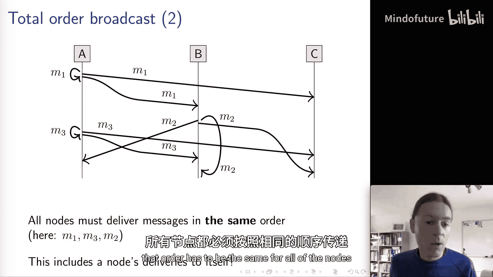

Finally there's something called PIFO Total order broadcast which just combines total order broadcast with PIFO ordering。

 so that means all nodes have to deliver messages in the same order and also messages sent by the same node have to be delivered in the order they were sent。

And it turns out that FiO total order broadcast is strictly stronger than causal broadcast。

 So every execution of PO total order broadcast also meets the requirement of causal broadcast。

And every execution of causal broadcast also meets the requirements of FiIO broadcast。

 every FiIO broadcast meets a requirement of reliable broadcast and so on。

 so there's actually an exercise in the lecture notes for this lecture that asks you to prove some of these relationships between the broadcast models in the next section we will then look at how to actually implement some of these broadcast algorithms。

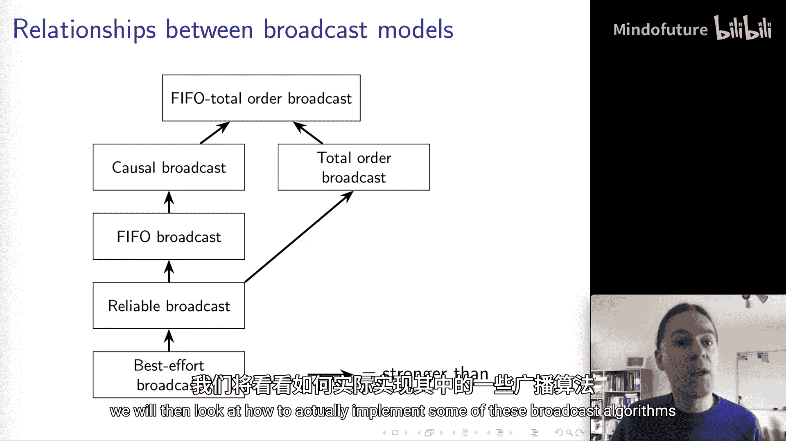