# 分布式系统：4.2：广播排序 📡

在本节课中，我们将要学习分布式系统中的广播协议。我们将探讨广播如何扩展点对点通信，并介绍几种不同类型的广播，它们的主要区别在于消息的交付顺序。理解这些概念对于构建可靠且一致的分布式应用至关重要。

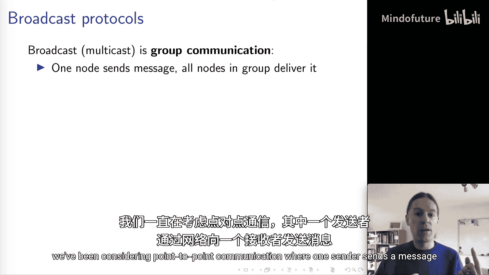

上一节我们讨论了逻辑时间，本节中我们来看看广播协议。这看起来像是逻辑时间之后的一个跳跃，但实际上，两者之间有着紧密的联系。广播协议将我们在分布式系统中可以进行的网络通信类型进行了泛化。

到目前为止，我们考虑的都是点对点通信，即一个发送者通过网络向一个接收者发送消息。消息可能到达也可能丢失，但这仍然是两个节点之间的一对一通信。在广播或多播通信中，我们将其泛化到一个节点组，使得一个节点可以同时向组内的所有节点发送消息。

在本课程中，我们主要假设组内的节点集合是固定且预先已知的。但在一般情况下，系统当然可能允许节点加入、离开或被管理员添加或移除，这是实际协议需要处理的问题。

广播协议的一个特别要求是容错性。这意味着，假设组内有一个节点发生故障，所有剩余节点应仍能像以前一样继续广播和交付消息。我们不希望单个故障节点导致整个系统停滞。

广播或多播有几种不同的实现方式。在计算机网络背景下，你可能遇到过一种：某些局域网在硬件层面支持广播或多播。这在局域网上非常有用。但通常，这种多播在公共互联网上不起作用。因此，在本课程中，我们将考虑更通用的广播或多播形式，我们假设底层网络只提供点对点消息传递（单播），并在此基础上构建广播协议。底层网络只允许我们将消息从一个节点发送到另一个节点，但在此之上，我们可以将广播构建为一个抽象，供更高层的协议使用。

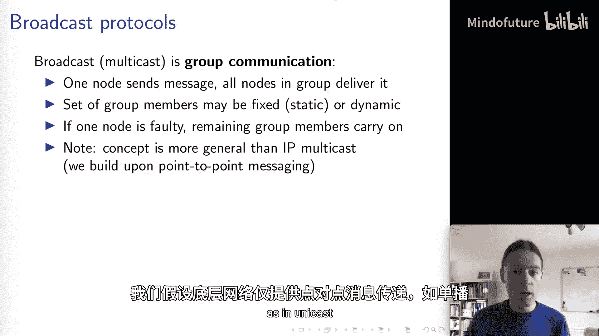

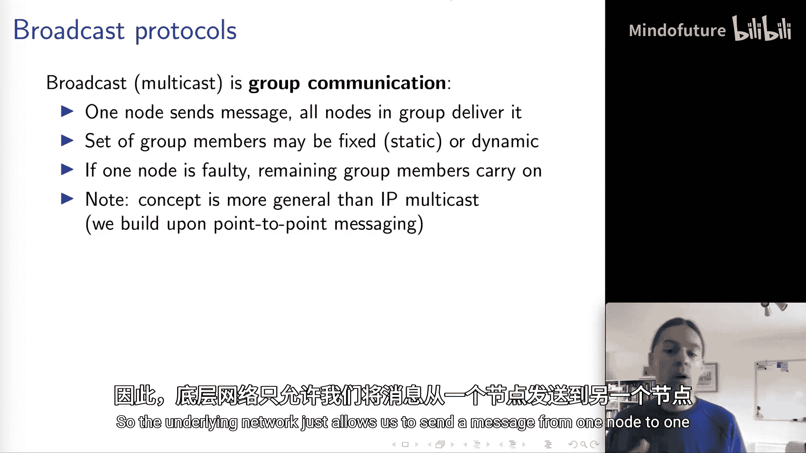

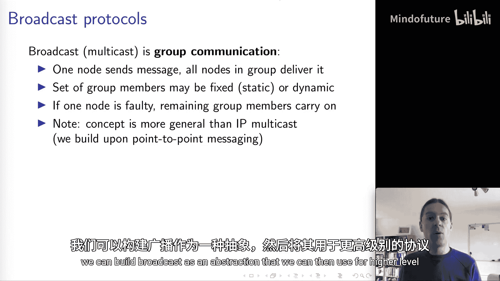

回想一下第2讲中关于系统模型的讨论，我们区分了公平丢失链路和可靠链路。当然，大多数网络链路是公平丢失的，但你可以通过重传消息使其变得可靠。广播协议中存在完全相同的区别，只是在这里，可能丢失消息的网络我们通常称为尽力而为广播。

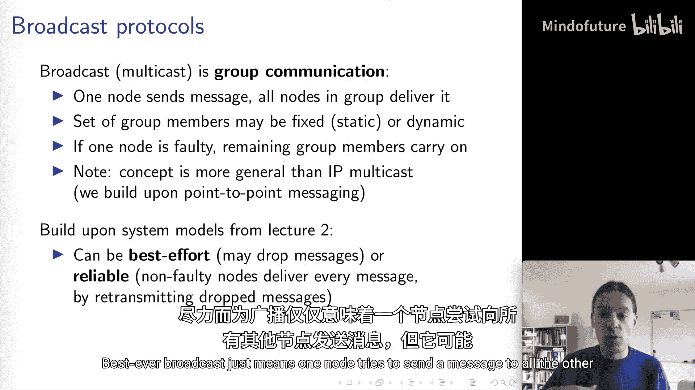

尽力而为广播意味着一个节点尝试向所有其他节点发送消息，但消息可能到达也可能不到达，特别是如果发送者崩溃，消息可能无法到达所有其他节点。

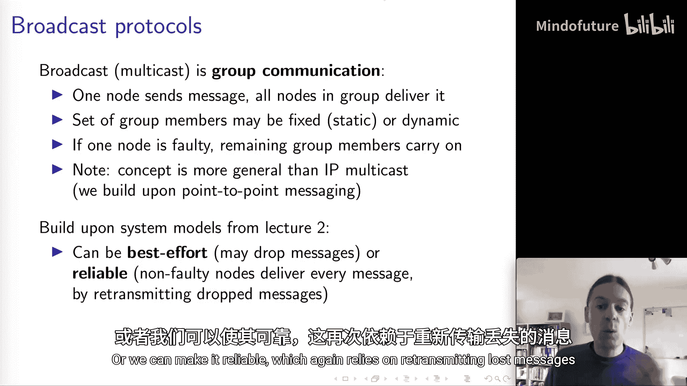

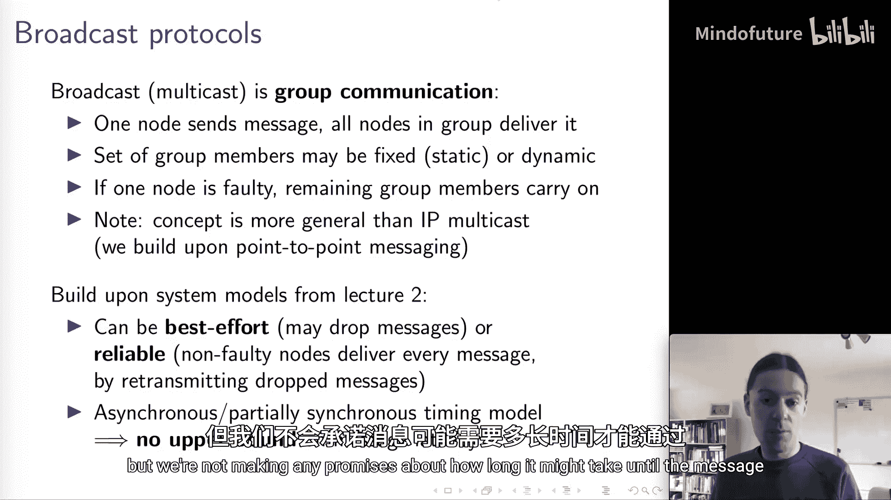

或者我们可以使其变得可靠，这同样依赖于重传丢失的消息。

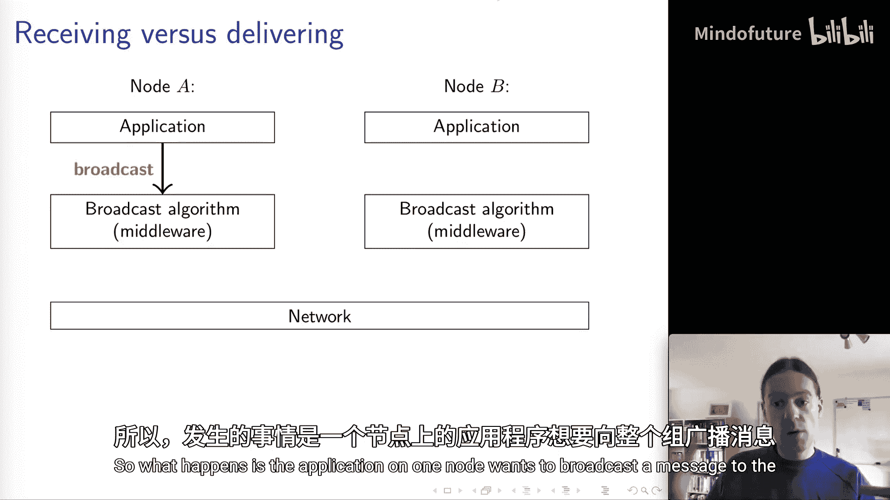

与系统模型背景类似，我们将假设一个异步系统模型，而不是同步系统模型，这意味着我们不假设消息延迟有任何上限。因此，在可靠广播协议中，我们可以说消息最终会到达，但我们不承诺消息到达可能需要多长时间。

以上就是广播的背景。在深入细节之前，我应该介绍一些术语。在点对点网络链路的背景下，我们讨论过通过网络发送和接收消息。而在广播协议的背景下，我们讨论广播消息然后交付它作为对应操作。具体过程是：一个节点上的应用程序希望向整个组广播一条消息，我们称这个动作为广播。

然后，底层的广播算法可能会通过网络发送或接收多条消息。这些是发送或接收的点对点消息。在其他节点上，这些消息可能被接收，再次被广播算法拾取，然后广播算法在某个时刻将消息交付给应用程序。因此，这里的交付是广播的对应操作。这里发生的一个细节是，当广播算法收到一条消息时，它可能不会立即将其交付给应用程序，它可能实际上需要等待一小段时间，因为我们需要确保消息以某种顺序交付。

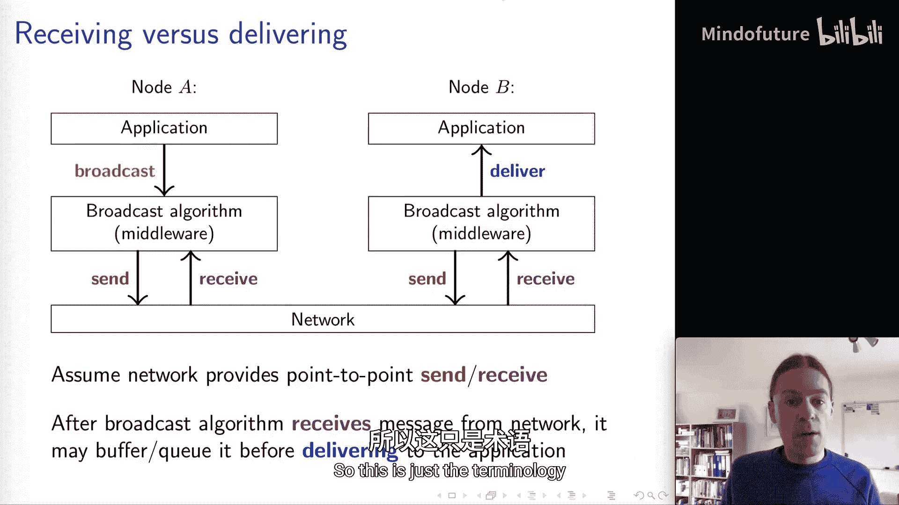

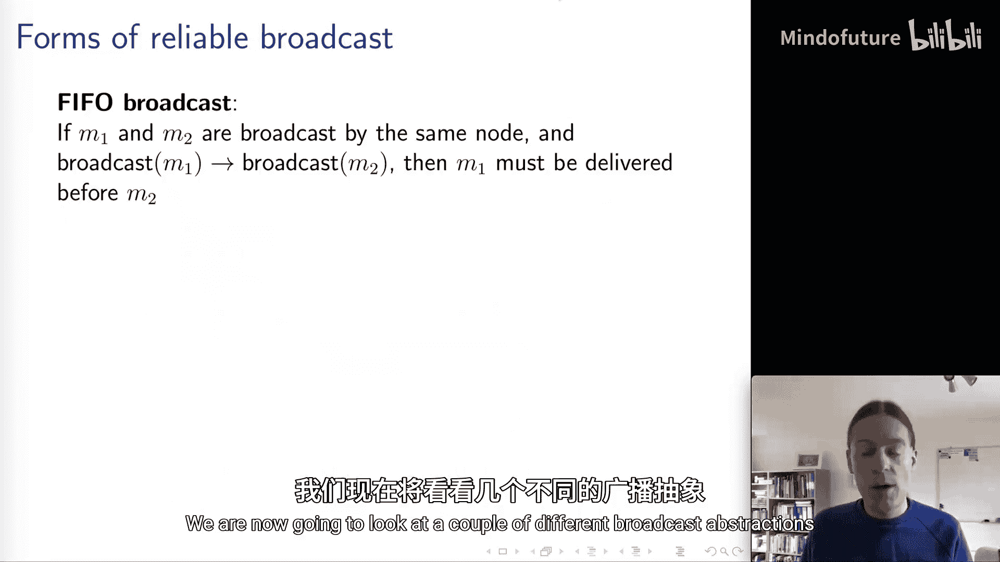

这只是术语。现在我们将看几种不同的广播抽象，我将分别讨论每一种，所以现在不会深入太多细节。这里的重点是，这些都是可靠广播的形式，因此我们假设有一个重传机制，确保所有消息最终都能到达。现在，我们希望根据消息交付的顺序来区分不同类型的广播。

我们要看的第一个是 **FIFO广播**。在FIFO广播中，排序属性是：如果两条消息由同一个节点广播，那么所有节点都将按照它们被广播的顺序交付这些消息。因此，对于从某个特定节点广播的任何消息，它们保持顺序。但对于由两个不同节点广播的任何消息，不保证它们可能到达的顺序。

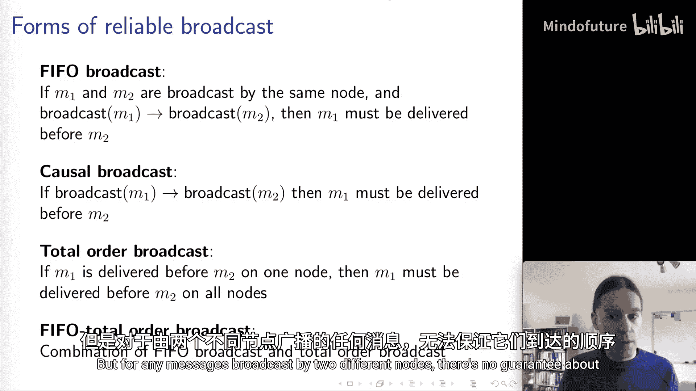

让我们看一个例子。这里我们有三个节点A、B和C。A希望向组广播消息M1。因此，它通过网络将该消息发送给C和B。请注意，A也将消息发送给自己。

这里用这个小回环箭头表示。这看起来可能没有必要，因为发送者已经知道自己发送了什么消息，不需要再次接收。节点向自己交付消息的原因在我们稍后讨论全序广播时会变得明显。现在，只需将其视为广播协议的一个小特点：它总是保证将消息交付给自己。

在M1被交付后，节点B决定向组广播消息M2。因此，它通过网络将M2发送给A和C，并且也将M2交付给自己。最后，节点A希望广播消息M3。同样，它通过网络将该消息发送给B和C，并将M3交付给自己。

这就是FIFO广播。正如刚才所说，对于FIFO广播，因为M1和M3都是由同一个节点A广播的，我们要求所有节点在交付M3之前先交付M1。我们可以检查这里的情况：A在这里交付M1，然后交付M3；B交付M1，然后交付M3；C也交付M1，然后交付M3。所有节点都以正确的顺序交付这些消息。

实际上，在FIFO广播下，有几种可能的顺序是有效的。特别是，由B发送的消息M2，相对于A的消息可以任意排序，因为我们不保证不同节点之间的顺序，而M2是由B发送的。这意味着M2可以在M1和M3之前交付，或在两者之间交付，或在两者之后交付，所有这些都可以。例如，这里我们可以考虑C以不同顺序交付消息的两种不同执行情况。

在第一种情况下，C先交付M1，然后M2，然后M3。在第二种情况下，C先交付M2，然后M1，然后M3。这两种顺序在FIFO广播下都是有效的，即使在第二种情况下，从因果意义上说，消息M2发生在M1之后，但FIFO广播并不保证M2在M1之后交付。

如果你确实想要那种排序属性，你需要因果广播。**因果广播**确保消息按因果顺序交付。这意味着，如果一条消息的广播在“先于”关系的意义上先于另一条消息的广播，那么这些消息必须按照匹配该“先于”关系的顺序交付。

这就是我们这里的情况。首先，M1由A广播，被B和C接收，并在这里被B交付。

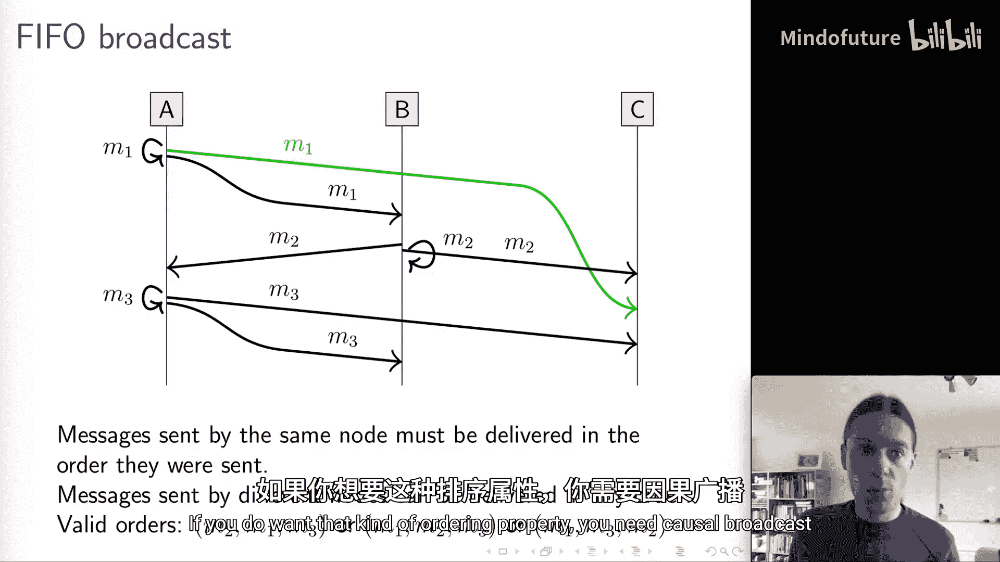

然后，在B交付M1之后，B希望广播M2。因此，M2可能对M1有因果依赖，因此我们要求所有节点必须先交付M1，然后交付M2。

接下来，节点A可能广播消息M3。同样，它通过网络发送给其他两个节点，并将消息交付给自己。在这种情况下，请注意M2的广播与M3的广播是并发的，因为在A上，M2是在M3广播之后交付的；在B上，M3是在M2广播之后交付的。因此，这两条消息彼此不依赖。在这种情况下，我们要求任何具有因果依赖关系的消息都按因果顺序交付。因此，这里M1和M2之间存在因果依赖，M1和M3之间也存在因果依赖（因为M1和M3由同一个节点A广播），但M2和M3之间没有因果依赖。这意味着M2和M3可以按任意顺序交付。

因此，这里C又有两种不同的交付顺序。在第一种情况下，C先交付M1，然后M3，然后M2。在第二种情况下，C先交付M1，然后M2，然后M3。这两种顺序在因果广播下都是可以的。我们可以交换M2和M3的交付顺序。

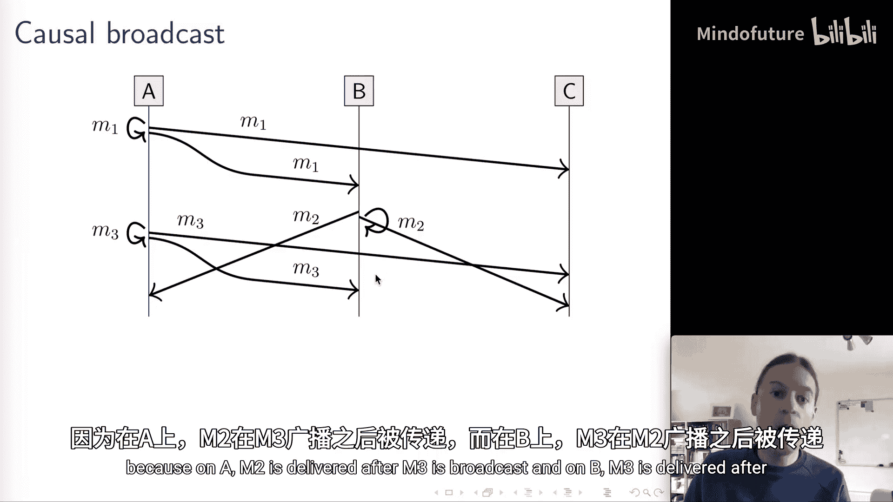

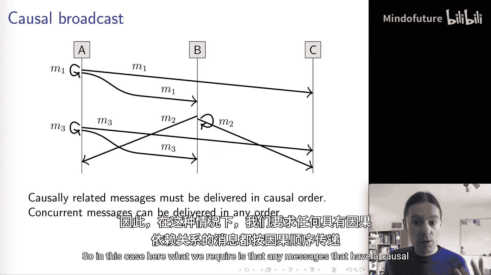

请注意，例如，A先交付M1，然后M3，然后M2；而B先交付M1，然后M2，然后M3。这两种顺序都是有效的因果顺序，但它们并不相同。在某些情况下，我们实际上要求所有节点以相同的顺序交付消息。如果这是我们想要的，我们需要转向所谓的**全序广播**。

全序广播将所有在系统中广播的消息放入一个全序中，这意味着总是清楚哪一条消息先出现。它确保所有节点以相同的顺序交付消息，因此所有节点就消息应被交付的顺序达成一致。

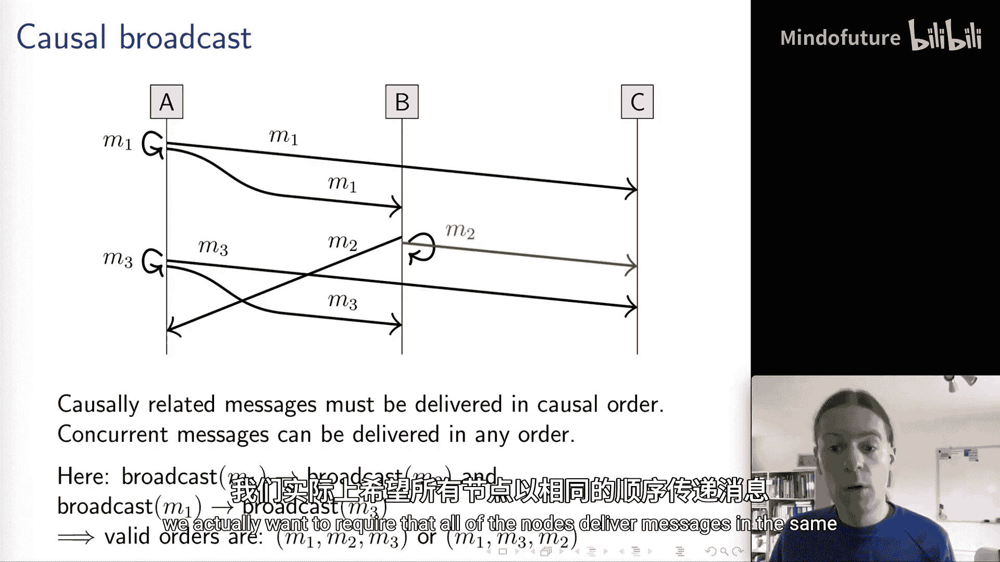

在这个例子中，同样，我们从A广播M1开始，然后有B广播的M2（发生在M1之后），最后有A再次广播的消息M3。

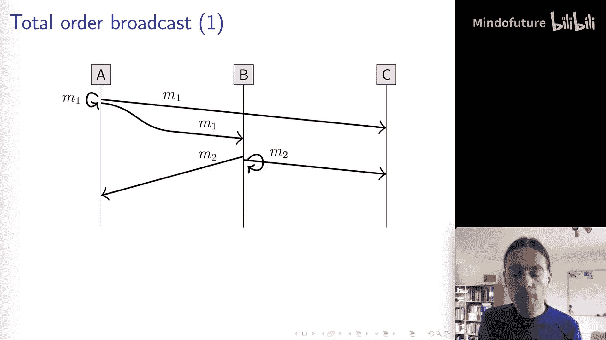

在这种情况下，某个地方必须决定这些消息的交付顺序。假设决定的顺序是先交付M1，然后M2，然后M3。我们可以看到，例如在C上，情况就是如此：C先交付M1，然后交付M2，然后交付M3。C以正确的顺序交付它们。让我们看看这里的B：B先交付M1，然后将M2交付给自己，然后交付M3。B也以正确的顺序交付消息。让我们看看节点A：节点A先将M1交付给自己，然后广播M3。但是等等，它还不能立即将M3交付给自己，因为决定的顺序是M2必须在M3之前交付。因此，节点A不能立即将M3交付给自己，相反，它必须首先等待M2到达并被A交付，然后才被允许将M3交付给自己。

这就是向自己交付变得非常有趣和关键的地方，因为你可以看到有时必须存在这种延迟，如果一个节点想向自己交付一条消息。这里M1、M2、然后M3是交付这些消息的一种可能顺序。

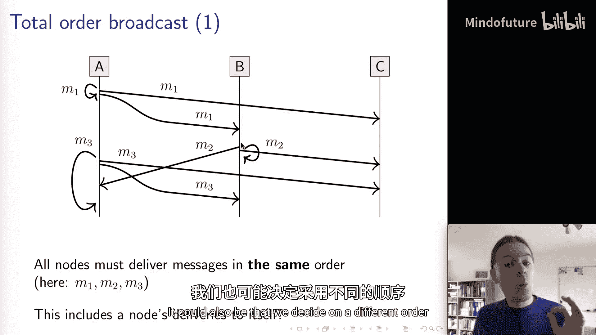

也可能我们决定一个不同的顺序，例如交付顺序为M1、M3、M2。只要所有节点以相同的顺序交付消息，这也是可以的。这里同样，我们从C开始：C先交付M1，然后M3，然后M2。请注意，C可能通过网络在收到M3之前就收到了M2，在这种情况下，C将不得不延迟M2的交付，直到M3到达之后。这在广播算法中称为**暂缓**，如果消息尚未准备好交付，因为我们在等待其他消息先到达，通常有必要暂缓消息，这在C的情况下发生了。

对于节点B，交付顺序为1、3、2。首先我们交付M1，然后M3，但我们不能立即将M2交付给自己。我们必须先等待M3被交付，然后才被允许在B将M2交付给自己。在节点A上，事情现在更简单了：首先我们将M1交付给自己，然后将M3交付给自己。最后，M2通过网络到达，我们将M2交付给自己。

因此，这两种情况都是全序广播的有效执行。关键点在于，无论消息以何种顺序交付，该顺序对于所有节点必须相同。

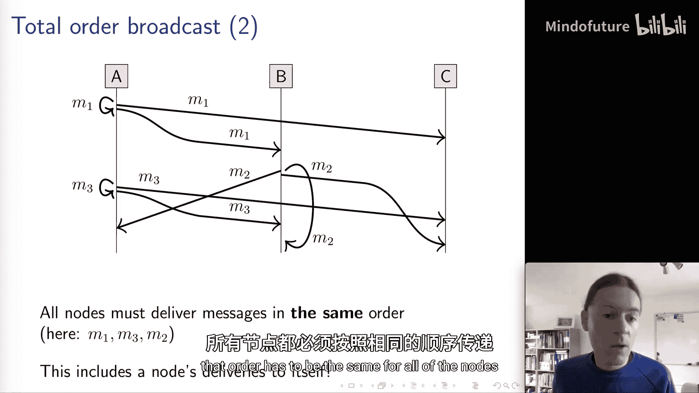

最后，还有一种称为 **FIFO全序广播** 的东西，它只是将全序广播与FIFO排序结合起来，这意味着所有节点必须以相同的顺序交付消息，并且由同一节点发送的消息必须按照它们被发送的顺序交付。

事实证明，FIFO全序广播严格强于因果广播。因此，FIFO全序广播的每一次执行也满足因果广播的要求。而因果广播的每一次执行也满足FIFO广播的要求，每一个FIFO广播都满足可靠广播的要求，依此类推。实际上，本讲的讲义中有一个练习，要求你证明这些广播模型之间的一些关系。

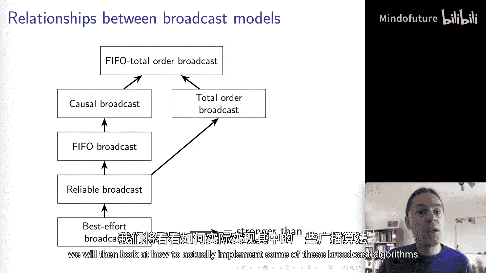

在下一节中，我们将看看如何实际实现其中一些广播算法。

---

本节课中我们一起学习了分布式系统中的广播协议。我们从广播作为点对点通信的泛化开始，介绍了尽力而为广播和可靠广播的区别。然后，我们深入探讨了三种主要的排序广播类型：**FIFO广播**（保证同一发送者的消息顺序）、**因果广播**（保证因果相关的消息顺序）以及**全序广播**（保证所有节点以完全相同的顺序交付所有消息）。我们还简要提到了结合两者的FIFO全序广播。理解这些不同级别的排序保证对于设计满足特定一致性要求的分布式系统至关重要。