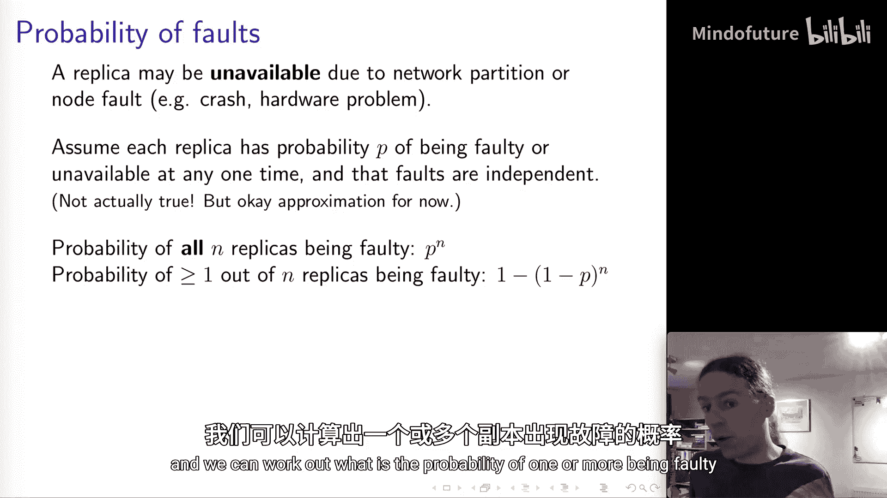
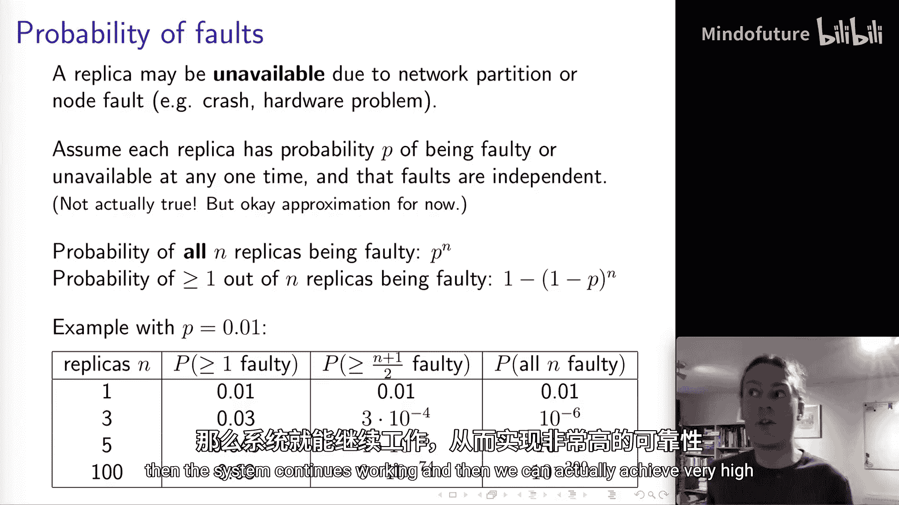
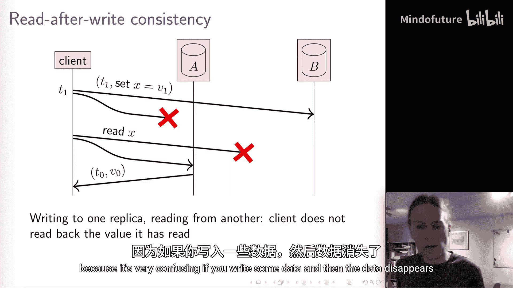
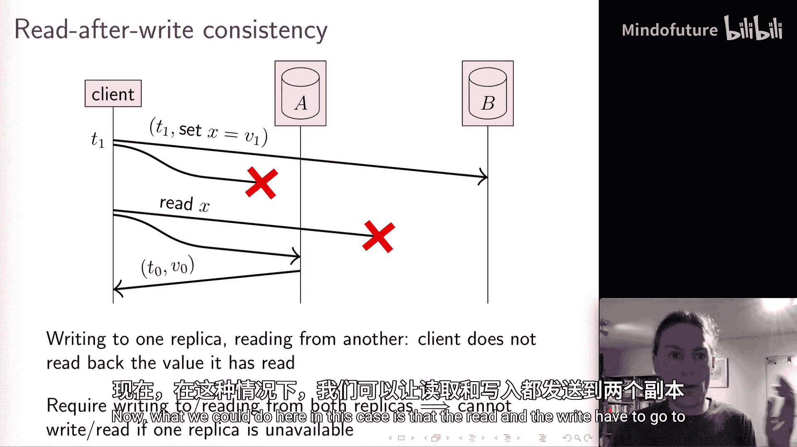
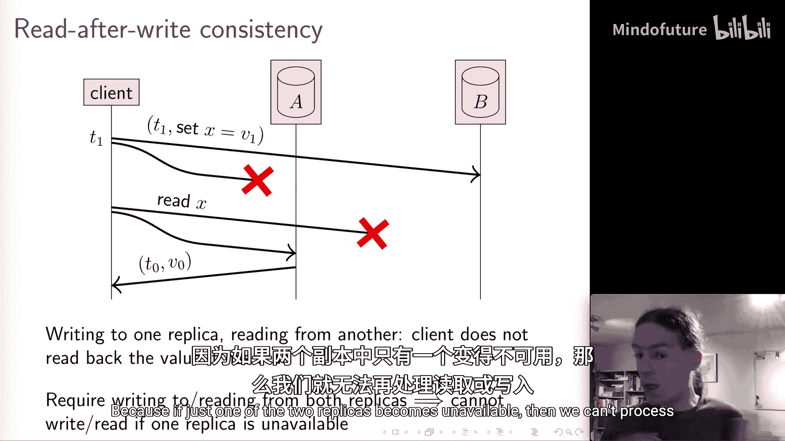
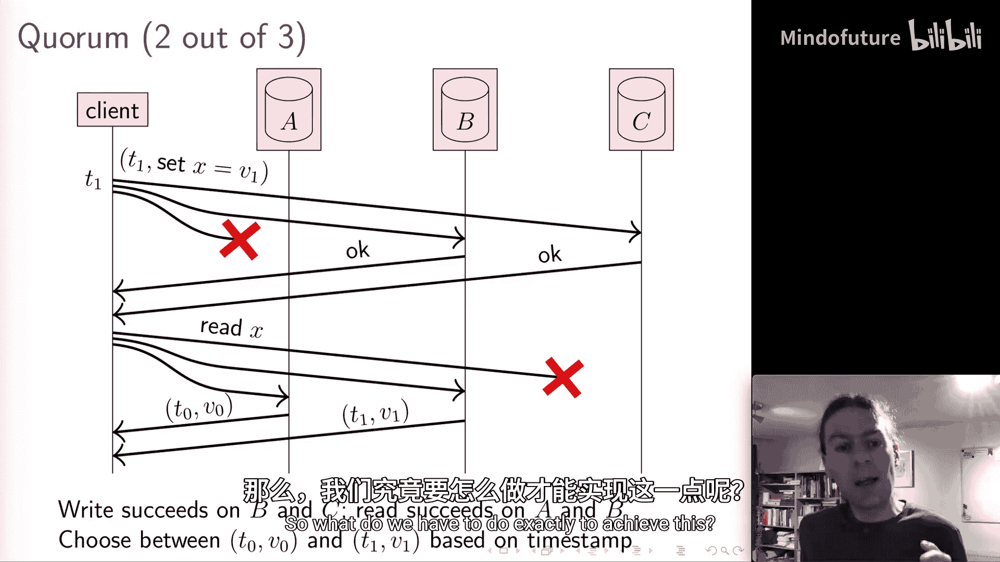
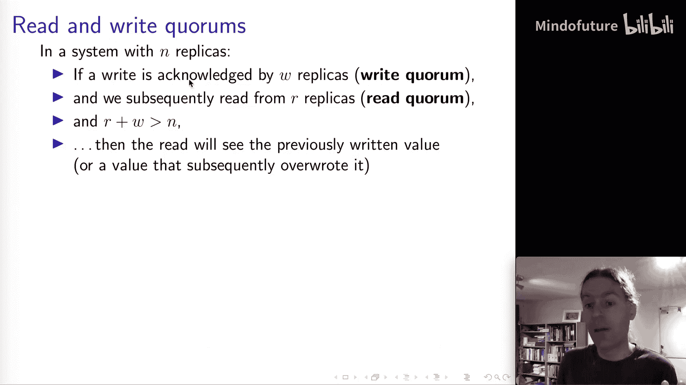
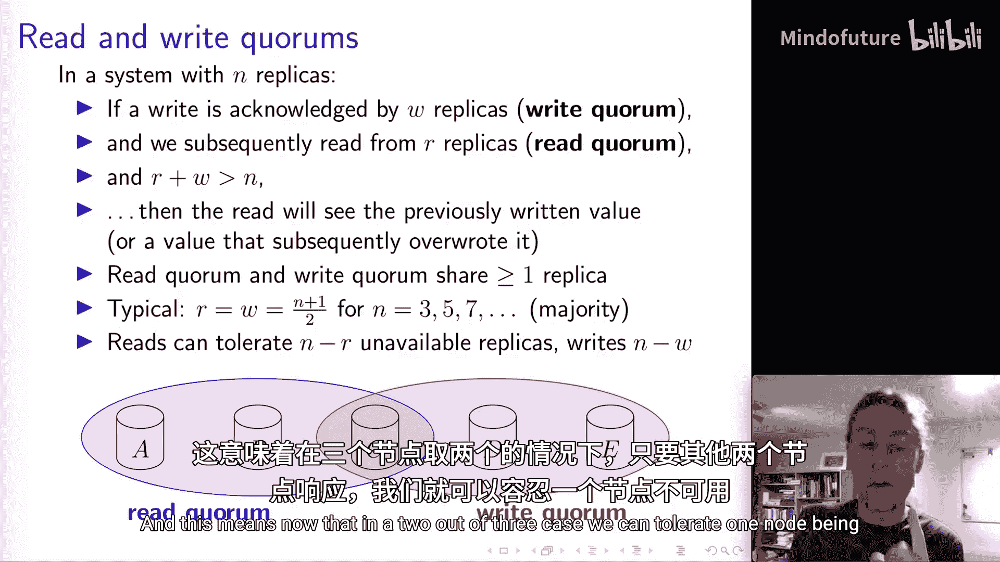
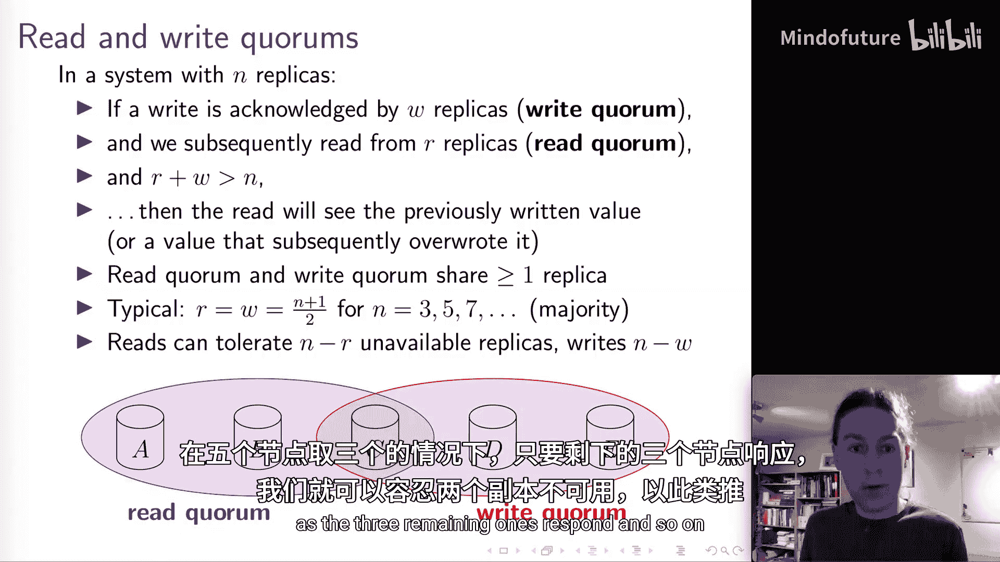
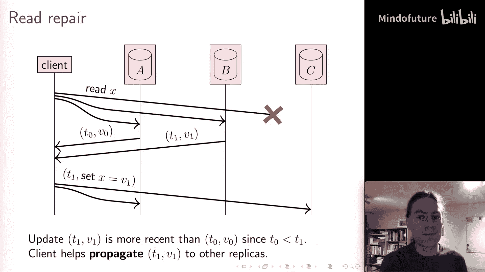

# 【剑桥大学-•-中英】分布式系统讲座-p15-P15-Distributed-Systems-5.2---Quorums--BV1NwQhYeEyV_p15-

The reason we want replication is typically to make systems more reliable。

 so a node might be unavailable for all sorts of reasons it might crash。

 it might have a hardware problem。 It might be just rebooting due to routine maintenance。

 Let's assume just there's some probability P that a node is unavailable at any given time and let's also assume that whether one node is unavailable is independent from whether another node is unavailable。

 so we're going to assume that faults are not correlated。 This is not actually true。

 there have been studies that have shown that actually faults do tend to be correlated in practice but just for the purposes of some rough estimation it's okay for now to assume that they are actually independent。

So now if p is the probability of one any one node being fault0。

 that means the probability of all n replicas being 40 is p to the n。

 and we can work out what is the probability of one or more being faulty and we can make a little table and what this table shows here is if you look at the column for at least one node being 40 as you increase the number of replicas。

 it becomes almost certain that at least one of them is faulty at any any given time。

So in that sense， the as you add replicas， to the system becomes less reliable because。😊。

Given anyone one has a chance of failing， as you have loads of replicas。

 there'll always be one that is failed at any moment。 However。

 if we take the probability of all of them being faulty。

 this probability decreases exponentially as you increase the number of replicas。

 And even if you consider not the probability of all of them failing。

 but does the probability of half of the nodes， half of the replicas failing。

 this probability also decreases exponentially with the number of replicas。

 So this is why we can achieve full tolerance because as long as it's okay if some of the nodes are unavailable。

 some of the replicas are unavailable， we just have to make sure that given at least most of the replicas are available。

 then the system continues working。 and then we can actually achieve very high reliability。

So let's look at one particular property that we might want in a for tolerant replicated system。

And that is called read after write consistency。 So what happens here is that a client first writes some data。

 and then reads the same data back again， and you would naturally expect that client to just to then see the data that it has just written。

 So here client wants to set the key X to the value V1。

 and we attach a timestamp of T1 to that operation。

 It sends that update to both replicas of the database A and B。

 The data the replica B receives that update and processes it whereas replica A is unavailable。

 And so the update is not processed by a。Then subsequently。

 the client goes and wants to read X again。 But for some reason now the things are flipped around and now a is available。

 but B is not available。 And so now the response that a that the client gets back from a does not reflect that value V1 that has been written。

 So the response is going to be some earlier value V0 that the replicas had before this scenario here started。

 So in this case， we have violated read after write consistency。

 which is kind of unfortunate because you know it's very confusing if you write some data and then the data disappears and then sometime later the data reappears again。

Now。What we could do here in this case is that the read and therite have to go to both replicas。

 and so that way we would ensure that we don't get this crossover problem where only one of the replicas has seen the update and we read from the other one。

But now if we require a read or write to go to both replicas。

 then the system is not full tolerant because if just one of the two replicas。

 it becomes unavailable， then we can't process reads or writes anymore。

So we can solve this problem using something called a quorum。

 And what we do here is here I've got an example quorum of two out of three。

 And so when we want to make a right， the client sends its requests to all three replicas。

 we're going to assume here there are three replicas and the for some reason the request reaches two out of three of these two replicas。

 So the request reaches B and C， but not a。And then B and C are going to respond to the client saying。

 okay， yes， I got your request to update this particular key X。

 And once the client has collected two positive responses， then it's happy。

So the fact that the response didn't the request didn't get through to a is okay。

 So maybe A is unavailable as long as B and C still respond， that's still fine。Now， second。

 the client goes to read， and it sends its read again to all three replicas。

 as before only two of them get it。 And so in this case， for some reason。

 the read to C doesn't go through， but the reads to A and B do go through。 And so in this case now。

 the client will receive responses from A and B。 It will get the correct response that it was expecting from B because B has seen the right。

 It will get an outdated response from A， because a didn't get the right。

 But at least one of the responses that the client got back， has the updated value。

 And so now the client can use the times stamps T 0 and T1 to figure out which is the more recent update。

 And this now allows the client to know what the correct response should be that it returns to the application and the application is happy because it has read after right consistency。

😊，So what do we have to do exactly to achieve this， We use quorums。

 and whenever you want to make a right to some number of replicas。

The right will be considered successful as long as it has been acknowledged by at least W replicas。

 So this is our right quorum。And then when you read。😡。

If you get a response back from at least our replicas。

So now we have W and R as are two parameters of this algorithm。

 and we require that the sum of w and R is strictly greater than the number of replicas in the system。

 So in our example here， W was2 R was 2 and n was 3。 So2 plus2 is greater than 3。

 And so in this case， we can guarantee that the read will see the previously written value。

 or maybe it was concurrently overwritten by another by another client。

 but it will see an up to date value， whereas if we have if this R plus w is less than or equal to n。

 it could happen that we don't get the value back that we were expecting。

So the idea here is that the read， the write goes to some subset of nodes。

 the read goes to some subset of nodes， and we want those two subsets to overlap。

 and we can guarantee that they will overlap in at least one replica if we have this R plus w greater than in this quorum condition。

Another way of putting this is that these we have these two subsets and subsets of nodes have to have a non empty intersection。

 So for example， if we have five nodes， we could require a write quorum of three and a read quorum of three that would satisfy this condition。

And in this case， those two subsets of nodes are always guaranteed to have at least one element in common。

 so they will have a non empty intersection。One common way of constructing these quorums is what are called majority quorums。

 where we say that we are going to assume that we have an odd number of nodes。

 and as long as the read quorum right form are strictly more than half of the number of nodes。

 then it's fine。 So that means we require two out of three we require three out of five。

4 out of7 and so on。 And this means now that in two out of three case。

 we can tolerate one node being unavailable as long as the other two respond in three out of five case。

 we can tolerate two replicas being unavailable as long as the three remaining ones respond and so on。

So this is all the quorums are about， really。😊，Now that we've done these quorum reads and writes。

 one thing that we can do is for the client can help get those different replicas back in sync with each other again。

 so in this case here the client received an outdated value from A and it received the up to date value from B and it didn't receive anything at all from C and so the client already knows now that A and B and C are inconsistent with each other。

And so the client can help clean this situation up by actually sending the update back to A and C。

 So C might not need it because it might be that C actually has the up tod value。

 but it just didn't respond。 there's no harm in sending it again。

 and certainly we want to send the update to A so that now A and B both have the updated value B1。

 So notice that we use the original times stampamp here because this is effectively just the retry。

 This is not a new set operation。 and therefore it's correct to use the right timestamp。

 and the client can thus help propagate and the values between the replicas。

 So we have the antienttropy if we discussed earlier。

 as one mechanism for the replicas to get back in sync。 and this process here。

 read repairpair is another way that helps the replicas but get back in sync with each other。

