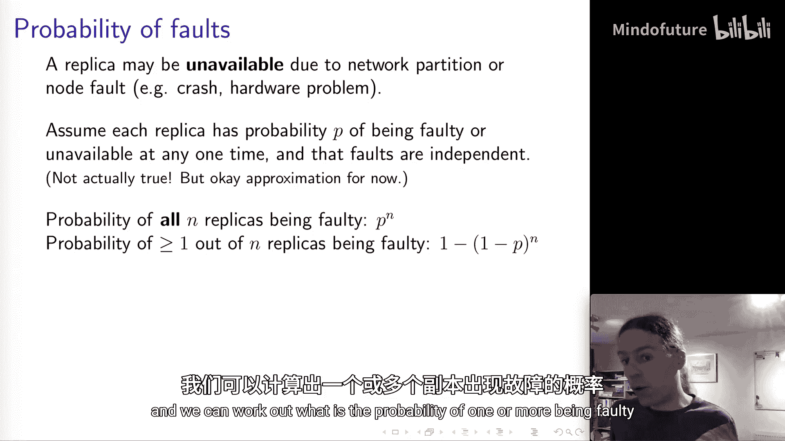
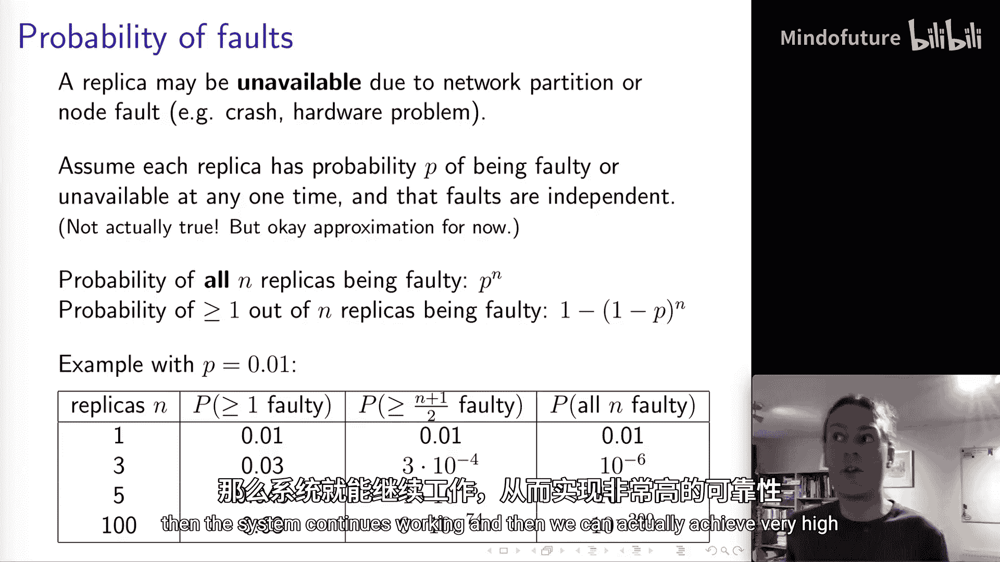
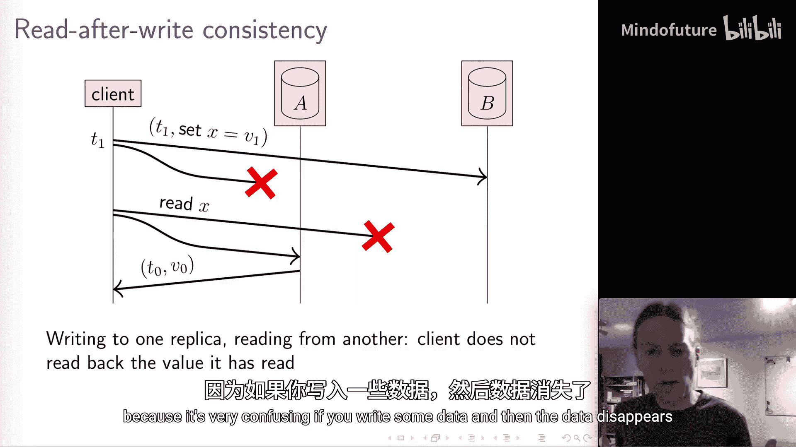
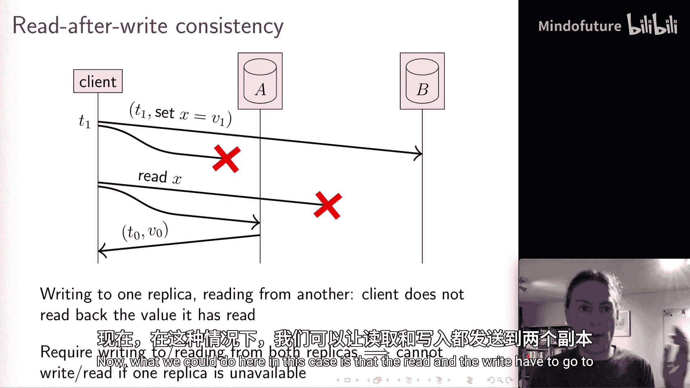
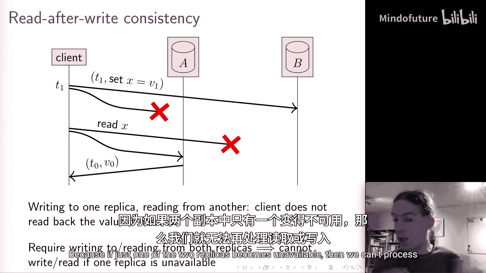
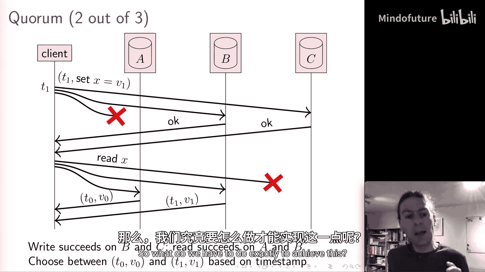
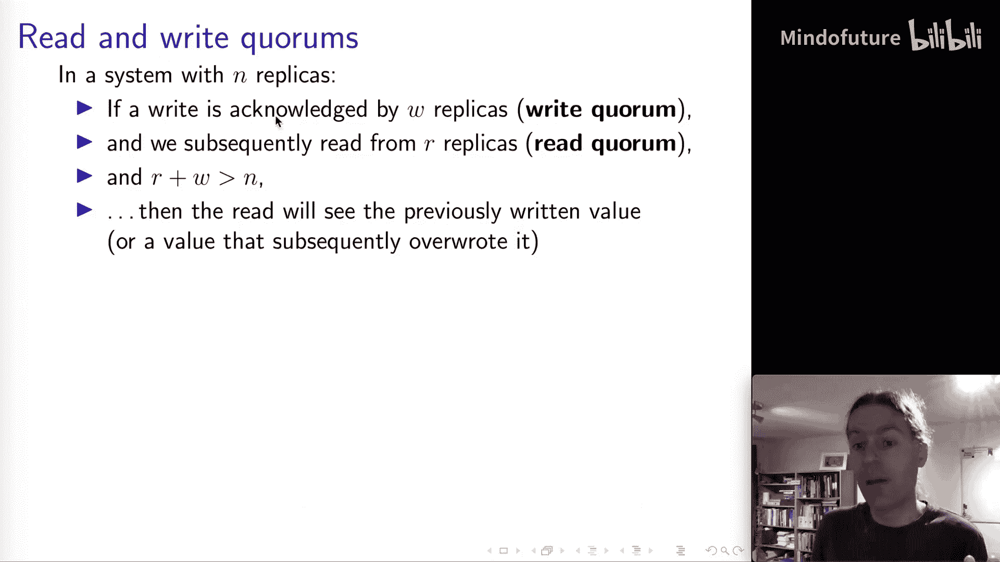
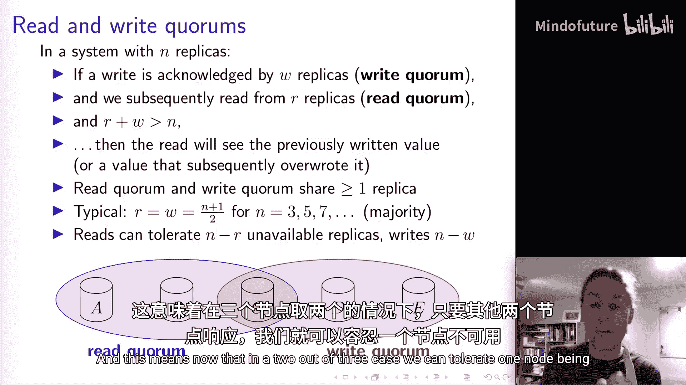
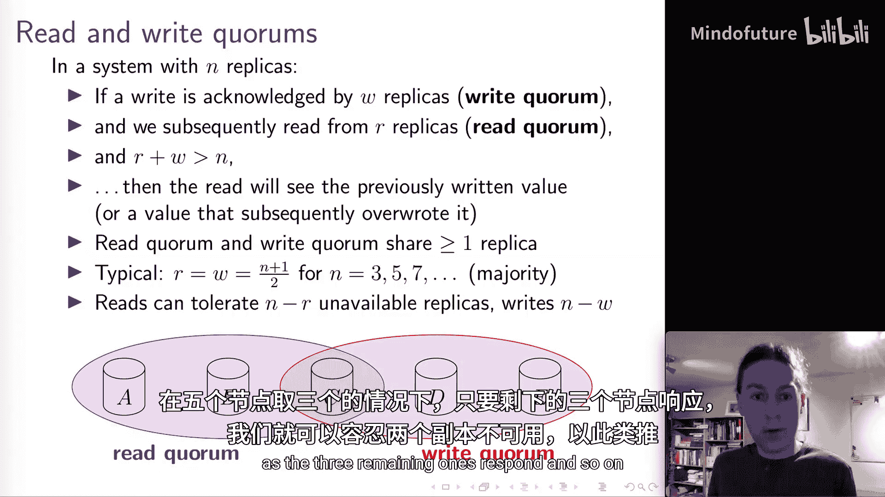
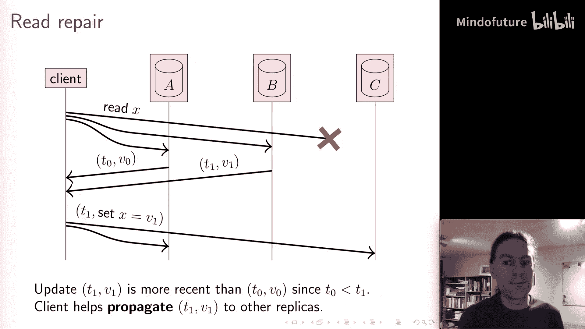

# 分布式系统：5.2：法定人数（Quorums）🏛️

在本节课中，我们将要学习分布式系统中数据复制的核心概念——法定人数（Quorums）。我们将探讨为何需要复制、如何通过法定人数机制在保证系统可用性的同时，实现读写一致性。

## 复制与可靠性

我们进行数据复制的主要目的是提高系统的可靠性。一个节点可能因各种原因变得不可用，例如崩溃、硬件故障或例行维护重启。

假设在任意给定时间，一个节点不可用的概率为 `P`。同时，我们假设一个节点是否可用与另一个节点是否可用是相互独立的。虽然实际研究表明故障往往是相关的，但为了进行粗略估算，我们暂时假设它们是独立的。

如果 `p` 是单个节点发生故障的概率，那么所有 `n` 个副本同时故障的概率就是 `p^n`。我们可以计算出一个或多个副本故障的概率。从下表的“至少一个节点故障”列可以看出，随着副本数量的增加，在任意时刻至少有一个副本故障的概率几乎变为必然。

从这个意义上说，随着副本数量的增加，系统似乎变得更不可靠，因为节点越多，总有一个可能故障。然而，如果我们考虑所有副本都故障的概率，这个概率会随着副本数量的增加呈指数级下降。即使我们考虑的不是全部故障，而是半数副本故障的概率，这个概率同样会随着副本数量增加而指数级下降。

因此，只要系统在大多数副本可用时就能继续工作，我们就能实现容错，并达到非常高的可靠性。

## 读写一致性

现在，让我们来看一个容错复制系统需要具备的一个特定属性：读写一致性。

读写一致性是指，一个客户端写入一些数据后，立即读取相同的数据，它应该能看到自己刚刚写入的数据。

考虑以下场景：客户端希望将键 `X` 的值设置为 `V1`，并为该操作附加时间戳 `T1`。它将更新发送到数据库的两个副本 `A` 和 `B`。副本 `B` 接收并处理了更新，而副本 `A` 不可用，因此更新未被 `A` 处理。随后，客户端再次读取 `X`。但此时情况反转，`A` 可用而 `B` 不可用。于是，客户端从 `A` 得到的响应并不反映已写入的值 `V1`，而是该场景开始前副本持有的旧值 `V0`。

在这种情况下，我们违反了读写一致性。这会造成混乱，因为写入的数据似乎消失了，之后又可能重新出现。

## 简单方案及其问题

为了解决这个问题，一个直观的想法是让读和写操作都访问所有副本。这样就能避免只有一个副本看到更新，而读取却从另一个副本进行的问题。

但是，如果要求读写都必须访问所有副本，那么系统就不再是容错的。因为只要两个副本中有一个不可用，我们就无法处理任何读写请求。

## 法定人数方案

我们可以使用“法定人数”来解决这个问题。以下是一个“三中取二”的法定人数示例。

当客户端想要写入时，它将请求发送给所有三个副本。假设请求到达了其中两个副本（`B` 和 `C`），但没有到达 `A`。`B` 和 `C` 会响应客户端，确认收到了更新键 `X` 的请求。一旦客户端收集到两个肯定的响应，它就认为写入成功。因此，请求没有到达 `A` 是可以接受的，只要 `B` 和 `C` 有响应即可。

随后，客户端进行读取。它再次将读请求发送给所有三个副本。这次，假设只有两个副本（`A` 和 `B`）收到了请求，而 `C` 没有。客户端将从 `A` 和 `B` 收到响应。它会从 `B` 得到正确的响应（因为 `B` 看到了写入），从 `A` 得到一个过时的响应（因为 `A` 没收到写入）。但客户端收到的响应中，至少有一个包含了更新后的值。

现在，客户端可以利用时间戳 `T0` 和 `T1` 来判断哪个是最近的更新。这使得客户端能够知道正确的响应应该是什么，并将其返回给应用程序，从而满足读写一致性。

## 法定人数算法

具体来说，我们需要做的是使用法定人数。每当你想向一些副本写入时，只要写入操作得到至少 `W` 个副本的确认，就被认为是成功的。这被称为**写入法定人数**。

当进行读取时，如果你从至少 `R` 个副本得到响应，就可以处理。这被称为**读取法定人数**。

`W` 和 `R` 是这个算法的两个参数。我们要求 `W` 和 `R` 的和严格大于系统中的副本总数 `N`。

用公式表示即：
**W + R > N**

在我们的例子中，`W=2`，`R=2`，`N=3`。`2+2 > 3`，因此我们可以保证读取操作能看到之前写入的值（或者被另一个客户端并发覆盖的最新值）。如果 `R + W ≤ N`，则可能无法读到预期的值。

这个机制的核心思想是：写入操作访问一部分节点，读取操作访问另一部分节点，我们希望这两个节点子集有重叠。只要满足 `W + R > N` 这个法定人数条件，我们就能保证它们至少在**一个**副本上重叠。换句话说，这两个节点子集必须有一个非空的交集。

例如，如果我们有5个节点，可以要求写入法定人数 `W=3`，读取法定人数 `R=3`，这满足条件。在这种情况下，这两个节点子集总是保证至少有一个公共元素。

## 多数法定人数

一种常见的构造法定人数的方法是“多数法定人数”。我们假设节点数为奇数，只要读写法定人数严格超过节点总数的一半即可。

这意味着：
*   对于3个节点，需要 `2` 个。
*   对于5个节点，需要 `3` 个。
*   对于7个节点，需要 `4` 个。

以此类推。

这样，在“三中取二”的情况下，只要另外两个节点响应，我们可以容忍一个节点不可用。在“五中取三”的情况下，只要剩余三个节点响应，我们可以容忍两个副本不可用。

## 读修复

在完成法定人数读写后，客户端可以帮助不同的副本重新同步。

在上述例子中，客户端从 `A` 收到了过时的值，从 `B` 收到了最新值，从 `C` 没有收到任何响应。客户端已经知道 `A`、`B`、`C` 彼此不一致。

客户端可以通过将更新再次发送给 `A` 和 `C` 来帮助清理这种情况。`C` 可能不需要，因为它可能已经有最新值只是没响应，但再次发送也无妨。我们肯定需要将更新发送给 `A`，这样 `A` 和 `B` 就都有了更新后的值 `V1`。

注意，这里使用的是原始时间戳，因为这本质上只是重试，不是一个新的设置操作。因此，使用原始时间戳是正确的。客户端可以借此帮助在副本间传播值。

之前讨论的反熵是副本重新同步的一种机制，而这里的“读修复”过程是另一种帮助副本彼此同步的方式。

## 总结

本节课中我们一起学习了分布式系统中的法定人数机制。我们了解到，数据复制虽然引入了副本不一致的风险，但通过精心设计读写法定人数（要求 `W + R > N`），可以在保证系统高可用性的同时，实现读写一致性。多数法定人数是一种常见且有效的实现方式。此外，客户端参与的“读修复”机制可以辅助副本间达成最终一致。法定人数是构建可靠、容错分布式系统的基石之一。