# 【剑桥大学-•-中英】分布式系统讲座-p17-P17-Distributed-Systems-6.1---Consensus--BV1NwQhYeEyV_p17-

Hello and welcome to lecture 6 on distributed systems Today we will look at consensus。

 which is one of the most tricky but also one of the most important problems in distributed systems。

And the context of this is last lecture we talked about state machine replication。

 which is a great way of replicating some data from one node to another from one repa to another and in order to do state machine replication we need to ensure that all of the replicas see the same updates in the same order which we can do with total order broadcast This now raises the question of how do we implement total order broadcast。

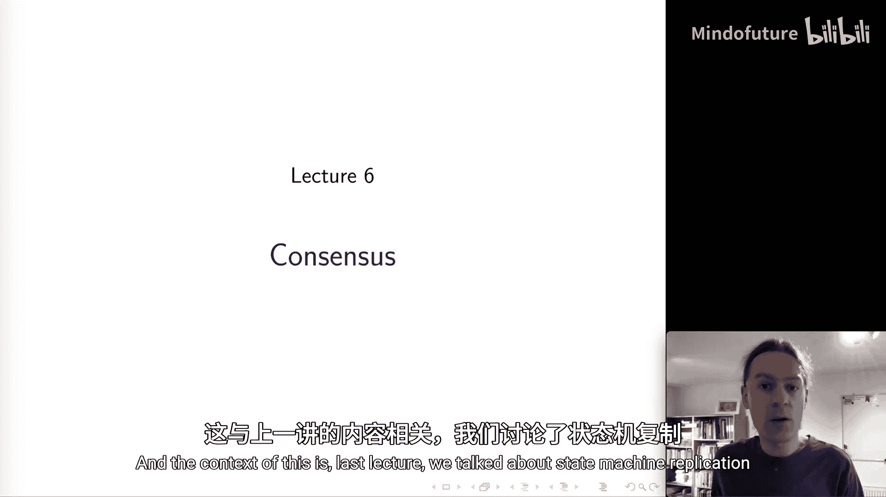

We saw one way of doing this is to send all of the messages via a particular dedicated node that we call the leader。

 and this node is going to order all of the messages and make sure that they get delivered in the same order on all of the nodes。

Unfortunately， if that leader crashes or it becomes unavailable due to a network problem or it has hardware failure or whatever anything goes wrong。

 then this approach to total order broadcast stops working。Now， the question is now really。

 how can we deal with the problem of a leader becoming unavailable？

One option is to manually switch over to a new leader and this process is called failover so manually means there's a human operator who gets notified if the leader fails and this human is then going to choose a new node as the new leader and it's going to reconfigure the system so change all of the followers to accepting this new node as their new leader telling this load this new node that it now has to be the leader and act in this capacity to implement total order broadcast。

And this works fine if you know in advance if the leader is going to go down， which could happen。

 for example， if the leader is going down due to planned maintenance。

 so if you know advance in advance that you want to reboot the leader tonight in order to install some software updates。

 then you just move the leader role to a different node before you install the software updates and then you can take it down in peace and quiet and no problems at all。

Unfortunately， this doesn't really help you in the case where the leader crashes unexpectedly or if the leader suddenly develops a hardware fault and suddenly just stops working and you know computers do that sometimes they do sometimes just stop working in that case。

 it'll probably stop working at the most inconvenient time So like three in the morning and so somebody then has to get phoned and they have to get out of bed and log into their computer。

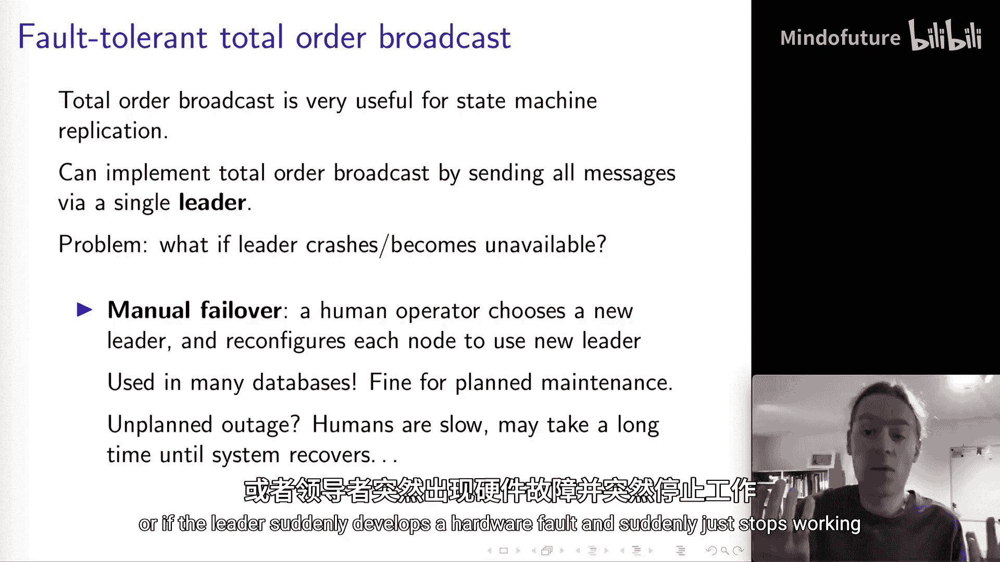

And reconfigure the system to use a new leader and so on。

 and so this is possible and some database systems do implement replication in this way。

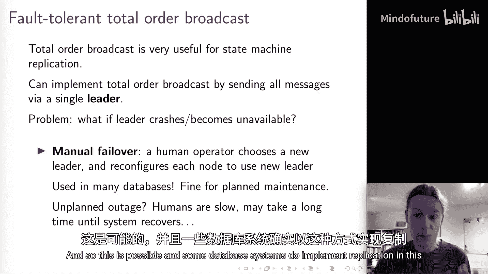

But it does beg the question， can we somehow do this leader transition automatically so that we don't have to wake people up at three o'clock in the morning？

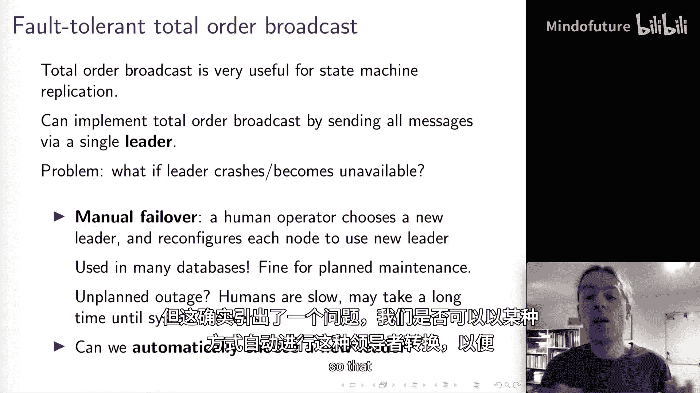

And this transition of to a new leader is exactly what consensus algorithms are all about。

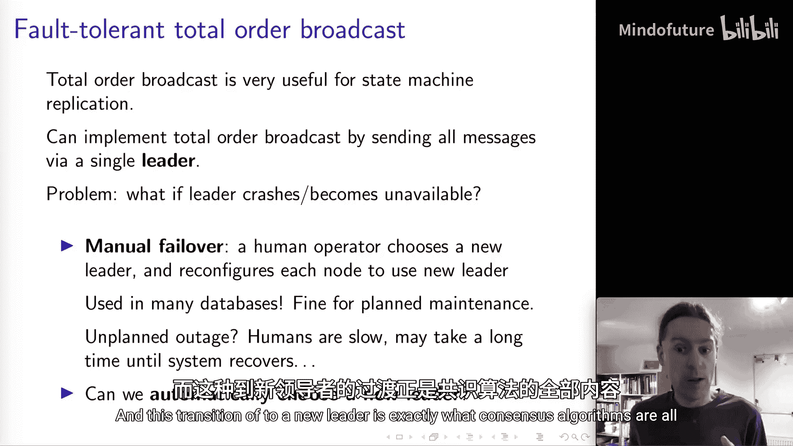

So consensus and total order broadcast are two different problems。

 but they are actually quite closely related， as I'll explain now。

 So the traditional way in which consensus is formulated in distributed systems is that you've got multiple nodes each node may propose a value and you want all of the nodes to decide on the same value。

 So think of it as like several friends deciding where to go for lunch today and like they propose different restaurants or shops to go to and then by some kind of process。

 one of those proposal that is going to get picked and then everybody is going to go to the same shop or restaurant for lunch and so this is the consensus problem we want nodes to agree on on one of the values that was proposed。

Now， you can think of this as being equivalent to total order broadcast because in total order broadcast。

 what happens is we want all of the nodes to deliver the same messages in the same order。

 and so this agreement that the nodes need to come to is the agreement on what is the next message to deliver in this total order and so you can keep doing consensus once for each message that needs to be delivered and the consensus will guarantee that all of the nodes will make the same decision and so at some point a node decides that on a certain value。

 which means in total order broadcast terms， it delivers that message。

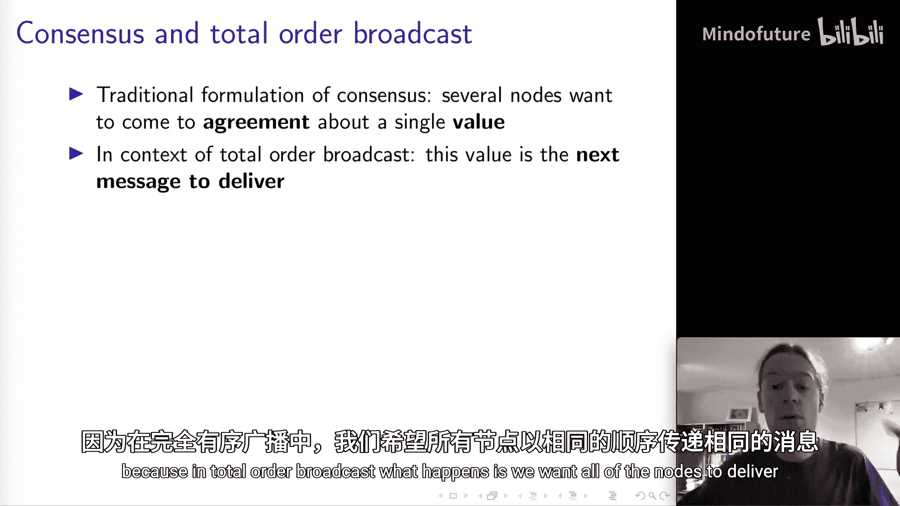

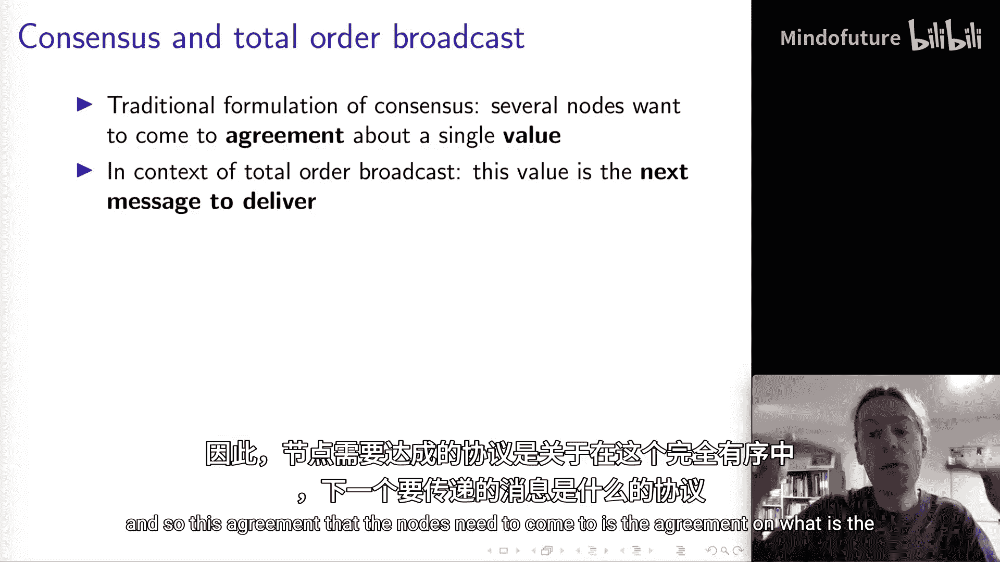

And consensus guarantees that once a value has been decided。

 it's not going to change its mind about it。 And so。For total order broadcast。

 this means now once a message is been delivered， it has been delivered at a certain point in this total order。

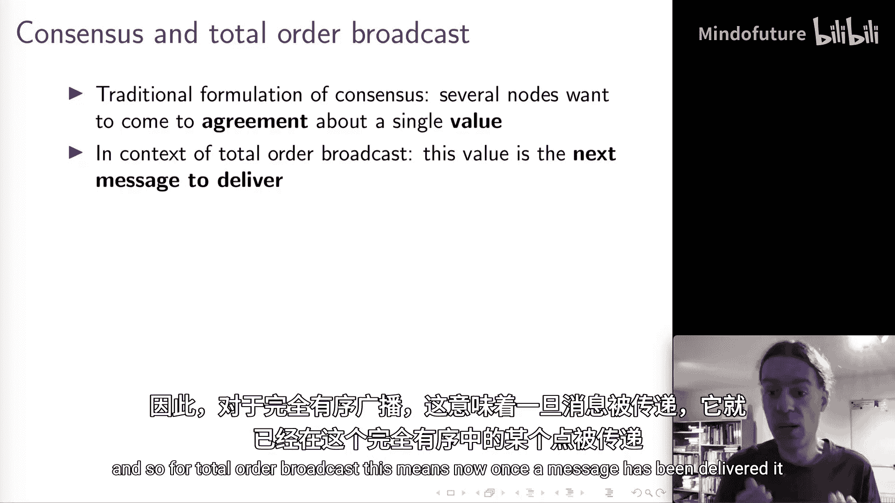

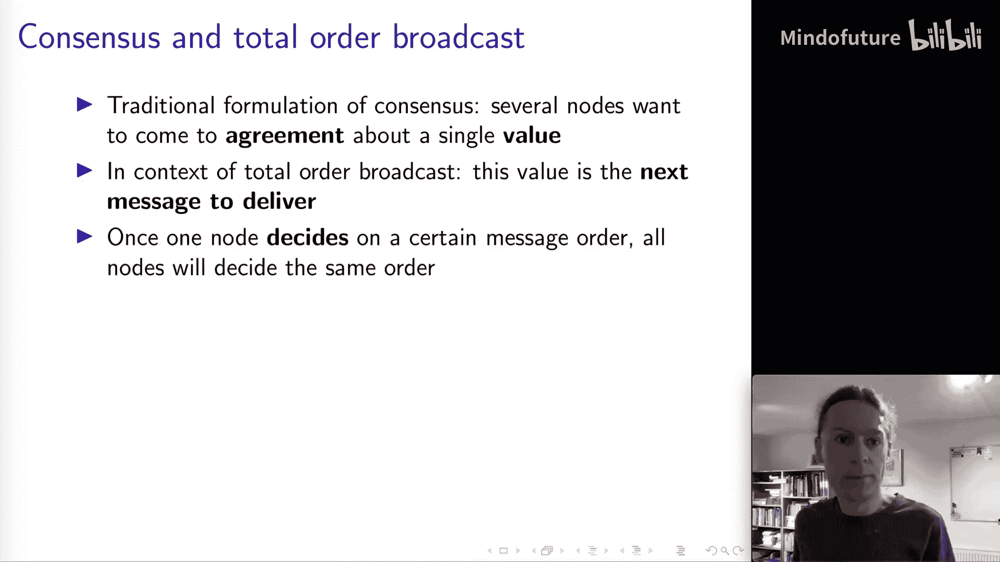

And so for this reason， the consensus problem and total order broadcast are actually formally equivalent to each other。

 which means that if you have an algorithm for one。

 then you can convert it into an algorithm for the other and vice versa。

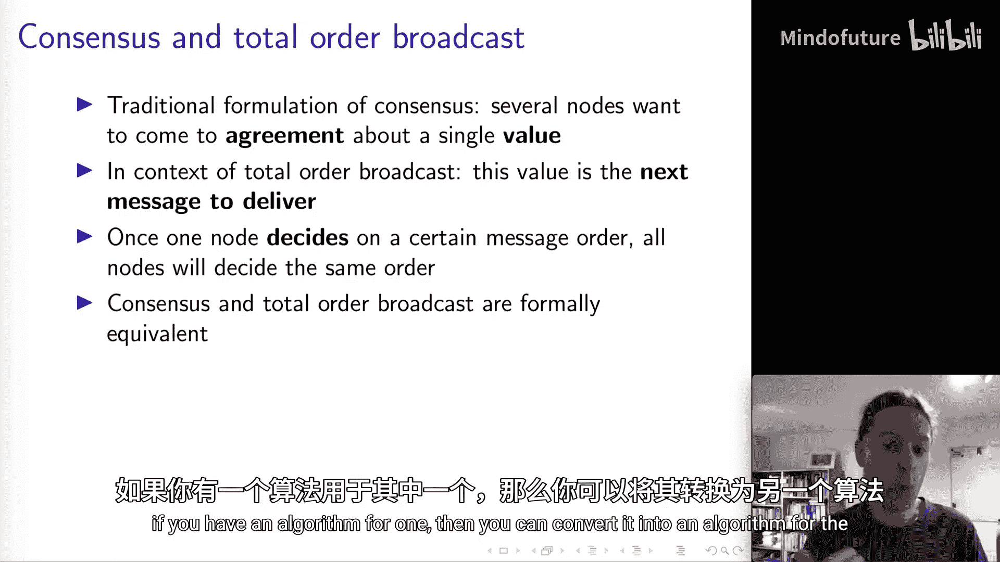

Now the classic consensus algorithm is called Paxos and what Paxos does actually is only consensus on a single value。

 but there's an extension to Paxos called multipaxos which actually provides total order broadcast so that provides agreement on a sequence of values。

e a sequence of messages to be delivered and there are a whole bunch of other consensus algorithms including RAF view stamp for application and zookeepers zookeeper atomic broadcast Zab and they are actually designed to provide total order broadcast right out of the box so in this lecture we're going to look at RAft in a more detailed way because that is perhaps the easiest to understand。

 although all of these algorithms are rather complicated and rather subtle。

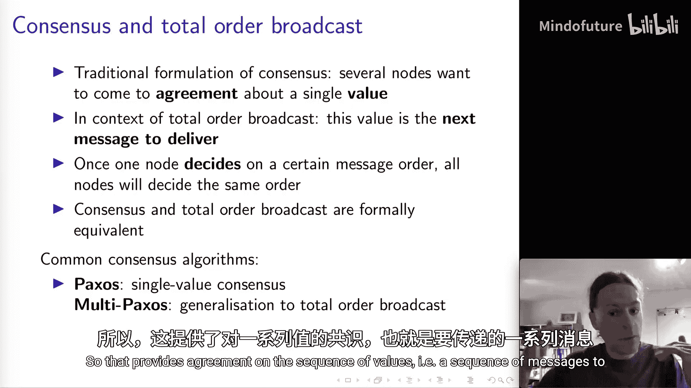

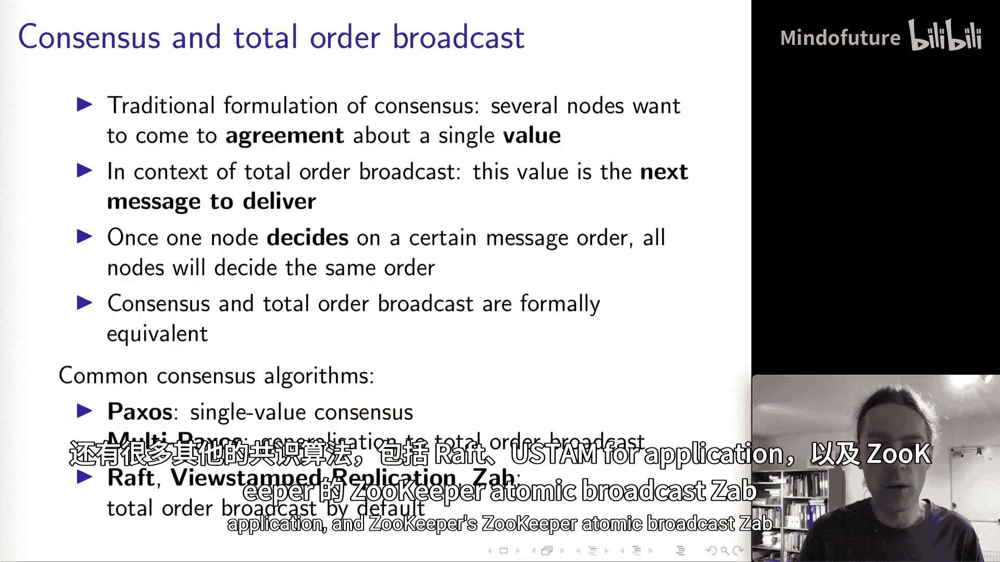

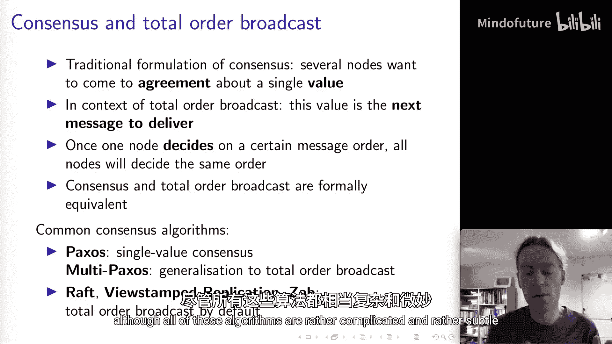

嗯。Now， remember from lecture2， we talked about different system models and this becomes very important now when we are talking about consensus。

So remember that when we were talking about node behavior， for example。

 we could choose between do we want to crash stop or crash recovery or Byzantine in which case node can behave arbitrarily maliciously。

 in terms of network do we want to assume fair loss， for example。

 and in terms of synchrony timing are we going to assume an asynchronous system or a partially synchronous system or a synchronous system？

And what Paxel and Raft and all these popular consensus algorithms do is they choose a partially synchronous crash recovery system model and you might wonder like why why particular these choices so in particular the question of synchrony is an important one because weve said that a fully synchronous model is unrealistic because in real systems you do get network delays and you do get various delays that happen at various points and so we can't rely on any upper bound of message latency when sending out the network So the best we can hope for really is partially synchronous where most of the time the network is well behaved but occasionally it has periods where messages are delayed for a long time or nodes。

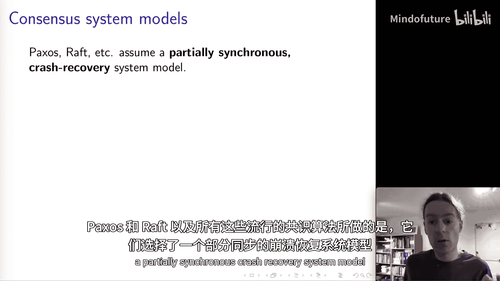

App paused their execution for a long time。Now ideally。

 we would want consensus to even work in an asynchronous system where we make no timing assumptions at all。

 but it turns out that this is actually impossible。

 so there is an impossibility proof which is called the FLP result。

 which proves that it is not possible to implement a consensus algorithm in an asynchronous system。

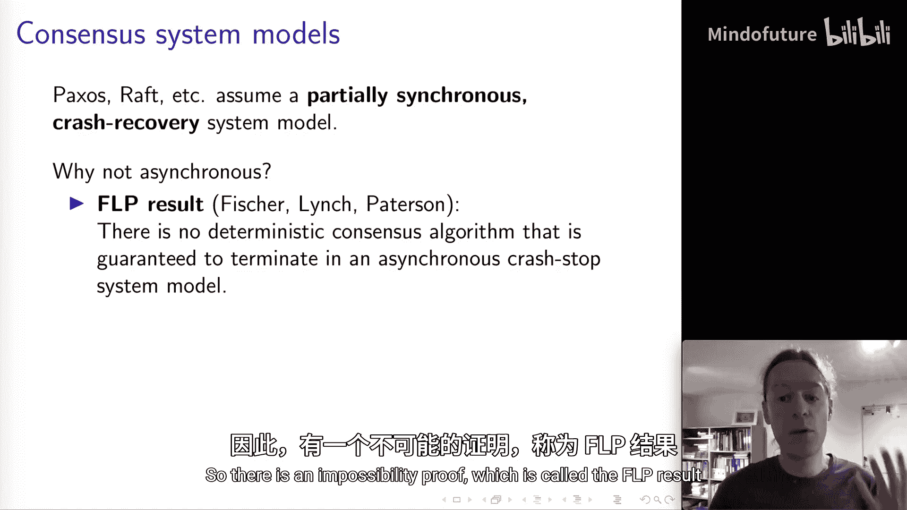

In such a way that this algorithm will always terminate。So if you have an asynchronous system。

 and even if you only allow crash stop failures so even not any of the more complex failures。

 then there will always be some executions of the consensus algorithm in which the algorithm doesn't terminate。

And so if you want termination， that is if you want the algorithm to make progress and eventually decide on something or for total order broadcast to eventually deliver a message。

 then we have to make these timing assumptions， So we have to assume at least partial synchrony。

 which means in effect that we use clocks for timeout or in other words。

 we have a timeout based failure detector which we use in order to figure out if the leader has failed or not。

 Now， importantly， the correctness of the algorithm。Doesn't really depend on the timing at all。

 So even if the timing in the system goes really bizarre。

 consensus algorithm will still guarantee that the same sequence of messages is delivered in the same order。

 the only thing that timing affects is when that delivery happens。

 And so if if you have a system in which there are lots of weird delays happening。

 then it could be that the timing that the the delivery of the messages is delayed for some amount of time until the system sort itself out。

 So the timing does affect the the liveness of the system here， but not the safety。

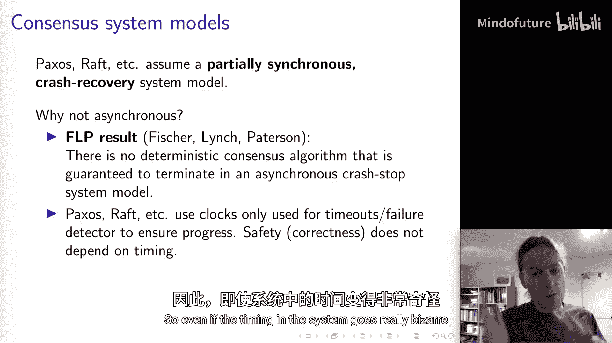

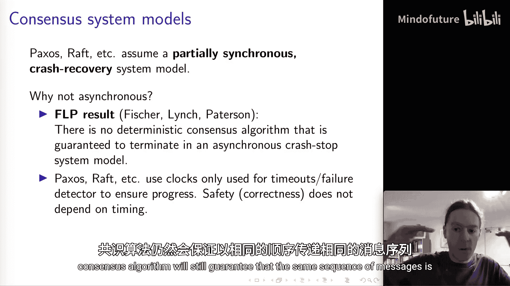

Now it is also possible to weaken the assumption about the crash recovery system model。

 and so it is actually possible to go all the way down to a Byzantine system model where we assume that some of the nodes may behave maliciously and it is possible to do consensus in that kind of system and these types of Byzantine for torant consensus algorithms are used in the context of some cryptocurrencies and blockchains and that sort of area。

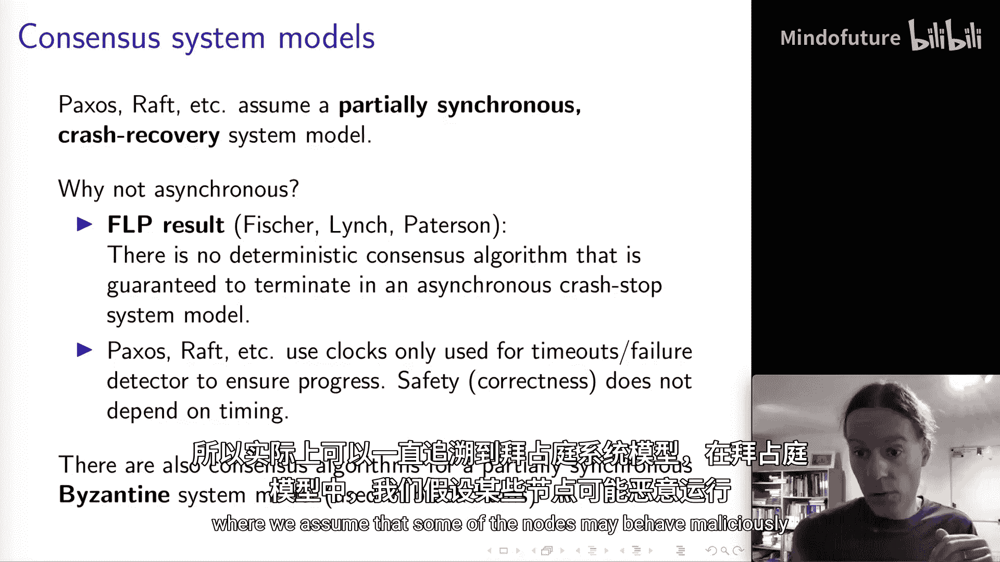

However， these Byzantine for tolerant algorithms are rather more complex than the crash recovery algorithms and they are also a lot less efficient and so for the purpose of this course we're just going to concentrate on raft which is a non Byzantine algorithm so it just assumes a crash recovery model and we will leave the Byzantine algorithms out of scope for now。

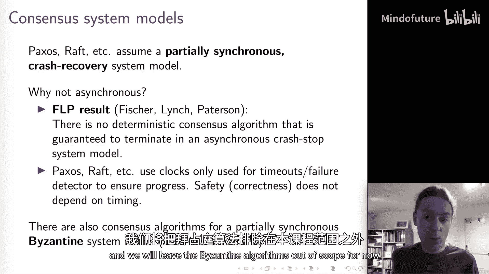

So as we said， the key thing that we need of consensus is to elect a leader。

 And then once we've got a leader， that leader can decide on the order in which the messages should be delivered and all of the consensus algorithms I've just mentioned do actually use a leader in order to sequence the messages。

 The details of how exactly they use the leader and how they elect a leader they differ from algorithm to algorithm。

 So I'll be focusing on what raft does in particular。And so what we have is we use a timeout。

 we use local clocks in order to suspect whether a leader has failed or not。

 So if you remember the failure detectors that we can have in a partially synchronous system are not always accurate So it could be that we think that a leader has crashed when in fact the leader working just fine but there's just a network problem which is stopping us from communicating with the leader So that's why I say we can only have a suspected leader crash we can't can never be actually certain if the timeout happened that it was。

 in fact a leader failure and what we want is that the consensus algorithm should prevent having two leaders at the same time because if we have two leaders they might make contradictory decisions and then all of our algorithms guarantees are off and this situation where you have two different leaders both believe that the leader this is called split brain and if this happens in a distributed system。

 it's usually really bad news。I's probably going to mean that some data is going to get corrupted or you're going to lose some data。

And so we want to avoid split brain and the consensus algorithm has to be designed in a very careful way so that it doesn't suffer from split brain。

And the way this works in Rft is that we have a concept of a term。

 so a term is just an integer variable。And。Every time that there's a leader election that leader election takes place in a certain term and every time we start a new leader election。

 we just increment the term and the guarantee that the leader election provides in raftT is that there will be at most one leader elected in a given term。

 it could be that a leader election fails and that no leader is elected in a term。

 but there will never be more than one leader in a given term and the way this is insured in raft is that we have a rule that in each term a node is only allowed to vote once so just like in a parliamentary election you're only allowed to cast one vote very similar here say if we have five a system of five nodes and say three out of the five elect a new leader。

 A BC have voted in favor of a new leader。

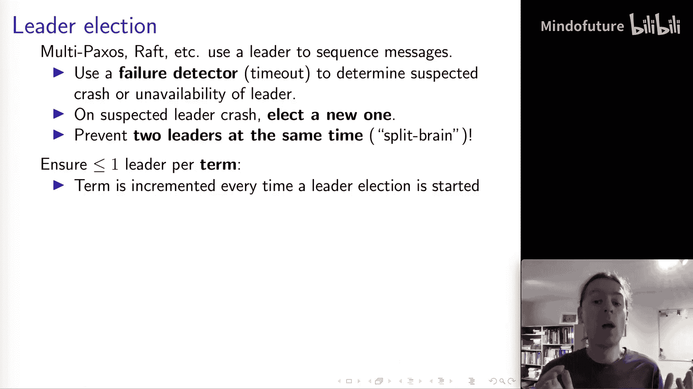

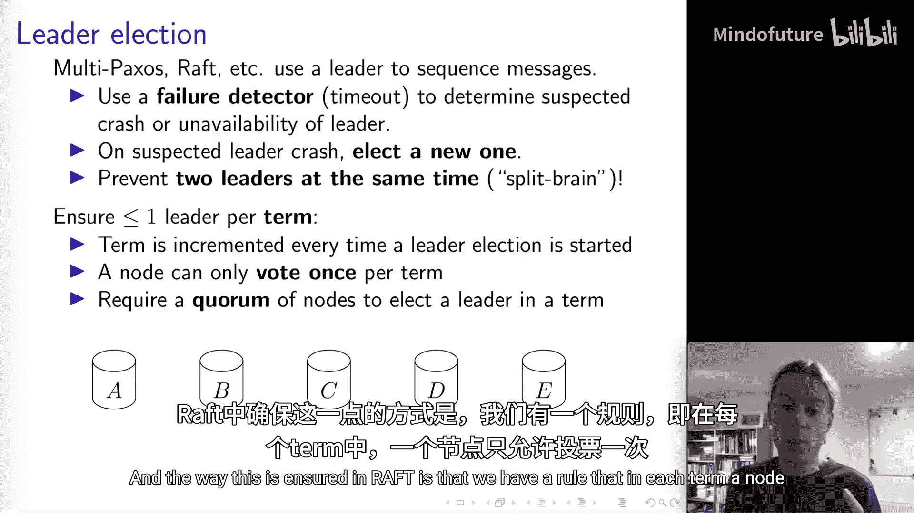

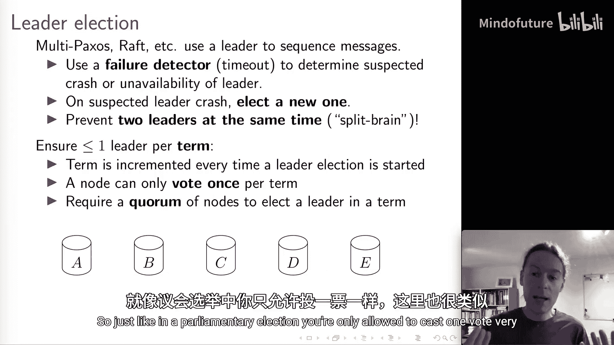

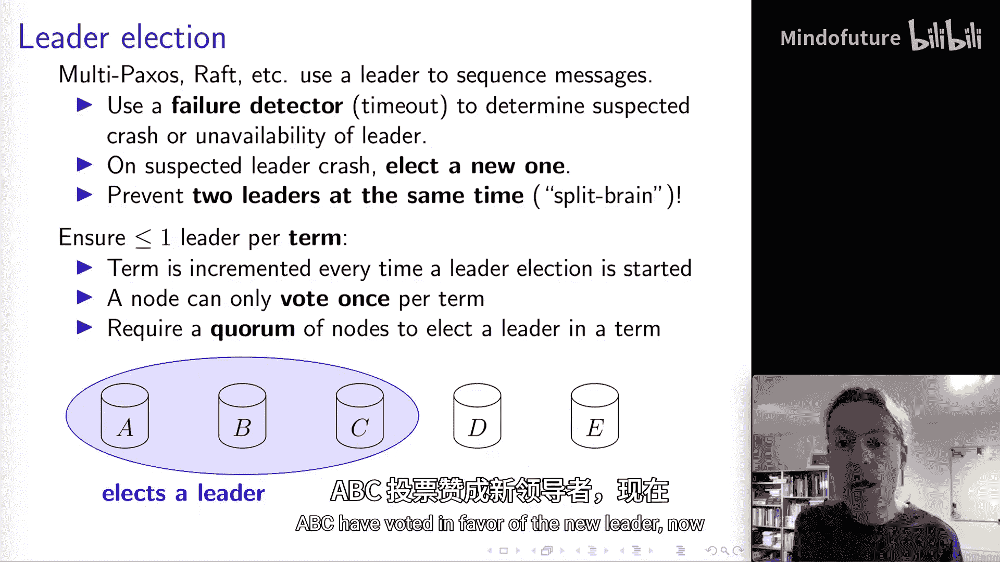

Now。Later， if C D and E try to elect a different leader in the same term， they will not be able to。

 because C knows that C has already voted once for this in this particular term。

 and therefore it will not vote again for a different candidate in the same term。

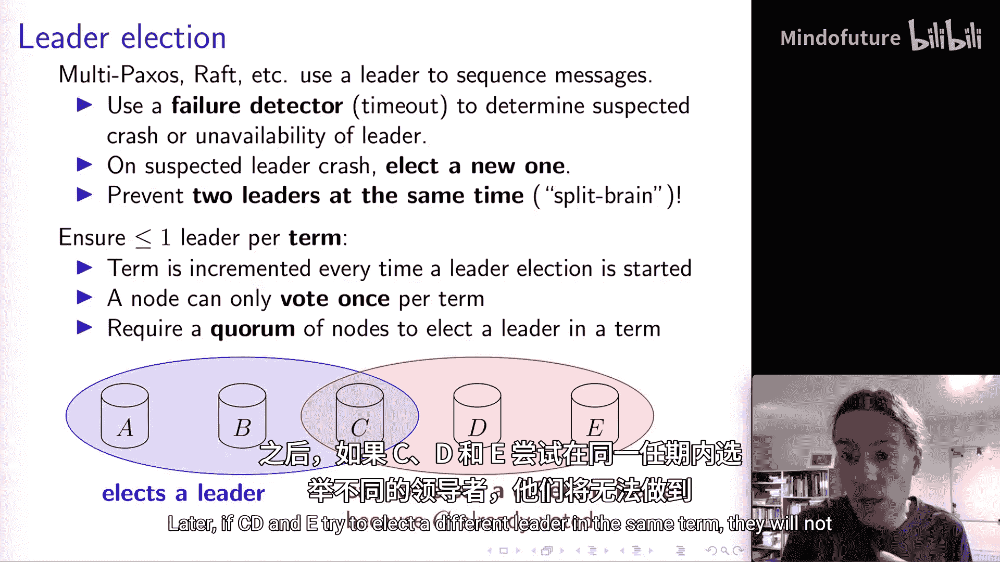

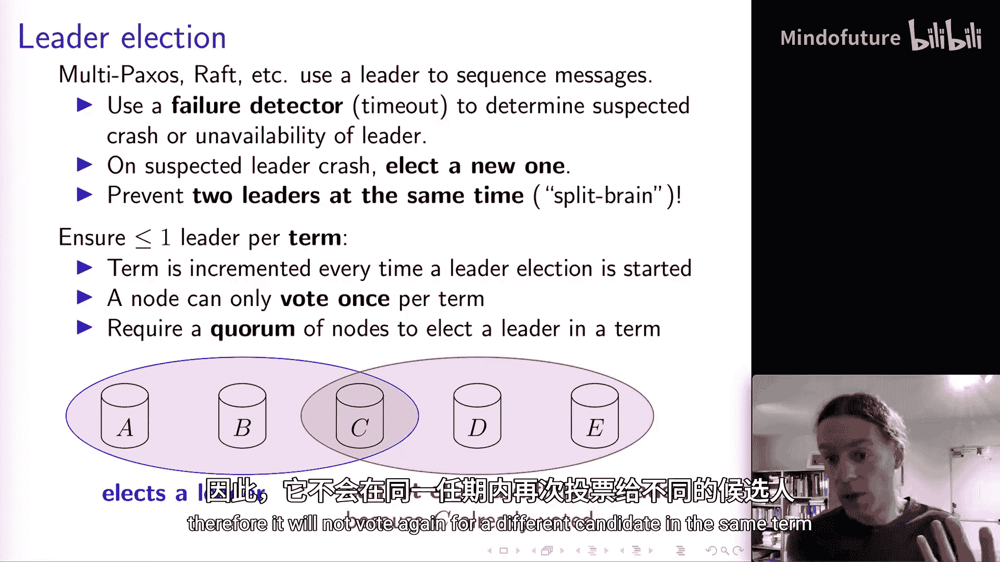

In a new term， new start new leader election， so in that case every node can vote again。

And so what we typically require in a consensus algorithm is that every time we want to elect a leader。

 we need a quorum of nodes to vote in favor of that leader in that particular term。

 And so in this case here， if we have three。If we have five nodes， for example。

 then we could have a majority quorum of three out of five。

 so any three out of five nodes are able to elect a new leader。

 which means that the system can tolerate two nodes being unavailable and the remaining three nodes out of five can still make progress and still elect a new leader if necessary。

 so this is what gives us the full tolerance。And so this approach here of allowing a voter only once per term ensures that within a given term。

 there is a unique leader。

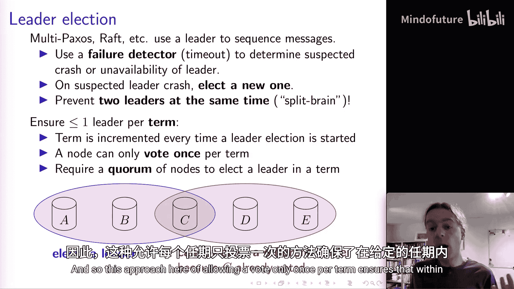

However， this does not actually guarantee that we will not have multiple leaders。

Because what could happen is that there are different nodes that are leaders in different terms and they just don't realize it。

 so imagine this scenario here， we've got three nodes one。

2 and three and say that node1 was elected to be the leader in term T。

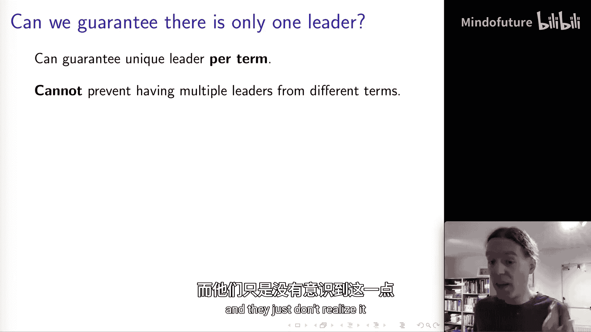

But then a network problem happens and node 1 is no longer able to communicate with node 2 and 3。

 Note 1 is still alive。 node 1 is still a leader。But now node 2 and 3 don't hear anything from their leader anymore。

 And so at some point， node 2 and 3 are going to say well， probably our leader is dead。

 So were going to we're going to elect a new leader in a new term。 So call a term T plus1。

 node 2 and 3 are going to elect a new leader among themselves。

 maybe node 2 is going to be a new leader for example。

 And now the system has actually got two leader， It's got node 1， which is the leader in term T。

 and node 2， which is the leader in term T plus 1。And this looks like split brainin， doesn't it。

 So we've got two leaders。 This is bad。 We want to not be in the situation。 But unfortunately。

 because the network is interrupted， there is no way for node1 to know that it is it is no longer the leader that has been superseded because the communication simply isn't getting through。

 And so therefore we need to actually deal with this possibility that there are different leaders existing in the system at the same time。

 in different terms。 and those leaders may for a little while make contradictory decisions。

 and we have to nevertheless ensure that we have total order broadcast that we don't violate our properties。

Even though we might have multiple leaders。And the way that consensus algorithms do this。

Is that if a leader wants to decide to deliver a certain message， for example。

 the leader cannot actually make that decision by itself。

But the leader has to again go and ask a quorum of nodes if they are okay to deliver a certain message。

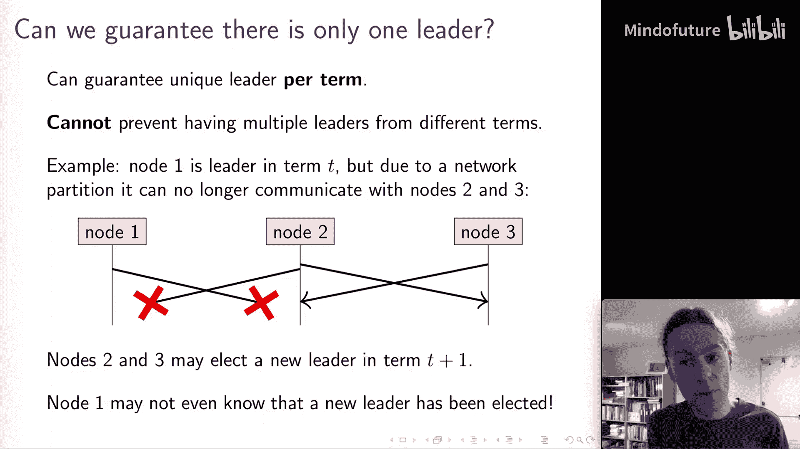

And so what the communication flow looks like is something like this。 Now。

 say we have leader leader on the left and two followers。 And so first of all。

 the leader needs to the left node on the left needs to be elected the leader and so it's going to contact the others say。

 are you okay for me to be your new leader and then the others respond Okay now it's got a quorum of votes in favor of being a leader So now the node on the left is the leader after one round of election Now the leader wants to deliver a message。

 But as I said， the leader cannot just make that decision by itself to simply deliver a message。

 but instead the leader has to go to the followers again and say。

 are you okay to deliver message M in term T as the next message。

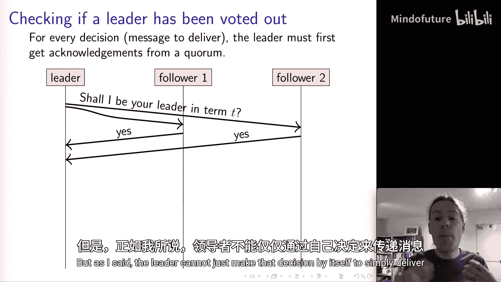

And only if a quorum of followers again respond here and say， okay， yes。

 we're okay with this message M in term T。 and the the followers will only respond positively if they haven't heard of any other leader in term T plus one。

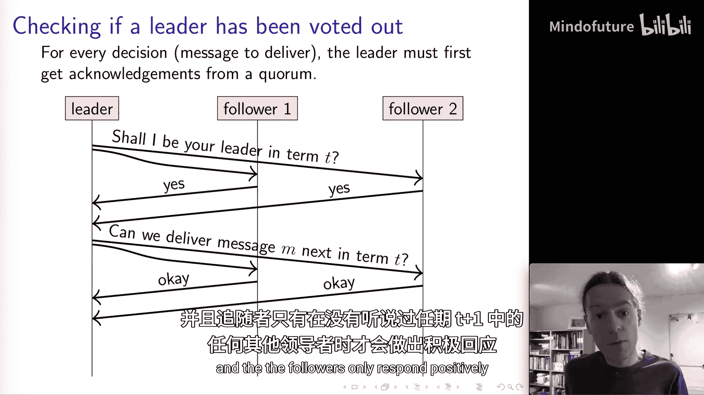

So now if， if the leader again gets this quorum of positive responses。

 now the leader can safely make the decision to deliver M and it can tell the others。

 the other nodes that， okay， M is now the next message to be delivered in our total order broadcast。

So this is the principle that we have effectively two phases of voting， first of all。

 a node needs to get elected leader by a quorum of nodes and then a second round happens in which the leader checks if it's okay to decide on a certain message next。

And this is actually the underlying principle of all of the consensus algorithms that we've seen。

 and in the next section， we will look in detail at how RAft implements this particular system。

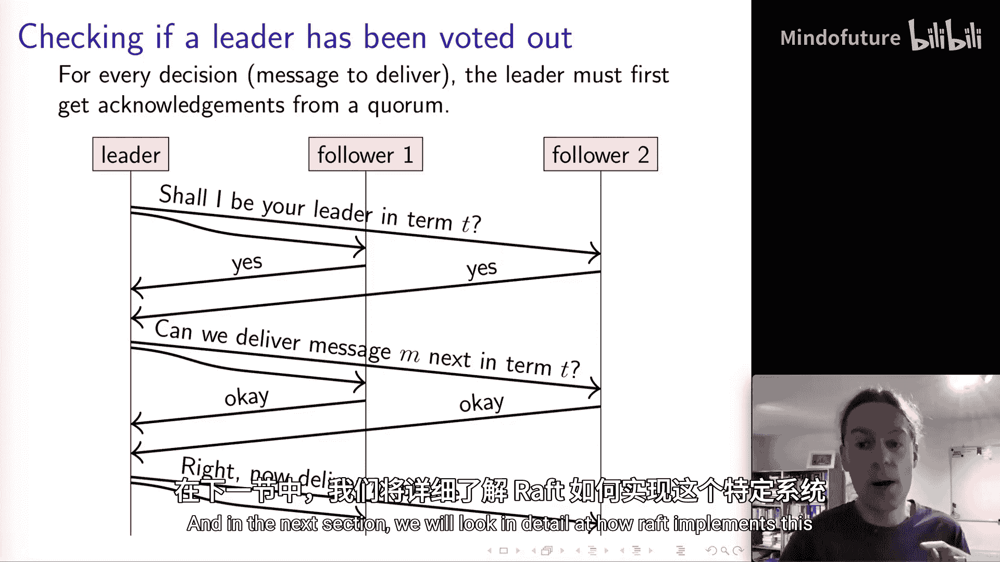